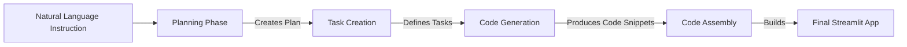
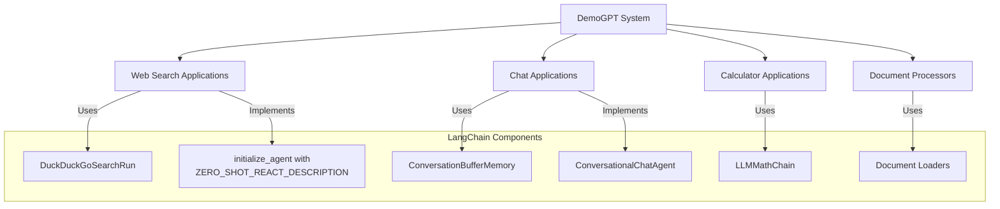
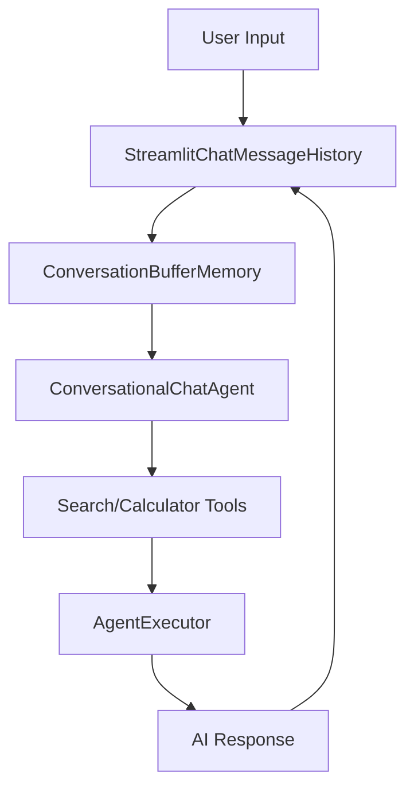
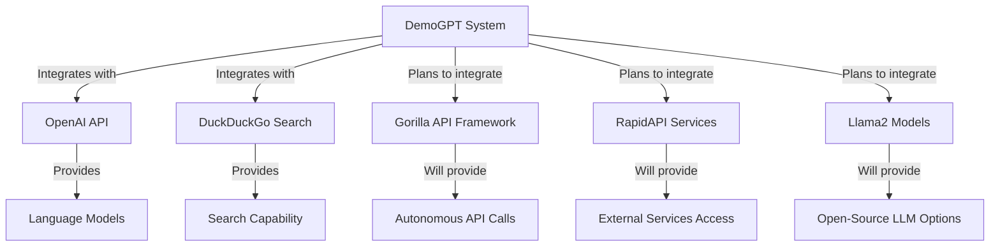

<!-- source: DeepWiki mcp.deepwiki.com · repo melih-unsal/DemoGPT · page 1.1 Features and Capabilities · fetched 2026-10-26 -->

# Features and Capabilities

<details>
<summary>Relevant source files</summary>

The following files were used as context for generating this wiki page:

- [README.md](README.md)
- [assets/demogpt_new_pipeline.jpeg](assets/demogpt_new_pipeline.jpeg)
- [assets/demogpt_new_pipeline1.jpeg](assets/demogpt_new_pipeline1.jpeg)
- [demogpt/chains/prompts/task_list/search.py](demogpt/chains/prompts/task_list/search.py)
- [demogpt/chains/prompts/task_list/search_chat.py](demogpt/chains/prompts/task_list/search_chat.py)
- [docs/README_CN.md](docs/README_CN.md)

</details>


This page provides an overview of the key features and capabilities of DemoGPT, focusing on what the system can do and the types of applications it can generate. For information about system requirements and installation, see [System Requirements](#1.2).

## Core Features

DemoGPT is an all-in-one agent library designed to automatically generate LangChain-based Streamlit applications from natural language instructions. The system incorporates several key features that enable this functionality.

### Automatic Streamlit Application Generation

DemoGPT transforms natural language instructions into fully functional Streamlit web applications without requiring manual coding. The system handles the entire process from planning to code generation automatically.

**Application Generation Pipeline**


Sources: [README.md:96-101]()

### Plan-Based Pipeline Architecture

DemoGPT implements a structured pipeline approach to application generation consisting of four main phases:

1. **Planning**: The system generates a high-level plan from the user's instruction
2. **Task Creation**: The plan is broken down into specific, executable tasks
3. **Code Snippet Generation**: Each task is converted into corresponding code snippets
4. **Final Code Assembly**: All code snippets are combined into a cohesive application

Sources: [README.md:96-101](), [README.md:120-123]()

### LangChain Integration

DemoGPT leverages the LangChain framework to create powerful applications that interact with Large Language Models (LLMs):

- Incorporates LangChain's components including agents, chains, and tools
- Enables complex workflows with minimal user input
- Supports various LLM-powered systems and tools

Sources: [README.md:92-93](), [README.md:100-101]()

### Model Flexibility

The system is designed to be adaptable and compatible with various LLM models:

- Primary support for OpenAI models (GPT-3.5-turbo)
- Configurable model parameters
- Extensible architecture to accommodate new models

Sources: [README.md:107-109]()

## Application Capabilities

DemoGPT can generate a wide range of application types with diverse functionalities:

**Capability Overview**


Sources: [demogpt/chains/prompts/task_list/search.py:21-46](), [demogpt/chains/prompts/task_list/search_chat.py:21-56]()

### Web Search Integration

DemoGPT can generate applications that perform web searches using DuckDuckGo:

- Query the web for information based on user input
- Integrate search results with other application components
- Process search results using LLM reasoning

Search functionality is implemented through LangChain's `DuckDuckGoSearchRun` tool and agent frameworks.

| Component | Purpose |
|-----------|---------|
| `DuckDuckGoSearchRun` | Provides the core search capability |
| `initialize_agent` | Creates agent to use the search tool |
| `AgentType.ZERO_SHOT_REACT_DESCRIPTION` | Enables reasoning about search results |
| `StreamlitCallbackHandler` | Displays search process in Streamlit UI |

Sources: [demogpt/chains/prompts/task_list/search.py:21-28](), [demogpt/chains/prompts/task_list/search.py:31-46]()

### Conversational Interfaces

DemoGPT can create sophisticated chat applications with memory and context awareness:

- Support for multi-turn conversations with history retention
- Integration with Streamlit's chat interface
- Contextual responses based on conversation history

The chat functionality leverages `StreamlitChatMessageHistory` and `ConversationBufferMemory` to maintain context across interactions.



Sources: [demogpt/chains/prompts/task_list/search_chat.py:21-33](), [demogpt/chains/prompts/task_list/search_chat.py:37-57]()

### Calculator and Math Functions

Applications can include mathematical processing capabilities:

- Basic and complex calculations
- Natural language math query interpretation
- Numerical analysis and processing

The calculator functionality is implemented using LangChain's `LLMMathChain` combined with LLMs to interpret and solve mathematical problems expressed in natural language.

Sources: [demogpt/chains/prompts/task_list/search.py:34-36](), [demogpt/chains/prompts/task_list/search_chat.py:39-46]()

### Agent-Based Systems

DemoGPT can generate applications that use LangChain's agent framework:

- Tool-using agents that can perform complex tasks
- ReAct agents with reasoning capabilities
- Conversational agents for interactive applications

The agent capabilities leverage LangChain's agent types like `AgentType.ZERO_SHOT_REACT_DESCRIPTION` and `ConversationalChatAgent` to create intelligent applications.

Sources: [demogpt/chains/prompts/task_list/search.py:43-46](), [demogpt/chains/prompts/task_list/search_chat.py:47-56]()

## User Interfaces

DemoGPT offers multiple interfaces for user interaction:

### Python API

Users can programmatically use DemoGPT in Python applications:

```python
from demogpt import DemoGPT
agent = DemoGPT(model_name="gpt-3.5-turbo")
instruction = "Create a web search application"
for phase in agent(instruction=instruction, title="My Search App"):
    print(phase)  # displays generation stages
    if phase["done"]:
        code = phase["code"]  # final code
```

The Python API allows full control over the generation process with access to intermediate results and the ability to integrate generated applications with existing systems.

Sources: [README.md:164-175]()

### Command Line Interface

Run DemoGPT directly from the command line:

```bash
demogpt
```

The CLI provides a simple way to access all core features without programming requirements.

Sources: [README.md:66-74]()

### Web Interface

An interactive Streamlit-based interface is available:

- Visual feedback during the generation process
- User-friendly approach for non-programmers
- Available as a hosted service or local installation

Sources: [README.md:49-53](), [README.md:203-204]()

## Integration with External APIs

**Integration Architecture**


Sources: [README.md:59-60](), [README.md:116-117](), [README.md:211-216]()

DemoGPT currently integrates with:
- OpenAI API for language model access
- DuckDuckGo for web search capabilities

Future integrations planned include:
- Gorilla for autonomous API usage
- RapidAPI for expanding available API calls
- Support for Llama2 models

## Self-Refinement Capability

DemoGPT implements a self-refinement strategy to improve generated code:

- Individual testing of code snippets
- Refinement of failed code segments
- Iterative improvement to ensure functional applications

Sources: [README.md:111-113]()

This feature ensures that the generated applications meet quality standards and function as expected, minimizing errors in the final output.

## Upcoming Features

Based on the project roadmap, several new capabilities are in development:

- Integration with Gorilla for API calls
- Llama2 model support
- Self-refinement strategy implementation
- Public database for similar example retrieval
- Database for caching successful generations

Sources: [README.md:211-217]()

These upcoming features will further enhance DemoGPT's capabilities and performance in future releases.

---

