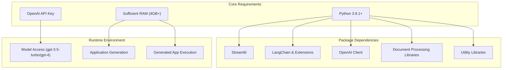
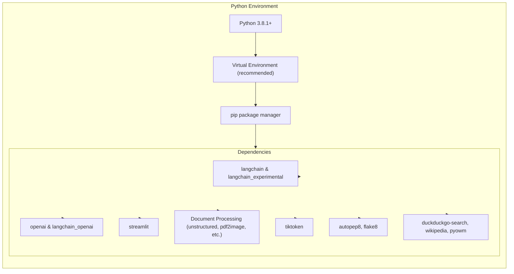
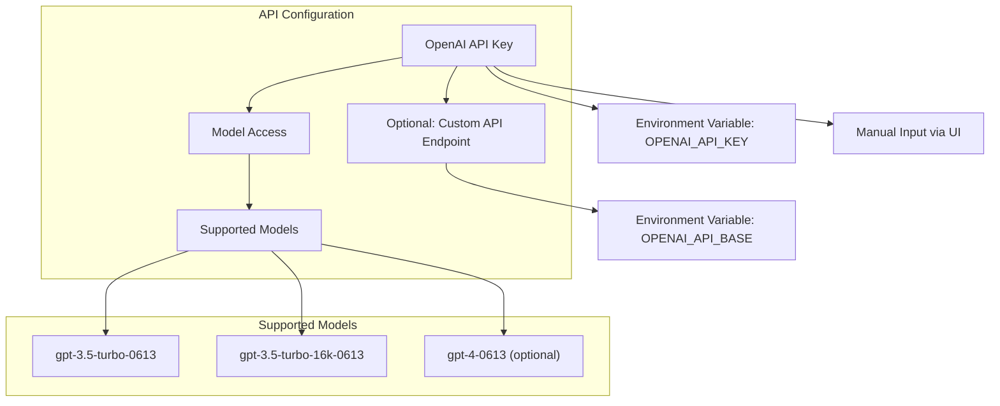
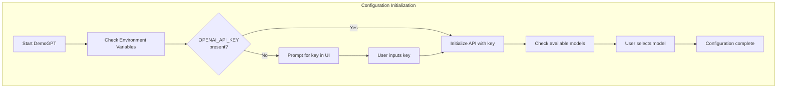
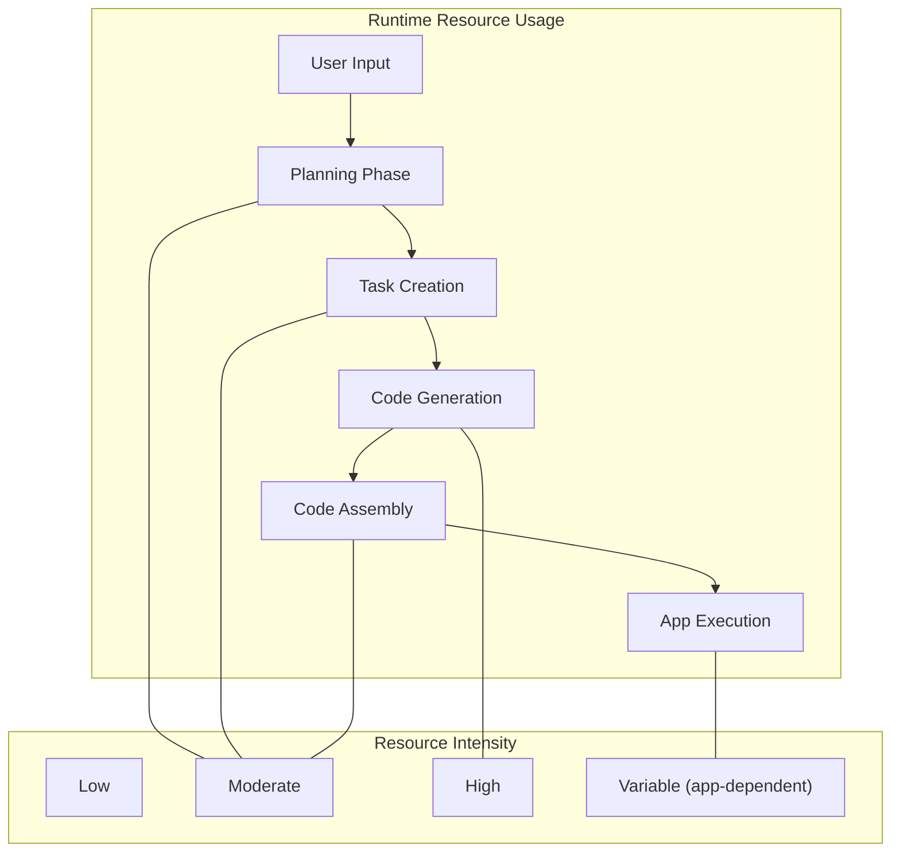

<!-- source: DeepWiki mcp.deepwiki.com · repo melih-unsal/DemoGPT · page 1.2 System Requirements · fetched 2026-10-26 -->

# System Requirements

<details>
<summary>Relevant source files</summary>

The following files were used as context for generating this wiki page:

- [.gitignore](.gitignore)
- [LICENSE](LICENSE)
- [README.md](README.md)
- [assets/demogpt_new_pipeline.jpeg](assets/demogpt_new_pipeline.jpeg)
- [assets/demogpt_new_pipeline1.jpeg](assets/demogpt_new_pipeline1.jpeg)
- [demogpt/app.py](demogpt/app.py)
- [demogpt/chains/chains.py](demogpt/chains/chains.py)
- [demogpt/chains/prompts/task_list/search.py](demogpt/chains/prompts/task_list/search.py)
- [demogpt/chains/prompts/task_list/search_chat.py](demogpt/chains/prompts/task_list/search_chat.py)
- [demogpt/chains/task_chains.py](demogpt/chains/task_chains.py)
- [demogpt/model.py](demogpt/model.py)
- [demogpt/utils.py](demogpt/utils.py)
- [docs/README_CN.md](docs/README_CN.md)
- [pyproject.toml](pyproject.toml)

</details>


## Purpose and Scope

This document outlines the specific hardware, software, and environment requirements needed to run DemoGPT successfully. It covers the dependencies, installation prerequisites, configuration settings, and runtime requirements. For information about the general architecture of DemoGPT, see [Architecture](#2), and for installation instructions, see [Installation](#5).

## System Requirements Overview

DemoGPT is an autonomous AI agent that generates Streamlit applications from natural language instructions. As such, it has dependencies on LLM APIs, Python libraries, and system resources that are essential for its operation.



Sources: [pyproject.toml:17-36](), [README.md:123-148]()

## Hardware Requirements

DemoGPT does not have specific hardware requirements beyond what is needed to run Python and Streamlit applications. However, for optimal performance:

| Component | Minimum Requirement | Recommended |
|-----------|---------------------|-------------|
| CPU       | Dual-core processor | Quad-core processor or better |
| RAM       | 4GB                 | 8GB or more |
| Disk Space| 1GB free space      | 2GB or more |
| Internet  | Stable connection   | High-speed connection |

Note: Memory requirements may increase when generating complex applications or when the generated applications are processing large documents.

Sources: [README.md:124-148]()

## Software Requirements

### Operating System

DemoGPT is cross-platform and can run on:
- Windows 10/11
- macOS 10.14 or newer
- Linux (tested on Ubuntu 18.04+)

### Python Environment



Sources: [pyproject.toml:17-36]()

### Package Dependencies

DemoGPT requires the following Python packages:

| Category | Packages |
|----------|----------|
| Core Framework | Python (≥ 3.8.1) |
| Web Interface | streamlit, altair (<5) |
| LLM Integration | langchain, langchain_experimental, langchain_openai, openai, tiktoken |
| Environment | python-dotenv |
| Document Processing | unstructured, pdf2image, pdfminer-six |
| Code Management | autopep8, flake8 |
| External Services | duckduckgo-search (6.3.2), wikipedia (1.4.0), pyowm (3.3.0) |
| Math Processing | numexpr |

Sources: [pyproject.toml:17-36]()

## API Requirements

DemoGPT relies heavily on the OpenAI API for its core functionality. Access to appropriate models and a valid API key are essential.



Sources: [model.py:19-47](), [app.py:56-68](), [utils.py:682-715]()

### OpenAI API Key

An OpenAI API key is required for DemoGPT to function. This can be provided in two ways:
1. As an environment variable `OPENAI_API_KEY`
2. Via the user interface during runtime

The API key must have access to at least the `gpt-3.5-turbo` model family. GPT-4 access is optional but can improve the quality of generated applications.

### Model Support

DemoGPT supports and can use the following models:
- `gpt-3.5-turbo-0613` (default)
- `gpt-3.5-turbo-16k-0613` (for complex applications)
- `gpt-4-0613` (optional, for enhanced quality)

The system dynamically checks model availability based on your API key.

Sources: [model.py:49-65](), [chains/chains.py:42-60]()

## Installation Methods

DemoGPT can be installed via two primary methods: using the pip package or by cloning the source repository.

### Package Installation

```bash
pip install demogpt
```

After installation, DemoGPT can be launched directly from the command line:

```bash
demogpt
```

Sources: [README.md:65-74](), [pyproject.toml:39-40]()

### Source Code Installation

```bash
git clone https://github.com/melih-unsal/DemoGPT.git
cd DemoGPT
pip install .
```

To run DemoGPT from source:

```bash
streamlit run demogpt/app.py
```

Sources: [README.md:137-148]()

## Environment Configuration

### Environment Variables

DemoGPT uses the following environment variables:

| Variable | Description | Required | Default |
|----------|-------------|----------|---------|
| OPENAI_API_KEY | Your OpenAI API key | Yes (can be input via UI) | None |
| OPENAI_API_BASE | Custom OpenAI API base URL | No | https://api.openai.com/v1 |

### Configuration Flow



Sources: [model.py:19-44](), [app.py:56-84]()

## Runtime Requirements

When DemoGPT is running, it performs several resource-intensive operations during the application generation process.

### Process Resources

The application generation process involves:

1. **Planning Phase**: Generating a plan from user instructions (moderate resource usage)
2. **Task Creation**: Breaking down the plan into specific tasks (moderate resource usage)
3. **Code Generation**: Generating code snippets for each task (high resource usage)
4. **Code Assembly**: Combining code snippets into a complete application (moderate resource usage)
5. **Execution**: Running the generated Streamlit app (varies based on app complexity)



Sources: [model.py:297-560](), [utils.py:682-715]()

### API Usage

DemoGPT makes multiple API calls to language models during the generation process. The number of calls depends on the complexity of the requested application and whether refinement steps are needed.

Sources: [model.py:105-294](), [chains/chains.py:84-335]()

## Usage Modes

DemoGPT supports three primary usage modes:

1. **Web Interface** (using Streamlit)
2. **Command Line Interface** (after package installation)
3. **Python API** (for integration into other applications)

### Python API Usage Requirements

To use DemoGPT as a library in Python applications, you need:

```python
from demogpt import DemoGPT
agent = DemoGPT(model_name="gpt-3.5-turbo")  # OpenAI API key in env or as parameter
instruction = "Your instruction here"
title = "Your title here"
```

Sources: [README.md:160-176](), [model.py:297-315]()

## Compatibility Notes

### Streamlit Compatibility

The generated applications are built with Streamlit, so they inherit Streamlit's compatibility requirements:
- Modern web browsers (Chrome, Firefox, Safari, Edge)
- JavaScript enabled
- Internet connection (for loading Streamlit resources)

### OpenAI API Compatibility

DemoGPT is designed to work with OpenAI's API and model versions available as of its release. Future changes to the OpenAI API might affect compatibility.

### Package Version Constraints

Some packages have specific version constraints:
- altair < 5
- duckduckgo-search = 6.3.2
- wikipedia = 1.4.0
- pyowm = 3.3.0

Sources: [pyproject.toml:20-36]()

## Troubleshooting Common Requirements Issues

| Issue | Possible Cause | Solution |
|-------|----------------|----------|
| "No module named 'demogpt'" | Package not installed | Run `pip install demogpt` |
| "OpenAI API key required" | Missing API key | Set environment variable or enter in UI |
| Model selection unavailable | API key doesn't have access to models | Check OpenAI account access |
| High memory usage | Complex application generation | Use a system with more RAM |
| Application generation timeout | Slow internet or complex request | Try a simpler application or check connection |

Sources: [app.py:138-147](), [model.py:45-48]()

---

