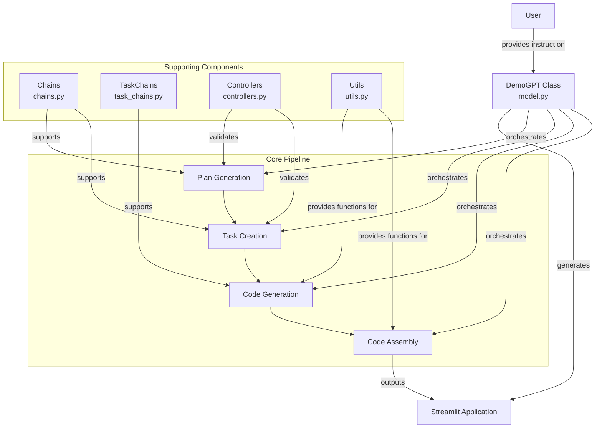
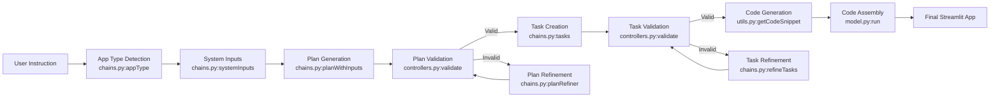
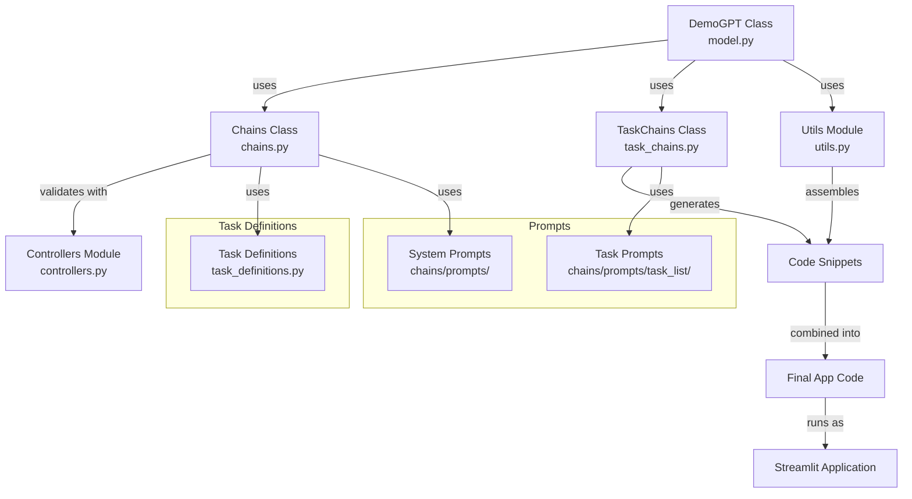
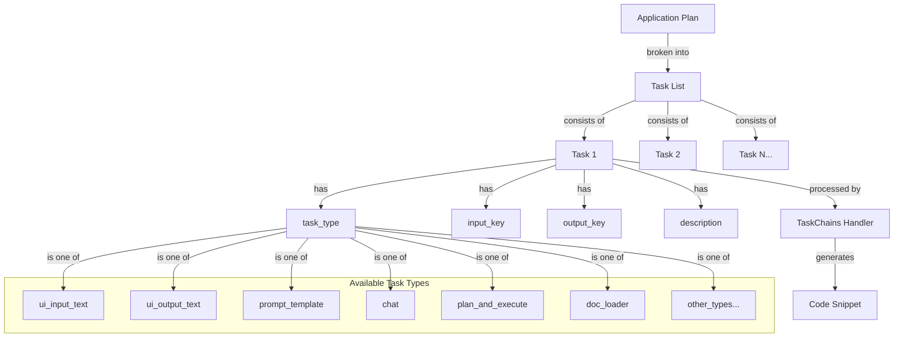

<!-- source: DeepWiki mcp.deepwiki.com · repo melih-unsal/DemoGPT · page 2 Architecture · fetched 2026-10-26 -->

# Architecture

Relevant source files

The following files were used as context for generating this wiki page:

- [README.md](README.md)
- [assets/demogpt_new_pipeline.jpeg](assets/demogpt_new_pipeline.jpeg)
- [assets/demogpt_new_pipeline1.jpeg](assets/demogpt_new_pipeline1.jpeg)
- [demogpt/app.py](demogpt/app.py)
- [demogpt/chains/chains.py](demogpt/chains/chains.py)
- [demogpt/chains/prompts/__init__.py](demogpt/chains/prompts/__init__.py)
- [demogpt/chains/prompts/app_type.py](demogpt/chains/prompts/app_type.py)
- [demogpt/chains/prompts/plan_with_inputs.py](demogpt/chains/prompts/plan_with_inputs.py)
- [demogpt/chains/prompts/task_list/search.py](demogpt/chains/prompts/task_list/search.py)
- [demogpt/chains/prompts/task_list/search_chat.py](demogpt/chains/prompts/task_list/search_chat.py)
- [demogpt/chains/prompts/task_list/ui_output_text.py](demogpt/chains/prompts/task_list/ui_output_text.py)
- [demogpt/chains/task_chains.py](demogpt/chains/task_chains.py)
- [demogpt/chains/task_definitions.py](demogpt/chains/task_definitions.py)
- [demogpt/controllers.py](demogpt/controllers.py)
- [demogpt/model.py](demogpt/model.py)
- [demogpt/utils.py](demogpt/utils.py)
- [docs/README_CN.md](docs/README_CN.md)
- [pyproject.toml](pyproject.toml)

This page provides a comprehensive overview of DemoGPT's architecture, detailing how the system transforms natural language instructions into functional Streamlit applications. It covers the pipeline approach, major components, and their interactions. For information about specific components and their implementation details, see [Core Components](#3).

## High-Level Architecture Overview

DemoGPT follows a pipeline architecture that transforms user instructions through several stages to generate a Streamlit application. The system employs a modular design where specialized components handle specific parts of the generation process.

Sources: [model.py:17-562](), [chains.py:1-335](), [task_chains.py:1-389](), [controllers.py:1-470](), [utils.py:1-734]()

## Plan-Based Pipeline

At the heart of DemoGPT is a plan-based pipeline that systematically transforms user instructions into executable Streamlit code:

Sources: [model.py:297-562](), [chains.py:97-202](), [controllers.py:7-92](), [utils.py:282-314]()

### 1. Plan Generation

The plan generation stage converts the user's instruction into a structured action plan. This involves:

1. **App Type Detection**: Using `chains.py:appType` to determine if the application is chat-based, AI-based, search-based, or summary-based
2. **System Input Identification**: Using `chains.py:systemInputs` to identify required inputs from the instruction
3. **Plan Creation**: Using `chains.py:planWithInputs` to generate a step-by-step plan for creating the application
4. **Plan Validation**: Using `controllers.py:validate` to ensure the plan is feasible with available tasks

If the plan is invalid, it's refined by `chains.py:planRefiner` until it passes validation.

Sources: [chains.py:97-155](), [controllers.py:7-92]()

### 2. Task Creation

Once a valid plan is established, it's broken down into specific tasks by `chains.py:tasks`. Each task represents a specific component or action in the final application.

Tasks are validated by `controllers.py:validate`, which checks:
- Task names are valid
- Input-output compatibility between tasks
- Compatibility with the application type

If there are issues, tasks are refined by `chains.py:refineTasks` until they pass validation.

Sources: [chains.py:158-196](), [controllers.py:7-92](), [controllers.py:139-388]()

### 3. Code Generation

The validated tasks are transformed into code snippets by `utils.py:getCodeSnippet`, which uses task-specific templates from `TaskChains` in `task_chains.py`.

Each task type has a dedicated handler in `TaskChains`:
- `uiInputText`: Generates code for text input UI elements
- `promptTemplate`: Generates code for AI prompt templates
- `search`: Generates code for search functionality
- And many others for various functionality

Sources: [utils.py:282-314](), [task_chains.py:44-389]()

### 4. Code Assembly

Finally, the code snippets are combined into a complete Streamlit application by `model.py:run`. This includes:
- Adding necessary imports
- Structuring the code logically
- Formatting with `autopep8`
- Adding "how to use" and "about" sections

The result is a complete, executable Streamlit application that implements the functionality described in the user's instruction.

Sources: [model.py:297-562](), [utils.py:316-734]()

## Component Architecture

DemoGPT consists of several key components that work together to transform user instructions into Streamlit applications:

Sources: [model.py:17-562](), [chains.py:20-335](), [task_chains.py:16-389](), [controllers.py:7-470](), [utils.py:14-734](), [chains/task_definitions.py:1-285]()

### DemoGPT Class

The `DemoGPT` class in `model.py` is the main entry point and orchestrator for the system. It manages the overall process flow and coordinates between components.

Key functions:
- `__init__`: Initializes with model name, API key, and other configuration
- `run`: Main method for generating applications, yields status updates during generation
- `callForChat`: Specialized method for generating chat-based applications
- `setModel`: Configures the language model to use

Sources: [model.py:17-296]()

### Chains Class

The `Chains` class in `chains.py` handles high-level processes like plan generation and task creation.

Key methods:
- `systemInputs`: Extracts system inputs from the instruction
- `planWithInputs`: Generates a plan from instruction and inputs
- `tasks`: Creates tasks from the plan
- `planController` and `taskController`: Interface with controllers for validation
- `getAboutAndHTU`: Generates application documentation

Sources: [chains.py:20-335]()

### TaskChains Class

The `TaskChains` class in `task_chains.py` provides specialized code generation for different task types.

Key methods:
- `uiInputText`: Generates text input UI code
- `uiOutputText`: Generates text output UI code
- `promptTemplate`: Generates AI prompt template code
- `chat`: Generates chat functionality code
- `search`: Generates web search functionality code
- `docLoad`: Generates document loading code

Sources: [task_chains.py:16-389]()

### Controllers Module

The `controllers.py` module contains validation functions that ensure plans and tasks are valid.

Key functions:
- `validate`: Main validation function for plans and tasks
- `checkAppTypeCompatiblity`: Ensures tasks match the application type
- `checkTaskNames`: Verifies task names are valid
- `checkInputOuputCompatibility`: Ensures task inputs/outputs are compatible
- `checkPromptTemplates`: Validates template variable usage

Sources: [controllers.py:7-470]()

### Utils Module

The `utils.py` module provides utility functions throughout the system.

Key functions:
- `getCodeSnippet`: Generates task-specific code snippets
- `init`: Initializes code generation
- `runStreamlit`: Executes the generated application
- `getChatCode`/`getPromptChatTemplateCode`: Generates specialized code

Sources: [utils.py:14-734]()

## Task System

The task system is a key innovation in DemoGPT, allowing complex applications to be broken down into modular, reusable components.

Sources: [chains/task_definitions.py:1-285](), [controllers.py:38-92]()

### Task Definition

Each task represents a specific action or component in the final application and has:
- `task_type`: The type of task (e.g., `ui_input_text`, `prompt_template`)
- `input_key`: Input variables required by the task
- `output_key`: Output variables produced by the task
- `description`: Natural language description of the task's purpose

Tasks are defined and validated to ensure they form a coherent application where:
- Each task's inputs are provided by previous tasks' outputs
- Task types are appropriate for the application type
- Input and output data types are compatible

Sources: [chains/task_definitions.py:7-169](), [controllers.py:38-156]()

### Task Processing

Tasks are processed in sequence:
1. Each task is matched to a handler in `TaskChains`
2. The handler generates code specific to that task type
3. Code snippets are assembled in the correct order
4. Input/output variables connect the code snippets together

This modular approach allows DemoGPT to generate complex applications by combining simpler building blocks.

Sources: [utils.py:248-314](), [task_chains.py:44-389]()

## Application Types and Task Compatibility

DemoGPT analyzes instructions to determine the application type, which affects the available tasks and validation rules:

| App Type | Description | Required Tasks | Example |
|----------|-------------|----------------|---------|
| Chat-based | Conversational applications | `ui_input_chat`, `chat`, `ui_output_chat` | Chatbot assistant |
| AI-based | Applications using AI for text generation | `prompt_template` | Text generator |
| Search-based | Applications requiring up-to-date information | `plan_and_execute` | Research tool |
| Summary-based | Applications that summarize content | `doc_summarizer` | Document summarizer |

The application type is determined by `chains.py:appType`, which analyzes the instruction and returns a JSON object specifying the type.

Sources: [chains/prompts/app_type.py:1-96](), [controllers.py:194-388](), [chains/task_definitions.py:176-283]()

## External Dependencies

DemoGPT relies on several external libraries:

- **Streamlit**: UI framework for the generated applications
- **LangChain**: Framework for working with LLMs
- **OpenAI**: Provides LLMs for text generation
- **Autopep8**: Code formatting
- **DuckDuckGo-Search**: Web search capabilities
- **Other utilities**: Wikipedia, PyOWM, etc.

These dependencies are specified in `pyproject.toml` and are crucial for the system's operation.

Sources: [pyproject.toml:17-35]()

## Conclusion

DemoGPT's architecture represents a sophisticated approach to transforming natural language instructions into functional applications. The plan-based pipeline, modular task system, and component-based design allow it to generate a wide variety of applications while maintaining code quality and coherence.

For more detailed information on how to use these components, see [Core Components](#3) and [Usage and Examples](#5).

Sources: [README.md:88-117]()

---

