<!-- source: DeepWiki mcp.deepwiki.com · repo melih-unsal/DemoGPT · page 2.1 Pipeline Overview · fetched 2026-10-26 -->

# Pipeline Overview

Relevant source files

The following files were used as context for generating this wiki page:

- [CONTRIBUTING.md](CONTRIBUTING.md)
- [README.md](README.md)
- [assets/demogpt_new_pipeline.jpeg](assets/demogpt_new_pipeline.jpeg)
- [assets/demogpt_new_pipeline1.jpeg](assets/demogpt_new_pipeline1.jpeg)
- [demogpt/app.py](demogpt/app.py)
- [demogpt/chains/chains.py](demogpt/chains/chains.py)
- [demogpt/chains/prompts/task_list/search.py](demogpt/chains/prompts/task_list/search.py)
- [demogpt/chains/prompts/task_list/search_chat.py](demogpt/chains/prompts/task_list/search_chat.py)
- [demogpt/chains/task_chains.py](demogpt/chains/task_chains.py)
- [demogpt/model.py](demogpt/model.py)
- [demogpt/test.py](demogpt/test.py)
- [demogpt/utils.py](demogpt/utils.py)
- [docs/README_CN.md](docs/README_CN.md)
- [pyproject.toml](pyproject.toml)

## Purpose and Scope

This document provides a comprehensive overview of DemoGPT's pipeline architecture - the core process that transforms user instructions into executable Streamlit applications. The pipeline implements a systematic approach for generating LangChain-based code that fulfills user requirements expressed in natural language.

For information about specific tasks supported by the pipeline, see [Task System](#2.2). For details on how code is generated and assembled, see [Code Generation and Assembly](#2.3).

## Pipeline Architecture

The DemoGPT pipeline follows a structured, sequential process with built-in validation and refinement steps to ensure high-quality output. This approach allows for automated application generation while maintaining reliability.

### High-Level Pipeline Flow

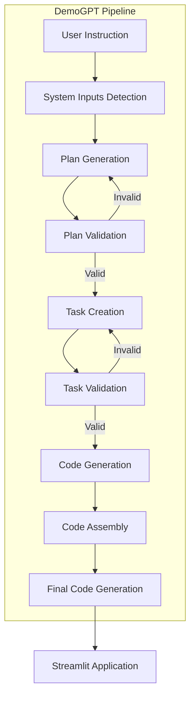

Sources: [demogpt/model.py:287-294](), [README.md:96-101]()

The pipeline consists of four major phases:
1. **Planning**: Generate a coherent plan from the user instruction
2. **Task Creation**: Break down the plan into specific executable tasks
3. **Code Generation**: Convert tasks into code snippets
4. **Code Assembly**: Combine the code snippets into a final application

## Detailed Pipeline Stages

### 1. System Inputs Detection

This initial stage analyzes the user's instruction to identify key components needed for the application.

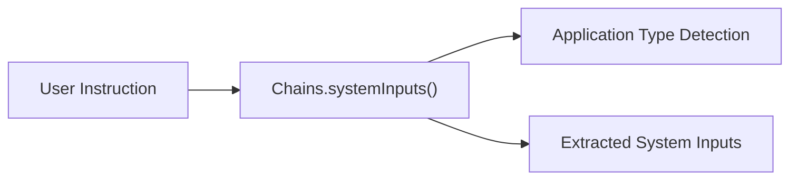

Sources: [demogpt/model.py:102-111](), [demogpt/chains/chains.py:106-113]()

The system inputs detection is implemented through the `systemInputs` method in the `Chains` class, which processes the natural language instruction to extract key information required for the subsequent steps.

### 2. Plan Generation

A plan is created based on the user's instruction and detected system inputs. This plan outlines the high-level steps needed to fulfill the user's requirements.

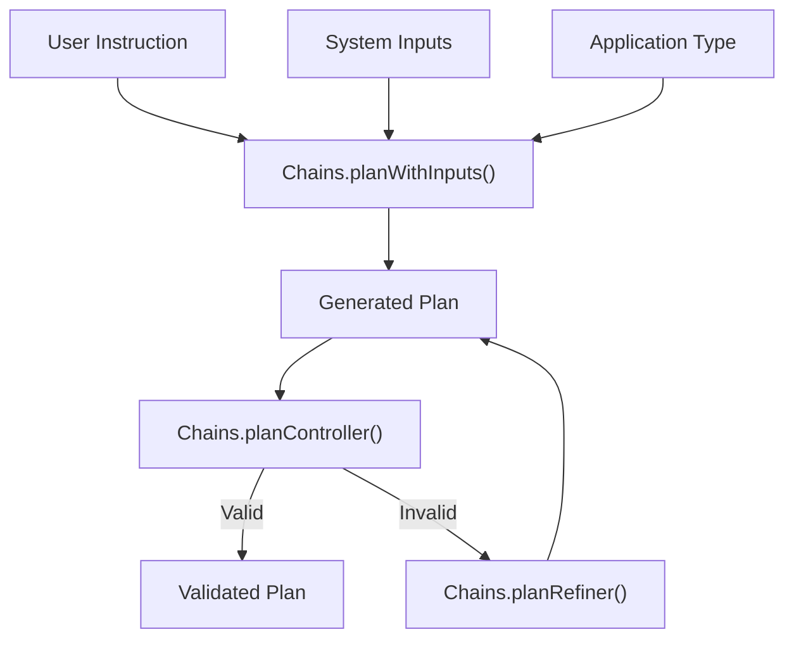

Sources: [demogpt/model.py:112-160](), [demogpt/chains/chains.py:116-155]()

The plan is a structured sequence of steps that will be translated into code. If the generated plan doesn't meet validation criteria, it undergoes refinement through the `planRefiner` method for up to `plan_max_steps` iterations.

### 3. Task Creation

Once a valid plan is established, it's broken down into specific tasks that can be implemented in code.

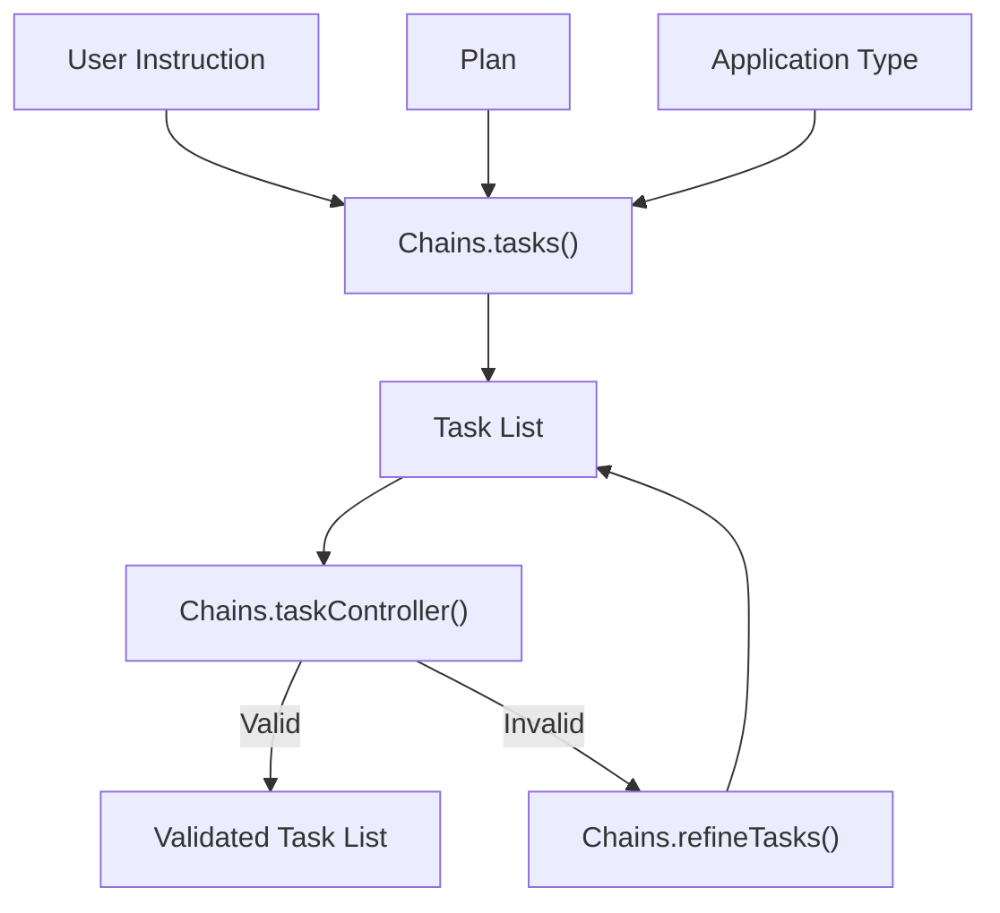

Sources: [demogpt/model.py:161-221](), [demogpt/chains/chains.py:158-196]()

Each task represents a specific function or feature that will be implemented in the final application. Tasks are defined with input and output parameters, a description, and a task type (e.g., `ui_input_text`, `prompt_template`, etc.).

### 4. Code Generation

With a validated list of tasks, the system generates code snippets for each task.

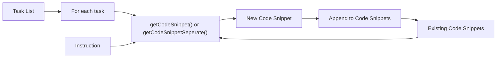

Sources: [demogpt/model.py:244-267](), [demogpt/utils.py:248-314]()

The code generation process iterates through each task in the task list, generating appropriate code based on the task type. The code snippets accumulate, with each new snippet building on the previous ones.

### 5. Code Assembly

Finally, the individual code snippets are combined and structured into a complete Streamlit application.

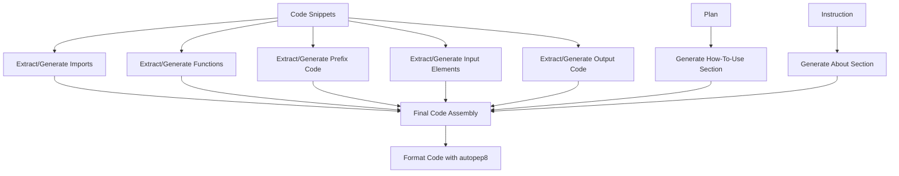

Sources: [demogpt/model.py:545-552](), [demogpt/utils.py:316-335]()

The code assembly phase generates the final structure of the Streamlit application, including necessary imports, function definitions, UI components, and documentation sections.

## Pipeline Implementation Details

### Component Architecture

The pipeline functionality is distributed across several key components that work together:

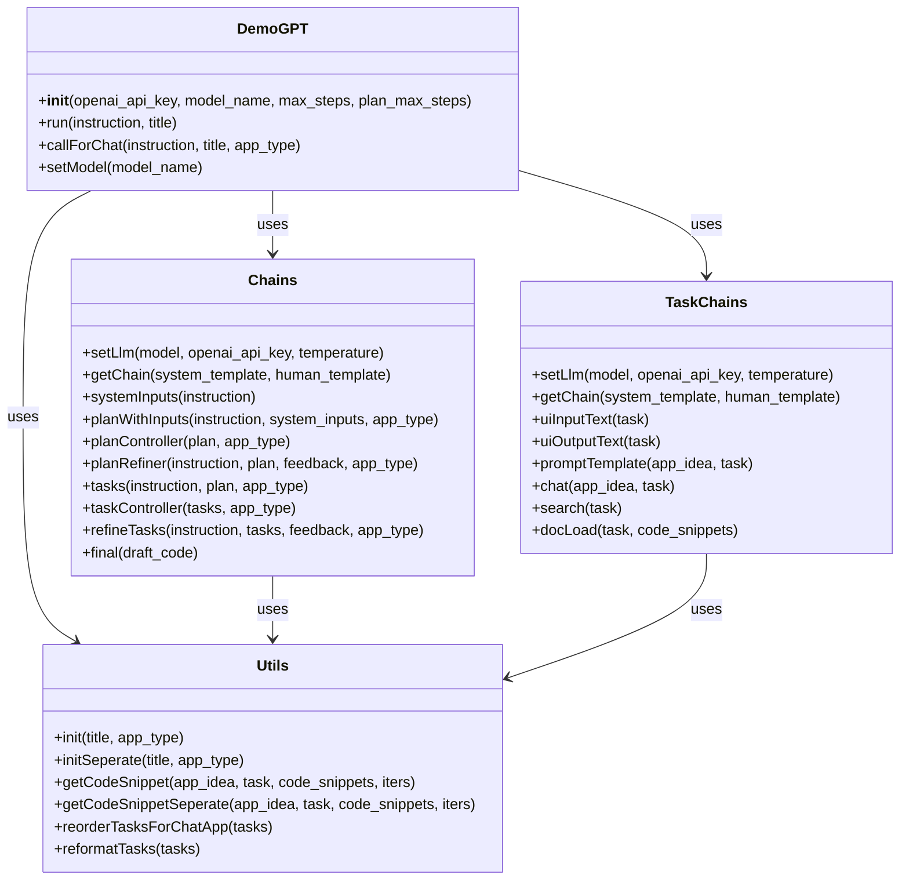

Sources: [demogpt/model.py:18-91](), [demogpt/chains/chains.py:20-63](), [demogpt/chains/task_chains.py:16-32](), [demogpt/utils.py:103-173]()

### Execution Flow

The pipeline's execution flow, particularly for generating a standard application (non-chat), follows this sequence:

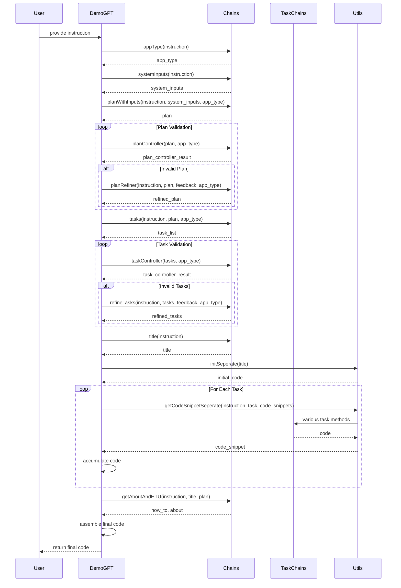

Sources: [demogpt/model.py:337-562]()

## Task Processing

A critical aspect of the pipeline is how it handles various task types. Each task type corresponds to a specific functionality that can be part of the generated application.

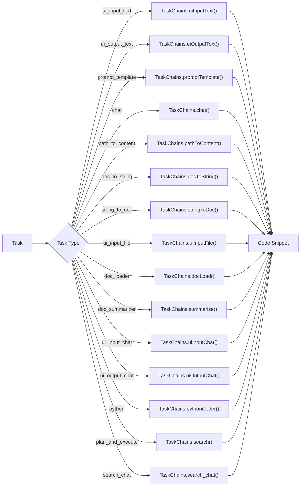

Sources: [demogpt/utils.py:282-314](), [demogpt/chains/task_chains.py:45-390]()

## Special Case: Chat Applications

The pipeline has special handling for chat-based applications, which involves reordering tasks and using the `callForChat` method instead of the standard `run` method.

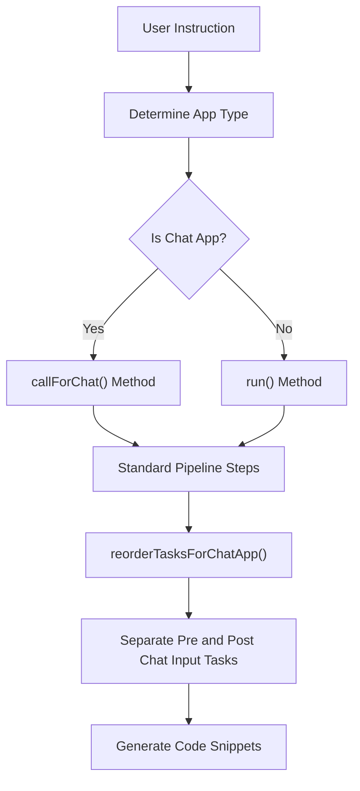

Sources: [demogpt/model.py:95-295](), [demogpt/utils.py:131-173]()

For chat applications, the system identifies tasks that depend on chat input and ensures they are executed after the chat input task, maintaining the correct execution flow in the generated application.

## Self-Refinement Mechanism

A key feature of the pipeline is its self-refinement capability, which allows it to improve outputs through iterative validation and refinement.

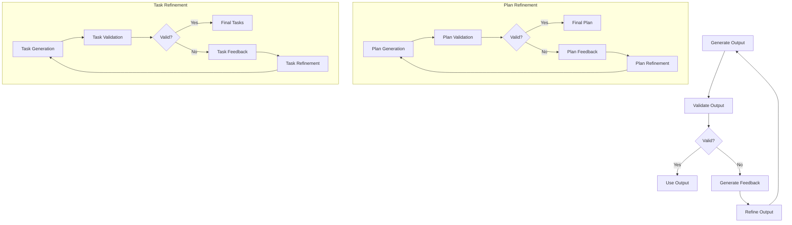

Sources: [demogpt/model.py:137-160](), [demogpt/model.py:197-221](), [demogpt/chains/chains.py:133-155](), [demogpt/chains/chains.py:182-196]()

The self-refinement process applies to multiple stages of the pipeline:
1. Plan refinement through `planRefiner` for up to `plan_max_steps` iterations
2. Task refinement through `refineTasks` for up to `max_steps` iterations
3. Prompt template refinement in the code generation phase

## Code Structure Generated by the Pipeline

The pipeline generates a structured Streamlit application with the following components:

| Section | Description | Source |
|---------|-------------|--------|
| Imports | Package imports and dependencies | `imports` variable |
| Functions | Function definitions for app functionality | `functions` variable |
| Prefix Code | Initialization code, session state setup | `prefix` variable |
| How-to-Use | Instructions for using the application | Generated by `getAboutAndHTU()` |
| About | Information about the application | Generated by `getAboutAndHTU()` |
| Form Definition | Streamlit form wrapper | Generated in final assembly |
| Input Elements | UI elements for user input | `inputs` variable |
| Submit Button | Form submission button | Generated in final assembly |
| Output Code | Code for processing and displaying outputs | `outputs` variable |

Sources: [demogpt/model.py:316-336](), [demogpt/model.py:545-552]()

## Conclusion

The DemoGPT pipeline provides a structured, end-to-end approach for transforming natural language instructions into functional Streamlit applications. Through a series of well-defined stages - planning, task creation, code generation, and code assembly - the system can produce complex applications with minimal user input. Built-in validation and refinement mechanisms ensure high-quality output, making the pipeline robust and reliable.

The pipeline architecture's modular design allows for easy extension with new task types and capabilities, while maintaining a consistent approach to application generation.

---

