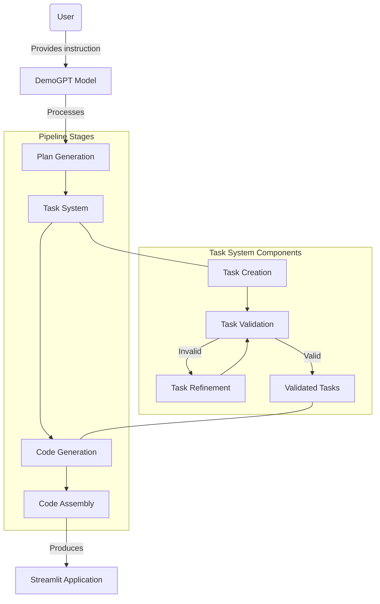
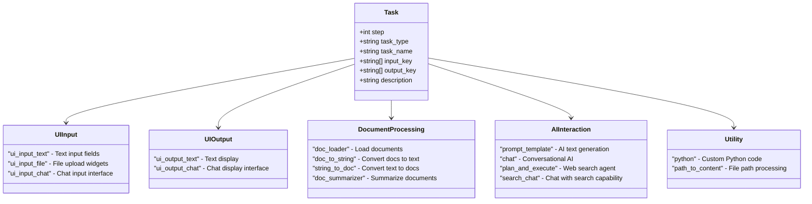
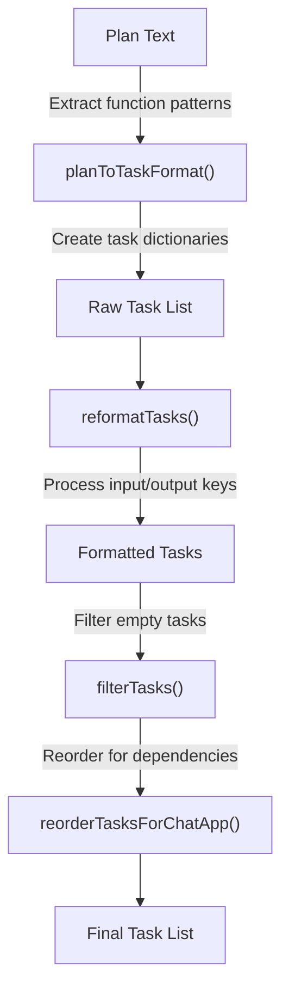
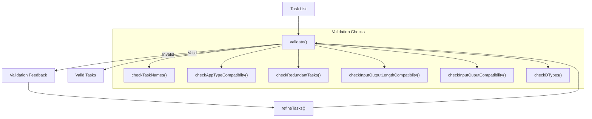
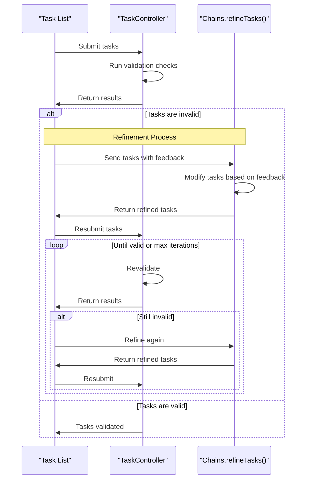
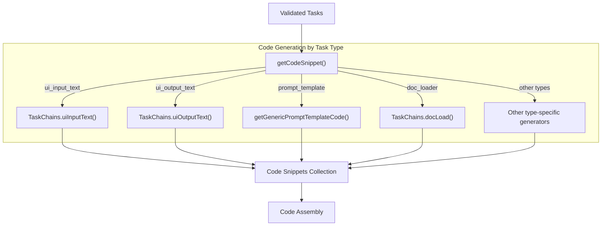
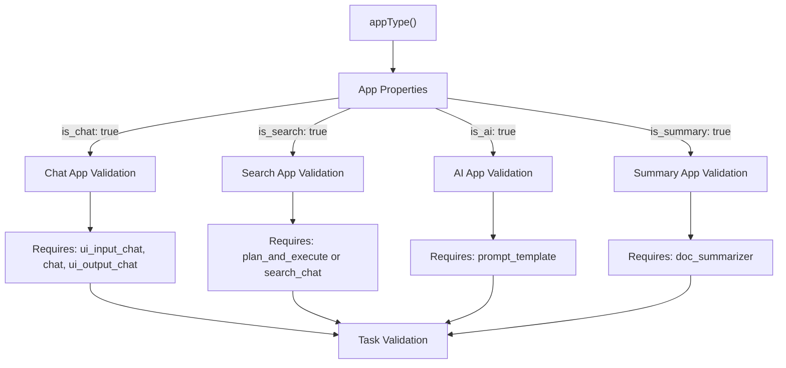

<!-- source: DeepWiki mcp.deepwiki.com · repo melih-unsal/DemoGPT · page 2.2 Task System · fetched 2026-10-26 -->

# Task System

<details>
<summary>Relevant source files</summary>

The following files were used as context for generating this wiki page:

- [demogpt/app.py](demogpt/app.py)
- [demogpt/chains/chains.py](demogpt/chains/chains.py)
- [demogpt/chains/prompts/__init__.py](demogpt/chains/prompts/__init__.py)
- [demogpt/chains/prompts/app_type.py](demogpt/chains/prompts/app_type.py)
- [demogpt/chains/prompts/how_to_use.py](demogpt/chains/prompts/how_to_use.py)
- [demogpt/chains/prompts/plan_with_inputs.py](demogpt/chains/prompts/plan_with_inputs.py)
- [demogpt/chains/prompts/task_list/chat.py](demogpt/chains/prompts/task_list/chat.py)
- [demogpt/chains/prompts/task_list/detailed_description.py](demogpt/chains/prompts/task_list/detailed_description.py)
- [demogpt/chains/prompts/task_list/doc_load.py](demogpt/chains/prompts/task_list/doc_load.py)
- [demogpt/chains/prompts/task_list/summarize.py](demogpt/chains/prompts/task_list/summarize.py)
- [demogpt/chains/prompts/task_list/ui_input_file.py](demogpt/chains/prompts/task_list/ui_input_file.py)
- [demogpt/chains/prompts/task_list/ui_output_text.py](demogpt/chains/prompts/task_list/ui_output_text.py)
- [demogpt/chains/task_chains.py](demogpt/chains/task_chains.py)
- [demogpt/chains/task_chains_seperate.py](demogpt/chains/task_chains_seperate.py)
- [demogpt/chains/task_definitions.py](demogpt/chains/task_definitions.py)
- [demogpt/controllers.py](demogpt/controllers.py)
- [demogpt/model.py](demogpt/model.py)
- [demogpt/utils.py](demogpt/utils.py)
- [pyproject.toml](pyproject.toml)

</details>


The Task System is a core component of DemoGPT that breaks down high-level application plans into executable tasks and validates them for compatibility and correctness. It serves as the bridge between the planning phase and code generation phase, ensuring that abstract application concepts are properly transformed into structured components that can be implemented with code.

For information about how generated code is assembled into complete applications, see [Code Generation and Assembly](#2.3).

## Task System in the Application Pipeline

The Task System occupies a critical position in DemoGPT's processing pipeline, transforming plans into executable code through several stages of processing.



Sources: [demogpt/model.py:95-294](), [demogpt/controllers.py:7-36]()

## Task Structure and Format

Each task in the system is represented as a structured dictionary with specific attributes that define its behavior and relationships with other tasks.

### Task Attributes

| Attribute | Description | Example |
|-----------|-------------|---------|
| `step` | Numerical order of execution | `1`, `2`, `3` |
| `task_type` | Type of task (from predefined list) | `"ui_input_text"`, `"prompt_template"` |
| `task_name` | Unique identifier for the task | `"get_user_input"`, `"generate_response"` |
| `input_key` | Array of input variable names | `["question", "context"]` |
| `output_key` | Array of output variable names | `["response"]` |
| `input_data_type` | Array of input data types | `["string", "Document"]` |
| `output_data_type` | Type of output data | `"string"`, `"Document"` |
| `description` | Human-readable description | `"Gets input from the user"` |

Tasks form a directed graph where outputs from one task become inputs to subsequent tasks, creating a data flow that determines the application's logic.

Sources: [demogpt/controllers.py:7-36](), [demogpt/utils.py:334-356]()

## Task Types and Categories

DemoGPT supports a variety of predefined task types, each designed for specific functionality within the generated application.



Sources: [demogpt/chains/task_definitions.py:7-169]()

### Data Type System

Tasks use a typing system to ensure compatibility between interconnected tasks:

- `none` - No data required or produced
- `string` - Text data
- `Document` - Document object
- `*string` - Multiple text inputs
- `*` - Any type of data

The asterisk prefix (`*`) indicates that multiple inputs or outputs of that type are accepted.

Sources: [demogpt/controllers.py:391-441](), [demogpt/chains/task_definitions.py:7-169]()

## Task Creation Process

### From Plan to Tasks

The task creation process begins with a plan, which is transformed into structured tasks through several steps:



The process uses regex pattern matching to extract function calls and their inputs/outputs from the plan text and converts them into structured task dictionaries.

Sources: [demogpt/model.py:171-173](), [demogpt/controllers.py:7-36](), [demogpt/utils.py:122-173]()

### Pattern Extraction Example

Plans contain function-like patterns that are extracted to create tasks:

```
1. Get user input by [ui_input_text() ---> user_query]
2. Generate response using [prompt_template(user_query) ---> ai_response]
3. Display response to user [ui_output_text(ai_response)]
```

This is converted to task dictionaries with appropriate attributes for each function call.

Sources: [demogpt/controllers.py:7-36]()

## Task Validation System

The validation system ensures tasks are compatible with each other and with the application type, performing multiple checks to guarantee coherence and correctness.



Sources: [demogpt/controllers.py:38-92](), [demogpt/model.py:196-221]()

### Validation Checks

The validation system performs these key checks:

1. **Task Name Validation** - Ensures all task types are defined in the system
2. **App Type Compatibility** - Verifies tasks match application requirements (chat, search, AI)
3. **Redundancy Check** - Ensures all task outputs are used by subsequent tasks
4. **Input/Output Length Check** - Validates correct number of inputs/outputs for each task type
5. **Input/Output Compatibility** - Verifies task inputs come from other task outputs
6. **Data Type Validation** - Ensures data types are compatible between connected tasks

Sources: [demogpt/controllers.py:38-471]()

### Task Refinement Loop

If validation fails, the system enters a refinement loop:



This loop continues until tasks are valid or the maximum iteration count is reached.

Sources: [demogpt/model.py:196-221](), [demogpt/chains/chains.py:182-196]()

## Task to Code Generation

Once tasks are validated, they are processed to generate code snippets for each component of the application.



Each task type has a dedicated code generation function in the `TaskChains` class that produces the appropriate code based on the task's attributes.

Sources: [demogpt/utils.py:282-314](), [demogpt/chains/task_chains.py:16-390]()

### Code Generation Process

The code generation process:

1. Identifies the task type
2. Calls the appropriate generator function with task attributes
3. Uses templates to create code snippets
4. Adds descriptive comments based on task description
5. Collects the snippets for later assembly

Different task types generate different kinds of code:
- UI tasks generate Streamlit interface components
- AI tasks generate LangChain-based code
- Document tasks generate document processing logic

Sources: [demogpt/model.py:255-267](), [demogpt/utils.py:282-314]()

## Task System Integration with App Types

The task system adjusts its validation and code generation based on the application type:



The app type determines which tasks are required, prohibited, or optional, ensuring the generated application meets the user's expectations.

Sources: [demogpt/controllers.py:194-388](), [demogpt/chains/app_type.py:1-96]()

## Conclusion

The Task System is a critical component of DemoGPT, serving as the bridge between abstract application plans and concrete code generation. By breaking down plans into structured, validated tasks, the system ensures that the generated applications are coherent, functional, and align with the user's intent. The validation and refinement processes provide robustness, while the code generation system translates abstract tasks into concrete implementations.

---

