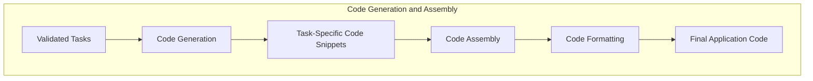
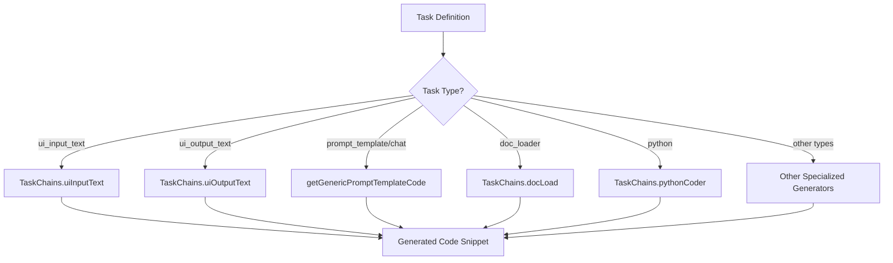
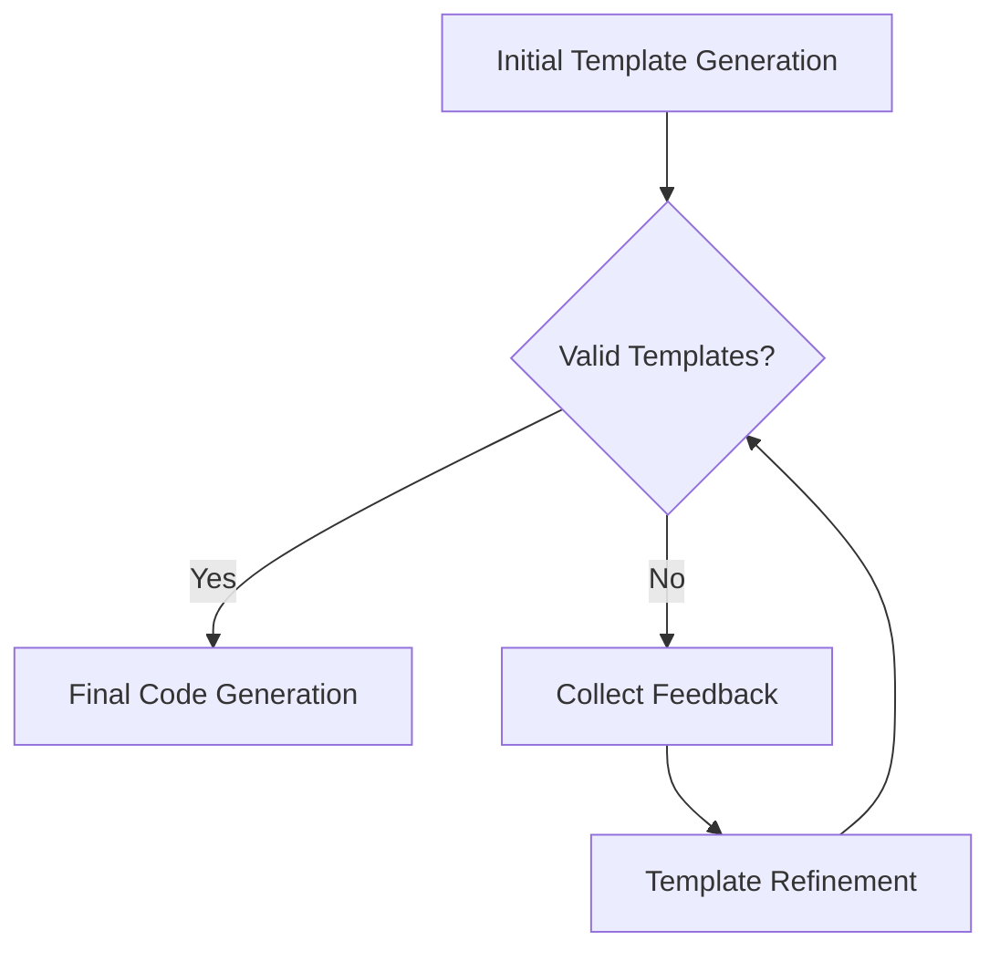
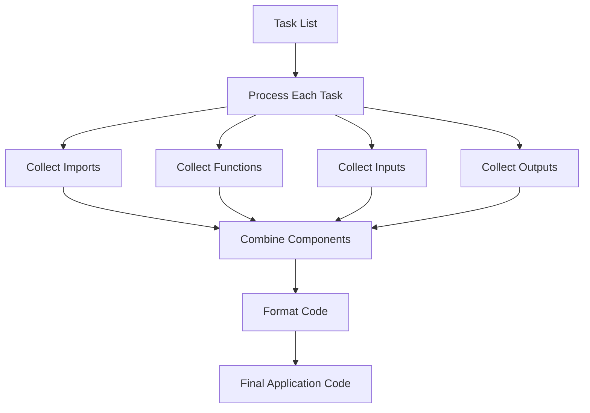
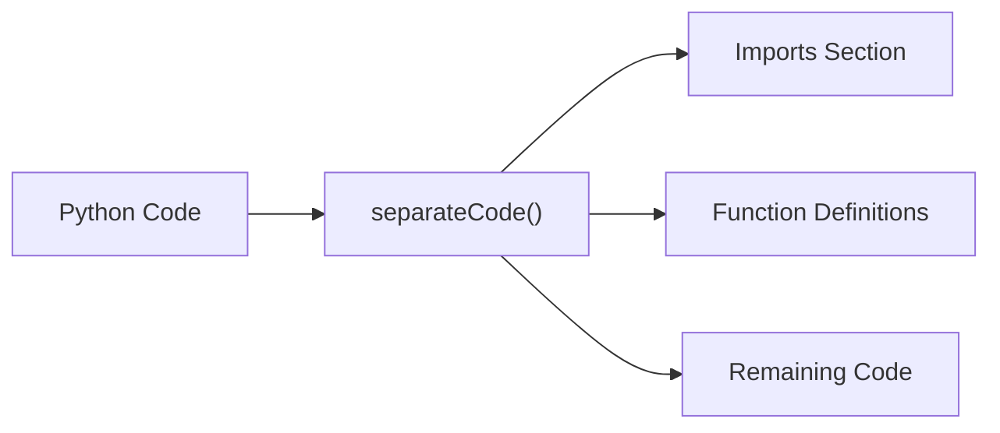
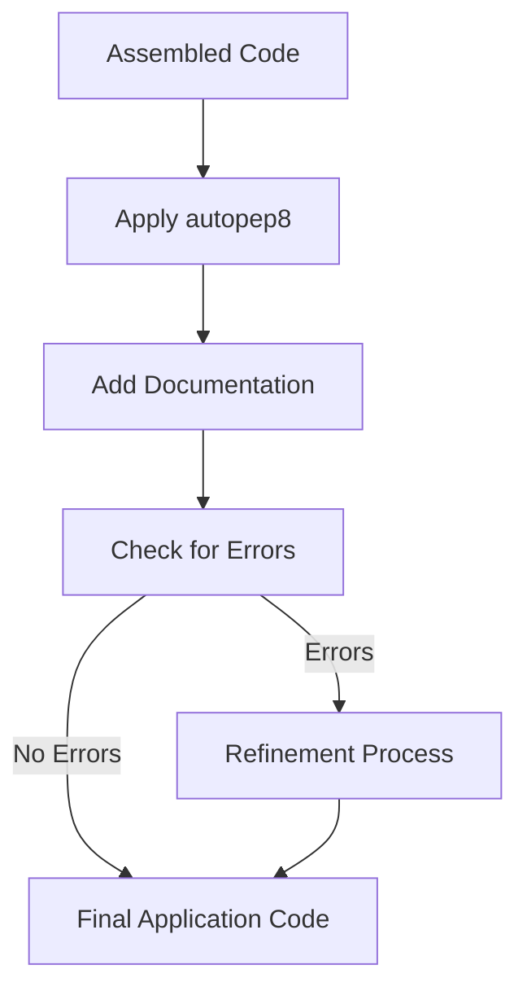
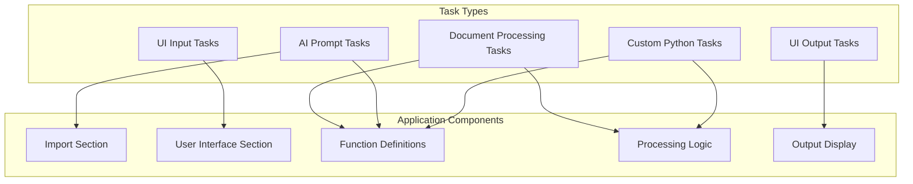

<!-- source: DeepWiki mcp.deepwiki.com · repo melih-unsal/DemoGPT · page 2.3 Code Generation and Assembly · fetched 2026-10-26 -->

# Code Generation and Assembly

<details>
<summary>Relevant source files</summary>

The following files were used as context for generating this wiki page:

- [demogpt/app.py](demogpt/app.py)
- [demogpt/chains/chains.py](demogpt/chains/chains.py)
- [demogpt/chains/prompts/combine_v2.py](demogpt/chains/prompts/combine_v2.py)
- [demogpt/chains/prompts/how_to_use.py](demogpt/chains/prompts/how_to_use.py)
- [demogpt/chains/prompts/task_list/chat.py](demogpt/chains/prompts/task_list/chat.py)
- [demogpt/chains/prompts/task_list/detailed_description.py](demogpt/chains/prompts/task_list/detailed_description.py)
- [demogpt/chains/prompts/task_list/doc_load.py](demogpt/chains/prompts/task_list/doc_load.py)
- [demogpt/chains/prompts/task_list/python_coder.py](demogpt/chains/prompts/task_list/python_coder.py)
- [demogpt/chains/prompts/task_list/summarize.py](demogpt/chains/prompts/task_list/summarize.py)
- [demogpt/chains/prompts/task_list/ui_input_file.py](demogpt/chains/prompts/task_list/ui_input_file.py)
- [demogpt/chains/task_chains.py](demogpt/chains/task_chains.py)
- [demogpt/chains/task_chains_seperate.py](demogpt/chains/task_chains_seperate.py)
- [demogpt/model.py](demogpt/model.py)
- [demogpt/utils.py](demogpt/utils.py)
- [pyproject.toml](pyproject.toml)

</details>


This page documents the process of how DemoGPT transforms task definitions into executable Streamlit application code and assembles the generated components into a complete, functional application. For information about how tasks are created and validated, see [Task System](#2.2).

## Overview

The code generation and assembly phase is a critical part of DemoGPT's application generation pipeline. After tasks have been defined and validated, DemoGPT:

1. Generates specific code snippets for each task based on its type
2. Assembles these snippets into a coherent application structure
3. Formats and refines the code to ensure it's error-free and follows best practices
4. Adds supporting elements like documentation and user guidance

This process bridges the gap between abstract task definitions and executable Streamlit applications that implement the user's intent.



Sources: [demogpt/model.py:256-284](), [demogpt/utils.py:282-314](), [demogpt/utils.py:59-81]()

## Code Generation Process

### Task-to-Code Translation

The task-to-code translation process is responsible for generating appropriate code snippets for each task in the task list. This process is primarily managed by the `getCodeSnippet` function in `utils.py` for standard assembly or `getCodeSnippetSeperate` for component-based assembly.



Sources: [demogpt/utils.py:282-314](), [demogpt/utils.py:248-279]()

### Task-Specific Code Generation

DemoGPT implements specialized code generators for different task types:

| Task Type | Code Generator | Purpose |
|-----------|----------------|---------|
| `ui_input_text` | `TaskChains.uiInputText` | Generate Streamlit text input widgets |
| `ui_output_text` | `TaskChains.uiOutputText` | Generate code to display text outputs |
| `prompt_template` | `getGenericPromptTemplateCode` | Generate LangChain prompt templates |
| `chat` | `getGenericPromptTemplateCode` | Generate chat interfaces with LangChain |
| `doc_loader` | `TaskChains.docLoad` | Generate document loading functionality |
| `doc_to_string` | `TaskChains.docToString` | Convert document objects to strings |
| `string_to_doc` | `TaskChains.stringToDoc` | Convert strings to document objects |
| `ui_input_file` | `TaskChains.uiInputFile` | Generate file upload functionality |
| `ui_input_chat` | `TaskChains.uiInputChat` | Generate chat input interfaces |
| `ui_output_chat` | `TaskChains.uiOutputChat` | Generate chat output displays |
| `python` | `TaskChains.pythonCoder` | Generate custom Python code |
| `plan_and_execute` | `TaskChains.search` | Generate search functionality |
| `search_chat` | `TaskChains.search_chat` | Generate chat-based search interfaces |

Each generator handles the specific requirements of its task type and produces appropriate Streamlit and LangChain code to implement the functionality.

Sources: [demogpt/utils.py:282-314](), [demogpt/chains/task_chains.py:16-390]()

### Self-Refinement Process

For complex task types like `prompt_template` and `chat`, DemoGPT implements a self-refinement process to ensure that generated templates and functions are valid:



This process is implemented in the `getGenericPromptTemplateCode` and `getGenericPromptTemplateCodeSeperate` functions, which:

1. Generate an initial template
2. Check if the template includes all required inputs
3. If not, refine the template based on feedback
4. Repeat until valid or max iterations reached

Sources: [demogpt/utils.py:180-212](), [demogpt/utils.py:214-246](), [demogpt/controllers.py]()

## Code Assembly Strategies

DemoGPT employs two different strategies for code assembly:

### 1. Simple Concatenation

Used in the `callForChat` method, this approach:
- Initializes a base code structure with imports and prefixes
- Generates code for each task and appends it to the growing codebase
- Formats the final combined code

```python
code_snippets = init(title)
for task in task_list:
    code = getCodeSnippet(instruction, task, code_snippets)
    code = "#" + task["description"] + "\n" + code
    code_snippets += code
final_code = code_snippets
final_code = autopep8.fix_code(final_code)
```

Sources: [demogpt/model.py:240-284]()

### 2. Component-Based Assembly

Used in the `run` method, this approach:
- Separates code into logical components (imports, functions, inputs, outputs)
- Collects each component separately across all tasks
- Combines the components in a structured format
- Applies indentation and formatting



This strategy is implemented using the `getCodeSnippetSeperate` function, which returns a dictionary of code components for each task:

```python
res = getCodeSnippetSeperate(instruction, task, code_snippets)
if res["imports"] not in imports:
    imports += res["imports"] + "\n"
functions += res["functions"] + "\n"
inputs += res["inputs"] + "\n"
outputs += res["outputs"] + "\n"
```

The final code is then assembled using a template that structures these components properly:

```python
final_code = getCode(imports, functions, prefix, inputs, outputs, how_to, about, title)
```

Sources: [demogpt/model.py:492-553](), [demogpt/utils.py:248-279](), [demogpt/model.py:316-336]()

## Code Separation and Organization

The `separateCode` function is responsible for breaking down code into logical components:



This separation is accomplished using regular expressions to identify different code sections:

```python
# Example pattern for identifying imports
imports_pattern = re.compile(r'^(import .*|from .* import .*)$', re.MULTILINE)

# Example pattern for identifying function definitions
function_pattern = re.compile(r'^(def .+:)\s*$(.*?)(?=^\S|\Z)', re.MULTILINE | re.DOTALL)
```

The separated components are then organized and reassembled in a structured way to create a well-organized Streamlit application.

Sources: [demogpt/utils.py:62-82]()

## Code Formatting and Finalization

Before the final code is delivered, DemoGPT:

1. Applies automatic code formatting using `autopep8.fix_code()`
2. Adds instructional elements like "How to Use" and "About" sections
3. Performs error checking using the `catchErrors` function
4. Organizes code into a Streamlit form structure for proper user interaction



Sources: [demogpt/model.py:282](), [demogpt/model.py:552](), [demogpt/utils.py:84-101](), [demogpt/chains/chains.py:297-307]()

## Generated Code Examples

### UI Input Elements

UI input elements generate Streamlit widgets for collecting user input:

```python
# Example of UI input text
user_input = st.text_input("Enter your text here:", key="user_input")

# Example of UI input file
uploaded_file = st.file_uploader("Upload PDF", type=["pdf"], key='pdf_file')
if uploaded_file is not None:
    with tempfile.NamedTemporaryFile(delete=False, suffix='.pdf') as temp_file:
        temp_file.write(uploaded_file.read())
        pdf_file = temp_file.name
else:
    pdf_file = ''
```

### AI Prompt Templates

Prompt templates generate code for creating and using LangChain prompt templates:

```python
def generate_response(input_text):
    chat = ChatOpenAI(
        model="gpt-3.5-turbo-16k",
        openai_api_key=openai_api_key,
        temperature=0.7
    )
    system_template = """You are an AI assistant..."""
    system_message_prompt = SystemMessagePromptTemplate.from_template(system_template)
    human_template = """Respond to: {input_text}"""
    human_message_prompt = HumanMessagePromptTemplate.from_template(human_template)
    chat_prompt = ChatPromptTemplate.from_messages(
        [system_message_prompt, human_message_prompt]
    )

    chain = LLMChain(llm=chat, prompt=chat_prompt)
    result = chain.run(input_text=input_text)
    return result
```

## Relationship Between Task Types and Generated Code

The diagram below illustrates how different task types contribute to different parts of the final Streamlit application:



Sources: [demogpt/utils.py:282-314](), [demogpt/chains/task_chains.py:16-390](), [demogpt/chains/task_chains_seperate.py:16-461]()

## Extending the System

To add new task types and code generation capabilities:

1. Define the new task type in the task system
2. Add a new method to `TaskChains` and `TaskChainsSeperate` for the task type
3. Update the `getCodeSnippet` and `getCodeSnippetSeperate` functions to handle the new task type
4. Create any necessary prompt templates for the task

For more information on the task system and how to define new tasks, see [Task System](#2.2) and [Adding New Tasks](#6.1).

Sources: [demogpt/utils.py:282-314](), [demogpt/utils.py:248-279](), [demogpt/chains/task_chains.py:16-390]()

---

