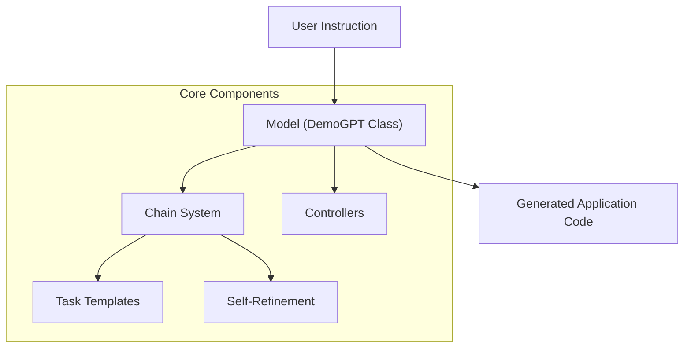
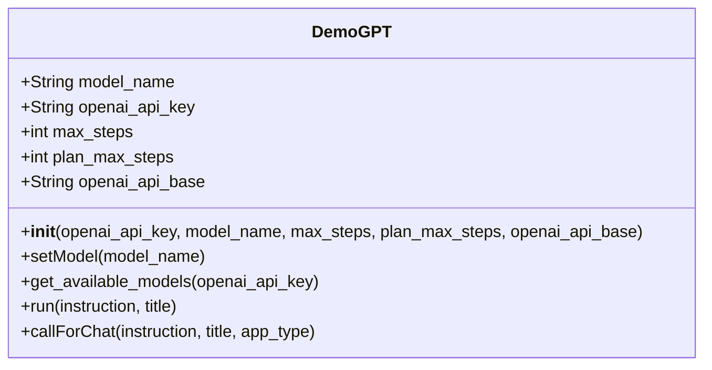
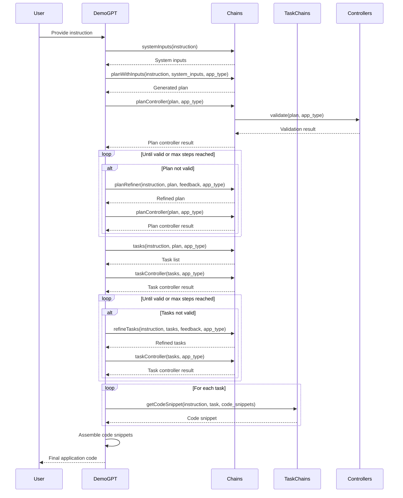
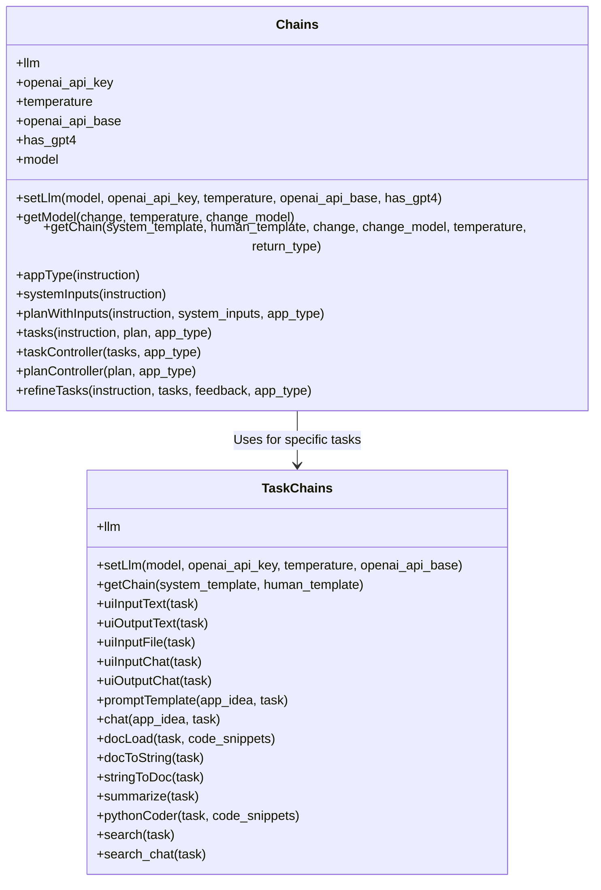
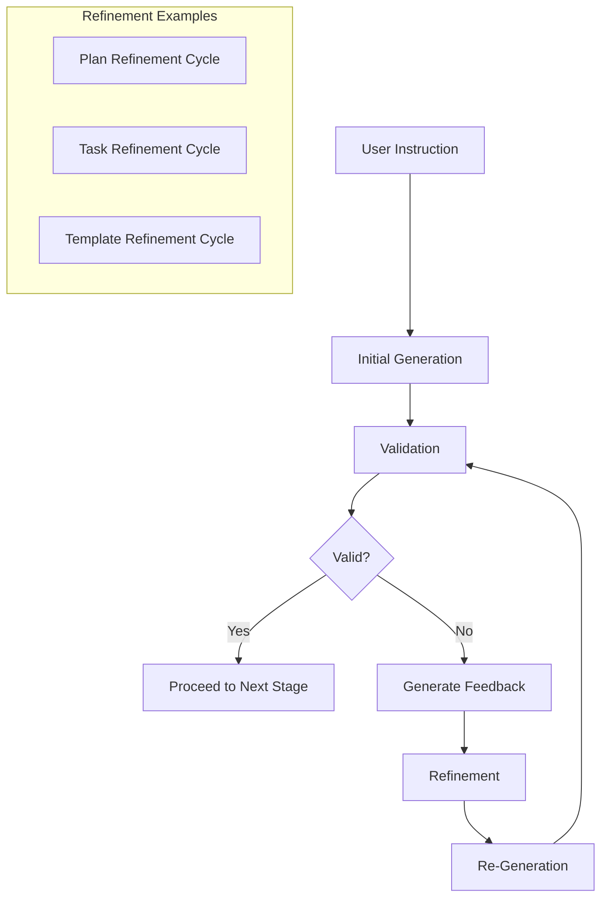
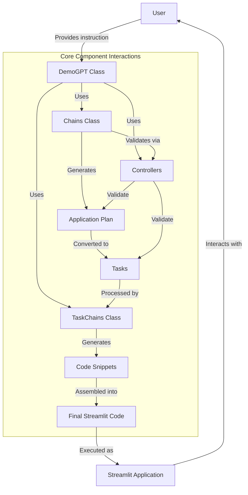

<!-- source: DeepWiki mcp.deepwiki.com · repo melih-unsal/DemoGPT · page 3 Core Components · fetched 2026-10-26 -->

# Core Components

Relevant source files

The following files were used as context for generating this wiki page:

- [demogpt/__init__.py](demogpt/__init__.py)
- [demogpt/app.py](demogpt/app.py)
- [demogpt/chains/chains.py](demogpt/chains/chains.py)
- [demogpt/chains/task_chains.py](demogpt/chains/task_chains.py)
- [demogpt/model.py](demogpt/model.py)
- [demogpt/utils.py](demogpt/utils.py)
- [pyproject.toml](pyproject.toml)

This page documents the fundamental components of DemoGPT that work together to transform natural language instructions into functional Streamlit applications. While the [Architecture](#2) page provides a high-level overview of the system design, this section focuses on the specific classes, modules, and mechanisms that implement this architecture. For details about specific task implementations, see [Task Templates](#3.4).

## Core Components Overview

DemoGPT's core is built around a set of specialized components that form a processing pipeline, each handling a specific part of the application generation process.

Sources: [demogpt/model.py:18-92](), [demogpt/chains/chains.py:20-335](), [demogpt/utils.py:180-211]()

## Model

The central orchestration component is the `DemoGPT` class defined in `model.py`. This class manages the entire application generation process, coordinating between different components and maintaining the pipeline state.

The `DemoGPT` class:
- Initializes language model configurations
- Implements the processing pipeline through the `run()` and `callForChat()` methods
- Yields progress updates at each stage of generation
- Handles error conditions and refinement loops
- Manages the assembly of code snippets into complete applications

Key methods include:
- `setModel()`: Configures the LLM to use for generation
- `run()`: Executes the complete generation pipeline for standard applications
- `callForChat()`: Specialized pipeline variant for chat-based applications

Sources: [demogpt/model.py:18-92](), [demogpt/model.py:311-562]()

### Pipeline Implementation

The model implements a sequential pipeline with the following stages:

1. **System Inputs Detection**: Identifies system-level inputs needed for the application
2. **Plan Generation**: Creates a step-by-step plan for the application
3. **Plan Validation and Refinement**: Validates the plan and refines it if necessary
4. **Task Creation**: Converts the plan into specific executable tasks
5. **Task Validation and Refinement**: Validates tasks and refines them if necessary
6. **Code Generation**: Creates code snippets for each task
7. **Code Assembly**: Combines code snippets into a complete application

Sources: [demogpt/model.py:311-562]()

## Chains

The Chain System consists of specialized classes that handle different aspects of the application generation process. There are two primary chain classes:

1. `Chains`: Handles high-level processes like planning and task generation
2. `TaskChains`: Generates specific code snippets for various task types

Sources: [demogpt/chains/chains.py:20-335](), [demogpt/chains/task_chains.py:16-390]()

### Chains Class

The `Chains` class is responsible for high-level processing, handling:

- Determining application type with `appType()`
- Planning with `planWithInputs()` and `planRefiner()`
- Task generation with `tasks()` and `refineTasks()`
- Validation with `planController()` and `taskController()`
- Final code assembly with methods like `combine()` and `addAboutAndHTU()`

This class interfaces with language models through the `getChain()` method, which constructs and executes prompt chains based on specified templates.

Sources: [demogpt/chains/chains.py:20-335]()

### TaskChains Class

The `TaskChains` class generates code snippets for specific task types, with methods like:

- `uiInputText()`: Generates UI input elements
- `uiOutputText()`: Generates UI output elements
- `promptTemplate()`: Creates AI prompt templates
- `chat()`: Implements chat functionality
- `docLoad()`: Creates document loading functionality
- `pythonCoder()`: Generates custom Python code

Each method takes a task definition and returns the corresponding code snippet or components needed to generate it.

Sources: [demogpt/chains/task_chains.py:16-390]()

## Controllers

Controllers validate and manage tasks and plans during the application generation process. They ensure that the generated plans and tasks are valid before proceeding to code generation.

```mermaid
flowchart TD
    subgraph "Plan Validation"
        Plan["Plan"] --> PlanController["planController()"]
        PlanController --> PlanValidation["validate()"]
        PlanValidation --> PlanResult{"Valid?"}
        PlanResult -->|"No"| PlanFeedback["Feedback"]
        PlanFeedback --> PlanRefiner["planRefiner()"]
        PlanRefiner --> Plan
        PlanResult -->|"Yes"| PlanValid["Proceed to Tasks"]
    end
    
    subgraph "Task Validation"
        Tasks["Tasks"] --> TaskController["taskController()"]
        TaskController --> TaskValidation["validate()"]
        TaskValidation --> TaskResult{"Valid?"}
        TaskResult -->|"No"| TaskFeedback["Feedback"]
        TaskFeedback --> TaskRefiner["refineTasks()"]
        TaskRefiner --> Tasks
        TaskResult -->|"Yes"| TaskValid["Proceed to Code Generation"]
    end
    
    subgraph "Template Validation"
        Template["Prompt Template"] --> TemplateCheck["checkPromptTemplates()"]
        TemplateCheck --> TemplateResult{"Valid?"}
        TemplateResult -->|"No"| TemplateFeedback["Feedback"]
        TemplateFeedback --> TemplateRefiner["promptTemplateRefiner()"]
        TemplateRefiner --> Template
        TemplateResult -->|"Yes"| TemplateValid["Use Template"]
    end
```

Controllers perform these key functions:
- Validate plans for structural correctness and feasibility
- Validate tasks for proper input/output relationships and data type compatibility
- Validate prompt templates for correct variable references
- Provide specific feedback for refinement when validation fails

The main controller functions are implemented in `validate()` for plans and tasks, and more specific functions like `checkPromptTemplates()` for prompt template validation.

Sources: [demogpt/chains/chains.py:173-179](), [demogpt/utils.py:180-211]()

## Task Templates

DemoGPT supports a variety of task templates that can be used to generate specific functionality. The code generation for these tasks is primarily handled by the `TaskChains` class and the `getCodeSnippet()` function.

```mermaid
flowchart TD
    subgraph "Task Types"
        UIInput["UI Input Tasks"]
        UIOutput["UI Output Tasks"]
        Doc["Document Processing Tasks"]
        AI["AI Interaction Tasks"]
        Custom["Custom Logic Tasks"]
    end
    
    subgraph "UI Input Tasks"
        TextInput["ui_input_text"]
        FileInput["ui_input_file"]
        ChatInput["ui_input_chat"]
    end
    
    subgraph "UI Output Tasks"
        TextOutput["ui_output_text"]
        ChatOutput["ui_output_chat"]
    end
    
    subgraph "Document Processing Tasks"
        DocLoad["doc_loader"]
        DocToString["doc_to_string"]
        StringToDoc["string_to_doc"]
        PathToContent["path_to_content"]
        Summarize["doc_summarizer"]
    end
    
    subgraph "AI Interaction Tasks"
        PromptTemplate["prompt_template"]
        Chat["chat"]
        Search["plan_and_execute"]
        SearchChat["search_chat"]
    end
    
    subgraph "Custom Logic Tasks"
        Python["python"]
    end
    
    UIInput --> TextInput
    UIInput --> FileInput
    UIInput --> ChatInput
    
    UIOutput --> TextOutput
    UIOutput --> ChatOutput
    
    Doc --> DocLoad
    Doc --> DocToString
    Doc --> StringToDoc
    Doc --> PathToContent
    Doc --> Summarize
    
    AI --> PromptTemplate
    AI --> Chat
    AI --> Search
    AI --> SearchChat
    
    Custom --> Python
```

The task template system:
- Defines a standard structure for tasks with type, inputs, outputs, and description
- Provides specialized handlers for each task type in `TaskChains`
- Uses the `getCodeSnippet()` function to select and execute the appropriate handler
- Assembles generated code snippets into a complete application

For more detailed information about each task template and its implementation, see [Task Templates](#3.4).

Sources: [demogpt/utils.py:282-314](), [demogpt/chains/task_chains.py:44-390]()

## Self-Refinement

DemoGPT incorporates a self-refinement system that improves the quality of generated plans, tasks, and code through iterative validation and refinement.

Key refinement processes include:

1. **Plan Refinement**:
   - Uses `planController()` to validate plans
   - Refines invalid plans with `planRefiner()`
   - Limited by `plan_max_steps` (default: 3)

2. **Task Refinement**:
   - Uses `taskController()` to validate tasks
   - Refines invalid tasks with `refineTasks()`
   - Limited by `max_steps` (default: 10)

3. **Template Refinement**:
   - Uses `checkPromptTemplates()` to validate prompt templates
   - Refines invalid templates with `promptTemplateRefiner()`
   - Used within methods like `getGenericPromptTemplateCode()`

The refinement system ensures that the generated outputs meet requirements before proceeding to the next stage, improving the overall quality of the final application.

Sources: [demogpt/model.py:146-161](), [demogpt/model.py:200-221](), [demogpt/utils.py:180-211]()

## Component Interactions

The following diagram illustrates how the core components interact during the application generation process:

The interaction flow between components is orchestrated by the `DemoGPT` class:

1. User provides an instruction to the `DemoGPT` class
2. `DemoGPT` uses the `Chains` class to generate a plan
3. Controllers validate the plan and provide feedback if needed
4. The plan is refined until valid or max iterations reached
5. `Chains` converts the plan into specific tasks
6. Controllers validate the tasks and provide feedback if needed
7. Tasks are refined until valid or max iterations reached
8. `TaskChains` generates code snippets for each validated task
9. `DemoGPT` assembles the code snippets into the final application code
10. The application is executed as a Streamlit app for the user

This structured interaction between components allows DemoGPT to break down the complex process of application generation into manageable, specialized steps that can be executed, validated, and refined independently.

Sources: [demogpt/model.py:95-295](), [demogpt/model.py:311-562]()

---

