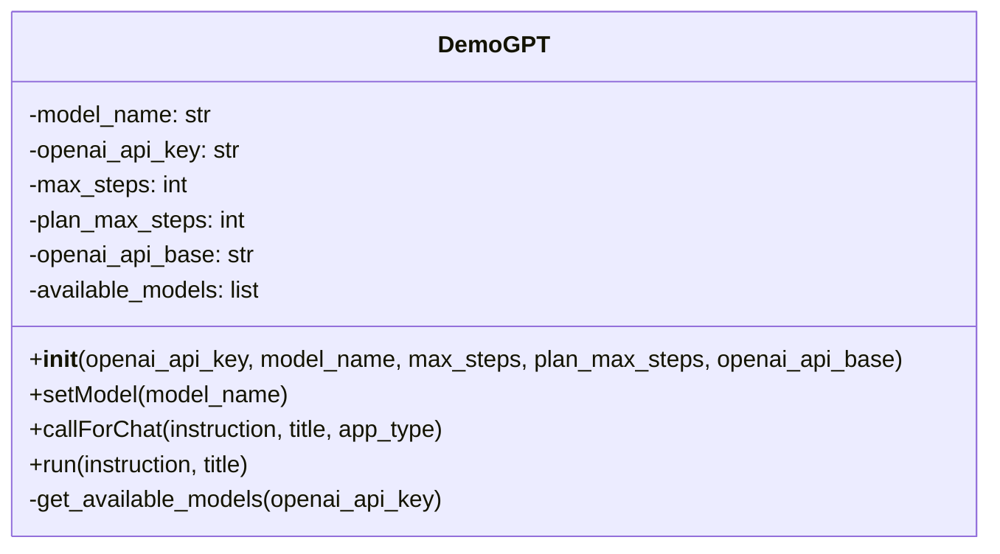
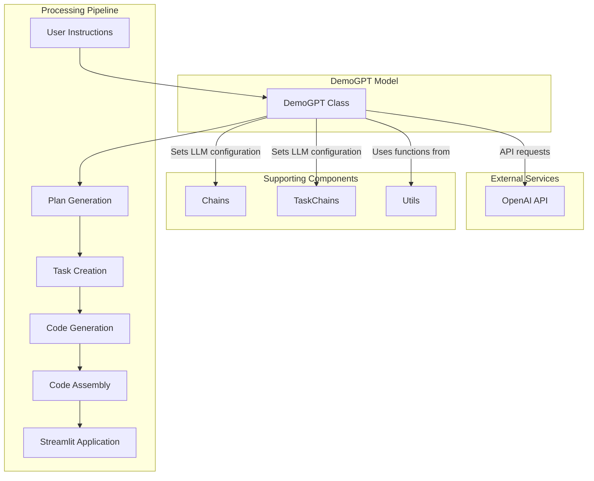
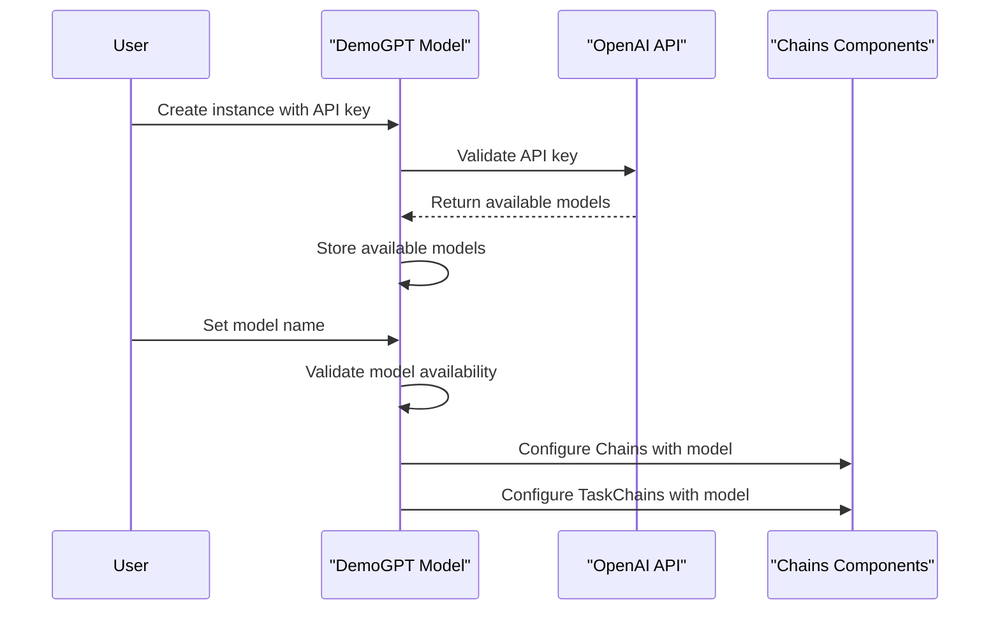
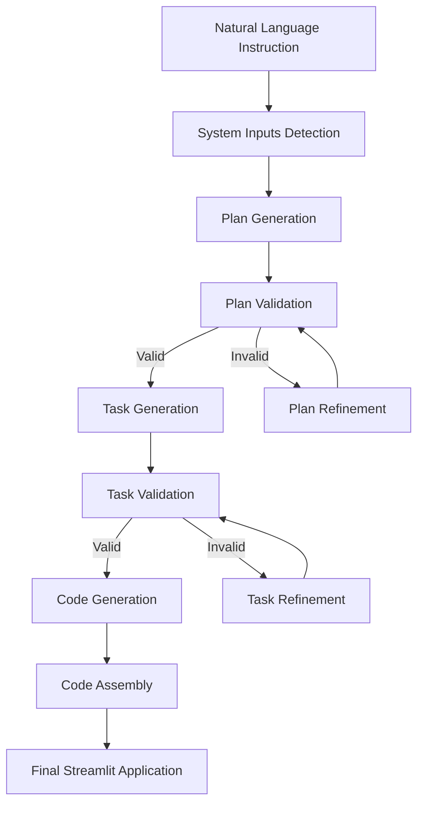
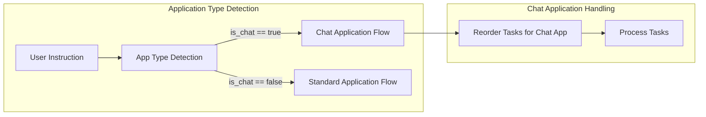
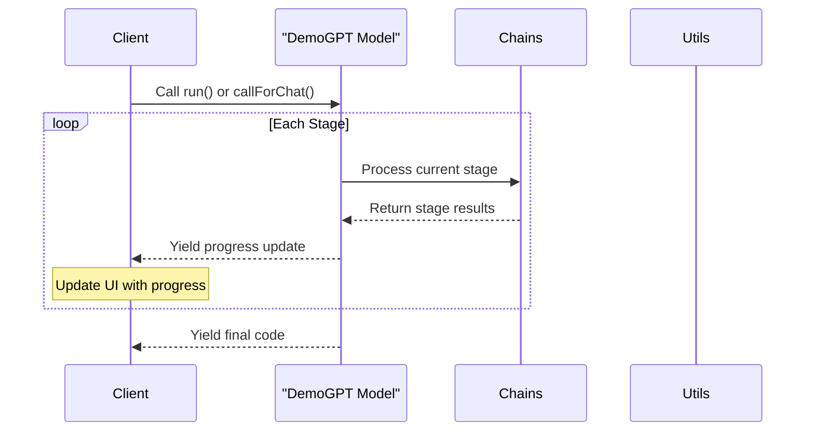

<!-- source: DeepWiki mcp.deepwiki.com · repo melih-unsal/DemoGPT · page 3.1 Model · fetched 2026-10-26 -->

# Model

<details>
<summary>Relevant source files</summary>

The following files were used as context for generating this wiki page:

- [CONTRIBUTING.md](CONTRIBUTING.md)
- [demogpt/app.py](demogpt/app.py)
- [demogpt/chains/chains.py](demogpt/chains/chains.py)
- [demogpt/chains/task_chains.py](demogpt/chains/task_chains.py)
- [demogpt/model.py](demogpt/model.py)
- [demogpt/test.py](demogpt/test.py)
- [demogpt/utils.py](demogpt/utils.py)
- [pyproject.toml](pyproject.toml)

</details>


The DemoGPT Model is the core orchestrator of the DemoGPT system, responsible for transforming natural language instructions into functional Streamlit applications. This document explains the architecture and operation of the Model component, focusing on how it coordinates the application generation pipeline and manages the interactions between various subsystems.

For information about the Chains component that handles specific transformation steps, see [Chains](#3.2). For details on task validation and management, see [Controllers](#3.3).

## Core Architecture

The `DemoGPT` class defined in `model.py` serves as the central coordinator for the application generation process. It initializes the necessary components, orchestrates the generation pipeline, and manages the communication with the language model.



Sources: [demogpt/model.py:18-562]()

## System Component Integration

The DemoGPT Model coordinates several key components to generate Streamlit applications. It serves as the bridge between natural language instructions and functional code.



Sources: [demogpt/model.py:18-96](), [demogpt/chains/chains.py:20-43](), [demogpt/chains/task_chains.py:16-33]()

## Model Initialization and Configuration

When initializing the DemoGPT Model, it establishes connections with the underlying LLM service and configures essential parameters for the generation process.



The initialization process sets important parameters:
- `model_name`: The OpenAI model to use (e.g., "gpt-3.5-turbo")
- `max_steps`: Maximum iterations for refining tasks
- `plan_max_steps`: Maximum iterations for refining the plan
- `openai_api_key`: API key for OpenAI authentication
- `openai_api_base`: Optional custom API endpoint URL

Sources: [demogpt/model.py:19-48](), [demogpt/model.py:67-90]()

## Processing Pipeline

The DemoGPT Model implements a multi-stage pipeline that transforms user instructions into a functional Streamlit application. Here's a breakdown of the process:



### 1. System Inputs Detection

The model first analyzes the instruction to identify system requirements and constraints.

```python
system_inputs = Chains.systemInputs(instruction=instruction)
```

Sources: [demogpt/model.py:102-111](), [demogpt/model.py:342-353]()

### 2. Plan Generation

The system generates a plan based on the instruction and system inputs.

```python
plan = Chains.planWithInputs(
    instruction=instruction, system_inputs=system_inputs, app_type=app_type
)
```

Sources: [demogpt/model.py:112-133](), [demogpt/model.py:354-377]()

### 3. Plan Validation and Refinement

The plan is validated and refined if necessary, up to `plan_max_steps` iterations.

```python
plan_controller_result = Chains.planController(plan=plan, app_type=app_type)
for _ in trange(self.plan_max_steps):
    if not plan_controller_result["valid"]:
        plan = Chains.planRefiner(
            instruction=instruction,
            plan=plan,
            feedback=plan_controller_result["feedback"],
            app_type=app_type,
        )
        plan_controller_result = Chains.planController(
            plan=plan, app_type=app_type
        )
    else:
        break
```

Sources: [demogpt/model.py:137-160](), [demogpt/model.py:378-405]()

### 4. Task Generation

Based on the validated plan, the system generates a list of tasks.

```python
task_list = Chains.tasks(
    instruction=instruction, plan=plan, app_type=app_type
)
```

Sources: [demogpt/model.py:162-183](), [demogpt/model.py:407-428]()

### 5. Task Validation and Refinement

Tasks are validated and refined if necessary, up to `max_steps` iterations.

```python
task_controller_result = Chains.taskController(
    tasks=task_list, app_type=app_type
)
for _ in trange(self.max_steps):
    if not task_controller_result["valid"]:
        task_list = Chains.refineTasks(
            instruction=instruction,
            tasks=task_list,
            feedback=task_controller_result["feedback"],
            app_type=app_type,
        )
        task_controller_result = Chains.taskController(
            tasks=task_list, app_type=app_type
        )
    else:
        break
```

Sources: [demogpt/model.py:187-221](), [demogpt/model.py:432-467]()

### 6. Code Generation

The system transforms each task into code snippets.

```python
for i, task in enumerate(task_list):
    code = getCodeSnippet(instruction, task, code_snippets, self.max_steps)
    code = "#" + task["description"] + "\n" + code
    code_snippets += code
```

Sources: [demogpt/model.py:240-267](), [demogpt/model.py:498-532]()

### 7. Code Assembly

The code snippets are assembled into a complete application, with additional documentation.

```python
final_code = code_snippets
final_code = autopep8.fix_code(final_code)
final_code = Chains.addAboutAndHTU(instruction, title, final_code, plan)
```

Sources: [demogpt/model.py:271-294](), [demogpt/model.py:534-552]()

## Special Application Types

The Model supports different application types, particularly chat-based applications which require special handling:



For chat applications, the Model needs to ensure that tasks are ordered correctly:

```python
task_list = reorderTasksForChatApp(task_list) # for chat apps, remove the code between chat input and chat output
```

This ensures that chat input and output components are properly sequenced in the generated application.

Sources: [demogpt/model.py:346-350](), [demogpt/model.py:238-239](), [demogpt/utils.py:131-173]()

## Progress Tracking and Feedback

The DemoGPT Model implements a generator pattern to provide real-time feedback on generation progress:



The model yields structured progress data that includes:
- Current processing stage
- Completion percentage
- Status messages
- Generated code (when available)

This allows client applications to display progress information and provide a responsive user experience.

Sources: [demogpt/model.py:102-294](), [demogpt/model.py:337-562]()

## Error Handling and Fallbacks

The Model includes mechanisms to handle errors and provide fallback solutions:

1. Token window size management:
   - Automatically switches to larger context models when needed
   - Example: switching to "gpt-3.5-turbo-16k-0613" when context length is exceeded

2. Model validation:
   - Checks if the user has access to the requested model
   - Provides informative error messages when access is denied

3. Failure recovery:
   - Gracefully handles generation failures
   - Provides informative failure messages to the user

Sources: [demogpt/model.py:213-221](), [demogpt/model.py:67-72](), [demogpt/model.py:223-232]()

## Integration with Utils and Chains

The Model leverages utility functions from `utils.py` and chain operations from `chains/chains.py` and `chains/task_chains.py` to perform its core functions:

| Component | Purpose | Key Functions Used |
|-----------|---------|-------------------|
| Utils | Code generation and manipulation | `getCodeSnippet`, `init`, `reorderTasksForChatApp` |
| Chains | High-level LLM operations | `planWithInputs`, `tasks`, `taskController`, `addAboutAndHTU` |
| TaskChains | Task-specific code generation | Various task functions via `getCodeSnippet` |

The Model acts as the coordinator that brings these components together in a coherent pipeline.

Sources: [demogpt/model.py:10-15](), [demogpt/utils.py:282-315]()

## Python API Usage

The DemoGPT model provides two main methods for generating applications:

1. `run(instruction, title)`: The main method for generating standard applications
2. `callForChat(instruction, title, app_type)`: A specialized method for chat-based applications

Both methods are generator functions that yield progress updates during the generation process.

The model can be used directly from Python code:

```python
from demogpt.model import DemoGPT

# Initialize the model
model = DemoGPT(
    openai_api_key="your-api-key",
    model_name="gpt-3.5-turbo-0613"
)

# Generate an application
for progress in model.run("Create a sentiment analysis application"):
    print(f"Stage: {progress['stage']}, Progress: {progress['percentage']}%")
    
    # When complete, access the generated code
    if progress.get("done", False):
        final_code = progress["code"]
        # Use the generated code...
```

Sources: [demogpt/model.py:295-310](), [demogpt/model.py:310-562]()

## Technical Details

### Available Model Detection

The Model includes functionality to discover available OpenAI models for the user:

```python
@classmethod
def get_available_models(cls, openai_api_key):
    if not openai_api_key:
        return []
    try:
        client = OpenAI(api_key=openai_api_key)
        models = client.models.list()
        return [model.id for model in models.data if "gpt" in model.id]
    except Exception as e:
        return []
```

This allows the system to validate model selection and provide appropriate options to the user.

Sources: [demogpt/model.py:51-60]()

### LLM Configuration Management

The Model configures language model interactions across multiple components:

```python
def setModel(self, model_name):
    self.model_name = model_name
    
    assert self.model_name, f"No model is selected, the selected model is {self.model_name}" 
    assert self.model_name in self.available_models, self.gpt4_message.format(model_name=self.model_name)
            
    Chains.setLlm(
        self.model_name, self.openai_api_key, openai_api_base=self.openai_api_base, has_gpt4=self.hasGPT4
    )
    TaskChains.setLlm(
        self.model_name, self.openai_api_key, openai_api_base=self.openai_api_base
    )
    TaskChainsSeperate.setLlm(
        self.model_name, self.openai_api_key, openai_api_base=self.openai_api_base
    )
```

This ensures consistent model usage across all components of the system.

Sources: [demogpt/model.py:67-90]()

## Summary

The DemoGPT Model is the central orchestrator that coordinates the entire application generation process. It:

1. Takes natural language instructions from the user
2. Detects system requirements and application type
3. Creates and refines a plan
4. Generates and validates tasks based on the plan
5. Produces code snippets for each task
6. Assembles the code snippets into a complete Streamlit application
7. Provides ongoing progress updates during generation

The Model's strength lies in its ability to coordinate different subsystems and implement a robust generation pipeline with validation and refinement at each step.

---

