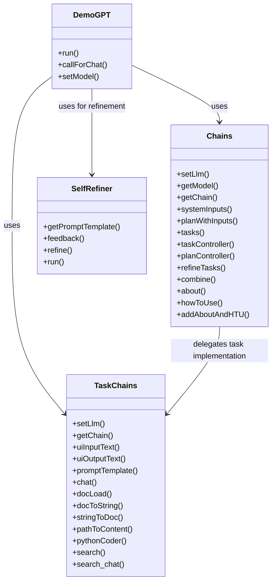
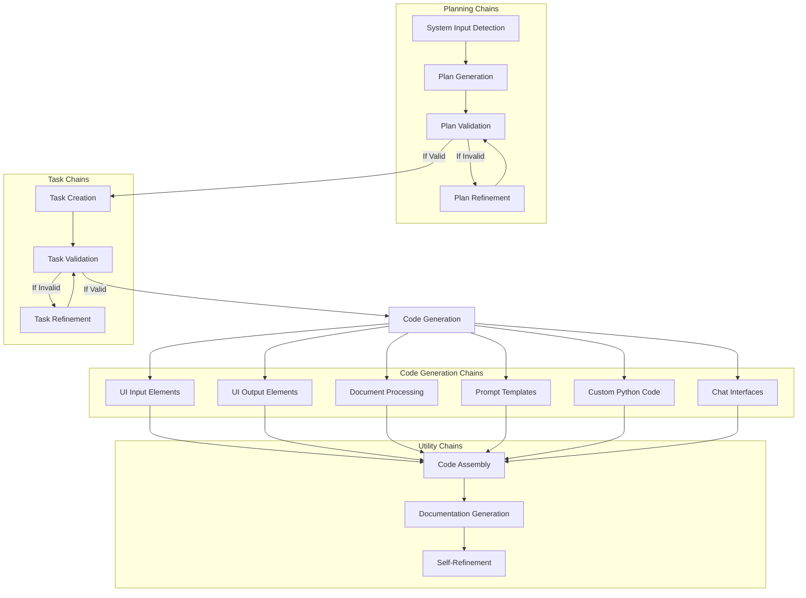
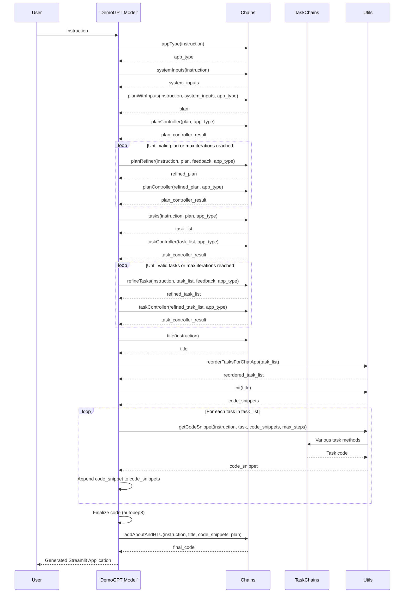

<!-- source: DeepWiki mcp.deepwiki.com · repo melih-unsal/DemoGPT · page 3.2 Chains · fetched 2026-10-26 -->

# Chains

<details>
<summary>Relevant source files</summary>

The following files were used as context for generating this wiki page:

- [demogpt/app.py](demogpt/app.py)
- [demogpt/chains/chains.py](demogpt/chains/chains.py)
- [demogpt/chains/prompts/plan.py](demogpt/chains/prompts/plan.py)
- [demogpt/chains/prompts/plan1.py](demogpt/chains/prompts/plan1.py)
- [demogpt/chains/self_refiner.py](demogpt/chains/self_refiner.py)
- [demogpt/chains/task_chains.py](demogpt/chains/task_chains.py)
- [demogpt/model.py](demogpt/model.py)
- [demogpt/test_cases.py](demogpt/test_cases.py)
- [demogpt/utils.py](demogpt/utils.py)
- [pyproject.toml](pyproject.toml)

</details>


The Chains component serves as the backbone of DemoGPT, orchestrating the transformation of natural language instructions into functional Streamlit applications. This system handles the progressive refinement of user requests through a series of language model interactions that ultimately produce executable code.

For information about the overall DemoGPT model that manages the application generation workflow, see [Model](#3.1). For details about controllers that validate tasks, see [Controllers](#3.3).

## Chain Architecture

DemoGPT employs a hierarchical chain architecture that manages different aspects of the application generation process.



Sources: [demogpt/chains/chains.py:20-326](), [demogpt/chains/task_chains.py:16-389](), [demogpt/chains/self_refiner.py:17-90](), [demogpt/model.py:18-562]()

### Core Chain Classes

The system consists of two primary chain classes:

1. **Chains** - Orchestrates high-level operations like plan generation, task management, and code assembly.
2. **TaskChains** - Generates specific code snippets for individual task types (UI elements, prompt templates, document processing, etc.)

These classes work together to implement a progressive refinement approach, where each step builds upon the outputs of previous steps.

## Chain Types

DemoGPT's chain system implements specialized chains for different aspects of the application generation process:



Sources: [demogpt/chains/chains.py:41-335](), [demogpt/utils.py:282-313]()

### Planning Chains

Planning chains convert user instructions into structured application plans:

| Chain Method | Purpose | File Location |
|--------------|---------|---------------|
| `systemInputs()` | Detects required system inputs | [chains.py:107-113]() |
| `planWithInputs()` | Generates initial plan | [chains.py:118-130]() |
| `planController()` | Validates the plan | [chains.py:178-179]() |
| `planRefiner()` | Improves plan based on feedback | [chains.py:144-155]() |

### Task Chains

Task chains generate and refine specific tasks from the plan:

| Chain Method | Purpose | File Location |
|--------------|---------|---------------|
| `tasks()` | Creates tasks from plan | [chains.py:161-171]() |
| `taskController()` | Validates tasks | [chains.py:174-175]() |
| `refineTasks()` | Improves tasks based on feedback | [chains.py:182-196]() |

### Code Generation Chains

Code generation chains implement specific functionality:

| Chain Method | Purpose | File Location |
|--------------|---------|---------------|
| `uiInputText()` | Generates text input UI | [task_chains.py:44-53]() |
| `uiOutputText()` | Generates text output UI | [task_chains.py:55-69]() |
| `promptTemplate()` | Creates prompt templates | [task_chains.py:117-128]() |
| `chat()` | Creates chat interfaces | [task_chains.py:154-168]() |
| `docLoad()` | Loads documents | [task_chains.py:230-341]() |
| `docToString()` | Converts docs to strings | [task_chains.py:354-358]() |
| `pythonCoder()` | Generates custom Python code | [task_chains.py:374-390]() |

### Utility Chains

Utility chains handle supporting operations:

| Chain Method | Purpose | File Location |
|--------------|---------|---------------|
| `combine()` | Combines code snippets | [chains.py:199-207]() |
| `howToUse()` | Generates usage documentation | [chains.py:210-218]() |
| `about()` | Generates about information | [chains.py:221-230]() |
| `addAboutAndHTU()` | Adds documentation to code | [chains.py:297-307]() |

## Chain Execution Flow

The chain execution process in DemoGPT follows a clear sequence to transform user instructions into Streamlit applications.



Sources: [demogpt/model.py:310-562](), [demogpt/chains/chains.py:20-326](), [demogpt/utils.py:282-313]()

### Key Execution Steps:

1. **Detect Application Type**: Determine what kind of application is being requested
2. **Identify System Inputs**: Detect required inputs for the application
3. **Generate Plan**: Create a step-by-step plan to implement the application
4. **Validate & Refine Plan**: Ensure the plan is valid and improve it if needed
5. **Create Tasks**: Break down the plan into specific tasks
6. **Validate & Refine Tasks**: Ensure tasks are valid and improve them if needed
7. **Generate Code**: Convert each task into code snippets
8. **Assemble Final Code**: Combine code snippets into a complete application
9. **Add Documentation**: Generate "How to Use" and "About" sections

## Implementation Details

### Chains Class Methods

The `Chains` class orchestrates the high-level processes:

```python
# Set up the language model
@classmethod
def setLlm(cls, model, openai_api_key, temperature=0.0, openai_api_base=None, has_gpt4=False):
    # Initialize the language model
    
# Create a chain with specified templates
@classmethod
def getChain(cls, system_template="", human_template="", change=False, change_model="gpt-4-0613", 
             temperature=0, return_type="text", **kwargs):
    # Configure and return a chain
    
# Generate system inputs from instruction
@classmethod
def systemInputs(cls, instruction):
    # Extract required system inputs
    
# Generate a plan from instruction and inputs
@classmethod
def planWithInputs(cls, instruction, system_inputs, app_type):
    # Create an application plan
```

Sources: [demogpt/chains/chains.py:22-130]()

### TaskChains Class Methods

The `TaskChains` class handles specific task implementation:

```python
# Generate text input UI
@classmethod
def uiInputText(cls, task):
    # Generate code for text input
    
# Generate text output UI
@classmethod
def uiOutputText(cls, task):
    # Generate code for text output
    
# Generate prompt template
@classmethod
def promptTemplate(cls, app_idea, task):
    # Generate code for LLM prompt template
```

Sources: [demogpt/chains/task_chains.py:44-128]()

### Chain Data Flow

The data flows through chains in specific formats:

1. **Plan Format**: A string containing numbered steps with task types (e.g., `1. Get input from user [ui_input_text() -> user_input]`)
2. **Task List Format**: A list of task dictionaries with step, type, inputs, and outputs
3. **Code Snippets**: Python code implementing specific functionality

Example Task Format:
```json
{
  "step": 1,
  "task_type": "ui_input_text",
  "task_name": "get_text_input",
  "input_key": "none",
  "output_key": "user_input",
  "description": "Get text input from the user"
}
```

## Chain Utilities

The DemoGPT chain system includes several utilities to support the chain operations:

### Task-Specific Code Generation

The `getCodeSnippet` utility in `utils.py` uses the appropriate `TaskChains` method to generate code for a given task:

```python
def getCodeSnippet(app_idea, task, code_snippets, iters=10):
    task_type = task["task_type"]
    code = ""
    if task_type == "ui_input_text":
        code = TaskChains.uiInputText(task=task)
    elif task_type == "ui_output_text":
        code = TaskChains.uiOutputText(task=task)
    # ... other task types
    return code.strip() + "\n"
```

Sources: [demogpt/utils.py:282-313]()

### Code Assembly

Code assembly utilities combine individual snippets into a complete application:

```python
def getCode(imports, functions, prefix, inputs, outputs, how_to, about, title):
    return f"""
{imports}

{functions}

{prefix}

{how_to}

{about}

with st.form(key="form"):
    st.title('{title}')
{inputs}
    submit_button = st.form_submit_button(label='Submit')
    # ... rest of code
"""
```

Sources: [demogpt/model.py:316-336]()

## Chain Prompts

The chain system uses carefully crafted prompts to guide the LLM in generating appropriate responses. These are stored in the `demogpt/chains/prompts/` directory.

Example plan generation prompt structure:
```python
system_template = """
Create a plan to fulfill the given instruction. 
The plan should be broken down into clear, logical steps that detail how to accomplish the task. 
Consider all necessary user interactions, system processes, and validations, 
and ensure that the steps are in a logical sequence that corresponds to the given instruction.
Don't generate impossible steps in the plan because only those tasks are available:
{TASK_DESCRIPTIONS}
# ... more instructions
"""

human_template = """
Don't generate redundant steps which is not meant in the instruction.

# Examples of different application types and their plans
Instruction: {instruction}
System Inputs:{system_inputs}
Let's think step by step.
"""
```

Sources: [demogpt/chains/prompts/plan.py:1-95]()

## Conclusion

The Chains component is a critical subsystem in DemoGPT that drives the transformation of natural language instructions into functional Streamlit applications. By implementing a progressive refinement approach with specialized chains for different aspects of the generation process, it enables reliable creation of complex applications from simple instructions.

The system's modular architecture allows for easy extension with new task types and refinement strategies, making it flexible and powerful for automated application generation.

---

