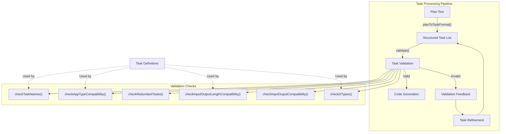
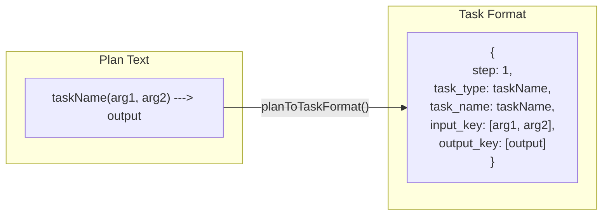
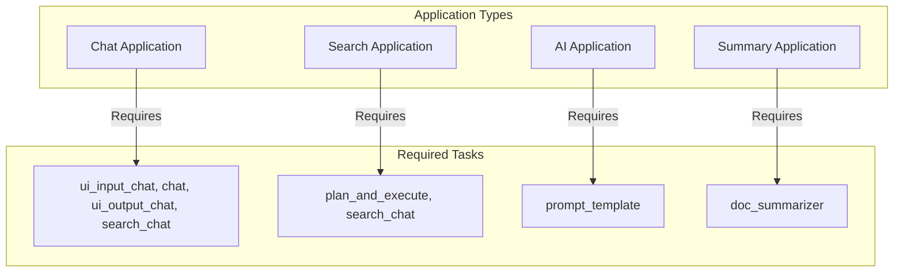
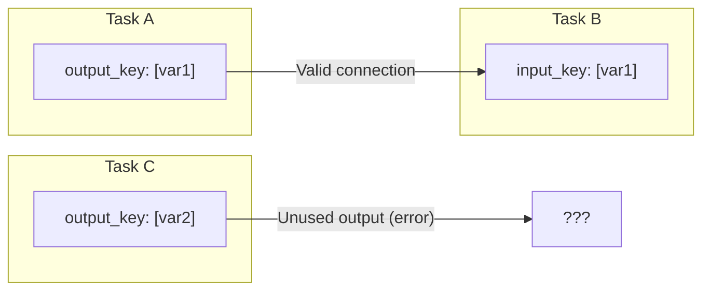
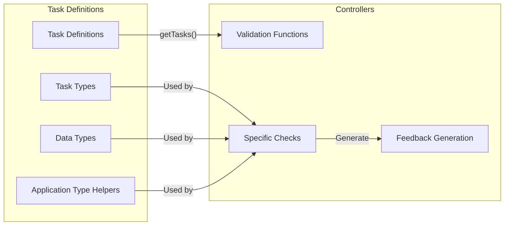
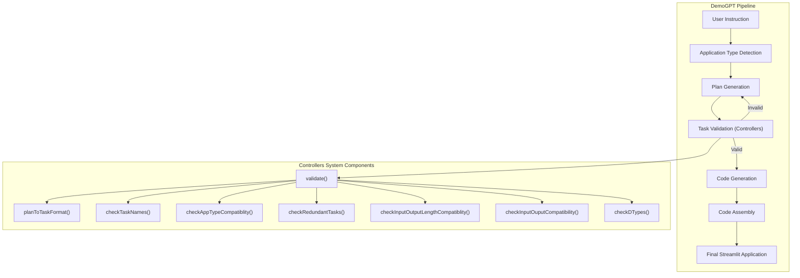

<!-- source: DeepWiki mcp.deepwiki.com · repo melih-unsal/DemoGPT · page 3.3 Controllers · fetched 2026-10-26 -->

# Controllers

<details>
<summary>Relevant source files</summary>

The following files were used as context for generating this wiki page:

- [demogpt/chains/prompts/__init__.py](demogpt/chains/prompts/__init__.py)
- [demogpt/chains/prompts/app_type.py](demogpt/chains/prompts/app_type.py)
- [demogpt/chains/prompts/plan_with_inputs.py](demogpt/chains/prompts/plan_with_inputs.py)
- [demogpt/chains/prompts/task_list/ui_output_text.py](demogpt/chains/prompts/task_list/ui_output_text.py)
- [demogpt/chains/task_definitions.py](demogpt/chains/task_definitions.py)
- [demogpt/controllers.py](demogpt/controllers.py)

</details>


The Controllers module in DemoGPT provides validation and management mechanisms for tasks during the application generation process. Controllers act as safeguards to ensure that plans and tasks are valid, compatible with the application type, and correctly structured before code generation begins.

This document covers the controllers' validation functions, their role in the task pipeline, and how they interact with the task definition system. For information about the Task System itself, see [Task System](#2.2).

## Overview of the Controllers System

The Controllers module serves as a critical validation layer in the DemoGPT pipeline. It validates plans and tasks against predefined rules and provides detailed feedback when issues are detected. This validation ensures that the generated applications will have the correct structure and functionality before any code is generated.



Sources: [demogpt/controllers.py:58-92](), [demogpt/controllers.py:7-36]()

## Task Validation Process

### Plan to Task Format Conversion

Before validation can occur, textual plans are converted to structured task formats using the `planToTaskFormat` function. This function parses plans written in a function-like syntax (e.g., `taskName(arg1, arg2) ---> output`) and converts them into a structured task list with steps, task types, input keys, and output keys.



Sources: [demogpt/controllers.py:7-36]()

### Validation Checks

The `validate` function coordinates multiple validation checks to ensure tasks are valid. It returns detailed feedback when issues are detected.

#### Task Name Validation

The `checkTaskNames` function verifies that all task types in the plan are valid and available for the specified application type. It uses the task definitions from `chains/task_definitions.py` to determine valid task types.

```python
# Example feedback from checkTaskNames
"Task invalid_task is invalid, you cannot use undefined task.
Only those tasks are available: ui_input_text ui_output_text prompt_template"
```

Sources: [demogpt/controllers.py:38-56](), [demogpt/chains/task_definitions.py:7-169]()

#### Application Type Compatibility

The `checkAppTypeCompatiblity` function ensures that tasks are compatible with the application type (e.g., chat-based apps must include chat-related tasks). This is especially important for specialized application types like chat apps, search apps, and AI-based apps.



Sources: [demogpt/controllers.py:287-388](), [demogpt/chains/prompts/app_type.py:1-96]()

#### Input/Output Compatibility

Two functions handle input/output compatibility:
- `checkInputOuputCompatibility` verifies that all inputs come from outputs of other tasks and that all outputs are used as inputs.
- `checkRedundantTasks` identifies tasks whose outputs are never used by other tasks.



Sources: [demogpt/controllers.py:104-157]()

#### Input/Output Length Compatibility

The `checkInputOutputLengthCompatiblity` function ensures that the number of inputs and outputs for each task matches the expected number based on the task definition. Some tasks may have a fixed number of inputs or outputs, while others (marked with `*` in their data type) can accept multiple inputs or outputs.

Sources: [demogpt/controllers.py:159-191]()

#### Data Type Validation

The `checkDTypes` function verifies that the data types of inputs and outputs for each task match the expected data types defined in the task definitions. This ensures type compatibility throughout the task flow.

```python
# Example feedback from checkDTypes
"task_name expects all inputs as string but data type of input_key is Document not string. Please find another way."
```

Sources: [demogpt/controllers.py:391-441]()

### Prompt Template Validation

For tasks that generate or use templates, the `checkPromptTemplates` function ensures that all required input variables are included in the templates and that no extra variables are present.

Sources: [demogpt/controllers.py:444-470]()

## Integration with Task Definitions

The controllers system integrates closely with the task definition system defined in `chains/task_definitions.py`. This relationship is essential for the validation process, as the controllers use the task definitions to determine valid task types, expected input/output data types, and other task constraints.



Sources: [demogpt/controllers.py:38-56](), [demogpt/chains/task_definitions.py:234-256]()

## Controller Flow in DemoGPT System

The following diagram illustrates how controllers fit into the overall DemoGPT pipeline:



Sources: [demogpt/controllers.py:58-92]()

## Key Validation Rules

The following table summarizes key validation rules enforced by the controllers:

| Validation Rule | Description | Validation Function |
|-----------------|-------------|---------------------|
| Valid Task Names | All task types must be defined in task definitions | `checkTaskNames()` |
| App Type Compatibility | Tasks must be compatible with the application type | `checkAppTypeCompatiblity()` |
| Input Source | All inputs must come from outputs of other tasks | `checkInputOuputCompatibility()` |
| Output Usage | All outputs must be used as inputs by other tasks | `checkRedundantTasks()` |
| I/O Length Compatibility | Number of inputs/outputs must match task definition | `checkInputOutputLengthCompatiblity()` |
| Data Type Compatibility | Data types of inputs/outputs must match task definition | `checkDTypes()` |
| Task Sequence | First task should not have inputs | `checkDTypes()` |
| Template Variables | Templates must contain all required variables and no extras | `checkPromptTemplates()` |

Sources: [demogpt/controllers.py:38-470]()

## Validation Feedback Examples

When validation fails, the controllers generate detailed feedback to help users correct their plans:

```
Task invalid_task is invalid, you cannot use undefined task.
Only those tasks are available: ui_input_text ui_output_text prompt_template

The app is chat-based but you didn't use ui_input_chat in your tasks. Please add it and try again

Task ui_output_text has problem because its output output_text is never used. Try another approach.

Task prompt_template can only have single output but you gave multiple

python task 'code_task' uses search_result as an input but it comes from plan_and_execute task 'search_task'. python task cannot use plan_and_execute task's output as an input. Please redesign the tasks so that no python task uses plan_and_execute task's output as an input!
```

These feedback messages help users understand what's wrong with their plans and how to fix them.

Sources: [demogpt/controllers.py:73-85]()

## Conclusion

The Controllers module is a critical component of the DemoGPT system that ensures plans and tasks are valid and well-structured before code generation begins. By performing comprehensive validation checks and providing detailed feedback, controllers help create robust and functional Streamlit applications from natural language instructions.

Controllers work closely with task definitions to validate tasks against predefined rules and constraints, ensuring type compatibility, proper task sequencing, and application type compatibility. This validation layer is essential for the reliability and stability of the DemoGPT system.

---

