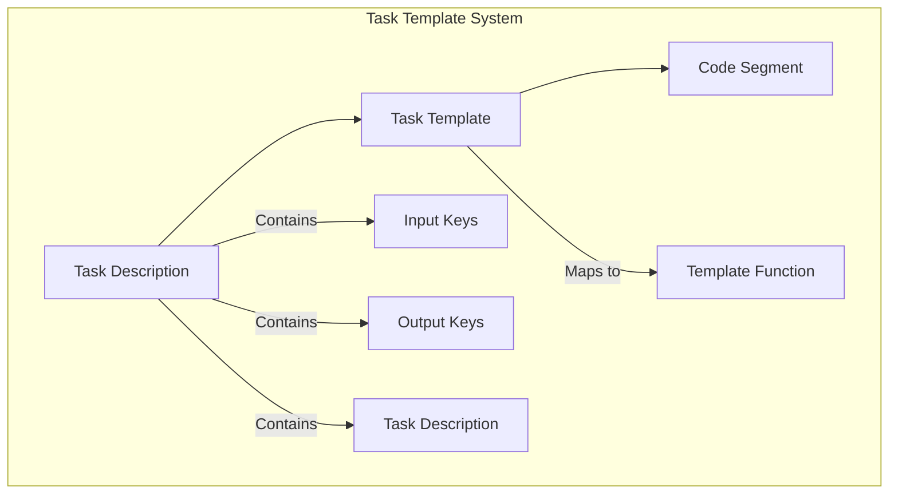
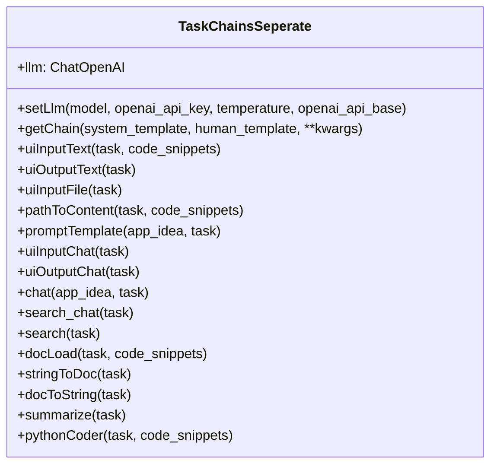
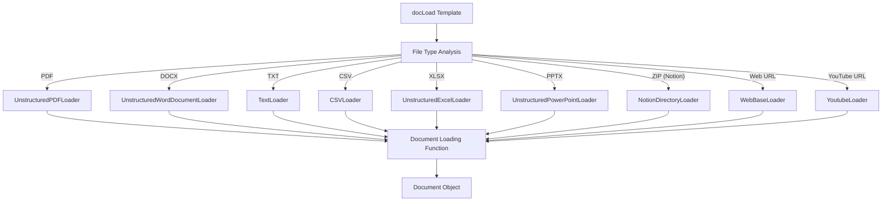
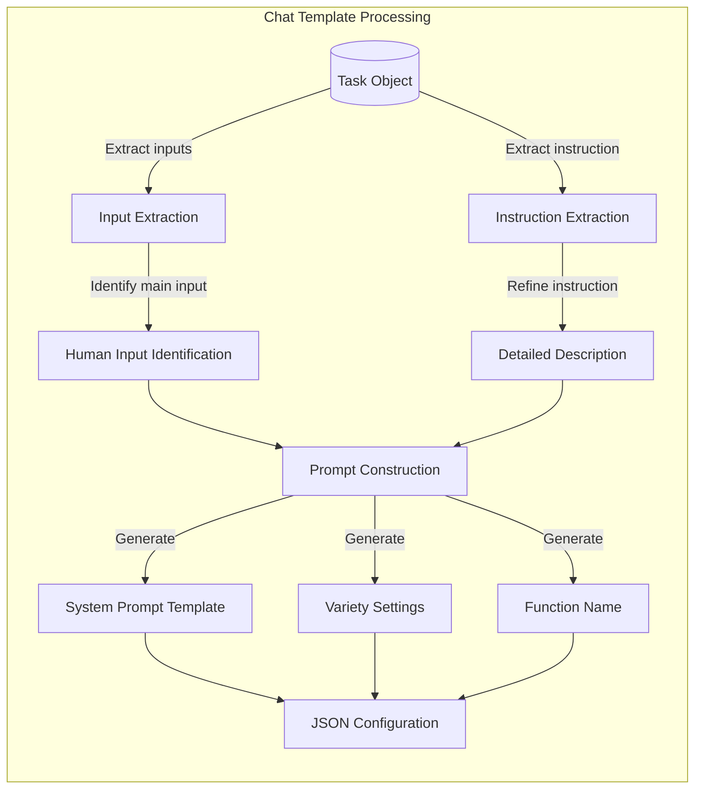
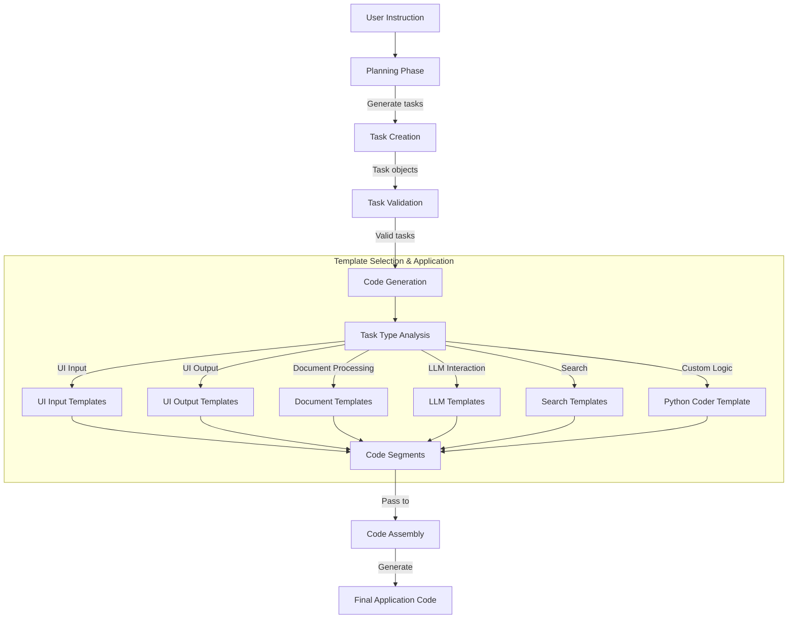

<!-- source: DeepWiki mcp.deepwiki.com · repo melih-unsal/DemoGPT · page 3.4 Task Templates · fetched 2026-10-26 -->

# Task Templates

<details>
<summary>Relevant source files</summary>

The following files were used as context for generating this wiki page:

- [demogpt/chains/prompts/how_to_use.py](demogpt/chains/prompts/how_to_use.py)
- [demogpt/chains/prompts/self_refinement/__init__.py](demogpt/chains/prompts/self_refinement/__init__.py)
- [demogpt/chains/prompts/self_refinement/final_refiner.py](demogpt/chains/prompts/self_refinement/final_refiner.py)
- [demogpt/chains/prompts/task_list/chat.py](demogpt/chains/prompts/task_list/chat.py)
- [demogpt/chains/prompts/task_list/detailed_description.py](demogpt/chains/prompts/task_list/detailed_description.py)
- [demogpt/chains/prompts/task_list/doc_load.py](demogpt/chains/prompts/task_list/doc_load.py)
- [demogpt/chains/prompts/task_list/summarize.py](demogpt/chains/prompts/task_list/summarize.py)
- [demogpt/chains/prompts/task_list/ui_input_chat.py](demogpt/chains/prompts/task_list/ui_input_chat.py)
- [demogpt/chains/prompts/task_list/ui_input_file.py](demogpt/chains/prompts/task_list/ui_input_file.py)
- [demogpt/chains/prompts/task_list/ui_input_text.py](demogpt/chains/prompts/task_list/ui_input_text.py)
- [demogpt/chains/task_chains_seperate.py](demogpt/chains/task_chains_seperate.py)

</details>


This page documents the available task templates in DemoGPT and explains how they're used to generate specific functionality in Streamlit applications. Task templates are predefined code generators that transform abstract task descriptions into concrete code implementations. For information about task controllers that validate and manage these tasks, see [Controllers](#3.3).

## What are Task Templates?

Task templates are specialized code generation functions that convert high-level task descriptions into specific code implementations for various Streamlit application features. Each template is designed to handle a specific type of functionality, such as creating UI elements, processing documents, or implementing chat interfaces.



Sources: [demogpt/chains/task_chains_seperate.py:16-461]()

## Template Structure and Interface

All task templates in DemoGPT follow a consistent structure and interface. Each template is implemented as a class method in the `TaskChainsSeperate` class, which:

1. Takes a task object containing input keys, output keys, and a description
2. May take additional context like code snippets from previous generations
3. Uses predefined prompt templates to generate code
4. Returns a standardized dictionary with code segments



The standard return structure for each template is a dictionary with the following keys:
- `imports`: Import statements needed for the generated code
- `functions`: Function definitions
- `inputs`: UI input elements
- `outputs`: UI output elements
- `code`: The complete code (combination of all above elements)

Sources: [demogpt/chains/task_chains_seperate.py:17-43]()

## Available Task Templates

DemoGPT provides a comprehensive set of task templates for different functionalities. These can be categorized into several groups:

### UI Input/Output Templates

These templates generate code for user interface elements that collect input from users or display output.

| Template | Purpose | Input Keys | Output Keys |
|----------|---------|------------|-------------|
| `uiInputText` | Text input elements (text boxes, select boxes, etc.) | N/A | Variable to store input |
| `uiOutputText` | Text output display | Input to display | N/A |
| `uiInputFile` | File upload functionality | N/A | Variable to store file path |
| `uiInputChat` | Chat input interface | N/A | Variable to store user message |
| `uiOutputChat` | Chat output display | Chat message | N/A |

Example of `uiInputText` usage:
```python
# Task definition
task = {
    "description": "Get the user's name",
    "output_key": ["user_name"]
}
# Results in Streamlit code like:
# user_name = st.text_input("Enter your name")
```

Sources: 
- [demogpt/chains/task_chains_seperate.py:45-64]()
- [demogpt/chains/task_chains_seperate.py:66-80]()
- [demogpt/chains/task_chains_seperate.py:82-103]()
- [demogpt/chains/task_chains_seperate.py:155-167]()
- [demogpt/chains/task_chains_seperate.py:169-181]()
- [demogpt/chains/prompts/task_list/ui_input_text.py:1-33]()
- [demogpt/chains/prompts/task_list/ui_input_file.py:1-40]()
- [demogpt/chains/prompts/task_list/ui_input_chat.py:1-34]()

### Document Processing Templates

These templates handle loading, processing, and manipulating document data.

| Template | Purpose | Input Keys | Output Keys |
|----------|---------|------------|-------------|
| `docLoad` | Load documents from various file types | File path | Document object |
| `stringToDoc` | Convert string to document object | Text string | Document object |
| `docToString` | Convert document to string | Document object | Text string |
| `summarize` | Summarize document content | Document object | Summary text |
| `pathToContent` | Extract content from file path | File path | File content |

The `docLoad` template is particularly sophisticated, supporting multiple file types through different loaders:



Sources:
- [demogpt/chains/task_chains_seperate.py:271-386]()
- [demogpt/chains/task_chains_seperate.py:388-401]()
- [demogpt/chains/task_chains_seperate.py:403-415]()
- [demogpt/chains/task_chains_seperate.py:417-433]()
- [demogpt/chains/task_chains_seperate.py:106-129]()
- [demogpt/chains/prompts/task_list/doc_load.py:1-69]()

### LLM Interaction Templates

These templates generate code for LLM-based interactions and functionalities.

| Template | Purpose | Input Keys | Output Keys |
|----------|---------|------------|-------------|
| `chat` | Create chat-based LLM interactions | User input, context | LLM response |
| `promptTemplate` | Generate prompt templates for LLM | User inputs | Formatted prompt |
| `promptTemplateRefiner` | Refine existing prompt templates | Templates, feedback | Improved templates |

The `chat` template is particularly important as it generates system prompts for LLM-based chat features:



Sources:
- [demogpt/chains/task_chains_seperate.py:183-200]()
- [demogpt/chains/task_chains_seperate.py:141-152]()
- [demogpt/chains/task_chains_seperate.py:202-212]()
- [demogpt/chains/prompts/task_list/chat.py:1-65]()
- [demogpt/chains/prompts/task_list/detailed_description.py:1-15]()

### Search Templates

These templates implement search functionality in the generated applications.

| Template | Purpose | Input Keys | Output Keys |
|----------|---------|------------|-------------|
| `search` | Web search functionality | Search query | Search results |
| `search_chat` | Interactive search with chat | Search query, chat history | Search results, chat response |

Sources:
- [demogpt/chains/task_chains_seperate.py:243-268]()
- [demogpt/chains/task_chains_seperate.py:214-241]()

### General Code Generation Template

| Template | Purpose | Input Keys | Output Keys |
|----------|---------|------------|-------------|
| `pythonCoder` | Generate custom Python code based on natural language instructions | Task inputs | Task outputs |

The `pythonCoder` template is the most flexible and can generate custom functionality when no specialized template fits the task:

```python
# Task definition
task = {
    "description": "Calculate the factorial of a number",
    "input_key": ["number"],
    "output_key": ["factorial"],
    "task_name": "calculate_factorial"
}
# Generates a custom Python function for factorial calculation
```

Sources:
- [demogpt/chains/task_chains_seperate.py:435-461]()

## How Task Templates Are Used in the Pipeline

Task templates are a crucial part of the DemoGPT code generation pipeline. Here's how they integrate with the overall system:



The process works as follows:

1. Task creation produces task objects with descriptions, input keys, and output keys
2. Each task is analyzed to determine its type (UI input, document processing, etc.)
3. The appropriate task template is selected based on the task type
4. The template generates code segments specific to that task
5. All code segments are assembled into the final application

Sources: [demogpt/chains/task_chains_seperate.py:16-461]()

## Self-Refinement in Task Templates

Some task templates include self-refinement capabilities to improve the generated code. For example, the `uiInputText` and `pathToContent` templates use a `refine` utility function to polish the generated code:

```python
code = cls.getChain(
    human_template=prompts.ui_input_text.human_template,
    instruction=instruction,
    variable=variable,
    code_snippets=code_snippets
)
code = utils.refine(code)  # Self-refinement step
```

The self-refinement process can check for issues like:
- Variable scope and definition order
- Missing initialization in conditional statements
- Streamlit-specific requirements
- Form button usage for state preservation

For more detailed information on self-refinement, see [Self-Refinement](#3.5).

Sources: 
- [demogpt/chains/task_chains_seperate.py:45-64]()
- [demogpt/chains/task_chains_seperate.py:106-129]()
- [demogpt/chains/task_chains_seperate.py:435-461]()
- [demogpt/chains/prompts/self_refinement/final_refiner.py:1-39]()

## Template Prompt System

Each task template relies on a corresponding prompt template that guides the LLM in generating appropriate code. These prompts are stored in the `prompts/task_list` directory and include:

1. **System templates**: Define the LLM's role and constraints
2. **Human templates**: Provide examples and the specific task instruction
3. **Code templates**: Pre-formatted code snippets that are filled with task-specific values

For example, the `ui_input_file.py` prompt contains:
```python
system_template = """
You are an AI assistant that can generate JSON with 2 keys which are title and data_type
The values correspond to those keys will be used in the streamlit's file_uploader function...
"""

human_template = """
Instruction:{instruction}
JSON:
"""

inputs = """
uploaded_file = st.file_uploader("{title}", type={data_type}, key='{variable}')
"""
```

These prompts ensure consistency and quality in the generated code across different tasks.

Sources:
- [demogpt/chains/prompts/task_list/ui_input_file.py:1-40]()
- [demogpt/chains/prompts/task_list/ui_input_text.py:1-33]()
- [demogpt/chains/prompts/task_list/ui_input_chat.py:1-34]()
- [demogpt/chains/prompts/task_list/chat.py:1-65]()
- [demogpt/chains/prompts/task_list/doc_load.py:1-69]()

## Extending with New Task Templates

To add new task templates to DemoGPT, developers need to:

1. Create a new prompt template in the `prompts/task_list` directory
2. Add a new method to the `TaskChainsSeperate` class
3. Ensure the method follows the standard template pattern
4. Update task controllers to validate the new task type

For more detailed information on extending DemoGPT with new tasks, see [Adding New Tasks](#6.1).

---

