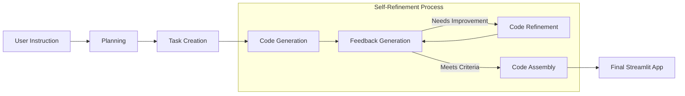
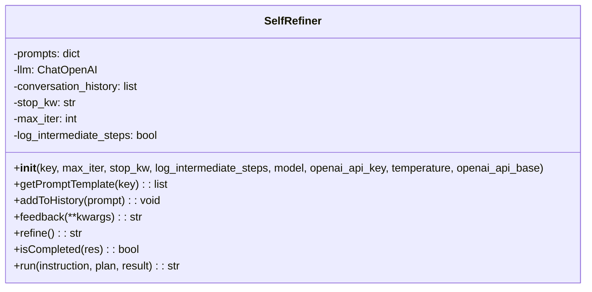
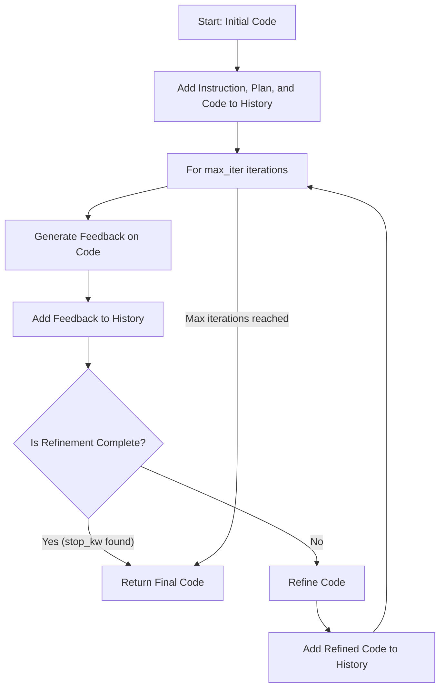

<!-- source: DeepWiki mcp.deepwiki.com · repo melih-unsal/DemoGPT · page 3.5 Self-Refinement · fetched 2026-10-26 -->

# Self-Refinement

<details>
<summary>Relevant source files</summary>

The following files were used as context for generating this wiki page:

- [README.md](README.md)
- [assets/demogpt_new_pipeline.jpeg](assets/demogpt_new_pipeline.jpeg)
- [assets/demogpt_new_pipeline1.jpeg](assets/demogpt_new_pipeline1.jpeg)
- [demogpt/chains/prompts/plan.py](demogpt/chains/prompts/plan.py)
- [demogpt/chains/prompts/plan1.py](demogpt/chains/prompts/plan1.py)
- [demogpt/chains/prompts/task_list/search.py](demogpt/chains/prompts/task_list/search.py)
- [demogpt/chains/prompts/task_list/search_chat.py](demogpt/chains/prompts/task_list/search_chat.py)
- [demogpt/chains/self_refiner.py](demogpt/chains/self_refiner.py)
- [demogpt/test_cases.py](demogpt/test_cases.py)
- [docs/README_CN.md](docs/README_CN.md)

</details>


Self-Refinement is a core component of DemoGPT's code generation pipeline that improves the quality of generated code through an iterative feedback and refinement process. Rather than accepting the initial output from the code generation step, the Self-Refinement system analyzes the code, provides feedback, and makes improvements until a satisfactory result is achieved. This ensures that the final Streamlit applications meet requirements and contain fewer errors.

For information about the overall code generation process, see [Code Generation and Assembly](#2.3).

## Architecture Overview

The Self-Refinement process is integrated into DemoGPT's core processing pipeline between the Code Generation and Code Assembly stages. When code snippets are generated, they pass through the Self-Refinement system before being assembled into the final application.



Sources: [README.md:115-115](), [demogpt/chains/self_refiner.py:17-91]()

## SelfRefiner Class

The Self-Refinement system is primarily implemented through the `SelfRefiner` class in the `demogpt/chains/self_refiner.py` file. This class orchestrates the feedback-refinement loop, tracking conversation history and determining when refinement is complete.



Sources: [demogpt/chains/self_refiner.py:17-91]()

### Key Components

| Component | Description |
|-----------|-------------|
| `prompts` | Dictionary containing prompt templates for feedback and refinement |
| `llm` | Language model (ChatOpenAI) used for generating feedback and refinements |
| `conversation_history` | List of messages tracking the refinement process |
| `stop_kw` | Keyword indicating successful refinement (default: "<SUCCESS>") |
| `max_iter` | Maximum number of refinement iterations (default: 4) |
| `log_intermediate_steps` | Flag to log intermediate refinement steps |

Sources: [demogpt/chains/self_refiner.py:17-46]()

## The Refinement Process

The Self-Refinement process follows these steps:

1. **Initialize with Context**: The initial code, along with the instruction and plan, is added to the conversation history.
2. **Generate Feedback**: The system uses the language model to evaluate the code and provide feedback.
3. **Evaluate Completion**: The feedback is checked for a success indicator that would signal refinement is complete.
4. **Refine or Complete**: If refinement is complete, the code is returned as is. Otherwise, it is refined based on the feedback.
5. **Iterate**: Steps 2-4 are repeated until either the code meets requirements or the maximum number of iterations is reached.

This process ensures that the generated code is continually improved through multiple iterations of feedback and refinement.



Sources: [demogpt/chains/self_refiner.py:75-90]()

## Implementation Details

### Conversation History Management

The `SelfRefiner` maintains a conversation history as a list of message templates, alternating between human and AI messages. This provides context for each refinement step, ensuring that the language model has access to the full history of the refinement process.

```python
def addToHistory(self, prompt):
    if len(self.conversation_history) % 2 == 0:
        template = HumanMessagePromptTemplate.from_template(prompt)
    else:
        template = AIMessagePromptTemplate.from_template(prompt)
    self.conversation_history.append(template)
```

When a new message is added, it's formatted as either a human or AI message depending on its position in the conversation.

Sources: [demogpt/chains/self_refiner.py:54-60]()

### Feedback Generation

Feedback is generated using a dedicated prompt template that evaluates the current state of the code:

```python
def feedback(self, **kwargs):
    return LLMChain(
        llm=self.llm,
        prompt=ChatPromptTemplate.from_template(self.prompts["feedback"]),
    ).run(**kwargs)
```

The feedback is based on the instruction and the current result, providing guidance on what needs to be improved.

Sources: [demogpt/chains/self_refiner.py:62-66]()

### Code Refinement

The refinement process uses the accumulated conversation history to generate an improved version of the code:

```python
def refine(self):
    prompt = ChatPromptTemplate.from_messages(self.conversation_history)
    return LLMChain(llm=self.llm, prompt=prompt).run({})
```

This approach allows the language model to consider all previous feedback and refinements when generating the next iteration of the code.

Sources: [demogpt/chains/self_refiner.py:68-70]()

### Completion Check

The system checks if refinement is complete by looking for a specific stop keyword in the feedback:

```python
def isCompleted(self, res):
    return self.stop_kw in res
```

When this keyword is found, the refinement process terminates and returns the current code.

Sources: [demogpt/chains/self_refiner.py:72-73]()

## Usage in DemoGPT

The Self-Refinement system is used in DemoGPT after code snippets are generated from tasks. It ensures that the generated code is of high quality before being assembled into the final Streamlit application.

A typical usage pattern is:

```python
refiner = SelfRefiner()
refined_code = refiner.run(
    instruction=instruction,
    plan=plan,
    result=initial_code
)
```

The refined code is then passed to the code assembly stage for integration into the final application.

Sources: [demogpt/chains/self_refiner.py:93-99]()

## Development Status

As of the current state of DemoGPT, the Self-Refinement system is operational but still under development. The README.md file lists "Implement self-refining strategy for model response refinement" as a to-do item, suggesting that enhancements to the system are planned.

Future improvements may include:
- Integration with a testing framework to evaluate code functionality
- Expansion of refinement prompt templates for different types of code
- Implementation of a database to store successful refinements and avoid redundant processing

Sources: [README.md:212-212]()

## Conclusion

The Self-Refinement system is a crucial component of DemoGPT that significantly improves the quality of generated code through iterative feedback and refinement. By ensuring that code meets requirements and contains fewer errors before assembly, it contributes to the overall reliability and effectiveness of the generated Streamlit applications.

---

