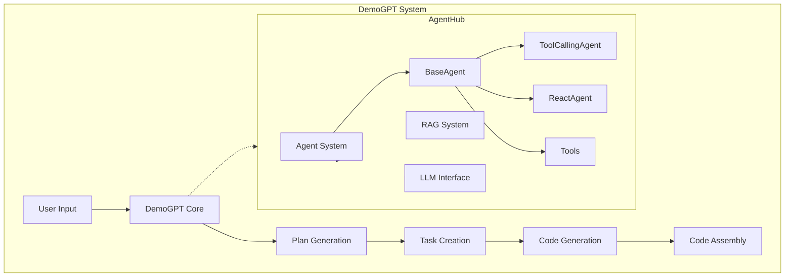
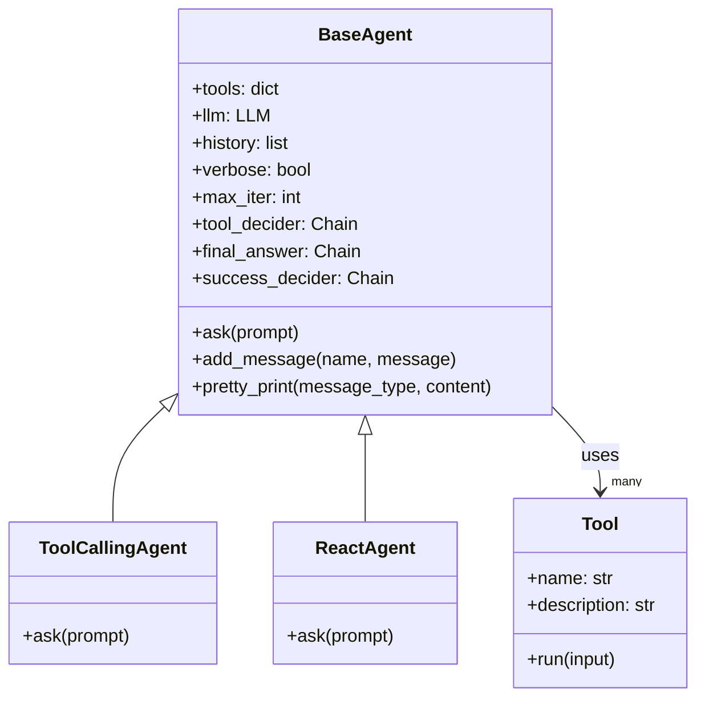
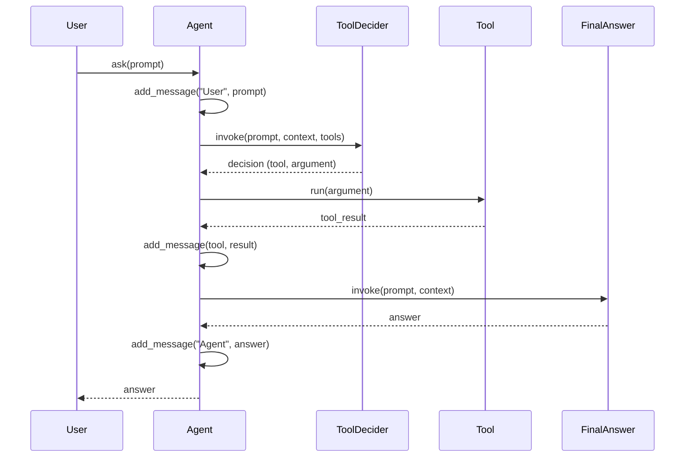
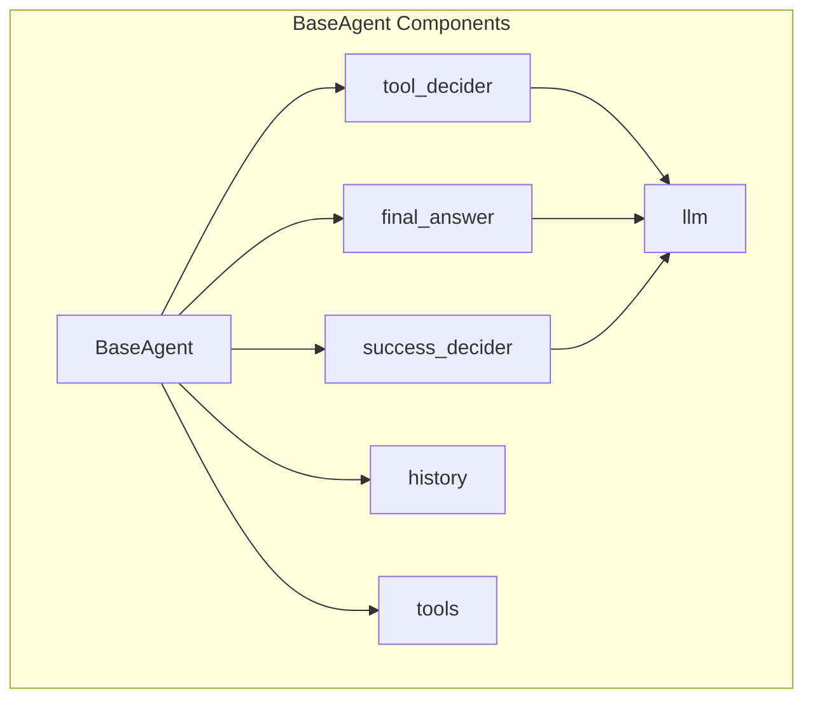
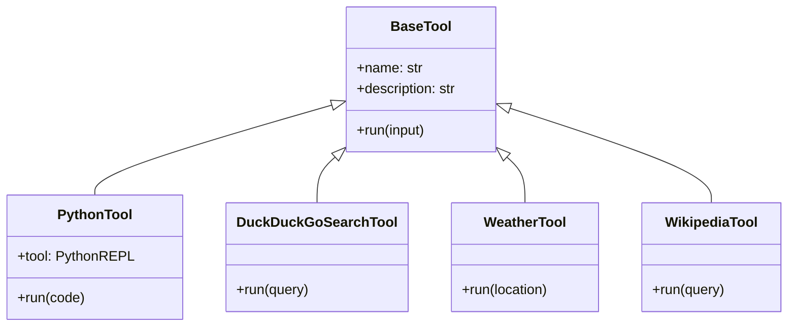
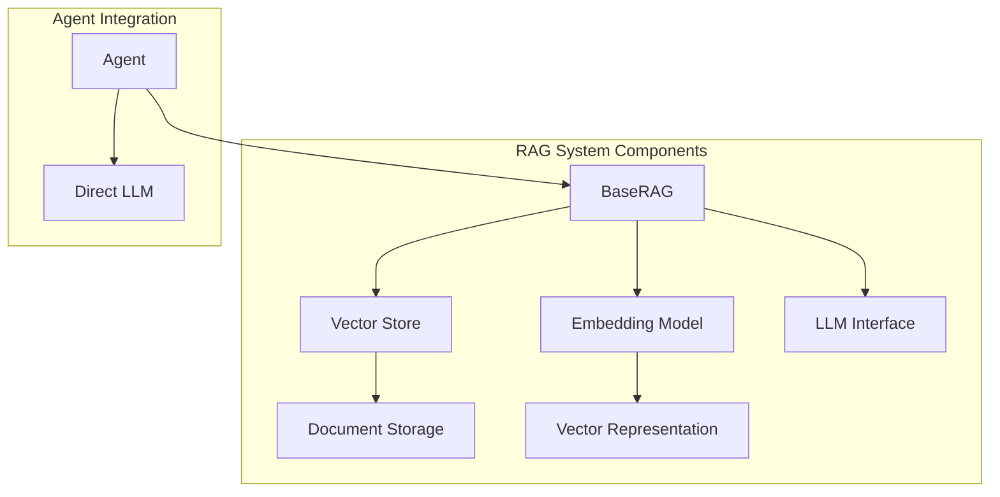
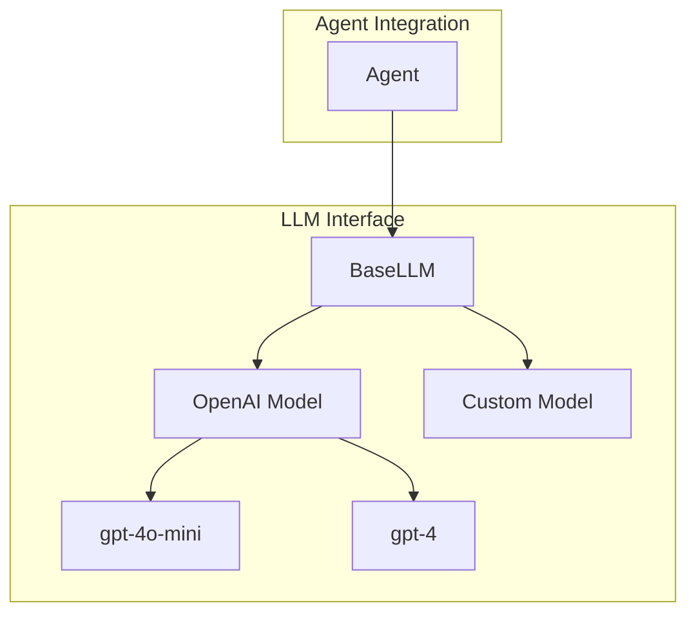
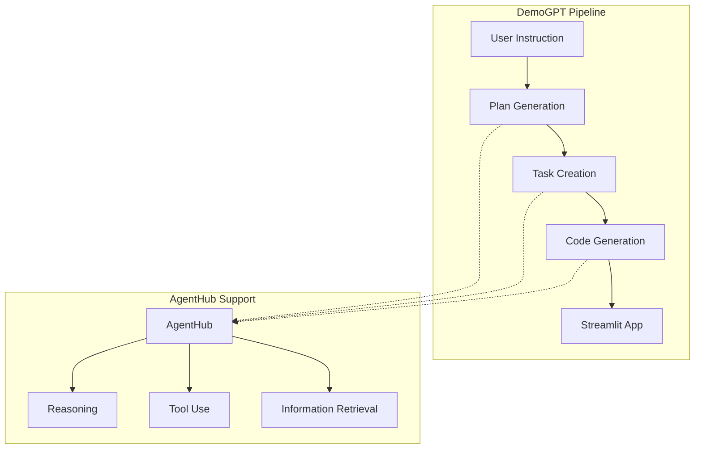

<!-- source: DeepWiki mcp.deepwiki.com · repo melih-unsal/DemoGPT · page 4 AgentHub · fetched 2026-10-26 -->

# AgentHub

Relevant source files

The following files were used as context for generating this wiki page:

- [demogpt_agenthub/__init__.py](demogpt_agenthub/__init__.py)
- [demogpt_agenthub/agents/__init__.py](demogpt_agenthub/agents/__init__.py)
- [demogpt_agenthub/agents/base.py](demogpt_agenthub/agents/base.py)
- [demogpt_agenthub/agents/react.py](demogpt_agenthub/agents/react.py)
- [demogpt_agenthub/agents/tool_calling.py](demogpt_agenthub/agents/tool_calling.py)
- [demogpt_agenthub/prompts/__init__.py](demogpt_agenthub/prompts/__init__.py)
- [demogpt_agenthub/prompts/agents/react/success_decider.py](demogpt_agenthub/prompts/agents/react/success_decider.py)
- [demogpt_agenthub/prompts/agents/tool_calling/final_answer.py](demogpt_agenthub/prompts/agents/tool_calling/final_answer.py)
- [demogpt_agenthub/prompts/agents/tool_calling/tool_decider.py](demogpt_agenthub/prompts/agents/tool_calling/tool_decider.py)
- [demogpt_agenthub/rag/__init__.py](demogpt_agenthub/rag/__init__.py)
- [demogpt_agenthub/tools/repl.py](demogpt_agenthub/tools/repl.py)
- [demogpt_agenthub/utils/parsers.py](demogpt_agenthub/utils/parsers.py)

The AgentHub component serves as the intelligent reasoning and task execution framework within DemoGPT. It provides a structured system of agents, tools, and retrieval-augmented generation (RAG) capabilities that power DemoGPT's ability to process natural language instructions and generate appropriate Streamlit applications. This document covers the architecture, components, and functionality of the AgentHub system.

For information about the overall DemoGPT architecture, see [Architecture](#2). For details on specific agent implementations, see [Agents](#4.1).

## Overview

AgentHub is a modular system that provides the reasoning and execution capabilities needed to transform user instructions into actionable steps. It serves as the "brain" of DemoGPT, allowing it to understand requirements, make decisions, and execute appropriate actions through a unified agent interface.

Sources: [demogpt_agenthub/agents/__init__.py](), [demogpt_agenthub/agents/base.py](), [demogpt_agenthub/rag/__init__.py]()

## Agent System Architecture

The Agent System is the core of AgentHub, providing a structured way to execute tasks through reasoning and tool use. It follows a hierarchical structure with a base agent class and specialized implementations.

Sources: [demogpt_agenthub/agents/base.py:11-94](), [demogpt_agenthub/agents/tool_calling.py:3-21](), [demogpt_agenthub/agents/react.py:3-33]()

### Agent Interaction Flow

The following diagram illustrates how the agents interact with tools and LLMs to process user queries:

Sources: [demogpt_agenthub/agents/tool_calling.py:7-21](), [demogpt_agenthub/agents/react.py:7-33]()

## BaseAgent

The `BaseAgent` class serves as the foundation for all agent implementations in AgentHub. It provides the core functionality for managing conversation history, invoking tools, and processing user queries.

### Key Methods and Properties

| Method/Property | Description |
|----------------|-------------|
| `__init__(tools, llm, verbose, max_iter)` | Initializes the agent with tools, LLM, verbosity setting, and max iterations |
| `tool_explanations` | Property that returns formatted tool descriptions |
| `context` | Property that returns the conversation history as a string |
| `add_message(name, message)` | Adds a message to the conversation history |
| `pretty_print(message_type, content)` | Prints color-coded messages when verbose is enabled |
| `ask(prompt)` | Abstract method to process user queries (implemented by subclasses) |

Sources: [demogpt_agenthub/agents/base.py:11-94]()

### Prompt Templates

The BaseAgent uses several prompt templates to guide its reasoning:

1. **Tool Decider**: Determines which tool to use for a given task
   - System prompt: [demogpt_agenthub/prompts/agents/tool_calling/tool_decider.py:1-14]()
   - Human prompt: [demogpt_agenthub/prompts/agents/tool_calling/tool_decider.py:16-24]()

2. **Final Answer**: Formulates the final response based on context
   - System prompt: [demogpt_agenthub/prompts/agents/tool_calling/final_answer.py:1-7]()
   - Human prompt: [demogpt_agenthub/prompts/agents/tool_calling/final_answer.py:9-16]()

3. **Success Decider**: Determines if enough information has been gathered to answer the query
   - System prompt: [demogpt_agenthub/prompts/agents/react/success_decider.py:1-15]()
   - Human prompt: [demogpt_agenthub/prompts/agents/react/success_decider.py:17-25]()

Sources: [demogpt_agenthub/agents/base.py:12-36](), [demogpt_agenthub/prompts/agents/tool_calling/tool_decider.py](), [demogpt_agenthub/prompts/agents/tool_calling/final_answer.py](), [demogpt_agenthub/prompts/agents/react/success_decider.py]()

## Agent Implementations

AgentHub provides two primary agent implementations that extend the BaseAgent:

### ToolCallingAgent

`ToolCallingAgent` provides a straightforward approach to tool use, where it makes a single tool decision, executes the tool, and then formulates a final answer.

Flow:
1. Add user message to history
2. Decide which tool to use and with what arguments
3. Execute the tool
4. Add tool result to history
5. Generate final answer

Sources: [demogpt_agenthub/agents/tool_calling.py:3-21]()

### ReactAgent

`ReactAgent` implements a more sophisticated approach that allows for iterative reasoning and multiple tool use. It continuously evaluates whether it has enough information to answer the query, and if not, it continues to use tools until it does or until it reaches the maximum number of iterations.

Flow:
1. Add user message to history
2. Check if enough information is available to answer
3. If not, decide which tool to use and execute it
4. Add tool result to history
5. Repeat steps 2-4 until enough information is available or max iterations reached
6. Generate final answer

Sources: [demogpt_agenthub/agents/react.py:3-33]()

### Agent Comparison

| Feature | ToolCallingAgent | ReactAgent |
|---------|-----------------|------------|
| Tool Usage | Single tool call | Multiple tool calls |
| Iteration | No | Yes |
| Decision Making | One-time | Continuous evaluation |
| Complexity | Simple | Complex |
| Use Case | Simple queries requiring one tool | Complex queries requiring multiple tools or steps |

Sources: [demogpt_agenthub/agents/tool_calling.py:3-21](), [demogpt_agenthub/agents/react.py:3-33]()

## Tools

The agent system relies on tools to interact with external systems and perform specific actions. Tools follow a common interface:

### PythonTool

The `PythonTool` provides a Python REPL (Read-Eval-Print Loop) environment for executing Python code, primarily used for performing precise calculations.

Key features:
- Executes arbitrary Python code
- Returns the output of the execution
- Requires print statements to display results

Sources: [demogpt_agenthub/tools/repl.py:4-14]()

### Other Tools

Based on the import statements and example code, AgentHub also provides several other tools:

- `DuckDuckGoSearchTool`: Performs web searches using DuckDuckGo
- `WeatherTool`: Retrieves weather information for a given location
- `WikipediaTool`: Queries Wikipedia for information

Sources: [demogpt_agenthub/agents/tool_calling.py:24-29](), [demogpt_agenthub/agents/react.py:36-40]()

## Output Parsers

AgentHub includes custom output parsers to interpret responses from the LLM:

### BooleanOutputParser

The `BooleanOutputParser` converts text output from the LLM into boolean values based on specific patterns:

- `<YES>` is parsed as `True`
- `<NO>` is parsed as `False`

This is primarily used by the `ReactAgent` to determine if enough information has been gathered to answer a query.

Sources: [demogpt_agenthub/utils/parsers.py:8-29]()

## RAG System

The Retrieval Augmented Generation (RAG) system is another core component of AgentHub. While detailed files were not provided, the architecture diagrams and import statements indicate that it provides document retrieval capabilities to augment the LLM's responses.

Sources: [demogpt_agenthub/rag/__init__.py]()

## LLM Interface

The LLM (Large Language Model) Interface provides a consistent API for interacting with language models. While detailed files were not provided, the agent implementations show that they rely on an LLM interface for:

1. Deciding which tools to use
2. Determining if enough information has been gathered
3. Formulating final answers

The interface appears to be flexible, allowing different models to be used with the agent system.

Sources: [demogpt_agenthub/agents/tool_calling.py:29](), [demogpt_agenthub/agents/react.py:40]()

## Integration with DemoGPT

AgentHub integrates with the broader DemoGPT system to provide intelligent processing of user instructions. It serves as the reasoning engine that helps transform natural language descriptions into concrete application designs and implementations.

AgentHub enhances DemoGPT's capabilities by:

1. Providing reasoning about user requirements
2. Enabling access to external tools for gathering information
3. Supporting information retrieval through the RAG system
4. Facilitating complex decision-making through iterative reasoning

Sources: Overall architecture based on the provided system diagrams and file analysis

---

