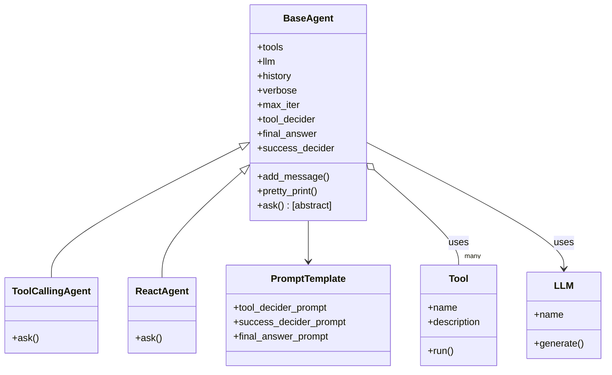
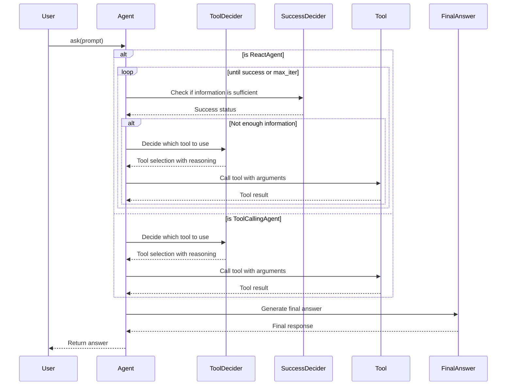
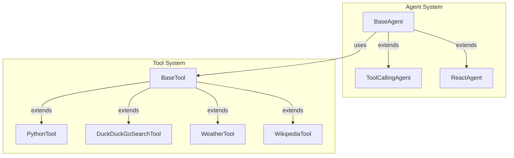

<!-- source: DeepWiki mcp.deepwiki.com · repo melih-unsal/DemoGPT · page 4.1 Agents · fetched 2026-10-26 -->

# Agents

<details>
<summary>Relevant source files</summary>

The following files were used as context for generating this wiki page:

- [demogpt_agenthub/agents/__init__.py](demogpt_agenthub/agents/__init__.py)
- [demogpt_agenthub/agents/base.py](demogpt_agenthub/agents/base.py)
- [demogpt_agenthub/agents/react.py](demogpt_agenthub/agents/react.py)
- [demogpt_agenthub/agents/tool_calling.py](demogpt_agenthub/agents/tool_calling.py)
- [demogpt_agenthub/prompts/agents/react/success_decider.py](demogpt_agenthub/prompts/agents/react/success_decider.py)
- [demogpt_agenthub/prompts/agents/tool_calling/final_answer.py](demogpt_agenthub/prompts/agents/tool_calling/final_answer.py)
- [demogpt_agenthub/prompts/agents/tool_calling/tool_decider.py](demogpt_agenthub/prompts/agents/tool_calling/tool_decider.py)
- [demogpt_agenthub/rag/__init__.py](demogpt_agenthub/rag/__init__.py)
- [demogpt_agenthub/tools/repl.py](demogpt_agenthub/tools/repl.py)
- [demogpt_agenthub/utils/parsers.py](demogpt_agenthub/utils/parsers.py)

</details>


The Agents component of DemoGPT provides a flexible framework for creating AI agents that can accomplish tasks by reasoning about problems and using tools to gather information or perform actions. This document covers the agent architecture, operation flow, and key components within the `demogpt_agenthub/agents` module.

For information about the overall AgentHub system, see [AgentHub](#4), and for details about the RAG system, see [RAG System](#4.2).

## Agent Architecture

DemoGPT implements an agent architecture based on a class hierarchy, with each agent type providing different interaction patterns for task solving.



**Diagram: Agent Class Hierarchy**

Sources: [demogpt_agenthub/agents/base.py](), [demogpt_agenthub/agents/tool_calling.py](), [demogpt_agenthub/agents/react.py](), [demogpt_agenthub/agents/__init__.py]()

### BaseAgent

The `BaseAgent` is the abstract base class that provides common functionality for all agent types. It establishes the core infrastructure for:

- Maintaining conversation history
- Deciding which tools to use
- Generating final answers
- Pretty printing for verbose output

Key components of `BaseAgent` include:

| Component | Purpose |
|-----------|---------|
| `tool_decider` | Chain that determines which tool to use for a given task |
| `final_answer` | Chain that generates the final response to the user |
| `success_decider` | Chain that determines when enough information has been gathered (for ReactAgent) |
| `history` | List that stores the conversation history |
| `tools` | Dictionary of tools available to the agent |

The `BaseAgent` defines an abstract `ask()` method that must be implemented by subclasses:

```python
def ask(self, prompt: str):
    """
    Abstract method to process a user's prompt and return a response.
    """
    raise NotImplementedError("Subclasses must implement the 'ask' method.")
```

Sources: [demogpt_agenthub/agents/base.py:11-94]()

### ToolCallingAgent

The `ToolCallingAgent` extends `BaseAgent` and implements a one-shot approach to task solving. It makes a single tool call and then generates a final answer based on the tool's output.

The `ask()` method in `ToolCallingAgent` follows these steps:

1. Add the user prompt to the conversation history
2. Use the tool decider to determine which tool to use and with what arguments
3. Call the selected tool with the provided arguments
4. Add the tool result to the conversation history
5. Generate and return a final answer

Sources: [demogpt_agenthub/agents/tool_calling.py:1-22]()

### ReactAgent

The `ReactAgent` implements a more sophisticated Reason-Act pattern (ReAct), allowing for multiple tool calls as needed to accomplish a task. It uses a loop-based approach where it continues to make tool calls until the success decider determines that enough information has been gathered or the maximum number of iterations is reached.

The `ask()` method in `ReactAgent` follows these steps:

1. Add the user prompt to the conversation history
2. Enter a loop that continues until success is determined or max iterations reached:
   - Check if the task can be completed with current information
   - If not, decide which tool to use and call it
   - Add the result to the conversation history
3. Generate and return a final answer

Sources: [demogpt_agenthub/agents/react.py:1-33]()

## Agent Operation Flow

The following diagram illustrates the typical operation flow for agents, showing how they process user queries through reasoning and tool usage.



**Diagram: Agent Operation Flow**

Sources: [demogpt_agenthub/agents/tool_calling.py:7-21](), [demogpt_agenthub/agents/react.py:7-33]()

## Prompt Templates

The agents rely on specialized prompt templates to guide the LLM's behavior:

### Tool Decider Prompt

Used to determine which tool to use for a given task. The output is a JSON object containing:
- `reasoning`: The reasoning behind the tool selection
- `tool`: The name of the selected tool
- `argument`: The arguments to pass to the tool

Sources: [demogpt_agenthub/prompts/agents/tool_calling/tool_decider.py]()

### Success Decider Prompt

Used by the `ReactAgent` to determine if enough information has been gathered to answer the user's query. Returns either "<YES>" or "<NO>".

Sources: [demogpt_agenthub/prompts/agents/react/success_decider.py]()

### Final Answer Prompt

Used to generate the final response to the user based on the context gathered through tool usage.

Sources: [demogpt_agenthub/prompts/agents/tool_calling/final_answer.py]()

## Tool Integration

Agents are designed to work with a variety of tools that implement the `BaseTool` interface. Each tool has a name, description, and a `run()` method that takes arguments and returns results.



**Diagram: Agent and Tool System Integration**

An example of a tool implementation is the `PythonTool`, which allows agents to execute Python code to perform calculations:

```python
class PythonTool(BaseTool):
    def __init__(self):
        self.tool = PythonREPL()
        super().__init__()
        self.name = "Python Interpreter"
        self.description = """A tool that can execute Python code to perform precise calculations..."""
        
    def run(self, code):
        return self.tool.run(code)
```

Sources: [demogpt_agenthub/tools/repl.py:1-18]()

## Usage Example

Here's how to instantiate and use a `ReactAgent` with various tools:

```python
from demogpt_agenthub.tools import DuckDuckGoSearchTool, WeatherTool, PythonTool
from demogpt_agenthub.llms import OpenAIChatModel
from demogpt_agenthub.agents import ReactAgent

# Create tools
search_tool = DuckDuckGoSearchTool()
weather_tool = WeatherTool()
python_tool = PythonTool()

# Create agent with tools and LLM
agent = ReactAgent(
    tools=[search_tool, weather_tool, python_tool], 
    llm=OpenAIChatModel(model_name="gpt-4o-mini"), 
    verbose=True
)

# Ask a question that requires multiple tools
query = "What is the weather's temperature's square root in the country where Christiano Ronaldo is currently playing?"
answer = agent.ask(query)
print(answer)
```

Sources: [demogpt_agenthub/agents/react.py:35-43]()

## Custom Output Parsers

The agent system uses custom output parsers to handle specialized outputs:

- `BooleanOutputParser`: Parses "<YES>" or "<NO>" strings from the success decider into boolean values

```python
class BooleanOutputParser(BaseOutputParser[bool]):
    """Custom boolean parser."""
    true_val: str = "<YES>"
    false_val: str = "<NO>"
    
    def parse(self, text: str) -> bool:
        cleaned_text = text.strip().upper()
        if self.true_val.upper() in cleaned_text:
            return True
        elif self.false_val.upper() in cleaned_text:
            return False
        else:
            raise OutputParserException(...)
```

Sources: [demogpt_agenthub/utils/parsers.py:1-29]()

## Integration with DemoGPT

The agent system serves as a fundamental component in the DemoGPT architecture, enabling intelligent interaction with various tools and services. It provides the reasoning and action capabilities necessary for the automatic generation of complex Streamlit applications.

Sources: [demogpt_agenthub/agents/__init__.py]()

---

