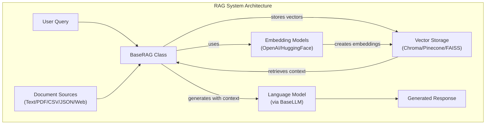
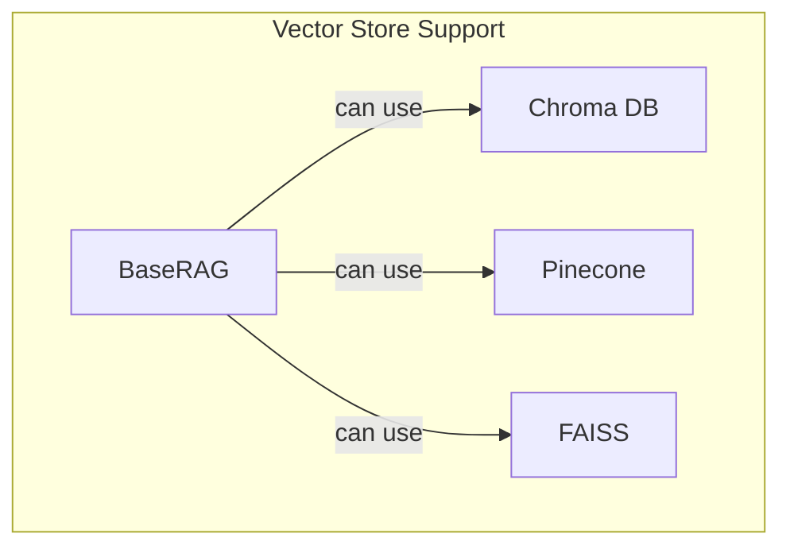
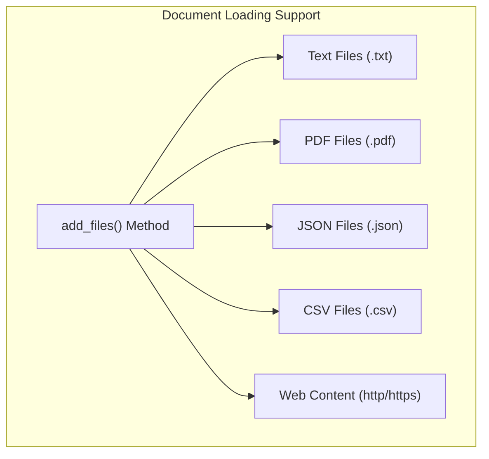
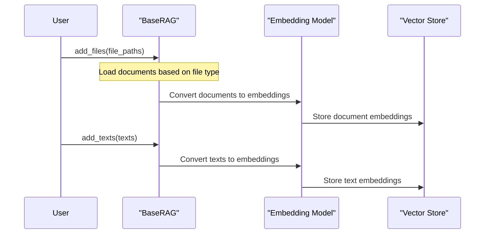
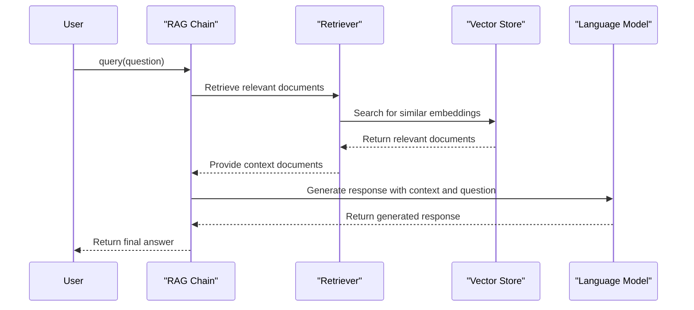
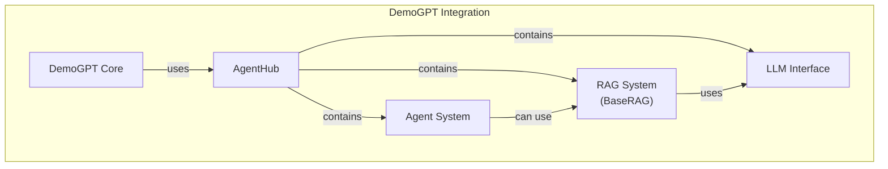

<!-- source: DeepWiki mcp.deepwiki.com · repo melih-unsal/DemoGPT · page 4.2 RAG System · fetched 2026-10-26 -->

# RAG System

<details>
<summary>Relevant source files</summary>

The following files were used as context for generating this wiki page:

- [demogpt_agenthub/rag/base.py](demogpt_agenthub/rag/base.py)
- [tests/test_rag.py](tests/test_rag.py)

</details>


The Retrieval Augmented Generation (RAG) system is a key component of DemoGPT's AgentHub that enhances language model responses with relevant context retrieved from various data sources. This component enables DemoGPT to generate more accurate and informed outputs by grounding responses in specific documents, texts, or file contents.

For information about other AgentHub components, see [Agents](#4.1) and [LLM Interface](#4.3).

## Overview

The RAG System combines the power of vector databases, embedding models, and large language models to provide context-enriched responses to queries. It consists of several interconnected components that work together to store, retrieve, and process information.



Sources: [demogpt_agenthub/rag/base.py:24-121]()

## Components

### BaseRAG Class

The core of the RAG system is the `BaseRAG` class, which orchestrates the interaction between vector stores, embedding models, and language models.

#### Key Properties

| Property | Type | Description |
|----------|------|-------------|
| `llm` | `BaseLLM` | Language model interface for generating responses |
| `vectorstore` | Various | Vector database for storing embeddings (Chroma, Pinecone, or FAISS) |
| `embedding_model` | Various | Model for generating vector embeddings (OpenAI or HuggingFace) |
| `retriever` | Retriever | Component that retrieves relevant documents from the vector store |
| `rag_chain` | Chain | Processing chain that combines retrieval and generation |

Sources: [demogpt_agenthub/rag/base.py:24-58]()

### Supported Vector Stores

The RAG system supports multiple vector databases for storing and retrieving document embeddings:



Sources: [demogpt_agenthub/rag/base.py:68-84]()

### Embedding Models

The RAG system supports both OpenAI and HuggingFace embedding models, which convert text into vector representations:

| Provider | Models |
|----------|--------|
| OpenAI | text-embedding-3-small, text-embedding-3-large, text-embedding-ada-002 |
| HuggingFace | Any compatible model (default: sentence-transformers/all-mpnet-base-v2) |

Sources: [demogpt_agenthub/rag/base.py:25-66]()

### Document Loaders

The system supports loading documents from various file formats:



Sources: [demogpt_agenthub/rag/base.py:94-116]()

## Workflow

The RAG System works through two main workflows: document ingestion and query processing.

### Document Ingestion Workflow



Sources: [demogpt_agenthub/rag/base.py:86-116]()

### Query Processing Workflow



Sources: [demogpt_agenthub/rag/base.py:52-58](), [demogpt_agenthub/rag/base.py:118-119]()

## Usage Examples

The RAG system can be instantiated and used as follows:

1. **Initialize the RAG system**:
   ```python
   from demogpt_agenthub.rag.base import BaseRAG
   from demogpt_agenthub.llms.openai import OpenAIChatModel
   
   rag = BaseRAG(
       llm=OpenAIChatModel(model="gpt-4o-mini"),
       vectorstore="chroma", 
       persistent_path="rag_chroma", 
       index_name="rag_index",
       embedding_model_name="sentence-transformers/all-mpnet-base-v2"
   )
   ```

2. **Add documents or text**:
   ```python
   # Add files
   rag.add_files(["document.pdf", "data.csv", "info.txt"])
   
   # Add text directly
   rag.add_texts("John Doe is a software engineer with 10 years of experience.")
   ```

3. **Query the RAG system**:
   ```python
   response = rag.query("What is John's profession?")
   print(response)  # Output: John Doe is a software engineer.
   ```

Sources: [demogpt_agenthub/rag/base.py:121-132](), [tests/test_rag.py:6-33]()

## Integration with DemoGPT

Within the DemoGPT system, the RAG component serves as part of the AgentHub, providing knowledge retrieval capabilities to enhance the application generation process. It enables the system to:

1. Retrieve relevant documentation when generating code snippets
2. Provide context-aware responses during task planning and execution
3. Enhance the generated applications with document processing and retrieval capabilities



Sources: [demogpt_agenthub/rag/base.py:18-123]()

## Initialization Parameters

The `BaseRAG` class accepts several parameters to customize its behavior:

| Parameter | Type | Description |
|-----------|------|-------------|
| `llm` | `BaseLLM` | The language model interface to use for generation |
| `vectorstore` | `str` | The type of vector store to use ("chroma", "pinecone", or "faiss") |
| `persistent_path` | `str` | Directory path where vector store data is persisted |
| `index_name` | `str` | Name of the index in the vector store |
| `reset_vectorstore` | `bool` | Whether to reset the vector store on initialization (default: False) |
| `embedding_model_name` | `str` | Name of the embedding model to use (default: "sentence-transformers/all-mpnet-base-v2") |
| `filter` | `dict` | Filter parameters for retrieval (default: None) |
| `k` | `int` | Number of documents to retrieve per query (default: 4) |
| `verbose` | `bool` | Whether to enable verbose logging (default: False) |

Sources: [demogpt_agenthub/rag/base.py:30-38]()

## Main Methods

| Method | Description |
|--------|-------------|
| `load_embedding_model(model_name)` | Loads the specified embedding model |
| `load_vectorstore(vectorstore, reset_vectorstore)` | Initializes the vector store |
| `add_texts(texts)` | Adds text strings to the vector store |
| `add_files(file_paths)` | Processes and adds files to the vector store |
| `query(query)` | Retrieves relevant documents and generates a response |

Sources: [demogpt_agenthub/rag/base.py:60-119]()

## Error Handling

The RAG system includes error handling for:
- Unsupported vector stores (raises `ValueError`)
- File loading errors (logged but processing continues with other files)
- Unsupported file types (logged and skipped)

Sources: [demogpt_agenthub/rag/base.py:81-115]()

---

