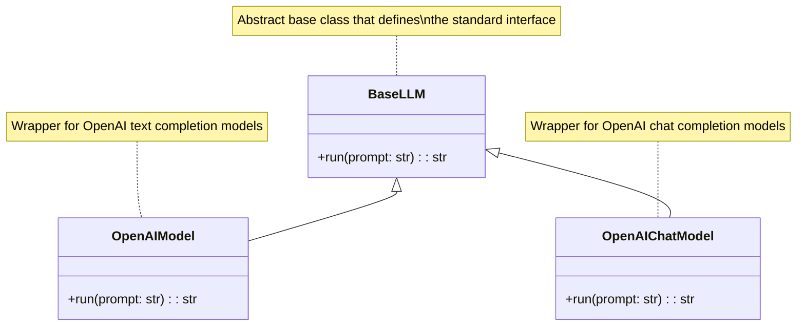
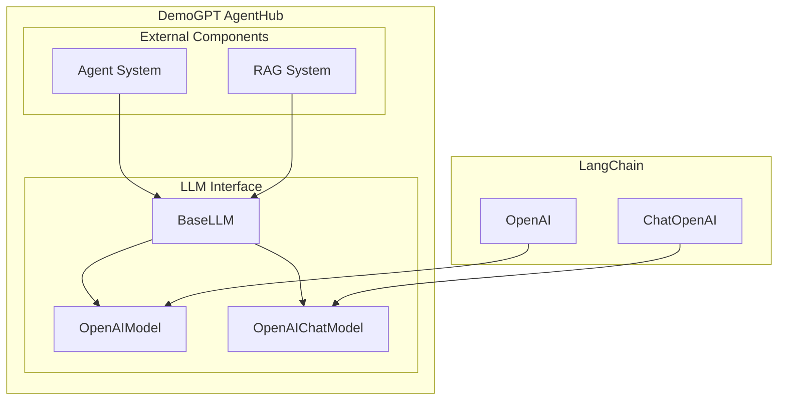
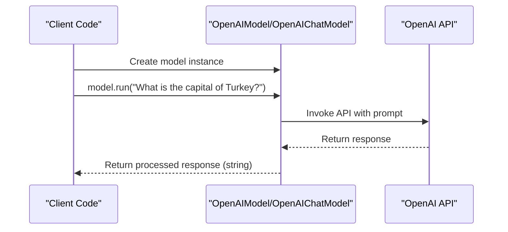
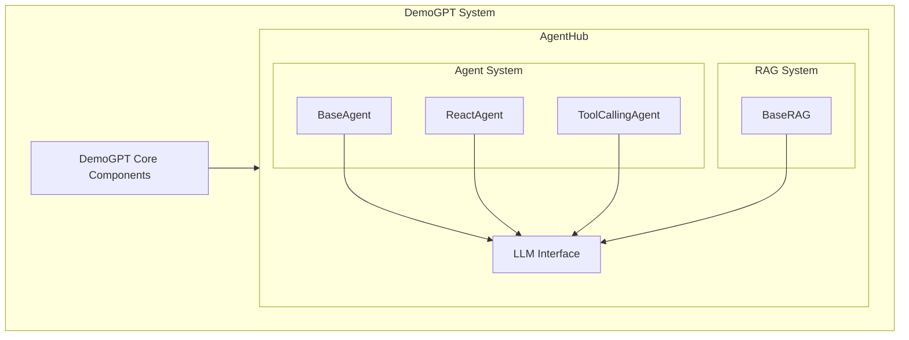

<!-- source: DeepWiki mcp.deepwiki.com · repo melih-unsal/DemoGPT · page 4.3 LLM Interface · fetched 2026-10-26 -->

# LLM Interface

<details>
<summary>Relevant source files</summary>

The following files were used as context for generating this wiki page:

- [demogpt_agenthub/llms/base.py](demogpt_agenthub/llms/base.py)
- [demogpt_agenthub/llms/openai.py](demogpt_agenthub/llms/openai.py)
- [tests/__init__.py](tests/__init__.py)
- [tests/test_llms.py](tests/test_llms.py)

</details>


The LLM Interface provides a consistent, standardized API for interacting with language models within the DemoGPT system. It abstracts away the implementation details of specific language model providers, allowing the rest of the system to work with any supported LLM through a unified interface.

For information about agents that utilize these LLM interfaces, see [Agents](#4.1). For details on how the RAG system leverages LLMs, see [RAG System](#4.2).

## Overview

The LLM Interface component serves as a critical abstraction layer in DemoGPT's AgentHub, providing a simple, unified method (`run`) for all language model interactions. This design allows DemoGPT to easily switch between different LLM providers or model types without changing the code that consumes these services.



Sources: [demogpt_agenthub/llms/base.py](), [demogpt_agenthub/llms/openai.py]()

## Architecture

The LLM Interface implementation follows a simple inheritance-based architecture that leverages multiple inheritance to combine LangChain's model classes with DemoGPT's custom interface.



Sources: [demogpt_agenthub/llms/base.py](), [demogpt_agenthub/llms/openai.py]()

## Components

### BaseLLM

The `BaseLLM` class serves as the abstract base class that defines the standard interface for all LLM implementations in DemoGPT. It is intentionally minimal, defining only a single method that all implementing classes must provide.

```python
class BaseLLM:
    def run(self, prompt: str) -> str:
        raise NotImplementedError("Subclasses must implement the 'run' method")
```

Sources: [demogpt_agenthub/llms/base.py:1-3]()

### OpenAIModel

The `OpenAIModel` class implements the `BaseLLM` interface for OpenAI's text completion models. It inherits from both LangChain's `OpenAI` class and DemoGPT's `BaseLLM` interface.

```python
class OpenAIModel(OpenAI, BaseLLM):
    def run(self, prompt: str) -> str:
        return self.invoke(prompt)
```

This class is typically used with models like `gpt-3.5-turbo-instruct`.

Sources: [demogpt_agenthub/llms/openai.py:4-6](), [tests/test_llms.py:4-10]()

### OpenAIChatModel

The `OpenAIChatModel` class implements the `BaseLLM` interface for OpenAI's chat completion models. It inherits from both LangChain's `ChatOpenAI` class and DemoGPT's `BaseLLM` interface.

```python
class OpenAIChatModel(ChatOpenAI, BaseLLM):
    def run(self, prompt: str) -> str:
        return self.invoke(prompt).content
```

This class is typically used with models like `gpt-4o-mini` and other chat-based models.

Sources: [demogpt_agenthub/llms/openai.py:8-10](), [tests/test_llms.py:12-18]()

## Usage

The LLM Interface is designed to be simple to use. Here's how you would typically instantiate and use an LLM in DemoGPT:



### Example Usage

```python
# Using OpenAIModel (text completion)
from demogpt_agenthub.llms.openai import OpenAIModel

model = OpenAIModel(model="gpt-3.5-turbo-instruct")
response = model.run("What is the capital of Turkey?")
# response contains "Ankara"

# Using OpenAIChatModel (chat completion)
from demogpt_agenthub.llms.openai import OpenAIChatModel

chat_model = OpenAIChatModel(model="gpt-4o-mini")
response = chat_model.run("What is the capital of Turkey?")
# response contains "Ankara"
```

Sources: [tests/test_llms.py:4-18]()

## Integration with Other Components

The LLM Interface plays a crucial role in DemoGPT's architecture by providing language model capabilities to various components:



- **Agent System**: Agents use LLMs for reasoning, planning, and tool selection through the LLM Interface
- **RAG System**: The Retrieval Augmented Generation system uses LLMs to generate responses based on retrieved context

This integration allows DemoGPT to leverage powerful language models while maintaining a clean separation of concerns and making it easy to switch between different LLM providers or model types.

Sources: [demogpt_agenthub/llms/base.py](), [demogpt_agenthub/llms/openai.py]()

## Extending the LLM Interface

To add support for additional LLM providers or model types, you simply need to create a new class that:

1. Inherits from `BaseLLM`
2. Implements the `run(prompt: str) -> str` method
3. Optionally inherits from a LangChain model class or directly implements API calls

This extensible design allows DemoGPT to easily adapt to new LLM providers and model types as they become available.

Sources: [demogpt_agenthub/llms/base.py](), [demogpt_agenthub/llms/openai.py]()

---

