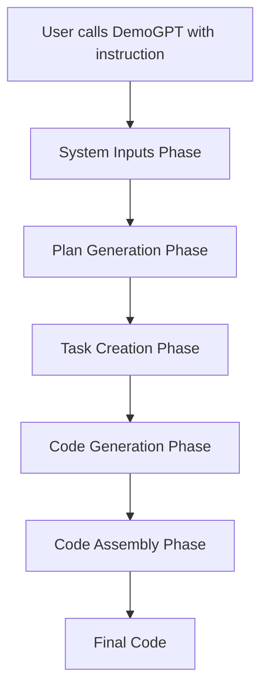
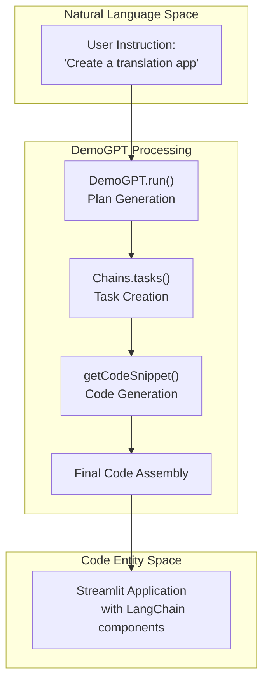
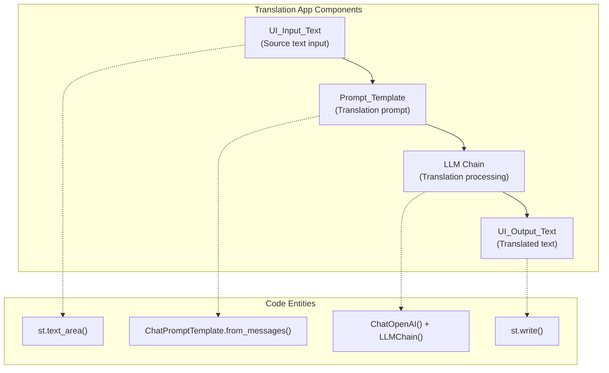
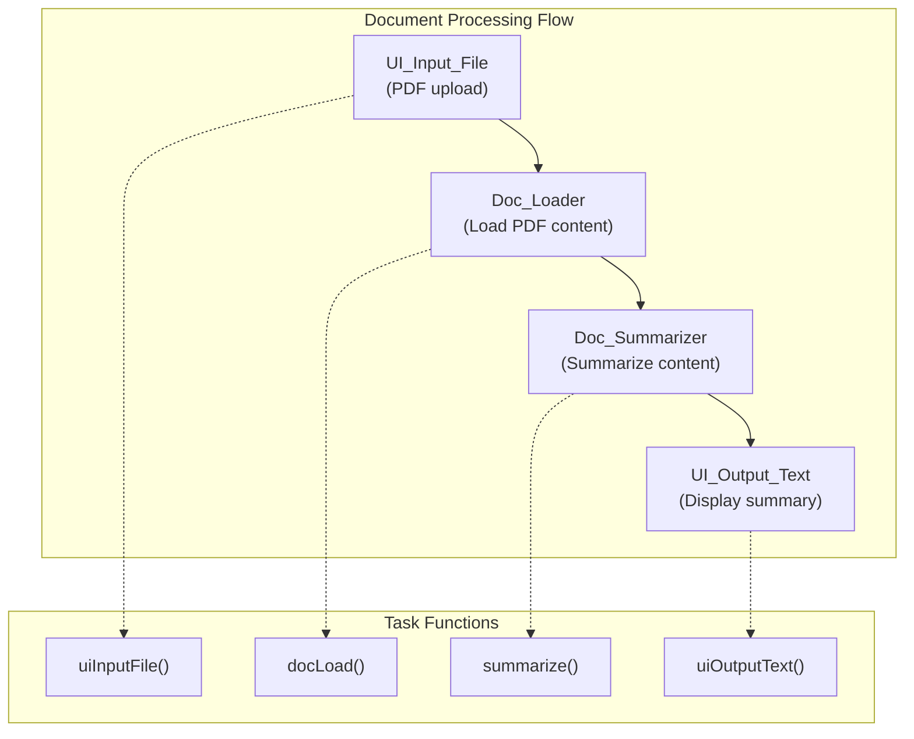
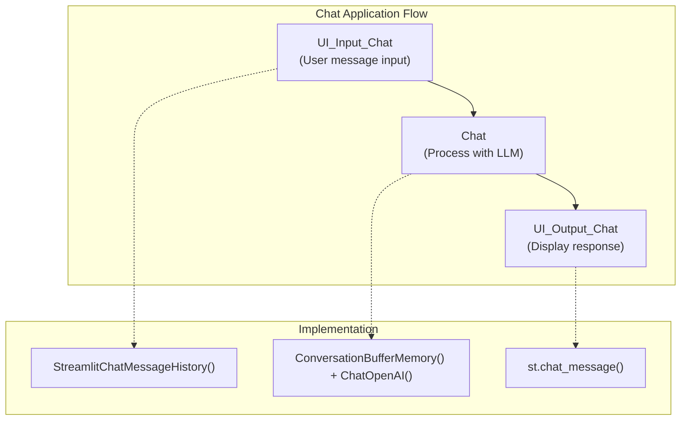
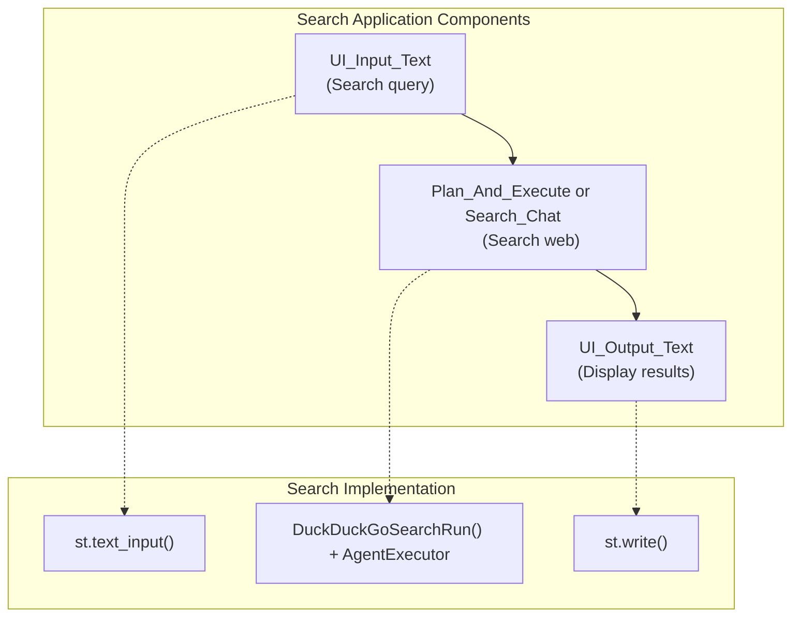
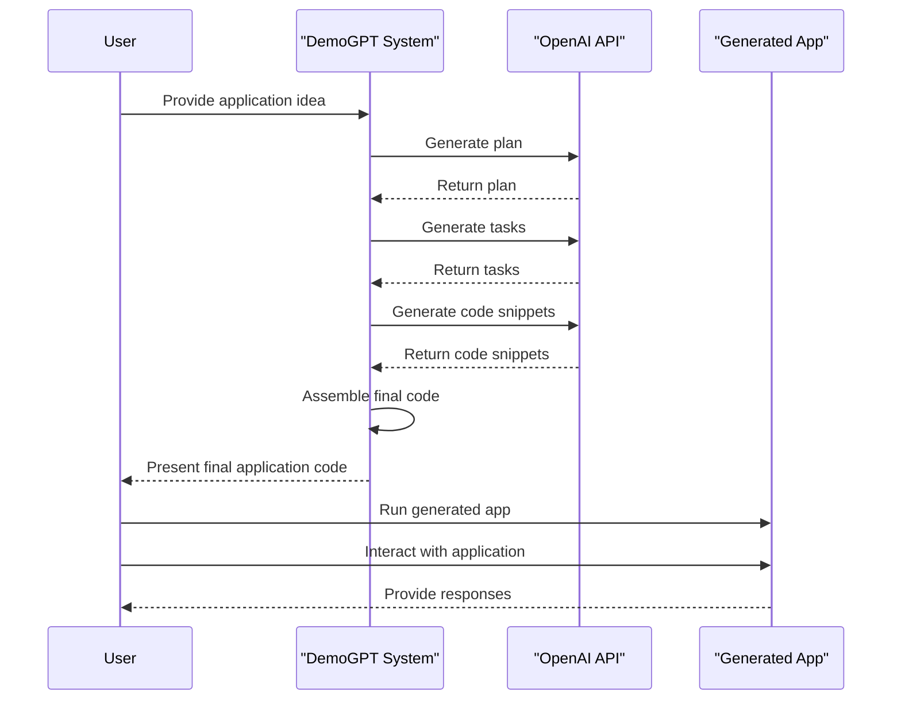

<!-- source: DeepWiki mcp.deepwiki.com · repo melih-unsal/DemoGPT · page 5 Usage and Examples · fetched 2026-10-26 -->

# Usage and Examples

<details>
<summary>Relevant source files</summary>

The following files were used as context for generating this wiki page:

- [README.md](README.md)
- [assets/demogpt_new_pipeline.jpeg](assets/demogpt_new_pipeline.jpeg)
- [assets/demogpt_new_pipeline1.jpeg](assets/demogpt_new_pipeline1.jpeg)
- [demogpt/app.py](demogpt/app.py)
- [demogpt/chains/chains.py](demogpt/chains/chains.py)
- [demogpt/chains/prompts/task_list/search.py](demogpt/chains/prompts/task_list/search.py)
- [demogpt/chains/prompts/task_list/search_chat.py](demogpt/chains/prompts/task_list/search_chat.py)
- [demogpt/chains/task_chains.py](demogpt/chains/task_chains.py)
- [demogpt/model.py](demogpt/model.py)
- [demogpt/prompt.py](demogpt/prompt.py)
- [demogpt/utils.py](demogpt/utils.py)
- [docs/README_CN.md](docs/README_CN.md)
- [pyproject.toml](pyproject.toml)

</details>


This page provides comprehensive guidance on using DemoGPT, a system that automatically generates LangChain-based Streamlit applications from natural language instructions. The document covers how to use DemoGPT both from the command line and through the Python API, along with examples of applications that can be generated.

For information about the overall architecture of DemoGPT, see [Architecture](#2), and for details on the core components, see [Core Components](#3).

## Command Line Usage

DemoGPT can be easily used from the command line after installation. This is the simplest way to interact with the system for quick application generation.

### Installation

To use DemoGPT from the command line, first install the package using pip:

```bash
pip install demogpt
```

### Running DemoGPT

Once installed, simply run the `demogpt` command in your terminal:

```bash
demogpt
```

This will launch the DemoGPT interface, where you can enter your application idea and other required information.

Sources: [README.md:66-74](), [pyproject.toml:40-40]()

## Python API Usage

For integration into existing Python applications or more programmatic control, DemoGPT provides a Python API that allows you to generate applications directly from your code.

### Basic Usage

Here's a basic example of using DemoGPT as a Python library:

```python
from demogpt import DemoGPT

# Initialize DemoGPT
agent = DemoGPT(model_name="gpt-3.5-turbo") 
# Note: If OPENAI_API_KEY is not set in environment variables, 
# provide it with openai_api_key argument

# Define your application idea
instruction = "Create a translation app that converts English to French"
title = "English-French Translator"

# Generate the application
for phase in agent(instruction=instruction, title=title):
    print(phase)  # Display generation progress
    if phase["done"]:
        code = phase["code"]  # Get the final generated code
```

### Processing Phases

When calling the DemoGPT agent, it yields information about different phases of the code generation process:



Each phase yields a dictionary with the following structure:

```
{
    "stage": "current_stage",  # e.g., "draft", "final"
    "completed": boolean,      # Whether this phase is complete
    "percentage": int,         # Overall progress (0-100)
    "done": boolean,           # Whether the entire process is done
    "message": "status message",
    "code": "generated_code"   # Only in later phases
}
```

### Example Output

The phases progress from "system_inputs" through "plan", "task", "draft", and finally "final". Here's an example of the output sequence:

```
{'stage': 'system_inputs', 'completed': False, 'percentage': 0, 'done': False, 'message': 'System inputs are being detected...', 'failed': False}
{'stage': 'plan', 'completed': False, 'percentage': 10, 'done': False, 'message': 'Plan creation has started...', 'failed': False}
...
{'stage': 'draft', 'completed': False, 'percentage': 64, 'code': '#Get the source language ...'}
...
{'stage': 'final', 'completed': True, 'percentage': 100, 'done': True, 'message': 'Final code has been generated...', 'code': 'import streamlit as st\n...'}
```

Sources: [README.md:150-196](), [model.py:292-310]()

## Application Examples

DemoGPT can generate a wide variety of LangChain-based Streamlit applications. Below are some common examples of applications that can be created.

### Example Instructions to DemoGPT

Here are some example prompts you can use with DemoGPT:

| Application Type | Example Instruction |
|------------------|---------------------|
| Translation | "Create a translation system that converts English to French" |
| Chatbot | "Build a chatbot that talks like Jeff Bezos" |
| Document Processing | "Create an app that can summarize PDF documents" |
| Content Generation | "Make a system that can write Medium articles from websites" |
| Search Tool | "Create a research assistant that can search the web and answer questions" |

### Generation Process Flow

The following diagram illustrates how a natural language instruction is transformed into a functional application:



Sources: [model.py:310-562](), [README.md:96-101]()

### Example 1: Translation Application

When you provide an instruction like "Create a translation system that converts English to French", DemoGPT will generate a Streamlit application with the following components:



Sources: [utils.py:282-314](), [chains/task_chains.py:17-50]()

### Example 2: Document Processing Application

For an instruction like "Create an app that can summarize PDF documents", DemoGPT will generate an application with the following flow:



Sources: [chains/task_chains.py:230-372](), [utils.py:282-314]()

### Example 3: Chat-Based Application

For an instruction like "Build a chatbot that helps with programming questions", DemoGPT will generate a chat application:



Sources: [utils.py:359-433](), [utils.py:434-523](), [chains/task_chains.py:134-169]()

### Example 4: Web Search Application

For an instruction like "Create a research assistant that can search the web", DemoGPT will generate a search-enabled application:



Sources: [chains/prompts/task_list/search.py:1-57](), [chains/prompts/task_list/search_chat.py:1-67](), [chains/task_chains.py:182-228]()

## Customizing Generated Applications

After generating an application with DemoGPT, you can customize it in several ways:

### Editing in the Web Interface

When using the DemoGPT web interface, you can edit the generated code directly:

1. After code generation completes, expand the "Code" section
2. Click the "Edit" button
3. Make changes to the code in the text area
4. Click "Save & Rerun" to apply your changes

### Modifying Output Files

When using the command line or Python API:

1. Save the generated code to a .py file
2. Edit the file with your preferred code editor
3. Run the modified file with Streamlit: `streamlit run your_app.py`

Sources: [app.py:183-203]()

## Example User Workflow

Here's a complete workflow for creating an application with DemoGPT:



Sources: [model.py:310-562](), [README.md:96-101]()

## Troubleshooting

Here are some common issues and solutions when using DemoGPT:

| Issue | Solution |
|-------|----------|
| Missing OpenAI API Key | Ensure your OpenAI API key is provided either as an environment variable or as an argument |
| Model Access Denied | Make sure you have access to the selected model or choose a different model |
| Complex Application Failure | For very complex applications, try breaking down your instruction into simpler components |
| Memory Issues | For large applications, consider using a model with larger context window like "gpt-3.5-turbo-16k" |

Sources: [model.py:35-48](), [app.py:143-146]()

## Best Practices

For optimal results when using DemoGPT:

1. **Be specific**: Provide clear, specific instructions about what your application should do
2. **Include features**: List specific features you want in your application
3. **Start simple**: Begin with simple applications to understand DemoGPT's capabilities
4. **Iterate**: Generate a basic application first, then add complexity in subsequent iterations
5. **Review the code**: Always review the generated code for any modifications needed

Sources: [README.md:91-101](), [app.py:83-101]()

---

