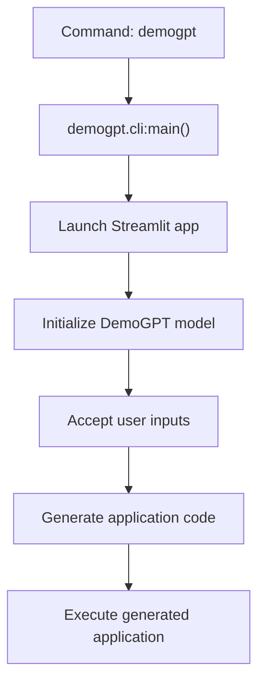
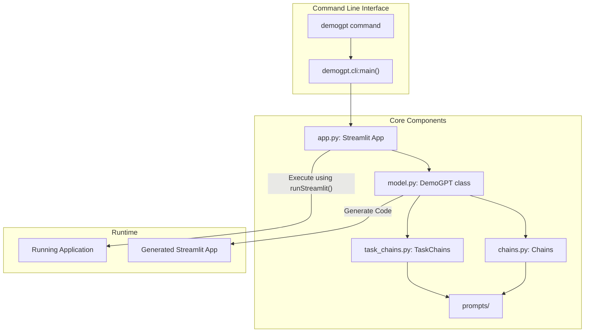
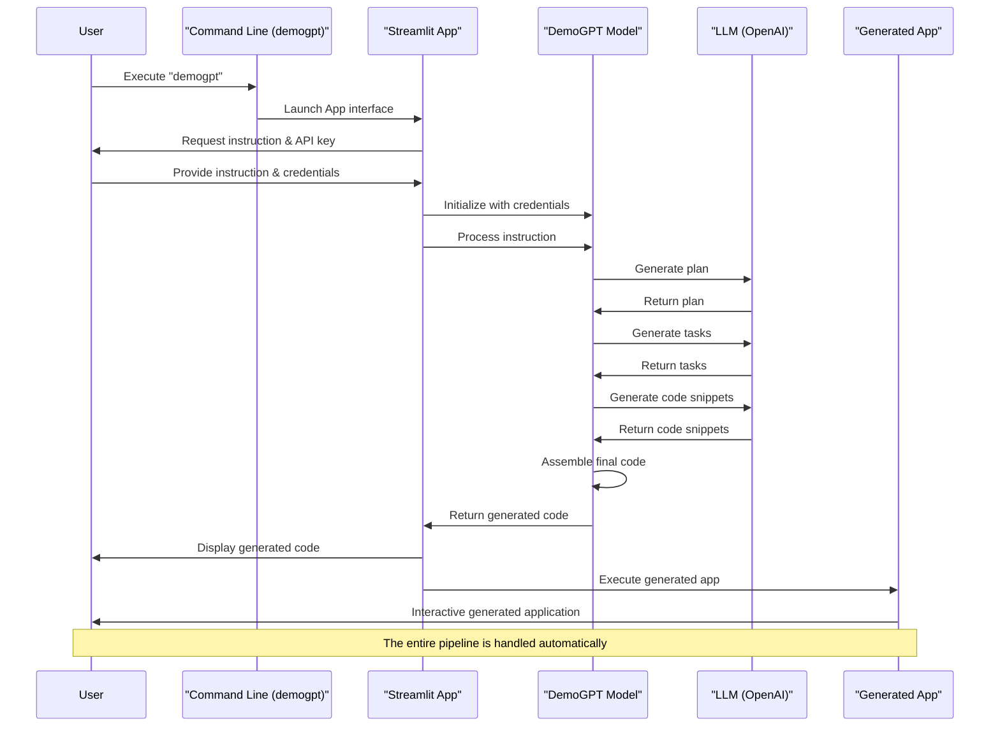
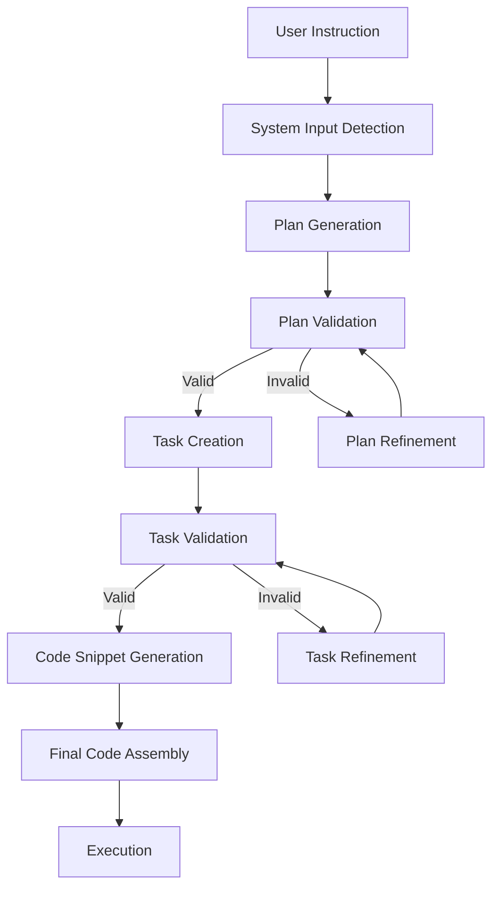
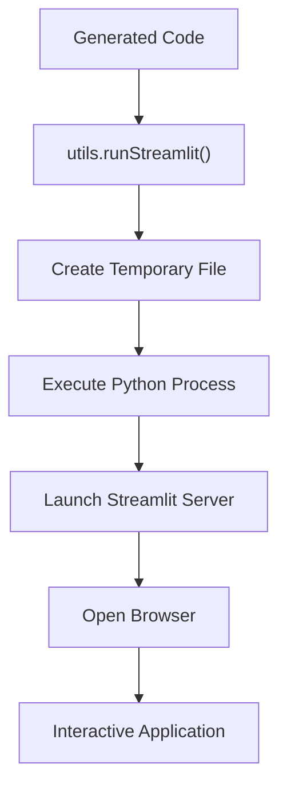

<!-- source: DeepWiki mcp.deepwiki.com · repo melih-unsal/DemoGPT · page 5.1 Command Line Usage · fetched 2026-10-26 -->

# Command Line Usage

<details>
<summary>Relevant source files</summary>

The following files were used as context for generating this wiki page:

- [README.md](README.md)
- [assets/demogpt_new_pipeline.jpeg](assets/demogpt_new_pipeline.jpeg)
- [assets/demogpt_new_pipeline1.jpeg](assets/demogpt_new_pipeline1.jpeg)
- [demogpt/app.py](demogpt/app.py)
- [demogpt/chains/chains.py](demogpt/chains/chains.py)
- [demogpt/chains/prompts/task_list/search.py](demogpt/chains/prompts/task_list/search.py)
- [demogpt/chains/prompts/task_list/search_chat.py](demogpt/chains/prompts/task_list/search_chat.py)
- [demogpt/chains/task_chains.py](demogpt/chains/task_chains.py)
- [demogpt/model.py](demogpt/model.py)
- [demogpt/utils.py](demogpt/utils.py)
- [docs/README_CN.md](docs/README_CN.md)
- [pyproject.toml](pyproject.toml)

</details>


This document explains how to use DemoGPT from the command line to automatically generate LangChain-based Streamlit applications. For information about using DemoGPT as a Python library, see [Python API Usage](#5.2).

## Installation

To use DemoGPT from the command line, you must first install the package using pip:

```bash
pip install demogpt
```

Sources: [pyproject.toml:1-40](), [README.md:63-68]()

## Basic Usage

After installation, you can launch DemoGPT by simply running the following command in your terminal:

```bash
demogpt
```

This command starts the DemoGPT interface in your default web browser via Streamlit.

Sources: [README.md:69-74](), [pyproject.toml:39-40]()

## Command Flow

When you execute the `demogpt` command, the following process occurs:



The command line interface serves as a convenient wrapper around the Streamlit application, which contains the full user interface for interacting with DemoGPT.

Sources: [pyproject.toml:39-40](), [app.py:1-216]()

## Environment Configuration

DemoGPT requires an OpenAI API key to function. You can provide this in two ways:

1. Set it as an environment variable before running the command:
   ```bash
   export OPENAI_API_KEY=sk-your-key-here
   demogpt
   ```

2. Enter it in the application interface when prompted.

You can also optionally configure a custom OpenAI API base URL if you're using a different endpoint:
   ```bash
   export OPENAI_API_BASE=https://your-custom-endpoint.com/v1
   demogpt
   ```

Sources: [model.py:19-34](), [app.py:56-68](), [utils.py:681-702]()

## Architecture and Integration

The following diagram illustrates how the command line interface integrates with the rest of the DemoGPT system:



Sources: [model.py:1-562](), [utils.py:682-715](), [app.py:1-216](), [chains/chains.py:1-335](), [chains/task_chains.py:1-390]()

## Behind the Scenes: Command Processing

When the `demogpt` command is executed, it triggers a sequence of operations that handle the entire application generation process:



Sources: [model.py:296-562](), [app.py:125-207](), [utils.py:682-715]()

## System Requirements

DemoGPT has the following requirements to run from the command line:

| Requirement | Details |
|-------------|---------|
| Python Version | 3.8.1 or higher |
| OpenAI API Key | Required for LLM functionality |
| Dependencies | Automatically installed with package |
| Internet Connection | Required for API calls to OpenAI |
| Memory | Recommended 4GB+ |
| Disk Space | ~100MB for installation |

Sources: [pyproject.toml:17-40](), [README.md:123-148]()

## Command Arguments and Options

While the basic `demogpt` command launches the interface without arguments, the system processes user instructions and API keys through its interface. The instruction pipeline follows this workflow:



Sources: [model.py:296-562](), [chains/chains.py:85-316]()

## Application Execution

After generating the application code, DemoGPT can automatically launch it using the `runStreamlit` utility:



The execution happens in a separate process, allowing you to interact with the generated application independently from the DemoGPT interface.

Sources: [utils.py:682-715](), [app.py:193-196]()

## Advanced Usage Tips

1. **Model Selection**: The DemoGPT interface allows you to select different models, such as:
   - gpt-3.5-turbo-0613
   - gpt-3.5-turbo-16k-0613
   - gpt-4-0613 (if available to your API key)

2. **Editing Generated Code**: You can edit the generated code directly in the interface before execution.

3. **Custom Templates**: The system supports various LangChain tasks, including:
   - UI Input/Output components
   - Document loading and processing
   - Prompt templates
   - Chat interfaces
   - Web search functionality

Sources: [app.py:70-84](), [model.py:67-90](), [utils.py:248-314]()

## Troubleshooting

If you encounter issues with the command line interface:

1. **API Key Issues**: Ensure your OpenAI API key is valid and has sufficient quota.
   ```bash
   # Check if your key is properly set
   echo $OPENAI_API_KEY
   ```

2. **Package Installation Problems**: Try reinstalling with:
   ```bash
   pip uninstall -y demogpt
   pip install demogpt
   ```

3. **Model Access**: If you're trying to use GPT-4 but receiving access errors, ensure your API key has GPT-4 access.

4. **Application Errors**: If the generated application has errors, you can edit the code in the interface before re-running.

Sources: [model.py:41-48](), [app.py:137-145](), [app.py:183-197]()

## Examples

Here's an example workflow showing how to create a basic translation app using the command line:

1. Open a terminal and run:
   ```bash
   demogpt
   ```

2. In the interface that opens, enter:
   - **Application Idea**: "Create a translation system that converts English to French"
   - **OpenAI API Key**: Your API key

3. Submit and wait for the application to be generated.

4. The generated application will be displayed and can be executed directly from the interface.

For more sophisticated applications like document processing, chat interfaces, or web search capabilities, provide more detailed instructions in the application idea field.

Sources: [README.md:95-115](), [model.py:97-294]()

## Related Documentation

For more information about DemoGPT's capabilities and usage, refer to:

- [Overview](#1): General introduction to DemoGPT
- [Python API Usage](#5.2): Using DemoGPT as a Python library
- [Application Examples](#5.3): Examples of applications that can be generated

---

