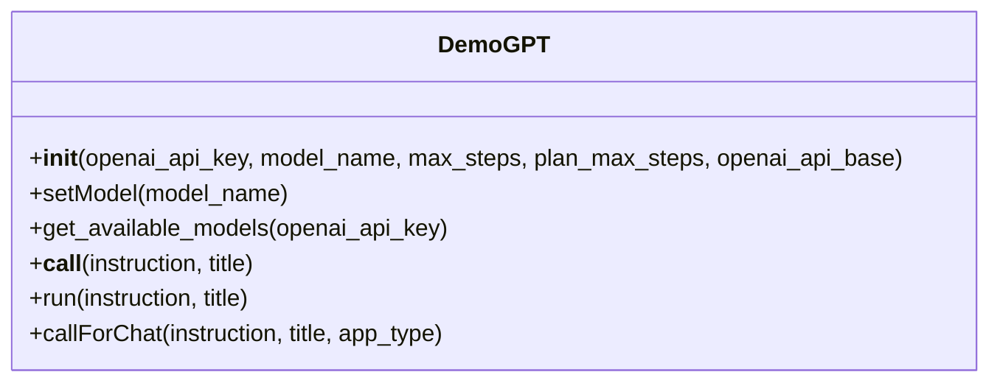
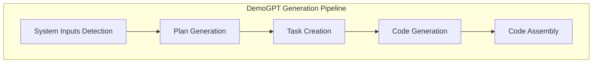
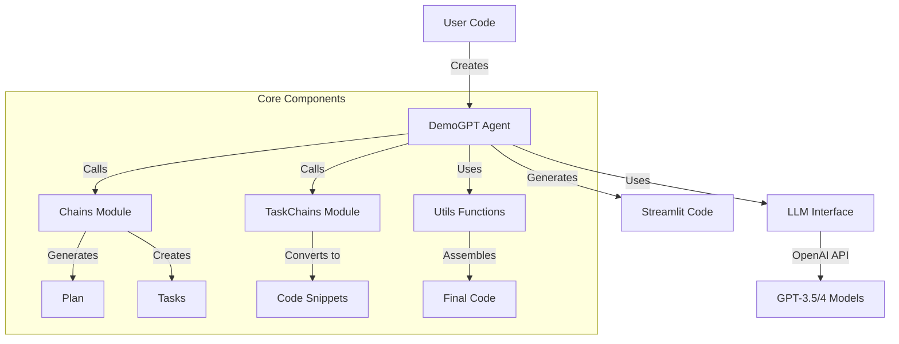
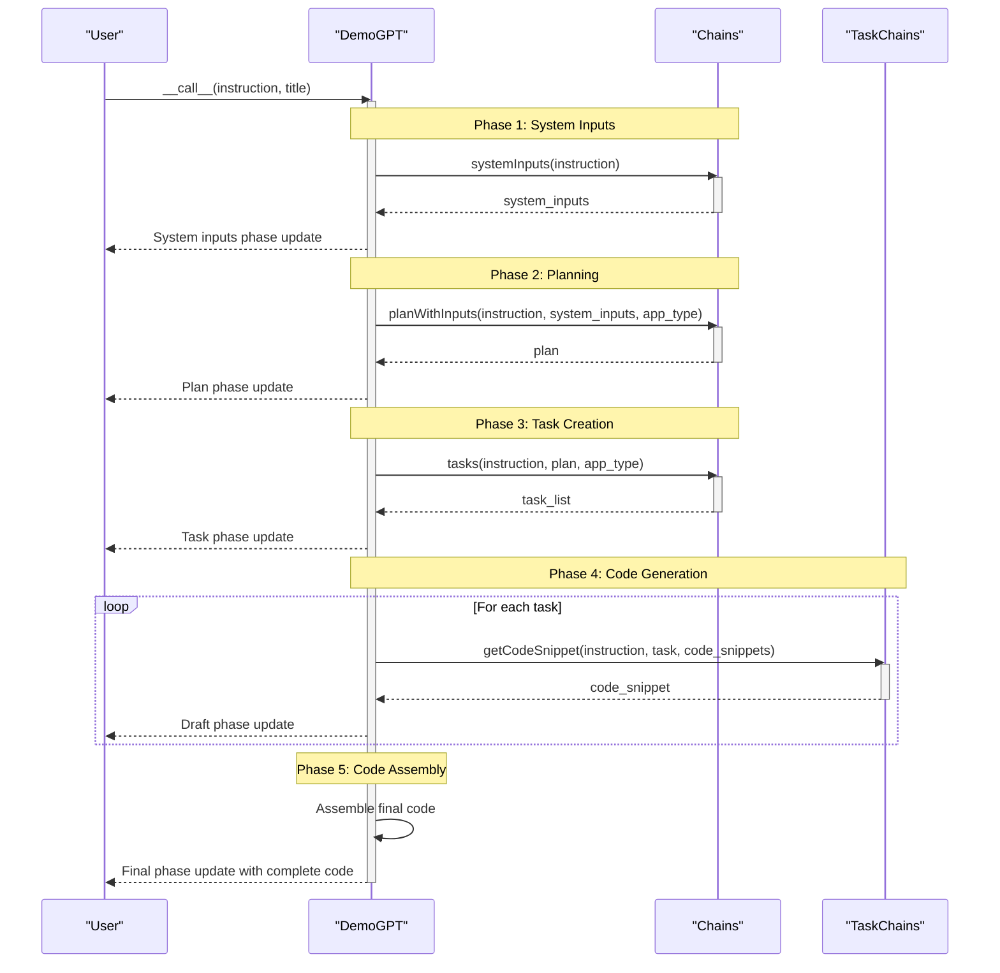

<!-- source: DeepWiki mcp.deepwiki.com · repo melih-unsal/DemoGPT · page 5.2 Python API Usage · fetched 2026-10-26 -->

# Python API Usage

<details>
<summary>Relevant source files</summary>

The following files were used as context for generating this wiki page:

- [README.md](README.md)
- [assets/demogpt_new_pipeline.jpeg](assets/demogpt_new_pipeline.jpeg)
- [assets/demogpt_new_pipeline1.jpeg](assets/demogpt_new_pipeline1.jpeg)
- [demogpt/app.py](demogpt/app.py)
- [demogpt/chains/chains.py](demogpt/chains/chains.py)
- [demogpt/chains/prompts/task_list/search.py](demogpt/chains/prompts/task_list/search.py)
- [demogpt/chains/prompts/task_list/search_chat.py](demogpt/chains/prompts/task_list/search_chat.py)
- [demogpt/chains/task_chains.py](demogpt/chains/task_chains.py)
- [demogpt/model.py](demogpt/model.py)
- [demogpt/utils.py](demogpt/utils.py)
- [docs/README_CN.md](docs/README_CN.md)
- [pyproject.toml](pyproject.toml)

</details>


The DemoGPT Python API allows developers to programmatically generate LangChain-based Streamlit applications from natural language instructions. This page documents how to use DemoGPT as a library within your Python applications, enabling you to create LLM-powered demos without manually writing code. For command-line usage, see [Command Line Usage](#5.1).

## Installation

To use DemoGPT in your Python projects, first install the package:

```bash
pip install demogpt
```

The DemoGPT package has several dependencies, including Streamlit, LangChain, and OpenAI, which will be installed automatically.

Sources: [pyproject.toml:1-44]()

## Basic Usage

Here's a simple example of using DemoGPT in a Python script:

```python
from demogpt import DemoGPT

# Initialize the agent
agent = DemoGPT(model_name="gpt-3.5-turbo")  
# If OPENAI_API_KEY is not set in env variables:
# agent = DemoGPT(openai_api_key="your-api-key", model_name="gpt-3.5-turbo")

# Define your application instructions
instruction = "Create a translation app that converts English to French"
title = "Language Translator"

# Generate the Streamlit application
for phase in agent(instruction=instruction, title=title):
    print(phase)  # Display the progress of each generation phase
    if phase["done"]:
        code = phase["code"]  # Get the final generated code
        
print(code)  # Print the complete Streamlit application code
```

This script:
1. Initializes a DemoGPT agent with the specified model
2. Defines the application requirements through natural language
3. Generates the application code through an iterative process
4. Returns the complete Streamlit application code

Sources: [README.md:162-176](), [demogpt/model.py:18-47]()

## API Components

### DemoGPT Class

The `DemoGPT` class is the main entry point for the API. It orchestrates the entire generation process:



#### Constructor Parameters
- `openai_api_key`: Your OpenAI API key (required if not set in environment)
- `model_name`: The model to use (default: "gpt-3.5-turbo-0613")
- `max_steps`: Maximum iterations for refining tasks (default: 10)
- `plan_max_steps`: Maximum iterations for refining plans (default: 3)
- `openai_api_base`: Alternative OpenAI API base URL (optional)

Sources: [demogpt/model.py:18-47]()

## Generation Pipeline

DemoGPT transforms natural language instructions into Streamlit applications through a multi-phase pipeline:



Each phase provides status updates through the generator API:

```python
for phase in agent(instruction=instruction, title=title):
    # Each phase is a dictionary with the following keys:
    # - stage: current stage (system_inputs, plan, task, draft, final)
    # - completed: whether the current stage is completed
    # - percentage: overall completion percentage
    # - done: whether the entire process is done
    # - message: status message
    # - code: code generated so far (in draft and final stages)
    print(f"Stage: {phase['stage']}, Completion: {phase['percentage']}%")
```

Sources: [demogpt/model.py:96-294]()

## Phase Information

The generator yields dictionaries containing information about the current generation phase:

| Key | Type | Description |
|-----|------|-------------|
| `stage` | string | Current stage (system_inputs, plan, task, draft, final) |
| `completed` | boolean | Whether the current stage is completed |
| `percentage` | integer | Overall completion percentage (0-100) |
| `done` | boolean | Whether the entire process is completed |
| `message` | string | Status message describing current activity |
| `code` | string | Generated code (available in draft and final stages) |
| `title` | string | Application title (available in later stages) |
| `failed` | boolean | Whether the generation process failed |

Sources: [demogpt/model.py:96-294]()

## Detailed Component Architecture

DemoGPT uses a sophisticated architecture to transform instructions into working code:



The system uses several specialized classes:

1. **DemoGPT**: Main entry point that coordinates the generation pipeline
2. **Chains**: Handles high-level operations like plan creation and task generation
3. **TaskChains**: Converts tasks into specific code snippets for various functionalities
4. **Utils**: Provides utility functions for code generation and application execution

Sources: [demogpt/model.py:1-562](), [demogpt/chains/chains.py:1-326](), [demogpt/chains/task_chains.py:1-390](), [demogpt/utils.py:1-735]()

## Advanced Configuration

### Using Different Models

DemoGPT supports various OpenAI models. You can check available models and set a specific one:

```python
from demogpt import DemoGPT

agent = DemoGPT(openai_api_key="your-api-key")

# Get available models
available_models = agent.available_models
print(available_models)  # List of models you have access to

# Set a specific model
agent.setModel("gpt-4")  # If you have access to GPT-4
```

Sources: [demogpt/model.py:48-91]()

### Running the Generated Streamlit App

You can run the generated Streamlit application directly from your Python code:

```python
from demogpt import DemoGPT
from demogpt.utils import runStreamlit

agent = DemoGPT(openai_api_key="your-api-key")
instruction = "Create a simple image classifier"

# Generate the application
code = None
for phase in agent(instruction=instruction):
    if phase["done"]:
        code = phase["code"]

# Run the generated application
if code:
    pid = runStreamlit(code, openai_api_key="your-api-key")
    print(f"Streamlit app running with PID: {pid}")
```

The `runStreamlit` function launches the Streamlit application in a subprocess and returns the process ID.

Sources: [demogpt/utils.py:678-715]()

## Example Applications

DemoGPT can generate various types of applications, including:

### Chat-Based Applications

```python
from demogpt import DemoGPT

agent = DemoGPT(openai_api_key="your-api-key")
instruction = "Create a chatbot that acts like a helpful historian"

for phase in agent(instruction=instruction):
    if phase["done"]:
        code = phase["code"]
        print(code)
```

### Document Processing Applications

```python
from demogpt import DemoGPT

agent = DemoGPT(openai_api_key="your-api-key")
instruction = "Create a PDF document summarizer that extracts key points"

for phase in agent(instruction=instruction):
    if phase["done"]:
        code = phase["code"]
        print(code)
```

### Search-Based Applications

```python
from demogpt import DemoGPT

agent = DemoGPT(openai_api_key="your-api-key")
instruction = "Create a web search application that finds research papers"

for phase in agent(instruction=instruction):
    if phase["done"]:
        code = phase["code"]
        print(code)
```

Sources: [demogpt/chains/prompts/task_list/search.py:1-57](), [demogpt/chains/prompts/task_list/search_chat.py:1-67]()

## Generation Process Deep Dive

The following diagram illustrates the detailed interaction sequence during the generation process:



Each phase yields status information that can be used to track progress, display updates to users, or implement custom handling logic.

Sources: [demogpt/model.py:310-562]()

## Error Handling

DemoGPT provides error feedback when generation fails:

```python
from demogpt import DemoGPT

agent = DemoGPT(openai_api_key="your-api-key")
instruction = "Create an extremely complex application..."

try:
    for phase in agent(instruction=instruction):
        if phase.get("failed", False):
            print(f"Generation failed: {phase['message']}")
            break
        elif phase["done"]:
            code = phase["code"]
            print("Generation succeeded!")
except Exception as e:
    print(f"An error occurred: {e}")
```

The system provides detailed error messages when it cannot generate a valid application or encounters issues during the generation process.

Sources: [demogpt/model.py:214-233](), [demogpt/model.py:297-309]()

## Conclusion

The DemoGPT Python API offers a powerful way to programmatically generate Streamlit applications from natural language instructions. By understanding the generation pipeline and available configuration options, you can integrate DemoGPT into your own projects to automate the creation of LLM-powered demos and applications.

For more examples and use cases, see the [Application Examples](#5.3) page. For details on using DemoGPT from the command line, refer to the [Command Line Usage](#5.1) page.

---

