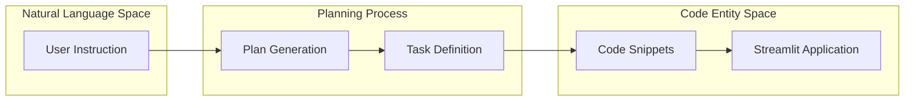
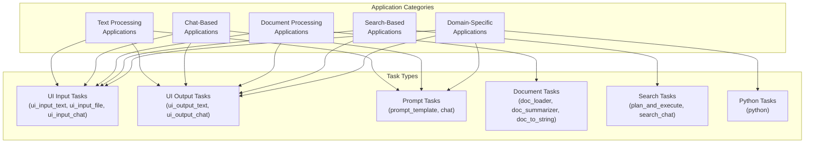
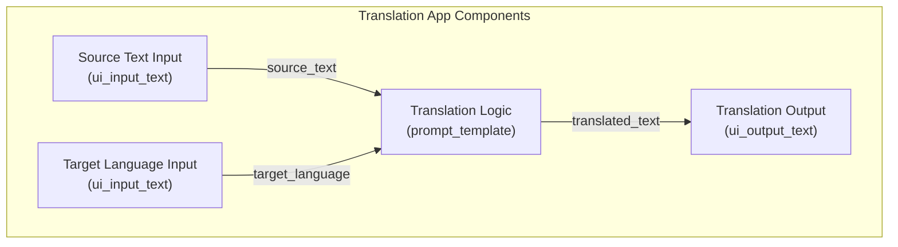
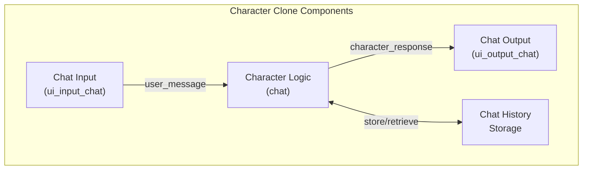
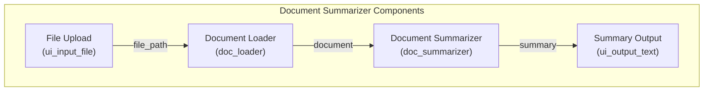
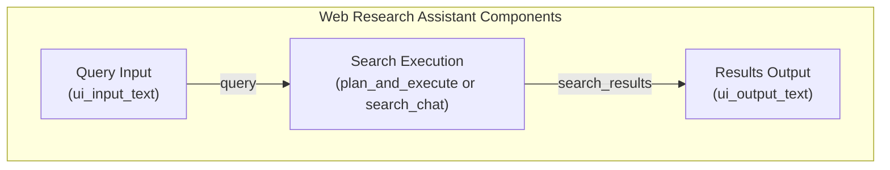
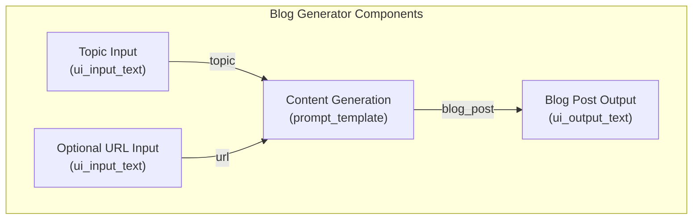
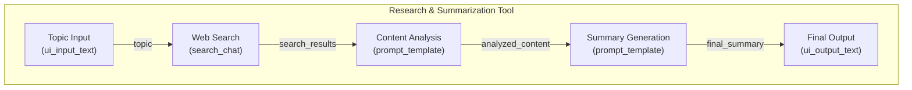

<!-- source: DeepWiki mcp.deepwiki.com · repo melih-unsal/DemoGPT · page 5.3 Application Examples · fetched 2026-10-26 -->

# Application Examples

Relevant source files

The following files were used as context for generating this wiki page:

- [README.md](README.md)
- [assets/demogpt_new_pipeline.jpeg](assets/demogpt_new_pipeline.jpeg)
- [assets/demogpt_new_pipeline1.jpeg](assets/demogpt_new_pipeline1.jpeg)
- [demogpt/app.py](demogpt/app.py)
- [demogpt/chains/chains.py](demogpt/chains/chains.py)
- [demogpt/chains/prompts/plan_feedback.py](demogpt/chains/prompts/plan_feedback.py)
- [demogpt/chains/prompts/plan_refiner.py](demogpt/chains/prompts/plan_refiner.py)
- [demogpt/chains/prompts/system_inputs.py](demogpt/chains/prompts/system_inputs.py)
- [demogpt/chains/prompts/task_list/search.py](demogpt/chains/prompts/task_list/search.py)
- [demogpt/chains/prompts/task_list/search_chat.py](demogpt/chains/prompts/task_list/search_chat.py)
- [demogpt/chains/task_chains.py](demogpt/chains/task_chains.py)
- [demogpt/model.py](demogpt/model.py)
- [demogpt/utils.py](demogpt/utils.py)
- [docs/README_CN.md](docs/README_CN.md)
- [pyproject.toml](pyproject.toml)

This page provides an overview of the types of applications that can be generated using DemoGPT, along with specific examples to help users understand the system's capabilities. For information about using DemoGPT from the command line or Python API, see [Command Line Usage](#5.1) and [Python API Usage](#5.2).

## Application Generation Overview

DemoGPT transforms natural language instructions into functional Streamlit applications powered by LangChain components. The system analyzes the user's input, generates a plan, creates tasks, and then converts these tasks into code that implements the requested functionality.

Sources: [demogpt/model.py:295-336](), [README.md:96-101]()

## Types of Applications

DemoGPT can generate a wide range of application types based on the capabilities of its underlying task system. Each application type maps to specific task combinations in the codebase.

Sources: [demogpt/utils.py:248-314](), [demogpt/model.py:510-522]()

## Text Processing Applications

Text processing applications handle the transformation, analysis, or generation of text content. These applications typically combine UI input elements, prompt templates, and UI output elements.

### Translation Application Example

A translation application transforms text from one language to another using LLM capabilities:

The translation app begins with collecting the source text and target language through UI inputs. It then uses a prompt template to instruct the LLM to perform the translation, and finally displays the result using a UI output element.

Sources: [demogpt/utils.py:284-289](), [demogpt/chains/task_chains.py:45-69]()

## Chat-Based Applications

Chat-based applications provide interactive conversational interfaces. These applications use UI chat input/output components and conversation handling logic.

### Character Clone Example

A character clone application simulates conversation with a specific person or character (like Jeff Bezos):

The character clone application uses a chat input to collect user messages, processes them through a chat component with character-specific instructions, and displays responses using a chat output component. The application maintains conversation history to provide context for responses.

Sources: [demogpt/utils.py:304-307](), [demogpt/model.py:348-350](), [demogpt/chains/task_chains.py:134-151]()

## Document Processing Applications

Document processing applications handle various file formats, extract content, and perform operations like summarization or analysis.

### Document Summarizer Example

A document summarizer extracts key information from uploaded documents:

The document summarizer begins with a file upload component, loads the document with the appropriate loader based on file type, applies summarization logic, and displays the results.

Sources: [demogpt/utils.py:298-302](), [demogpt/chains/task_chains.py:230-299](), [demogpt/chains/task_chains.py:361-372]()

## Search-Based Applications

Search-based applications integrate with external data sources to provide answers or information from the web.

### Web Research Assistant Example

A web research assistant that searches for information based on user queries:

The web research assistant collects a query from the user, executes a search using tools like DuckDuckGo, processes the results, and presents them in a structured format.

Sources: [demogpt/utils.py:310-313](), [demogpt/chains/task_chains.py:182-227](), [demogpt/chains/prompts/task_list/search.py:20-57]()

## Content Generation Applications

Content generation applications create new content based on user inputs, such as blog posts or articles.

### Blog Post Generator Example

A blog post generator that creates articles based on a topic or website:

The blog post generator collects a topic and optional URL from the user, uses a prompt template to instruct the LLM to create relevant content, and displays the generated blog post.

Sources: [demogpt/utils.py:284-291](), [demogpt/model.py:480-550]()

## Best Practices for Application Examples

When creating applications with DemoGPT, consider the following best practices:

1. **Clear Instructions**: Provide clear, detailed instructions about what you want the application to do
2. **Specify Features**: List specific features you want, especially for complex applications
3. **Consider Task Flow**: Think about the logical flow of tasks from input to output
4. **Test Iterations**: Try different instructions to refine your application

## Application Example Table

Below is a table of common application examples and their corresponding components:

| Application Type | Description | Key Components | Example Instruction |
|-----------------|-------------|----------------|---------------------|
| Language Translator | Translates text between languages | ui_input_text, prompt_template, ui_output_text | "Create a translation system that converts English to French" |
| Character Clone | Simulates conversation with a person/character | ui_input_chat, chat, ui_output_chat | "Create a chat bot that talks like Jeff Bezos" |
| Document Analyzer | Analyzes and extracts information from documents | ui_input_file, doc_loader, prompt_template, ui_output_text | "Create an app that extracts key points from uploaded PDF files" |
| Web Researcher | Searches the web for information | ui_input_text, search_chat, ui_output_text | "Create a research assistant that can find information about any topic" |
| Content Creator | Generates creative content | ui_input_text, prompt_template, ui_output_text | "Build an app that generates blog posts from topics" |
| Learning Assistant | Helps with educational content | ui_input_text, chat, ui_output_text | "Create a learning assistant for French language practice" |

Sources: [demogpt/app.py:86-101](), [README.md:96-101]()

## Advanced Application Examples

More complex applications can be created by combining multiple task types and adding custom logic:

### Multi-Step Research and Summarization Tool

This advanced application combines web search, document processing, and content generation:

This application searches for information on a topic, analyzes the search results, generates a comprehensive summary, and presents it to the user in a structured format.

Sources: [demogpt/utils.py:284-313](), [demogpt/chains/task_chains.py:45-227]()

## Application Extension Patterns

When building on top of DemoGPT-generated applications, consider these common extension patterns:

1. **Add Authentication**: Incorporate user authentication for personalized experiences
2. **Database Integration**: Add database storage for persistent data
3. **API Connections**: Connect to external APIs for additional functionality
4. **Custom Styling**: Enhance the UI with custom CSS and Streamlit components
5. **Deployment**: Package the application for deployment to Streamlit Cloud or other hosting platforms

## Limitations and Considerations

When working with DemoGPT-generated applications, be aware of these limitations:

1. Applications rely on OpenAI API keys for functionality
2. Complex, multi-step applications may require manual refinement
3. Performance depends on the underlying LLM's capabilities
4. Custom UI layouts may need manual adjustments
5. Some applications may need additional error handling for production use

Sources: [demogpt/model.py:298-298](), [demogpt/app.py:58-63]()

By understanding these application examples, you can better leverage DemoGPT to generate a wide range of AI-powered Streamlit applications tailored to your specific needs.

---

