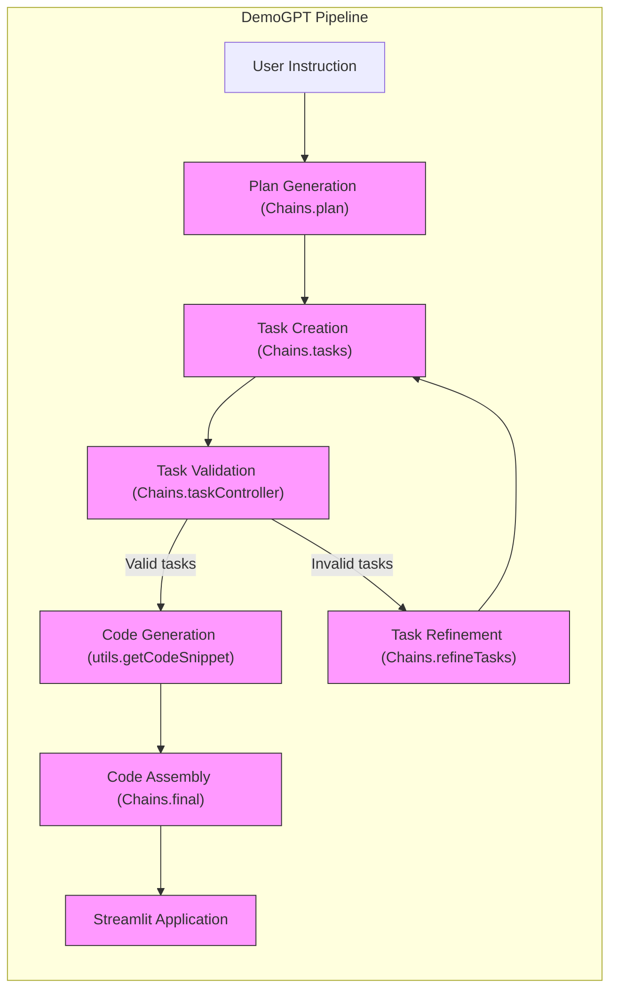
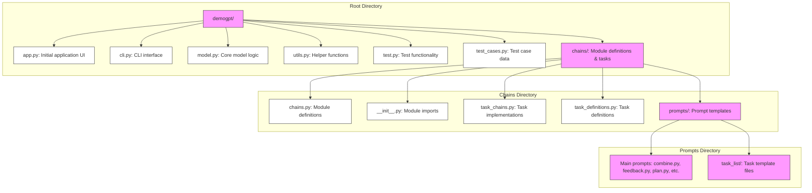
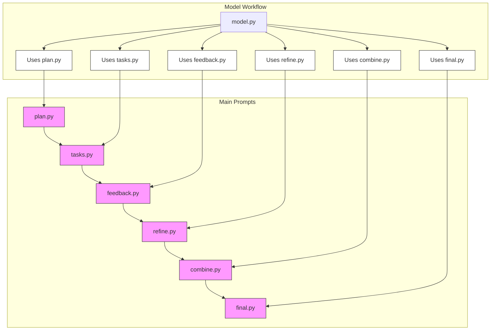

<!-- source: DeepWiki mcp.deepwiki.com · repo melih-unsal/DemoGPT · page 6 Contributing · fetched 2026-10-26 -->

# Contributing

<details>
<summary>Relevant source files</summary>

The following files were used as context for generating this wiki page:

- [CONTRIBUTING.md](CONTRIBUTING.md)
- [README.md](README.md)
- [assets/demogpt_new_pipeline.jpeg](assets/demogpt_new_pipeline.jpeg)
- [assets/demogpt_new_pipeline1.jpeg](assets/demogpt_new_pipeline1.jpeg)
- [demogpt/chains/prompts/task_list/search.py](demogpt/chains/prompts/task_list/search.py)
- [demogpt/chains/prompts/task_list/search_chat.py](demogpt/chains/prompts/task_list/search_chat.py)
- [demogpt/test.py](demogpt/test.py)
- [docs/README_CN.md](docs/README_CN.md)

</details>


This document provides guidelines for contributing to the DemoGPT project. It covers the project structure, how to add new tasks, modify prompts, and test your changes. For information about using DemoGPT as a library or application, see [Usage and Examples](#5).

## System Overview

DemoGPT is designed with a systematic pipeline approach that transforms user instructions into functional Streamlit applications. Before contributing, it's essential to understand how the system works:

1. **Planning**: A plan is generated based on the incoming instruction from the user.
2. **Task Creation**: Tasks are generated based on the plan.
3. **Code Generation**: Code snippets are generated for each task.
4. **Code Assembly**: The code snippets are combined into a final Streamlit application.
5. **Execution**: The generated application is executed with Streamlit.

This pipeline approach enables DemoGPT to generate complex applications from simple natural language instructions.



Sources: [CONTRIBUTING.md:6-13](), [demogpt/test.py:121-172]()

## Project Structure

Understanding the project structure is crucial for effective contributions. The DemoGPT codebase is organized as follows:



Sources: [CONTRIBUTING.md:14-31]()

The key files and directories for contributors are:

- **app.py**: The initial application where users can enter their instructions and app titles.
- **model.py**: Contains the DemoGPT model that orchestrates the application generation process.
- **utils.py**: Contains helper functions for code generation and assembly.
- **chains/chains.py**: Contains the module definitions for different chains used in the pipeline.
- **chains/task_chains.py**: Implements the available tasks.
- **chains/task_definitions.py**: Defines the tasks available in the system.
- **chains/prompts/**: Contains prompt templates for tasks and other operations.

## Adding New Tasks

Adding new tasks is one of the primary ways to contribute to DemoGPT. A task represents a specific functionality that can be included in the generated application. The process of adding a new task bridges the natural language space (task descriptions) to the code entity space (task implementations).

```mermaid
graph TD
    subgraph "New Task Addition Workflow"
        desc["1. Create Task Description"] --> template["2. Fill Template in demogpt/chains/prompts/task_list/"]
        template --> taskdef["3. Update TASKS in demogpt/chains/task_definitions.py"]
        taskdef --> taskchain["4. Add Task in demogpt/chains/task_chains.py"]
        taskchain --> init["5. Update demogpt/chains/prompts/__init__.py"]
        init --> utils["6. Update getCodeSnippet in demogpt/utils.py"]
        utils --> test["7. Add Test Case in demogpt/test_cases.py"]
        test --> testfunc["8. Add Test Function in demogpt/test.py"]
    end
    
    classDef step fill:#f9f,stroke:#333,stroke-width:1px
    class desc,template,taskdef,taskchain,init,utils,test,testfunc step
```



Sources: [CONTRIBUTING.md:36-65]()

Let's examine each step in detail:

### 1. Fill the Task Template File

Create or modify a file in `demogpt/chains/prompts/task_list/` with your new task implementation. Each task file typically contains these components:

- **system_template**: Prompt to guide the LLM in generating a specific task.
- **human_template**: Example instructions and expected outputs.
- **imports**: Required imports for the generated code.
- **functions**: Function templates for the task.
- **outputs**: Code to handle the function outputs in the Streamlit app.

Example from the search task:

```python
# In demogpt/chains/prompts/task_list/search.py
system_template = """
You are an AI assistant that write a concise prompt to direct an assistant to make web search for the given instruction.
You will have inputs and instruction. The prompt should be formattable with the inputs which means it should include inputs with curly braces.
"""

human_template = """
Instruction: Search the given input
Inputs:input
Prompt: Find the answer of it: {{input}}

Instruction: Find the list of song releated to the title
Inputs:title
Prompt: Find the list of songs releated to the title: {{title}}

Instruction:{instruction}
Inputs:{inputs}
Prompt:
"""

imports = """
from langchain_community.chat_models import ChatOpenAI
from langchain.llms import OpenAI
from langchain.tools import DuckDuckGoSearchRun
from langchain.agents.tools import Tool
from langchain.agents import initialize_agent, AgentType
from langchain.chains import LLMMathChain
from langchain.callbacks import StreamlitCallbackHandler
"""

functions = """
def {function_name}({argument}):
    search_input = "{res}".format({argument}={argument})
    llm = OpenAI(openai_api_key=openai_api_key, temperature=0)
    llm_math_chain = LLMMathChain.from_llm(llm=llm, verbose=True)
    tools = [
        DuckDuckGoSearchRun(name="Search"),
        Tool(
            name="Calculator",
            func=llm_math_chain.run,
            description="useful for when you need to answer questions about math"
        ),
    ]
    model = ChatOpenAI(openai_api_key=openai_api_key, temperature=0)
    agent = initialize_agent(tools, llm, agent=AgentType.ZERO_SHOT_REACT_DESCRIPTION, verbose=True)
    st_cb = StreamlitCallbackHandler(st.container(), expand_new_thoughts=False)
    return agent.run(search_input, callbacks=[st_cb])
"""

outputs = """
if not openai_api_key.startswith('sk-'):
    st.warning('Please enter your OpenAI API key!', icon='⚠')
    {variable} = ""
elif {argument}:
    {variable} = {function_name}({argument})
else:
    {variable} = ''
"""
```

Sources: [demogpt/chains/prompts/task_list/search.py:1-57]()

### 2. Update Task Definitions

Add your new task to the `TASKS` variable in `demogpt/chains/task_definitions.py` to make it available in the system.

### 3. Add Task Implementation in TaskChains

Implement the task logic in `demogpt/chains/task_chains.py`. This typically involves creating a new method that processes the task inputs and returns the generated code.

### 4. Update `__init__.py`

Modify `demogpt/chains/prompts/__init__.py` to make your new task available to the system.

### 5. Update `getCodeSnippet` Function

Add your new task to the `getCodeSnippet` function in `demogpt/utils.py`:

```python
elif task_type == $task_name:
    code = TaskChains.$task_name(task=task, code_snippets=code_snippets)
```

### 6. Add Test Cases

Update the `TOOL_EXAMPLES` variable in `demogpt/test_cases.py` to include test cases for your new task.

### 7. Add Test Function

Add a test function in `demogpt/test.py` to test your new task:

```python
def test_$new_task_name(self):
    for example in TOOL_EXAMPLES[$new_task_name]:
        instruction = example["instruction"]
        inputs = example["inputs"]
        res = TaskChains.$new_task_name(instruction=instruction, inputs=inputs)
        self.writeToFile($APPROPRIATE_TASK_NAME, res, instruction)
```

### 8. Test Your Implementation

Run the test for your new task to make sure it works correctly:

```bash
python -m unittest demogpt.test.TestDemoGPT.$function_name
```

The test results will be available in the **test.log** file.

## Modifying Main Prompts

The main prompts are another area where you can contribute to DemoGPT. These prompts guide the LLM in generating different parts of the application.



Sources: [CONTRIBUTING.md:67-71]()

The main prompts are in the `demogpt/chains/prompts/` folder:

- **combine.py**: Used to combine code snippets.
- **feedback.py**: Used to generate feedback on the code.
- **plan.py**: Used to generate the initial plan.
- **refine.py**: Used to refine the code based on feedback.
- **tasks.py**: Used to generate tasks from the plan.
- **final.py**: Used to generate the final code.

You can modify these prompts to improve the quality and capabilities of the generated applications. Check their usage in `demogpt/model.py` to understand their role in the pipeline.

## Testing Your Changes

Testing is a crucial part of the contribution process. DemoGPT provides a testing framework in `demogpt/test.py` to validate your changes.

The testing framework allows you to test individual components of the system as well as the entire pipeline. You can run specific tests or the full test suite:

```bash
# Test a specific function
python -m unittest demogpt.test.TestDemoGPT.$function_name

# Test the entire pipeline
python -m unittest demogpt.test.TestDemoGPT.test
```

Make sure to test your changes thoroughly before submitting a contribution.

Sources: [demogpt/test.py:16-186]()

## Development Roadmap

The DemoGPT team has identified several areas for future development. Contributing to these areas can help advance the project:

1. ✅ Implement the new DemoGPT pipeline (plan generation, task creation, code generation, code assembly)
2. ✅ Add feature to allow users to select models
3. ✅ Define useful LangChain tasks
4. ✅ Publish release with the new pipeline without refinement
5. ⬜ Implement remaining LangChain tasks
6. ⬜ Implement self-refining strategy for model response refinement
7. ⬜ Integrate 🦍 Gorilla model for API calls
8. ⬜ Add Rapid API for expanding available API calls
9. ⬜ Add 🦙 Llama2 integration
10. ⬜ Implement publicly available database to accelerate generation
11. ⬜ Add successfully generated steps to a DB to eliminate redundant refinement

The team is especially focused on integrating Gorilla, a model specifically designed for API calls, in the near future. This will enable DemoGPT to use external APIs autonomously.

Sources: [README.md:206-217](), [CONTRIBUTING.md:73-74]()

## Submission Guidelines

When contributing to DemoGPT, please follow these guidelines:

1. **Fork the Repository**: Create a fork of the repository on GitHub.
2. **Create a Branch**: Make your changes in a new branch.
3. **Test Your Changes**: Make sure your changes pass all tests.
4. **Submit a Pull Request**: Create a pull request with a clear description of your changes.
5. **Follow Code of Conduct**: Adhere to the project's code of conduct.

For more details, please read the [`CONTRIBUTING`](CONTRIBUTING.md) document and the [`CODE OF CONDUCT`](CODE_OF_CONDUCT.md).

Sources: [README.md:219-223]()

## Conclusion

Contributing to DemoGPT is an opportunity to advance the state of the art in LLM-based application generation. Whether you're adding new tasks, improving prompts, or fixing bugs, your contributions are valued by the community.

If you have any questions or need assistance, please don't hesitate to reach out through GitHub issues or discussions.

Thank you for being a part of the DemoGPT community!

---

