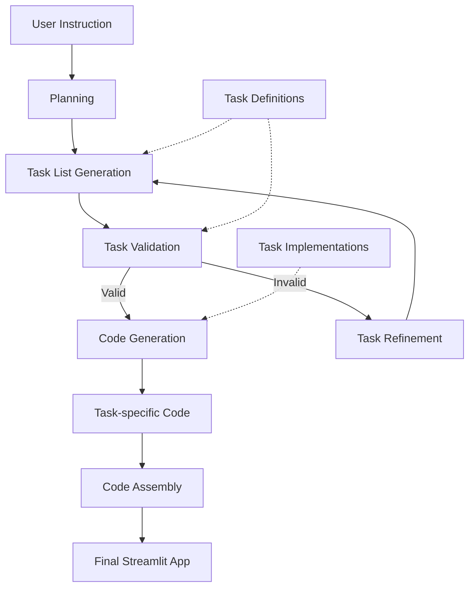
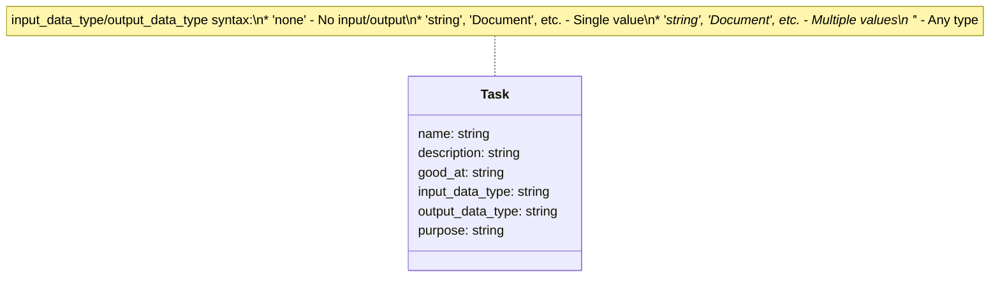
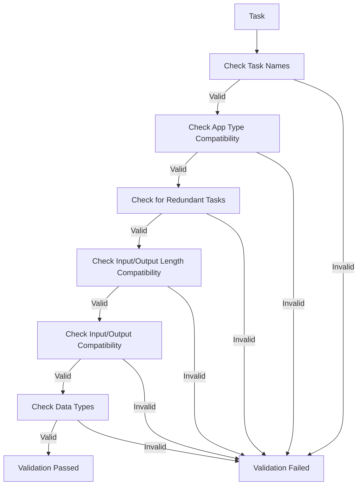
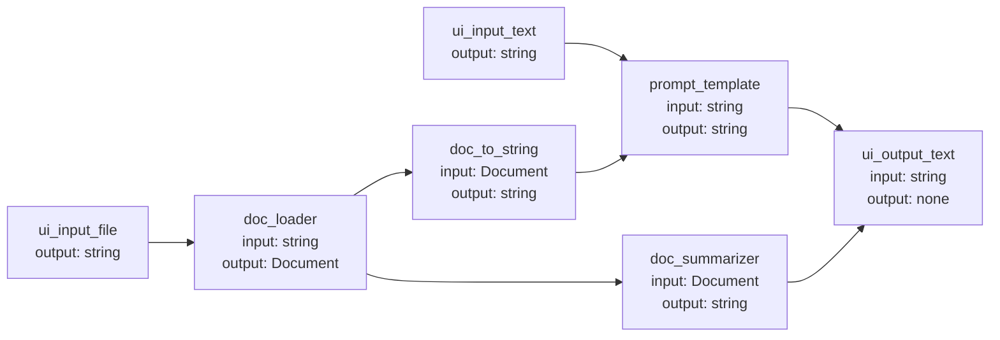

<!-- source: DeepWiki mcp.deepwiki.com · repo melih-unsal/DemoGPT · page 6.1 Adding New Tasks · fetched 2026-10-26 -->

# Adding New Tasks

<details>
<summary>Relevant source files</summary>

The following files were used as context for generating this wiki page:

- [CONTRIBUTING.md](CONTRIBUTING.md)
- [demogpt/chains/prompts/__init__.py](demogpt/chains/prompts/__init__.py)
- [demogpt/chains/prompts/app_type.py](demogpt/chains/prompts/app_type.py)
- [demogpt/chains/prompts/how_to_use.py](demogpt/chains/prompts/how_to_use.py)
- [demogpt/chains/prompts/plan_with_inputs.py](demogpt/chains/prompts/plan_with_inputs.py)
- [demogpt/chains/prompts/task_list/chat.py](demogpt/chains/prompts/task_list/chat.py)
- [demogpt/chains/prompts/task_list/detailed_description.py](demogpt/chains/prompts/task_list/detailed_description.py)
- [demogpt/chains/prompts/task_list/doc_load.py](demogpt/chains/prompts/task_list/doc_load.py)
- [demogpt/chains/prompts/task_list/summarize.py](demogpt/chains/prompts/task_list/summarize.py)
- [demogpt/chains/prompts/task_list/ui_input_file.py](demogpt/chains/prompts/task_list/ui_input_file.py)
- [demogpt/chains/prompts/task_list/ui_output_text.py](demogpt/chains/prompts/task_list/ui_output_text.py)
- [demogpt/chains/task_chains_seperate.py](demogpt/chains/task_chains_seperate.py)
- [demogpt/chains/task_definitions.py](demogpt/chains/task_definitions.py)
- [demogpt/controllers.py](demogpt/controllers.py)
- [demogpt/test.py](demogpt/test.py)

</details>


This page guides developers on extending DemoGPT by adding new task types to the system. Tasks are fundamental building blocks that enable DemoGPT to generate different functionalities in Streamlit applications. Each task type represents a specific capability (like text input, file handling, or AI-powered processing) that can be combined to create complete applications.

For information about the overall architecture, see [Architecture](#2), and for details about the existing task system, see [Task System](#2.2).

## Task System Overview

Tasks are the functional units that DemoGPT uses to transform user instructions into working applications. Each task represents a specific capability or operation that can be performed as part of a generated application.

**Task Processing Flow**



Sources: [demogpt/controllers.py](), [demogpt/chains/task_definitions.py](), [CONTRIBUTING.md]()

## Task Structure

Each task in DemoGPT is defined with specific attributes that determine its behavior and compatibility with other tasks.

**Task Definition Anatomy**



Sources: [demogpt/chains/task_definitions.py:7-169]()

### Task Attributes Explained

| Attribute | Description | Example |
|-----------|-------------|---------|
| `name` | Unique identifier for the task | `"ui_input_text"` |
| `description` | Explains what the task does | `"Gets input from the user via a text field."` |
| `good_at` | Describes the task's strengths | `"Retrieving text input from the user."` |
| `input_data_type` | The expected input type(s) | `"string"`, `"*string"`, `"none"`, `"*"` |
| `output_data_type` | The produced output type(s) | `"Document"`, `"string"`, `"none"` |
| `purpose` | The task's intended use | `"Collect user-entered text for further processing."` |

Sources: [demogpt/chains/task_definitions.py:7-169]()

## Step-by-Step Guide to Adding a New Task

### 1. Define Task Requirements

Before implementing a new task, determine:
- What functionality the task will provide
- Required input and output data types
- How it will interact with existing tasks

### 2. Add Task Definition

Add your task to the `ALL_TASKS` list in `task_definitions.py`:

```
{
    "name": "your_task_name",
    "description": "Clear description of what your task does",
    "good_at": "What your task is good at handling",
    "input_data_type": "expected_input_type",
    "output_data_type": "produced_output_type",
    "purpose": "The intended purpose of your task",
}
```

Sources: [demogpt/chains/task_definitions.py:7-169]()

### 3. Create Task Implementation File

Create a new Python file in `demogpt/chains/prompts/task_list/` for your task. This should include:

- System template (instructions for the LLM)
- Human template (input format)
- Any additional template components needed

Refer to existing files like [demogpt/chains/prompts/task_list/ui_input_file.py]() or [demogpt/chains/prompts/task_list/ui_output_text.py]() for examples.

Sources: [demogpt/chains/prompts/task_list/ui_output_text.py](), [demogpt/chains/prompts/task_list/ui_input_file.py]()

### 4. Update Task Imports

Add your task to the imports in `demogpt/chains/prompts/__init__.py`:

Sources: [demogpt/chains/prompts/__init__.py:6-9]()

### 5. Add Task Implementation to TaskChains Class

Implement the task execution function in `task_chains.py` or `task_chains_seperate.py`. The function should:
- Accept a task object and possibly code_snippets
- Generate appropriate code snippets
- Return a dictionary with:
  - `imports`: Import statements
  - `functions`: Function definitions
  - `inputs`: Input handling code
  - `outputs`: Output handling code
  - `code`: Combined code

Sources: [demogpt/chains/task_chains_seperate.py:45-461]()

### 6. Update Task Processing

Add a condition to handle your new task type in the `getCodeSnippet` function in `utils.py`:

```python
elif task_type == "your_task_name":
    code = TaskChains.your_task_name(task=task, code_snippets=code_snippets)
```

### 7. Add Test Cases

Update the `TOOL_EXAMPLES` variable in `test_cases.py` with examples for your task.

Sources: [demogpt/test.py:95-114]()

### 8. Add Test Function

Add a test function to `test.py` to validate your task:

```python
def test_your_task_name(self):
    for example in TOOL_EXAMPLES["your_task_name"]:
        instruction = example["instruction"]
        # Add other required parameters
        res = TaskChains.your_task_name(instruction=instruction, ...)
        self.writeToFile("YOUR_TASK_NAME", res, instruction)
```

Sources: [demogpt/test.py:95-114]()

## Task Validation System

When adding a new task, understand how the validation system works to ensure your task integrates properly.

**Validation Process**



Sources: [demogpt/controllers.py:38-391]()

### Key Validation Rules

1. **Task Name Check**: Task must be in the registered task types
2. **App Type Compatibility**: 
   - Chat tasks require chat apps
   - Search tasks require search apps
   - AI tasks require AI apps
   - Summarization tasks require summary apps
3. **Redundancy Check**: Ensure task outputs are used as inputs by other tasks
4. **I/O Length Compatibility**: Input/output array lengths must match task definitions
5. **I/O Compatibility**: Ensure inputs come from other task outputs
6. **Data Type Check**: Input/output data types must be compatible with definitions

Sources: [demogpt/controllers.py:38-441]()

## Task Type Constraints

Different application types have specific task requirements and constraints.

### Application Type Requirements

| App Type | Required Tasks | Prohibited Tasks | 
|----------|----------------|------------------|
| Chat Apps | `ui_input_chat`, `ui_output_chat`, `chat` | `plan_and_execute` (if not search) |
| Search Apps | `plan_and_execute` (if not chat), `search_chat` (if chat) | `python` + `plan_and_execute` combination |
| AI Apps | `prompt_template` | - |
| Summary Apps | `doc_summarizer` | - |

Sources: [demogpt/chains/task_definitions.py:176-215](), [demogpt/controllers.py:287-388]()

## Testing Your New Task

To test your new task, use the unittest framework:

```bash
python -m unittest demogpt.test.TestDemoGPT.test_your_task_name
```

The test results will be available in `test.log` to help you debug any issues.

Sources: [demogpt/test.py:95-114](), [CONTRIBUTING.md:61-65]()

## Task Chaining and Data Flow

Tasks must have compatible input and output types to be chainable. The system enforces this through validation.

**Task Data Flow Example**



Sources: [demogpt/chains/task_definitions.py:7-169](), [demogpt/controllers.py:104-156]()

## Common Issues and Solutions

| Issue | Solution |
|-------|----------|
| Task validation fails | Check input/output data types for compatibility |
| Task not showing up | Ensure task is added to `__init__.py` imports |
| Incorrect code generation | Review task implementation in task_chains.py |
| Test failures | Verify example inputs match expected format |
| Incompatible tasks | Review app type constraints in validation system |

Sources: [demogpt/controllers.py:38-441](), [CONTRIBUTING.md]()

## Best Practices

1. **Follow existing patterns**: Use existing tasks as templates
2. **Clear descriptions**: Make task names and descriptions intuitive
3. **Specific data types**: Be clear about input/output requirements
4. **Single responsibility**: Each task should do one thing well
5. **Thorough testing**: Test with various inputs and edge cases
6. **Proper validation**: Ensure your task integrates with validation

By following this guide, you'll be able to successfully add new tasks to DemoGPT, expanding its capabilities to generate more diverse and powerful Streamlit applications.

---

