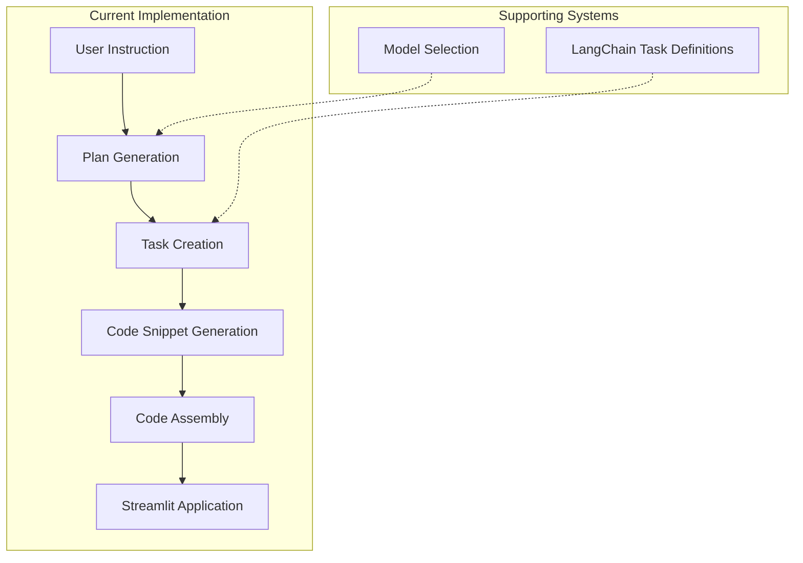
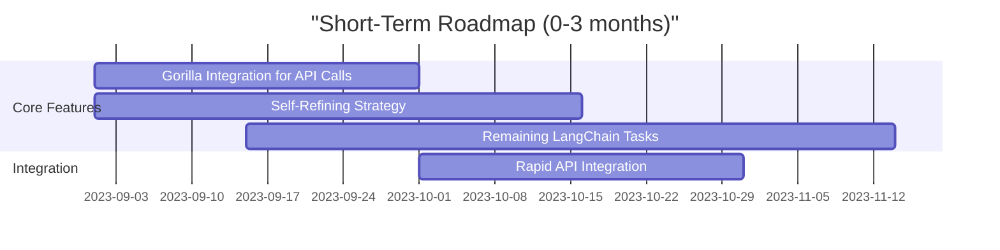
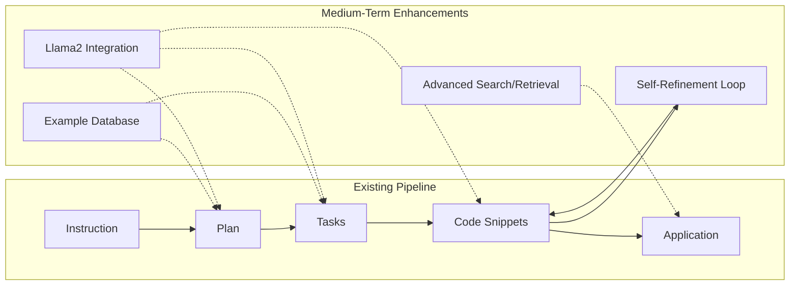
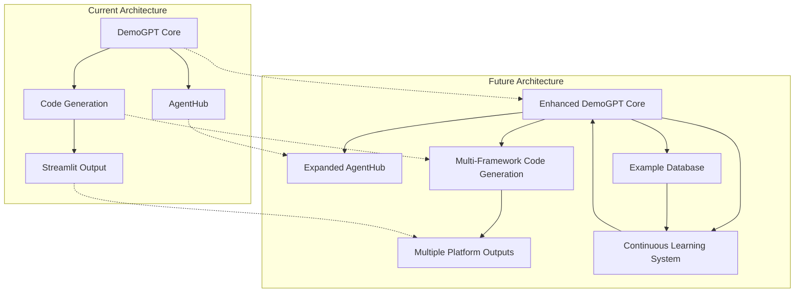
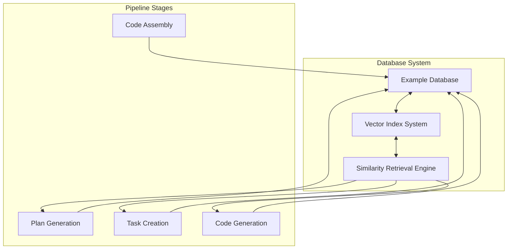
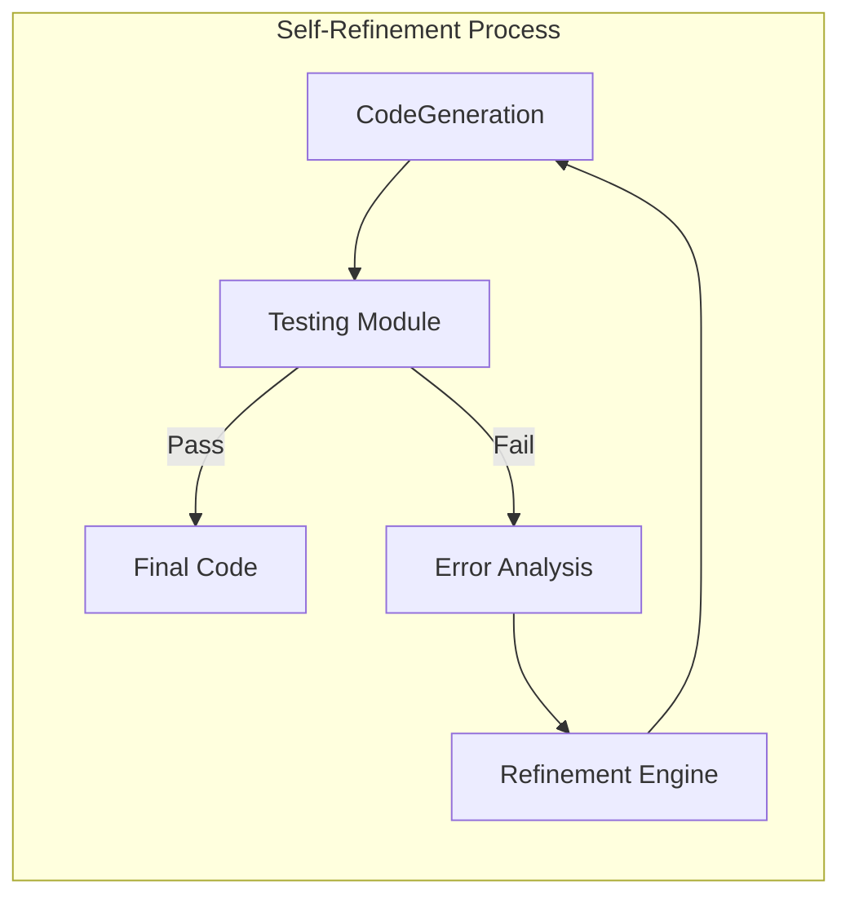
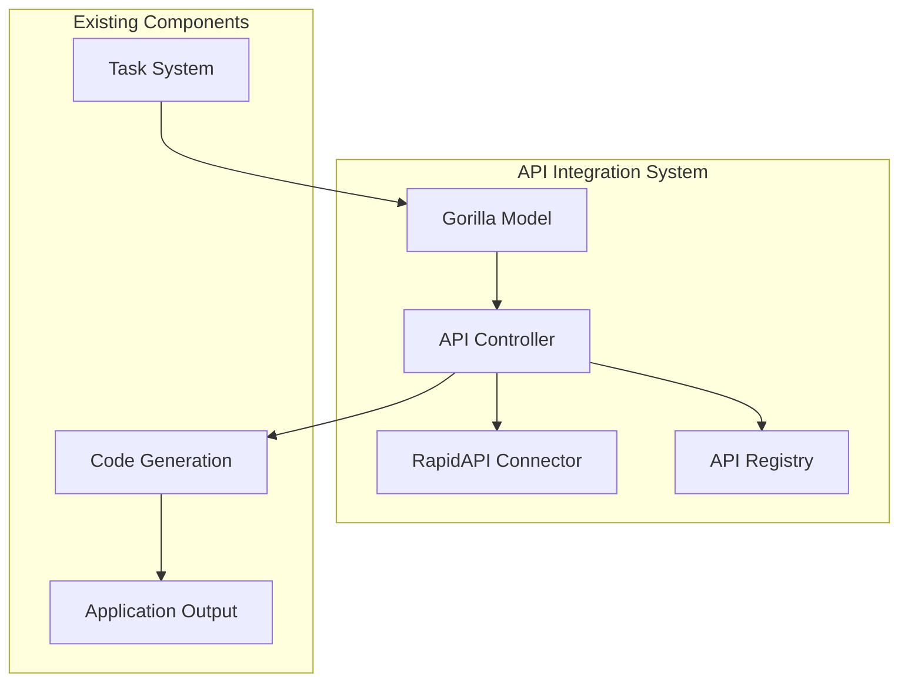

<!-- source: DeepWiki mcp.deepwiki.com · repo melih-unsal/DemoGPT · page 6.2 Development Roadmap · fetched 2026-10-26 -->

# Development Roadmap

Relevant source files

The following files were used as context for generating this wiki page:

- [README.md](README.md)
- [assets/demogpt_new_pipeline.jpeg](assets/demogpt_new_pipeline.jpeg)
- [assets/demogpt_new_pipeline1.jpeg](assets/demogpt_new_pipeline1.jpeg)
- [demogpt/chains/prompts/task_list/search.py](demogpt/chains/prompts/task_list/search.py)
- [demogpt/chains/prompts/task_list/search_chat.py](demogpt/chains/prompts/task_list/search_chat.py)
- [docs/README_CN.md](docs/README_CN.md)

## Purpose and Scope

This document outlines the planned development trajectory for DemoGPT, detailing upcoming features, improvements, and strategic direction. It serves as a guide for both contributors and users to understand where the project is heading and what capabilities to expect in future releases. For information about contributing to DemoGPT by adding new tasks, see [Adding New Tasks](#6.1).

## Current Status

DemoGPT has established a solid foundation with its plan-based pipeline architecture that transforms user instructions into functional Streamlit applications. Current capabilities include:

- Plan generation from user instructions
- Task creation from plans
- Code snippet generation from tasks
- Final code assembly into Streamlit applications
- Model selection capabilities
- Basic LangChain task definitions

Sources: [README.md:206-211]()

## Short-Term Roadmap (0-3 months)

The immediate focus is on enhancing the existing pipeline with features that improve output quality and expand functionality.

### Gorilla Integration for API Usage

A top priority is integrating the Gorilla model to enable autonomous API usage. This will allow DemoGPT to interact with external services without user intervention.

### Self-Refining Strategy

Implementation of a self-refining mechanism to improve model responses and generated code quality. This will create a feedback loop where generated code is tested and refined before final assembly.

### Remaining LangChain Tasks

Complete the implementation of planned LangChain tasks to expand the scope of applications that can be generated.

Sources: [README.md:59-60](), [README.md:212-214](), [README.md:117-118]()

## Medium-Term Roadmap (3-9 months)

### Database for Example Storage

Creation of a publicly available database to store successfully generated examples. This will:
- Accelerate generation by retrieving similar examples
- Eliminate redundant refinement steps
- Improve overall system efficiency

### Llama2 Integration

Integration of the Llama2 model to provide an open-source alternative to proprietary models and potentially improve performance for specific tasks.

### Enhanced Search and Retrieval Capabilities

Expansion of the search functionality to include more sophisticated retrieval methods, as evidenced by the search and search_chat components already in development.

Sources: [README.md:103-105](), [README.md:215-216]()

## Long-Term Vision (9+ months)

The long-term vision focuses on creating a comprehensive autonomous development ecosystem where DemoGPT can:

1. **Fully Autonomous App Development**: Create increasingly complex applications with minimal user guidance
2. **Continuous Learning**: Improve over time by learning from successful generations and user feedback
3. **Ecosystem Expansion**: Broaden the range of supported frameworks and platforms beyond Streamlit

### Technical Infrastructure Evolution

Sources: [README.md:213-218]()

## Technical Implementation Details

### Database Integration Architecture

The planned database integration will become a central component that interacts with multiple stages of the pipeline:

Sources: [README.md:216-217]()

### Self-Refinement Mechanism

The planned self-refinement mechanism will create a feedback loop in the code generation process:

Sources: [README.md:212]()

### API Integration Architecture

The planned Gorilla integration for API usage will connect to the existing architecture:

Sources: [README.md:59-60](), [README.md:213-214](), [demogpt/chains/prompts/task_list/search.py:20-47](), [demogpt/chains/prompts/task_list/search_chat.py:20-57]()

## Contribution Areas

For developers interested in contributing to the roadmap, here are the key areas where help is needed:

| Area | Description | Priority | Technical Complexity |
|------|-------------|----------|----------------------|
| LangChain Tasks | Implementing remaining task templates | High | Medium |
| Self-Refinement | Creating the code testing and refinement system | High | High |
| API Integration | Working on Gorilla model integration | High | High |
| Database System | Building the example storage and retrieval database | Medium | Medium |
| Llama2 Integration | Adding support for the Llama2 model | Medium | Medium |
| Testing Framework | Creating comprehensive testing for generated applications | Medium | High |
| Documentation | Improving and expanding documentation | Medium | Low |

Sources: [README.md:212-218](), [README.md:219-223]()

## Conclusion

The DemoGPT development roadmap represents an ambitious vision for the future of AI-assisted application development. By focusing on enhancing the core pipeline while expanding functionality through strategic integrations, DemoGPT aims to revolutionize how developers create LLM-powered applications. The planned improvements in self-refinement, database integration, and model support will significantly enhance both the quality and efficiency of the system.

Contributors are encouraged to focus on the areas outlined in this roadmap, particularly the high-priority short-term objectives that will have the most immediate impact on the project's capabilities.

Sources: [README.md:117-118](), [README.md:212-218]()