# Page: Overview

# Overview

<details>
<summary>Relevant source files</summary>

The following files were used as context for generating this wiki page:

- [README.md](README.md)
- [assets/demogpt_new_pipeline.jpeg](assets/demogpt_new_pipeline.jpeg)
- [assets/demogpt_new_pipeline1.jpeg](assets/demogpt_new_pipeline1.jpeg)
- [demogpt/app.py](demogpt/app.py)
- [demogpt/chains/chains.py](demogpt/chains/chains.py)
- [demogpt/chains/prompts/task_list/search.py](demogpt/chains/prompts/task_list/search.py)
- [demogpt/chains/prompts/task_list/search_chat.py](demogpt/chains/prompts/task_list/search_chat.py)
- [demogpt/chains/task_chains.py](demogpt/chains/task_chains.py)
- [demogpt/model.py](demogpt/model.py)
- [demogpt/utils.py](demogpt/utils.py)
- [docs/README_CN.md](docs/README_CN.md)
- [pyproject.toml](pyproject.toml)

</details>


DemoGPT is an open-source system that automatically generates LangChain-based Streamlit applications from natural language instructions. It serves as a comprehensive agent library, enabling users to create functional AI-powered applications by simply describing what they want to build, without writing any code themselves.

This document provides a technical overview of the DemoGPT system, explaining its core architecture, components, and the processing pipeline that transforms natural language instructions into executable Streamlit applications. For specific usage instructions and examples, see [Usage and Examples](#5).

## Core Purpose and Capabilities

DemoGPT was designed to democratize the creation of LLM-powered applications by abstracting away the complexities of coding. The system takes a user's natural language instruction and converts it into a fully functional Streamlit application that leverages LangChain for interacting with large language models.

Key capabilities include:

- Transformation of natural language instructions into executable code
- Generation of interactive Streamlit user interfaces
- Integration with various LLMs through LangChain
- Support for document processing, chat functionality, and web search
- Self-refinement of generated code

Sources: [README.md:88-115](), [pyproject.toml:8]()

## System Architecture

The DemoGPT system follows a plan-based pipeline architecture that systematically transforms user instructions into functional applications through a series of well-defined stages.

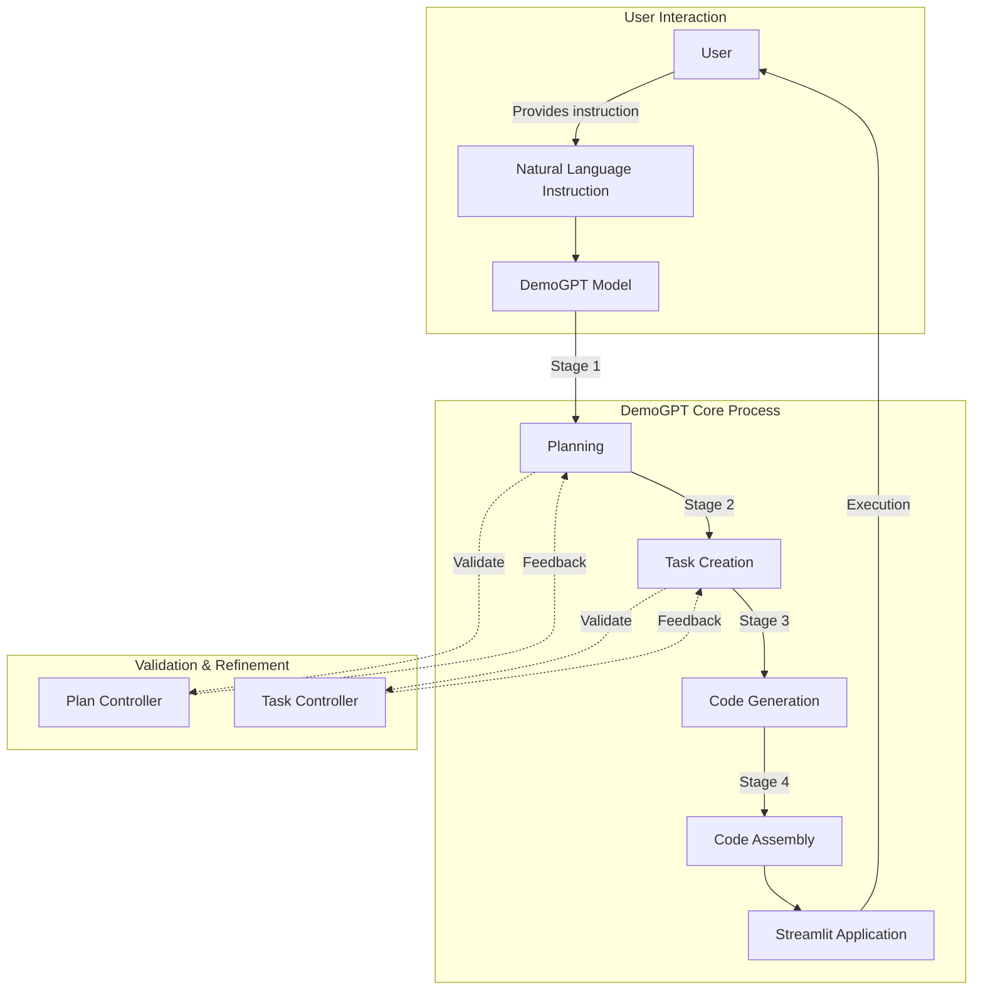

The system is composed of several key components:

1. **DemoGPT Model**: The central orchestrator that manages the entire process
2. **Chains**: Handle different aspects of the generation process, such as planning and task creation
3. **Task Chains**: Generate code snippets for specific task types
4. **Controllers**: Validate plans and tasks, providing feedback for refinement

Sources: [README.md:120-122](), [demogpt/model.py:18-90](), [demogpt/chains/chains.py:20-43]()

## Processing Pipeline

DemoGPT transforms user instructions into Streamlit applications through a four-stage pipeline:

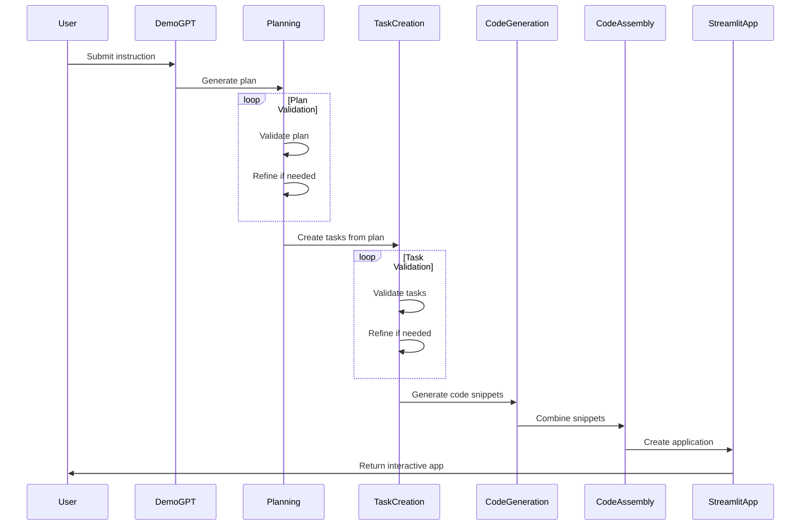

### 1. Planning

The planning stage takes the user's natural language instruction and generates a structured plan. The system analyzes the instruction to understand the user's requirements and creates a sequential list of steps needed to build the application.

Sources: [demogpt/model.py:122-133](), [demogpt/chains/chains.py:122-130]()

### 2. Task Creation

Once a plan is created and validated, it is broken down into specific tasks. Each task represents a specific functionality or component of the application, such as input fields, processing logic, or output displays.

Sources: [demogpt/model.py:162-183](), [demogpt/chains/chains.py:158-171]()

### 3. Code Generation

In this stage, each task is translated into a code snippet. The system uses specialized task chains to generate code for different types of functionality, such as UI elements, document processing, and AI interactions.

Sources: [demogpt/model.py:255-257](), [demogpt/utils.py:248-314]()

### 4. Code Assembly

Finally, the individual code snippets are combined into a complete Streamlit application. The system handles imports, function definitions, and the main application flow, ensuring that all components work together correctly.

Sources: [demogpt/model.py:280-294](), [demogpt/model.py:550-562]()

## Core Components

### DemoGPT Model

The `DemoGPT` class in `model.py` serves as the main orchestrator of the application generation process. It initializes the necessary components, manages the pipeline flow, and handles errors and edge cases.

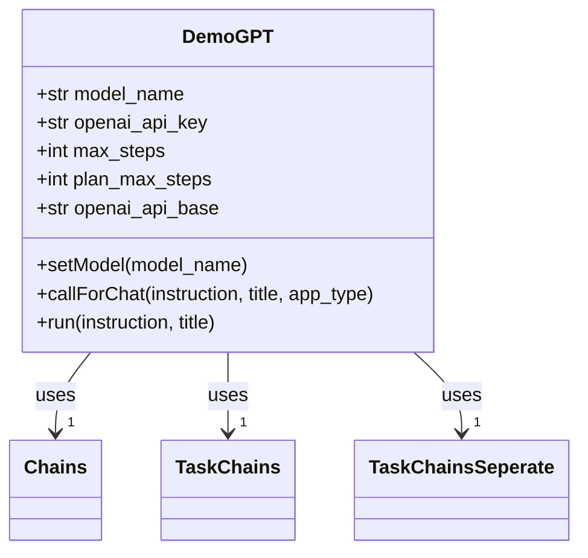

The model orchestrates the entire process, communicating with various chains to generate plans, tasks, and code.

Sources: [demogpt/model.py:18-562]()

### Chains System

The chains system in `chains/chains.py` handles different aspects of the application generation process. It provides methods for planning, task creation, code assembly, and refinement.

Key methods include:
- `planWithInputs`: Generates a plan from the user's instruction
- `tasks`: Creates tasks from the plan
- `combine`: Assembles code snippets into a complete application

Sources: [demogpt/chains/chains.py:122-130](), [demogpt/chains/chains.py:158-171](), [demogpt/chains/chains.py:199-207]()

### Task Chains

The task chains system in `chains/task_chains.py` is responsible for generating code snippets for specific task types. It provides specialized methods for different kinds of functionality, such as:

- UI elements (input fields, output displays)
- Document processing
- LLM interactions
- Search functionality

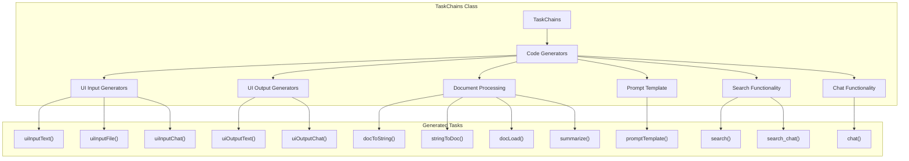

The task chains use LangChain and OpenAI models to generate appropriate code for each task type.

Sources: [demogpt/chains/task_chains.py:16-390](), [demogpt/utils.py:282-314]()

### Controllers

Controllers validate plans and tasks, ensuring they meet the requirements for the application. They provide feedback for refinement when necessary.

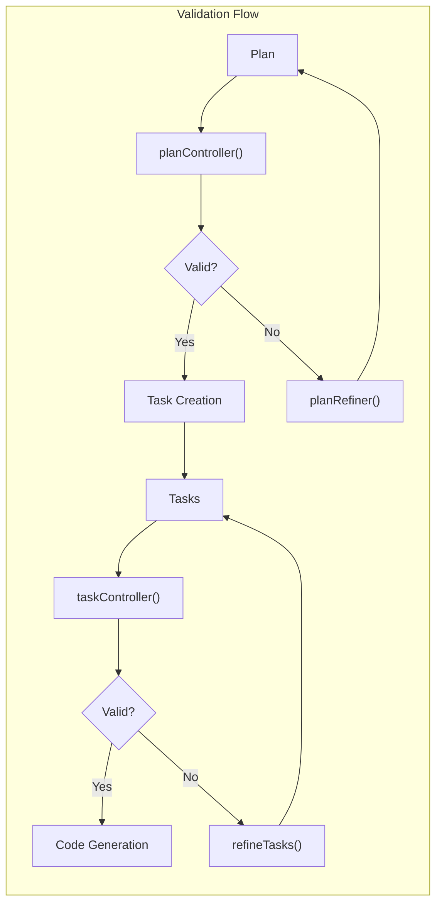

The validation process ensures that the generated plans and tasks are feasible and meet the requirements specified in the user's instruction.

Sources: [demogpt/model.py:146-160](), [demogpt/model.py:440-467](), [demogpt/chains/chains.py:174-177](), [demogpt/chains/chains.py:178-180]()

## Integration with External Systems

### LangChain Integration

DemoGPT heavily integrates with LangChain, using its components for:
- Creating chains with LLMs
- Building prompt templates
- Managing conversation memory
- Implementing document loaders and processors

The system leverages LangChain's capabilities to create powerful AI applications without requiring users to understand the underlying complexities.

Sources: [demogpt/chains/task_chains.py:3-10](), [demogpt/utils.py:404-425](), [demogpt/utils.py:567-588]()

### OpenAI API Integration

DemoGPT uses OpenAI's models for generating code and handling AI interactions. It allows users to specify their OpenAI API key and model preference, supporting various GPT models.

Sources: [demogpt/chains/chains.py:34-40](), [demogpt/chains/task_chains.py:26-32](), [demogpt/model.py:33-35]()

### Streamlit Integration

The final output of DemoGPT is a Streamlit application. The system generates Streamlit code that handles the UI, user interactions, and backend processing. It also provides a Streamlit interface for using DemoGPT itself.

Sources: [demogpt/app.py:1-216](), [demogpt/utils.py:682-716]()

## System Requirements

DemoGPT requires:
- Python 3.8.1 or higher
- OpenAI API key
- Required packages:
  - streamlit
  - langchain
  - openai
  - tiktoken
  - other dependencies listed in pyproject.toml

Sources: [pyproject.toml:17-35](), [README.md:123-148]()

## Conclusion

DemoGPT represents a sophisticated system for automatically generating LangChain-based Streamlit applications from natural language instructions. Its pipeline approach, with planning, task creation, code generation, and assembly stages, allows it to create complex applications with minimal user input. By leveraging LangChain, OpenAI, and Streamlit, DemoGPT simplifies the development of AI-powered applications, making them accessible to users without programming expertise.

---

# Page: Features and Capabilities

# Features and Capabilities

<details>
<summary>Relevant source files</summary>

The following files were used as context for generating this wiki page:

- [README.md](README.md)
- [assets/demogpt_new_pipeline.jpeg](assets/demogpt_new_pipeline.jpeg)
- [assets/demogpt_new_pipeline1.jpeg](assets/demogpt_new_pipeline1.jpeg)
- [demogpt/chains/prompts/task_list/search.py](demogpt/chains/prompts/task_list/search.py)
- [demogpt/chains/prompts/task_list/search_chat.py](demogpt/chains/prompts/task_list/search_chat.py)
- [docs/README_CN.md](docs/README_CN.md)

</details>


This page provides an overview of the key features and capabilities of DemoGPT, focusing on what the system can do and the types of applications it can generate. For information about system requirements and installation, see [System Requirements](#1.2).

## Core Features

DemoGPT is an all-in-one agent library designed to automatically generate LangChain-based Streamlit applications from natural language instructions. The system incorporates several key features that enable this functionality.

### Automatic Streamlit Application Generation

DemoGPT transforms natural language instructions into fully functional Streamlit web applications without requiring manual coding. The system handles the entire process from planning to code generation automatically.

**Application Generation Pipeline**
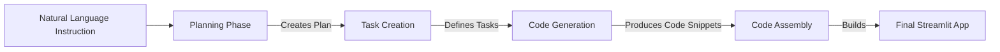

Sources: [README.md:96-101]()

### Plan-Based Pipeline Architecture

DemoGPT implements a structured pipeline approach to application generation consisting of four main phases:

1. **Planning**: The system generates a high-level plan from the user's instruction
2. **Task Creation**: The plan is broken down into specific, executable tasks
3. **Code Snippet Generation**: Each task is converted into corresponding code snippets
4. **Final Code Assembly**: All code snippets are combined into a cohesive application

Sources: [README.md:96-101](), [README.md:120-123]()

### LangChain Integration

DemoGPT leverages the LangChain framework to create powerful applications that interact with Large Language Models (LLMs):

- Incorporates LangChain's components including agents, chains, and tools
- Enables complex workflows with minimal user input
- Supports various LLM-powered systems and tools

Sources: [README.md:92-93](), [README.md:100-101]()

### Model Flexibility

The system is designed to be adaptable and compatible with various LLM models:

- Primary support for OpenAI models (GPT-3.5-turbo)
- Configurable model parameters
- Extensible architecture to accommodate new models

Sources: [README.md:107-109]()

## Application Capabilities

DemoGPT can generate a wide range of application types with diverse functionalities:

**Capability Overview**
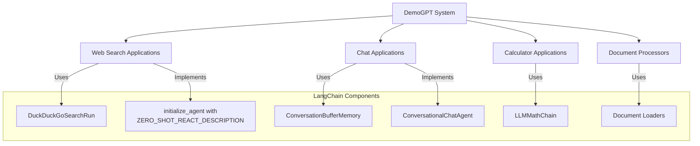

Sources: [demogpt/chains/prompts/task_list/search.py:21-46](), [demogpt/chains/prompts/task_list/search_chat.py:21-56]()

### Web Search Integration

DemoGPT can generate applications that perform web searches using DuckDuckGo:

- Query the web for information based on user input
- Integrate search results with other application components
- Process search results using LLM reasoning

Search functionality is implemented through LangChain's `DuckDuckGoSearchRun` tool and agent frameworks.

| Component | Purpose |
|-----------|---------|
| `DuckDuckGoSearchRun` | Provides the core search capability |
| `initialize_agent` | Creates agent to use the search tool |
| `AgentType.ZERO_SHOT_REACT_DESCRIPTION` | Enables reasoning about search results |
| `StreamlitCallbackHandler` | Displays search process in Streamlit UI |

Sources: [demogpt/chains/prompts/task_list/search.py:21-28](), [demogpt/chains/prompts/task_list/search.py:31-46]()

### Conversational Interfaces

DemoGPT can create sophisticated chat applications with memory and context awareness:

- Support for multi-turn conversations with history retention
- Integration with Streamlit's chat interface
- Contextual responses based on conversation history

The chat functionality leverages `StreamlitChatMessageHistory` and `ConversationBufferMemory` to maintain context across interactions.

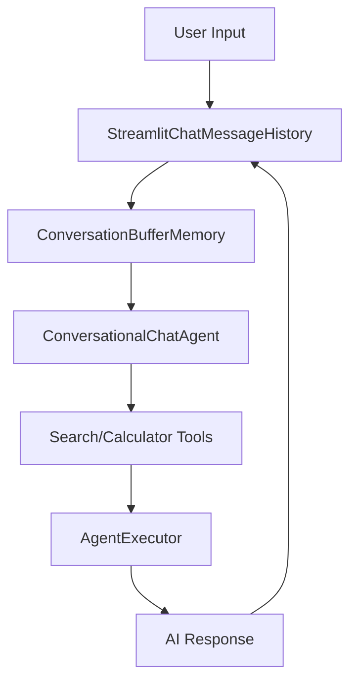

Sources: [demogpt/chains/prompts/task_list/search_chat.py:21-33](), [demogpt/chains/prompts/task_list/search_chat.py:37-57]()

### Calculator and Math Functions

Applications can include mathematical processing capabilities:

- Basic and complex calculations
- Natural language math query interpretation
- Numerical analysis and processing

The calculator functionality is implemented using LangChain's `LLMMathChain` combined with LLMs to interpret and solve mathematical problems expressed in natural language.

Sources: [demogpt/chains/prompts/task_list/search.py:34-36](), [demogpt/chains/prompts/task_list/search_chat.py:39-46]()

### Agent-Based Systems

DemoGPT can generate applications that use LangChain's agent framework:

- Tool-using agents that can perform complex tasks
- ReAct agents with reasoning capabilities
- Conversational agents for interactive applications

The agent capabilities leverage LangChain's agent types like `AgentType.ZERO_SHOT_REACT_DESCRIPTION` and `ConversationalChatAgent` to create intelligent applications.

Sources: [demogpt/chains/prompts/task_list/search.py:43-46](), [demogpt/chains/prompts/task_list/search_chat.py:47-56]()

## User Interfaces

DemoGPT offers multiple interfaces for user interaction:

### Python API

Users can programmatically use DemoGPT in Python applications:

```python
from demogpt import DemoGPT
agent = DemoGPT(model_name="gpt-3.5-turbo")
instruction = "Create a web search application"
for phase in agent(instruction=instruction, title="My Search App"):
    print(phase)  # displays generation stages
    if phase["done"]:
        code = phase["code"]  # final code
```

The Python API allows full control over the generation process with access to intermediate results and the ability to integrate generated applications with existing systems.

Sources: [README.md:164-175]()

### Command Line Interface

Run DemoGPT directly from the command line:

```bash
demogpt
```

The CLI provides a simple way to access all core features without programming requirements.

Sources: [README.md:66-74]()

### Web Interface

An interactive Streamlit-based interface is available:

- Visual feedback during the generation process
- User-friendly approach for non-programmers
- Available as a hosted service or local installation

Sources: [README.md:49-53](), [README.md:203-204]()

## Integration with External APIs

**Integration Architecture**
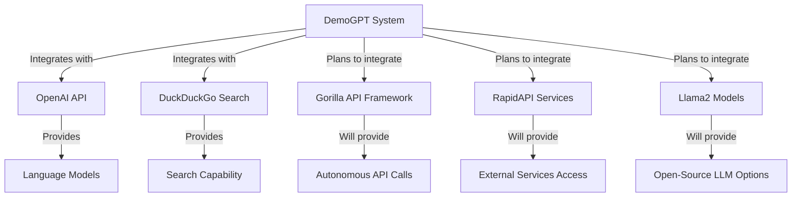

Sources: [README.md:59-60](), [README.md:116-117](), [README.md:211-216]()

DemoGPT currently integrates with:
- OpenAI API for language model access
- DuckDuckGo for web search capabilities

Future integrations planned include:
- Gorilla for autonomous API usage
- RapidAPI for expanding available API calls
- Support for Llama2 models

## Self-Refinement Capability

DemoGPT implements a self-refinement strategy to improve generated code:

- Individual testing of code snippets
- Refinement of failed code segments
- Iterative improvement to ensure functional applications

Sources: [README.md:111-113]()

This feature ensures that the generated applications meet quality standards and function as expected, minimizing errors in the final output.

## Upcoming Features

Based on the project roadmap, several new capabilities are in development:

- Integration with Gorilla for API calls
- Llama2 model support
- Self-refinement strategy implementation
- Public database for similar example retrieval
- Database for caching successful generations

Sources: [README.md:211-217]()

These upcoming features will further enhance DemoGPT's capabilities and performance in future releases.

---

# Page: System Requirements

# System Requirements

<details>
<summary>Relevant source files</summary>

The following files were used as context for generating this wiki page:

- [.gitignore](.gitignore)
- [LICENSE](LICENSE)
- [README.md](README.md)
- [assets/demogpt_new_pipeline.jpeg](assets/demogpt_new_pipeline.jpeg)
- [assets/demogpt_new_pipeline1.jpeg](assets/demogpt_new_pipeline1.jpeg)
- [demogpt/app.py](demogpt/app.py)
- [demogpt/chains/chains.py](demogpt/chains/chains.py)
- [demogpt/chains/prompts/task_list/search.py](demogpt/chains/prompts/task_list/search.py)
- [demogpt/chains/prompts/task_list/search_chat.py](demogpt/chains/prompts/task_list/search_chat.py)
- [demogpt/chains/task_chains.py](demogpt/chains/task_chains.py)
- [demogpt/model.py](demogpt/model.py)
- [demogpt/utils.py](demogpt/utils.py)
- [docs/README_CN.md](docs/README_CN.md)
- [pyproject.toml](pyproject.toml)

</details>


## Purpose and Scope

This document outlines the specific hardware, software, and environment requirements needed to run DemoGPT successfully. It covers the dependencies, installation prerequisites, configuration settings, and runtime requirements. For information about the general architecture of DemoGPT, see [Architecture](#2), and for installation instructions, see [Installation](#5).

## System Requirements Overview

DemoGPT is an autonomous AI agent that generates Streamlit applications from natural language instructions. As such, it has dependencies on LLM APIs, Python libraries, and system resources that are essential for its operation.

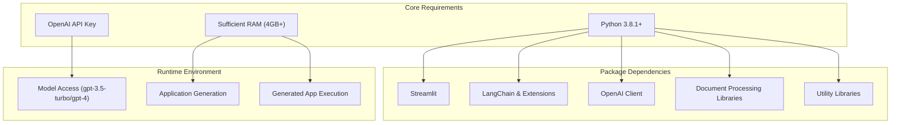

Sources: [pyproject.toml:17-36](), [README.md:123-148]()

## Hardware Requirements

DemoGPT does not have specific hardware requirements beyond what is needed to run Python and Streamlit applications. However, for optimal performance:

| Component | Minimum Requirement | Recommended |
|-----------|---------------------|-------------|
| CPU       | Dual-core processor | Quad-core processor or better |
| RAM       | 4GB                 | 8GB or more |
| Disk Space| 1GB free space      | 2GB or more |
| Internet  | Stable connection   | High-speed connection |

Note: Memory requirements may increase when generating complex applications or when the generated applications are processing large documents.

Sources: [README.md:124-148]()

## Software Requirements

### Operating System

DemoGPT is cross-platform and can run on:
- Windows 10/11
- macOS 10.14 or newer
- Linux (tested on Ubuntu 18.04+)

### Python Environment

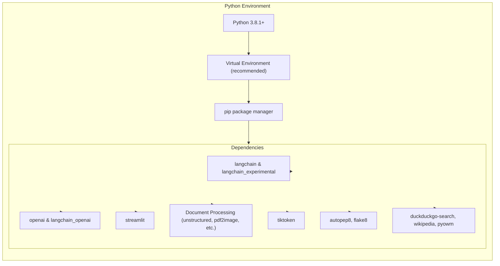

Sources: [pyproject.toml:17-36]()

### Package Dependencies

DemoGPT requires the following Python packages:

| Category | Packages |
|----------|----------|
| Core Framework | Python (≥ 3.8.1) |
| Web Interface | streamlit, altair (<5) |
| LLM Integration | langchain, langchain_experimental, langchain_openai, openai, tiktoken |
| Environment | python-dotenv |
| Document Processing | unstructured, pdf2image, pdfminer-six |
| Code Management | autopep8, flake8 |
| External Services | duckduckgo-search (6.3.2), wikipedia (1.4.0), pyowm (3.3.0) |
| Math Processing | numexpr |

Sources: [pyproject.toml:17-36]()

## API Requirements

DemoGPT relies heavily on the OpenAI API for its core functionality. Access to appropriate models and a valid API key are essential.

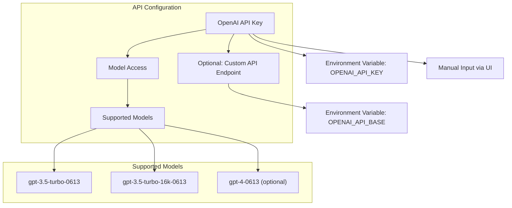

Sources: [model.py:19-47](), [app.py:56-68](), [utils.py:682-715]()

### OpenAI API Key

An OpenAI API key is required for DemoGPT to function. This can be provided in two ways:
1. As an environment variable `OPENAI_API_KEY`
2. Via the user interface during runtime

The API key must have access to at least the `gpt-3.5-turbo` model family. GPT-4 access is optional but can improve the quality of generated applications.

### Model Support

DemoGPT supports and can use the following models:
- `gpt-3.5-turbo-0613` (default)
- `gpt-3.5-turbo-16k-0613` (for complex applications)
- `gpt-4-0613` (optional, for enhanced quality)

The system dynamically checks model availability based on your API key.

Sources: [model.py:49-65](), [chains/chains.py:42-60]()

## Installation Methods

DemoGPT can be installed via two primary methods: using the pip package or by cloning the source repository.

### Package Installation

```bash
pip install demogpt
```

After installation, DemoGPT can be launched directly from the command line:

```bash
demogpt
```

Sources: [README.md:65-74](), [pyproject.toml:39-40]()

### Source Code Installation

```bash
git clone https://github.com/melih-unsal/DemoGPT.git
cd DemoGPT
pip install .
```

To run DemoGPT from source:

```bash
streamlit run demogpt/app.py
```

Sources: [README.md:137-148]()

## Environment Configuration

### Environment Variables

DemoGPT uses the following environment variables:

| Variable | Description | Required | Default |
|----------|-------------|----------|---------|
| OPENAI_API_KEY | Your OpenAI API key | Yes (can be input via UI) | None |
| OPENAI_API_BASE | Custom OpenAI API base URL | No | https://api.openai.com/v1 |

### Configuration Flow

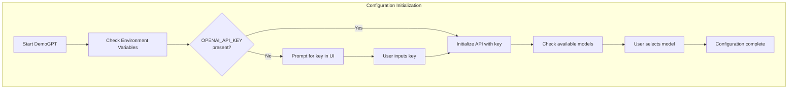

Sources: [model.py:19-44](), [app.py:56-84]()

## Runtime Requirements

When DemoGPT is running, it performs several resource-intensive operations during the application generation process.

### Process Resources

The application generation process involves:

1. **Planning Phase**: Generating a plan from user instructions (moderate resource usage)
2. **Task Creation**: Breaking down the plan into specific tasks (moderate resource usage)
3. **Code Generation**: Generating code snippets for each task (high resource usage)
4. **Code Assembly**: Combining code snippets into a complete application (moderate resource usage)
5. **Execution**: Running the generated Streamlit app (varies based on app complexity)

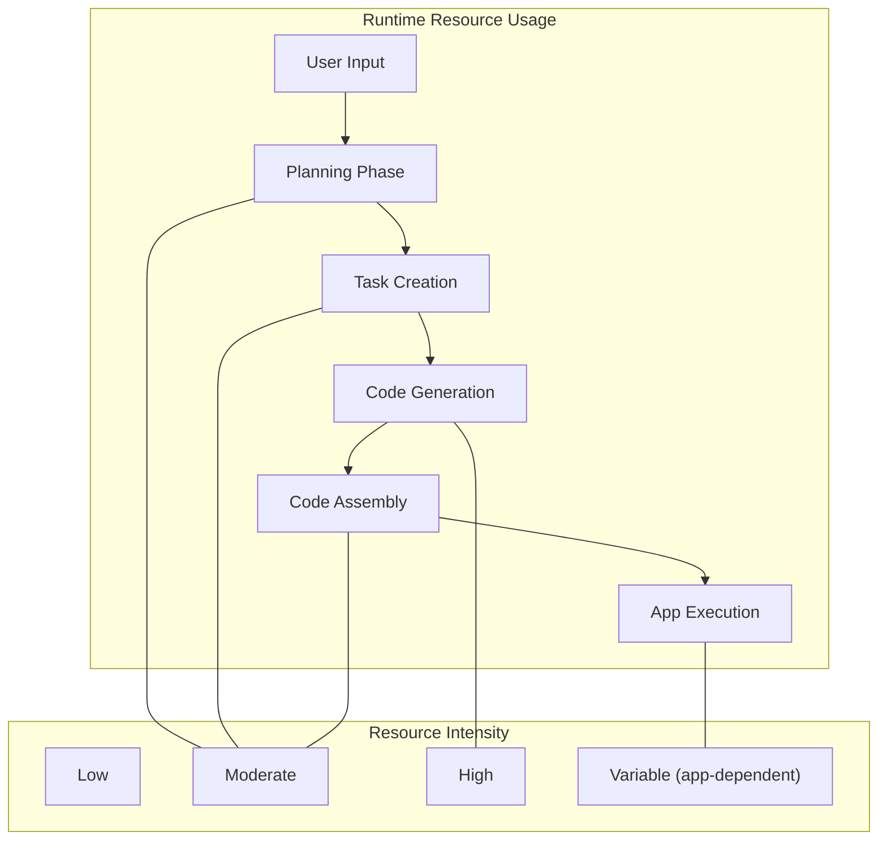

Sources: [model.py:297-560](), [utils.py:682-715]()

### API Usage

DemoGPT makes multiple API calls to language models during the generation process. The number of calls depends on the complexity of the requested application and whether refinement steps are needed.

Sources: [model.py:105-294](), [chains/chains.py:84-335]()

## Usage Modes

DemoGPT supports three primary usage modes:

1. **Web Interface** (using Streamlit)
2. **Command Line Interface** (after package installation)
3. **Python API** (for integration into other applications)

### Python API Usage Requirements

To use DemoGPT as a library in Python applications, you need:

```python
from demogpt import DemoGPT
agent = DemoGPT(model_name="gpt-3.5-turbo")  # OpenAI API key in env or as parameter
instruction = "Your instruction here"
title = "Your title here"
```

Sources: [README.md:160-176](), [model.py:297-315]()

## Compatibility Notes

### Streamlit Compatibility

The generated applications are built with Streamlit, so they inherit Streamlit's compatibility requirements:
- Modern web browsers (Chrome, Firefox, Safari, Edge)
- JavaScript enabled
- Internet connection (for loading Streamlit resources)

### OpenAI API Compatibility

DemoGPT is designed to work with OpenAI's API and model versions available as of its release. Future changes to the OpenAI API might affect compatibility.

### Package Version Constraints

Some packages have specific version constraints:
- altair < 5
- duckduckgo-search = 6.3.2
- wikipedia = 1.4.0
- pyowm = 3.3.0

Sources: [pyproject.toml:20-36]()

## Troubleshooting Common Requirements Issues

| Issue | Possible Cause | Solution |
|-------|----------------|----------|
| "No module named 'demogpt'" | Package not installed | Run `pip install demogpt` |
| "OpenAI API key required" | Missing API key | Set environment variable or enter in UI |
| Model selection unavailable | API key doesn't have access to models | Check OpenAI account access |
| High memory usage | Complex application generation | Use a system with more RAM |
| Application generation timeout | Slow internet or complex request | Try a simpler application or check connection |

Sources: [app.py:138-147](), [model.py:45-48]()

---

# Page: Architecture

# Architecture

<details>
<summary>Relevant source files</summary>

The following files were used as context for generating this wiki page:

- [README.md](README.md)
- [assets/demogpt_new_pipeline.jpeg](assets/demogpt_new_pipeline.jpeg)
- [assets/demogpt_new_pipeline1.jpeg](assets/demogpt_new_pipeline1.jpeg)
- [demogpt/app.py](demogpt/app.py)
- [demogpt/chains/chains.py](demogpt/chains/chains.py)
- [demogpt/chains/prompts/__init__.py](demogpt/chains/prompts/__init__.py)
- [demogpt/chains/prompts/app_type.py](demogpt/chains/prompts/app_type.py)
- [demogpt/chains/prompts/plan_with_inputs.py](demogpt/chains/prompts/plan_with_inputs.py)
- [demogpt/chains/prompts/task_list/search.py](demogpt/chains/prompts/task_list/search.py)
- [demogpt/chains/prompts/task_list/search_chat.py](demogpt/chains/prompts/task_list/search_chat.py)
- [demogpt/chains/prompts/task_list/ui_output_text.py](demogpt/chains/prompts/task_list/ui_output_text.py)
- [demogpt/chains/task_chains.py](demogpt/chains/task_chains.py)
- [demogpt/chains/task_definitions.py](demogpt/chains/task_definitions.py)
- [demogpt/controllers.py](demogpt/controllers.py)
- [demogpt/model.py](demogpt/model.py)
- [demogpt/utils.py](demogpt/utils.py)
- [docs/README_CN.md](docs/README_CN.md)
- [pyproject.toml](pyproject.toml)

</details>


This page provides a comprehensive overview of DemoGPT's architecture, detailing how the system transforms natural language instructions into functional Streamlit applications. It covers the pipeline approach, major components, and their interactions. For information about specific components and their implementation details, see [Core Components](#3).

## High-Level Architecture Overview

DemoGPT follows a pipeline architecture that transforms user instructions through several stages to generate a Streamlit application. The system employs a modular design where specialized components handle specific parts of the generation process.

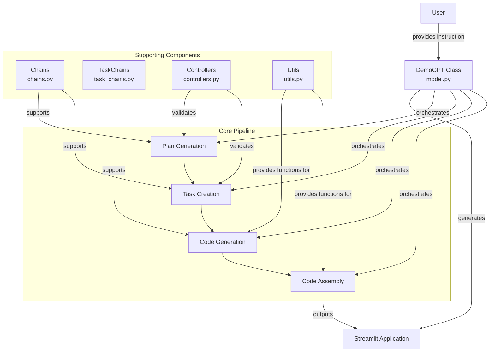

Sources: [model.py:17-562](), [chains.py:1-335](), [task_chains.py:1-389](), [controllers.py:1-470](), [utils.py:1-734]()

## Plan-Based Pipeline

At the heart of DemoGPT is a plan-based pipeline that systematically transforms user instructions into executable Streamlit code:

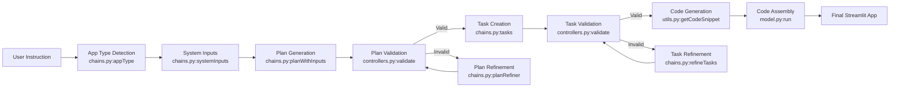

Sources: [model.py:297-562](), [chains.py:97-202](), [controllers.py:7-92](), [utils.py:282-314]()

### 1. Plan Generation

The plan generation stage converts the user's instruction into a structured action plan. This involves:

1. **App Type Detection**: Using `chains.py:appType` to determine if the application is chat-based, AI-based, search-based, or summary-based
2. **System Input Identification**: Using `chains.py:systemInputs` to identify required inputs from the instruction
3. **Plan Creation**: Using `chains.py:planWithInputs` to generate a step-by-step plan for creating the application
4. **Plan Validation**: Using `controllers.py:validate` to ensure the plan is feasible with available tasks

If the plan is invalid, it's refined by `chains.py:planRefiner` until it passes validation.

Sources: [chains.py:97-155](), [controllers.py:7-92]()

### 2. Task Creation

Once a valid plan is established, it's broken down into specific tasks by `chains.py:tasks`. Each task represents a specific component or action in the final application.

Tasks are validated by `controllers.py:validate`, which checks:
- Task names are valid
- Input-output compatibility between tasks
- Compatibility with the application type

If there are issues, tasks are refined by `chains.py:refineTasks` until they pass validation.

Sources: [chains.py:158-196](), [controllers.py:7-92](), [controllers.py:139-388]()

### 3. Code Generation

The validated tasks are transformed into code snippets by `utils.py:getCodeSnippet`, which uses task-specific templates from `TaskChains` in `task_chains.py`.

Each task type has a dedicated handler in `TaskChains`:
- `uiInputText`: Generates code for text input UI elements
- `promptTemplate`: Generates code for AI prompt templates
- `search`: Generates code for search functionality
- And many others for various functionality

Sources: [utils.py:282-314](), [task_chains.py:44-389]()

### 4. Code Assembly

Finally, the code snippets are combined into a complete Streamlit application by `model.py:run`. This includes:
- Adding necessary imports
- Structuring the code logically
- Formatting with `autopep8`
- Adding "how to use" and "about" sections

The result is a complete, executable Streamlit application that implements the functionality described in the user's instruction.

Sources: [model.py:297-562](), [utils.py:316-734]()

## Component Architecture

DemoGPT consists of several key components that work together to transform user instructions into Streamlit applications:

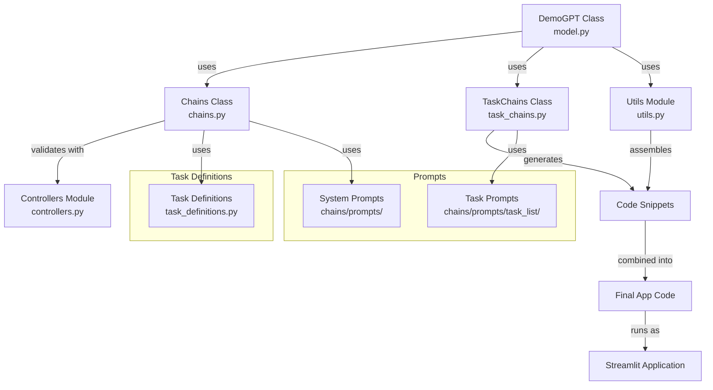

Sources: [model.py:17-562](), [chains.py:20-335](), [task_chains.py:16-389](), [controllers.py:7-470](), [utils.py:14-734](), [chains/task_definitions.py:1-285]()

### DemoGPT Class

The `DemoGPT` class in `model.py` is the main entry point and orchestrator for the system. It manages the overall process flow and coordinates between components.

Key functions:
- `__init__`: Initializes with model name, API key, and other configuration
- `run`: Main method for generating applications, yields status updates during generation
- `callForChat`: Specialized method for generating chat-based applications
- `setModel`: Configures the language model to use

Sources: [model.py:17-296]()

### Chains Class

The `Chains` class in `chains.py` handles high-level processes like plan generation and task creation.

Key methods:
- `systemInputs`: Extracts system inputs from the instruction
- `planWithInputs`: Generates a plan from instruction and inputs
- `tasks`: Creates tasks from the plan
- `planController` and `taskController`: Interface with controllers for validation
- `getAboutAndHTU`: Generates application documentation

Sources: [chains.py:20-335]()

### TaskChains Class

The `TaskChains` class in `task_chains.py` provides specialized code generation for different task types.

Key methods:
- `uiInputText`: Generates text input UI code
- `uiOutputText`: Generates text output UI code
- `promptTemplate`: Generates AI prompt template code
- `chat`: Generates chat functionality code
- `search`: Generates web search functionality code
- `docLoad`: Generates document loading code

Sources: [task_chains.py:16-389]()

### Controllers Module

The `controllers.py` module contains validation functions that ensure plans and tasks are valid.

Key functions:
- `validate`: Main validation function for plans and tasks
- `checkAppTypeCompatiblity`: Ensures tasks match the application type
- `checkTaskNames`: Verifies task names are valid
- `checkInputOuputCompatibility`: Ensures task inputs/outputs are compatible
- `checkPromptTemplates`: Validates template variable usage

Sources: [controllers.py:7-470]()

### Utils Module

The `utils.py` module provides utility functions throughout the system.

Key functions:
- `getCodeSnippet`: Generates task-specific code snippets
- `init`: Initializes code generation
- `runStreamlit`: Executes the generated application
- `getChatCode`/`getPromptChatTemplateCode`: Generates specialized code

Sources: [utils.py:14-734]()

## Task System

The task system is a key innovation in DemoGPT, allowing complex applications to be broken down into modular, reusable components.

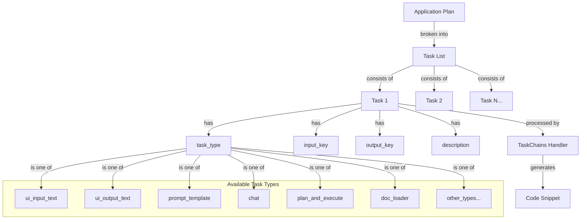

Sources: [chains/task_definitions.py:1-285](), [controllers.py:38-92]()

### Task Definition

Each task represents a specific action or component in the final application and has:
- `task_type`: The type of task (e.g., `ui_input_text`, `prompt_template`)
- `input_key`: Input variables required by the task
- `output_key`: Output variables produced by the task
- `description`: Natural language description of the task's purpose

Tasks are defined and validated to ensure they form a coherent application where:
- Each task's inputs are provided by previous tasks' outputs
- Task types are appropriate for the application type
- Input and output data types are compatible

Sources: [chains/task_definitions.py:7-169](), [controllers.py:38-156]()

### Task Processing

Tasks are processed in sequence:
1. Each task is matched to a handler in `TaskChains`
2. The handler generates code specific to that task type
3. Code snippets are assembled in the correct order
4. Input/output variables connect the code snippets together

This modular approach allows DemoGPT to generate complex applications by combining simpler building blocks.

Sources: [utils.py:248-314](), [task_chains.py:44-389]()

## Application Types and Task Compatibility

DemoGPT analyzes instructions to determine the application type, which affects the available tasks and validation rules:

| App Type | Description | Required Tasks | Example |
|----------|-------------|----------------|---------|
| Chat-based | Conversational applications | `ui_input_chat`, `chat`, `ui_output_chat` | Chatbot assistant |
| AI-based | Applications using AI for text generation | `prompt_template` | Text generator |
| Search-based | Applications requiring up-to-date information | `plan_and_execute` | Research tool |
| Summary-based | Applications that summarize content | `doc_summarizer` | Document summarizer |

The application type is determined by `chains.py:appType`, which analyzes the instruction and returns a JSON object specifying the type.

Sources: [chains/prompts/app_type.py:1-96](), [controllers.py:194-388](), [chains/task_definitions.py:176-283]()

## External Dependencies

DemoGPT relies on several external libraries:

- **Streamlit**: UI framework for the generated applications
- **LangChain**: Framework for working with LLMs
- **OpenAI**: Provides LLMs for text generation
- **Autopep8**: Code formatting
- **DuckDuckGo-Search**: Web search capabilities
- **Other utilities**: Wikipedia, PyOWM, etc.

These dependencies are specified in `pyproject.toml` and are crucial for the system's operation.

Sources: [pyproject.toml:17-35]()

## Conclusion

DemoGPT's architecture represents a sophisticated approach to transforming natural language instructions into functional applications. The plan-based pipeline, modular task system, and component-based design allow it to generate a wide variety of applications while maintaining code quality and coherence.

For more detailed information on how to use these components, see [Core Components](#3) and [Usage and Examples](#5).

Sources: [README.md:88-117]()

---

# Page: Pipeline Overview

# Pipeline Overview

<details>
<summary>Relevant source files</summary>

The following files were used as context for generating this wiki page:

- [CONTRIBUTING.md](CONTRIBUTING.md)
- [README.md](README.md)
- [assets/demogpt_new_pipeline.jpeg](assets/demogpt_new_pipeline.jpeg)
- [assets/demogpt_new_pipeline1.jpeg](assets/demogpt_new_pipeline1.jpeg)
- [demogpt/app.py](demogpt/app.py)
- [demogpt/chains/chains.py](demogpt/chains/chains.py)
- [demogpt/chains/prompts/task_list/search.py](demogpt/chains/prompts/task_list/search.py)
- [demogpt/chains/prompts/task_list/search_chat.py](demogpt/chains/prompts/task_list/search_chat.py)
- [demogpt/chains/task_chains.py](demogpt/chains/task_chains.py)
- [demogpt/model.py](demogpt/model.py)
- [demogpt/test.py](demogpt/test.py)
- [demogpt/utils.py](demogpt/utils.py)
- [docs/README_CN.md](docs/README_CN.md)
- [pyproject.toml](pyproject.toml)

</details>


## Purpose and Scope

This document provides a comprehensive overview of DemoGPT's pipeline architecture - the core process that transforms user instructions into executable Streamlit applications. The pipeline implements a systematic approach for generating LangChain-based code that fulfills user requirements expressed in natural language.

For information about specific tasks supported by the pipeline, see [Task System](#2.2). For details on how code is generated and assembled, see [Code Generation and Assembly](#2.3).

## Pipeline Architecture

The DemoGPT pipeline follows a structured, sequential process with built-in validation and refinement steps to ensure high-quality output. This approach allows for automated application generation while maintaining reliability.

### High-Level Pipeline Flow

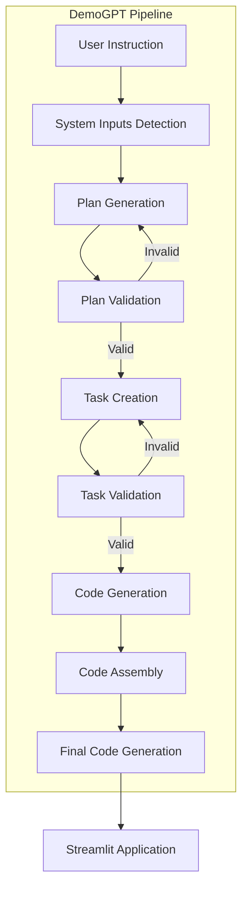

Sources: [demogpt/model.py:287-294](), [README.md:96-101]()

The pipeline consists of four major phases:
1. **Planning**: Generate a coherent plan from the user instruction
2. **Task Creation**: Break down the plan into specific executable tasks
3. **Code Generation**: Convert tasks into code snippets
4. **Code Assembly**: Combine the code snippets into a final application

## Detailed Pipeline Stages

### 1. System Inputs Detection

This initial stage analyzes the user's instruction to identify key components needed for the application.

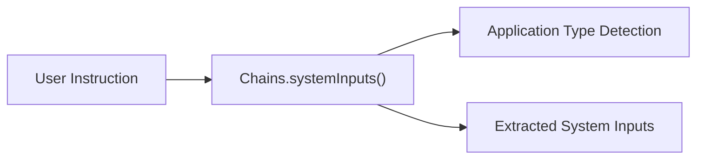

Sources: [demogpt/model.py:102-111](), [demogpt/chains/chains.py:106-113]()

The system inputs detection is implemented through the `systemInputs` method in the `Chains` class, which processes the natural language instruction to extract key information required for the subsequent steps.

### 2. Plan Generation

A plan is created based on the user's instruction and detected system inputs. This plan outlines the high-level steps needed to fulfill the user's requirements.

```mermaid
flowchart TD
    instruction["User Instruction"] --> planWithInputs["Chains.planWithInputs()"]
    systemInputs["System Inputs"] --> planWithInputs
    appType["Application Type"] --> planWithInputs
    planWithInputs --> plan["Generated Plan"]
    plan --> planController["Chains.planController()"]
    planController --> |Valid| validPlan["Validated Plan"]
    planController --> |Invalid| planRefiner["Chains.planRefiner()"]
    planRefiner --> plan
```

Sources: [demogpt/model.py:112-160](), [demogpt/chains/chains.py:116-155]()

The plan is a structured sequence of steps that will be translated into code. If the generated plan doesn't meet validation criteria, it undergoes refinement through the `planRefiner` method for up to `plan_max_steps` iterations.

### 3. Task Creation

Once a valid plan is established, it's broken down into specific tasks that can be implemented in code.

```mermaid
flowchart TD
    instruction["User Instruction"] --> tasks["Chains.tasks()"]
    plan["Plan"] --> tasks
    appType["Application Type"] --> tasks
    tasks --> taskList["Task List"]
    taskList --> taskController["Chains.taskController()"]
    taskController --> |Valid| validTaskList["Validated Task List"]
    taskController --> |Invalid| refineTasks["Chains.refineTasks()"]
    refineTasks --> taskList
```

Sources: [demogpt/model.py:161-221](), [demogpt/chains/chains.py:158-196]()

Each task represents a specific function or feature that will be implemented in the final application. Tasks are defined with input and output parameters, a description, and a task type (e.g., `ui_input_text`, `prompt_template`, etc.).

### 4. Code Generation

With a validated list of tasks, the system generates code snippets for each task.

```mermaid
flowchart LR
    taskList["Task List"] --> loop["For each task"]
    loop --> getCodeSnippet["getCodeSnippet() or getCodeSnippetSeperate()"]
    instruction["Instruction"] --> getCodeSnippet
    codeSnippets["Existing Code Snippets"] --> getCodeSnippet
    getCodeSnippet --> newCodeSnippet["New Code Snippet"]
    newCodeSnippet --> appendCode["Append to Code Snippets"]
    appendCode --> codeSnippets
```

Sources: [demogpt/model.py:244-267](), [demogpt/utils.py:248-314]()

The code generation process iterates through each task in the task list, generating appropriate code based on the task type. The code snippets accumulate, with each new snippet building on the previous ones.

### 5. Code Assembly

Finally, the individual code snippets are combined and structured into a complete Streamlit application.

```mermaid
flowchart TD
    codeSnippets["Code Snippets"] --> imports["Extract/Generate Imports"]
    codeSnippets --> functions["Extract/Generate Functions"]
    codeSnippets --> prefix["Extract/Generate Prefix Code"]
    codeSnippets --> inputs["Extract/Generate Input Elements"]
    codeSnippets --> outputs["Extract/Generate Output Code"]
    imports --> finalCode["Final Code Assembly"]
    functions --> finalCode
    prefix --> finalCode
    inputs --> finalCode
    outputs --> finalCode
    plan["Plan"] --> howToUse["Generate How-To-Use Section"]
    instruction["Instruction"] --> aboutSection["Generate About Section"]
    howToUse --> finalCode
    aboutSection --> finalCode
    finalCode --> autopep8["Format Code with autopep8"]
```

Sources: [demogpt/model.py:545-552](), [demogpt/utils.py:316-335]()

The code assembly phase generates the final structure of the Streamlit application, including necessary imports, function definitions, UI components, and documentation sections.

## Pipeline Implementation Details

### Component Architecture

The pipeline functionality is distributed across several key components that work together:

```mermaid
classDiagram
    class DemoGPT {
        +__init__(openai_api_key, model_name, max_steps, plan_max_steps)
        +run(instruction, title)
        +callForChat(instruction, title, app_type)
        +setModel(model_name)
    }
    
    class Chains {
        +setLlm(model, openai_api_key, temperature)
        +getChain(system_template, human_template)
        +systemInputs(instruction)
        +planWithInputs(instruction, system_inputs, app_type)
        +planController(plan, app_type)
        +planRefiner(instruction, plan, feedback, app_type)
        +tasks(instruction, plan, app_type)
        +taskController(tasks, app_type)
        +refineTasks(instruction, tasks, feedback, app_type)
        +final(draft_code)
    }
    
    class TaskChains {
        +setLlm(model, openai_api_key, temperature)
        +getChain(system_template, human_template)
        +uiInputText(task)
        +uiOutputText(task)
        +promptTemplate(app_idea, task)
        +chat(app_idea, task)
        +search(task)
        +docLoad(task, code_snippets)
    }
    
    class Utils {
        +init(title, app_type)
        +initSeperate(title, app_type)
        +getCodeSnippet(app_idea, task, code_snippets, iters)
        +getCodeSnippetSeperate(app_idea, task, code_snippets, iters)
        +reorderTasksForChatApp(tasks)
        +reformatTasks(tasks)
    }
    
    DemoGPT --> Chains : uses
    DemoGPT --> TaskChains : uses
    DemoGPT --> Utils : uses
    Chains --> Utils : uses
    TaskChains --> Utils : uses
```

Sources: [demogpt/model.py:18-91](), [demogpt/chains/chains.py:20-63](), [demogpt/chains/task_chains.py:16-32](), [demogpt/utils.py:103-173]()

### Execution Flow

The pipeline's execution flow, particularly for generating a standard application (non-chat), follows this sequence:

```mermaid
sequenceDiagram
    participant User
    participant DemoGPT
    participant Chains
    participant TaskChains
    participant Utils
    
    User->>DemoGPT: provide instruction
    DemoGPT->>Chains: appType(instruction)
    Chains-->>DemoGPT: app_type
    
    DemoGPT->>Chains: systemInputs(instruction)
    Chains-->>DemoGPT: system_inputs
    
    DemoGPT->>Chains: planWithInputs(instruction, system_inputs, app_type)
    Chains-->>DemoGPT: plan
    
    loop Plan Validation
        DemoGPT->>Chains: planController(plan, app_type)
        Chains-->>DemoGPT: plan_controller_result
        alt Invalid Plan
            DemoGPT->>Chains: planRefiner(instruction, plan, feedback, app_type)
            Chains-->>DemoGPT: refined_plan
        end
    end
    
    DemoGPT->>Chains: tasks(instruction, plan, app_type)
    Chains-->>DemoGPT: task_list
    
    loop Task Validation
        DemoGPT->>Chains: taskController(tasks, app_type)
        Chains-->>DemoGPT: task_controller_result
        alt Invalid Tasks
            DemoGPT->>Chains: refineTasks(instruction, tasks, feedback, app_type)
            Chains-->>DemoGPT: refined_tasks
        end
    end
    
    DemoGPT->>Chains: title(instruction)
    Chains-->>DemoGPT: title
    
    DemoGPT->>Utils: initSeperate(title)
    Utils-->>DemoGPT: initial_code
    
    loop For Each Task
        DemoGPT->>Utils: getCodeSnippetSeperate(instruction, task, code_snippets)
        Utils->>TaskChains: various task methods
        TaskChains-->>Utils: code
        Utils-->>DemoGPT: code_snippet
        DemoGPT->>DemoGPT: accumulate code
    end
    
    DemoGPT->>Chains: getAboutAndHTU(instruction, title, plan)
    Chains-->>DemoGPT: how_to, about
    
    DemoGPT->>DemoGPT: assemble final code
    DemoGPT-->>User: return final code
```

Sources: [demogpt/model.py:337-562]()

## Task Processing

A critical aspect of the pipeline is how it handles various task types. Each task type corresponds to a specific functionality that can be part of the generated application.

```mermaid
flowchart LR
    task["Task"] --> taskType{"Task Type"}
    
    taskType --> |"ui_input_text"| uiInputText["TaskChains.uiInputText()"]
    taskType --> |"ui_output_text"| uiOutputText["TaskChains.uiOutputText()"]
    taskType --> |"prompt_template"| promptTemplate["TaskChains.promptTemplate()"]
    taskType --> |"chat"| chat["TaskChains.chat()"]
    taskType --> |"path_to_content"| pathToContent["TaskChains.pathToContent()"]
    taskType --> |"doc_to_string"| docToString["TaskChains.docToString()"]
    taskType --> |"string_to_doc"| stringToDoc["TaskChains.stringToDoc()"]
    taskType --> |"ui_input_file"| uiInputFile["TaskChains.uiInputFile()"]
    taskType --> |"doc_loader"| docLoad["TaskChains.docLoad()"]
    taskType --> |"doc_summarizer"| summarize["TaskChains.summarize()"]
    taskType --> |"ui_input_chat"| uiInputChat["TaskChains.uiInputChat()"]
    taskType --> |"ui_output_chat"| uiOutputChat["TaskChains.uiOutputChat()"]
    taskType --> |"python"| pythonCoder["TaskChains.pythonCoder()"]
    taskType --> |"plan_and_execute"| search["TaskChains.search()"]
    taskType --> |"search_chat"| searchChat["TaskChains.search_chat()"]
    
    uiInputText --> codeSnippet["Code Snippet"]
    uiOutputText --> codeSnippet
    promptTemplate --> codeSnippet
    chat --> codeSnippet
    pathToContent --> codeSnippet
    docToString --> codeSnippet
    stringToDoc --> codeSnippet
    uiInputFile --> codeSnippet
    docLoad --> codeSnippet
    summarize --> codeSnippet
    uiInputChat --> codeSnippet
    uiOutputChat --> codeSnippet
    pythonCoder --> codeSnippet
    search --> codeSnippet
    searchChat --> codeSnippet
```

Sources: [demogpt/utils.py:282-314](), [demogpt/chains/task_chains.py:45-390]()

## Special Case: Chat Applications

The pipeline has special handling for chat-based applications, which involves reordering tasks and using the `callForChat` method instead of the standard `run` method.

```mermaid
flowchart TD
    instruction["User Instruction"] --> appType["Determine App Type"]
    appType --> isChat{"Is Chat App?"}
    isChat --> |Yes| callForChat["callForChat() Method"]
    isChat --> |No| run["run() Method"]
    callForChat --> standardPipeline["Standard Pipeline Steps"]
    run --> standardPipeline
    standardPipeline --> reorderTasksForChatApp["reorderTasksForChatApp()"]
    reorderTasksForChatApp --> separateTasks["Separate Pre and Post Chat Input Tasks"]
    separateTasks --> generateCode["Generate Code Snippets"]
```

Sources: [demogpt/model.py:95-295](), [demogpt/utils.py:131-173]()

For chat applications, the system identifies tasks that depend on chat input and ensures they are executed after the chat input task, maintaining the correct execution flow in the generated application.

## Self-Refinement Mechanism

A key feature of the pipeline is its self-refinement capability, which allows it to improve outputs through iterative validation and refinement.

```mermaid
flowchart TD
    generate["Generate Output"] --> validate["Validate Output"]
    validate --> decision{"Valid?"}
    decision --> |Yes| finalOutput["Use Output"]
    decision --> |No| feedback["Generate Feedback"]
    feedback --> refine["Refine Output"]
    refine --> generate
    
    subgraph "Plan Refinement"
        planGeneration["Plan Generation"] --> planValidation["Plan Validation"]
        planValidation --> planDecision{"Valid?"}
        planDecision --> |Yes| finalPlan["Final Plan"]
        planDecision --> |No| planFeedback["Plan Feedback"]
        planFeedback --> planRefinement["Plan Refinement"]
        planRefinement --> planGeneration
    end
    
    subgraph "Task Refinement"
        taskGeneration["Task Generation"] --> taskValidation["Task Validation"]
        taskValidation --> taskDecision{"Valid?"}
        taskDecision --> |Yes| finalTasks["Final Tasks"]
        taskDecision --> |No| taskFeedback["Task Feedback"]
        taskFeedback --> taskRefinement["Task Refinement"]
        taskRefinement --> taskGeneration
    end
```

Sources: [demogpt/model.py:137-160](), [demogpt/model.py:197-221](), [demogpt/chains/chains.py:133-155](), [demogpt/chains/chains.py:182-196]()

The self-refinement process applies to multiple stages of the pipeline:
1. Plan refinement through `planRefiner` for up to `plan_max_steps` iterations
2. Task refinement through `refineTasks` for up to `max_steps` iterations
3. Prompt template refinement in the code generation phase

## Code Structure Generated by the Pipeline

The pipeline generates a structured Streamlit application with the following components:

| Section | Description | Source |
|---------|-------------|--------|
| Imports | Package imports and dependencies | `imports` variable |
| Functions | Function definitions for app functionality | `functions` variable |
| Prefix Code | Initialization code, session state setup | `prefix` variable |
| How-to-Use | Instructions for using the application | Generated by `getAboutAndHTU()` |
| About | Information about the application | Generated by `getAboutAndHTU()` |
| Form Definition | Streamlit form wrapper | Generated in final assembly |
| Input Elements | UI elements for user input | `inputs` variable |
| Submit Button | Form submission button | Generated in final assembly |
| Output Code | Code for processing and displaying outputs | `outputs` variable |

Sources: [demogpt/model.py:316-336](), [demogpt/model.py:545-552]()

## Conclusion

The DemoGPT pipeline provides a structured, end-to-end approach for transforming natural language instructions into functional Streamlit applications. Through a series of well-defined stages - planning, task creation, code generation, and code assembly - the system can produce complex applications with minimal user input. Built-in validation and refinement mechanisms ensure high-quality output, making the pipeline robust and reliable.

The pipeline architecture's modular design allows for easy extension with new task types and capabilities, while maintaining a consistent approach to application generation.

---

# Page: Task System

# Task System

<details>
<summary>Relevant source files</summary>

The following files were used as context for generating this wiki page:

- [demogpt/app.py](demogpt/app.py)
- [demogpt/chains/chains.py](demogpt/chains/chains.py)
- [demogpt/chains/prompts/__init__.py](demogpt/chains/prompts/__init__.py)
- [demogpt/chains/prompts/app_type.py](demogpt/chains/prompts/app_type.py)
- [demogpt/chains/prompts/how_to_use.py](demogpt/chains/prompts/how_to_use.py)
- [demogpt/chains/prompts/plan_with_inputs.py](demogpt/chains/prompts/plan_with_inputs.py)
- [demogpt/chains/prompts/task_list/chat.py](demogpt/chains/prompts/task_list/chat.py)
- [demogpt/chains/prompts/task_list/detailed_description.py](demogpt/chains/prompts/task_list/detailed_description.py)
- [demogpt/chains/prompts/task_list/doc_load.py](demogpt/chains/prompts/task_list/doc_load.py)
- [demogpt/chains/prompts/task_list/summarize.py](demogpt/chains/prompts/task_list/summarize.py)
- [demogpt/chains/prompts/task_list/ui_input_file.py](demogpt/chains/prompts/task_list/ui_input_file.py)
- [demogpt/chains/prompts/task_list/ui_output_text.py](demogpt/chains/prompts/task_list/ui_output_text.py)
- [demogpt/chains/task_chains.py](demogpt/chains/task_chains.py)
- [demogpt/chains/task_chains_seperate.py](demogpt/chains/task_chains_seperate.py)
- [demogpt/chains/task_definitions.py](demogpt/chains/task_definitions.py)
- [demogpt/controllers.py](demogpt/controllers.py)
- [demogpt/model.py](demogpt/model.py)
- [demogpt/utils.py](demogpt/utils.py)
- [pyproject.toml](pyproject.toml)

</details>


The Task System is a core component of DemoGPT that breaks down high-level application plans into executable tasks and validates them for compatibility and correctness. It serves as the bridge between the planning phase and code generation phase, ensuring that abstract application concepts are properly transformed into structured components that can be implemented with code.

For information about how generated code is assembled into complete applications, see [Code Generation and Assembly](#2.3).

## Task System in the Application Pipeline

The Task System occupies a critical position in DemoGPT's processing pipeline, transforming plans into executable code through several stages of processing.

```mermaid
flowchart TD
    User("User") -->|"Provides instruction"| Model["DemoGPT Model"]
    
    subgraph "Pipeline Stages"
        PlanStage["Plan Generation"] --> TaskStage["Task System"]
        TaskStage --> CodeGenStage["Code Generation"]
        CodeGenStage --> CodeAssembly["Code Assembly"]
    end
    
    Model -->|"Processes"| PlanStage
    CodeAssembly -->|"Produces"| FinalApp["Streamlit Application"]
    
    subgraph "Task System Components"
        TaskCreation["Task Creation"] --> TaskValidation["Task Validation"]
        TaskValidation -->|"Invalid"| TaskRefinement["Task Refinement"]
        TaskRefinement --> TaskValidation
        TaskValidation -->|"Valid"| ValidatedTasks["Validated Tasks"]
    end
    
    TaskStage --- TaskCreation
    ValidatedTasks --- CodeGenStage
```

Sources: [demogpt/model.py:95-294](), [demogpt/controllers.py:7-36]()

## Task Structure and Format

Each task in the system is represented as a structured dictionary with specific attributes that define its behavior and relationships with other tasks.

### Task Attributes

| Attribute | Description | Example |
|-----------|-------------|---------|
| `step` | Numerical order of execution | `1`, `2`, `3` |
| `task_type` | Type of task (from predefined list) | `"ui_input_text"`, `"prompt_template"` |
| `task_name` | Unique identifier for the task | `"get_user_input"`, `"generate_response"` |
| `input_key` | Array of input variable names | `["question", "context"]` |
| `output_key` | Array of output variable names | `["response"]` |
| `input_data_type` | Array of input data types | `["string", "Document"]` |
| `output_data_type` | Type of output data | `"string"`, `"Document"` |
| `description` | Human-readable description | `"Gets input from the user"` |

Tasks form a directed graph where outputs from one task become inputs to subsequent tasks, creating a data flow that determines the application's logic.

Sources: [demogpt/controllers.py:7-36](), [demogpt/utils.py:334-356]()

## Task Types and Categories

DemoGPT supports a variety of predefined task types, each designed for specific functionality within the generated application.

```mermaid
classDiagram
    class Task {
        +int step
        +string task_type
        +string task_name
        +string[] input_key
        +string[] output_key
        +string description
    }
    
    Task --> UIInput
    Task --> UIOutput
    Task --> DocumentProcessing
    Task --> AIInteraction
    Task --> Utility
    
    class UIInput {
        "ui_input_text" - Text input fields
        "ui_input_file" - File upload widgets
        "ui_input_chat" - Chat input interface
    }
    
    class UIOutput {
        "ui_output_text" - Text display
        "ui_output_chat" - Chat display interface
    }
    
    class DocumentProcessing {
        "doc_loader" - Load documents
        "doc_to_string" - Convert docs to text
        "string_to_doc" - Convert text to docs
        "doc_summarizer" - Summarize documents
    }
    
    class AIInteraction {
        "prompt_template" - AI text generation
        "chat" - Conversational AI
        "plan_and_execute" - Web search agent
        "search_chat" - Chat with search capability
    }
    
    class Utility {
        "python" - Custom Python code
        "path_to_content" - File path processing
    }
```

Sources: [demogpt/chains/task_definitions.py:7-169]()

### Data Type System

Tasks use a typing system to ensure compatibility between interconnected tasks:

- `none` - No data required or produced
- `string` - Text data
- `Document` - Document object
- `*string` - Multiple text inputs
- `*` - Any type of data

The asterisk prefix (`*`) indicates that multiple inputs or outputs of that type are accepted.

Sources: [demogpt/controllers.py:391-441](), [demogpt/chains/task_definitions.py:7-169]()

## Task Creation Process

### From Plan to Tasks

The task creation process begins with a plan, which is transformed into structured tasks through several steps:

```mermaid
flowchart TD
    Plan["Plan Text"] -->|"Extract function patterns"| PlanExtraction["planToTaskFormat()"]
    PlanExtraction -->|"Create task dictionaries"| RawTasks["Raw Task List"]
    RawTasks --> TaskFormatting["reformatTasks()"]
    TaskFormatting -->|"Process input/output keys"| FormattedTasks["Formatted Tasks"]
    FormattedTasks -->|"Filter empty tasks"| FilteredTasks["filterTasks()"]
    FilteredTasks -->|"Reorder for dependencies"| ReorderedTasks["reorderTasksForChatApp()"]
    ReorderedTasks --> FinalTaskList["Final Task List"]
```

The process uses regex pattern matching to extract function calls and their inputs/outputs from the plan text and converts them into structured task dictionaries.

Sources: [demogpt/model.py:171-173](), [demogpt/controllers.py:7-36](), [demogpt/utils.py:122-173]()

### Pattern Extraction Example

Plans contain function-like patterns that are extracted to create tasks:

```
1. Get user input by [ui_input_text() ---> user_query]
2. Generate response using [prompt_template(user_query) ---> ai_response]
3. Display response to user [ui_output_text(ai_response)]
```

This is converted to task dictionaries with appropriate attributes for each function call.

Sources: [demogpt/controllers.py:7-36]()

## Task Validation System

The validation system ensures tasks are compatible with each other and with the application type, performing multiple checks to guarantee coherence and correctness.

```mermaid
flowchart TD
    TaskList["Task List"] --> ValidationProcess["validate()"]
    
    subgraph "Validation Checks"
        ValidationProcess --> TaskNames["checkTaskNames()"]
        ValidationProcess --> AppCompat["checkAppTypeCompatiblity()"]
        ValidationProcess --> Redundancy["checkRedundantTasks()"]
        ValidationProcess --> IOLength["checkInputOutputLengthCompatiblity()"]
        ValidationProcess --> IOCompat["checkInputOuputCompatibility()"]
        ValidationProcess --> DTypes["checkDTypes()"]
    end
    
    ValidationProcess -->|"Valid"| ValidTasks["Valid Tasks"]
    ValidationProcess -->|"Invalid"| Feedback["Validation Feedback"]
    Feedback --> RefineTasks["refineTasks()"]
    RefineTasks --> ValidationProcess
```

Sources: [demogpt/controllers.py:38-92](), [demogpt/model.py:196-221]()

### Validation Checks

The validation system performs these key checks:

1. **Task Name Validation** - Ensures all task types are defined in the system
2. **App Type Compatibility** - Verifies tasks match application requirements (chat, search, AI)
3. **Redundancy Check** - Ensures all task outputs are used by subsequent tasks
4. **Input/Output Length Check** - Validates correct number of inputs/outputs for each task type
5. **Input/Output Compatibility** - Verifies task inputs come from other task outputs
6. **Data Type Validation** - Ensures data types are compatible between connected tasks

Sources: [demogpt/controllers.py:38-471]()

### Task Refinement Loop

If validation fails, the system enters a refinement loop:

```mermaid
sequenceDiagram
    participant TaskList as "Task List"
    participant Controller as "TaskController"
    participant Chains as "Chains.refineTasks()"
    
    TaskList->>Controller: Submit tasks
    Controller->>Controller: Run validation checks
    Controller->>TaskList: Return results
    
    alt Tasks are invalid
        Note over TaskList,Chains: Refinement Process
        TaskList->>Chains: Send tasks with feedback
        Chains->>Chains: Modify tasks based on feedback
        Chains->>TaskList: Return refined tasks
        TaskList->>Controller: Resubmit tasks
        loop Until valid or max iterations
            Controller->>Controller: Revalidate
            Controller->>TaskList: Return results
            alt Still invalid
                TaskList->>Chains: Refine again
                Chains->>TaskList: Return refined tasks
                TaskList->>Controller: Resubmit
            end
        end
    else Tasks are valid
        Controller->>TaskList: Tasks validated
    end
```

This loop continues until tasks are valid or the maximum iteration count is reached.

Sources: [demogpt/model.py:196-221](), [demogpt/chains/chains.py:182-196]()

## Task to Code Generation

Once tasks are validated, they are processed to generate code snippets for each component of the application.

```mermaid
flowchart TD
    ValidTasks["Validated Tasks"] --> TaskProcessing["getCodeSnippet()"]
    
    subgraph "Code Generation by Task Type"
        TaskProcessing -->|"ui_input_text"| UIInputCode["TaskChains.uiInputText()"]
        TaskProcessing -->|"ui_output_text"| UIOutputCode["TaskChains.uiOutputText()"]
        TaskProcessing -->|"prompt_template"| PromptCode["getGenericPromptTemplateCode()"]
        TaskProcessing -->|"doc_loader"| DocCode["TaskChains.docLoad()"]
        TaskProcessing -->|"other types"| OtherCode["Other type-specific generators"]
    end
    
    UIInputCode --> CodeSnippets["Code Snippets Collection"]
    UIOutputCode --> CodeSnippets
    PromptCode --> CodeSnippets
    DocCode --> CodeSnippets
    OtherCode --> CodeSnippets
    
    CodeSnippets --> CodeAssembly["Code Assembly"]
```

Each task type has a dedicated code generation function in the `TaskChains` class that produces the appropriate code based on the task's attributes.

Sources: [demogpt/utils.py:282-314](), [demogpt/chains/task_chains.py:16-390]()

### Code Generation Process

The code generation process:

1. Identifies the task type
2. Calls the appropriate generator function with task attributes
3. Uses templates to create code snippets
4. Adds descriptive comments based on task description
5. Collects the snippets for later assembly

Different task types generate different kinds of code:
- UI tasks generate Streamlit interface components
- AI tasks generate LangChain-based code
- Document tasks generate document processing logic

Sources: [demogpt/model.py:255-267](), [demogpt/utils.py:282-314]()

## Task System Integration with App Types

The task system adjusts its validation and code generation based on the application type:

```mermaid
flowchart TD
    AppTypeDetection["appType()"] --> AppProperties["App Properties"]
    
    AppProperties -->|"is_chat: true"| ChatValidation["Chat App Validation"]
    AppProperties -->|"is_search: true"| SearchValidation["Search App Validation"]
    AppProperties -->|"is_ai: true"| AIValidation["AI App Validation"]
    AppProperties -->|"is_summary: true"| SummaryValidation["Summary App Validation"]
    
    ChatValidation --> RequiredTasks1["Requires: ui_input_chat, chat, ui_output_chat"]
    SearchValidation --> RequiredTasks2["Requires: plan_and_execute or search_chat"]
    AIValidation --> RequiredTasks3["Requires: prompt_template"]
    SummaryValidation --> RequiredTasks4["Requires: doc_summarizer"]
    
    RequiredTasks1 --> TaskValidation["Task Validation"]
    RequiredTasks2 --> TaskValidation
    RequiredTasks3 --> TaskValidation
    RequiredTasks4 --> TaskValidation
```

The app type determines which tasks are required, prohibited, or optional, ensuring the generated application meets the user's expectations.

Sources: [demogpt/controllers.py:194-388](), [demogpt/chains/app_type.py:1-96]()

## Conclusion

The Task System is a critical component of DemoGPT, serving as the bridge between abstract application plans and concrete code generation. By breaking down plans into structured, validated tasks, the system ensures that the generated applications are coherent, functional, and align with the user's intent. The validation and refinement processes provide robustness, while the code generation system translates abstract tasks into concrete implementations.

---

# Page: Code Generation and Assembly

# Code Generation and Assembly

<details>
<summary>Relevant source files</summary>

The following files were used as context for generating this wiki page:

- [demogpt/app.py](demogpt/app.py)
- [demogpt/chains/chains.py](demogpt/chains/chains.py)
- [demogpt/chains/prompts/combine_v2.py](demogpt/chains/prompts/combine_v2.py)
- [demogpt/chains/prompts/how_to_use.py](demogpt/chains/prompts/how_to_use.py)
- [demogpt/chains/prompts/task_list/chat.py](demogpt/chains/prompts/task_list/chat.py)
- [demogpt/chains/prompts/task_list/detailed_description.py](demogpt/chains/prompts/task_list/detailed_description.py)
- [demogpt/chains/prompts/task_list/doc_load.py](demogpt/chains/prompts/task_list/doc_load.py)
- [demogpt/chains/prompts/task_list/python_coder.py](demogpt/chains/prompts/task_list/python_coder.py)
- [demogpt/chains/prompts/task_list/summarize.py](demogpt/chains/prompts/task_list/summarize.py)
- [demogpt/chains/prompts/task_list/ui_input_file.py](demogpt/chains/prompts/task_list/ui_input_file.py)
- [demogpt/chains/task_chains.py](demogpt/chains/task_chains.py)
- [demogpt/chains/task_chains_seperate.py](demogpt/chains/task_chains_seperate.py)
- [demogpt/model.py](demogpt/model.py)
- [demogpt/utils.py](demogpt/utils.py)
- [pyproject.toml](pyproject.toml)

</details>


This page documents the process of how DemoGPT transforms task definitions into executable Streamlit application code and assembles the generated components into a complete, functional application. For information about how tasks are created and validated, see [Task System](#2.2).

## Overview

The code generation and assembly phase is a critical part of DemoGPT's application generation pipeline. After tasks have been defined and validated, DemoGPT:

1. Generates specific code snippets for each task based on its type
2. Assembles these snippets into a coherent application structure
3. Formats and refines the code to ensure it's error-free and follows best practices
4. Adds supporting elements like documentation and user guidance

This process bridges the gap between abstract task definitions and executable Streamlit applications that implement the user's intent.

```mermaid
flowchart TD
    subgraph "Code Generation and Assembly"
        Tasks["Validated Tasks"] --> CodeGen["Code Generation"]
        CodeGen --> CodeSnippets["Task-Specific Code Snippets"]
        CodeSnippets --> CodeAssembly["Code Assembly"]
        CodeAssembly --> Formatting["Code Formatting"]
        Formatting --> FinalCode["Final Application Code"]
    end
```

Sources: [demogpt/model.py:256-284](), [demogpt/utils.py:282-314](), [demogpt/utils.py:59-81]()

## Code Generation Process

### Task-to-Code Translation

The task-to-code translation process is responsible for generating appropriate code snippets for each task in the task list. This process is primarily managed by the `getCodeSnippet` function in `utils.py` for standard assembly or `getCodeSnippetSeperate` for component-based assembly.

```mermaid
flowchart TD
    Task["Task Definition"] --> TaskType{"Task Type?"}
    
    TaskType -->|"ui_input_text"| UIInputText["TaskChains.uiInputText"]
    TaskType -->|"ui_output_text"| UIOutputText["TaskChains.uiOutputText"]
    TaskType -->|"prompt_template/chat"| TemplateCode["getGenericPromptTemplateCode"]
    TaskType -->|"doc_loader"| DocLoader["TaskChains.docLoad"]
    TaskType -->|"python"| Python["TaskChains.pythonCoder"]
    TaskType -->|"other types"| OtherTypes["Other Specialized Generators"]
    
    UIInputText --> CodeSnippet["Generated Code Snippet"]
    UIOutputText --> CodeSnippet
    TemplateCode --> CodeSnippet
    DocLoader --> CodeSnippet
    Python --> CodeSnippet
    OtherTypes --> CodeSnippet
```

Sources: [demogpt/utils.py:282-314](), [demogpt/utils.py:248-279]()

### Task-Specific Code Generation

DemoGPT implements specialized code generators for different task types:

| Task Type | Code Generator | Purpose |
|-----------|----------------|---------|
| `ui_input_text` | `TaskChains.uiInputText` | Generate Streamlit text input widgets |
| `ui_output_text` | `TaskChains.uiOutputText` | Generate code to display text outputs |
| `prompt_template` | `getGenericPromptTemplateCode` | Generate LangChain prompt templates |
| `chat` | `getGenericPromptTemplateCode` | Generate chat interfaces with LangChain |
| `doc_loader` | `TaskChains.docLoad` | Generate document loading functionality |
| `doc_to_string` | `TaskChains.docToString` | Convert document objects to strings |
| `string_to_doc` | `TaskChains.stringToDoc` | Convert strings to document objects |
| `ui_input_file` | `TaskChains.uiInputFile` | Generate file upload functionality |
| `ui_input_chat` | `TaskChains.uiInputChat` | Generate chat input interfaces |
| `ui_output_chat` | `TaskChains.uiOutputChat` | Generate chat output displays |
| `python` | `TaskChains.pythonCoder` | Generate custom Python code |
| `plan_and_execute` | `TaskChains.search` | Generate search functionality |
| `search_chat` | `TaskChains.search_chat` | Generate chat-based search interfaces |

Each generator handles the specific requirements of its task type and produces appropriate Streamlit and LangChain code to implement the functionality.

Sources: [demogpt/utils.py:282-314](), [demogpt/chains/task_chains.py:16-390]()

### Self-Refinement Process

For complex task types like `prompt_template` and `chat`, DemoGPT implements a self-refinement process to ensure that generated templates and functions are valid:

```mermaid
flowchart TD
    InitGen["Initial Template Generation"] --> Validation{"Valid Templates?"}
    Validation -->|"Yes"| FinalCode["Final Code Generation"]
    Validation -->|"No"| Feedback["Collect Feedback"]
    Feedback --> Refinement["Template Refinement"]
    Refinement --> Validation
```

This process is implemented in the `getGenericPromptTemplateCode` and `getGenericPromptTemplateCodeSeperate` functions, which:

1. Generate an initial template
2. Check if the template includes all required inputs
3. If not, refine the template based on feedback
4. Repeat until valid or max iterations reached

Sources: [demogpt/utils.py:180-212](), [demogpt/utils.py:214-246](), [demogpt/controllers.py]()

## Code Assembly Strategies

DemoGPT employs two different strategies for code assembly:

### 1. Simple Concatenation

Used in the `callForChat` method, this approach:
- Initializes a base code structure with imports and prefixes
- Generates code for each task and appends it to the growing codebase
- Formats the final combined code

```python
code_snippets = init(title)
for task in task_list:
    code = getCodeSnippet(instruction, task, code_snippets)
    code = "#" + task["description"] + "\n" + code
    code_snippets += code
final_code = code_snippets
final_code = autopep8.fix_code(final_code)
```

Sources: [demogpt/model.py:240-284]()

### 2. Component-Based Assembly

Used in the `run` method, this approach:
- Separates code into logical components (imports, functions, inputs, outputs)
- Collects each component separately across all tasks
- Combines the components in a structured format
- Applies indentation and formatting

```mermaid
flowchart TD
    TaskList["Task List"] --> Process["Process Each Task"]
    
    Process --> Imports["Collect Imports"]
    Process --> Functions["Collect Functions"]
    Process --> Inputs["Collect Inputs"]
    Process --> Outputs["Collect Outputs"]
    
    Imports --> Combine["Combine Components"]
    Functions --> Combine
    Inputs --> Combine
    Outputs --> Combine
    
    Combine --> Format["Format Code"]
    Format --> FinalCode["Final Application Code"]
```

This strategy is implemented using the `getCodeSnippetSeperate` function, which returns a dictionary of code components for each task:

```python
res = getCodeSnippetSeperate(instruction, task, code_snippets)
if res["imports"] not in imports:
    imports += res["imports"] + "\n"
functions += res["functions"] + "\n"
inputs += res["inputs"] + "\n"
outputs += res["outputs"] + "\n"
```

The final code is then assembled using a template that structures these components properly:

```python
final_code = getCode(imports, functions, prefix, inputs, outputs, how_to, about, title)
```

Sources: [demogpt/model.py:492-553](), [demogpt/utils.py:248-279](), [demogpt/model.py:316-336]()

## Code Separation and Organization

The `separateCode` function is responsible for breaking down code into logical components:

```mermaid
flowchart LR
    Code["Python Code"] --> Separator["separateCode()"]
    Separator --> Imports["Imports Section"]
    Separator --> Functions["Function Definitions"]
    Separator --> RemainingCode["Remaining Code"]
```

This separation is accomplished using regular expressions to identify different code sections:

```python
# Example pattern for identifying imports
imports_pattern = re.compile(r'^(import .*|from .* import .*)$', re.MULTILINE)

# Example pattern for identifying function definitions
function_pattern = re.compile(r'^(def .+:)\s*$(.*?)(?=^\S|\Z)', re.MULTILINE | re.DOTALL)
```

The separated components are then organized and reassembled in a structured way to create a well-organized Streamlit application.

Sources: [demogpt/utils.py:62-82]()

## Code Formatting and Finalization

Before the final code is delivered, DemoGPT:

1. Applies automatic code formatting using `autopep8.fix_code()`
2. Adds instructional elements like "How to Use" and "About" sections
3. Performs error checking using the `catchErrors` function
4. Organizes code into a Streamlit form structure for proper user interaction

```mermaid
flowchart TD
    AssembledCode["Assembled Code"] --> AutoPEP8["Apply autopep8"]
    AutoPEP8 --> Documentation["Add Documentation"]
    Documentation --> ErrorCheck["Check for Errors"]
    ErrorCheck -->|"No Errors"| FinalCode["Final Application Code"]
    ErrorCheck -->|"Errors"| Refine["Refinement Process"]
    Refine --> FinalCode
```

Sources: [demogpt/model.py:282](), [demogpt/model.py:552](), [demogpt/utils.py:84-101](), [demogpt/chains/chains.py:297-307]()

## Generated Code Examples

### UI Input Elements

UI input elements generate Streamlit widgets for collecting user input:

```python
# Example of UI input text
user_input = st.text_input("Enter your text here:", key="user_input")

# Example of UI input file
uploaded_file = st.file_uploader("Upload PDF", type=["pdf"], key='pdf_file')
if uploaded_file is not None:
    with tempfile.NamedTemporaryFile(delete=False, suffix='.pdf') as temp_file:
        temp_file.write(uploaded_file.read())
        pdf_file = temp_file.name
else:
    pdf_file = ''
```

### AI Prompt Templates

Prompt templates generate code for creating and using LangChain prompt templates:

```python
def generate_response(input_text):
    chat = ChatOpenAI(
        model="gpt-3.5-turbo-16k",
        openai_api_key=openai_api_key,
        temperature=0.7
    )
    system_template = """You are an AI assistant..."""
    system_message_prompt = SystemMessagePromptTemplate.from_template(system_template)
    human_template = """Respond to: {input_text}"""
    human_message_prompt = HumanMessagePromptTemplate.from_template(human_template)
    chat_prompt = ChatPromptTemplate.from_messages(
        [system_message_prompt, human_message_prompt]
    )

    chain = LLMChain(llm=chat, prompt=chat_prompt)
    result = chain.run(input_text=input_text)
    return result
```

## Relationship Between Task Types and Generated Code

The diagram below illustrates how different task types contribute to different parts of the final Streamlit application:

```mermaid
flowchart TD
    subgraph "Task Types"
        UIInput["UI Input Tasks"]
        UIOutput["UI Output Tasks"]
        DocProcess["Document Processing Tasks"]
        AIPrompt["AI Prompt Tasks"]
        CustomCode["Custom Python Tasks"]
    end
    
    subgraph "Application Components"
        ImportSection["Import Section"]
        UISection["User Interface Section"]
        FunctionSection["Function Definitions"]
        ProcessingSection["Processing Logic"]
        OutputSection["Output Display"]
    end
    
    UIInput --> UISection
    UIOutput --> OutputSection
    DocProcess --> FunctionSection
    DocProcess --> ProcessingSection
    AIPrompt --> ImportSection
    AIPrompt --> FunctionSection
    CustomCode --> FunctionSection
    CustomCode --> ProcessingSection
```

Sources: [demogpt/utils.py:282-314](), [demogpt/chains/task_chains.py:16-390](), [demogpt/chains/task_chains_seperate.py:16-461]()

## Extending the System

To add new task types and code generation capabilities:

1. Define the new task type in the task system
2. Add a new method to `TaskChains` and `TaskChainsSeperate` for the task type
3. Update the `getCodeSnippet` and `getCodeSnippetSeperate` functions to handle the new task type
4. Create any necessary prompt templates for the task

For more information on the task system and how to define new tasks, see [Task System](#2.2) and [Adding New Tasks](#6.1).

Sources: [demogpt/utils.py:282-314](), [demogpt/utils.py:248-279](), [demogpt/chains/task_chains.py:16-390]()

---

# Page: Core Components

# Core Components

<details>
<summary>Relevant source files</summary>

The following files were used as context for generating this wiki page:

- [demogpt/__init__.py](demogpt/__init__.py)
- [demogpt/app.py](demogpt/app.py)
- [demogpt/chains/chains.py](demogpt/chains/chains.py)
- [demogpt/chains/task_chains.py](demogpt/chains/task_chains.py)
- [demogpt/model.py](demogpt/model.py)
- [demogpt/utils.py](demogpt/utils.py)
- [pyproject.toml](pyproject.toml)

</details>


This page documents the fundamental components of DemoGPT that work together to transform natural language instructions into functional Streamlit applications. While the [Architecture](#2) page provides a high-level overview of the system design, this section focuses on the specific classes, modules, and mechanisms that implement this architecture. For details about specific task implementations, see [Task Templates](#3.4).

## Core Components Overview

DemoGPT's core is built around a set of specialized components that form a processing pipeline, each handling a specific part of the application generation process.

```mermaid
flowchart TD
    subgraph "Core Components"
        direction LR
        Model["Model (DemoGPT Class)"] --> Chains["Chain System"]
        Model --> Controllers["Controllers"]
        Chains --> TaskTemplates["Task Templates"]
        Chains --> SelfRefinement["Self-Refinement"]
    end
    
    Instruction["User Instruction"] --> Model
    Model --> OutputCode["Generated Application Code"]
```

Sources: [demogpt/model.py:18-92](), [demogpt/chains/chains.py:20-335](), [demogpt/utils.py:180-211]()

## Model

The central orchestration component is the `DemoGPT` class defined in `model.py`. This class manages the entire application generation process, coordinating between different components and maintaining the pipeline state.

```mermaid
classDiagram
    class DemoGPT {
        +String model_name
        +String openai_api_key
        +int max_steps
        +int plan_max_steps
        +String openai_api_base
        +__init__(openai_api_key, model_name, max_steps, plan_max_steps, openai_api_base)
        +setModel(model_name)
        +get_available_models(openai_api_key)
        +run(instruction, title)
        +callForChat(instruction, title, app_type)
    }
```

The `DemoGPT` class:
- Initializes language model configurations
- Implements the processing pipeline through the `run()` and `callForChat()` methods
- Yields progress updates at each stage of generation
- Handles error conditions and refinement loops
- Manages the assembly of code snippets into complete applications

Key methods include:
- `setModel()`: Configures the LLM to use for generation
- `run()`: Executes the complete generation pipeline for standard applications
- `callForChat()`: Specialized pipeline variant for chat-based applications

Sources: [demogpt/model.py:18-92](), [demogpt/model.py:311-562]()

### Pipeline Implementation

The model implements a sequential pipeline with the following stages:

1. **System Inputs Detection**: Identifies system-level inputs needed for the application
2. **Plan Generation**: Creates a step-by-step plan for the application
3. **Plan Validation and Refinement**: Validates the plan and refines it if necessary
4. **Task Creation**: Converts the plan into specific executable tasks
5. **Task Validation and Refinement**: Validates tasks and refines them if necessary
6. **Code Generation**: Creates code snippets for each task
7. **Code Assembly**: Combines code snippets into a complete application

```mermaid
sequenceDiagram
    participant User
    participant DemoGPT
    participant Chains
    participant TaskChains
    participant Controllers
    
    User->>DemoGPT: Provide instruction
    DemoGPT->>Chains: systemInputs(instruction)
    Chains-->>DemoGPT: System inputs
    
    DemoGPT->>Chains: planWithInputs(instruction, system_inputs, app_type)
    Chains-->>DemoGPT: Generated plan
    
    DemoGPT->>Chains: planController(plan, app_type)
    Chains->>Controllers: validate(plan, app_type)
    Controllers-->>Chains: Validation result
    Chains-->>DemoGPT: Plan controller result
    
    loop Until valid or max steps reached
        alt Plan not valid
            DemoGPT->>Chains: planRefiner(instruction, plan, feedback, app_type)
            Chains-->>DemoGPT: Refined plan
            DemoGPT->>Chains: planController(plan, app_type)
            Chains-->>DemoGPT: Plan controller result
        end
    end
    
    DemoGPT->>Chains: tasks(instruction, plan, app_type)
    Chains-->>DemoGPT: Task list
    
    DemoGPT->>Chains: taskController(tasks, app_type)
    Chains-->>DemoGPT: Task controller result
    
    loop Until valid or max steps reached
        alt Tasks not valid
            DemoGPT->>Chains: refineTasks(instruction, tasks, feedback, app_type)
            Chains-->>DemoGPT: Refined tasks
            DemoGPT->>Chains: taskController(tasks, app_type)
            Chains-->>DemoGPT: Task controller result
        end
    end
    
    loop For each task
        DemoGPT->>TaskChains: getCodeSnippet(instruction, task, code_snippets)
        TaskChains-->>DemoGPT: Code snippet
    end
    
    DemoGPT->>DemoGPT: Assemble code snippets
    DemoGPT-->>User: Final application code
```

Sources: [demogpt/model.py:311-562]()

## Chains

The Chain System consists of specialized classes that handle different aspects of the application generation process. There are two primary chain classes:

1. `Chains`: Handles high-level processes like planning and task generation
2. `TaskChains`: Generates specific code snippets for various task types

```mermaid
classDiagram
    class Chains {
        +llm
        +openai_api_key
        +temperature
        +openai_api_base
        +has_gpt4
        +model
        +setLlm(model, openai_api_key, temperature, openai_api_base, has_gpt4)
        +getModel(change, temperature, change_model)
        +getChain(system_template, human_template, change, change_model, temperature, return_type)
        +appType(instruction)
        +systemInputs(instruction)
        +planWithInputs(instruction, system_inputs, app_type)
        +tasks(instruction, plan, app_type)
        +taskController(tasks, app_type)
        +planController(plan, app_type)
        +refineTasks(instruction, tasks, feedback, app_type)
    }
    
    class TaskChains {
        +llm
        +setLlm(model, openai_api_key, temperature, openai_api_base)
        +getChain(system_template, human_template)
        +uiInputText(task)
        +uiOutputText(task)
        +uiInputFile(task)
        +uiInputChat(task)
        +uiOutputChat(task)
        +promptTemplate(app_idea, task)
        +chat(app_idea, task)
        +docLoad(task, code_snippets)
        +docToString(task)
        +stringToDoc(task)
        +summarize(task)
        +pythonCoder(task, code_snippets)
        +search(task)
        +search_chat(task)
    }
    
    Chains --> TaskChains: Uses for specific tasks
```

Sources: [demogpt/chains/chains.py:20-335](), [demogpt/chains/task_chains.py:16-390]()

### Chains Class

The `Chains` class is responsible for high-level processing, handling:

- Determining application type with `appType()`
- Planning with `planWithInputs()` and `planRefiner()`
- Task generation with `tasks()` and `refineTasks()`
- Validation with `planController()` and `taskController()`
- Final code assembly with methods like `combine()` and `addAboutAndHTU()`

This class interfaces with language models through the `getChain()` method, which constructs and executes prompt chains based on specified templates.

Sources: [demogpt/chains/chains.py:20-335]()

### TaskChains Class

The `TaskChains` class generates code snippets for specific task types, with methods like:

- `uiInputText()`: Generates UI input elements
- `uiOutputText()`: Generates UI output elements
- `promptTemplate()`: Creates AI prompt templates
- `chat()`: Implements chat functionality
- `docLoad()`: Creates document loading functionality
- `pythonCoder()`: Generates custom Python code

Each method takes a task definition and returns the corresponding code snippet or components needed to generate it.

Sources: [demogpt/chains/task_chains.py:16-390]()

## Controllers

Controllers validate and manage tasks and plans during the application generation process. They ensure that the generated plans and tasks are valid before proceeding to code generation.

```mermaid
flowchart TD
    subgraph "Plan Validation"
        Plan["Plan"] --> PlanController["planController()"]
        PlanController --> PlanValidation["validate()"]
        PlanValidation --> PlanResult{"Valid?"}
        PlanResult -->|"No"| PlanFeedback["Feedback"]
        PlanFeedback --> PlanRefiner["planRefiner()"]
        PlanRefiner --> Plan
        PlanResult -->|"Yes"| PlanValid["Proceed to Tasks"]
    end
    
    subgraph "Task Validation"
        Tasks["Tasks"] --> TaskController["taskController()"]
        TaskController --> TaskValidation["validate()"]
        TaskValidation --> TaskResult{"Valid?"}
        TaskResult -->|"No"| TaskFeedback["Feedback"]
        TaskFeedback --> TaskRefiner["refineTasks()"]
        TaskRefiner --> Tasks
        TaskResult -->|"Yes"| TaskValid["Proceed to Code Generation"]
    end
    
    subgraph "Template Validation"
        Template["Prompt Template"] --> TemplateCheck["checkPromptTemplates()"]
        TemplateCheck --> TemplateResult{"Valid?"}
        TemplateResult -->|"No"| TemplateFeedback["Feedback"]
        TemplateFeedback --> TemplateRefiner["promptTemplateRefiner()"]
        TemplateRefiner --> Template
        TemplateResult -->|"Yes"| TemplateValid["Use Template"]
    end
```

Controllers perform these key functions:
- Validate plans for structural correctness and feasibility
- Validate tasks for proper input/output relationships and data type compatibility
- Validate prompt templates for correct variable references
- Provide specific feedback for refinement when validation fails

The main controller functions are implemented in `validate()` for plans and tasks, and more specific functions like `checkPromptTemplates()` for prompt template validation.

Sources: [demogpt/chains/chains.py:173-179](), [demogpt/utils.py:180-211]()

## Task Templates

DemoGPT supports a variety of task templates that can be used to generate specific functionality. The code generation for these tasks is primarily handled by the `TaskChains` class and the `getCodeSnippet()` function.

```mermaid
flowchart TD
    subgraph "Task Types"
        UIInput["UI Input Tasks"]
        UIOutput["UI Output Tasks"]
        Doc["Document Processing Tasks"]
        AI["AI Interaction Tasks"]
        Custom["Custom Logic Tasks"]
    end
    
    subgraph "UI Input Tasks"
        TextInput["ui_input_text"]
        FileInput["ui_input_file"]
        ChatInput["ui_input_chat"]
    end
    
    subgraph "UI Output Tasks"
        TextOutput["ui_output_text"]
        ChatOutput["ui_output_chat"]
    end
    
    subgraph "Document Processing Tasks"
        DocLoad["doc_loader"]
        DocToString["doc_to_string"]
        StringToDoc["string_to_doc"]
        PathToContent["path_to_content"]
        Summarize["doc_summarizer"]
    end
    
    subgraph "AI Interaction Tasks"
        PromptTemplate["prompt_template"]
        Chat["chat"]
        Search["plan_and_execute"]
        SearchChat["search_chat"]
    end
    
    subgraph "Custom Logic Tasks"
        Python["python"]
    end
    
    UIInput --> TextInput
    UIInput --> FileInput
    UIInput --> ChatInput
    
    UIOutput --> TextOutput
    UIOutput --> ChatOutput
    
    Doc --> DocLoad
    Doc --> DocToString
    Doc --> StringToDoc
    Doc --> PathToContent
    Doc --> Summarize
    
    AI --> PromptTemplate
    AI --> Chat
    AI --> Search
    AI --> SearchChat
    
    Custom --> Python
```

The task template system:
- Defines a standard structure for tasks with type, inputs, outputs, and description
- Provides specialized handlers for each task type in `TaskChains`
- Uses the `getCodeSnippet()` function to select and execute the appropriate handler
- Assembles generated code snippets into a complete application

For more detailed information about each task template and its implementation, see [Task Templates](#3.4).

Sources: [demogpt/utils.py:282-314](), [demogpt/chains/task_chains.py:44-390]()

## Self-Refinement

DemoGPT incorporates a self-refinement system that improves the quality of generated plans, tasks, and code through iterative validation and refinement.

```mermaid
flowchart TD
    Instruction["User Instruction"] --> Generation["Initial Generation"]
    Generation --> Validation["Validation"]
    Validation --> IsValid{"Valid?"}
    
    IsValid -->|"Yes"| NextStage["Proceed to Next Stage"]
    IsValid -->|"No"| Feedback["Generate Feedback"]
    Feedback --> Refinement["Refinement"]
    Refinement --> ReGeneration["Re-Generation"]
    ReGeneration --> Validation
    
    subgraph "Refinement Examples"
        PlanRefinement["Plan Refinement Cycle"]
        TaskRefinement["Task Refinement Cycle"]
        TemplateRefinement["Template Refinement Cycle"]
    end
```

Key refinement processes include:

1. **Plan Refinement**:
   - Uses `planController()` to validate plans
   - Refines invalid plans with `planRefiner()`
   - Limited by `plan_max_steps` (default: 3)

2. **Task Refinement**:
   - Uses `taskController()` to validate tasks
   - Refines invalid tasks with `refineTasks()`
   - Limited by `max_steps` (default: 10)

3. **Template Refinement**:
   - Uses `checkPromptTemplates()` to validate prompt templates
   - Refines invalid templates with `promptTemplateRefiner()`
   - Used within methods like `getGenericPromptTemplateCode()`

The refinement system ensures that the generated outputs meet requirements before proceeding to the next stage, improving the overall quality of the final application.

Sources: [demogpt/model.py:146-161](), [demogpt/model.py:200-221](), [demogpt/utils.py:180-211]()

## Component Interactions

The following diagram illustrates how the core components interact during the application generation process:

```mermaid
flowchart TD
    User["User"] -->|"Provides instruction"| DemoGPTClass["DemoGPT Class"]
    
    subgraph "Core Component Interactions"
        DemoGPTClass -->|"Uses"| ChainsClass["Chains Class"]
        DemoGPTClass -->|"Uses"| TaskChainsClass["TaskChains Class"]
        DemoGPTClass -->|"Uses"| Controllers["Controllers"]
        
        ChainsClass -->|"Generates"| Plan["Application Plan"]
        ChainsClass -->|"Validates via"| Controllers
        Controllers -->|"Validate"| Plan
        
        Plan -->|"Converted to"| Tasks["Tasks"]
        Controllers -->|"Validate"| Tasks
        
        Tasks -->|"Processed by"| TaskChainsClass
        TaskChainsClass -->|"Generates"| CodeSnippets["Code Snippets"]
        
        CodeSnippets -->|"Assembled into"| FinalCode["Final Streamlit Code"]
    end
    
    FinalCode -->|"Executed as"| StreamlitApp["Streamlit Application"]
    StreamlitApp -->|"Interacts with"| User
```

The interaction flow between components is orchestrated by the `DemoGPT` class:

1. User provides an instruction to the `DemoGPT` class
2. `DemoGPT` uses the `Chains` class to generate a plan
3. Controllers validate the plan and provide feedback if needed
4. The plan is refined until valid or max iterations reached
5. `Chains` converts the plan into specific tasks
6. Controllers validate the tasks and provide feedback if needed
7. Tasks are refined until valid or max iterations reached
8. `TaskChains` generates code snippets for each validated task
9. `DemoGPT` assembles the code snippets into the final application code
10. The application is executed as a Streamlit app for the user

This structured interaction between components allows DemoGPT to break down the complex process of application generation into manageable, specialized steps that can be executed, validated, and refined independently.

Sources: [demogpt/model.py:95-295](), [demogpt/model.py:311-562]()

---

# Page: Model

# Model

<details>
<summary>Relevant source files</summary>

The following files were used as context for generating this wiki page:

- [CONTRIBUTING.md](CONTRIBUTING.md)
- [demogpt/app.py](demogpt/app.py)
- [demogpt/chains/chains.py](demogpt/chains/chains.py)
- [demogpt/chains/task_chains.py](demogpt/chains/task_chains.py)
- [demogpt/model.py](demogpt/model.py)
- [demogpt/test.py](demogpt/test.py)
- [demogpt/utils.py](demogpt/utils.py)
- [pyproject.toml](pyproject.toml)

</details>


The DemoGPT Model is the core orchestrator of the DemoGPT system, responsible for transforming natural language instructions into functional Streamlit applications. This document explains the architecture and operation of the Model component, focusing on how it coordinates the application generation pipeline and manages the interactions between various subsystems.

For information about the Chains component that handles specific transformation steps, see [Chains](#3.2). For details on task validation and management, see [Controllers](#3.3).

## Core Architecture

The `DemoGPT` class defined in `model.py` serves as the central coordinator for the application generation process. It initializes the necessary components, orchestrates the generation pipeline, and manages the communication with the language model.

```mermaid
classDiagram
    class DemoGPT {
        -model_name: str
        -openai_api_key: str
        -max_steps: int
        -plan_max_steps: int
        -openai_api_base: str
        -available_models: list
        +__init__(openai_api_key, model_name, max_steps, plan_max_steps, openai_api_base)
        +setModel(model_name)
        +callForChat(instruction, title, app_type)
        +run(instruction, title)
        -get_available_models(openai_api_key)
    }
```

Sources: [demogpt/model.py:18-562]()

## System Component Integration

The DemoGPT Model coordinates several key components to generate Streamlit applications. It serves as the bridge between natural language instructions and functional code.

```mermaid
graph TD
    subgraph "DemoGPT Model"
        Model["DemoGPT Class"]
    end

    subgraph "External Services"
        OpenAI["OpenAI API"]
    end

    subgraph "Supporting Components"
        Chains["Chains"]
        TaskChains["TaskChains"]
        Utils["Utils"]
    end

    Model -->|"Sets LLM configuration"| Chains
    Model -->|"Sets LLM configuration"| TaskChains
    Model -->|"Uses functions from"| Utils
    Model -->|"API requests"| OpenAI
    
    subgraph "Processing Pipeline"
        Instructions["User Instructions"]
        Plan["Plan Generation"]
        Tasks["Task Creation"]
        Code["Code Generation"]
        Assembly["Code Assembly"]
        App["Streamlit Application"]
    end
    
    Instructions --> Model
    Model --> Plan --> Tasks --> Code --> Assembly --> App
```

Sources: [demogpt/model.py:18-96](), [demogpt/chains/chains.py:20-43](), [demogpt/chains/task_chains.py:16-33]()

## Model Initialization and Configuration

When initializing the DemoGPT Model, it establishes connections with the underlying LLM service and configures essential parameters for the generation process.

```mermaid
sequenceDiagram
    participant User
    participant Model as "DemoGPT Model"
    participant OpenAI as "OpenAI API"
    participant Chains as "Chains Components"

    User->>Model: Create instance with API key
    Model->>OpenAI: Validate API key
    OpenAI-->>Model: Return available models
    Model->>Model: Store available models
    
    User->>Model: Set model name
    Model->>Model: Validate model availability
    Model->>Chains: Configure Chains with model
    Model->>Chains: Configure TaskChains with model
```

The initialization process sets important parameters:
- `model_name`: The OpenAI model to use (e.g., "gpt-3.5-turbo")
- `max_steps`: Maximum iterations for refining tasks
- `plan_max_steps`: Maximum iterations for refining the plan
- `openai_api_key`: API key for OpenAI authentication
- `openai_api_base`: Optional custom API endpoint URL

Sources: [demogpt/model.py:19-48](), [demogpt/model.py:67-90]()

## Processing Pipeline

The DemoGPT Model implements a multi-stage pipeline that transforms user instructions into a functional Streamlit application. Here's a breakdown of the process:

```mermaid
flowchart TD
    Input["Natural Language Instruction"]
    SystemInputs["System Inputs Detection"]
    PlanGen["Plan Generation"]
    PlanControl["Plan Validation"]
    TaskGen["Task Generation"]
    TaskControl["Task Validation"]
    CodeGen["Code Generation"]
    CodeAssembly["Code Assembly"]
    Output["Final Streamlit Application"]

    Input --> SystemInputs
    SystemInputs --> PlanGen
    PlanGen --> PlanControl
    
    PlanControl -->|"Valid"| TaskGen
    PlanControl -->|"Invalid"| PlanRefine["Plan Refinement"] --> PlanControl
    
    TaskGen --> TaskControl
    TaskControl -->|"Valid"| CodeGen
    TaskControl -->|"Invalid"| TaskRefine["Task Refinement"] --> TaskControl
    
    CodeGen --> CodeAssembly --> Output
```

### 1. System Inputs Detection

The model first analyzes the instruction to identify system requirements and constraints.

```python
system_inputs = Chains.systemInputs(instruction=instruction)
```

Sources: [demogpt/model.py:102-111](), [demogpt/model.py:342-353]()

### 2. Plan Generation

The system generates a plan based on the instruction and system inputs.

```python
plan = Chains.planWithInputs(
    instruction=instruction, system_inputs=system_inputs, app_type=app_type
)
```

Sources: [demogpt/model.py:112-133](), [demogpt/model.py:354-377]()

### 3. Plan Validation and Refinement

The plan is validated and refined if necessary, up to `plan_max_steps` iterations.

```python
plan_controller_result = Chains.planController(plan=plan, app_type=app_type)
for _ in trange(self.plan_max_steps):
    if not plan_controller_result["valid"]:
        plan = Chains.planRefiner(
            instruction=instruction,
            plan=plan,
            feedback=plan_controller_result["feedback"],
            app_type=app_type,
        )
        plan_controller_result = Chains.planController(
            plan=plan, app_type=app_type
        )
    else:
        break
```

Sources: [demogpt/model.py:137-160](), [demogpt/model.py:378-405]()

### 4. Task Generation

Based on the validated plan, the system generates a list of tasks.

```python
task_list = Chains.tasks(
    instruction=instruction, plan=plan, app_type=app_type
)
```

Sources: [demogpt/model.py:162-183](), [demogpt/model.py:407-428]()

### 5. Task Validation and Refinement

Tasks are validated and refined if necessary, up to `max_steps` iterations.

```python
task_controller_result = Chains.taskController(
    tasks=task_list, app_type=app_type
)
for _ in trange(self.max_steps):
    if not task_controller_result["valid"]:
        task_list = Chains.refineTasks(
            instruction=instruction,
            tasks=task_list,
            feedback=task_controller_result["feedback"],
            app_type=app_type,
        )
        task_controller_result = Chains.taskController(
            tasks=task_list, app_type=app_type
        )
    else:
        break
```

Sources: [demogpt/model.py:187-221](), [demogpt/model.py:432-467]()

### 6. Code Generation

The system transforms each task into code snippets.

```python
for i, task in enumerate(task_list):
    code = getCodeSnippet(instruction, task, code_snippets, self.max_steps)
    code = "#" + task["description"] + "\n" + code
    code_snippets += code
```

Sources: [demogpt/model.py:240-267](), [demogpt/model.py:498-532]()

### 7. Code Assembly

The code snippets are assembled into a complete application, with additional documentation.

```python
final_code = code_snippets
final_code = autopep8.fix_code(final_code)
final_code = Chains.addAboutAndHTU(instruction, title, final_code, plan)
```

Sources: [demogpt/model.py:271-294](), [demogpt/model.py:534-552]()

## Special Application Types

The Model supports different application types, particularly chat-based applications which require special handling:

```mermaid
flowchart LR
    subgraph "Application Type Detection"
        Instruction["User Instruction"] --> AppType["App Type Detection"]
        AppType -->|"is_chat == true"| ChatFlow["Chat Application Flow"]
        AppType -->|"is_chat == false"| StandardFlow["Standard Application Flow"]
    end
    
    subgraph "Chat Application Handling"
        ChatFlow --> ReorderTasks["Reorder Tasks for Chat App"]
        ReorderTasks --> ProcessTasks["Process Tasks"]
    end
```

For chat applications, the Model needs to ensure that tasks are ordered correctly:

```python
task_list = reorderTasksForChatApp(task_list) # for chat apps, remove the code between chat input and chat output
```

This ensures that chat input and output components are properly sequenced in the generated application.

Sources: [demogpt/model.py:346-350](), [demogpt/model.py:238-239](), [demogpt/utils.py:131-173]()

## Progress Tracking and Feedback

The DemoGPT Model implements a generator pattern to provide real-time feedback on generation progress:

```mermaid
sequenceDiagram
    participant Client
    participant Model as "DemoGPT Model"
    participant Chains
    participant Utils
    
    Client->>Model: Call run() or callForChat()
    loop Each Stage
        Model->>Chains: Process current stage
        Chains-->>Model: Return stage results
        Model-->>Client: Yield progress update
        Note over Client: Update UI with progress
    end
    Model-->>Client: Yield final code
```

The model yields structured progress data that includes:
- Current processing stage
- Completion percentage
- Status messages
- Generated code (when available)

This allows client applications to display progress information and provide a responsive user experience.

Sources: [demogpt/model.py:102-294](), [demogpt/model.py:337-562]()

## Error Handling and Fallbacks

The Model includes mechanisms to handle errors and provide fallback solutions:

1. Token window size management:
   - Automatically switches to larger context models when needed
   - Example: switching to "gpt-3.5-turbo-16k-0613" when context length is exceeded

2. Model validation:
   - Checks if the user has access to the requested model
   - Provides informative error messages when access is denied

3. Failure recovery:
   - Gracefully handles generation failures
   - Provides informative failure messages to the user

Sources: [demogpt/model.py:213-221](), [demogpt/model.py:67-72](), [demogpt/model.py:223-232]()

## Integration with Utils and Chains

The Model leverages utility functions from `utils.py` and chain operations from `chains/chains.py` and `chains/task_chains.py` to perform its core functions:

| Component | Purpose | Key Functions Used |
|-----------|---------|-------------------|
| Utils | Code generation and manipulation | `getCodeSnippet`, `init`, `reorderTasksForChatApp` |
| Chains | High-level LLM operations | `planWithInputs`, `tasks`, `taskController`, `addAboutAndHTU` |
| TaskChains | Task-specific code generation | Various task functions via `getCodeSnippet` |

The Model acts as the coordinator that brings these components together in a coherent pipeline.

Sources: [demogpt/model.py:10-15](), [demogpt/utils.py:282-315]()

## Python API Usage

The DemoGPT model provides two main methods for generating applications:

1. `run(instruction, title)`: The main method for generating standard applications
2. `callForChat(instruction, title, app_type)`: A specialized method for chat-based applications

Both methods are generator functions that yield progress updates during the generation process.

The model can be used directly from Python code:

```python
from demogpt.model import DemoGPT

# Initialize the model
model = DemoGPT(
    openai_api_key="your-api-key",
    model_name="gpt-3.5-turbo-0613"
)

# Generate an application
for progress in model.run("Create a sentiment analysis application"):
    print(f"Stage: {progress['stage']}, Progress: {progress['percentage']}%")
    
    # When complete, access the generated code
    if progress.get("done", False):
        final_code = progress["code"]
        # Use the generated code...
```

Sources: [demogpt/model.py:295-310](), [demogpt/model.py:310-562]()

## Technical Details

### Available Model Detection

The Model includes functionality to discover available OpenAI models for the user:

```python
@classmethod
def get_available_models(cls, openai_api_key):
    if not openai_api_key:
        return []
    try:
        client = OpenAI(api_key=openai_api_key)
        models = client.models.list()
        return [model.id for model in models.data if "gpt" in model.id]
    except Exception as e:
        return []
```

This allows the system to validate model selection and provide appropriate options to the user.

Sources: [demogpt/model.py:51-60]()

### LLM Configuration Management

The Model configures language model interactions across multiple components:

```python
def setModel(self, model_name):
    self.model_name = model_name
    
    assert self.model_name, f"No model is selected, the selected model is {self.model_name}" 
    assert self.model_name in self.available_models, self.gpt4_message.format(model_name=self.model_name)
            
    Chains.setLlm(
        self.model_name, self.openai_api_key, openai_api_base=self.openai_api_base, has_gpt4=self.hasGPT4
    )
    TaskChains.setLlm(
        self.model_name, self.openai_api_key, openai_api_base=self.openai_api_base
    )
    TaskChainsSeperate.setLlm(
        self.model_name, self.openai_api_key, openai_api_base=self.openai_api_base
    )
```

This ensures consistent model usage across all components of the system.

Sources: [demogpt/model.py:67-90]()

## Summary

The DemoGPT Model is the central orchestrator that coordinates the entire application generation process. It:

1. Takes natural language instructions from the user
2. Detects system requirements and application type
3. Creates and refines a plan
4. Generates and validates tasks based on the plan
5. Produces code snippets for each task
6. Assembles the code snippets into a complete Streamlit application
7. Provides ongoing progress updates during generation

The Model's strength lies in its ability to coordinate different subsystems and implement a robust generation pipeline with validation and refinement at each step.

---

# Page: Chains

# Chains

<details>
<summary>Relevant source files</summary>

The following files were used as context for generating this wiki page:

- [demogpt/app.py](demogpt/app.py)
- [demogpt/chains/chains.py](demogpt/chains/chains.py)
- [demogpt/chains/prompts/plan.py](demogpt/chains/prompts/plan.py)
- [demogpt/chains/prompts/plan1.py](demogpt/chains/prompts/plan1.py)
- [demogpt/chains/self_refiner.py](demogpt/chains/self_refiner.py)
- [demogpt/chains/task_chains.py](demogpt/chains/task_chains.py)
- [demogpt/model.py](demogpt/model.py)
- [demogpt/test_cases.py](demogpt/test_cases.py)
- [demogpt/utils.py](demogpt/utils.py)
- [pyproject.toml](pyproject.toml)

</details>


The Chains component serves as the backbone of DemoGPT, orchestrating the transformation of natural language instructions into functional Streamlit applications. This system handles the progressive refinement of user requests through a series of language model interactions that ultimately produce executable code.

For information about the overall DemoGPT model that manages the application generation workflow, see [Model](#3.1). For details about controllers that validate tasks, see [Controllers](#3.3).

## Chain Architecture

DemoGPT employs a hierarchical chain architecture that manages different aspects of the application generation process.

```mermaid
classDiagram
    class Chains {
        +setLlm()
        +getModel()
        +getChain()
        +systemInputs()
        +planWithInputs()
        +tasks()
        +taskController()
        +planController()
        +refineTasks()
        +combine()
        +about()
        +howToUse()
        +addAboutAndHTU()
    }
    
    class TaskChains {
        +setLlm()
        +getChain()
        +uiInputText()
        +uiOutputText()
        +promptTemplate()
        +chat()
        +docLoad()
        +docToString()
        +stringToDoc()
        +pathToContent()
        +pythonCoder()
        +search()
        +search_chat()
    }
    
    class SelfRefiner {
        +getPromptTemplate()
        +feedback()
        +refine()
        +run()
    }
    
    class DemoGPT {
        +run()
        +callForChat()
        +setModel()
    }
    
    DemoGPT --> Chains : uses
    DemoGPT --> TaskChains : uses
    Chains --> TaskChains : delegates task implementation
    DemoGPT --> SelfRefiner : uses for refinement
```

Sources: [demogpt/chains/chains.py:20-326](), [demogpt/chains/task_chains.py:16-389](), [demogpt/chains/self_refiner.py:17-90](), [demogpt/model.py:18-562]()

### Core Chain Classes

The system consists of two primary chain classes:

1. **Chains** - Orchestrates high-level operations like plan generation, task management, and code assembly.
2. **TaskChains** - Generates specific code snippets for individual task types (UI elements, prompt templates, document processing, etc.)

These classes work together to implement a progressive refinement approach, where each step builds upon the outputs of previous steps.

## Chain Types

DemoGPT's chain system implements specialized chains for different aspects of the application generation process:

```mermaid
flowchart TD
    subgraph "Planning Chains"
        A["System Input Detection"] --> B["Plan Generation"]
        B --> C["Plan Validation"]
        C -->|"If Invalid"| D["Plan Refinement"]
        D --> C
    end
    
    subgraph "Task Chains"
        E["Task Creation"] --> F["Task Validation"]
        F -->|"If Invalid"| G["Task Refinement"]
        G --> F
    end
    
    subgraph "Code Generation Chains"
        H["UI Input Elements"] 
        I["UI Output Elements"]
        J["Document Processing"]
        K["Prompt Templates"]
        L["Custom Python Code"]
        M["Chat Interfaces"]
    end
    
    subgraph "Utility Chains"
        N["Code Assembly"]
        O["Documentation Generation"]
        P["Self-Refinement"]
    end
    
    C -->|"If Valid"| E
    F -->|"If Valid"| CodeGen["Code Generation"]
    CodeGen --> H
    CodeGen --> I
    CodeGen --> J
    CodeGen --> K
    CodeGen --> L
    CodeGen --> M
    
    H --> N
    I --> N
    J --> N
    K --> N
    L --> N
    M --> N
    
    N --> O
    O --> P
```

Sources: [demogpt/chains/chains.py:41-335](), [demogpt/utils.py:282-313]()

### Planning Chains

Planning chains convert user instructions into structured application plans:

| Chain Method | Purpose | File Location |
|--------------|---------|---------------|
| `systemInputs()` | Detects required system inputs | [chains.py:107-113]() |
| `planWithInputs()` | Generates initial plan | [chains.py:118-130]() |
| `planController()` | Validates the plan | [chains.py:178-179]() |
| `planRefiner()` | Improves plan based on feedback | [chains.py:144-155]() |

### Task Chains

Task chains generate and refine specific tasks from the plan:

| Chain Method | Purpose | File Location |
|--------------|---------|---------------|
| `tasks()` | Creates tasks from plan | [chains.py:161-171]() |
| `taskController()` | Validates tasks | [chains.py:174-175]() |
| `refineTasks()` | Improves tasks based on feedback | [chains.py:182-196]() |

### Code Generation Chains

Code generation chains implement specific functionality:

| Chain Method | Purpose | File Location |
|--------------|---------|---------------|
| `uiInputText()` | Generates text input UI | [task_chains.py:44-53]() |
| `uiOutputText()` | Generates text output UI | [task_chains.py:55-69]() |
| `promptTemplate()` | Creates prompt templates | [task_chains.py:117-128]() |
| `chat()` | Creates chat interfaces | [task_chains.py:154-168]() |
| `docLoad()` | Loads documents | [task_chains.py:230-341]() |
| `docToString()` | Converts docs to strings | [task_chains.py:354-358]() |
| `pythonCoder()` | Generates custom Python code | [task_chains.py:374-390]() |

### Utility Chains

Utility chains handle supporting operations:

| Chain Method | Purpose | File Location |
|--------------|---------|---------------|
| `combine()` | Combines code snippets | [chains.py:199-207]() |
| `howToUse()` | Generates usage documentation | [chains.py:210-218]() |
| `about()` | Generates about information | [chains.py:221-230]() |
| `addAboutAndHTU()` | Adds documentation to code | [chains.py:297-307]() |

## Chain Execution Flow

The chain execution process in DemoGPT follows a clear sequence to transform user instructions into Streamlit applications.

```mermaid
sequenceDiagram
    participant User
    participant DemoGPT as "DemoGPT Model"
    participant Chains
    participant TaskChains
    participant Utils
    
    User->>DemoGPT: Instruction
    
    DemoGPT->>Chains: appType(instruction)
    Chains-->>DemoGPT: app_type
    
    DemoGPT->>Chains: systemInputs(instruction)
    Chains-->>DemoGPT: system_inputs
    
    DemoGPT->>Chains: planWithInputs(instruction, system_inputs, app_type)
    Chains-->>DemoGPT: plan
    
    DemoGPT->>Chains: planController(plan, app_type)
    Chains-->>DemoGPT: plan_controller_result
    
    loop Until valid plan or max iterations reached
        DemoGPT->>Chains: planRefiner(instruction, plan, feedback, app_type)
        Chains-->>DemoGPT: refined_plan
        DemoGPT->>Chains: planController(refined_plan, app_type)
        Chains-->>DemoGPT: plan_controller_result
    end
    
    DemoGPT->>Chains: tasks(instruction, plan, app_type)
    Chains-->>DemoGPT: task_list
    
    DemoGPT->>Chains: taskController(task_list, app_type)
    Chains-->>DemoGPT: task_controller_result
    
    loop Until valid tasks or max iterations reached
        DemoGPT->>Chains: refineTasks(instruction, task_list, feedback, app_type)
        Chains-->>DemoGPT: refined_task_list
        DemoGPT->>Chains: taskController(refined_task_list, app_type)
        Chains-->>DemoGPT: task_controller_result
    end
    
    DemoGPT->>Chains: title(instruction)
    Chains-->>DemoGPT: title
    
    DemoGPT->>Utils: reorderTasksForChatApp(task_list)
    Utils-->>DemoGPT: reordered_task_list
    
    DemoGPT->>Utils: init(title)
    Utils-->>DemoGPT: code_snippets
    
    loop For each task in task_list
        DemoGPT->>Utils: getCodeSnippet(instruction, task, code_snippets, max_steps)
        Utils->>TaskChains: Various task methods
        TaskChains-->>Utils: Task code
        Utils-->>DemoGPT: code_snippet
        DemoGPT->>DemoGPT: Append code_snippet to code_snippets
    end
    
    DemoGPT->>DemoGPT: Finalize code (autopep8)
    DemoGPT->>Chains: addAboutAndHTU(instruction, title, code_snippets, plan)
    Chains-->>DemoGPT: final_code
    
    DemoGPT-->>User: Generated Streamlit Application
```

Sources: [demogpt/model.py:310-562](), [demogpt/chains/chains.py:20-326](), [demogpt/utils.py:282-313]()

### Key Execution Steps:

1. **Detect Application Type**: Determine what kind of application is being requested
2. **Identify System Inputs**: Detect required inputs for the application
3. **Generate Plan**: Create a step-by-step plan to implement the application
4. **Validate & Refine Plan**: Ensure the plan is valid and improve it if needed
5. **Create Tasks**: Break down the plan into specific tasks
6. **Validate & Refine Tasks**: Ensure tasks are valid and improve them if needed
7. **Generate Code**: Convert each task into code snippets
8. **Assemble Final Code**: Combine code snippets into a complete application
9. **Add Documentation**: Generate "How to Use" and "About" sections

## Implementation Details

### Chains Class Methods

The `Chains` class orchestrates the high-level processes:

```python
# Set up the language model
@classmethod
def setLlm(cls, model, openai_api_key, temperature=0.0, openai_api_base=None, has_gpt4=False):
    # Initialize the language model
    
# Create a chain with specified templates
@classmethod
def getChain(cls, system_template="", human_template="", change=False, change_model="gpt-4-0613", 
             temperature=0, return_type="text", **kwargs):
    # Configure and return a chain
    
# Generate system inputs from instruction
@classmethod
def systemInputs(cls, instruction):
    # Extract required system inputs
    
# Generate a plan from instruction and inputs
@classmethod
def planWithInputs(cls, instruction, system_inputs, app_type):
    # Create an application plan
```

Sources: [demogpt/chains/chains.py:22-130]()

### TaskChains Class Methods

The `TaskChains` class handles specific task implementation:

```python
# Generate text input UI
@classmethod
def uiInputText(cls, task):
    # Generate code for text input
    
# Generate text output UI
@classmethod
def uiOutputText(cls, task):
    # Generate code for text output
    
# Generate prompt template
@classmethod
def promptTemplate(cls, app_idea, task):
    # Generate code for LLM prompt template
```

Sources: [demogpt/chains/task_chains.py:44-128]()

### Chain Data Flow

The data flows through chains in specific formats:

1. **Plan Format**: A string containing numbered steps with task types (e.g., `1. Get input from user [ui_input_text() -> user_input]`)
2. **Task List Format**: A list of task dictionaries with step, type, inputs, and outputs
3. **Code Snippets**: Python code implementing specific functionality

Example Task Format:
```json
{
  "step": 1,
  "task_type": "ui_input_text",
  "task_name": "get_text_input",
  "input_key": "none",
  "output_key": "user_input",
  "description": "Get text input from the user"
}
```

## Chain Utilities

The DemoGPT chain system includes several utilities to support the chain operations:

### Task-Specific Code Generation

The `getCodeSnippet` utility in `utils.py` uses the appropriate `TaskChains` method to generate code for a given task:

```python
def getCodeSnippet(app_idea, task, code_snippets, iters=10):
    task_type = task["task_type"]
    code = ""
    if task_type == "ui_input_text":
        code = TaskChains.uiInputText(task=task)
    elif task_type == "ui_output_text":
        code = TaskChains.uiOutputText(task=task)
    # ... other task types
    return code.strip() + "\n"
```

Sources: [demogpt/utils.py:282-313]()

### Code Assembly

Code assembly utilities combine individual snippets into a complete application:

```python
def getCode(imports, functions, prefix, inputs, outputs, how_to, about, title):
    return f"""
{imports}

{functions}

{prefix}

{how_to}

{about}

with st.form(key="form"):
    st.title('{title}')
{inputs}
    submit_button = st.form_submit_button(label='Submit')
    # ... rest of code
"""
```

Sources: [demogpt/model.py:316-336]()

## Chain Prompts

The chain system uses carefully crafted prompts to guide the LLM in generating appropriate responses. These are stored in the `demogpt/chains/prompts/` directory.

Example plan generation prompt structure:
```python
system_template = """
Create a plan to fulfill the given instruction. 
The plan should be broken down into clear, logical steps that detail how to accomplish the task. 
Consider all necessary user interactions, system processes, and validations, 
and ensure that the steps are in a logical sequence that corresponds to the given instruction.
Don't generate impossible steps in the plan because only those tasks are available:
{TASK_DESCRIPTIONS}
# ... more instructions
"""

human_template = """
Don't generate redundant steps which is not meant in the instruction.

# Examples of different application types and their plans
Instruction: {instruction}
System Inputs:{system_inputs}
Let's think step by step.
"""
```

Sources: [demogpt/chains/prompts/plan.py:1-95]()

## Conclusion

The Chains component is a critical subsystem in DemoGPT that drives the transformation of natural language instructions into functional Streamlit applications. By implementing a progressive refinement approach with specialized chains for different aspects of the generation process, it enables reliable creation of complex applications from simple instructions.

The system's modular architecture allows for easy extension with new task types and refinement strategies, making it flexible and powerful for automated application generation.

---

# Page: Controllers

# Controllers

<details>
<summary>Relevant source files</summary>

The following files were used as context for generating this wiki page:

- [demogpt/chains/prompts/__init__.py](demogpt/chains/prompts/__init__.py)
- [demogpt/chains/prompts/app_type.py](demogpt/chains/prompts/app_type.py)
- [demogpt/chains/prompts/plan_with_inputs.py](demogpt/chains/prompts/plan_with_inputs.py)
- [demogpt/chains/prompts/task_list/ui_output_text.py](demogpt/chains/prompts/task_list/ui_output_text.py)
- [demogpt/chains/task_definitions.py](demogpt/chains/task_definitions.py)
- [demogpt/controllers.py](demogpt/controllers.py)

</details>


The Controllers module in DemoGPT provides validation and management mechanisms for tasks during the application generation process. Controllers act as safeguards to ensure that plans and tasks are valid, compatible with the application type, and correctly structured before code generation begins.

This document covers the controllers' validation functions, their role in the task pipeline, and how they interact with the task definition system. For information about the Task System itself, see [Task System](#2.2).

## Overview of the Controllers System

The Controllers module serves as a critical validation layer in the DemoGPT pipeline. It validates plans and tasks against predefined rules and provides detailed feedback when issues are detected. This validation ensures that the generated applications will have the correct structure and functionality before any code is generated.

```mermaid
flowchart TB
    subgraph "Task Processing Pipeline"
        Plan["Plan Text"] -->|"planToTaskFormat()"| TaskList["Structured Task List"]
        TaskList -->|"validate()"| TaskValidation["Task Validation"]
        TaskValidation -->|"Valid"| CodeGeneration["Code Generation"]
        TaskValidation -->|"Invalid"| Feedback["Validation Feedback"]
        Feedback --> TaskRefinement["Task Refinement"]
        TaskRefinement --> TaskList
    end

    subgraph "Validation Checks"
        TaskValidation --> CheckNames["checkTaskNames()"]
        TaskValidation --> CheckAppType["checkAppTypeCompatiblity()"]
        TaskValidation --> CheckRedundant["checkRedundantTasks()"]
        TaskValidation --> CheckIOLength["checkInputOutputLengthCompatiblity()"]
        TaskValidation --> CheckIOCompat["checkInputOuputCompatibility()"]
        TaskValidation --> CheckDTypes["checkDTypes()"]
    end

    TaskDefinitions["Task Definitions"] -.->|"Used by"| CheckNames
    TaskDefinitions -.->|"Used by"| CheckAppType
    TaskDefinitions -.->|"Used by"| CheckIOLength
    TaskDefinitions -.->|"Used by"| CheckDTypes
```

Sources: [demogpt/controllers.py:58-92](), [demogpt/controllers.py:7-36]()

## Task Validation Process

### Plan to Task Format Conversion

Before validation can occur, textual plans are converted to structured task formats using the `planToTaskFormat` function. This function parses plans written in a function-like syntax (e.g., `taskName(arg1, arg2) ---> output`) and converts them into a structured task list with steps, task types, input keys, and output keys.

```mermaid
flowchart LR
    subgraph "Plan Text"
        PlanString["taskName(arg1, arg2) ---> output"]
    end

    subgraph "Task Format"
        TaskFormat["
        {
          step: 1,
          task_type: taskName,
          task_name: taskName,
          input_key: [arg1, arg2],
          output_key: [output]
        }
        "]
    end

    PlanString -->|"planToTaskFormat()"| TaskFormat
```

Sources: [demogpt/controllers.py:7-36]()

### Validation Checks

The `validate` function coordinates multiple validation checks to ensure tasks are valid. It returns detailed feedback when issues are detected.

#### Task Name Validation

The `checkTaskNames` function verifies that all task types in the plan are valid and available for the specified application type. It uses the task definitions from `chains/task_definitions.py` to determine valid task types.

```python
# Example feedback from checkTaskNames
"Task invalid_task is invalid, you cannot use undefined task.
Only those tasks are available: ui_input_text ui_output_text prompt_template"
```

Sources: [demogpt/controllers.py:38-56](), [demogpt/chains/task_definitions.py:7-169]()

#### Application Type Compatibility

The `checkAppTypeCompatiblity` function ensures that tasks are compatible with the application type (e.g., chat-based apps must include chat-related tasks). This is especially important for specialized application types like chat apps, search apps, and AI-based apps.

```mermaid
flowchart TD
    subgraph "Application Types"
        ChatApp["Chat Application"]
        SearchApp["Search Application"]
        AIApp["AI Application"]
        SummaryApp["Summary Application"]
    end

    subgraph "Required Tasks"
        ChatTasks["ui_input_chat, chat, ui_output_chat, search_chat"]
        SearchTasks["plan_and_execute, search_chat"]
        AITasks["prompt_template"]
        SummaryTasks["doc_summarizer"]
    end

    ChatApp -->|"Requires"| ChatTasks
    SearchApp -->|"Requires"| SearchTasks
    AIApp -->|"Requires"| AITasks
    SummaryApp -->|"Requires"| SummaryTasks
```

Sources: [demogpt/controllers.py:287-388](), [demogpt/chains/prompts/app_type.py:1-96]()

#### Input/Output Compatibility

Two functions handle input/output compatibility:
- `checkInputOuputCompatibility` verifies that all inputs come from outputs of other tasks and that all outputs are used as inputs.
- `checkRedundantTasks` identifies tasks whose outputs are never used by other tasks.

```mermaid
flowchart LR
    subgraph "Task A"
        OutputA["output_key: [var1]"]
    end

    subgraph "Task B"
        InputB["input_key: [var1]"]
    end

    subgraph "Task C"
        OutputC["output_key: [var2]"]
    end

    OutputA -->|"Valid connection"| InputB
    OutputC -->|"Unused output (error)"| Nowhere["???"]
```

Sources: [demogpt/controllers.py:104-157]()

#### Input/Output Length Compatibility

The `checkInputOutputLengthCompatiblity` function ensures that the number of inputs and outputs for each task matches the expected number based on the task definition. Some tasks may have a fixed number of inputs or outputs, while others (marked with `*` in their data type) can accept multiple inputs or outputs.

Sources: [demogpt/controllers.py:159-191]()

#### Data Type Validation

The `checkDTypes` function verifies that the data types of inputs and outputs for each task match the expected data types defined in the task definitions. This ensures type compatibility throughout the task flow.

```python
# Example feedback from checkDTypes
"task_name expects all inputs as string but data type of input_key is Document not string. Please find another way."
```

Sources: [demogpt/controllers.py:391-441]()

### Prompt Template Validation

For tasks that generate or use templates, the `checkPromptTemplates` function ensures that all required input variables are included in the templates and that no extra variables are present.

Sources: [demogpt/controllers.py:444-470]()

## Integration with Task Definitions

The controllers system integrates closely with the task definition system defined in `chains/task_definitions.py`. This relationship is essential for the validation process, as the controllers use the task definitions to determine valid task types, expected input/output data types, and other task constraints.

```mermaid
flowchart LR
    subgraph "Task Definitions"
        TaskDefs["Task Definitions"]
        TaskTypes["Task Types"]
        DataTypes["Data Types"]
        AppTypeHelpers["Application Type Helpers"]
    end

    subgraph "Controllers"
        Validation["Validation Functions"]
        Checks["Specific Checks"]
        Feedback["Feedback Generation"]
    end

    TaskDefs -->|"getTasks()"| Validation
    TaskTypes -->|"Used by"| Checks
    DataTypes -->|"Used by"| Checks
    AppTypeHelpers -->|"Used by"| Checks
    Checks -->|"Generate"| Feedback
```

Sources: [demogpt/controllers.py:38-56](), [demogpt/chains/task_definitions.py:234-256]()

## Controller Flow in DemoGPT System

The following diagram illustrates how controllers fit into the overall DemoGPT pipeline:

```mermaid
flowchart TB
    subgraph "DemoGPT Pipeline"
        UserInstruction["User Instruction"]
        AppType["Application Type Detection"]
        PlanGeneration["Plan Generation"]
        TaskValidation["Task Validation (Controllers)"]
        CodeGeneration["Code Generation"]
        CodeAssembly["Code Assembly"]
        FinalApp["Final Streamlit Application"]
    end

    UserInstruction --> AppType
    AppType --> PlanGeneration
    PlanGeneration --> TaskValidation
    TaskValidation -->|"Valid"| CodeGeneration
    TaskValidation -->|"Invalid"| PlanGeneration
    CodeGeneration --> CodeAssembly
    CodeAssembly --> FinalApp

    subgraph "Controllers System Components"
        Validator["validate()"]
        PlanConverter["planToTaskFormat()"]
        NameChecker["checkTaskNames()"]
        AppTypeChecker["checkAppTypeCompatiblity()"]
        RedundantChecker["checkRedundantTasks()"]
        IOLengthChecker["checkInputOutputLengthCompatiblity()"]
        IOCompatChecker["checkInputOuputCompatibility()"]
        DTypeChecker["checkDTypes()"]
    end

    TaskValidation --> Validator
    Validator --> PlanConverter
    Validator --> NameChecker
    Validator --> AppTypeChecker
    Validator --> RedundantChecker
    Validator --> IOLengthChecker
    Validator --> IOCompatChecker
    Validator --> DTypeChecker
```

Sources: [demogpt/controllers.py:58-92]()

## Key Validation Rules

The following table summarizes key validation rules enforced by the controllers:

| Validation Rule | Description | Validation Function |
|-----------------|-------------|---------------------|
| Valid Task Names | All task types must be defined in task definitions | `checkTaskNames()` |
| App Type Compatibility | Tasks must be compatible with the application type | `checkAppTypeCompatiblity()` |
| Input Source | All inputs must come from outputs of other tasks | `checkInputOuputCompatibility()` |
| Output Usage | All outputs must be used as inputs by other tasks | `checkRedundantTasks()` |
| I/O Length Compatibility | Number of inputs/outputs must match task definition | `checkInputOutputLengthCompatiblity()` |
| Data Type Compatibility | Data types of inputs/outputs must match task definition | `checkDTypes()` |
| Task Sequence | First task should not have inputs | `checkDTypes()` |
| Template Variables | Templates must contain all required variables and no extras | `checkPromptTemplates()` |

Sources: [demogpt/controllers.py:38-470]()

## Validation Feedback Examples

When validation fails, the controllers generate detailed feedback to help users correct their plans:

```
Task invalid_task is invalid, you cannot use undefined task.
Only those tasks are available: ui_input_text ui_output_text prompt_template

The app is chat-based but you didn't use ui_input_chat in your tasks. Please add it and try again

Task ui_output_text has problem because its output output_text is never used. Try another approach.

Task prompt_template can only have single output but you gave multiple

python task 'code_task' uses search_result as an input but it comes from plan_and_execute task 'search_task'. python task cannot use plan_and_execute task's output as an input. Please redesign the tasks so that no python task uses plan_and_execute task's output as an input!
```

These feedback messages help users understand what's wrong with their plans and how to fix them.

Sources: [demogpt/controllers.py:73-85]()

## Conclusion

The Controllers module is a critical component of the DemoGPT system that ensures plans and tasks are valid and well-structured before code generation begins. By performing comprehensive validation checks and providing detailed feedback, controllers help create robust and functional Streamlit applications from natural language instructions.

Controllers work closely with task definitions to validate tasks against predefined rules and constraints, ensuring type compatibility, proper task sequencing, and application type compatibility. This validation layer is essential for the reliability and stability of the DemoGPT system.

---

# Page: Task Templates

# Task Templates

<details>
<summary>Relevant source files</summary>

The following files were used as context for generating this wiki page:

- [demogpt/chains/prompts/how_to_use.py](demogpt/chains/prompts/how_to_use.py)
- [demogpt/chains/prompts/self_refinement/__init__.py](demogpt/chains/prompts/self_refinement/__init__.py)
- [demogpt/chains/prompts/self_refinement/final_refiner.py](demogpt/chains/prompts/self_refinement/final_refiner.py)
- [demogpt/chains/prompts/task_list/chat.py](demogpt/chains/prompts/task_list/chat.py)
- [demogpt/chains/prompts/task_list/detailed_description.py](demogpt/chains/prompts/task_list/detailed_description.py)
- [demogpt/chains/prompts/task_list/doc_load.py](demogpt/chains/prompts/task_list/doc_load.py)
- [demogpt/chains/prompts/task_list/summarize.py](demogpt/chains/prompts/task_list/summarize.py)
- [demogpt/chains/prompts/task_list/ui_input_chat.py](demogpt/chains/prompts/task_list/ui_input_chat.py)
- [demogpt/chains/prompts/task_list/ui_input_file.py](demogpt/chains/prompts/task_list/ui_input_file.py)
- [demogpt/chains/prompts/task_list/ui_input_text.py](demogpt/chains/prompts/task_list/ui_input_text.py)
- [demogpt/chains/task_chains_seperate.py](demogpt/chains/task_chains_seperate.py)

</details>


This page documents the available task templates in DemoGPT and explains how they're used to generate specific functionality in Streamlit applications. Task templates are predefined code generators that transform abstract task descriptions into concrete code implementations. For information about task controllers that validate and manage these tasks, see [Controllers](#3.3).

## What are Task Templates?

Task templates are specialized code generation functions that convert high-level task descriptions into specific code implementations for various Streamlit application features. Each template is designed to handle a specific type of functionality, such as creating UI elements, processing documents, or implementing chat interfaces.

```mermaid
graph TD
    subgraph "Task Template System"
        TaskDesc["Task Description"] --> TaskTemplate["Task Template"]
        TaskTemplate --> CodeSegment["Code Segment"]
        
        TaskTemplate --> |"Maps to"| TemplateFunction["Template Function"]
        TaskDesc --> |"Contains"| InputKeys["Input Keys"]
        TaskDesc --> |"Contains"| OutputKeys["Output Keys"]
        TaskDesc --> |"Contains"| Description["Task Description"]
    end
```

Sources: [demogpt/chains/task_chains_seperate.py:16-461]()

## Template Structure and Interface

All task templates in DemoGPT follow a consistent structure and interface. Each template is implemented as a class method in the `TaskChainsSeperate` class, which:

1. Takes a task object containing input keys, output keys, and a description
2. May take additional context like code snippets from previous generations
3. Uses predefined prompt templates to generate code
4. Returns a standardized dictionary with code segments

```mermaid
classDiagram
    class TaskChainsSeperate {
        +llm: ChatOpenAI
        +setLlm(model, openai_api_key, temperature, openai_api_base)
        +getChain(system_template, human_template, **kwargs)
        +uiInputText(task, code_snippets)
        +uiOutputText(task)
        +uiInputFile(task)
        +pathToContent(task, code_snippets)
        +promptTemplate(app_idea, task)
        +uiInputChat(task)
        +uiOutputChat(task)
        +chat(app_idea, task)
        +search_chat(task)
        +search(task)
        +docLoad(task, code_snippets)
        +stringToDoc(task)
        +docToString(task)
        +summarize(task)
        +pythonCoder(task, code_snippets)
    }
```

The standard return structure for each template is a dictionary with the following keys:
- `imports`: Import statements needed for the generated code
- `functions`: Function definitions
- `inputs`: UI input elements
- `outputs`: UI output elements
- `code`: The complete code (combination of all above elements)

Sources: [demogpt/chains/task_chains_seperate.py:17-43]()

## Available Task Templates

DemoGPT provides a comprehensive set of task templates for different functionalities. These can be categorized into several groups:

### UI Input/Output Templates

These templates generate code for user interface elements that collect input from users or display output.

| Template | Purpose | Input Keys | Output Keys |
|----------|---------|------------|-------------|
| `uiInputText` | Text input elements (text boxes, select boxes, etc.) | N/A | Variable to store input |
| `uiOutputText` | Text output display | Input to display | N/A |
| `uiInputFile` | File upload functionality | N/A | Variable to store file path |
| `uiInputChat` | Chat input interface | N/A | Variable to store user message |
| `uiOutputChat` | Chat output display | Chat message | N/A |

Example of `uiInputText` usage:
```python
# Task definition
task = {
    "description": "Get the user's name",
    "output_key": ["user_name"]
}
# Results in Streamlit code like:
# user_name = st.text_input("Enter your name")
```

Sources: 
- [demogpt/chains/task_chains_seperate.py:45-64]()
- [demogpt/chains/task_chains_seperate.py:66-80]()
- [demogpt/chains/task_chains_seperate.py:82-103]()
- [demogpt/chains/task_chains_seperate.py:155-167]()
- [demogpt/chains/task_chains_seperate.py:169-181]()
- [demogpt/chains/prompts/task_list/ui_input_text.py:1-33]()
- [demogpt/chains/prompts/task_list/ui_input_file.py:1-40]()
- [demogpt/chains/prompts/task_list/ui_input_chat.py:1-34]()

### Document Processing Templates

These templates handle loading, processing, and manipulating document data.

| Template | Purpose | Input Keys | Output Keys |
|----------|---------|------------|-------------|
| `docLoad` | Load documents from various file types | File path | Document object |
| `stringToDoc` | Convert string to document object | Text string | Document object |
| `docToString` | Convert document to string | Document object | Text string |
| `summarize` | Summarize document content | Document object | Summary text |
| `pathToContent` | Extract content from file path | File path | File content |

The `docLoad` template is particularly sophisticated, supporting multiple file types through different loaders:

```mermaid
graph TD
    docLoad["docLoad Template"] --> FileAnalysis["File Type Analysis"]
    FileAnalysis --> |"PDF"| PDFLoader["UnstructuredPDFLoader"]
    FileAnalysis --> |"DOCX"| DOCXLoader["UnstructuredWordDocumentLoader"]
    FileAnalysis --> |"TXT"| TXTLoader["TextLoader"]
    FileAnalysis --> |"CSV"| CSVLoader["CSVLoader"]
    FileAnalysis --> |"XLSX"| ExcelLoader["UnstructuredExcelLoader"]
    FileAnalysis --> |"PPTX"| PowerPointLoader["UnstructuredPowerPointLoader"]
    FileAnalysis --> |"ZIP (Notion)"| NotionLoader["NotionDirectoryLoader"]
    FileAnalysis --> |"Web URL"| WebLoader["WebBaseLoader"]
    FileAnalysis --> |"YouTube URL"| YouTubeLoader["YoutubeLoader"]
    
    PDFLoader --> LoadFunction["Document Loading Function"]
    DOCXLoader --> LoadFunction
    TXTLoader --> LoadFunction
    CSVLoader --> LoadFunction
    ExcelLoader --> LoadFunction
    PowerPointLoader --> LoadFunction
    NotionLoader --> LoadFunction
    WebLoader --> LoadFunction
    YouTubeLoader --> LoadFunction
    
    LoadFunction --> DocumentObject["Document Object"]
```

Sources:
- [demogpt/chains/task_chains_seperate.py:271-386]()
- [demogpt/chains/task_chains_seperate.py:388-401]()
- [demogpt/chains/task_chains_seperate.py:403-415]()
- [demogpt/chains/task_chains_seperate.py:417-433]()
- [demogpt/chains/task_chains_seperate.py:106-129]()
- [demogpt/chains/prompts/task_list/doc_load.py:1-69]()

### LLM Interaction Templates

These templates generate code for LLM-based interactions and functionalities.

| Template | Purpose | Input Keys | Output Keys |
|----------|---------|------------|-------------|
| `chat` | Create chat-based LLM interactions | User input, context | LLM response |
| `promptTemplate` | Generate prompt templates for LLM | User inputs | Formatted prompt |
| `promptTemplateRefiner` | Refine existing prompt templates | Templates, feedback | Improved templates |

The `chat` template is particularly important as it generates system prompts for LLM-based chat features:

```mermaid
flowchart LR
    subgraph "Chat Template Processing"
        Task[("Task Object")] --> |"Extract inputs"| InputExtraction["Input Extraction"]
        Task --> |"Extract instruction"| InstExtraction["Instruction Extraction"]
        
        InputExtraction --> |"Identify main input"| MainInput["Human Input Identification"]
        InstExtraction --> |"Refine instruction"| DetailedDesc["Detailed Description"]
        
        MainInput --> PromptConstruction["Prompt Construction"]
        DetailedDesc --> PromptConstruction
        
        PromptConstruction --> |"Generate"| SystemPrompt["System Prompt Template"]
        PromptConstruction --> |"Generate"| VarietySettings["Variety Settings"]
        PromptConstruction --> |"Generate"| FunctionID["Function Name"]
        
        SystemPrompt --> FinalJSON["JSON Configuration"]
        VarietySettings --> FinalJSON
        FunctionID --> FinalJSON
    end
```

Sources:
- [demogpt/chains/task_chains_seperate.py:183-200]()
- [demogpt/chains/task_chains_seperate.py:141-152]()
- [demogpt/chains/task_chains_seperate.py:202-212]()
- [demogpt/chains/prompts/task_list/chat.py:1-65]()
- [demogpt/chains/prompts/task_list/detailed_description.py:1-15]()

### Search Templates

These templates implement search functionality in the generated applications.

| Template | Purpose | Input Keys | Output Keys |
|----------|---------|------------|-------------|
| `search` | Web search functionality | Search query | Search results |
| `search_chat` | Interactive search with chat | Search query, chat history | Search results, chat response |

Sources:
- [demogpt/chains/task_chains_seperate.py:243-268]()
- [demogpt/chains/task_chains_seperate.py:214-241]()

### General Code Generation Template

| Template | Purpose | Input Keys | Output Keys |
|----------|---------|------------|-------------|
| `pythonCoder` | Generate custom Python code based on natural language instructions | Task inputs | Task outputs |

The `pythonCoder` template is the most flexible and can generate custom functionality when no specialized template fits the task:

```python
# Task definition
task = {
    "description": "Calculate the factorial of a number",
    "input_key": ["number"],
    "output_key": ["factorial"],
    "task_name": "calculate_factorial"
}
# Generates a custom Python function for factorial calculation
```

Sources:
- [demogpt/chains/task_chains_seperate.py:435-461]()

## How Task Templates Are Used in the Pipeline

Task templates are a crucial part of the DemoGPT code generation pipeline. Here's how they integrate with the overall system:

```mermaid
flowchart TD
    UserInstruction["User Instruction"] --> Planning["Planning Phase"]
    Planning --> |"Generate tasks"| TaskCreation["Task Creation"]
    
    TaskCreation --> |"Task objects"| TaskValidation["Task Validation"]
    TaskValidation --> |"Valid tasks"| CodeGeneration["Code Generation"]
    
    subgraph "Template Selection & Application"
        CodeGeneration --> TaskAnalysis["Task Type Analysis"]
        TaskAnalysis --> |"UI Input"| UIInputTemplates["UI Input Templates"]
        TaskAnalysis --> |"UI Output"| UIOutputTemplates["UI Output Templates"]
        TaskAnalysis --> |"Document Processing"| DocTemplates["Document Templates"]
        TaskAnalysis --> |"LLM Interaction"| LLMTemplates["LLM Templates"]
        TaskAnalysis --> |"Search"| SearchTemplates["Search Templates"]
        TaskAnalysis --> |"Custom Logic"| PythonCoderTemplate["Python Coder Template"]
        
        UIInputTemplates --> CodeSegments["Code Segments"]
        UIOutputTemplates --> CodeSegments
        DocTemplates --> CodeSegments
        LLMTemplates --> CodeSegments
        SearchTemplates --> CodeSegments
        PythonCoderTemplate --> CodeSegments
    end
    
    CodeSegments --> |"Pass to"| CodeAssembly["Code Assembly"]
    CodeAssembly --> |"Generate"| FinalCode["Final Application Code"]
```

The process works as follows:

1. Task creation produces task objects with descriptions, input keys, and output keys
2. Each task is analyzed to determine its type (UI input, document processing, etc.)
3. The appropriate task template is selected based on the task type
4. The template generates code segments specific to that task
5. All code segments are assembled into the final application

Sources: [demogpt/chains/task_chains_seperate.py:16-461]()

## Self-Refinement in Task Templates

Some task templates include self-refinement capabilities to improve the generated code. For example, the `uiInputText` and `pathToContent` templates use a `refine` utility function to polish the generated code:

```python
code = cls.getChain(
    human_template=prompts.ui_input_text.human_template,
    instruction=instruction,
    variable=variable,
    code_snippets=code_snippets
)
code = utils.refine(code)  # Self-refinement step
```

The self-refinement process can check for issues like:
- Variable scope and definition order
- Missing initialization in conditional statements
- Streamlit-specific requirements
- Form button usage for state preservation

For more detailed information on self-refinement, see [Self-Refinement](#3.5).

Sources: 
- [demogpt/chains/task_chains_seperate.py:45-64]()
- [demogpt/chains/task_chains_seperate.py:106-129]()
- [demogpt/chains/task_chains_seperate.py:435-461]()
- [demogpt/chains/prompts/self_refinement/final_refiner.py:1-39]()

## Template Prompt System

Each task template relies on a corresponding prompt template that guides the LLM in generating appropriate code. These prompts are stored in the `prompts/task_list` directory and include:

1. **System templates**: Define the LLM's role and constraints
2. **Human templates**: Provide examples and the specific task instruction
3. **Code templates**: Pre-formatted code snippets that are filled with task-specific values

For example, the `ui_input_file.py` prompt contains:
```python
system_template = """
You are an AI assistant that can generate JSON with 2 keys which are title and data_type
The values correspond to those keys will be used in the streamlit's file_uploader function...
"""

human_template = """
Instruction:{instruction}
JSON:
"""

inputs = """
uploaded_file = st.file_uploader("{title}", type={data_type}, key='{variable}')
"""
```

These prompts ensure consistency and quality in the generated code across different tasks.

Sources:
- [demogpt/chains/prompts/task_list/ui_input_file.py:1-40]()
- [demogpt/chains/prompts/task_list/ui_input_text.py:1-33]()
- [demogpt/chains/prompts/task_list/ui_input_chat.py:1-34]()
- [demogpt/chains/prompts/task_list/chat.py:1-65]()
- [demogpt/chains/prompts/task_list/doc_load.py:1-69]()

## Extending with New Task Templates

To add new task templates to DemoGPT, developers need to:

1. Create a new prompt template in the `prompts/task_list` directory
2. Add a new method to the `TaskChainsSeperate` class
3. Ensure the method follows the standard template pattern
4. Update task controllers to validate the new task type

For more detailed information on extending DemoGPT with new tasks, see [Adding New Tasks](#6.1).

---

# Page: Self-Refinement

# Self-Refinement

<details>
<summary>Relevant source files</summary>

The following files were used as context for generating this wiki page:

- [README.md](README.md)
- [assets/demogpt_new_pipeline.jpeg](assets/demogpt_new_pipeline.jpeg)
- [assets/demogpt_new_pipeline1.jpeg](assets/demogpt_new_pipeline1.jpeg)
- [demogpt/chains/prompts/plan.py](demogpt/chains/prompts/plan.py)
- [demogpt/chains/prompts/plan1.py](demogpt/chains/prompts/plan1.py)
- [demogpt/chains/prompts/task_list/search.py](demogpt/chains/prompts/task_list/search.py)
- [demogpt/chains/prompts/task_list/search_chat.py](demogpt/chains/prompts/task_list/search_chat.py)
- [demogpt/chains/self_refiner.py](demogpt/chains/self_refiner.py)
- [demogpt/test_cases.py](demogpt/test_cases.py)
- [docs/README_CN.md](docs/README_CN.md)

</details>


Self-Refinement is a core component of DemoGPT's code generation pipeline that improves the quality of generated code through an iterative feedback and refinement process. Rather than accepting the initial output from the code generation step, the Self-Refinement system analyzes the code, provides feedback, and makes improvements until a satisfactory result is achieved. This ensures that the final Streamlit applications meet requirements and contain fewer errors.

For information about the overall code generation process, see [Code Generation and Assembly](#2.3).

## Architecture Overview

The Self-Refinement process is integrated into DemoGPT's core processing pipeline between the Code Generation and Code Assembly stages. When code snippets are generated, they pass through the Self-Refinement system before being assembled into the final application.

```mermaid
flowchart LR
    Instruction["User Instruction"] --> Planning["Planning"]
    Planning --> TaskCreation["Task Creation"]
    TaskCreation --> CodeGeneration["Code Generation"]
    
    subgraph "Self-Refinement Process"
        CodeGeneration --> Feedback["Feedback Generation"]
        Feedback -->|"Needs Improvement"| Refinement["Code Refinement"]
        Refinement --> Feedback
        Feedback -->|"Meets Criteria"| CodeAssembly
    end
    
    CodeAssembly["Code Assembly"] --> FinalApp["Final Streamlit App"]
```

Sources: [README.md:115-115](), [demogpt/chains/self_refiner.py:17-91]()

## SelfRefiner Class

The Self-Refinement system is primarily implemented through the `SelfRefiner` class in the `demogpt/chains/self_refiner.py` file. This class orchestrates the feedback-refinement loop, tracking conversation history and determining when refinement is complete.

```mermaid
classDiagram
    class SelfRefiner {
        -prompts: dict
        -llm: ChatOpenAI
        -conversation_history: list
        -stop_kw: str
        -max_iter: int
        -log_intermediate_steps: bool
        +__init__(key, max_iter, stop_kw, log_intermediate_steps, model, openai_api_key, temperature, openai_api_base)
        +getPromptTemplate(key): list
        +addToHistory(prompt): void
        +feedback(**kwargs): str
        +refine(): str
        +isCompleted(res): bool
        +run(instruction, plan, result): str
    }
```

Sources: [demogpt/chains/self_refiner.py:17-91]()

### Key Components

| Component | Description |
|-----------|-------------|
| `prompts` | Dictionary containing prompt templates for feedback and refinement |
| `llm` | Language model (ChatOpenAI) used for generating feedback and refinements |
| `conversation_history` | List of messages tracking the refinement process |
| `stop_kw` | Keyword indicating successful refinement (default: "<SUCCESS>") |
| `max_iter` | Maximum number of refinement iterations (default: 4) |
| `log_intermediate_steps` | Flag to log intermediate refinement steps |

Sources: [demogpt/chains/self_refiner.py:17-46]()

## The Refinement Process

The Self-Refinement process follows these steps:

1. **Initialize with Context**: The initial code, along with the instruction and plan, is added to the conversation history.
2. **Generate Feedback**: The system uses the language model to evaluate the code and provide feedback.
3. **Evaluate Completion**: The feedback is checked for a success indicator that would signal refinement is complete.
4. **Refine or Complete**: If refinement is complete, the code is returned as is. Otherwise, it is refined based on the feedback.
5. **Iterate**: Steps 2-4 are repeated until either the code meets requirements or the maximum number of iterations is reached.

This process ensures that the generated code is continually improved through multiple iterations of feedback and refinement.

```mermaid
flowchart TD
    Start["Start: Initial Code"] --> AddToHistory["Add Instruction, Plan, and Code to History"]
    AddToHistory --> Loop["For max_iter iterations"]
    Loop --> GetFeedback["Generate Feedback on Code"]
    GetFeedback --> AddFeedback["Add Feedback to History"]
    AddFeedback --> CheckComplete{"Is Refinement Complete?"}
    CheckComplete -->|"Yes (stop_kw found)"| End["Return Final Code"]
    CheckComplete -->|"No"| RefineCode["Refine Code"]
    RefineCode --> AddRefined["Add Refined Code to History"]
    AddRefined --> Loop
    Loop -->|"Max iterations reached"| End
```

Sources: [demogpt/chains/self_refiner.py:75-90]()

## Implementation Details

### Conversation History Management

The `SelfRefiner` maintains a conversation history as a list of message templates, alternating between human and AI messages. This provides context for each refinement step, ensuring that the language model has access to the full history of the refinement process.

```python
def addToHistory(self, prompt):
    if len(self.conversation_history) % 2 == 0:
        template = HumanMessagePromptTemplate.from_template(prompt)
    else:
        template = AIMessagePromptTemplate.from_template(prompt)
    self.conversation_history.append(template)
```

When a new message is added, it's formatted as either a human or AI message depending on its position in the conversation.

Sources: [demogpt/chains/self_refiner.py:54-60]()

### Feedback Generation

Feedback is generated using a dedicated prompt template that evaluates the current state of the code:

```python
def feedback(self, **kwargs):
    return LLMChain(
        llm=self.llm,
        prompt=ChatPromptTemplate.from_template(self.prompts["feedback"]),
    ).run(**kwargs)
```

The feedback is based on the instruction and the current result, providing guidance on what needs to be improved.

Sources: [demogpt/chains/self_refiner.py:62-66]()

### Code Refinement

The refinement process uses the accumulated conversation history to generate an improved version of the code:

```python
def refine(self):
    prompt = ChatPromptTemplate.from_messages(self.conversation_history)
    return LLMChain(llm=self.llm, prompt=prompt).run({})
```

This approach allows the language model to consider all previous feedback and refinements when generating the next iteration of the code.

Sources: [demogpt/chains/self_refiner.py:68-70]()

### Completion Check

The system checks if refinement is complete by looking for a specific stop keyword in the feedback:

```python
def isCompleted(self, res):
    return self.stop_kw in res
```

When this keyword is found, the refinement process terminates and returns the current code.

Sources: [demogpt/chains/self_refiner.py:72-73]()

## Usage in DemoGPT

The Self-Refinement system is used in DemoGPT after code snippets are generated from tasks. It ensures that the generated code is of high quality before being assembled into the final Streamlit application.

A typical usage pattern is:

```python
refiner = SelfRefiner()
refined_code = refiner.run(
    instruction=instruction,
    plan=plan,
    result=initial_code
)
```

The refined code is then passed to the code assembly stage for integration into the final application.

Sources: [demogpt/chains/self_refiner.py:93-99]()

## Development Status

As of the current state of DemoGPT, the Self-Refinement system is operational but still under development. The README.md file lists "Implement self-refining strategy for model response refinement" as a to-do item, suggesting that enhancements to the system are planned.

Future improvements may include:
- Integration with a testing framework to evaluate code functionality
- Expansion of refinement prompt templates for different types of code
- Implementation of a database to store successful refinements and avoid redundant processing

Sources: [README.md:212-212]()

## Conclusion

The Self-Refinement system is a crucial component of DemoGPT that significantly improves the quality of generated code through iterative feedback and refinement. By ensuring that code meets requirements and contains fewer errors before assembly, it contributes to the overall reliability and effectiveness of the generated Streamlit applications.

---

# Page: AgentHub

# AgentHub

<details>
<summary>Relevant source files</summary>

The following files were used as context for generating this wiki page:

- [demogpt_agenthub/__init__.py](demogpt_agenthub/__init__.py)
- [demogpt_agenthub/agents/__init__.py](demogpt_agenthub/agents/__init__.py)
- [demogpt_agenthub/agents/base.py](demogpt_agenthub/agents/base.py)
- [demogpt_agenthub/agents/react.py](demogpt_agenthub/agents/react.py)
- [demogpt_agenthub/agents/tool_calling.py](demogpt_agenthub/agents/tool_calling.py)
- [demogpt_agenthub/prompts/__init__.py](demogpt_agenthub/prompts/__init__.py)
- [demogpt_agenthub/prompts/agents/react/success_decider.py](demogpt_agenthub/prompts/agents/react/success_decider.py)
- [demogpt_agenthub/prompts/agents/tool_calling/final_answer.py](demogpt_agenthub/prompts/agents/tool_calling/final_answer.py)
- [demogpt_agenthub/prompts/agents/tool_calling/tool_decider.py](demogpt_agenthub/prompts/agents/tool_calling/tool_decider.py)
- [demogpt_agenthub/rag/__init__.py](demogpt_agenthub/rag/__init__.py)
- [demogpt_agenthub/tools/repl.py](demogpt_agenthub/tools/repl.py)
- [demogpt_agenthub/utils/parsers.py](demogpt_agenthub/utils/parsers.py)

</details>


The AgentHub component serves as the intelligent reasoning and task execution framework within DemoGPT. It provides a structured system of agents, tools, and retrieval-augmented generation (RAG) capabilities that power DemoGPT's ability to process natural language instructions and generate appropriate Streamlit applications. This document covers the architecture, components, and functionality of the AgentHub system.

For information about the overall DemoGPT architecture, see [Architecture](#2). For details on specific agent implementations, see [Agents](#4.1).

## Overview

AgentHub is a modular system that provides the reasoning and execution capabilities needed to transform user instructions into actionable steps. It serves as the "brain" of DemoGPT, allowing it to understand requirements, make decisions, and execute appropriate actions through a unified agent interface.

```mermaid
graph TD
    subgraph "DemoGPT System"
        UserInput["User Input"] --> DemoGPTCore["DemoGPT Core"]
        DemoGPTCore --> PlanGen["Plan Generation"]
        PlanGen --> TaskCreation["Task Creation"]
        TaskCreation --> CodeGen["Code Generation"]
        CodeGen --> CodeAssembly["Code Assembly"]
        
        DemoGPTCore -.-> AgentHub["AgentHub"]
    end
    
    subgraph "AgentHub"
        AgentHub --> Agents["Agent System"]
        AgentHub --> RAGSystem["RAG System"]
        AgentHub --> LLMInterface["LLM Interface"]
        
        Agents --> BaseAgent["BaseAgent"]
        BaseAgent --> ToolCalling["ToolCallingAgent"]
        BaseAgent --> React["ReactAgent"]
        
        BaseAgent --> Tools["Tools"]
    end
```

Sources: [demogpt_agenthub/agents/__init__.py](), [demogpt_agenthub/agents/base.py](), [demogpt_agenthub/rag/__init__.py]()

## Agent System Architecture

The Agent System is the core of AgentHub, providing a structured way to execute tasks through reasoning and tool use. It follows a hierarchical structure with a base agent class and specialized implementations.

```mermaid
classDiagram
    class BaseAgent {
        +tools: dict
        +llm: LLM
        +history: list
        +verbose: bool
        +max_iter: int
        +tool_decider: Chain
        +final_answer: Chain
        +success_decider: Chain
        +ask(prompt)
        +add_message(name, message)
        +pretty_print(message_type, content)
    }
    
    class ToolCallingAgent {
        +ask(prompt)
    }
    
    class ReactAgent {
        +ask(prompt)
    }
    
    BaseAgent <|-- ToolCallingAgent
    BaseAgent <|-- ReactAgent
    
    class Tool {
        +name: str
        +description: str
        +run(input)
    }
    
    BaseAgent --> "many" Tool : uses
```

Sources: [demogpt_agenthub/agents/base.py:11-94](), [demogpt_agenthub/agents/tool_calling.py:3-21](), [demogpt_agenthub/agents/react.py:3-33]()

### Agent Interaction Flow

The following diagram illustrates how the agents interact with tools and LLMs to process user queries:

```mermaid
sequenceDiagram
    participant User
    participant Agent
    participant ToolDecider
    participant Tool
    participant FinalAnswer
    
    User->>Agent: ask(prompt)
    Agent->>Agent: add_message("User", prompt)
    Agent->>ToolDecider: invoke(prompt, context, tools)
    ToolDecider-->>Agent: decision (tool, argument)
    Agent->>Tool: run(argument)
    Tool-->>Agent: tool_result
    Agent->>Agent: add_message(tool, result)
    Agent->>FinalAnswer: invoke(prompt, context)
    FinalAnswer-->>Agent: answer
    Agent->>Agent: add_message("Agent", answer)
    Agent-->>User: answer
```

Sources: [demogpt_agenthub/agents/tool_calling.py:7-21](), [demogpt_agenthub/agents/react.py:7-33]()

## BaseAgent

The `BaseAgent` class serves as the foundation for all agent implementations in AgentHub. It provides the core functionality for managing conversation history, invoking tools, and processing user queries.

```mermaid
graph TD
    subgraph "BaseAgent Components"
        BaseAgent["BaseAgent"] --> ToolDecider["tool_decider"]
        BaseAgent --> FinalAnswer["final_answer"]
        BaseAgent --> SuccessDecider["success_decider"]
        BaseAgent --> History["history"]
        BaseAgent --> Tools["tools"]
        
        ToolDecider --> LLM["llm"]
        FinalAnswer --> LLM
        SuccessDecider --> LLM
    end
```

### Key Methods and Properties

| Method/Property | Description |
|----------------|-------------|
| `__init__(tools, llm, verbose, max_iter)` | Initializes the agent with tools, LLM, verbosity setting, and max iterations |
| `tool_explanations` | Property that returns formatted tool descriptions |
| `context` | Property that returns the conversation history as a string |
| `add_message(name, message)` | Adds a message to the conversation history |
| `pretty_print(message_type, content)` | Prints color-coded messages when verbose is enabled |
| `ask(prompt)` | Abstract method to process user queries (implemented by subclasses) |

Sources: [demogpt_agenthub/agents/base.py:11-94]()

### Prompt Templates

The BaseAgent uses several prompt templates to guide its reasoning:

1. **Tool Decider**: Determines which tool to use for a given task
   - System prompt: [demogpt_agenthub/prompts/agents/tool_calling/tool_decider.py:1-14]()
   - Human prompt: [demogpt_agenthub/prompts/agents/tool_calling/tool_decider.py:16-24]()

2. **Final Answer**: Formulates the final response based on context
   - System prompt: [demogpt_agenthub/prompts/agents/tool_calling/final_answer.py:1-7]()
   - Human prompt: [demogpt_agenthub/prompts/agents/tool_calling/final_answer.py:9-16]()

3. **Success Decider**: Determines if enough information has been gathered to answer the query
   - System prompt: [demogpt_agenthub/prompts/agents/react/success_decider.py:1-15]()
   - Human prompt: [demogpt_agenthub/prompts/agents/react/success_decider.py:17-25]()

Sources: [demogpt_agenthub/agents/base.py:12-36](), [demogpt_agenthub/prompts/agents/tool_calling/tool_decider.py](), [demogpt_agenthub/prompts/agents/tool_calling/final_answer.py](), [demogpt_agenthub/prompts/agents/react/success_decider.py]()

## Agent Implementations

AgentHub provides two primary agent implementations that extend the BaseAgent:

### ToolCallingAgent

`ToolCallingAgent` provides a straightforward approach to tool use, where it makes a single tool decision, executes the tool, and then formulates a final answer.

Flow:
1. Add user message to history
2. Decide which tool to use and with what arguments
3. Execute the tool
4. Add tool result to history
5. Generate final answer

Sources: [demogpt_agenthub/agents/tool_calling.py:3-21]()

### ReactAgent

`ReactAgent` implements a more sophisticated approach that allows for iterative reasoning and multiple tool use. It continuously evaluates whether it has enough information to answer the query, and if not, it continues to use tools until it does or until it reaches the maximum number of iterations.

Flow:
1. Add user message to history
2. Check if enough information is available to answer
3. If not, decide which tool to use and execute it
4. Add tool result to history
5. Repeat steps 2-4 until enough information is available or max iterations reached
6. Generate final answer

Sources: [demogpt_agenthub/agents/react.py:3-33]()

### Agent Comparison

| Feature | ToolCallingAgent | ReactAgent |
|---------|-----------------|------------|
| Tool Usage | Single tool call | Multiple tool calls |
| Iteration | No | Yes |
| Decision Making | One-time | Continuous evaluation |
| Complexity | Simple | Complex |
| Use Case | Simple queries requiring one tool | Complex queries requiring multiple tools or steps |

Sources: [demogpt_agenthub/agents/tool_calling.py:3-21](), [demogpt_agenthub/agents/react.py:3-33]()

## Tools

The agent system relies on tools to interact with external systems and perform specific actions. Tools follow a common interface:

```mermaid
classDiagram
    class BaseTool {
        +name: str
        +description: str
        +run(input)
    }
    
    class PythonTool {
        +tool: PythonREPL
        +run(code)
    }
    
    class DuckDuckGoSearchTool {
        +run(query)
    }
    
    class WeatherTool {
        +run(location)
    }
    
    class WikipediaTool {
        +run(query)
    }
    
    BaseTool <|-- PythonTool
    BaseTool <|-- DuckDuckGoSearchTool
    BaseTool <|-- WeatherTool
    BaseTool <|-- WikipediaTool
```

### PythonTool

The `PythonTool` provides a Python REPL (Read-Eval-Print Loop) environment for executing Python code, primarily used for performing precise calculations.

Key features:
- Executes arbitrary Python code
- Returns the output of the execution
- Requires print statements to display results

Sources: [demogpt_agenthub/tools/repl.py:4-14]()

### Other Tools

Based on the import statements and example code, AgentHub also provides several other tools:

- `DuckDuckGoSearchTool`: Performs web searches using DuckDuckGo
- `WeatherTool`: Retrieves weather information for a given location
- `WikipediaTool`: Queries Wikipedia for information

Sources: [demogpt_agenthub/agents/tool_calling.py:24-29](), [demogpt_agenthub/agents/react.py:36-40]()

## Output Parsers

AgentHub includes custom output parsers to interpret responses from the LLM:

### BooleanOutputParser

The `BooleanOutputParser` converts text output from the LLM into boolean values based on specific patterns:

- `<YES>` is parsed as `True`
- `<NO>` is parsed as `False`

This is primarily used by the `ReactAgent` to determine if enough information has been gathered to answer a query.

Sources: [demogpt_agenthub/utils/parsers.py:8-29]()

## RAG System

The Retrieval Augmented Generation (RAG) system is another core component of AgentHub. While detailed files were not provided, the architecture diagrams and import statements indicate that it provides document retrieval capabilities to augment the LLM's responses.

```mermaid
graph TD
    subgraph "RAG System Components"
        BaseRAG["BaseRAG"] --> VectorStore["Vector Store"]
        BaseRAG --> EmbeddingModel["Embedding Model"]
        BaseRAG --> LLM["LLM Interface"]
        
        VectorStore --> DocumentStorage["Document Storage"]
        EmbeddingModel --> VectorRepresentation["Vector Representation"]
    end
    
    subgraph "Agent Integration"
        Agent["Agent"] --> BaseRAG
        Agent --> DirectLLM["Direct LLM"]
    end
```

Sources: [demogpt_agenthub/rag/__init__.py]()

## LLM Interface

The LLM (Large Language Model) Interface provides a consistent API for interacting with language models. While detailed files were not provided, the agent implementations show that they rely on an LLM interface for:

1. Deciding which tools to use
2. Determining if enough information has been gathered
3. Formulating final answers

The interface appears to be flexible, allowing different models to be used with the agent system.

```mermaid
graph TD
    subgraph "LLM Interface"
        BaseLLM["BaseLLM"] --> OpenAIModel["OpenAI Model"]
        BaseLLM --> CustomModel["Custom Model"]
        
        OpenAIModel --> GPT4o["gpt-4o-mini"]
        OpenAIModel --> GPT4["gpt-4"]
    end
    
    subgraph "Agent Integration"
        Agent["Agent"] --> BaseLLM
    end
```

Sources: [demogpt_agenthub/agents/tool_calling.py:29](), [demogpt_agenthub/agents/react.py:40]()

## Integration with DemoGPT

AgentHub integrates with the broader DemoGPT system to provide intelligent processing of user instructions. It serves as the reasoning engine that helps transform natural language descriptions into concrete application designs and implementations.

```mermaid
flowchart TD
    subgraph "DemoGPT Pipeline"
        UserInstruction["User Instruction"] --> PlanGeneration["Plan Generation"]
        PlanGeneration --> TaskCreation["Task Creation"]
        TaskCreation --> CodeGeneration["Code Generation"]
        CodeGeneration --> StreamlitApp["Streamlit App"]
    end
    
    subgraph "AgentHub Support"
        PlanGeneration -.-> AgentHub["AgentHub"]
        TaskCreation -.-> AgentHub
        CodeGeneration -.-> AgentHub
        
        AgentHub --> Reasoning["Reasoning"]
        AgentHub --> ToolUse["Tool Use"]
        AgentHub --> InformationRetrieval["Information Retrieval"]
    end
```

AgentHub enhances DemoGPT's capabilities by:

1. Providing reasoning about user requirements
2. Enabling access to external tools for gathering information
3. Supporting information retrieval through the RAG system
4. Facilitating complex decision-making through iterative reasoning

Sources: Overall architecture based on the provided system diagrams and file analysis

---

# Page: Agents

# Agents

<details>
<summary>Relevant source files</summary>

The following files were used as context for generating this wiki page:

- [demogpt_agenthub/agents/__init__.py](demogpt_agenthub/agents/__init__.py)
- [demogpt_agenthub/agents/base.py](demogpt_agenthub/agents/base.py)
- [demogpt_agenthub/agents/react.py](demogpt_agenthub/agents/react.py)
- [demogpt_agenthub/agents/tool_calling.py](demogpt_agenthub/agents/tool_calling.py)
- [demogpt_agenthub/prompts/agents/react/success_decider.py](demogpt_agenthub/prompts/agents/react/success_decider.py)
- [demogpt_agenthub/prompts/agents/tool_calling/final_answer.py](demogpt_agenthub/prompts/agents/tool_calling/final_answer.py)
- [demogpt_agenthub/prompts/agents/tool_calling/tool_decider.py](demogpt_agenthub/prompts/agents/tool_calling/tool_decider.py)
- [demogpt_agenthub/rag/__init__.py](demogpt_agenthub/rag/__init__.py)
- [demogpt_agenthub/tools/repl.py](demogpt_agenthub/tools/repl.py)
- [demogpt_agenthub/utils/parsers.py](demogpt_agenthub/utils/parsers.py)

</details>


The Agents component of DemoGPT provides a flexible framework for creating AI agents that can accomplish tasks by reasoning about problems and using tools to gather information or perform actions. This document covers the agent architecture, operation flow, and key components within the `demogpt_agenthub/agents` module.

For information about the overall AgentHub system, see [AgentHub](#4), and for details about the RAG system, see [RAG System](#4.2).

## Agent Architecture

DemoGPT implements an agent architecture based on a class hierarchy, with each agent type providing different interaction patterns for task solving.

```mermaid
classDiagram
    class BaseAgent {
        +tools
        +llm
        +history
        +verbose
        +max_iter
        +tool_decider
        +final_answer
        +success_decider
        +add_message()
        +pretty_print()
        +ask() [abstract]
    }
    
    class ToolCallingAgent {
        +ask()
    }
    
    class ReactAgent {
        +ask()
    }
    
    BaseAgent <|-- ToolCallingAgent
    BaseAgent <|-- ReactAgent

    class PromptTemplate {
        +tool_decider_prompt
        +success_decider_prompt
        +final_answer_prompt
    }
    
    BaseAgent --> PromptTemplate
    
    class Tool {
        +name
        +description
        +run()
    }
    
    BaseAgent o-- "many" Tool : uses
    
    class LLM {
        +name
        +generate()
    }
    
    BaseAgent --> LLM : uses
```

**Diagram: Agent Class Hierarchy**

Sources: [demogpt_agenthub/agents/base.py](), [demogpt_agenthub/agents/tool_calling.py](), [demogpt_agenthub/agents/react.py](), [demogpt_agenthub/agents/__init__.py]()

### BaseAgent

The `BaseAgent` is the abstract base class that provides common functionality for all agent types. It establishes the core infrastructure for:

- Maintaining conversation history
- Deciding which tools to use
- Generating final answers
- Pretty printing for verbose output

Key components of `BaseAgent` include:

| Component | Purpose |
|-----------|---------|
| `tool_decider` | Chain that determines which tool to use for a given task |
| `final_answer` | Chain that generates the final response to the user |
| `success_decider` | Chain that determines when enough information has been gathered (for ReactAgent) |
| `history` | List that stores the conversation history |
| `tools` | Dictionary of tools available to the agent |

The `BaseAgent` defines an abstract `ask()` method that must be implemented by subclasses:

```python
def ask(self, prompt: str):
    """
    Abstract method to process a user's prompt and return a response.
    """
    raise NotImplementedError("Subclasses must implement the 'ask' method.")
```

Sources: [demogpt_agenthub/agents/base.py:11-94]()

### ToolCallingAgent

The `ToolCallingAgent` extends `BaseAgent` and implements a one-shot approach to task solving. It makes a single tool call and then generates a final answer based on the tool's output.

The `ask()` method in `ToolCallingAgent` follows these steps:

1. Add the user prompt to the conversation history
2. Use the tool decider to determine which tool to use and with what arguments
3. Call the selected tool with the provided arguments
4. Add the tool result to the conversation history
5. Generate and return a final answer

Sources: [demogpt_agenthub/agents/tool_calling.py:1-22]()

### ReactAgent

The `ReactAgent` implements a more sophisticated Reason-Act pattern (ReAct), allowing for multiple tool calls as needed to accomplish a task. It uses a loop-based approach where it continues to make tool calls until the success decider determines that enough information has been gathered or the maximum number of iterations is reached.

The `ask()` method in `ReactAgent` follows these steps:

1. Add the user prompt to the conversation history
2. Enter a loop that continues until success is determined or max iterations reached:
   - Check if the task can be completed with current information
   - If not, decide which tool to use and call it
   - Add the result to the conversation history
3. Generate and return a final answer

Sources: [demogpt_agenthub/agents/react.py:1-33]()

## Agent Operation Flow

The following diagram illustrates the typical operation flow for agents, showing how they process user queries through reasoning and tool usage.

```mermaid
sequenceDiagram
    participant User
    participant Agent
    participant ToolDecider
    participant SuccessDecider
    participant Tool
    participant FinalAnswer
    
    User->>Agent: ask(prompt)
    
    alt is ReactAgent
        loop until success or max_iter
            Agent->>SuccessDecider: Check if information is sufficient
            SuccessDecider-->>Agent: Success status
            
            alt Not enough information
                Agent->>ToolDecider: Decide which tool to use
                ToolDecider-->>Agent: Tool selection with reasoning
                Agent->>Tool: Call tool with arguments
                Tool-->>Agent: Tool result
            end
        end
    else is ToolCallingAgent
        Agent->>ToolDecider: Decide which tool to use
        ToolDecider-->>Agent: Tool selection with reasoning
        Agent->>Tool: Call tool with arguments
        Tool-->>Agent: Tool result
    end
    
    Agent->>FinalAnswer: Generate final answer
    FinalAnswer-->>Agent: Final response
    Agent-->>User: Return answer
```

**Diagram: Agent Operation Flow**

Sources: [demogpt_agenthub/agents/tool_calling.py:7-21](), [demogpt_agenthub/agents/react.py:7-33]()

## Prompt Templates

The agents rely on specialized prompt templates to guide the LLM's behavior:

### Tool Decider Prompt

Used to determine which tool to use for a given task. The output is a JSON object containing:
- `reasoning`: The reasoning behind the tool selection
- `tool`: The name of the selected tool
- `argument`: The arguments to pass to the tool

Sources: [demogpt_agenthub/prompts/agents/tool_calling/tool_decider.py]()

### Success Decider Prompt

Used by the `ReactAgent` to determine if enough information has been gathered to answer the user's query. Returns either "<YES>" or "<NO>".

Sources: [demogpt_agenthub/prompts/agents/react/success_decider.py]()

### Final Answer Prompt

Used to generate the final response to the user based on the context gathered through tool usage.

Sources: [demogpt_agenthub/prompts/agents/tool_calling/final_answer.py]()

## Tool Integration

Agents are designed to work with a variety of tools that implement the `BaseTool` interface. Each tool has a name, description, and a `run()` method that takes arguments and returns results.

```mermaid
graph TD
    subgraph "Agent System"
        BaseAgent["BaseAgent"]
        ToolCallingAgent["ToolCallingAgent"]
        ReactAgent["ReactAgent"]
        
        BaseAgent -->|"extends"| ToolCallingAgent
        BaseAgent -->|"extends"| ReactAgent
    end
    
    subgraph "Tool System"
        BaseTool["BaseTool"]
        PythonTool["PythonTool"]
        SearchTool["DuckDuckGoSearchTool"]
        WeatherTool["WeatherTool"]
        WikipediaTool["WikipediaTool"]
        
        BaseTool -->|"extends"| PythonTool
        BaseTool -->|"extends"| SearchTool
        BaseTool -->|"extends"| WeatherTool
        BaseTool -->|"extends"| WikipediaTool
    end
    
    BaseAgent -->|"uses"| BaseTool
```

**Diagram: Agent and Tool System Integration**

An example of a tool implementation is the `PythonTool`, which allows agents to execute Python code to perform calculations:

```python
class PythonTool(BaseTool):
    def __init__(self):
        self.tool = PythonREPL()
        super().__init__()
        self.name = "Python Interpreter"
        self.description = """A tool that can execute Python code to perform precise calculations..."""
        
    def run(self, code):
        return self.tool.run(code)
```

Sources: [demogpt_agenthub/tools/repl.py:1-18]()

## Usage Example

Here's how to instantiate and use a `ReactAgent` with various tools:

```python
from demogpt_agenthub.tools import DuckDuckGoSearchTool, WeatherTool, PythonTool
from demogpt_agenthub.llms import OpenAIChatModel
from demogpt_agenthub.agents import ReactAgent

# Create tools
search_tool = DuckDuckGoSearchTool()
weather_tool = WeatherTool()
python_tool = PythonTool()

# Create agent with tools and LLM
agent = ReactAgent(
    tools=[search_tool, weather_tool, python_tool], 
    llm=OpenAIChatModel(model_name="gpt-4o-mini"), 
    verbose=True
)

# Ask a question that requires multiple tools
query = "What is the weather's temperature's square root in the country where Christiano Ronaldo is currently playing?"
answer = agent.ask(query)
print(answer)
```

Sources: [demogpt_agenthub/agents/react.py:35-43]()

## Custom Output Parsers

The agent system uses custom output parsers to handle specialized outputs:

- `BooleanOutputParser`: Parses "<YES>" or "<NO>" strings from the success decider into boolean values

```python
class BooleanOutputParser(BaseOutputParser[bool]):
    """Custom boolean parser."""
    true_val: str = "<YES>"
    false_val: str = "<NO>"
    
    def parse(self, text: str) -> bool:
        cleaned_text = text.strip().upper()
        if self.true_val.upper() in cleaned_text:
            return True
        elif self.false_val.upper() in cleaned_text:
            return False
        else:
            raise OutputParserException(...)
```

Sources: [demogpt_agenthub/utils/parsers.py:1-29]()

## Integration with DemoGPT

The agent system serves as a fundamental component in the DemoGPT architecture, enabling intelligent interaction with various tools and services. It provides the reasoning and action capabilities necessary for the automatic generation of complex Streamlit applications.

Sources: [demogpt_agenthub/agents/__init__.py]()

---

# Page: RAG System

# RAG System

<details>
<summary>Relevant source files</summary>

The following files were used as context for generating this wiki page:

- [demogpt_agenthub/rag/base.py](demogpt_agenthub/rag/base.py)
- [tests/test_rag.py](tests/test_rag.py)

</details>


The Retrieval Augmented Generation (RAG) system is a key component of DemoGPT's AgentHub that enhances language model responses with relevant context retrieved from various data sources. This component enables DemoGPT to generate more accurate and informed outputs by grounding responses in specific documents, texts, or file contents.

For information about other AgentHub components, see [Agents](#4.1) and [LLM Interface](#4.3).

## Overview

The RAG System combines the power of vector databases, embedding models, and large language models to provide context-enriched responses to queries. It consists of several interconnected components that work together to store, retrieve, and process information.

```mermaid
graph TD
    subgraph "RAG System Architecture"
        Query["User Query"]
        BaseRAG["BaseRAG Class"]
        VectorStore["Vector Storage<br>(Chroma/Pinecone/FAISS)"]
        EmbModel["Embedding Models<br>(OpenAI/HuggingFace)"]
        LLM["Language Model<br>(via BaseLLM)"]
        Documents["Document Sources<br>(Text/PDF/CSV/JSON/Web)"]
        Response["Generated Response"]

        Query --> BaseRAG
        Documents --> BaseRAG
        BaseRAG --> |"stores vectors"| VectorStore
        BaseRAG --> |"uses"| EmbModel
        BaseRAG --> |"generates with context"| LLM
        LLM --> Response
        EmbModel --> |"creates embeddings"| VectorStore
        VectorStore --> |"retrieves context"| BaseRAG
    end
```

Sources: [demogpt_agenthub/rag/base.py:24-121]()

## Components

### BaseRAG Class

The core of the RAG system is the `BaseRAG` class, which orchestrates the interaction between vector stores, embedding models, and language models.

#### Key Properties

| Property | Type | Description |
|----------|------|-------------|
| `llm` | `BaseLLM` | Language model interface for generating responses |
| `vectorstore` | Various | Vector database for storing embeddings (Chroma, Pinecone, or FAISS) |
| `embedding_model` | Various | Model for generating vector embeddings (OpenAI or HuggingFace) |
| `retriever` | Retriever | Component that retrieves relevant documents from the vector store |
| `rag_chain` | Chain | Processing chain that combines retrieval and generation |

Sources: [demogpt_agenthub/rag/base.py:24-58]()

### Supported Vector Stores

The RAG system supports multiple vector databases for storing and retrieving document embeddings:

```mermaid
graph TD
    subgraph "Vector Store Support"
        BaseRAG["BaseRAG"]
        Chroma["Chroma DB"]
        Pinecone["Pinecone"]
        FAISS["FAISS"]
        
        BaseRAG --> |"can use"| Chroma
        BaseRAG --> |"can use"| Pinecone
        BaseRAG --> |"can use"| FAISS
    end
```

Sources: [demogpt_agenthub/rag/base.py:68-84]()

### Embedding Models

The RAG system supports both OpenAI and HuggingFace embedding models, which convert text into vector representations:

| Provider | Models |
|----------|--------|
| OpenAI | text-embedding-3-small, text-embedding-3-large, text-embedding-ada-002 |
| HuggingFace | Any compatible model (default: sentence-transformers/all-mpnet-base-v2) |

Sources: [demogpt_agenthub/rag/base.py:25-66]()

### Document Loaders

The system supports loading documents from various file formats:

```mermaid
graph TD
    subgraph "Document Loading Support"
        AddFiles["add_files() Method"]
        TextLoader["Text Files (.txt)"]
        PDFLoader["PDF Files (.pdf)"]
        JSONLoader["JSON Files (.json)"]
        CSVLoader["CSV Files (.csv)"]
        WebLoader["Web Content (http/https)"]
        
        AddFiles --> TextLoader
        AddFiles --> PDFLoader
        AddFiles --> JSONLoader
        AddFiles --> CSVLoader
        AddFiles --> WebLoader
    end
```

Sources: [demogpt_agenthub/rag/base.py:94-116]()

## Workflow

The RAG System works through two main workflows: document ingestion and query processing.

### Document Ingestion Workflow

```mermaid
sequenceDiagram
    participant User
    participant BaseRAG as "BaseRAG"
    participant EmbModel as "Embedding Model"
    participant VectorStore as "Vector Store"
    
    User->>BaseRAG: add_files(file_paths)
    Note over BaseRAG: Load documents based on file type
    BaseRAG->>EmbModel: Convert documents to embeddings
    EmbModel->>VectorStore: Store document embeddings
    
    User->>BaseRAG: add_texts(texts)
    BaseRAG->>EmbModel: Convert texts to embeddings
    EmbModel->>VectorStore: Store text embeddings
```

Sources: [demogpt_agenthub/rag/base.py:86-116]()

### Query Processing Workflow

```mermaid
sequenceDiagram
    participant User
    participant RAGChain as "RAG Chain"
    participant Retriever as "Retriever"
    participant VectorStore as "Vector Store"
    participant LLM as "Language Model"
    
    User->>RAGChain: query(question)
    RAGChain->>Retriever: Retrieve relevant documents
    Retriever->>VectorStore: Search for similar embeddings
    VectorStore-->>Retriever: Return relevant documents
    Retriever-->>RAGChain: Provide context documents
    RAGChain->>LLM: Generate response with context and question
    LLM-->>RAGChain: Return generated response
    RAGChain-->>User: Return final answer
```

Sources: [demogpt_agenthub/rag/base.py:52-58](), [demogpt_agenthub/rag/base.py:118-119]()

## Usage Examples

The RAG system can be instantiated and used as follows:

1. **Initialize the RAG system**:
   ```python
   from demogpt_agenthub.rag.base import BaseRAG
   from demogpt_agenthub.llms.openai import OpenAIChatModel
   
   rag = BaseRAG(
       llm=OpenAIChatModel(model="gpt-4o-mini"),
       vectorstore="chroma", 
       persistent_path="rag_chroma", 
       index_name="rag_index",
       embedding_model_name="sentence-transformers/all-mpnet-base-v2"
   )
   ```

2. **Add documents or text**:
   ```python
   # Add files
   rag.add_files(["document.pdf", "data.csv", "info.txt"])
   
   # Add text directly
   rag.add_texts("John Doe is a software engineer with 10 years of experience.")
   ```

3. **Query the RAG system**:
   ```python
   response = rag.query("What is John's profession?")
   print(response)  # Output: John Doe is a software engineer.
   ```

Sources: [demogpt_agenthub/rag/base.py:121-132](), [tests/test_rag.py:6-33]()

## Integration with DemoGPT

Within the DemoGPT system, the RAG component serves as part of the AgentHub, providing knowledge retrieval capabilities to enhance the application generation process. It enables the system to:

1. Retrieve relevant documentation when generating code snippets
2. Provide context-aware responses during task planning and execution
3. Enhance the generated applications with document processing and retrieval capabilities

```mermaid
graph TD
    subgraph "DemoGPT Integration"
        DemoGPT["DemoGPT Core"]
        AgentHub["AgentHub"]
        RAGSystem["RAG System<br>(BaseRAG)"]
        AgentSystem["Agent System"]
        LLMInterface["LLM Interface"]
        
        DemoGPT --> |"uses"| AgentHub
        AgentHub --> |"contains"| RAGSystem
        AgentHub --> |"contains"| AgentSystem
        AgentHub --> |"contains"| LLMInterface
        
        RAGSystem --> |"uses"| LLMInterface
        AgentSystem --> |"can use"| RAGSystem
    end
```

Sources: [demogpt_agenthub/rag/base.py:18-123]()

## Initialization Parameters

The `BaseRAG` class accepts several parameters to customize its behavior:

| Parameter | Type | Description |
|-----------|------|-------------|
| `llm` | `BaseLLM` | The language model interface to use for generation |
| `vectorstore` | `str` | The type of vector store to use ("chroma", "pinecone", or "faiss") |
| `persistent_path` | `str` | Directory path where vector store data is persisted |
| `index_name` | `str` | Name of the index in the vector store |
| `reset_vectorstore` | `bool` | Whether to reset the vector store on initialization (default: False) |
| `embedding_model_name` | `str` | Name of the embedding model to use (default: "sentence-transformers/all-mpnet-base-v2") |
| `filter` | `dict` | Filter parameters for retrieval (default: None) |
| `k` | `int` | Number of documents to retrieve per query (default: 4) |
| `verbose` | `bool` | Whether to enable verbose logging (default: False) |

Sources: [demogpt_agenthub/rag/base.py:30-38]()

## Main Methods

| Method | Description |
|--------|-------------|
| `load_embedding_model(model_name)` | Loads the specified embedding model |
| `load_vectorstore(vectorstore, reset_vectorstore)` | Initializes the vector store |
| `add_texts(texts)` | Adds text strings to the vector store |
| `add_files(file_paths)` | Processes and adds files to the vector store |
| `query(query)` | Retrieves relevant documents and generates a response |

Sources: [demogpt_agenthub/rag/base.py:60-119]()

## Error Handling

The RAG system includes error handling for:
- Unsupported vector stores (raises `ValueError`)
- File loading errors (logged but processing continues with other files)
- Unsupported file types (logged and skipped)

Sources: [demogpt_agenthub/rag/base.py:81-115]()

---

# Page: LLM Interface

# LLM Interface

<details>
<summary>Relevant source files</summary>

The following files were used as context for generating this wiki page:

- [demogpt_agenthub/llms/base.py](demogpt_agenthub/llms/base.py)
- [demogpt_agenthub/llms/openai.py](demogpt_agenthub/llms/openai.py)
- [tests/__init__.py](tests/__init__.py)
- [tests/test_llms.py](tests/test_llms.py)

</details>


The LLM Interface provides a consistent, standardized API for interacting with language models within the DemoGPT system. It abstracts away the implementation details of specific language model providers, allowing the rest of the system to work with any supported LLM through a unified interface.

For information about agents that utilize these LLM interfaces, see [Agents](#4.1). For details on how the RAG system leverages LLMs, see [RAG System](#4.2).

## Overview

The LLM Interface component serves as a critical abstraction layer in DemoGPT's AgentHub, providing a simple, unified method (`run`) for all language model interactions. This design allows DemoGPT to easily switch between different LLM providers or model types without changing the code that consumes these services.

```mermaid
classDiagram
    class BaseLLM {
        +run(prompt: str): str
    }
    
    class OpenAIModel {
        +run(prompt: str): str
    }
    
    class OpenAIChatModel {
        +run(prompt: str): str
    }
    
    BaseLLM <|-- OpenAIModel
    BaseLLM <|-- OpenAIChatModel
    
    note for BaseLLM "Abstract base class that defines\nthe standard interface"
    note for OpenAIModel "Wrapper for OpenAI text completion models"
    note for OpenAIChatModel "Wrapper for OpenAI chat completion models"
```

Sources: [demogpt_agenthub/llms/base.py](), [demogpt_agenthub/llms/openai.py]()

## Architecture

The LLM Interface implementation follows a simple inheritance-based architecture that leverages multiple inheritance to combine LangChain's model classes with DemoGPT's custom interface.

```mermaid
graph TD
    subgraph "DemoGPT AgentHub"
        subgraph "LLM Interface"
            BaseLLM["BaseLLM"]
            OpenAIModel["OpenAIModel"]
            OpenAIChatModel["OpenAIChatModel"]
            
            BaseLLM --> OpenAIModel
            BaseLLM --> OpenAIChatModel
        end
        
        subgraph "External Components"
            Agents["Agent System"] --> BaseLLM
            RAG["RAG System"] --> BaseLLM
        end
    end
    
    subgraph "LangChain"
        LCOpenAI["OpenAI"]
        LCChatOpenAI["ChatOpenAI"]
    end
    
    LCOpenAI --> OpenAIModel
    LCChatOpenAI --> OpenAIChatModel
```

Sources: [demogpt_agenthub/llms/base.py](), [demogpt_agenthub/llms/openai.py]()

## Components

### BaseLLM

The `BaseLLM` class serves as the abstract base class that defines the standard interface for all LLM implementations in DemoGPT. It is intentionally minimal, defining only a single method that all implementing classes must provide.

```python
class BaseLLM:
    def run(self, prompt: str) -> str:
        raise NotImplementedError("Subclasses must implement the 'run' method")
```

Sources: [demogpt_agenthub/llms/base.py:1-3]()

### OpenAIModel

The `OpenAIModel` class implements the `BaseLLM` interface for OpenAI's text completion models. It inherits from both LangChain's `OpenAI` class and DemoGPT's `BaseLLM` interface.

```python
class OpenAIModel(OpenAI, BaseLLM):
    def run(self, prompt: str) -> str:
        return self.invoke(prompt)
```

This class is typically used with models like `gpt-3.5-turbo-instruct`.

Sources: [demogpt_agenthub/llms/openai.py:4-6](), [tests/test_llms.py:4-10]()

### OpenAIChatModel

The `OpenAIChatModel` class implements the `BaseLLM` interface for OpenAI's chat completion models. It inherits from both LangChain's `ChatOpenAI` class and DemoGPT's `BaseLLM` interface.

```python
class OpenAIChatModel(ChatOpenAI, BaseLLM):
    def run(self, prompt: str) -> str:
        return self.invoke(prompt).content
```

This class is typically used with models like `gpt-4o-mini` and other chat-based models.

Sources: [demogpt_agenthub/llms/openai.py:8-10](), [tests/test_llms.py:12-18]()

## Usage

The LLM Interface is designed to be simple to use. Here's how you would typically instantiate and use an LLM in DemoGPT:

```mermaid
sequenceDiagram
    participant Client as "Client Code"
    participant Model as "OpenAIModel/OpenAIChatModel"
    participant API as "OpenAI API"
    
    Client->>Model: Create model instance
    Client->>Model: model.run("What is the capital of Turkey?")
    Model->>API: Invoke API with prompt
    API-->>Model: Return response
    Model-->>Client: Return processed response (string)
```

### Example Usage

```python
# Using OpenAIModel (text completion)
from demogpt_agenthub.llms.openai import OpenAIModel

model = OpenAIModel(model="gpt-3.5-turbo-instruct")
response = model.run("What is the capital of Turkey?")
# response contains "Ankara"

# Using OpenAIChatModel (chat completion)
from demogpt_agenthub.llms.openai import OpenAIChatModel

chat_model = OpenAIChatModel(model="gpt-4o-mini")
response = chat_model.run("What is the capital of Turkey?")
# response contains "Ankara"
```

Sources: [tests/test_llms.py:4-18]()

## Integration with Other Components

The LLM Interface plays a crucial role in DemoGPT's architecture by providing language model capabilities to various components:

```mermaid
graph TD
    subgraph "DemoGPT System"
        subgraph "AgentHub"
            LLMInterface["LLM Interface"]
            
            subgraph "Agent System"
                BaseAgent["BaseAgent"]
                ReactAgent["ReactAgent"]
                ToolCallingAgent["ToolCallingAgent"]
            end
            
            subgraph "RAG System"
                BaseRAG["BaseRAG"]
            end
            
            BaseAgent --> LLMInterface
            ReactAgent --> LLMInterface
            ToolCallingAgent --> LLMInterface
            BaseRAG --> LLMInterface
        end
        
        CoreComponents["DemoGPT Core Components"] --> AgentHub
    end
```

- **Agent System**: Agents use LLMs for reasoning, planning, and tool selection through the LLM Interface
- **RAG System**: The Retrieval Augmented Generation system uses LLMs to generate responses based on retrieved context

This integration allows DemoGPT to leverage powerful language models while maintaining a clean separation of concerns and making it easy to switch between different LLM providers or model types.

Sources: [demogpt_agenthub/llms/base.py](), [demogpt_agenthub/llms/openai.py]()

## Extending the LLM Interface

To add support for additional LLM providers or model types, you simply need to create a new class that:

1. Inherits from `BaseLLM`
2. Implements the `run(prompt: str) -> str` method
3. Optionally inherits from a LangChain model class or directly implements API calls

This extensible design allows DemoGPT to easily adapt to new LLM providers and model types as they become available.

Sources: [demogpt_agenthub/llms/base.py](), [demogpt_agenthub/llms/openai.py]()

---

# Page: Usage and Examples

# Usage and Examples

<details>
<summary>Relevant source files</summary>

The following files were used as context for generating this wiki page:

- [README.md](README.md)
- [assets/demogpt_new_pipeline.jpeg](assets/demogpt_new_pipeline.jpeg)
- [assets/demogpt_new_pipeline1.jpeg](assets/demogpt_new_pipeline1.jpeg)
- [demogpt/app.py](demogpt/app.py)
- [demogpt/chains/chains.py](demogpt/chains/chains.py)
- [demogpt/chains/prompts/task_list/search.py](demogpt/chains/prompts/task_list/search.py)
- [demogpt/chains/prompts/task_list/search_chat.py](demogpt/chains/prompts/task_list/search_chat.py)
- [demogpt/chains/task_chains.py](demogpt/chains/task_chains.py)
- [demogpt/model.py](demogpt/model.py)
- [demogpt/prompt.py](demogpt/prompt.py)
- [demogpt/utils.py](demogpt/utils.py)
- [docs/README_CN.md](docs/README_CN.md)
- [pyproject.toml](pyproject.toml)

</details>


This page provides comprehensive guidance on using DemoGPT, a system that automatically generates LangChain-based Streamlit applications from natural language instructions. The document covers how to use DemoGPT both from the command line and through the Python API, along with examples of applications that can be generated.

For information about the overall architecture of DemoGPT, see [Architecture](#2), and for details on the core components, see [Core Components](#3).

## Command Line Usage

DemoGPT can be easily used from the command line after installation. This is the simplest way to interact with the system for quick application generation.

### Installation

To use DemoGPT from the command line, first install the package using pip:

```bash
pip install demogpt
```

### Running DemoGPT

Once installed, simply run the `demogpt` command in your terminal:

```bash
demogpt
```

This will launch the DemoGPT interface, where you can enter your application idea and other required information.

Sources: [README.md:66-74](), [pyproject.toml:40-40]()

## Python API Usage

For integration into existing Python applications or more programmatic control, DemoGPT provides a Python API that allows you to generate applications directly from your code.

### Basic Usage

Here's a basic example of using DemoGPT as a Python library:

```python
from demogpt import DemoGPT

# Initialize DemoGPT
agent = DemoGPT(model_name="gpt-3.5-turbo") 
# Note: If OPENAI_API_KEY is not set in environment variables, 
# provide it with openai_api_key argument

# Define your application idea
instruction = "Create a translation app that converts English to French"
title = "English-French Translator"

# Generate the application
for phase in agent(instruction=instruction, title=title):
    print(phase)  # Display generation progress
    if phase["done"]:
        code = phase["code"]  # Get the final generated code
```

### Processing Phases

When calling the DemoGPT agent, it yields information about different phases of the code generation process:

```mermaid
flowchart TD
    Start["User calls DemoGPT with instruction"] --> SystemInputs["System Inputs Phase"]
    SystemInputs --> Plan["Plan Generation Phase"]
    Plan --> TaskCreation["Task Creation Phase"]
    TaskCreation --> CodeGeneration["Code Generation Phase"]
    CodeGeneration --> CodeAssembly["Code Assembly Phase"]
    CodeAssembly --> FinalCode["Final Code"]

    class Start,FinalCode primary
```

Each phase yields a dictionary with the following structure:

```
{
    "stage": "current_stage",  # e.g., "draft", "final"
    "completed": boolean,      # Whether this phase is complete
    "percentage": int,         # Overall progress (0-100)
    "done": boolean,           # Whether the entire process is done
    "message": "status message",
    "code": "generated_code"   # Only in later phases
}
```

### Example Output

The phases progress from "system_inputs" through "plan", "task", "draft", and finally "final". Here's an example of the output sequence:

```
{'stage': 'system_inputs', 'completed': False, 'percentage': 0, 'done': False, 'message': 'System inputs are being detected...', 'failed': False}
{'stage': 'plan', 'completed': False, 'percentage': 10, 'done': False, 'message': 'Plan creation has started...', 'failed': False}
...
{'stage': 'draft', 'completed': False, 'percentage': 64, 'code': '#Get the source language ...'}
...
{'stage': 'final', 'completed': True, 'percentage': 100, 'done': True, 'message': 'Final code has been generated...', 'code': 'import streamlit as st\n...'}
```

Sources: [README.md:150-196](), [model.py:292-310]()

## Application Examples

DemoGPT can generate a wide variety of LangChain-based Streamlit applications. Below are some common examples of applications that can be created.

### Example Instructions to DemoGPT

Here are some example prompts you can use with DemoGPT:

| Application Type | Example Instruction |
|------------------|---------------------|
| Translation | "Create a translation system that converts English to French" |
| Chatbot | "Build a chatbot that talks like Jeff Bezos" |
| Document Processing | "Create an app that can summarize PDF documents" |
| Content Generation | "Make a system that can write Medium articles from websites" |
| Search Tool | "Create a research assistant that can search the web and answer questions" |

### Generation Process Flow

The following diagram illustrates how a natural language instruction is transformed into a functional application:

```mermaid
flowchart TD
    subgraph "Natural Language Space"
        Instruction["User Instruction: 
        'Create a translation app'"]
    end
    
    subgraph "DemoGPT Processing"
        Planning["DemoGPT.run() 
        Plan Generation"]
        Tasks["Chains.tasks() 
        Task Creation"]
        CodeGen["getCodeSnippet() 
        Code Generation"]
        Assembly["Final Code Assembly"]
    end
    
    subgraph "Code Entity Space"
        App["Streamlit Application
        with LangChain components"]
    end
    
    Instruction --> Planning
    Planning --> Tasks
    Tasks --> CodeGen
    CodeGen --> Assembly
    Assembly --> App
```

Sources: [model.py:310-562](), [README.md:96-101]()

### Example 1: Translation Application

When you provide an instruction like "Create a translation system that converts English to French", DemoGPT will generate a Streamlit application with the following components:

```mermaid
graph TD
    subgraph "Translation App Components"
        UI["UI_Input_Text
        (Source text input)"] --> PT["Prompt_Template
        (Translation prompt)"]
        PT --> LLM["LLM Chain
        (Translation processing)"]
        LLM --> Output["UI_Output_Text
        (Translated text)"]
    end
    
    subgraph "Code Entities"
        InputCode["st.text_area()"]
        PromptCode["ChatPromptTemplate.from_messages()"]
        LLMCode["ChatOpenAI() + LLMChain()"]
        OutputCode["st.write()"]
    end
    
    UI -.-> InputCode
    PT -.-> PromptCode
    LLM -.-> LLMCode
    Output -.-> OutputCode
```

Sources: [utils.py:282-314](), [chains/task_chains.py:17-50]()

### Example 2: Document Processing Application

For an instruction like "Create an app that can summarize PDF documents", DemoGPT will generate an application with the following flow:

```mermaid
graph TD
    subgraph "Document Processing Flow"
        FileUpload["UI_Input_File
        (PDF upload)"] --> DocLoader["Doc_Loader
        (Load PDF content)"]
        DocLoader --> DocSummarizer["Doc_Summarizer
        (Summarize content)"]
        DocSummarizer --> Output["UI_Output_Text
        (Display summary)"]
    end
    
    subgraph "Task Functions"
        UploadFunc["uiInputFile()"]
        LoadFunc["docLoad()"]
        SummarizeFunc["summarize()"]
        OutputFunc["uiOutputText()"]
    end
    
    FileUpload -.-> UploadFunc
    DocLoader -.-> LoadFunc
    DocSummarizer -.-> SummarizeFunc
    Output -.-> OutputFunc
```

Sources: [chains/task_chains.py:230-372](), [utils.py:282-314]()

### Example 3: Chat-Based Application

For an instruction like "Build a chatbot that helps with programming questions", DemoGPT will generate a chat application:

```mermaid
graph TD
    subgraph "Chat Application Flow"
        ChatInput["UI_Input_Chat
        (User message input)"] --> ChatProcessing["Chat
        (Process with LLM)"]
        ChatProcessing --> ChatOutput["UI_Output_Chat
        (Display response)"]
    end
    
    subgraph "Implementation"
        InputImplementation["StreamlitChatMessageHistory()"]
        ProcessingImplementation["ConversationBufferMemory() + ChatOpenAI()"]
        OutputImplementation["st.chat_message()"]
    end
    
    ChatInput -.-> InputImplementation
    ChatProcessing -.-> ProcessingImplementation
    ChatOutput -.-> OutputImplementation
```

Sources: [utils.py:359-433](), [utils.py:434-523](), [chains/task_chains.py:134-169]()

### Example 4: Web Search Application

For an instruction like "Create a research assistant that can search the web", DemoGPT will generate a search-enabled application:

```mermaid
graph TD
    subgraph "Search Application Components"
        QueryInput["UI_Input_Text
        (Search query)"] --> SearchTask["Plan_And_Execute or Search_Chat
        (Search web)"]
        SearchTask --> ResultsOutput["UI_Output_Text
        (Display results)"]
    end
    
    subgraph "Search Implementation"
        Input["st.text_input()"]
        Search["DuckDuckGoSearchRun() + AgentExecutor"]
        Output["st.write()"]
    end
    
    QueryInput -.-> Input
    SearchTask -.-> Search
    ResultsOutput -.-> Output
```

Sources: [chains/prompts/task_list/search.py:1-57](), [chains/prompts/task_list/search_chat.py:1-67](), [chains/task_chains.py:182-228]()

## Customizing Generated Applications

After generating an application with DemoGPT, you can customize it in several ways:

### Editing in the Web Interface

When using the DemoGPT web interface, you can edit the generated code directly:

1. After code generation completes, expand the "Code" section
2. Click the "Edit" button
3. Make changes to the code in the text area
4. Click "Save & Rerun" to apply your changes

### Modifying Output Files

When using the command line or Python API:

1. Save the generated code to a .py file
2. Edit the file with your preferred code editor
3. Run the modified file with Streamlit: `streamlit run your_app.py`

Sources: [app.py:183-203]()

## Example User Workflow

Here's a complete workflow for creating an application with DemoGPT:

```mermaid
sequenceDiagram
    participant User
    participant DemoGPT as "DemoGPT System"
    participant API as "OpenAI API"
    participant App as "Generated App"
    
    User->>DemoGPT: Provide application idea
    DemoGPT->>API: Generate plan
    API-->>DemoGPT: Return plan
    DemoGPT->>API: Generate tasks
    API-->>DemoGPT: Return tasks
    DemoGPT->>API: Generate code snippets
    API-->>DemoGPT: Return code snippets
    DemoGPT->>DemoGPT: Assemble final code
    DemoGPT-->>User: Present final application code
    User->>App: Run generated app
    User->>App: Interact with application
    App-->>User: Provide responses
```

Sources: [model.py:310-562](), [README.md:96-101]()

## Troubleshooting

Here are some common issues and solutions when using DemoGPT:

| Issue | Solution |
|-------|----------|
| Missing OpenAI API Key | Ensure your OpenAI API key is provided either as an environment variable or as an argument |
| Model Access Denied | Make sure you have access to the selected model or choose a different model |
| Complex Application Failure | For very complex applications, try breaking down your instruction into simpler components |
| Memory Issues | For large applications, consider using a model with larger context window like "gpt-3.5-turbo-16k" |

Sources: [model.py:35-48](), [app.py:143-146]()

## Best Practices

For optimal results when using DemoGPT:

1. **Be specific**: Provide clear, specific instructions about what your application should do
2. **Include features**: List specific features you want in your application
3. **Start simple**: Begin with simple applications to understand DemoGPT's capabilities
4. **Iterate**: Generate a basic application first, then add complexity in subsequent iterations
5. **Review the code**: Always review the generated code for any modifications needed

Sources: [README.md:91-101](), [app.py:83-101]()

---

# Page: Command Line Usage

# Command Line Usage

<details>
<summary>Relevant source files</summary>

The following files were used as context for generating this wiki page:

- [README.md](README.md)
- [assets/demogpt_new_pipeline.jpeg](assets/demogpt_new_pipeline.jpeg)
- [assets/demogpt_new_pipeline1.jpeg](assets/demogpt_new_pipeline1.jpeg)
- [demogpt/app.py](demogpt/app.py)
- [demogpt/chains/chains.py](demogpt/chains/chains.py)
- [demogpt/chains/prompts/task_list/search.py](demogpt/chains/prompts/task_list/search.py)
- [demogpt/chains/prompts/task_list/search_chat.py](demogpt/chains/prompts/task_list/search_chat.py)
- [demogpt/chains/task_chains.py](demogpt/chains/task_chains.py)
- [demogpt/model.py](demogpt/model.py)
- [demogpt/utils.py](demogpt/utils.py)
- [docs/README_CN.md](docs/README_CN.md)
- [pyproject.toml](pyproject.toml)

</details>


This document explains how to use DemoGPT from the command line to automatically generate LangChain-based Streamlit applications. For information about using DemoGPT as a Python library, see [Python API Usage](#5.2).

## Installation

To use DemoGPT from the command line, you must first install the package using pip:

```bash
pip install demogpt
```

Sources: [pyproject.toml:1-40](), [README.md:63-68]()

## Basic Usage

After installation, you can launch DemoGPT by simply running the following command in your terminal:

```bash
demogpt
```

This command starts the DemoGPT interface in your default web browser via Streamlit.

Sources: [README.md:69-74](), [pyproject.toml:39-40]()

## Command Flow

When you execute the `demogpt` command, the following process occurs:

```mermaid
flowchart TD
    A["Command: demogpt"] --> B["demogpt.cli:main()"]
    B --> C["Launch Streamlit app"]
    C --> D["Initialize DemoGPT model"]
    D --> E["Accept user inputs"]
    E --> F["Generate application code"]
    F --> G["Execute generated application"]
    
    classDef default stroke-width:1px;
```

The command line interface serves as a convenient wrapper around the Streamlit application, which contains the full user interface for interacting with DemoGPT.

Sources: [pyproject.toml:39-40](), [app.py:1-216]()

## Environment Configuration

DemoGPT requires an OpenAI API key to function. You can provide this in two ways:

1. Set it as an environment variable before running the command:
   ```bash
   export OPENAI_API_KEY=sk-your-key-here
   demogpt
   ```

2. Enter it in the application interface when prompted.

You can also optionally configure a custom OpenAI API base URL if you're using a different endpoint:
   ```bash
   export OPENAI_API_BASE=https://your-custom-endpoint.com/v1
   demogpt
   ```

Sources: [model.py:19-34](), [app.py:56-68](), [utils.py:681-702]()

## Architecture and Integration

The following diagram illustrates how the command line interface integrates with the rest of the DemoGPT system:

```mermaid
graph TD
    subgraph "Command Line Interface"
        CLI["demogpt command"] --> Main["demogpt.cli:main()"]
    end

    subgraph "Core Components"
        Main --> App["app.py: Streamlit App"]
        App --> DemoGPTClass["model.py: DemoGPT class"]
        DemoGPTClass --> Chains["chains.py: Chains"]
        DemoGPTClass --> TaskChains["task_chains.py: TaskChains"]
        Chains --> Prompts["prompts/"]
        TaskChains --> Prompts
    end

    subgraph "Runtime"
        DemoGPTClass -- "Generate Code" --> GeneratedCode["Generated Streamlit App"]
        App -- "Execute using runStreamlit()" --> RunApp["Running Application"]
    end

    classDef default stroke-width:1px;
```

Sources: [model.py:1-562](), [utils.py:682-715](), [app.py:1-216](), [chains/chains.py:1-335](), [chains/task_chains.py:1-390]()

## Behind the Scenes: Command Processing

When the `demogpt` command is executed, it triggers a sequence of operations that handle the entire application generation process:

```mermaid
sequenceDiagram
    participant User
    participant CLI as "Command Line (demogpt)"
    participant App as "Streamlit App"
    participant Model as "DemoGPT Model"
    participant AI as "LLM (OpenAI)"
    participant Code as "Generated App"

    User->>CLI: Execute "demogpt"
    CLI->>App: Launch App interface
    App->>User: Request instruction & API key
    User->>App: Provide instruction & credentials
    App->>Model: Initialize with credentials
    App->>Model: Process instruction
    
    Model->>AI: Generate plan
    AI->>Model: Return plan
    Model->>AI: Generate tasks
    AI->>Model: Return tasks
    Model->>AI: Generate code snippets
    AI->>Model: Return code snippets
    Model->>Model: Assemble final code
    
    Model->>App: Return generated code
    App->>User: Display generated code
    App->>Code: Execute generated app
    Code->>User: Interactive generated application

    Note over User,Code: The entire pipeline is handled automatically
```

Sources: [model.py:296-562](), [app.py:125-207](), [utils.py:682-715]()

## System Requirements

DemoGPT has the following requirements to run from the command line:

| Requirement | Details |
|-------------|---------|
| Python Version | 3.8.1 or higher |
| OpenAI API Key | Required for LLM functionality |
| Dependencies | Automatically installed with package |
| Internet Connection | Required for API calls to OpenAI |
| Memory | Recommended 4GB+ |
| Disk Space | ~100MB for installation |

Sources: [pyproject.toml:17-40](), [README.md:123-148]()

## Command Arguments and Options

While the basic `demogpt` command launches the interface without arguments, the system processes user instructions and API keys through its interface. The instruction pipeline follows this workflow:

```mermaid
graph TD
    A["User Instruction"] --> B["System Input Detection"]
    B --> C["Plan Generation"]
    C --> D["Plan Validation"]
    D -->|Valid| E["Task Creation"]
    D -->|Invalid| F["Plan Refinement"]
    F --> D
    E --> G["Task Validation"]
    G -->|Valid| H["Code Snippet Generation"]
    G -->|Invalid| I["Task Refinement"]
    I --> G
    H --> J["Final Code Assembly"]
    J --> K["Execution"]

    classDef default stroke-width:1px;
```

Sources: [model.py:296-562](), [chains/chains.py:85-316]()

## Application Execution

After generating the application code, DemoGPT can automatically launch it using the `runStreamlit` utility:

```mermaid
graph TD
    A["Generated Code"] --> B["utils.runStreamlit()"]
    B --> C["Create Temporary File"]
    C --> D["Execute Python Process"]
    D --> E["Launch Streamlit Server"]
    E --> F["Open Browser"]
    F --> G["Interactive Application"]

    classDef default stroke-width:1px;
```

The execution happens in a separate process, allowing you to interact with the generated application independently from the DemoGPT interface.

Sources: [utils.py:682-715](), [app.py:193-196]()

## Advanced Usage Tips

1. **Model Selection**: The DemoGPT interface allows you to select different models, such as:
   - gpt-3.5-turbo-0613
   - gpt-3.5-turbo-16k-0613
   - gpt-4-0613 (if available to your API key)

2. **Editing Generated Code**: You can edit the generated code directly in the interface before execution.

3. **Custom Templates**: The system supports various LangChain tasks, including:
   - UI Input/Output components
   - Document loading and processing
   - Prompt templates
   - Chat interfaces
   - Web search functionality

Sources: [app.py:70-84](), [model.py:67-90](), [utils.py:248-314]()

## Troubleshooting

If you encounter issues with the command line interface:

1. **API Key Issues**: Ensure your OpenAI API key is valid and has sufficient quota.
   ```bash
   # Check if your key is properly set
   echo $OPENAI_API_KEY
   ```

2. **Package Installation Problems**: Try reinstalling with:
   ```bash
   pip uninstall -y demogpt
   pip install demogpt
   ```

3. **Model Access**: If you're trying to use GPT-4 but receiving access errors, ensure your API key has GPT-4 access.

4. **Application Errors**: If the generated application has errors, you can edit the code in the interface before re-running.

Sources: [model.py:41-48](), [app.py:137-145](), [app.py:183-197]()

## Examples

Here's an example workflow showing how to create a basic translation app using the command line:

1. Open a terminal and run:
   ```bash
   demogpt
   ```

2. In the interface that opens, enter:
   - **Application Idea**: "Create a translation system that converts English to French"
   - **OpenAI API Key**: Your API key

3. Submit and wait for the application to be generated.

4. The generated application will be displayed and can be executed directly from the interface.

For more sophisticated applications like document processing, chat interfaces, or web search capabilities, provide more detailed instructions in the application idea field.

Sources: [README.md:95-115](), [model.py:97-294]()

## Related Documentation

For more information about DemoGPT's capabilities and usage, refer to:

- [Overview](#1): General introduction to DemoGPT
- [Python API Usage](#5.2): Using DemoGPT as a Python library
- [Application Examples](#5.3): Examples of applications that can be generated

---

# Page: Python API Usage

# Python API Usage

<details>
<summary>Relevant source files</summary>

The following files were used as context for generating this wiki page:

- [README.md](README.md)
- [assets/demogpt_new_pipeline.jpeg](assets/demogpt_new_pipeline.jpeg)
- [assets/demogpt_new_pipeline1.jpeg](assets/demogpt_new_pipeline1.jpeg)
- [demogpt/app.py](demogpt/app.py)
- [demogpt/chains/chains.py](demogpt/chains/chains.py)
- [demogpt/chains/prompts/task_list/search.py](demogpt/chains/prompts/task_list/search.py)
- [demogpt/chains/prompts/task_list/search_chat.py](demogpt/chains/prompts/task_list/search_chat.py)
- [demogpt/chains/task_chains.py](demogpt/chains/task_chains.py)
- [demogpt/model.py](demogpt/model.py)
- [demogpt/utils.py](demogpt/utils.py)
- [docs/README_CN.md](docs/README_CN.md)
- [pyproject.toml](pyproject.toml)

</details>


The DemoGPT Python API allows developers to programmatically generate LangChain-based Streamlit applications from natural language instructions. This page documents how to use DemoGPT as a library within your Python applications, enabling you to create LLM-powered demos without manually writing code. For command-line usage, see [Command Line Usage](#5.1).

## Installation

To use DemoGPT in your Python projects, first install the package:

```bash
pip install demogpt
```

The DemoGPT package has several dependencies, including Streamlit, LangChain, and OpenAI, which will be installed automatically.

Sources: [pyproject.toml:1-44]()

## Basic Usage

Here's a simple example of using DemoGPT in a Python script:

```python
from demogpt import DemoGPT

# Initialize the agent
agent = DemoGPT(model_name="gpt-3.5-turbo")  
# If OPENAI_API_KEY is not set in env variables:
# agent = DemoGPT(openai_api_key="your-api-key", model_name="gpt-3.5-turbo")

# Define your application instructions
instruction = "Create a translation app that converts English to French"
title = "Language Translator"

# Generate the Streamlit application
for phase in agent(instruction=instruction, title=title):
    print(phase)  # Display the progress of each generation phase
    if phase["done"]:
        code = phase["code"]  # Get the final generated code
        
print(code)  # Print the complete Streamlit application code
```

This script:
1. Initializes a DemoGPT agent with the specified model
2. Defines the application requirements through natural language
3. Generates the application code through an iterative process
4. Returns the complete Streamlit application code

Sources: [README.md:162-176](), [demogpt/model.py:18-47]()

## API Components

### DemoGPT Class

The `DemoGPT` class is the main entry point for the API. It orchestrates the entire generation process:

```mermaid
classDiagram
    class DemoGPT {
        +__init__(openai_api_key, model_name, max_steps, plan_max_steps, openai_api_base)
        +setModel(model_name)
        +get_available_models(openai_api_key)
        +__call__(instruction, title)
        +run(instruction, title)
        +callForChat(instruction, title, app_type)
    }
```

#### Constructor Parameters
- `openai_api_key`: Your OpenAI API key (required if not set in environment)
- `model_name`: The model to use (default: "gpt-3.5-turbo-0613")
- `max_steps`: Maximum iterations for refining tasks (default: 10)
- `plan_max_steps`: Maximum iterations for refining plans (default: 3)
- `openai_api_base`: Alternative OpenAI API base URL (optional)

Sources: [demogpt/model.py:18-47]()

## Generation Pipeline

DemoGPT transforms natural language instructions into Streamlit applications through a multi-phase pipeline:

```mermaid
flowchart TD
    subgraph "DemoGPT Generation Pipeline"
        direction LR
        A["System Inputs Detection"] --> B["Plan Generation"]
        B --> C["Task Creation"]
        C --> D["Code Generation"]
        D --> E["Code Assembly"]
    end
```

Each phase provides status updates through the generator API:

```python
for phase in agent(instruction=instruction, title=title):
    # Each phase is a dictionary with the following keys:
    # - stage: current stage (system_inputs, plan, task, draft, final)
    # - completed: whether the current stage is completed
    # - percentage: overall completion percentage
    # - done: whether the entire process is done
    # - message: status message
    # - code: code generated so far (in draft and final stages)
    print(f"Stage: {phase['stage']}, Completion: {phase['percentage']}%")
```

Sources: [demogpt/model.py:96-294]()

## Phase Information

The generator yields dictionaries containing information about the current generation phase:

| Key | Type | Description |
|-----|------|-------------|
| `stage` | string | Current stage (system_inputs, plan, task, draft, final) |
| `completed` | boolean | Whether the current stage is completed |
| `percentage` | integer | Overall completion percentage (0-100) |
| `done` | boolean | Whether the entire process is completed |
| `message` | string | Status message describing current activity |
| `code` | string | Generated code (available in draft and final stages) |
| `title` | string | Application title (available in later stages) |
| `failed` | boolean | Whether the generation process failed |

Sources: [demogpt/model.py:96-294]()

## Detailed Component Architecture

DemoGPT uses a sophisticated architecture to transform instructions into working code:

```mermaid
graph TD
    User["User Code"] -->|"Creates"| DemoGPTAgent["DemoGPT Agent"]
    DemoGPTAgent -->|"Uses"| LLMInterface["LLM Interface"]
    DemoGPTAgent -->|"Generates"| StreamlitCode["Streamlit Code"]
    
    subgraph "Core Components"
        direction TB
        DemoGPTAgent -->|"Calls"| ChainsModule["Chains Module"]
        DemoGPTAgent -->|"Calls"| TaskChainsModule["TaskChains Module"]
        DemoGPTAgent -->|"Uses"| Utils["Utils Functions"]
        
        ChainsModule -->|"Generates"| Plan["Plan"]
        ChainsModule -->|"Creates"| Tasks["Tasks"]
        TaskChainsModule -->|"Converts to"| CodeSnippets["Code Snippets"]
        Utils -->|"Assembles"| FinalCode["Final Code"]
    end
    
    LLMInterface -->|"OpenAI API"| GPTModel["GPT-3.5/4 Models"]
```

The system uses several specialized classes:

1. **DemoGPT**: Main entry point that coordinates the generation pipeline
2. **Chains**: Handles high-level operations like plan creation and task generation
3. **TaskChains**: Converts tasks into specific code snippets for various functionalities
4. **Utils**: Provides utility functions for code generation and application execution

Sources: [demogpt/model.py:1-562](), [demogpt/chains/chains.py:1-326](), [demogpt/chains/task_chains.py:1-390](), [demogpt/utils.py:1-735]()

## Advanced Configuration

### Using Different Models

DemoGPT supports various OpenAI models. You can check available models and set a specific one:

```python
from demogpt import DemoGPT

agent = DemoGPT(openai_api_key="your-api-key")

# Get available models
available_models = agent.available_models
print(available_models)  # List of models you have access to

# Set a specific model
agent.setModel("gpt-4")  # If you have access to GPT-4
```

Sources: [demogpt/model.py:48-91]()

### Running the Generated Streamlit App

You can run the generated Streamlit application directly from your Python code:

```python
from demogpt import DemoGPT
from demogpt.utils import runStreamlit

agent = DemoGPT(openai_api_key="your-api-key")
instruction = "Create a simple image classifier"

# Generate the application
code = None
for phase in agent(instruction=instruction):
    if phase["done"]:
        code = phase["code"]

# Run the generated application
if code:
    pid = runStreamlit(code, openai_api_key="your-api-key")
    print(f"Streamlit app running with PID: {pid}")
```

The `runStreamlit` function launches the Streamlit application in a subprocess and returns the process ID.

Sources: [demogpt/utils.py:678-715]()

## Example Applications

DemoGPT can generate various types of applications, including:

### Chat-Based Applications

```python
from demogpt import DemoGPT

agent = DemoGPT(openai_api_key="your-api-key")
instruction = "Create a chatbot that acts like a helpful historian"

for phase in agent(instruction=instruction):
    if phase["done"]:
        code = phase["code"]
        print(code)
```

### Document Processing Applications

```python
from demogpt import DemoGPT

agent = DemoGPT(openai_api_key="your-api-key")
instruction = "Create a PDF document summarizer that extracts key points"

for phase in agent(instruction=instruction):
    if phase["done"]:
        code = phase["code"]
        print(code)
```

### Search-Based Applications

```python
from demogpt import DemoGPT

agent = DemoGPT(openai_api_key="your-api-key")
instruction = "Create a web search application that finds research papers"

for phase in agent(instruction=instruction):
    if phase["done"]:
        code = phase["code"]
        print(code)
```

Sources: [demogpt/chains/prompts/task_list/search.py:1-57](), [demogpt/chains/prompts/task_list/search_chat.py:1-67]()

## Generation Process Deep Dive

The following diagram illustrates the detailed interaction sequence during the generation process:

```mermaid
sequenceDiagram
    participant User as "User"
    participant DemoGPT as "DemoGPT"
    participant Chains as "Chains"
    participant TaskChains as "TaskChains"
    
    User->>DemoGPT: __call__(instruction, title)
    activate DemoGPT
    
    Note over DemoGPT,Chains: Phase 1: System Inputs
    DemoGPT->>Chains: systemInputs(instruction)
    activate Chains
    Chains-->>DemoGPT: system_inputs
    deactivate Chains
    DemoGPT-->>User: System inputs phase update
    
    Note over DemoGPT,Chains: Phase 2: Planning
    DemoGPT->>Chains: planWithInputs(instruction, system_inputs, app_type)
    activate Chains
    Chains-->>DemoGPT: plan
    deactivate Chains
    DemoGPT-->>User: Plan phase update
    
    Note over DemoGPT,Chains: Phase 3: Task Creation
    DemoGPT->>Chains: tasks(instruction, plan, app_type)
    activate Chains
    Chains-->>DemoGPT: task_list
    deactivate Chains
    DemoGPT-->>User: Task phase update
    
    Note over DemoGPT,TaskChains: Phase 4: Code Generation
    loop For each task
        DemoGPT->>TaskChains: getCodeSnippet(instruction, task, code_snippets)
        activate TaskChains
        TaskChains-->>DemoGPT: code_snippet
        deactivate TaskChains
        DemoGPT-->>User: Draft phase update
    end
    
    Note over DemoGPT: Phase 5: Code Assembly
    DemoGPT->>DemoGPT: Assemble final code
    DemoGPT-->>User: Final phase update with complete code
    deactivate DemoGPT
```

Each phase yields status information that can be used to track progress, display updates to users, or implement custom handling logic.

Sources: [demogpt/model.py:310-562]()

## Error Handling

DemoGPT provides error feedback when generation fails:

```python
from demogpt import DemoGPT

agent = DemoGPT(openai_api_key="your-api-key")
instruction = "Create an extremely complex application..."

try:
    for phase in agent(instruction=instruction):
        if phase.get("failed", False):
            print(f"Generation failed: {phase['message']}")
            break
        elif phase["done"]:
            code = phase["code"]
            print("Generation succeeded!")
except Exception as e:
    print(f"An error occurred: {e}")
```

The system provides detailed error messages when it cannot generate a valid application or encounters issues during the generation process.

Sources: [demogpt/model.py:214-233](), [demogpt/model.py:297-309]()

## Conclusion

The DemoGPT Python API offers a powerful way to programmatically generate Streamlit applications from natural language instructions. By understanding the generation pipeline and available configuration options, you can integrate DemoGPT into your own projects to automate the creation of LLM-powered demos and applications.

For more examples and use cases, see the [Application Examples](#5.3) page. For details on using DemoGPT from the command line, refer to the [Command Line Usage](#5.1) page.

---

# Page: Application Examples

# Application Examples

<details>
<summary>Relevant source files</summary>

The following files were used as context for generating this wiki page:

- [README.md](README.md)
- [assets/demogpt_new_pipeline.jpeg](assets/demogpt_new_pipeline.jpeg)
- [assets/demogpt_new_pipeline1.jpeg](assets/demogpt_new_pipeline1.jpeg)
- [demogpt/app.py](demogpt/app.py)
- [demogpt/chains/chains.py](demogpt/chains/chains.py)
- [demogpt/chains/prompts/plan_feedback.py](demogpt/chains/prompts/plan_feedback.py)
- [demogpt/chains/prompts/plan_refiner.py](demogpt/chains/prompts/plan_refiner.py)
- [demogpt/chains/prompts/system_inputs.py](demogpt/chains/prompts/system_inputs.py)
- [demogpt/chains/prompts/task_list/search.py](demogpt/chains/prompts/task_list/search.py)
- [demogpt/chains/prompts/task_list/search_chat.py](demogpt/chains/prompts/task_list/search_chat.py)
- [demogpt/chains/task_chains.py](demogpt/chains/task_chains.py)
- [demogpt/model.py](demogpt/model.py)
- [demogpt/utils.py](demogpt/utils.py)
- [docs/README_CN.md](docs/README_CN.md)
- [pyproject.toml](pyproject.toml)

</details>


This page provides an overview of the types of applications that can be generated using DemoGPT, along with specific examples to help users understand the system's capabilities. For information about using DemoGPT from the command line or Python API, see [Command Line Usage](#5.1) and [Python API Usage](#5.2).

## Application Generation Overview

DemoGPT transforms natural language instructions into functional Streamlit applications powered by LangChain components. The system analyzes the user's input, generates a plan, creates tasks, and then converts these tasks into code that implements the requested functionality.

```mermaid
flowchart LR
    subgraph "Natural Language Space"
        Instruction["User Instruction"]
    end
    
    subgraph "Planning Process"
        Plan["Plan Generation"]
        Tasks["Task Definition"]
    end
    
    subgraph "Code Entity Space"
        CodeSnippets["Code Snippets"]
        FinalApp["Streamlit Application"]
    end
    
    Instruction --> Plan
    Plan --> Tasks
    Tasks --> CodeSnippets
    CodeSnippets --> FinalApp
```

Sources: [demogpt/model.py:295-336](), [README.md:96-101]()

## Types of Applications

DemoGPT can generate a wide range of application types based on the capabilities of its underlying task system. Each application type maps to specific task combinations in the codebase.

```mermaid
flowchart TD
    subgraph "Application Categories"
        Text["Text Processing\nApplications"]
        Chat["Chat-Based\nApplications"]
        Doc["Document Processing\nApplications"]
        Search["Search-Based\nApplications"]
        Domain["Domain-Specific\nApplications"]
    end
    
    subgraph "Task Types"
        UIInput["UI Input Tasks\n(ui_input_text, ui_input_file, ui_input_chat)"]
        UIOutput["UI Output Tasks\n(ui_output_text, ui_output_chat)"]
        PromptTasks["Prompt Tasks\n(prompt_template, chat)"]
        DocTasks["Document Tasks\n(doc_loader, doc_summarizer, doc_to_string)"]
        SearchTasks["Search Tasks\n(plan_and_execute, search_chat)"]
        PythonTasks["Python Tasks\n(python)"]
    end
    
    Text --> UIInput
    Text --> UIOutput
    Text --> PromptTasks
    
    Chat --> UIInput
    Chat --> UIOutput
    Chat --> PromptTasks
    
    Doc --> UIInput
    Doc --> UIOutput
    Doc --> DocTasks
    
    Search --> UIInput
    Search --> UIOutput
    Search --> SearchTasks
    
    Domain --> UIInput
    Domain --> UIOutput
    Domain --> PythonTasks
    Domain --> PromptTasks
```

Sources: [demogpt/utils.py:248-314](), [demogpt/model.py:510-522]()

## Text Processing Applications

Text processing applications handle the transformation, analysis, or generation of text content. These applications typically combine UI input elements, prompt templates, and UI output elements.

### Translation Application Example

A translation application transforms text from one language to another using LLM capabilities:

```mermaid
flowchart TD
    subgraph "Translation App Components"
        SourceText["Source Text Input\n(ui_input_text)"]
        TargetLang["Target Language Input\n(ui_input_text)"]
        Translator["Translation Logic\n(prompt_template)"]
        Result["Translation Output\n(ui_output_text)"]
    end
    
    SourceText -->|"source_text"| Translator
    TargetLang -->|"target_language"| Translator
    Translator -->|"translated_text"| Result
```

The translation app begins with collecting the source text and target language through UI inputs. It then uses a prompt template to instruct the LLM to perform the translation, and finally displays the result using a UI output element.

Sources: [demogpt/utils.py:284-289](), [demogpt/chains/task_chains.py:45-69]()

## Chat-Based Applications

Chat-based applications provide interactive conversational interfaces. These applications use UI chat input/output components and conversation handling logic.

### Character Clone Example

A character clone application simulates conversation with a specific person or character (like Jeff Bezos):

```mermaid
flowchart TD
    subgraph "Character Clone Components"
        ChatInput["Chat Input\n(ui_input_chat)"]
        Character["Character Logic\n(chat)"]
        ChatOutput["Chat Output\n(ui_output_chat)"]
        ChatHistory["Chat History\nStorage"]
    end
    
    ChatInput -->|"user_message"| Character
    Character -->|"character_response"| ChatOutput
    Character <-->|"store/retrieve"| ChatHistory
```

The character clone application uses a chat input to collect user messages, processes them through a chat component with character-specific instructions, and displays responses using a chat output component. The application maintains conversation history to provide context for responses.

Sources: [demogpt/utils.py:304-307](), [demogpt/model.py:348-350](), [demogpt/chains/task_chains.py:134-151]()

## Document Processing Applications

Document processing applications handle various file formats, extract content, and perform operations like summarization or analysis.

### Document Summarizer Example

A document summarizer extracts key information from uploaded documents:

```mermaid
flowchart TD
    subgraph "Document Summarizer Components"
        FileUpload["File Upload\n(ui_input_file)"]
        DocLoader["Document Loader\n(doc_loader)"]
        DocSummarizer["Document Summarizer\n(doc_summarizer)"]
        SummaryOutput["Summary Output\n(ui_output_text)"]
    end
    
    FileUpload -->|"file_path"| DocLoader
    DocLoader -->|"document"| DocSummarizer
    DocSummarizer -->|"summary"| SummaryOutput
```

The document summarizer begins with a file upload component, loads the document with the appropriate loader based on file type, applies summarization logic, and displays the results.

Sources: [demogpt/utils.py:298-302](), [demogpt/chains/task_chains.py:230-299](), [demogpt/chains/task_chains.py:361-372]()

## Search-Based Applications

Search-based applications integrate with external data sources to provide answers or information from the web.

### Web Research Assistant Example

A web research assistant that searches for information based on user queries:

```mermaid
flowchart TD
    subgraph "Web Research Assistant Components"
        QueryInput["Query Input\n(ui_input_text)"]
        SearchExec["Search Execution\n(plan_and_execute or search_chat)"]
        ResultOutput["Results Output\n(ui_output_text)"]
    end
    
    QueryInput -->|"query"| SearchExec
    SearchExec -->|"search_results"| ResultOutput
```

The web research assistant collects a query from the user, executes a search using tools like DuckDuckGo, processes the results, and presents them in a structured format.

Sources: [demogpt/utils.py:310-313](), [demogpt/chains/task_chains.py:182-227](), [demogpt/chains/prompts/task_list/search.py:20-57]()

## Content Generation Applications

Content generation applications create new content based on user inputs, such as blog posts or articles.

### Blog Post Generator Example

A blog post generator that creates articles based on a topic or website:

```mermaid
flowchart TD
    subgraph "Blog Generator Components"
        TopicInput["Topic Input\n(ui_input_text)"]
        URLInput["Optional URL Input\n(ui_input_text)"]
        ContentGen["Content Generation\n(prompt_template)"]
        BlogOutput["Blog Post Output\n(ui_output_text)"]
    end
    
    TopicInput -->|"topic"| ContentGen
    URLInput -->|"url"| ContentGen
    ContentGen -->|"blog_post"| BlogOutput
```

The blog post generator collects a topic and optional URL from the user, uses a prompt template to instruct the LLM to create relevant content, and displays the generated blog post.

Sources: [demogpt/utils.py:284-291](), [demogpt/model.py:480-550]()

## Best Practices for Application Examples

When creating applications with DemoGPT, consider the following best practices:

1. **Clear Instructions**: Provide clear, detailed instructions about what you want the application to do
2. **Specify Features**: List specific features you want, especially for complex applications
3. **Consider Task Flow**: Think about the logical flow of tasks from input to output
4. **Test Iterations**: Try different instructions to refine your application

## Application Example Table

Below is a table of common application examples and their corresponding components:

| Application Type | Description | Key Components | Example Instruction |
|-----------------|-------------|----------------|---------------------|
| Language Translator | Translates text between languages | ui_input_text, prompt_template, ui_output_text | "Create a translation system that converts English to French" |
| Character Clone | Simulates conversation with a person/character | ui_input_chat, chat, ui_output_chat | "Create a chat bot that talks like Jeff Bezos" |
| Document Analyzer | Analyzes and extracts information from documents | ui_input_file, doc_loader, prompt_template, ui_output_text | "Create an app that extracts key points from uploaded PDF files" |
| Web Researcher | Searches the web for information | ui_input_text, search_chat, ui_output_text | "Create a research assistant that can find information about any topic" |
| Content Creator | Generates creative content | ui_input_text, prompt_template, ui_output_text | "Build an app that generates blog posts from topics" |
| Learning Assistant | Helps with educational content | ui_input_text, chat, ui_output_text | "Create a learning assistant for French language practice" |

Sources: [demogpt/app.py:86-101](), [README.md:96-101]()

## Advanced Application Examples

More complex applications can be created by combining multiple task types and adding custom logic:

### Multi-Step Research and Summarization Tool

This advanced application combines web search, document processing, and content generation:

```mermaid
flowchart TD
    subgraph "Research & Summarization Tool"
        TopicInput["Topic Input\n(ui_input_text)"]
        SearchExec["Web Search\n(search_chat)"]
        ContentAnalysis["Content Analysis\n(prompt_template)"]
        SummaryGen["Summary Generation\n(prompt_template)"]
        FinalOutput["Final Output\n(ui_output_text)"]
    end
    
    TopicInput -->|"topic"| SearchExec
    SearchExec -->|"search_results"| ContentAnalysis
    ContentAnalysis -->|"analyzed_content"| SummaryGen
    SummaryGen -->|"final_summary"| FinalOutput
```

This application searches for information on a topic, analyzes the search results, generates a comprehensive summary, and presents it to the user in a structured format.

Sources: [demogpt/utils.py:284-313](), [demogpt/chains/task_chains.py:45-227]()

## Application Extension Patterns

When building on top of DemoGPT-generated applications, consider these common extension patterns:

1. **Add Authentication**: Incorporate user authentication for personalized experiences
2. **Database Integration**: Add database storage for persistent data
3. **API Connections**: Connect to external APIs for additional functionality
4. **Custom Styling**: Enhance the UI with custom CSS and Streamlit components
5. **Deployment**: Package the application for deployment to Streamlit Cloud or other hosting platforms

## Limitations and Considerations

When working with DemoGPT-generated applications, be aware of these limitations:

1. Applications rely on OpenAI API keys for functionality
2. Complex, multi-step applications may require manual refinement
3. Performance depends on the underlying LLM's capabilities
4. Custom UI layouts may need manual adjustments
5. Some applications may need additional error handling for production use

Sources: [demogpt/model.py:298-298](), [demogpt/app.py:58-63]()

By understanding these application examples, you can better leverage DemoGPT to generate a wide range of AI-powered Streamlit applications tailored to your specific needs.

---

# Page: Contributing

# Contributing

<details>
<summary>Relevant source files</summary>

The following files were used as context for generating this wiki page:

- [CONTRIBUTING.md](CONTRIBUTING.md)
- [README.md](README.md)
- [assets/demogpt_new_pipeline.jpeg](assets/demogpt_new_pipeline.jpeg)
- [assets/demogpt_new_pipeline1.jpeg](assets/demogpt_new_pipeline1.jpeg)
- [demogpt/chains/prompts/task_list/search.py](demogpt/chains/prompts/task_list/search.py)
- [demogpt/chains/prompts/task_list/search_chat.py](demogpt/chains/prompts/task_list/search_chat.py)
- [demogpt/test.py](demogpt/test.py)
- [docs/README_CN.md](docs/README_CN.md)

</details>


This document provides guidelines for contributing to the DemoGPT project. It covers the project structure, how to add new tasks, modify prompts, and test your changes. For information about using DemoGPT as a library or application, see [Usage and Examples](#5).

## System Overview

DemoGPT is designed with a systematic pipeline approach that transforms user instructions into functional Streamlit applications. Before contributing, it's essential to understand how the system works:

1. **Planning**: A plan is generated based on the incoming instruction from the user.
2. **Task Creation**: Tasks are generated based on the plan.
3. **Code Generation**: Code snippets are generated for each task.
4. **Code Assembly**: The code snippets are combined into a final Streamlit application.
5. **Execution**: The generated application is executed with Streamlit.

This pipeline approach enables DemoGPT to generate complex applications from simple natural language instructions.

```mermaid
graph LR
    subgraph "DemoGPT Pipeline"
        Instruction["User Instruction"] --> Plan["Plan Generation (Chains.plan)"]
        Plan --> Tasks["Task Creation (Chains.tasks)"]
        Tasks --> Validation["Task Validation (Chains.taskController)"]
        Validation -- Valid tasks --> CodeGen["Code Generation (utils.getCodeSnippet)"]
        Validation -- Invalid tasks --> Refine["Task Refinement (Chains.refineTasks)"]
        Refine --> Tasks
        CodeGen --> Assembly["Code Assembly (Chains.final)"]
        Assembly --> App["Streamlit Application"]
    end
    
    classDef process fill:#f9f,stroke:#333,stroke-width:1px
    class Plan,Tasks,Validation,CodeGen,Assembly,Refine,App process
```

Sources: [CONTRIBUTING.md:6-13](), [demogpt/test.py:121-172]()

## Project Structure

Understanding the project structure is crucial for effective contributions. The DemoGPT codebase is organized as follows:

```mermaid
graph TD
    subgraph "Root Directory"
        demogpt["demogpt/"] --> app["app.py: Initial application UI"]
        demogpt --> cli["cli.py: CLI interface"]
        demogpt --> model["model.py: Core model logic"]
        demogpt --> utils["utils.py: Helper functions"]
        demogpt --> test["test.py: Test functionality"]
        demogpt --> testcases["test_cases.py: Test case data"]
        demogpt --> chains["chains/: Module definitions & tasks"]
    end
    
    subgraph "Chains Directory"
        chains --> chainspy["chains.py: Module definitions"]
        chains --> init["__init__.py: Module imports"]
        chains --> taskchains["task_chains.py: Task implementations"]
        chains --> taskdefs["task_definitions.py: Task definitions"]
        chains --> prompts["prompts/: Prompt templates"]
    end
    
    subgraph "Prompts Directory"
        prompts --> mainPrompts["Main prompts: combine.py, feedback.py, plan.py, etc."]
        prompts --> taskList["task_list/: Task template files"]
    end
    
    classDef dir fill:#f9f,stroke:#333,stroke-width:1px
    classDef file fill:#fff,stroke:#333,stroke-width:1px
    class demogpt,chains,prompts,taskList,mainPrompts dir
    class app,cli,model,utils,test,testcases,chainspy,init,taskchains,taskdefs file
```

Sources: [CONTRIBUTING.md:14-31]()

The key files and directories for contributors are:

- **app.py**: The initial application where users can enter their instructions and app titles.
- **model.py**: Contains the DemoGPT model that orchestrates the application generation process.
- **utils.py**: Contains helper functions for code generation and assembly.
- **chains/chains.py**: Contains the module definitions for different chains used in the pipeline.
- **chains/task_chains.py**: Implements the available tasks.
- **chains/task_definitions.py**: Defines the tasks available in the system.
- **chains/prompts/**: Contains prompt templates for tasks and other operations.

## Adding New Tasks

Adding new tasks is one of the primary ways to contribute to DemoGPT. A task represents a specific functionality that can be included in the generated application. The process of adding a new task bridges the natural language space (task descriptions) to the code entity space (task implementations).

```mermaid
graph TD
    subgraph "New Task Addition Workflow"
        desc["1. Create Task Description"] --> template["2. Fill Template in demogpt/chains/prompts/task_list/"]
        template --> taskdef["3. Update TASKS in demogpt/chains/task_definitions.py"]
        taskdef --> taskchain["4. Add Task in demogpt/chains/task_chains.py"]
        taskchain --> init["5. Update demogpt/chains/prompts/__init__.py"]
        init --> utils["6. Update getCodeSnippet in demogpt/utils.py"]
        utils --> test["7. Add Test Case in demogpt/test_cases.py"]
        test --> testfunc["8. Add Test Function in demogpt/test.py"]
    end
    
    classDef step fill:#f9f,stroke:#333,stroke-width:1px
    class desc,template,taskdef,taskchain,init,utils,test,testfunc step
```

Sources: [CONTRIBUTING.md:36-65]()

Let's examine each step in detail:

### 1. Fill the Task Template File

Create or modify a file in `demogpt/chains/prompts/task_list/` with your new task implementation. Each task file typically contains these components:

- **system_template**: Prompt to guide the LLM in generating a specific task.
- **human_template**: Example instructions and expected outputs.
- **imports**: Required imports for the generated code.
- **functions**: Function templates for the task.
- **outputs**: Code to handle the function outputs in the Streamlit app.

Example from the search task:

```python
# In demogpt/chains/prompts/task_list/search.py
system_template = """
You are an AI assistant that write a concise prompt to direct an assistant to make web search for the given instruction.
You will have inputs and instruction. The prompt should be formattable with the inputs which means it should include inputs with curly braces.
"""

human_template = """
Instruction: Search the given input
Inputs:input
Prompt: Find the answer of it: {{input}}

Instruction: Find the list of song releated to the title
Inputs:title
Prompt: Find the list of songs releated to the title: {{title}}

Instruction:{instruction}
Inputs:{inputs}
Prompt:
"""

imports = """
from langchain_community.chat_models import ChatOpenAI
from langchain.llms import OpenAI
from langchain.tools import DuckDuckGoSearchRun
from langchain.agents.tools import Tool
from langchain.agents import initialize_agent, AgentType
from langchain.chains import LLMMathChain
from langchain.callbacks import StreamlitCallbackHandler
"""

functions = """
def {function_name}({argument}):
    search_input = "{res}".format({argument}={argument})
    llm = OpenAI(openai_api_key=openai_api_key, temperature=0)
    llm_math_chain = LLMMathChain.from_llm(llm=llm, verbose=True)
    tools = [
        DuckDuckGoSearchRun(name="Search"),
        Tool(
            name="Calculator",
            func=llm_math_chain.run,
            description="useful for when you need to answer questions about math"
        ),
    ]
    model = ChatOpenAI(openai_api_key=openai_api_key, temperature=0)
    agent = initialize_agent(tools, llm, agent=AgentType.ZERO_SHOT_REACT_DESCRIPTION, verbose=True)
    st_cb = StreamlitCallbackHandler(st.container(), expand_new_thoughts=False)
    return agent.run(search_input, callbacks=[st_cb])
"""

outputs = """
if not openai_api_key.startswith('sk-'):
    st.warning('Please enter your OpenAI API key!', icon='⚠')
    {variable} = ""
elif {argument}:
    {variable} = {function_name}({argument})
else:
    {variable} = ''
"""
```

Sources: [demogpt/chains/prompts/task_list/search.py:1-57]()

### 2. Update Task Definitions

Add your new task to the `TASKS` variable in `demogpt/chains/task_definitions.py` to make it available in the system.

### 3. Add Task Implementation in TaskChains

Implement the task logic in `demogpt/chains/task_chains.py`. This typically involves creating a new method that processes the task inputs and returns the generated code.

### 4. Update `__init__.py`

Modify `demogpt/chains/prompts/__init__.py` to make your new task available to the system.

### 5. Update `getCodeSnippet` Function

Add your new task to the `getCodeSnippet` function in `demogpt/utils.py`:

```python
elif task_type == $task_name:
    code = TaskChains.$task_name(task=task, code_snippets=code_snippets)
```

### 6. Add Test Cases

Update the `TOOL_EXAMPLES` variable in `demogpt/test_cases.py` to include test cases for your new task.

### 7. Add Test Function

Add a test function in `demogpt/test.py` to test your new task:

```python
def test_$new_task_name(self):
    for example in TOOL_EXAMPLES[$new_task_name]:
        instruction = example["instruction"]
        inputs = example["inputs"]
        res = TaskChains.$new_task_name(instruction=instruction, inputs=inputs)
        self.writeToFile($APPROPRIATE_TASK_NAME, res, instruction)
```

### 8. Test Your Implementation

Run the test for your new task to make sure it works correctly:

```bash
python -m unittest demogpt.test.TestDemoGPT.$function_name
```

The test results will be available in the **test.log** file.

## Modifying Main Prompts

The main prompts are another area where you can contribute to DemoGPT. These prompts guide the LLM in generating different parts of the application.

```mermaid
graph TD
    subgraph "Main Prompts"
        plan["plan.py"] --> tasks["tasks.py"]
        tasks --> feedback["feedback.py"]
        feedback --> refine["refine.py"]
        refine --> combine["combine.py"]
        combine --> final["final.py"]
    end
    
    subgraph "Model Workflow"
        model["model.py"] --> usePlan["Uses plan.py"]
        model --> useTasks["Uses tasks.py"]
        model --> useFeedback["Uses feedback.py"]
        model --> useRefine["Uses refine.py"]
        model --> useCombine["Uses combine.py"]
        model --> useFinal["Uses final.py"]
    end
    
    usePlan --> plan
    useTasks --> tasks
    useFeedback --> feedback
    useRefine --> refine
    useCombine --> combine
    useFinal --> final
    
    classDef prompt fill:#f9f,stroke:#333,stroke-width:1px
    classDef function fill:#fff,stroke:#333,stroke-width:1px
    class plan,tasks,feedback,refine,combine,final prompt
    class usePlan,useTasks,useFeedback,useRefine,useCombine,useFinal function
```

Sources: [CONTRIBUTING.md:67-71]()

The main prompts are in the `demogpt/chains/prompts/` folder:

- **combine.py**: Used to combine code snippets.
- **feedback.py**: Used to generate feedback on the code.
- **plan.py**: Used to generate the initial plan.
- **refine.py**: Used to refine the code based on feedback.
- **tasks.py**: Used to generate tasks from the plan.
- **final.py**: Used to generate the final code.

You can modify these prompts to improve the quality and capabilities of the generated applications. Check their usage in `demogpt/model.py` to understand their role in the pipeline.

## Testing Your Changes

Testing is a crucial part of the contribution process. DemoGPT provides a testing framework in `demogpt/test.py` to validate your changes.

The testing framework allows you to test individual components of the system as well as the entire pipeline. You can run specific tests or the full test suite:

```bash
# Test a specific function
python -m unittest demogpt.test.TestDemoGPT.$function_name

# Test the entire pipeline
python -m unittest demogpt.test.TestDemoGPT.test
```

Make sure to test your changes thoroughly before submitting a contribution.

Sources: [demogpt/test.py:16-186]()

## Development Roadmap

The DemoGPT team has identified several areas for future development. Contributing to these areas can help advance the project:

1. ✅ Implement the new DemoGPT pipeline (plan generation, task creation, code generation, code assembly)
2. ✅ Add feature to allow users to select models
3. ✅ Define useful LangChain tasks
4. ✅ Publish release with the new pipeline without refinement
5. ⬜ Implement remaining LangChain tasks
6. ⬜ Implement self-refining strategy for model response refinement
7. ⬜ Integrate 🦍 Gorilla model for API calls
8. ⬜ Add Rapid API for expanding available API calls
9. ⬜ Add 🦙 Llama2 integration
10. ⬜ Implement publicly available database to accelerate generation
11. ⬜ Add successfully generated steps to a DB to eliminate redundant refinement

The team is especially focused on integrating Gorilla, a model specifically designed for API calls, in the near future. This will enable DemoGPT to use external APIs autonomously.

Sources: [README.md:206-217](), [CONTRIBUTING.md:73-74]()

## Submission Guidelines

When contributing to DemoGPT, please follow these guidelines:

1. **Fork the Repository**: Create a fork of the repository on GitHub.
2. **Create a Branch**: Make your changes in a new branch.
3. **Test Your Changes**: Make sure your changes pass all tests.
4. **Submit a Pull Request**: Create a pull request with a clear description of your changes.
5. **Follow Code of Conduct**: Adhere to the project's code of conduct.

For more details, please read the [`CONTRIBUTING`](CONTRIBUTING.md) document and the [`CODE OF CONDUCT`](CODE_OF_CONDUCT.md).

Sources: [README.md:219-223]()

## Conclusion

Contributing to DemoGPT is an opportunity to advance the state of the art in LLM-based application generation. Whether you're adding new tasks, improving prompts, or fixing bugs, your contributions are valued by the community.

If you have any questions or need assistance, please don't hesitate to reach out through GitHub issues or discussions.

Thank you for being a part of the DemoGPT community!

---

# Page: Adding New Tasks

# Adding New Tasks

<details>
<summary>Relevant source files</summary>

The following files were used as context for generating this wiki page:

- [CONTRIBUTING.md](CONTRIBUTING.md)
- [demogpt/chains/prompts/__init__.py](demogpt/chains/prompts/__init__.py)
- [demogpt/chains/prompts/app_type.py](demogpt/chains/prompts/app_type.py)
- [demogpt/chains/prompts/how_to_use.py](demogpt/chains/prompts/how_to_use.py)
- [demogpt/chains/prompts/plan_with_inputs.py](demogpt/chains/prompts/plan_with_inputs.py)
- [demogpt/chains/prompts/task_list/chat.py](demogpt/chains/prompts/task_list/chat.py)
- [demogpt/chains/prompts/task_list/detailed_description.py](demogpt/chains/prompts/task_list/detailed_description.py)
- [demogpt/chains/prompts/task_list/doc_load.py](demogpt/chains/prompts/task_list/doc_load.py)
- [demogpt/chains/prompts/task_list/summarize.py](demogpt/chains/prompts/task_list/summarize.py)
- [demogpt/chains/prompts/task_list/ui_input_file.py](demogpt/chains/prompts/task_list/ui_input_file.py)
- [demogpt/chains/prompts/task_list/ui_output_text.py](demogpt/chains/prompts/task_list/ui_output_text.py)
- [demogpt/chains/task_chains_seperate.py](demogpt/chains/task_chains_seperate.py)
- [demogpt/chains/task_definitions.py](demogpt/chains/task_definitions.py)
- [demogpt/controllers.py](demogpt/controllers.py)
- [demogpt/test.py](demogpt/test.py)

</details>


This page guides developers on extending DemoGPT by adding new task types to the system. Tasks are fundamental building blocks that enable DemoGPT to generate different functionalities in Streamlit applications. Each task type represents a specific capability (like text input, file handling, or AI-powered processing) that can be combined to create complete applications.

For information about the overall architecture, see [Architecture](#2), and for details about the existing task system, see [Task System](#2.2).

## Task System Overview

Tasks are the functional units that DemoGPT uses to transform user instructions into working applications. Each task represents a specific capability or operation that can be performed as part of a generated application.

**Task Processing Flow**

```mermaid
flowchart TD
    UserInstruction["User Instruction"] --> Planning["Planning"]
    Planning --> TaskList["Task List Generation"]
    TaskList --> TaskValidation["Task Validation"]
    TaskValidation -->|"Valid"| CodeGeneration["Code Generation"]
    TaskValidation -->|"Invalid"| TaskRefinement["Task Refinement"]
    TaskRefinement --> TaskList
    CodeGeneration --> TaskCode["Task-specific Code"]
    TaskCode --> CodeAssembly["Code Assembly"]
    CodeAssembly --> FinalApp["Final Streamlit App"]
    
    TaskDefinition["Task Definitions"] -.-> TaskList
    TaskDefinition -.-> TaskValidation
    TaskImplementation["Task Implementations"] -.-> CodeGeneration
```

Sources: [demogpt/controllers.py](), [demogpt/chains/task_definitions.py](), [CONTRIBUTING.md]()

## Task Structure

Each task in DemoGPT is defined with specific attributes that determine its behavior and compatibility with other tasks.

**Task Definition Anatomy**

```mermaid
classDiagram
    class Task {
        name: string
        description: string
        good_at: string
        input_data_type: string
        output_data_type: string
        purpose: string
    }
    
    note for Task "input_data_type/output_data_type syntax:\n* 'none' - No input/output\n* 'string', 'Document', etc. - Single value\n* '*string', '*Document', etc. - Multiple values\n* '*' - Any type"
```

Sources: [demogpt/chains/task_definitions.py:7-169]()

### Task Attributes Explained

| Attribute | Description | Example |
|-----------|-------------|---------|
| `name` | Unique identifier for the task | `"ui_input_text"` |
| `description` | Explains what the task does | `"Gets input from the user via a text field."` |
| `good_at` | Describes the task's strengths | `"Retrieving text input from the user."` |
| `input_data_type` | The expected input type(s) | `"string"`, `"*string"`, `"none"`, `"*"` |
| `output_data_type` | The produced output type(s) | `"Document"`, `"string"`, `"none"` |
| `purpose` | The task's intended use | `"Collect user-entered text for further processing."` |

Sources: [demogpt/chains/task_definitions.py:7-169]()

## Step-by-Step Guide to Adding a New Task

### 1. Define Task Requirements

Before implementing a new task, determine:
- What functionality the task will provide
- Required input and output data types
- How it will interact with existing tasks

### 2. Add Task Definition

Add your task to the `ALL_TASKS` list in `task_definitions.py`:

```
{
    "name": "your_task_name",
    "description": "Clear description of what your task does",
    "good_at": "What your task is good at handling",
    "input_data_type": "expected_input_type",
    "output_data_type": "produced_output_type",
    "purpose": "The intended purpose of your task",
}
```

Sources: [demogpt/chains/task_definitions.py:7-169]()

### 3. Create Task Implementation File

Create a new Python file in `demogpt/chains/prompts/task_list/` for your task. This should include:

- System template (instructions for the LLM)
- Human template (input format)
- Any additional template components needed

Refer to existing files like [demogpt/chains/prompts/task_list/ui_input_file.py]() or [demogpt/chains/prompts/task_list/ui_output_text.py]() for examples.

Sources: [demogpt/chains/prompts/task_list/ui_output_text.py](), [demogpt/chains/prompts/task_list/ui_input_file.py]()

### 4. Update Task Imports

Add your task to the imports in `demogpt/chains/prompts/__init__.py`:

Sources: [demogpt/chains/prompts/__init__.py:6-9]()

### 5. Add Task Implementation to TaskChains Class

Implement the task execution function in `task_chains.py` or `task_chains_seperate.py`. The function should:
- Accept a task object and possibly code_snippets
- Generate appropriate code snippets
- Return a dictionary with:
  - `imports`: Import statements
  - `functions`: Function definitions
  - `inputs`: Input handling code
  - `outputs`: Output handling code
  - `code`: Combined code

Sources: [demogpt/chains/task_chains_seperate.py:45-461]()

### 6. Update Task Processing

Add a condition to handle your new task type in the `getCodeSnippet` function in `utils.py`:

```python
elif task_type == "your_task_name":
    code = TaskChains.your_task_name(task=task, code_snippets=code_snippets)
```

### 7. Add Test Cases

Update the `TOOL_EXAMPLES` variable in `test_cases.py` with examples for your task.

Sources: [demogpt/test.py:95-114]()

### 8. Add Test Function

Add a test function to `test.py` to validate your task:

```python
def test_your_task_name(self):
    for example in TOOL_EXAMPLES["your_task_name"]:
        instruction = example["instruction"]
        # Add other required parameters
        res = TaskChains.your_task_name(instruction=instruction, ...)
        self.writeToFile("YOUR_TASK_NAME", res, instruction)
```

Sources: [demogpt/test.py:95-114]()

## Task Validation System

When adding a new task, understand how the validation system works to ensure your task integrates properly.

**Validation Process**

```mermaid
flowchart TD
    Task["Task"] --> NameCheck["Check Task Names"]
    NameCheck -->|"Valid"| AppTypeCheck["Check App Type Compatibility"]
    NameCheck -->|"Invalid"| ValidationFailed["Validation Failed"]
    AppTypeCheck -->|"Valid"| RedundancyCheck["Check for Redundant Tasks"]
    AppTypeCheck -->|"Invalid"| ValidationFailed
    RedundancyCheck -->|"Valid"| IOLengthCheck["Check Input/Output Length Compatibility"]
    RedundancyCheck -->|"Invalid"| ValidationFailed
    IOLengthCheck -->|"Valid"| IOCompCheck["Check Input/Output Compatibility"]
    IOLengthCheck -->|"Invalid"| ValidationFailed
    IOCompCheck -->|"Valid"| DTypeCheck["Check Data Types"]
    IOCompCheck -->|"Invalid"| ValidationFailed
    DTypeCheck -->|"Valid"| ValidationPassed["Validation Passed"]
    DTypeCheck -->|"Invalid"| ValidationFailed
```

Sources: [demogpt/controllers.py:38-391]()

### Key Validation Rules

1. **Task Name Check**: Task must be in the registered task types
2. **App Type Compatibility**: 
   - Chat tasks require chat apps
   - Search tasks require search apps
   - AI tasks require AI apps
   - Summarization tasks require summary apps
3. **Redundancy Check**: Ensure task outputs are used as inputs by other tasks
4. **I/O Length Compatibility**: Input/output array lengths must match task definitions
5. **I/O Compatibility**: Ensure inputs come from other task outputs
6. **Data Type Check**: Input/output data types must be compatible with definitions

Sources: [demogpt/controllers.py:38-441]()

## Task Type Constraints

Different application types have specific task requirements and constraints.

### Application Type Requirements

| App Type | Required Tasks | Prohibited Tasks | 
|----------|----------------|------------------|
| Chat Apps | `ui_input_chat`, `ui_output_chat`, `chat` | `plan_and_execute` (if not search) |
| Search Apps | `plan_and_execute` (if not chat), `search_chat` (if chat) | `python` + `plan_and_execute` combination |
| AI Apps | `prompt_template` | - |
| Summary Apps | `doc_summarizer` | - |

Sources: [demogpt/chains/task_definitions.py:176-215](), [demogpt/controllers.py:287-388]()

## Testing Your New Task

To test your new task, use the unittest framework:

```bash
python -m unittest demogpt.test.TestDemoGPT.test_your_task_name
```

The test results will be available in `test.log` to help you debug any issues.

Sources: [demogpt/test.py:95-114](), [CONTRIBUTING.md:61-65]()

## Task Chaining and Data Flow

Tasks must have compatible input and output types to be chainable. The system enforces this through validation.

**Task Data Flow Example**

```mermaid
flowchart LR
    InputText["ui_input_text\noutput: string"] --> PromptTemplate["prompt_template\ninput: string\noutput: string"]
    InputFile["ui_input_file\noutput: string"] --> DocLoader["doc_loader\ninput: string\noutput: Document"]
    DocLoader --> DocToString["doc_to_string\ninput: Document\noutput: string"]
    DocLoader --> Summarizer["doc_summarizer\ninput: Document\noutput: string"]
    DocToString --> PromptTemplate
    PromptTemplate --> OutputText["ui_output_text\ninput: string\noutput: none"]
    Summarizer --> OutputText
```

Sources: [demogpt/chains/task_definitions.py:7-169](), [demogpt/controllers.py:104-156]()

## Common Issues and Solutions

| Issue | Solution |
|-------|----------|
| Task validation fails | Check input/output data types for compatibility |
| Task not showing up | Ensure task is added to `__init__.py` imports |
| Incorrect code generation | Review task implementation in task_chains.py |
| Test failures | Verify example inputs match expected format |
| Incompatible tasks | Review app type constraints in validation system |

Sources: [demogpt/controllers.py:38-441](), [CONTRIBUTING.md]()

## Best Practices

1. **Follow existing patterns**: Use existing tasks as templates
2. **Clear descriptions**: Make task names and descriptions intuitive
3. **Specific data types**: Be clear about input/output requirements
4. **Single responsibility**: Each task should do one thing well
5. **Thorough testing**: Test with various inputs and edge cases
6. **Proper validation**: Ensure your task integrates with validation

By following this guide, you'll be able to successfully add new tasks to DemoGPT, expanding its capabilities to generate more diverse and powerful Streamlit applications.

---

# Page: Development Roadmap

# Development Roadmap

<details>
<summary>Relevant source files</summary>

The following files were used as context for generating this wiki page:

- [README.md](README.md)
- [assets/demogpt_new_pipeline.jpeg](assets/demogpt_new_pipeline.jpeg)
- [assets/demogpt_new_pipeline1.jpeg](assets/demogpt_new_pipeline1.jpeg)
- [demogpt/chains/prompts/task_list/search.py](demogpt/chains/prompts/task_list/search.py)
- [demogpt/chains/prompts/task_list/search_chat.py](demogpt/chains/prompts/task_list/search_chat.py)
- [docs/README_CN.md](docs/README_CN.md)

</details>


## Purpose and Scope

This document outlines the planned development trajectory for DemoGPT, detailing upcoming features, improvements, and strategic direction. It serves as a guide for both contributors and users to understand where the project is heading and what capabilities to expect in future releases. For information about contributing to DemoGPT by adding new tasks, see [Adding New Tasks](#6.1).

## Current Status

DemoGPT has established a solid foundation with its plan-based pipeline architecture that transforms user instructions into functional Streamlit applications. Current capabilities include:

- Plan generation from user instructions
- Task creation from plans
- Code snippet generation from tasks
- Final code assembly into Streamlit applications
- Model selection capabilities
- Basic LangChain task definitions

```mermaid
flowchart TD
    subgraph "Current Implementation"
        A["User Instruction"] --> B["Plan Generation"]
        B --> C["Task Creation"]
        C --> D["Code Snippet Generation"]
        D --> E["Code Assembly"]
        E --> F["Streamlit Application"]
    end
    
    subgraph "Supporting Systems"
        G["Model Selection"]
        H["LangChain Task Definitions"]
    end
    
    G -.-> B
    H -.-> C
```

Sources: [README.md:206-211]()

## Short-Term Roadmap (0-3 months)

The immediate focus is on enhancing the existing pipeline with features that improve output quality and expand functionality.

### Gorilla Integration for API Usage

A top priority is integrating the Gorilla model to enable autonomous API usage. This will allow DemoGPT to interact with external services without user intervention.

### Self-Refining Strategy

Implementation of a self-refining mechanism to improve model responses and generated code quality. This will create a feedback loop where generated code is tested and refined before final assembly.

### Remaining LangChain Tasks

Complete the implementation of planned LangChain tasks to expand the scope of applications that can be generated.

```mermaid
gantt
    title "Short-Term Roadmap (0-3 months)"
    dateFormat  YYYY-MM-DD
    section Core Features
    Gorilla Integration for API Calls       :a1, 2023-09-01, 30d
    Self-Refining Strategy                  :a2, 2023-09-01, 45d
    Remaining LangChain Tasks               :a3, 2023-09-15, 60d
    section Integration
    Rapid API Integration                   :b1, 2023-10-01, 30d
```

Sources: [README.md:59-60](), [README.md:212-214](), [README.md:117-118]()

## Medium-Term Roadmap (3-9 months)

### Database for Example Storage

Creation of a publicly available database to store successfully generated examples. This will:
- Accelerate generation by retrieving similar examples
- Eliminate redundant refinement steps
- Improve overall system efficiency

### Llama2 Integration

Integration of the Llama2 model to provide an open-source alternative to proprietary models and potentially improve performance for specific tasks.

### Enhanced Search and Retrieval Capabilities

Expansion of the search functionality to include more sophisticated retrieval methods, as evidenced by the search and search_chat components already in development.

```mermaid
flowchart LR
    subgraph "Existing Pipeline"
        A1["Instruction"] --> B1["Plan"]
        B1 --> C1["Tasks"]
        C1 --> D1["Code Snippets"]
        D1 --> E1["Application"]
    end
    
    subgraph "Medium-Term Enhancements"
        A2["Example Database"]
        B2["Llama2 Integration"]
        C2["Advanced Search/Retrieval"]
        D2["Self-Refinement Loop"]
    end
    
    A2 -.-> B1
    A2 -.-> C1
    B2 -.-> B1
    B2 -.-> C1
    B2 -.-> D1
    C2 -.-> E1
    D1 --> D2
    D2 --> D1
```

Sources: [README.md:103-105](), [README.md:215-216]()

## Long-Term Vision (9+ months)

The long-term vision focuses on creating a comprehensive autonomous development ecosystem where DemoGPT can:

1. **Fully Autonomous App Development**: Create increasingly complex applications with minimal user guidance
2. **Continuous Learning**: Improve over time by learning from successful generations and user feedback
3. **Ecosystem Expansion**: Broaden the range of supported frameworks and platforms beyond Streamlit

### Technical Infrastructure Evolution

```mermaid
flowchart TD
    subgraph "Current Architecture"
        A["DemoGPT Core"]
        B["AgentHub"]
        C["Code Generation"]
        D["Streamlit Output"]
        
        A --> B
        A --> C
        C --> D
    end
    
    subgraph "Future Architecture"
        E["Enhanced DemoGPT Core"]
        F["Expanded AgentHub"]
        G["Multi-Framework Code Generation"]
        H["Multiple Platform Outputs"]
        I["Example Database"]
        J["Continuous Learning System"]
        
        E --> F
        E --> G
        E --> I
        E --> J
        G --> H
        I --> J
        J --> E
    end
    
    A -.-> E
    B -.-> F
    C -.-> G
    D -.-> H
```

Sources: [README.md:213-218]()

## Technical Implementation Details

### Database Integration Architecture

The planned database integration will become a central component that interacts with multiple stages of the pipeline:

```mermaid
flowchart TD
    subgraph "Database System"
        DB["Example Database"]
        IndexSystem["Vector Index System"]
        RetrievalEngine["Similarity Retrieval Engine"]
    end
    
    subgraph "Pipeline Stages"
        PlanGen["Plan Generation"]
        TaskCreation["Task Creation"]
        CodeGen["Code Generation"]
        CodeAssembly["Code Assembly"]
    end
    
    DB <--> IndexSystem
    IndexSystem <--> RetrievalEngine
    
    RetrievalEngine --> PlanGen
    RetrievalEngine --> TaskCreation
    RetrievalEngine --> CodeGen
    
    PlanGen --> DB
    TaskCreation --> DB
    CodeGen --> DB
    CodeAssembly --> DB
```

Sources: [README.md:216-217]()

### Self-Refinement Mechanism

The planned self-refinement mechanism will create a feedback loop in the code generation process:

```mermaid
flowchart LR
    subgraph "Self-Refinement Process"
        CodeGen["CodeGeneration"]
        Testing["Testing Module"]
        ErrorAnalysis["Error Analysis"]
        Refinement["Refinement Engine"]
        
        CodeGen --> Testing
        Testing -->|"Pass"| FinalCode["Final Code"]
        Testing -->|"Fail"| ErrorAnalysis
        ErrorAnalysis --> Refinement
        Refinement --> CodeGen
    end
```

Sources: [README.md:212]()

### API Integration Architecture

The planned Gorilla integration for API usage will connect to the existing architecture:

```mermaid
flowchart TD
    subgraph "API Integration System"
        GorillaModel["Gorilla Model"]
        APIController["API Controller"]
        RapidAPIConnector["RapidAPI Connector"]
        APIRegistry["API Registry"]
    end
    
    subgraph "Existing Components"
        TaskSystem["Task System"]
        CodeGen["Code Generation"]
        AppOutput["Application Output"]
    end
    
    TaskSystem --> GorillaModel
    GorillaModel --> APIController
    APIController --> RapidAPIConnector
    APIController --> APIRegistry
    
    APIController --> CodeGen
    CodeGen --> AppOutput
```

Sources: [README.md:59-60](), [README.md:213-214](), [demogpt/chains/prompts/task_list/search.py:20-47](), [demogpt/chains/prompts/task_list/search_chat.py:20-57]()

## Contribution Areas

For developers interested in contributing to the roadmap, here are the key areas where help is needed:

| Area | Description | Priority | Technical Complexity |
|------|-------------|----------|----------------------|
| LangChain Tasks | Implementing remaining task templates | High | Medium |
| Self-Refinement | Creating the code testing and refinement system | High | High |
| API Integration | Working on Gorilla model integration | High | High |
| Database System | Building the example storage and retrieval database | Medium | Medium |
| Llama2 Integration | Adding support for the Llama2 model | Medium | Medium |
| Testing Framework | Creating comprehensive testing for generated applications | Medium | High |
| Documentation | Improving and expanding documentation | Medium | Low |

Sources: [README.md:212-218](), [README.md:219-223]()

## Conclusion

The DemoGPT development roadmap represents an ambitious vision for the future of AI-assisted application development. By focusing on enhancing the core pipeline while expanding functionality through strategic integrations, DemoGPT aims to revolutionize how developers create LLM-powered applications. The planned improvements in self-refinement, database integration, and model support will significantly enhance both the quality and efficiency of the system.

Contributors are encouraged to focus on the areas outlined in this roadmap, particularly the high-priority short-term objectives that will have the most immediate impact on the project's capabilities.

Sources: [README.md:117-118](), [README.md:212-218]()