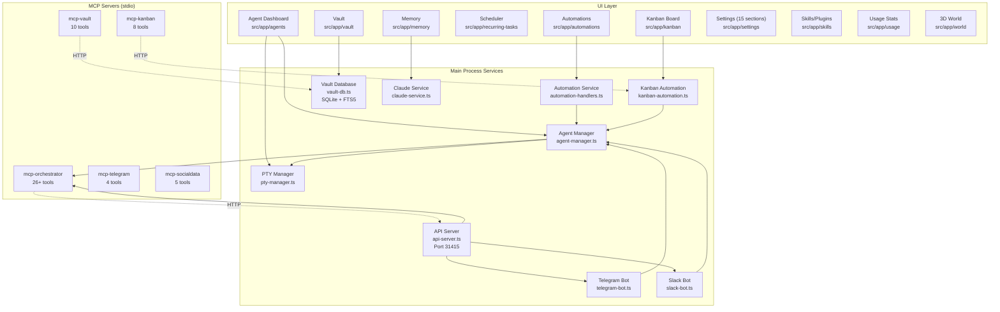
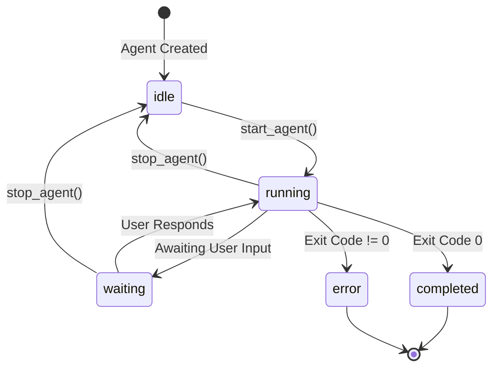
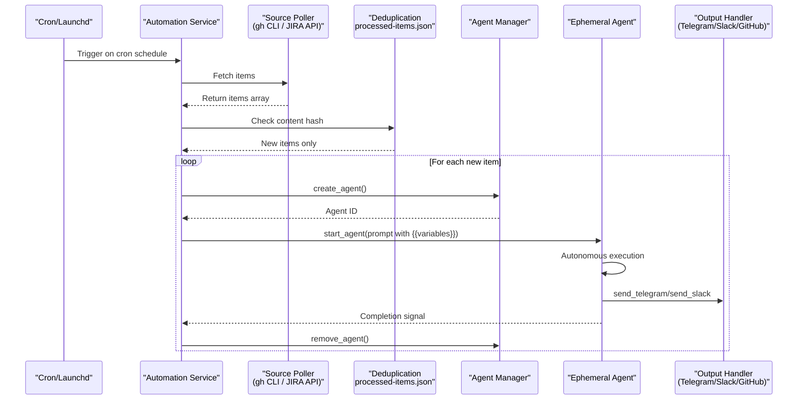
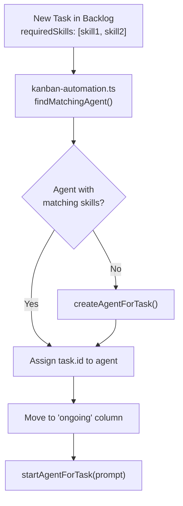
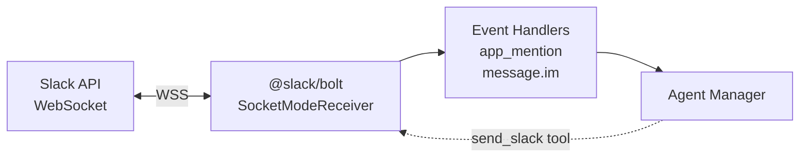
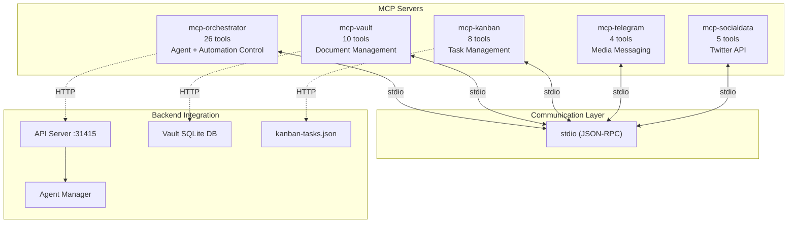
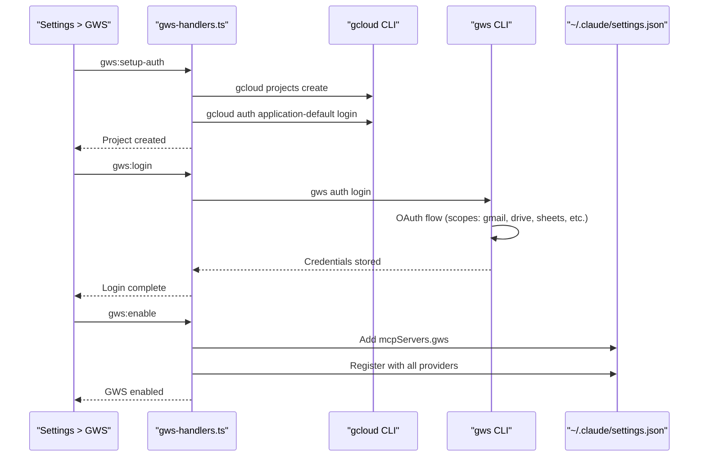

<!-- source: DeepWiki mcp.deepwiki.com · repo Charlie85270/Dorothy · page 1.1 Key Features · fetched 2026-10-26 -->

# Key Features

<details>
<summary>Relevant source files</summary>

The following files were used as context for generating this wiki page:

- [README.md](README.md)
- [__tests__/mcp/mcp-socialdata.test.ts](__tests__/mcp/mcp-socialdata.test.ts)
- [__tests__/mcp/mcp-vault.test.ts](__tests__/mcp/mcp-vault.test.ts)
- [electron/main.ts](electron/main.ts)
- [landing/public/kanban.png](landing/public/kanban.png)
- [landing/public/ollama-icon.svg](landing/public/ollama-icon.svg)
- [landing/src/app/page.tsx](landing/src/app/page.tsx)
- [screenshots/kanban.png](screenshots/kanban.png)

</details>


This page provides a comprehensive overview of Dorothy's core capabilities. Each feature is described with its primary use case, underlying implementation details, and relevant code locations. For detailed implementation architecture, see [System Architecture](#1.2). For setup and configuration of specific features, see [Settings](#5.3).

---

## Feature Overview

Dorothy provides 15 major feature areas organized into three tiers: **Agent Operations**, **Integrations & Automation**, and **Knowledge Management**.

### Feature Classification

| Category | Features |
|----------|----------|
| **Agent Operations** | Multi-Agent Management, Super Agent Orchestrator, Provider Abstraction, Skills & Plugins |
| **Integrations & Automation** | GitHub/JIRA Automations, Scheduler, Telegram Bot, Slack Bot, Google Workspace, SocialData/Twitter |
| **Knowledge Management** | Vault, Memory System, Kanban Board, Usage Tracking |
| **Visualization** | 3D Agent World, Agent Knowledge Graph |

**Sources:** [landing/src/app/page.tsx:117-151](), [README.md:9-28]()

---

## Feature Map: Natural Language to Code Entities

This diagram maps user-facing features to their primary implementation locations.



**Sources:** [electron/main.ts:1-603](), [README.md:647-701]()

---

## 1. Multi-Agent Management

Dorothy spawns and manages unlimited concurrent agents, each running in an isolated PTY (pseudo-terminal) session. Each agent is a `claude` CLI process with its own working directory, skills, and project context.

### Agent Lifecycle States



### Core Components

| Component | File | Purpose |
|-----------|------|---------|
| **Agent Manager** | [electron/core/agent-manager.ts:1-400]() | Agent state map (`Map<string, AgentStatus>`), lifecycle orchestration |
| **PTY Manager** | [electron/core/pty-manager.ts:1-200]() | Terminal multiplexing (`ptyProcesses`, `quickPtyProcesses`, `skillPtyProcesses`) |
| **IPC Handlers** | [electron/handlers/ipc-handlers.ts:1-600]() | Renderer ↔ main process communication for CRUD operations |

### Agent Properties

```typescript
interface AgentStatus {
  id: string;                    // UUID
  status: 'idle' | 'running' | 'waiting' | 'completed' | 'error';
  projectPath: string;           // Working directory
  skills: string[];              // Skill names (e.g., 'world-builder')
  output: string[];              // Terminal output buffer
  ptyId?: string;                // Reference to PTY process
  character?: string;            // Visual character (robot, wizard, etc.)
  name?: string;                 // Display name
  currentTask?: string;          // Active task description
  skipPermissions?: boolean;     // Autonomous mode flag
  worktreePath?: string;         // Git worktree override
  secondaryProjectPath?: string; // Additional --add-dir path
}
```

### Persistence

Agents persist to `~/.dorothy/agents.json` via `saveAgents()` [electron/core/agent-manager.ts:50-100](). State reloads on app startup via `loadAgents()` [electron/main.ts:306]().

**Sources:** [electron/core/agent-manager.ts:1-500](), [electron/core/pty-manager.ts:1-200](), [README.md:46-64]()

---

## 2. Super Agent (Orchestrator)

A special meta-agent with programmatic control over all other agents via MCP tools. It runs with access to `mcp-orchestrator` tools and is identified by name matching "super" (case-insensitive).

### Super Agent Identification

```typescript
// electron/utils.ts
function isSuperAgent(agent: AgentStatus): boolean {
  return agent.name?.toLowerCase().includes('super') ?? false;
}
```

### Orchestration Tools Available

The Super Agent has exclusive access to these MCP tools via `mcp-orchestrator`:

| Tool Category | Tools | Purpose |
|---------------|-------|---------|
| **Agent Management** | `list_agents`, `get_agent`, `create_agent`, `start_agent`, `send_message`, `stop_agent`, `remove_agent`, `wait_for_agent` | Full CRUD + monitoring |
| **Messaging** | `send_telegram`, `send_slack` | Remote notification |
| **Scheduler** | `list_scheduled_tasks`, `create_scheduled_task`, `run_scheduled_task` | Task automation |
| **Automations** | `create_automation`, `run_automation`, `get_automation_logs` | External source polling |

### Integration with Remote Control

When messages arrive via Telegram or Slack without direct commands, they route to the Super Agent's PTY. The agent responds using `send_telegram` or `send_slack` tools [electron/services/telegram-bot.ts:200-400](), [electron/services/slack-bot.ts:100-300]().

**Sources:** [electron/utils.ts:100-150](), [electron/services/telegram-bot.ts:1-600](), [mcp-orchestrator/src/tools/agents.ts:1-300](), [README.md:66-76]()

---

## 3. Automations

Poll-based workflow engine that monitors external sources (GitHub, JIRA), filters items, and spawns ephemeral agents to process each item autonomously.

### Automation Pipeline Flow



### Supported Sources

| Source | Implementation | Polling Method |
|--------|---------------|----------------|
| **GitHub** | [electron/handlers/automation-handlers.ts:100-300]() | `gh` CLI (`gh pr list`, `gh issue list`) |
| **JIRA** | [electron/handlers/automation-handlers.ts:300-500]() | REST API v3 + JQL queries |
| Pipedrive | Planned | — |
| Twitter/RSS | Planned | — |

### Template Variables

Prompts and output templates support variable interpolation:

**GitHub Variables:** `{{title}}`, `{{url}}`, `{{author}}`, `{{body}}`, `{{labels}}`, `{{repo}}`, `{{number}}`, `{{type}}`

**JIRA Variables:** `{{key}}`, `{{summary}}`, `{{status}}`, `{{issueType}}`, `{{priority}}`, `{{assignee}}`, `{{reporter}}`, `{{url}}`, `{{body}}`

### Deduplication Strategy

Content hashing via SHA256 of item key + timestamp. Processed items store in `~/.dorothy/automations-processed.json` [electron/handlers/automation-handlers.ts:400-500]().

**Sources:** [electron/handlers/automation-handlers.ts:1-800](), [README.md:100-192]()

---

## 4. Kanban Task Management

SQLite-backed task board with automatic agent assignment based on skill matching. Tasks flow through four columns: `backlog` → `planned` → `ongoing` → `done`.

### Task-to-Agent Matching Algorithm



### Storage Schema

Tasks persist to `~/.dorothy/kanban-tasks.json`:

```typescript
interface KanbanTask {
  id: string;
  title: string;
  description: string;
  column: 'backlog' | 'planned' | 'ongoing' | 'done';
  priority: 'low' | 'medium' | 'high';
  progress: number;              // 0-100
  labels: string[];
  requiredSkills: string[];
  assignedAgentId?: string;
  projectPath?: string;
  createdAt: string;
  updatedAt: string;
  completedAt?: string;
  agentSummary?: string;
}
```

### MCP Tools for Programmatic Access

The `mcp-kanban` server exposes 8 tools [mcp-kanban/src/index.ts:1-500]():

- `list_tasks`, `get_task`, `create_task`, `move_task`
- `update_task_progress`, `mark_task_done`, `assign_task`, `delete_task`

**Sources:** [electron/services/kanban-automation.ts:1-300](), [electron/handlers/kanban-handlers.ts:1-400](), [README.md:195-224]()

---

## 5. Scheduler (Recurring Tasks)

Cron-based task runner using platform-native schedulers: `launchd` on macOS, `cron` on Linux. Tasks execute Claude CLI commands on a schedule.

### Platform Integration

| Platform | Scheduler | Config Location | Script Location |
|----------|-----------|----------------|-----------------|
| **macOS** | `launchd` | `~/Library/LaunchAgents/*.plist` | `~/.dorothy/scripts/*.sh` |
| **Linux** | `cron` | Crontab entries | `~/.dorothy/scripts/*.sh` |

### Task Definition

Tasks store in `~/.claude/schedules.json`:

```typescript
interface ScheduledTask {
  id: string;
  prompt: string;
  schedule: string;              // Cron expression (e.g., "0 9 * * *")
  projectPath: string;
  autonomous: boolean;           // --dangerously-skip-permissions flag
  enabled: boolean;
  createdAt: string;
  lastRun?: string;
}
```

### Cron Expression Format

```
┌─── minute (0-59)
│ ┌─── hour (0-23)
│ │ ┌─── day of month (1-31)
│ │ │ ┌─── month (1-12)
│ │ │ │ ┌─── day of week (0-7, Sunday=0,7)
* * * * *
```

### IPC Handler: Task Creation

[electron/handlers/scheduler-handlers.ts:50-200]() handles `scheduler:create-task`, generates shell script, and registers with OS scheduler.

**Sources:** [electron/handlers/scheduler-handlers.ts:1-400](), [README.md:227-261]()

---

## 6. Remote Control (Telegram & Slack)

Bidirectional bot integrations enabling agent control from mobile/desktop chat clients. Both bots support identical command sets.

### Bot Command Mapping

| Command | Handler | Action |
|---------|---------|--------|
| `/status`, `status` | [telegram-bot.ts:200-250]() | List all agents with status |
| `/agents`, `agents` | [telegram-bot.ts:250-300]() | Detailed agent list |
| `/start_agent`, `start` | [telegram-bot.ts:300-350]() | Create + start agent |
| `/stop_agent`, `stop` | [telegram-bot.ts:350-400]() | Stop running agent |
| `/usage`, `usage` | [telegram-bot.ts:400-450]() | Claude API usage stats |
| (text without command) | [telegram-bot.ts:500-600]() | Route to Super Agent |

### Telegram Media Support

The `mcp-telegram` server provides media upload tools [mcp-telegram/src/index.ts:1-300]():

- `send_telegram_photo` - Images
- `send_telegram_video` - Videos
- `send_telegram_document` - Files

### Slack Socket Mode Architecture



**Sources:** [electron/services/telegram-bot.ts:1-700](), [electron/services/slack-bot.ts:1-500](), [README.md:264-316]()

---

## 7. Vault (Document Management)

SQLite database with FTS5 (Full-Text Search) for persistent document storage accessible to all agents via MCP tools.

### Database Schema

```sql
-- electron/services/vault-db.ts
CREATE TABLE folders (
  id TEXT PRIMARY KEY,
  name TEXT NOT NULL,
  parent_id TEXT,
  created_at TEXT,
  updated_at TEXT
);

CREATE TABLE documents (
  id TEXT PRIMARY KEY,
  title TEXT NOT NULL,
  content TEXT,
  folder_id TEXT,
  author TEXT,
  agent_id TEXT,
  tags TEXT,                    -- JSON array
  created_at TEXT,
  updated_at TEXT,
  FOREIGN KEY (folder_id) REFERENCES folders(id)
);

CREATE TABLE attachments (
  id TEXT PRIMARY KEY,
  document_id TEXT NOT NULL,
  filename TEXT NOT NULL,
  mimetype TEXT,
  size INTEGER,
  file_path TEXT,
  created_at TEXT,
  FOREIGN KEY (document_id) REFERENCES documents(id)
);

CREATE VIRTUAL TABLE documents_fts USING fts5(
  title, content, tags,
  content='documents',
  content_rowid='rowid'
);
```

### MCP Tools (mcp-vault)

10 tools exposed via `mcp-vault` server [mcp-vault/src/index.ts:1-700]():

**Document Operations:**
- `vault_create_document` - Auto-creates folders if needed
- `vault_update_document` - Partial updates supported
- `vault_get_document` - Full content + attachments
- `vault_list_documents` - Filter by folder/tags
- `vault_delete_document` - Cascade delete attachments
- `vault_attach_file` - Binary file upload
- `vault_search` - FTS5 with Boolean operators

**Folder Operations:**
- `vault_create_folder` - Nested hierarchies
- `vault_list_folders` - Tree structure
- `vault_delete_folder` - Recursive option

### Search Query Syntax

Supports SQLite FTS5 query syntax:
- `report AND weekly` - Boolean AND
- `report OR analysis` - Boolean OR
- `report NOT draft` - Boolean NOT
- `"exact phrase"` - Phrase matching

**Sources:** [electron/services/vault-db.ts:1-500](), [mcp-vault/src/index.ts:1-700](), [README.md:319-347]()

---

## 8. Usage Tracking

Monitors Claude API consumption by parsing `~/.claude/statsig_metadata.json` and conversation history.

### Data Sources

| Source | File | Data Points |
|--------|------|-------------|
| **Statsig Metadata** | `~/.claude/statsig_metadata.json` | Total input/output tokens, API calls |
| **Project History** | `~/.claude/projects/*/history/*.json` | Per-conversation breakdowns |
| **Cache Stats** | Derived from metadata | Cache read/write tokens |

### Stats Computation

[electron/services/claude-service.ts:100-300]() aggregates:

```typescript
interface ClaudeStats {
  totalInputTokens: number;
  totalOutputTokens: number;
  totalCacheReadTokens: number;
  totalCacheWriteTokens: number;
  totalApiCalls: number;
  estimatedCost: number;        // Calculated from token counts
}
```

### UI Integration

[src/app/usage/page.tsx:1-400]() displays:
- Token usage charts (Recharts library)
- Cost breakdown by model tier (Sonnet/Opus/Haiku)
- Historical trends
- Per-project breakdowns

**Sources:** [electron/services/claude-service.ts:1-400](), [src/app/usage/page.tsx:1-500]()

---

## 9. Skills & Plugins

Extension system integrating with [skills.sh](https://skills.sh) marketplace and Claude Code's native plugin system.

### Skill Types

| Type | Installation | Detection |
|------|-------------|-----------|
| **Community Skills** | `claude install <skill>` | `~/.claude/skills/` directory scan |
| **MCP Servers** | Manual registration | `~/.claude/settings.json` parsing |
| **GWS Skills** | `npm install -g @googleworkspace/gws-*` | Global npm package scan |

### Skill Assignment to Agents

Skills attach via environment variable `CLAUDE_SKILLS=skill1,skill2` when spawning PTY [electron/core/agent-manager.ts:150-200]():

```typescript
const ptyProcess = pty.spawn(shell, ['-l'], {
  env: {
    ...process.env,
    CLAUDE_SKILLS: agent.skills.join(','),
    CLAUDE_AGENT_ID: agent.id,
  }
});
```

### Skill Discovery

[electron/handlers/ipc-handlers.ts:200-400]() scans:
1. `~/.claude/skills/*` - Community skills
2. `~/.claude/settings.json` - Installed plugins
3. `npm list -g` - GWS skills (match pattern `@googleworkspace/gws-*`)

**Sources:** [electron/handlers/ipc-handlers.ts:1-600](), [README.md:84-93]()

---

## 10. MCP Ecosystem

Five standalone MCP servers communicating via stdio, exposing 40+ tools to Claude CLI agents.

### Server Inventory



### Tool Count Breakdown

| Server | Tools | Primary Use Case |
|--------|-------|------------------|
| `mcp-orchestrator` | 26 | Agent lifecycle, messaging, scheduling, automations |
| `mcp-vault` | 10 | Document CRUD, folder management, full-text search |
| `mcp-kanban` | 8 | Task board operations, agent assignment |
| `mcp-telegram` | 4 | Media uploads (photo, video, document) |
| `mcp-socialdata` | 5 | Twitter search, user profiles, tweet details |

### Server Registration

Each agent's PTY spawns with `--mcp-config` pointing to dynamically generated config [electron/services/mcp-orchestrator.ts:50-200]():

```json
{
  "mcpServers": {
    "orchestrator": {
      "command": "node",
      "args": ["/path/to/mcp-orchestrator/build/index.js"]
    },
    "vault": {
      "command": "node",
      "args": ["/path/to/mcp-vault/build/index.js"]
    }
  }
}
```

**Sources:** [mcp-orchestrator/src/index.ts:1-200](), [mcp-vault/src/index.ts:1-100](), [mcp-kanban/src/index.ts:1-100](), [README.md:409-532]()

---

## 11. Settings Management (15 Sections)

Centralized configuration UI with 15 specialized sections, persisting to `~/.dorothy/app-settings.json` and `~/.claude/settings.json`.

### Settings Sections

| Section | Purpose | File |
|---------|---------|------|
| **General** | Auto-updates, default provider | [src/app/settings/general/page.tsx]() |
| **Terminal** | Font, theme, shell | [src/app/settings/terminal/page.tsx]() |
| **Obsidian** | Vault paths (read-only integration) | [src/app/settings/obsidian/page.tsx]() |
| **Git** | Worktree config | [src/app/settings/git/page.tsx]() |
| **Notifications** | Trigger settings (waiting/complete/error) | [src/app/settings/notifications/page.tsx]() |
| **Telegram** | Bot token, chat IDs, auth token | [src/app/settings/telegram/page.tsx]() |
| **Slack** | App token, bot token, channel ID | [src/app/settings/slack/page.tsx]() |
| **JIRA** | Domain, email, API token | [src/app/settings/jira/page.tsx]() |
| **SocialData** | API key | [src/app/settings/socialdata/page.tsx]() |
| **Tasmania** | Local AI server path | [src/app/settings/tasmania/page.tsx]() |
| **Google Workspace** | GWS CLI setup, OAuth | [src/app/settings/gws/page.tsx]() |
| **Permissions** | Claude permission defaults | [src/app/settings/permissions/page.tsx]() |
| **Skills** | Skill installation, marketplace | [src/app/settings/skills/page.tsx]() |
| **CLI Paths** | Tool path overrides | [src/app/settings/cli-paths/page.tsx]() |
| **System** | App info, diagnostics | [src/app/settings/system/page.tsx]() |

### Settings Persistence Strategy

[electron/handlers/ipc-handlers.ts:400-600]() separates concerns:

```typescript
// Dorothy-specific settings → ~/.dorothy/app-settings.json
{
  notificationsEnabled: boolean;
  telegramBotToken: string;
  jiraDomain: string;
  defaultProvider: 'claude' | 'codex' | 'gemini';
  // ... 40+ fields
}

// Claude Code settings → ~/.claude/settings.json
{
  permissions: { ... };
  mcpServers: { ... };
  plugins: [ ... ];
}

// CLI path overrides → ~/.dorothy/cli-paths.json
{
  claude: string;
  codex: string;
  gh: string;
  node: string;
  additionalPaths: string[];
}
```

**Sources:** [electron/handlers/ipc-handlers.ts:400-800](), [electron/main.ts:104-173]()

---

## 12. Google Workspace Integration

Registers `gws mcp` as an MCP server, exposing 10-80 Google API tools per service (Gmail, Drive, Sheets, Calendar, Docs).

### Setup Flow



### Service Detection

[electron/handlers/gws-handlers.ts:100-300]() parses `gws service list` output to populate service badges:

```typescript
interface GWSService {
  name: string;              // "Gmail", "Drive", "Sheets"
  scopes: string[];          // OAuth scopes
  access: 'READ' | 'R/W';    // Derived from scope names
  toolCount: number;         // Parsed from CLI output
}
```

### MCP Server Config

```json
{
  "gws": {
    "command": "gws",
    "args": ["mcp"]
  }
}
```

Registered in `~/.claude/settings.json` for all configured providers (Claude, Codex, Gemini).

**Sources:** [electron/handlers/gws-handlers.ts:1-500](), [README.md:372-405]()

---

## 13. SocialData (Twitter/X)

REST API integration via [socialdata.tools](https://socialdata.tools) for Twitter data retrieval without official API credentials.

### API Endpoints

| Tool | Endpoint | Rate Limit |
|------|----------|------------|
| `twitter_search` | `/twitter/search` | Cursor-based pagination |
| `twitter_get_tweet` | `/twitter/tweets/{id}` | Single tweet detail |
| `twitter_get_tweet_comments` | `/twitter/tweets/{id}/comments` | Cursor-based pagination |
| `twitter_get_user` | `/twitter/user/{username}` | Single user profile |
| `twitter_get_user_tweets` | `/twitter/user/{id}/tweets` | Cursor-based pagination |

### Search Operators

Supports Twitter advanced search syntax:
- `from:username` - Tweets from specific user
- `to:username` - Tweets mentioning user
- `min_faves:100` - Minimum like count
- `filter:images` - Tweets with images
- `since:2024-01-01` - Date filtering

### Error Handling

[mcp-socialdata/src/index.ts:50-150]() handles API-specific error codes:

```typescript
// 402 - Insufficient credits
if (response.status === 402) {
  return 'Insufficient SocialData API credits. Please top up your account.';
}

// 404 - Not found
if (response.status === 404) {
  return 'Resource not found on Twitter/X.';
}

// 422 - Validation error
if (response.status === 422) {
  const detail = await response.json();
  return `Validation error: ${JSON.stringify(detail)}`;
}
```

**Sources:** [mcp-socialdata/src/index.ts:1-500](), [__tests__/mcp/mcp-socialdata.test.ts:1-800](), [README.md:349-370]()

---

## 14. Memory System & Knowledge Graph

Integrates with Claude Code's native project memory system (`~/.claude/projects/*/memory/`) and provides a visual force-directed graph showing relationships between agents, skills, memory files, and MCP servers.

### Memory File Structure

```
~/.claude/projects/{project-id}/
├── memory/
│   ├── MEMORY.md              # Entrypoint with topic index
│   ├── project-overview.md
│   ├── technical-decisions.md
│   └── agent-notes.md
└── CLAUDE.md                  # Project instructions
```

### Knowledge Graph Algorithm

[src/app/memory/components/knowledge-graph.tsx:100-400]() builds graph via `buildGraph()`:

```typescript
interface GraphNode {
  id: string;
  type: 'agent' | 'skill' | 'memory' | 'mcp' | 'claude-md';
  label: string;
  x: number;                   // Force-directed layout position
  y: number;
  vx: number;                  // Velocity
  vy: number;
}

interface GraphEdge {
  source: string;              // Node ID
  target: string;              // Node ID
  type: 'uses' | 'contains' | 'references';
}
```

### Force-Directed Layout

Physics simulation with:
- **Repulsion:** Nodes repel (inverse square law)
- **Attraction:** Edges pull connected nodes together (spring force)
- **Damping:** Velocity decay for stability
- **Center gravity:** Weak pull to canvas center

Canvas rendering at 60 FPS [src/app/memory/components/knowledge-graph.tsx:300-500]().

**Sources:** [src/app/memory/components/knowledge-graph.tsx:1-600](), [README.md:695-720]()

---

## 15. 3D Agent World

WebGL-based visualization rendering agents as animated characters in a 3D office environment using Three.js.

### World Generation

[src/app/world/components/world.tsx:100-500]() generates:
- **Floor:** Grid plane
- **Agents:** Character models positioned by agent count
- **Office Objects:** Desks, chairs, monitors (procedural placement)
- **Lighting:** Ambient + directional lights

### Agent Character Models

| Character | Model File | Animation States |
|-----------|-----------|------------------|
| `robot` | `/models/robot.glb` | idle, walking, working |
| `wizard` | `/models/wizard.glb` | idle, casting, meditating |
| `ninja` | `/models/ninja.glb` | idle, running, attacking |
| `cat` | `/models/cat.glb` | idle, sitting, playing |

### Status-to-Animation Mapping

```typescript
// src/app/world/components/world.tsx
const animationMap: Record<AgentStatus, string> = {
  idle: 'idle',
  running: 'working',
  waiting: 'idle',
  completed: 'celebrating',
  error: 'error_pose',
};
```

Animations loop based on agent status updates from IPC events.

**Sources:** [src/app/world/components/world.tsx:1-700]()

---

## Feature Dependencies

Many features depend on external CLI tools or services:

| Feature | Required Tool/Service | Installation |
|---------|----------------------|--------------|
| **Multi-Agent** | `claude` CLI | `npm install -g @anthropic-ai/claude-code` |
| **GitHub Automations** | `gh` CLI | `brew install gh` |
| **JIRA Automations** | — | API token only |
| **Google Workspace** | `gcloud`, `gws` CLI | `brew install google-cloud-sdk`, `npm install -g @googleworkspace/cli` |
| **SocialData** | — | API key from [socialdata.tools](https://socialdata.tools) |
| **Vault** | — | Built-in SQLite |
| **Scheduler** | `launchd` / `cron` | System-native |

**Sources:** [README.md:534-542]()

---

