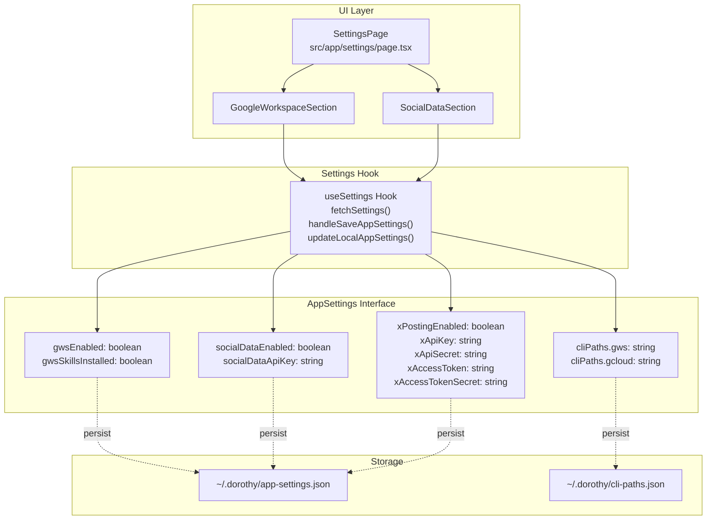
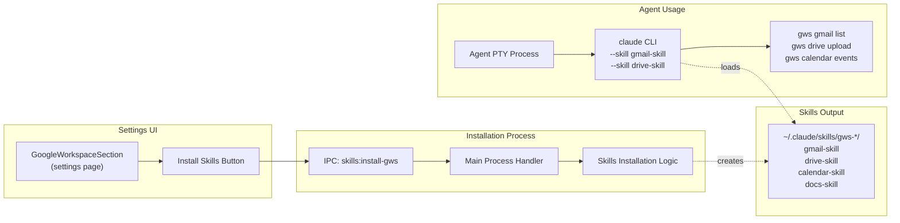
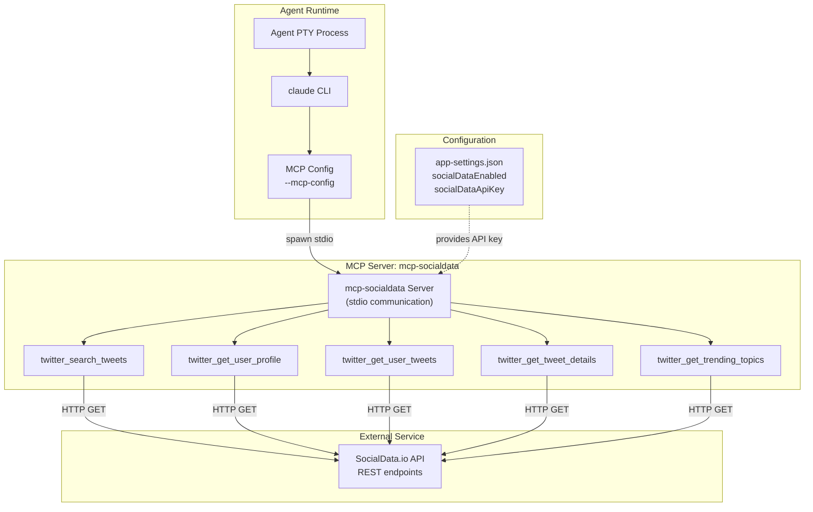
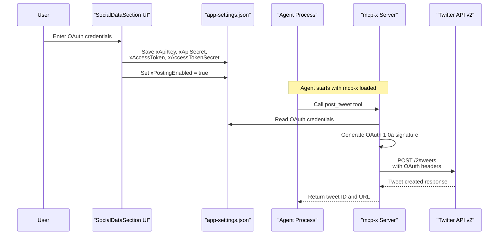
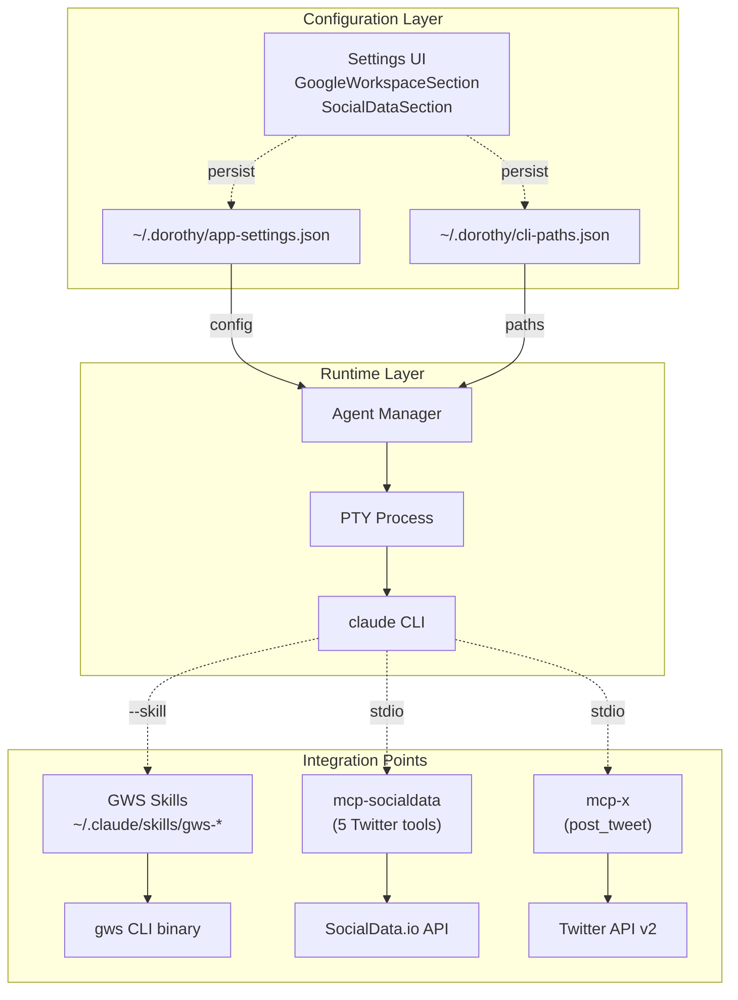

<!-- source: DeepWiki mcp.deepwiki.com · repo Charlie85270/Dorothy · page 10 Other Integrations · fetched 2026-10-26 -->

# Other Integrations

<details>
<summary>Relevant source files</summary>

The following files were used as context for generating this wiki page:

- [electron/types/index.ts](electron/types/index.ts)
- [src/app/settings/page.tsx](src/app/settings/page.tsx)
- [src/components/Settings/constants.ts](src/components/Settings/constants.ts)
- [src/components/Settings/types.ts](src/components/Settings/types.ts)

</details>


This page documents Dorothy's additional integration capabilities beyond the core messaging and automation features. It covers Google Workspace CLI integration for interacting with Google services, and Social Data API integration for X/Twitter functionality.

For information about Telegram and Slack integrations, see [Remote Control](#9). For JIRA and GitHub automations, see [Automations](#7).

---

## Overview

Dorothy supports three additional integration categories:

1. **Google Workspace (GWS)**: CLI-based integration with Google services including Gmail, Drive, Calendar, and Docs
2. **Social Data API**: Third-party API for Twitter/X data access and analysis
3. **X/Twitter Posting**: Direct OAuth-based posting to X/Twitter

These integrations extend agent capabilities through CLI tools, MCP servers, and API access.

**Sources:** [electron/types/index.ts:46-84](), [src/components/Settings/types.ts:38-76]()

---

## Configuration Architecture

### Settings Storage Structure



**Integration Settings Flow**

All integration settings are managed through the centralized `useSettings` hook and stored in `app-settings.json`. The Google Workspace and Social Data sections are accessible from the settings page sidebar at indices 10 and 8 respectively.

**Sources:** [src/app/settings/page.tsx:1-262](), [src/components/Settings/types.ts:38-76](), [electron/types/index.ts:46-84]()

---

## Google Workspace Integration

### Overview

The Google Workspace integration enables agents to interact with Google services through the `gws` CLI tool. This integration requires:
- The `gws` CLI binary installed on the system
- The `gcloud` CLI for authentication
- Dorothy-specific skills to expose GWS functionality to agents

### Configuration Fields

| Field | Type | Description |
|-------|------|-------------|
| `gwsEnabled` | boolean | Master toggle for GWS integration |
| `gwsSkillsInstalled` | boolean | Tracks whether GWS skills have been installed |
| `cliPaths.gws` | string | Filesystem path to `gws` CLI binary |
| `cliPaths.gcloud` | string | Filesystem path to `gcloud` CLI binary |

**Sources:** [electron/types/index.ts:75-80](), [src/components/Settings/types.ts:67-71]()

### Skills Installation

The GWS integration relies on specialized skills that wrap `gws` CLI commands:



**Google Workspace Skills Installation Flow**

When a user clicks "Install Skills" in the Google Workspace settings section, Dorothy installs pre-defined skill packages that expose `gws` commands to agents. These skills are stored in the standard Claude Code skills directory and can be attached to any agent during creation.

**Sources:** [src/app/settings/page.tsx:128-134]()

### CLI Path Resolution

Dorothy uses the `CLIPaths` interface to locate the `gws` and `gcloud` binaries:

```typescript
// CLIPaths structure
{
  gws: "/opt/homebrew/bin/gws",      // GWS CLI binary
  gcloud: "/usr/local/bin/gcloud",   // Google Cloud SDK
  // ... other CLI paths
}
```

These paths are configured in the CLI Paths settings section and stored separately in `cli-paths.json`. The agent manager uses these paths when constructing commands for agents that require GWS functionality.

**Sources:** [electron/types/index.ts:35-44](), [src/components/Settings/types.ts:27-36]()

---

## Social Data Integration

### Overview

The Social Data integration provides access to Twitter/X data through the SocialData.io API. This integration is exposed to agents via the `mcp-socialdata` MCP server, which provides 5 tools for Twitter API interactions.

### Configuration

| Field | Type | Description |
|-------|------|-------------|
| `socialDataEnabled` | boolean | Enables/disables the Social Data integration |
| `socialDataApiKey` | string | API key for SocialData.io service |

The `SocialDataSection` component in the settings page handles configuration UI and validation.

**Sources:** [electron/types/index.ts:66-67](), [src/components/Settings/types.ts:58-59]()

### MCP Server Architecture



**Social Data MCP Server Integration**

The `mcp-socialdata` server runs as a child process of each agent's Claude CLI instance, communicating via stdio. When an agent invokes a Twitter-related tool, the MCP server makes authenticated requests to SocialData.io using the configured API key from `app-settings.json`.

**Sources:** [electron/types/index.ts:66-67](), [src/components/Settings/types.ts:58-59]()

### Available Tools

The `mcp-socialdata` server exposes 5 tools to agents:

| Tool Name | Purpose | Typical Use Case |
|-----------|---------|------------------|
| `twitter_search_tweets` | Search for tweets by query | Monitoring topics, gathering data |
| `twitter_get_user_profile` | Fetch user profile information | User research, profile analysis |
| `twitter_get_user_tweets` | Get tweets from specific user | Content analysis, timeline export |
| `twitter_get_tweet_details` | Get details about specific tweet | Engagement metrics, thread analysis |
| `twitter_get_trending_topics` | Fetch trending topics | Trend monitoring, content discovery |

All tools require the `socialDataEnabled` flag to be true and a valid `socialDataApiKey` to function.

---

## X/Twitter Posting Integration

### Overview

Dorothy supports direct posting to X/Twitter through OAuth 1.0a authentication. This integration is separate from the Social Data read-only API and enables agents to create tweets programmatically.

### OAuth Configuration

The X posting integration requires four OAuth credentials:

| Field | Type | Description |
|-------|------|-------------|
| `xPostingEnabled` | boolean | Master toggle for X posting capability |
| `xApiKey` | string | OAuth consumer key (API key) |
| `xApiSecret` | string | OAuth consumer secret (API secret) |
| `xAccessToken` | string | User access token |
| `xAccessTokenSecret` | string | User access token secret |

**Sources:** [electron/types/index.ts:68-72](), [src/components/Settings/types.ts:60-64]()

### Authentication Flow



**X/Twitter OAuth Authentication Sequence**

The X posting integration uses OAuth 1.0a with user credentials stored in `app-settings.json`. When an agent invokes the `post_tweet` tool from `mcp-x`, the server reads credentials from settings, signs the request, and posts to Twitter API v2.

**Sources:** [electron/types/index.ts:68-72]()

### Integration with MCP Servers

The X posting capability is exposed through the `mcp-x` MCP server (distinct from `mcp-socialdata`). While `mcp-socialdata` provides read-only access via SocialData.io, `mcp-x` provides write access through direct Twitter API integration.

| Integration | MCP Server | Access Type | Authentication |
|-------------|------------|-------------|----------------|
| Social Data | `mcp-socialdata` | Read-only | SocialData.io API key |
| X Posting | `mcp-x` | Write (post tweets) | Twitter OAuth 1.0a |

Both integrations can be enabled simultaneously, giving agents full read-write capabilities for Twitter/X.

---

## Settings UI Sections

### Google Workspace Section

The Google Workspace settings section is rendered at [src/app/settings/page.tsx:128-134]() when `activeSection === 'google-workspace'`. It displays:
- Enable/disable toggle
- GWS CLI path configuration
- Skills installation status
- Install skills button

**Sources:** [src/app/settings/page.tsx:128-134]()

### Social Data Section

The Social Data settings section is rendered at [src/app/settings/page.tsx:111-118]() when `activeSection === 'socialdata'`. It provides:
- Social Data API key input
- X posting OAuth credentials (4 fields)
- Enable/disable toggles for both integrations
- Test connection buttons

**Sources:** [src/app/settings/page.tsx:111-118]()

### Settings Section Registry

Both integration sections are registered in the `SECTIONS` constant:

```typescript
// Position 10 (index from 0)
{ id: 'google-workspace', label: 'Google Workspace', icon: Cloud }

// Position 8
{ id: 'socialdata', label: 'X (Twitter)', icon: Twitter }
```

**Sources:** [src/components/Settings/constants.ts:19-35]()

---

## Data Flow Summary



**Integration Data Flow Overview**

Configuration flows from the settings UI into JSON files, which are consumed by the agent manager when spawning agent processes. Agents access integrations through three mechanisms: skills for GWS CLI wrapping, `mcp-socialdata` for Twitter read access, and `mcp-x` for Twitter write access.

**Sources:** [src/app/settings/page.tsx:1-262](), [electron/types/index.ts:46-84](), [src/components/Settings/constants.ts:19-35]()

---

