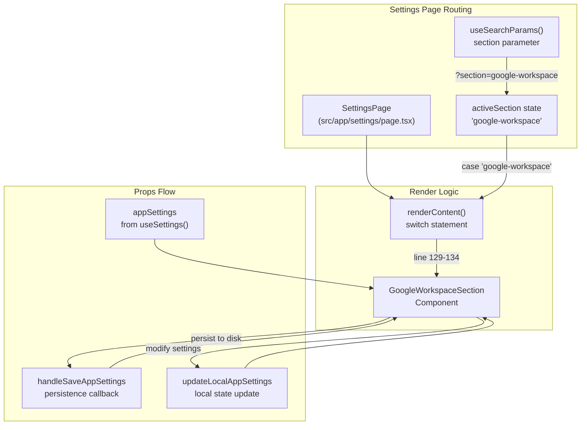
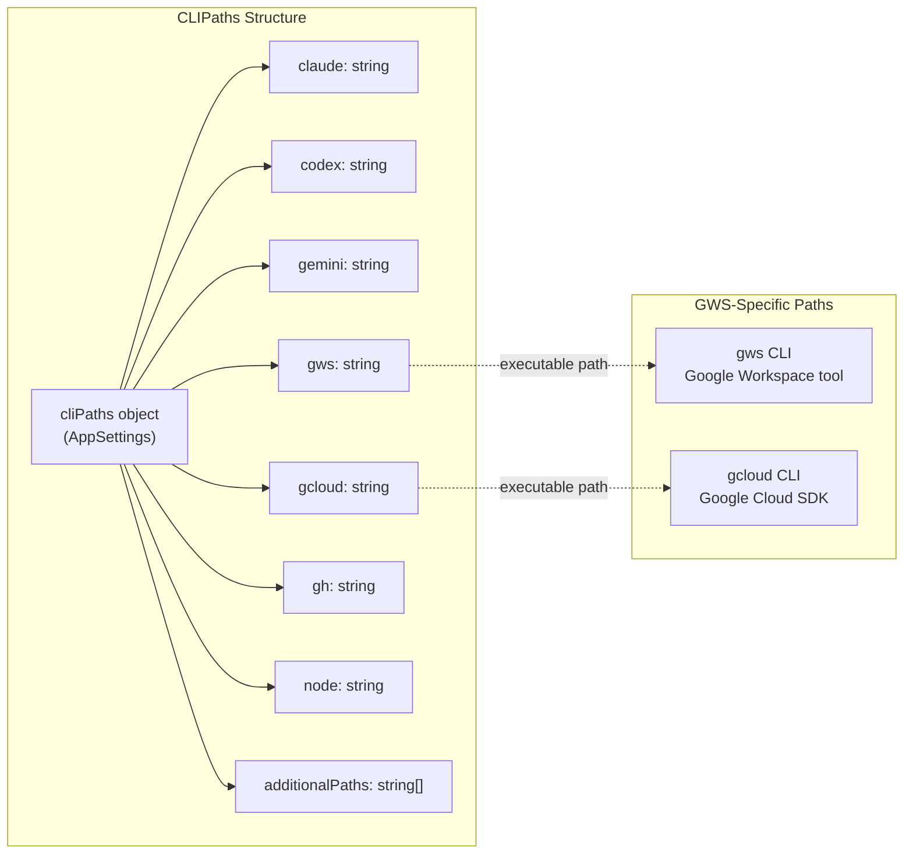
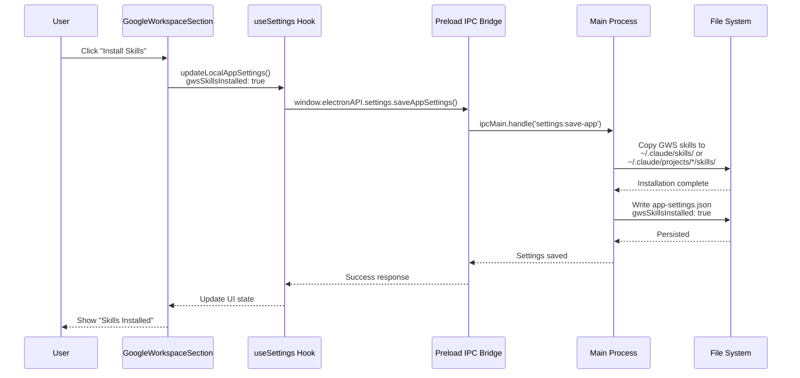
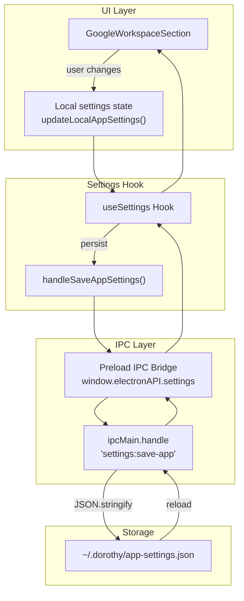

<!-- source: DeepWiki mcp.deepwiki.com · repo Charlie85270/Dorothy · page 10.1 Google Workspace · fetched 2026-10-26 -->

# Google Workspace

<details>
<summary>Relevant source files</summary>

The following files were used as context for generating this wiki page:

- [electron/types/index.ts](electron/types/index.ts)
- [src/app/settings/page.tsx](src/app/settings/page.tsx)
- [src/components/Settings/constants.ts](src/components/Settings/constants.ts)
- [src/components/Settings/types.ts](src/components/Settings/types.ts)

</details>


## Purpose and Scope

This document describes Dorothy's Google Workspace (GWS) integration, which enables agents to interact with Google services through CLI tools. The integration provides access to Google Workspace APIs via the `gws` and `gcloud` command-line interfaces. This integration is configured through the Settings UI and requires installation of GWS-specific skills to enable agent capabilities.

For information about other external service integrations, see [Other Integrations](#10). For general configuration management, see [Settings](#5.3).

---

## Overview

The Google Workspace integration in Dorothy follows the CLI-based integration pattern used throughout the system. It consists of two primary components:

1. **CLI Path Configuration**: Dorothy manages paths to `gws` and `gcloud` command-line tools
2. **Skills System**: GWS-specific skills are installed to expose Google Workspace capabilities to agents

The integration is controlled by two boolean flags in the application settings: `gwsEnabled` and `gwsSkillsInstalled`, which track the activation state and skill installation status respectively.

**Sources**: [electron/types/index.ts:75-76](), [src/components/Settings/types.ts:67-68]()

---

## Configuration Structure

The Google Workspace integration is managed through the `AppSettings` interface, which persists to `~/.dorothy/app-settings.json`.

### AppSettings Fields

| Field | Type | Default | Description |
|-------|------|---------|-------------|
| `gwsEnabled` | `boolean` | `false` | Master toggle for Google Workspace integration |
| `gwsSkillsInstalled` | `boolean` | `false` | Tracks whether GWS skills have been installed |
| `cliPaths.gws` | `string` | `''` | Path to the `gws` CLI executable |
| `cliPaths.gcloud` | `string` | `''` | Path to the `gcloud` CLI executable |

The `cliPaths` object is part of the broader CLI path management system that includes paths for all external tools Dorothy integrates with.

**Sources**: [electron/types/index.ts:35-44,75-76](), [src/components/Settings/constants.ts:66-67,74-83]()

---

## Settings UI Integration

### GoogleWorkspaceSection Component

The Google Workspace settings are accessed through the Settings page at the `'google-workspace'` section. The UI is rendered by the `GoogleWorkspaceSection` component, which follows the standard settings section pattern.



**Diagram: Settings Page Routing to GoogleWorkspaceSection**

The component receives three props:
- `appSettings`: Current application settings from the `useSettings` hook
- `onSaveAppSettings`: Callback to persist settings to `~/.dorothy/app-settings.json`
- `onUpdateLocalSettings`: Callback to update local state without persistence

**Sources**: [src/app/settings/page.tsx:127-134](), [src/app/settings/page.tsx:53-68]()

---

## CLI Path Management

### CLIPaths Interface

The Google Workspace integration relies on two CLI tools that must be configured in the `cliPaths` section of application settings:



**Diagram: CLI Paths Configuration Structure**

The `gws` path points to the Google Workspace CLI tool executable, while `gcloud` points to the Google Cloud SDK CLI. Both paths are required for full Google Workspace functionality within Dorothy agents.

**Sources**: [electron/types/index.ts:35-44](), [src/components/Settings/types.ts:27-36]()

---

## Skills Installation System

### Installation Flow

The `gwsSkillsInstalled` flag tracks whether Google Workspace skills have been installed to the Claude Code skills directory. Skills are the mechanism through which agents gain access to Google Workspace capabilities.



**Diagram: Google Workspace Skills Installation Sequence**

Once skills are installed, agents created with GWS skills included in their skill set will have access to Google Workspace tools during execution.

**Sources**: [src/components/Settings/types.ts:67-68](), [src/app/settings/page.tsx:53-68]()

---

## Integration States

The Google Workspace integration can exist in one of four states based on the two boolean flags:

| `gwsEnabled` | `gwsSkillsInstalled` | State | Description |
|--------------|----------------------|-------|-------------|
| `false` | `false` | **Disabled** | Integration is completely inactive |
| `true` | `false` | **Enabled, Not Configured** | Integration enabled but skills not installed |
| `true` | `true` | **Fully Configured** | Integration active with skills available |
| `false` | `true` | **Disabled with Skills** | Skills installed but integration disabled |

The typical setup flow is:
1. User enables `gwsEnabled` toggle
2. User configures `cliPaths.gws` and `cliPaths.gcloud`
3. User clicks "Install Skills" to set `gwsSkillsInstalled`
4. Skills become available for agent creation

**Sources**: [electron/types/index.ts:75-76](), [src/components/Settings/constants.ts:66-67]()

---

## Settings Section Registration

The Google Workspace section is registered in the settings navigation system through the `SECTIONS` array:

```typescript
// From constants.ts line 30
{ id: 'google-workspace', label: 'Google Workspace', icon: Cloud }
```

This registration:
- Assigns the section ID `'google-workspace'` for routing
- Sets the display label "Google Workspace" for the sidebar
- Uses the `Cloud` icon from `lucide-react` for visual identification

The section appears in the settings sidebar between Tasmania and Permissions sections.

**Sources**: [src/components/Settings/constants.ts:30](), [src/components/Settings/constants.ts:19-35]()

---

## Data Persistence

### Storage Location

Google Workspace configuration persists to the application settings file:

```
~/.dorothy/app-settings.json
```

The file stores the complete `AppSettings` object, including:
- `gwsEnabled` and `gwsSkillsInstalled` flags
- `cliPaths.gws` and `cliPaths.gcloud` paths
- All other Dorothy application settings

### Persistence Flow



**Diagram: Google Workspace Settings Persistence Architecture**

The persistence follows the standard Dorothy settings pattern:
1. UI components update local state immediately for responsive feedback
2. User clicks "Save Changes" button in settings header
3. Settings are persisted via IPC to the main process
4. Main process writes `app-settings.json` atomically
5. Settings are reloaded to ensure consistency

**Sources**: [src/app/settings/page.tsx:53-68](), [src/app/settings/page.tsx:200-218]()

---

## Integration with Agent System

When an agent is created with Google Workspace skills, the CLI paths configured in settings are used during agent execution. The agent's PTY process environment will include:

1. **PATH augmentation**: `cliPaths.gws` and `cliPaths.gcloud` directories added to PATH
2. **Skill availability**: GWS skills loaded into the agent's skill set
3. **Tool access**: Google Workspace tools exposed via MCP servers (if applicable)

The `gwsEnabled` flag acts as a master switch - even if skills are installed, they will not be available to agents unless the integration is enabled.

**Sources**: [electron/types/index.ts:35-44](), [src/components/Settings/types.ts:67-68]()

---

## Default Configuration

The system ships with Google Workspace integration disabled by default:

```typescript
// From constants.ts lines 66-67
gwsEnabled: false,
gwsSkillsInstalled: false,
```

Both CLI paths default to empty strings:

```typescript
// From constants.ts lines 78-79
gws: '',
gcloud: '',
```

Users must explicitly:
1. Enable the integration
2. Configure CLI paths
3. Install skills

This ensures that Google Workspace functionality is opt-in and does not interfere with users who do not need it.

**Sources**: [src/components/Settings/constants.ts:37-84]()

---

## Type Safety

The Google Workspace settings are type-safe across the Electron boundary. The `AppSettings` interface is defined identically in both:

- **Renderer process**: [src/components/Settings/types.ts:38-76]()
- **Main process**: [electron/types/index.ts:46-84]()

This ensures that IPC communication maintains type consistency and prevents runtime errors from mismatched settings structures.

The `SettingsSection` type union explicitly includes `'google-workspace'` as a valid section identifier, providing compile-time validation of section routing.

**Sources**: [src/components/Settings/types.ts:78](), [electron/types/index.ts:46-84]()

---

