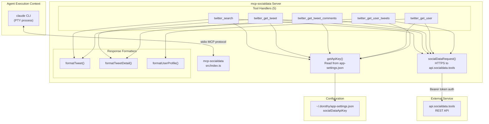
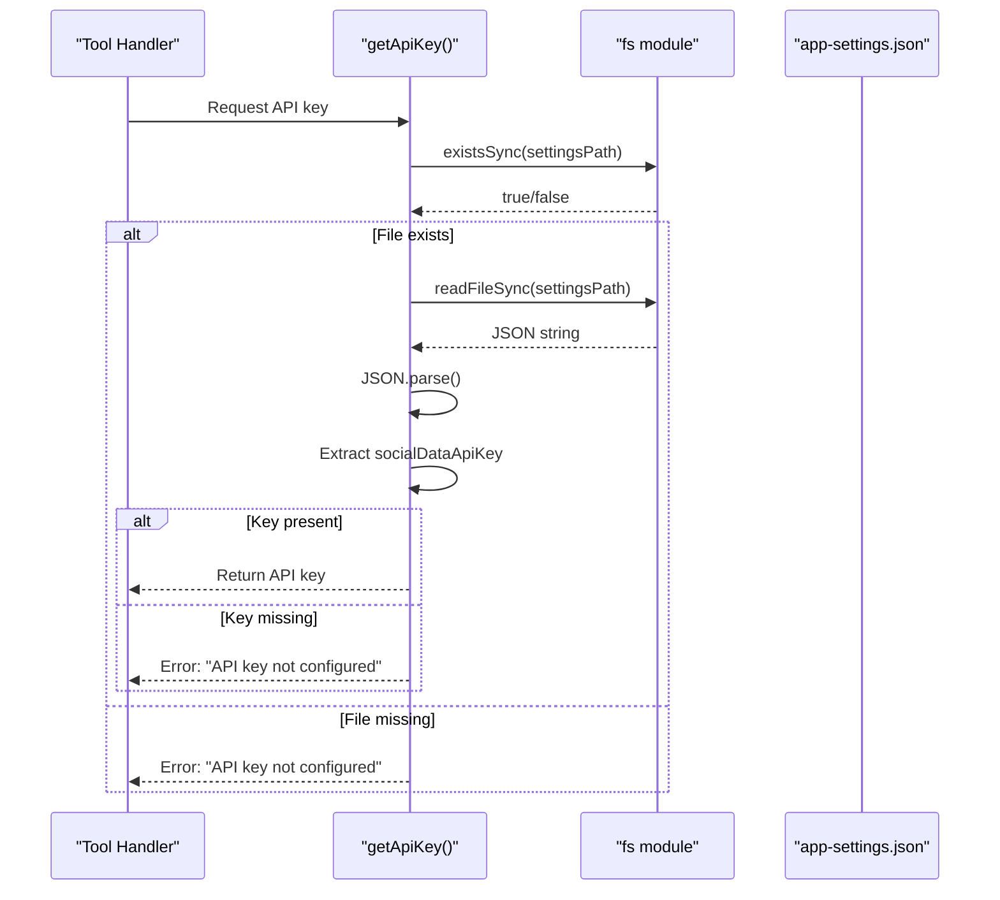
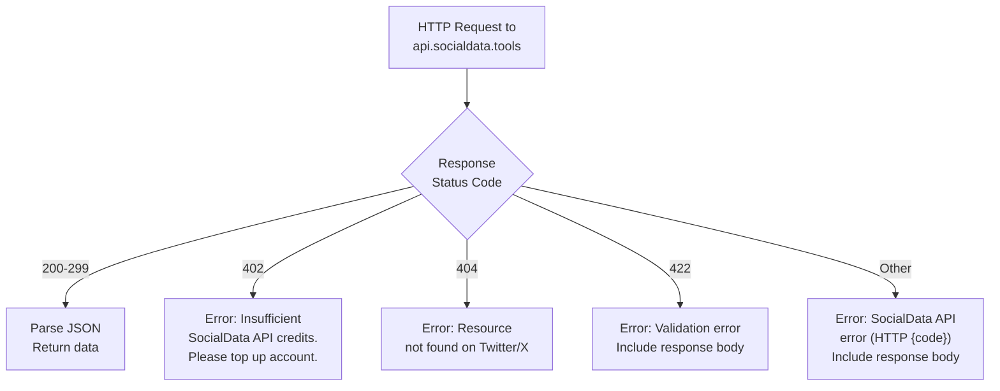
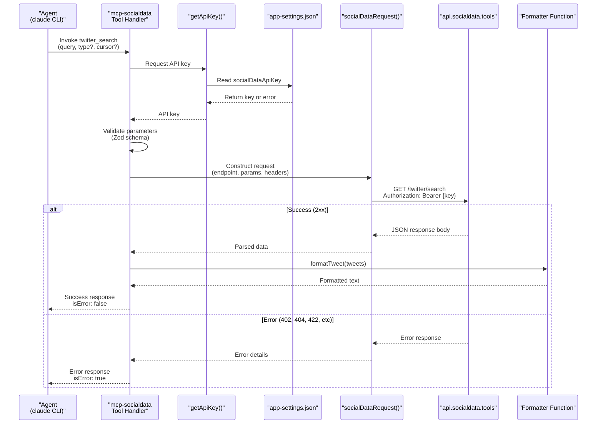
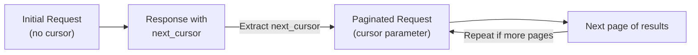

<!-- source: DeepWiki mcp.deepwiki.com · repo Charlie85270/Dorothy · page 10.2 Social Data and X/Twitter · fetched 2026-10-26 -->

# Social Data and X/Twitter

<details>
<summary>Relevant source files</summary>

The following files were used as context for generating this wiki page:

- [README.md](README.md)
- [__tests__/mcp/mcp-socialdata.test.ts](__tests__/mcp/mcp-socialdata.test.ts)
- [__tests__/mcp/mcp-vault.test.ts](__tests__/mcp/mcp-vault.test.ts)
- [electron/types/index.ts](electron/types/index.ts)
- [landing/public/kanban.png](landing/public/kanban.png)
- [landing/public/ollama-icon.svg](landing/public/ollama-icon.svg)
- [landing/src/app/page.tsx](landing/src/app/page.tsx)
- [screenshots/kanban.png](screenshots/kanban.png)
- [src/components/Settings/constants.ts](src/components/Settings/constants.ts)
- [src/components/Settings/types.ts](src/components/Settings/types.ts)

</details>


## Purpose and Scope

This document covers Dorothy's integration with the SocialData API for accessing Twitter/X data programmatically through agents. The integration provides read-only access to tweets, user profiles, and engagement metrics via five MCP tools exposed through the `mcp-socialdata` server.

This page focuses on Twitter/X data retrieval. For information about other social media integrations or posting capabilities, refer to related settings sections. For the broader MCP ecosystem overview, see [MCP Ecosystem](#4).

---

## Configuration

### Settings Storage

The Social Data integration stores its configuration in two primary fields within `AppSettings`:

| Field | Type | Purpose |
|-------|------|---------|
| `socialDataEnabled` | `boolean` | Master toggle for the integration |
| `socialDataApiKey` | `string` | SocialData API authentication token |

**Sources:** [electron/types/index.ts:66-67](), [src/components/Settings/types.ts:58-59]()

### Configuration UI

The settings interface is accessible through the Settings page under the "X (Twitter)" section, which maps to the `socialdata` settings section identifier.

**Sources:** [src/components/Settings/constants.ts:28](), [src/components/Settings/constants.ts:57-58]()

### Obtaining an API Key

1. Visit https://socialdata.tools and create an account
2. Purchase API credits (402 errors indicate insufficient credits)
3. Copy the API key from your dashboard
4. Paste into **Settings → X (Twitter) → Social Data API Key**
5. Enable the toggle to activate the integration

**Sources:** [README.md:353-357]()

---

## MCP Server Architecture

### Overview



**Sources:** [README.md:528-531](), [__tests__/mcp/mcp-socialdata.test.ts:1-784]()

### Server Communication

The `mcp-socialdata` server communicates with the Claude CLI via stdio using the Model Context Protocol. It registers five tool handlers that agents can invoke during execution.

**Sources:** [README.md:349-370](), [README.md:698-699]()

---

## API Key Resolution

The `getApiKey()` function retrieves the SocialData API key from the persisted application settings:



**Error Message:** `"SocialData API key not configured. Please add your API key in Dorothy Settings > SocialData."`

**Sources:** [__tests__/mcp/mcp-socialdata.test.ts:244-257](), [__tests__/mcp/mcp-socialdata.test.ts:265-292]()

---

## HTTP Request Architecture

### URL Construction

The `socialDataRequest()` function constructs API URLs following this pattern:

| Component | Value |
|-----------|-------|
| **Protocol** | `https` |
| **Hostname** | `api.socialdata.tools` |
| **Endpoint** | `/twitter/{resource}` |
| **Query Params** | URLSearchParams (non-empty values only) |

**Example URL Construction:**
```
Base: https://api.socialdata.tools/twitter/search
With params: ?query=from:elonmusk&type=Top&cursor=DAABCgABGPmw__8
```

**Sources:** [__tests__/mcp/mcp-socialdata.test.ts:295-333]()

### Request Headers

```
Authorization: Bearer {apiKey}
Accept: application/json
```

**Sources:** [__tests__/mcp/mcp-socialdata.test.ts:324-332]()

### HTTP Status Code Handling



**Sources:** [__tests__/mcp/mcp-socialdata.test.ts:335-381]()

---

## Tool Reference

### twitter_search

Searches for tweets using Twitter's advanced search operators.

#### Parameters

| Parameter | Type | Required | Description |
|-----------|------|----------|-------------|
| `query` | `string` | Yes | Search query with operators (`from:`, `min_faves:`, `filter:images`, etc.) |
| `type` | `string` | No | Result type: `"Top"`, `"Latest"`, `"People"`, `"Photos"`, `"Videos"` |
| `cursor` | `string` | No | Pagination cursor for next page of results |

#### API Endpoint

```
GET /twitter/search?query={query}&type={type}&cursor={cursor}
```

**Sources:** [README.md:362](), [__tests__/mcp/mcp-socialdata.test.ts:405-466]()

#### Response Format

For empty results:
```
No tweets found for this search query.
```

For results:
```
Found {count} tweets:

@{screen_name} ({name}) — {date}
{text}
  ❤️ {likes}  🔁 {retweets}  💬 {replies}  👁 {views}  🔖 {bookmarks}
  Tweet ID: {id}

---

[Additional tweets...]

📄 More results available. Use cursor: "{next_cursor}" to get the next page.
```

**Sources:** [__tests__/mcp/mcp-socialdata.test.ts:383-440]()

#### Example Query Operators

```
from:elonmusk min_faves:100
filter:images since:2024-01-01
to:user_name -filter:replies
```

---

### twitter_get_tweet

Retrieves detailed information about a specific tweet.

#### Parameters

| Parameter | Type | Required | Description |
|-----------|------|----------|-------------|
| `tweet_id` | `string` | Yes | Twitter tweet ID (numeric string) |

#### API Endpoint

```
GET /twitter/tweets/{tweet_id}
```

**Sources:** [README.md:363](), [__tests__/mcp/mcp-socialdata.test.ts:584-590]()

#### Response Format

```
Tweet by @{screen_name} ({name})
Date: {date}
Tweet ID: {id}

{full_text}

Engagement:
  ❤️ Likes: {favorite_count}
  🔁 Retweets: {retweet_count}
  💬 Replies: {reply_count}
  🔄 Quotes: {quote_count}
  👁 Views: {views_count}
  🔖 Bookmarks: {bookmark_count}

[If reply:]
In reply to: @{in_reply_to_screen_name} (tweet {in_reply_to_status_id_str})

[If hashtags:]
Hashtags: #tag1 #tag2

[If URLs:]
Links: https://example.com, https://other.com

[If media:]
Media: photo: https://pbs.twimg.com/photo.jpg

[If mentions:]
Mentions: @user1 @user2

Author: @{screen_name} — {followers_count} followers, {friends_count} following
```

**Sources:** [__tests__/mcp/mcp-socialdata.test.ts:468-582]()

---

### twitter_get_tweet_comments

Retrieves replies/comments on a specific tweet.

#### Parameters

| Parameter | Type | Required | Description |
|-----------|------|----------|-------------|
| `tweet_id` | `string` | Yes | Twitter tweet ID |
| `cursor` | `string` | No | Pagination cursor for more comments |

#### API Endpoint

```
GET /twitter/tweets/{tweet_id}/comments?cursor={cursor}
```

**Sources:** [README.md:364](), [__tests__/mcp/mcp-socialdata.test.ts:592-632]()

#### Response Format

For empty results:
```
No comments found for this tweet.
```

For results:
```
{count} comments:

@{screen_name}: {text}
  ❤️ {likes}  🔁 {retweets}  💬 {replies} | ID: {id}

@{screen_name}: {text}
  ❤️ {likes}  🔁 {retweets}  💬 {replies} | ID: {id}

📄 More comments available. Use cursor: "{next_cursor}"
```

**Sources:** [__tests__/mcp/mcp-socialdata.test.ts:598-632]()

---

### twitter_get_user

Retrieves a Twitter user's profile information.

#### Parameters

| Parameter | Type | Required | Description |
|-----------|------|----------|-------------|
| `username` | `string` | Yes | Twitter username (with or without `@` prefix) |

#### API Endpoint

The `@` prefix is automatically stripped from the username before making the request.

```
GET /twitter/user/{username}
```

**Sources:** [README.md:365](), [__tests__/mcp/mcp-socialdata.test.ts:686-704]()

#### Response Format

```
{name} (@{screen_name})
User ID: {id_str}

{description}

📍 Location: {location}
🔗 URL: {url}
📅 Joined: {created_at}

👥 Followers: {followers_count}
👤 Following: {friends_count}
📝 Tweets: {statuses_count}
❤️ Likes: {favourites_count}
📋 Listed: {listed_count}

Protected: Yes/No
Verified: Yes/No
Can DM: Yes/No
```

**Fallback Values:**
- Empty bio: `"(no bio)"`
- Empty location: `"Not specified"`
- No URL: `"None"`

**Sources:** [__tests__/mcp/mcp-socialdata.test.ts:634-684]()

---

### twitter_get_user_tweets

Retrieves recent tweets from a specific user.

#### Parameters

| Parameter | Type | Required | Description |
|-----------|------|----------|-------------|
| `user_id` | `string` | Yes | Twitter user ID (numeric string) |
| `include_replies` | `boolean` | No | Include reply tweets (default: `false`) |
| `cursor` | `string` | No | Pagination cursor for next page |

#### API Endpoint

```
GET /twitter/user/{user_id}/tweets                    # include_replies = false
GET /twitter/user/{user_id}/tweets-and-replies        # include_replies = true
```

**Sources:** [README.md:366](), [__tests__/mcp/mcp-socialdata.test.ts:706-747]()

#### Response Format

For empty results:
```
No tweets found for this user.
```

For results:
```
Found {count} tweets:

@{screen_name} — {date}
{text}
  ❤️ {likes}  🔁 {retweets}  💬 {replies}  👁 {views} | ID: {id}

---

[Additional tweets...]

📄 More tweets available. Use cursor: "{next_cursor}"
```

**Sources:** [__tests__/mcp/mcp-socialdata.test.ts:725-747]()

---

## Data Flow Diagram



**Sources:** [__tests__/mcp/mcp-socialdata.test.ts:1-784]()

---

## Error Handling

### Error Response Structure

All tool handlers return a consistent error response format:

```typescript
{
  content: [
    {
      type: "text",
      text: "Error {operation}: {message}"
    }
  ],
  isError: true
}
```

**Sources:** [__tests__/mcp/mcp-socialdata.test.ts:749-783]()

### Error Message Patterns

| Operation | Error Prefix |
|-----------|-------------|
| Search | `"Error searching tweets:"` |
| Get tweet | `"Error fetching tweet:"` |
| Get comments | `"Error fetching comments:"` |
| Get user | `"Error fetching user profile:"` |
| Get user tweets | `"Error fetching user tweets:"` |

### Common Error Scenarios

#### Missing API Key

```
Error: SocialData API key not configured. Please add your API key in Dorothy Settings > SocialData.
```

**Trigger:** Settings file missing or `socialDataApiKey` field empty/undefined.

**Sources:** [__tests__/mcp/mcp-socialdata.test.ts:265-292]()

#### Insufficient Credits (HTTP 402)

```
Error: Insufficient SocialData API credits. Please top up your account.
```

**Trigger:** Account balance depleted on socialdata.tools.

**Sources:** [__tests__/mcp/mcp-socialdata.test.ts:336-347]()

#### Resource Not Found (HTTP 404)

```
Error: Resource not found on Twitter/X.
```

**Trigger:** Invalid tweet ID, username, or user ID that doesn't exist.

**Sources:** [__tests__/mcp/mcp-socialdata.test.ts:349-361]()

#### Validation Error (HTTP 422)

```
Error: Validation error: {"detail": "Invalid query"}
```

**Trigger:** Malformed search query or invalid parameter values.

**Sources:** [__tests__/mcp/mcp-socialdata.test.ts:363-374]()

---

## Response Formatting

### Tweet Formatter

The `formatTweet()` function transforms API tweet objects into a human-readable format:

```
@{screen_name} ({name}) — {date}
{full_text}
  ❤️ {favorite_count}  🔁 {retweet_count}  💬 {reply_count}  👁 {views_count}  🔖 {bookmark_count}
  Tweet ID: {id_str}
```

**Used by:** `twitter_search`, `twitter_get_user_tweets`

**Sources:** [__tests__/mcp/mcp-socialdata.test.ts:171-178](), [__tests__/mcp/mcp-socialdata.test.ts:383-403]()

### Tweet Detail Formatter

The `formatTweetDetail()` function provides extended formatting with entities (hashtags, URLs, media, mentions):

**Additional sections:**
- Reply context (when present)
- Hashtags list
- URLs list
- Media attachments
- User mentions
- Author stats

**Used by:** `twitter_get_tweet`, `twitter_get_tweet_comments`

**Sources:** [__tests__/mcp/mcp-socialdata.test.ts:180-216](), [__tests__/mcp/mcp-socialdata.test.ts:468-582]()

### User Profile Formatter

The `formatUserProfile()` function structures profile data with follower metrics, verification status, and privacy settings.

**Used by:** `twitter_get_user`

**Sources:** [__tests__/mcp/mcp-socialdata.test.ts:218-241](), [__tests__/mcp/mcp-socialdata.test.ts:634-684]()

---

## Pagination Support

All search and list operations support cursor-based pagination:

### Cursor Flow



### Pagination Indicators

When more results are available, responses include:

```
📄 More results available. Use cursor: "{cursor_value}" to get the next page.
```

or

```
📄 More comments available. Use cursor: "{cursor_value}"
```

**Tools with pagination:**
- `twitter_search`
- `twitter_get_tweet_comments`
- `twitter_get_user_tweets`

**Sources:** [README.md:369](), [__tests__/mcp/mcp-socialdata.test.ts:422-440]()

---

## Integration with Agent Workflows

### Example Use Cases

#### Social Media Monitoring
Agents can search for brand mentions, track competitor activity, or monitor trending topics:

```javascript
twitter_search({
  query: "from:competitor min_faves:100",
  type: "Top"
})
```

#### Customer Support Tracking
Monitor and respond to support requests:

```javascript
twitter_search({
  query: "to:your_brand filter:question",
  type: "Latest"
})
```

#### User Research
Analyze user profiles and tweet history for research:

```javascript
twitter_get_user({ username: "researcher" })
twitter_get_user_tweets({ user_id: "12345678", include_replies: false })
```

#### Engagement Analysis
Track tweet performance and audience reactions:

```javascript
twitter_get_tweet({ tweet_id: "1729591119699124560" })
twitter_get_tweet_comments({ tweet_id: "1729591119699124560" })
```

**Sources:** [README.md:349-370]()

---

## Storage and State

The Social Data integration is stateless and does not persist any Twitter/X data locally. Each agent invocation makes fresh API requests to retrieve current data.

### Configuration Persistence

Only the API key and enabled status are persisted:

**File:** `~/.dorothy/app-settings.json`

```json
{
  "socialDataEnabled": true,
  "socialDataApiKey": "your-api-key-here"
}
```

**Sources:** [electron/types/index.ts:66-67](), [src/components/Settings/types.ts:58-59]()

---

## Testing

The integration includes comprehensive test coverage for all tool handlers and helper functions.

### Test File Structure

**Location:** [__tests__/mcp/mcp-socialdata.test.ts:1-784]()

**Test Categories:**
1. `getApiKey()` - API key resolution logic (4 tests)
2. URL construction - Endpoint and query parameter building (3 tests)
3. HTTP status handling - Error code mapping (4 tests)
4. Response formatting - All three formatter functions (15 tests)
5. Tool handler logic - Parameter validation and response generation (22 tests)
6. Error handling patterns - Consistent error responses (6 tests)

### Mock Strategy

The test suite mocks the file system (`fs` module) to simulate different configuration scenarios without requiring actual file I/O or API credentials.

**Sources:** [__tests__/mcp/mcp-socialdata.test.ts:11-21]()

---

## Related Documentation

- **Settings Management:** See [Settings](#5.3) for UI configuration details
- **MCP Ecosystem:** See [MCP Ecosystem](#4) for the broader tool landscape
- **Agent Execution:** See [Agent Execution Model](#3.2) for how tools are invoked
- **Other MCP Servers:** See [Other MCP Servers](#4.4) for mcp-telegram and other integrations

---

