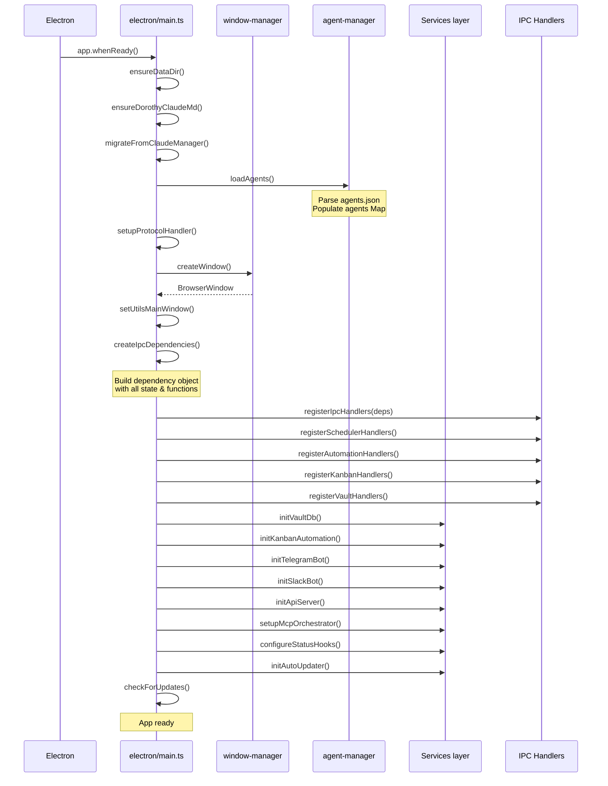
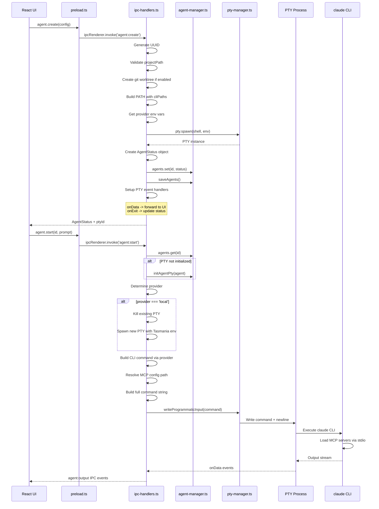
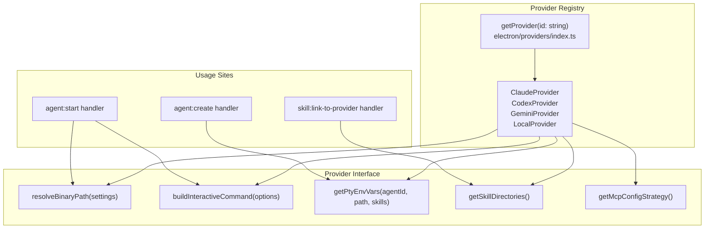

<!-- source: DeepWiki mcp.deepwiki.com · repo Charlie85270/Dorothy · page 11 Technical Architecture · fetched 2026-10-26 -->

# Technical Architecture

<details>
<summary>Relevant source files</summary>

The following files were used as context for generating this wiki page:

- [electron/core/agent-manager.ts](electron/core/agent-manager.ts)
- [electron/handlers/ipc-handlers.ts](electron/handlers/ipc-handlers.ts)
- [electron/main.ts](electron/main.ts)
- [electron/preload.ts](electron/preload.ts)
- [src/components/Settings/index.ts](src/components/Settings/index.ts)
- [src/types/electron.d.ts](src/types/electron.d.ts)

</details>


This document provides a technical deep dive into Dorothy's internal architecture, focusing on the Electron-based application structure, process model, core modules, and key abstractions. It is intended for developers who want to understand how Dorothy is built or contribute to the codebase.

For information about specific subsystems, see:
- [Electron Main Process](#11.1) - Main process initialization and service orchestration
- [IPC Communication](#11.2) - Inter-process communication patterns
- [PTY Management](#11.3) - Pseudo-terminal handling
- [HTTP API Server](#11.4) - Internal REST API
- [Data Persistence](#11.5) - Storage strategies
- [State Management](#11.6) - Reactive state patterns in the UI

---

## Process Architecture

Dorothy is built as an Electron application with a clear separation between the main process and renderer process. This architecture follows Electron's security model by isolating privileged operations from the web-based UI.

### Electron Multi-Process Model

```mermaid
graph TB
    subgraph "Main Process (Node.js)"
        MainEntry["electron/main.ts<br/>App entry point"]
        CoreModules["Core Modules"]
        Services["Services"]
        Handlers["IPC Handlers"]
    end
    
    subgraph "Renderer Process (Chromium)"
        NextApp["Next.js Application<br/>React UI"]
        Components["React Components"]
        Hooks["Custom Hooks"]
    end
    
    subgraph "Preload Script (Isolated Context)"
        PreloadBridge["electron/preload.ts<br/>contextBridge.exposeInMainWorld()"]
        ElectronAPI["window.electronAPI"]
    end
    
    subgraph "External Processes"
        PTYProcs["PTY Processes<br/>node-pty spawned shells"]
        ClaudeCLI["claude CLI instances"]
        MCPServers["MCP Servers<br/>stdio communication"]
    end
    
    MainEntry --> CoreModules
    MainEntry --> Services
    MainEntry --> Handlers
    
    Handlers -->|ipcMain.handle()| PreloadBridge
    PreloadBridge -->|ipcRenderer.invoke()| ElectronAPI
    ElectronAPI --> Hooks
    Hooks --> Components
    Components --> NextApp
    
    CoreModules -->|node-pty.spawn()| PTYProcs
    PTYProcs --> ClaudeCLI
    ClaudeCLI -->|stdio| MCPServers
    
    Services -->|HTTP| MCPServers
```

**Sources:** [electron/main.ts:1-603](), [electron/preload.ts:1-635](), [src/types/electron.d.ts:152-785]()

The main process runs with full Node.js privileges and manages system resources, while the renderer process runs in a sandboxed Chromium environment. Communication occurs exclusively through the preload script's IPC bridge, which exposes a type-safe API surface via `window.electronAPI`.

### Process Responsibilities

| Process | Responsibilities | Key Files |
|---------|-----------------|-----------|
| **Main Process** | Agent lifecycle management, PTY process spawning, file system operations, service orchestration, IPC handler registration | [electron/main.ts:1-603]() |
| **Renderer Process** | UI rendering, user interaction, state management, terminal display | Next.js app in `src/` |
| **Preload Script** | IPC bridge, API surface definition, event listener management | [electron/preload.ts:1-635]() |
| **PTY Processes** | Shell execution, Claude CLI hosting, output streaming | Managed by [electron/core/pty-manager.ts]() |

**Sources:** [electron/main.ts:1-603](), [electron/preload.ts:1-635]()

---

## Core Module Structure

The main process is organized into distinct modules with clear responsibilities. This modularity enables maintainability and testability.

### Main Process Module Organization

```mermaid
graph TB
    Main["electron/main.ts<br/>Entry point & orchestration"]
    
    subgraph "Core Modules"
        WindowMgr["electron/core/window-manager.ts<br/>createWindow()<br/>getMainWindow()<br/>Protocol handlers"]
        AgentMgr["electron/core/agent-manager.ts<br/>agents: Map<string, AgentStatus><br/>saveAgents()<br/>loadAgents()<br/>initAgentPty()"]
        PtyMgr["electron/core/pty-manager.ts<br/>ptyProcesses: Map<string, IPty><br/>killAllPty()<br/>writeProgrammaticInput()"]
    end
    
    subgraph "Services"
        APIServer["electron/services/api-server.ts<br/>startApiServer()<br/>Port 31415"]
        TgBot["electron/services/telegram-bot.ts<br/>initTelegramBot()<br/>getTelegramBot()"]
        SlackBot["electron/services/slack-bot.ts<br/>initSlackBot()<br/>getSlackApp()"]
        AutoSvc["electron/services/automation-service.ts<br/>Poll & execute automations"]
        VaultDB["electron/services/vault-db.ts<br/>initVaultDb()<br/>SQLite + FTS5"]
        MCPOrch["electron/services/mcp-orchestrator.ts<br/>setupMcpOrchestrator()<br/>registerMcpOrchestratorHandlers()"]
        Updater["electron/services/update-checker.ts<br/>initAutoUpdater()<br/>checkForUpdates()"]
    end
    
    subgraph "IPC Handlers"
        IPCHandlers["electron/handlers/ipc-handlers.ts<br/>registerIpcHandlers()"]
        SchedulerHandlers["electron/handlers/scheduler-handlers.ts<br/>registerSchedulerHandlers()"]
        AutoHandlers["electron/handlers/automation-handlers.ts<br/>registerAutomationHandlers()"]
        KanbanHandlers["electron/handlers/kanban-handlers.ts<br/>registerKanbanHandlers()"]
        VaultHandlers["electron/handlers/vault-handlers.ts<br/>registerVaultHandlers()"]
    end
    
    Main --> WindowMgr
    Main --> AgentMgr
    Main --> PtyMgr
    Main --> APIServer
    Main --> TgBot
    Main --> SlackBot
    Main --> AutoSvc
    Main --> VaultDB
    Main --> MCPOrch
    Main --> Updater
    Main --> IPCHandlers
    Main --> SchedulerHandlers
    Main --> AutoHandlers
    Main --> KanbanHandlers
    Main --> VaultHandlers
    
    IPCHandlers -.depends on.-> AgentMgr
    IPCHandlers -.depends on.-> PtyMgr
    AgentMgr -.uses.-> PtyMgr
    APIServer -.uses.-> AgentMgr
    TgBot -.uses.-> AgentMgr
    SlackBot -.uses.-> AgentMgr
```



**Sources:** [electron/main.ts:24-102](), [electron/core/window-manager.ts](), [electron/core/agent-manager.ts:1-356](), [electron/core/pty-manager.ts]()

### Module Responsibilities

| Module | Primary Responsibility | Key Exports |
|--------|----------------------|-------------|
| **window-manager** | Window lifecycle, protocol schemes, development/production mode handling | `createWindow()`, `getMainWindow()`, `setupProtocolHandler()` |
| **agent-manager** | Agent state management, persistence, status change notifications | `agents` Map, `saveAgents()`, `loadAgents()`, `initAgentPty()` |
| **pty-manager** | PTY process lifecycle, I/O handling, cleanup | `ptyProcesses` Map, `killAllPty()`, `writeProgrammaticInput()` |
| **ipc-handlers** | IPC method registration, dependency injection coordination | `registerIpcHandlers()`, `IpcHandlerDependencies` interface |

**Sources:** [electron/core/window-manager.ts](), [electron/core/agent-manager.ts:1-356](), [electron/core/pty-manager.ts](), [electron/handlers/ipc-handlers.ts:1-85]()

---

## Application Initialization Sequence

The initialization sequence in `electron/main.ts` follows a specific order to ensure dependencies are properly established before services start.

### Startup Flow



**Sources:** [electron/main.ts:293-567]()

Key initialization steps:

1. **Directory Setup** ([electron/main.ts:297-303]()): Create `~/.dorothy/` directory, write `CLAUDE.md` for MCP servers, migrate data from legacy `~/.claude-manager/`
2. **Agent Loading** ([electron/main.ts:306]()): Parse `agents.json` and populate the `agents` Map with restored state
3. **Window Creation** ([electron/main.ts:312]()): Spawn the main BrowserWindow and load the Next.js renderer
4. **IPC Registration** ([electron/main.ts:318-390]()): Register all IPC handlers with dependency injection
5. **Service Initialization** ([electron/main.ts:392-551]()): Start vault DB, Telegram/Slack bots, API server, MCP orchestrator
6. **Update Check** ([electron/main.ts:558-564]()): Auto-check for updates if enabled in settings

**Sources:** [electron/main.ts:293-567]()

---

## Dependency Injection Pattern

Dorothy uses explicit dependency injection to avoid circular dependencies and improve testability. The `IpcHandlerDependencies` interface defines all state and functions that IPC handlers need.

### IpcHandlerDependencies Interface

```typescript
interface IpcHandlerDependencies {
  // State Maps
  ptyProcesses: Map<string, pty.IPty>;
  agents: Map<string, AgentStatus>;
  skillPtyProcesses: Map<string, pty.IPty>;
  quickPtyProcesses: Map<string, pty.IPty>;
  pluginPtyProcesses: Map<string, pty.IPty>;

  // Core Functions
  getMainWindow: () => Electron.BrowserWindow | null;
  getAppSettings: () => AppSettings;
  setAppSettings: (settings: AppSettings) => void;
  saveAppSettings: (settings: AppSettings) => void;
  saveAgents: () => void;
  initAgentPty: (agent: AgentStatus) => Promise<string>;
  handleStatusChangeNotification: (agent: AgentStatus, newStatus: string) => void;
  
  // Service Getters
  getTelegramBot: () => TelegramBot | null;
  getSlackApp: () => SlackApp | null;
  
  // Claude Data Functions
  getClaudeSettings: () => Promise<any>;
  getClaudeStats: () => Promise<any>;
  getClaudeProjects: () => Promise<any[]>;
  getClaudePlugins: () => Promise<any[]>;
  getClaudeSkills: () => Promise<any[]>;
  getClaudeHistory: (limit?: number) => Promise<any[]>;
}
```

**Sources:** [electron/handlers/ipc-handlers.ts:22-55]()

The `createIpcDependencies()` function in `main.ts` constructs this object:

```typescript
function createIpcDependencies(): IpcHandlerDependencies {
  return {
    ptyProcesses,
    agents,
    skillPtyProcesses,
    quickPtyProcesses,
    pluginPtyProcesses,
    getMainWindow,
    getAppSettings: () => appSettings,
    setAppSettings: (settings: AppSettings) => { appSettings = settings; },
    saveAppSettings: saveAppSettingsToFile,
    saveAgents,
    initAgentPty: (agent: AgentStatus) => initAgentPty(
      agent,
      getMainWindow(),
      handleStatusChangeNotificationWrapper,
      saveAgents
    ),
    handleStatusChangeNotification: handleStatusChangeNotificationWrapper,
    // ... additional dependencies
  };
}
```

**Sources:** [electron/main.ts:214-265]()

This pattern allows handlers to access shared state without importing modules that would create circular dependencies. For example, `registerAgentHandlers()` receives `agents` and `ptyProcesses` as parameters rather than importing them directly.

**Sources:** [electron/handlers/ipc-handlers.ts:156-775](), [electron/main.ts:214-265]()

---

## Key Abstractions

Dorothy defines several core abstractions that structure the codebase.

### AgentStatus Type

The `AgentStatus` interface represents an agent's complete state:

```typescript
interface AgentStatus {
  id: string;                          // UUID
  status: 'idle' | 'running' | 'completed' | 'error' | 'waiting';
  projectPath: string;                 // Primary working directory
  secondaryProjectPath?: string;       // Optional --add-dir path
  worktreePath?: string;               // Git worktree path if enabled
  branchName?: string;                 // Git branch for worktree
  skills: string[];                    // Installed skills/plugins
  currentTask?: string;                // Current prompt (truncated)
  output: string[];                    // Terminal output buffer
  lastActivity: string;                // ISO timestamp
  error?: string;                      // Error message if status is 'error'
  ptyId?: string;                      // Associated PTY process ID
  character?: AgentCharacter;          // Visual avatar
  name?: string;                       // Display name
  pathMissing?: boolean;               // True if projectPath no longer exists
  skipPermissions?: boolean;           // Use --dangerously-skip-permissions
  provider?: AgentProvider;            // 'claude' | 'codex' | 'gemini' | 'local'
  localModel?: string;                 // Tasmania model name
  obsidianVaultPaths?: string[];       // Obsidian vaults to mount
}
```

**Sources:** [src/types/electron.d.ts:115-135]()

Agents are stored in the `agents` Map in [electron/core/agent-manager.ts:14]():

```typescript
export const agents: Map<string, AgentStatus> = new Map();
```

### PTY Process Management

Each agent has a dedicated pseudo-terminal (PTY) process created via `node-pty`. PTY processes are tracked in separate maps:

```typescript
// In electron/core/pty-manager.ts
export const ptyProcesses: Map<string, pty.IPty> = new Map();
export const quickPtyProcesses: Map<string, pty.IPty> = new Map();
export const skillPtyProcesses: Map<string, pty.IPty> = new Map();
export const pluginPtyProcesses: Map<string, pty.IPty> = new Map();
```

**Sources:** [electron/core/pty-manager.ts]()

The separation allows different cleanup strategies (e.g., agent PTYs persist across UI navigation, while skill installation PTYs are ephemeral).

### ElectronAPI Surface

The `ElectronAPI` interface in [src/types/electron.d.ts:152-785]() defines the complete IPC API surface exposed to the renderer. It's organized into namespaces:

```typescript
interface ElectronAPI {
  pty: { create, write, resize, kill, onData, onExit };
  agent: { create, start, stop, remove, list, get, update, ... };
  skill: { install, installStart, listInstalled, ... };
  claude: { getData };
  settings: { get, save, getInfo };
  appSettings: { get, save, onUpdated };
  telegram: { test, sendTest, generateAuthToken, ... };
  slack: { test, sendTest };
  // ... 15+ more namespaces
}
```

Each namespace corresponds to a functional domain. The `electron/preload.ts` file implements this interface by mapping methods to `ipcRenderer.invoke()` calls.

**Sources:** [src/types/electron.d.ts:152-785](), [electron/preload.ts:18-634]()

---

## Agent Lifecycle Pattern

Agents follow a specific lifecycle managed by the agent-manager and IPC handlers.

### Agent Creation and Execution Flow



**Sources:** [electron/handlers/ipc-handlers.ts:172-589](), [electron/core/agent-manager.ts:223-355]()

Key steps:

1. **Creation** ([electron/handlers/ipc-handlers.ts:172-377]()): Spawn PTY with login shell, populate `AgentStatus`, persist to disk
2. **Start** ([electron/handlers/ipc-handlers.ts:380-589]()): Build provider-specific command, write to PTY, update status to `'running'`
3. **Execution**: Claude CLI loads MCP servers, executes prompt, streams output
4. **Completion** ([electron/handlers/ipc-handlers.ts:356-374]()): PTY exit handler updates status to `'completed'` or `'error'`

The agent never directly executes commands—all interaction occurs through the PTY's stdin/stdout.

**Sources:** [electron/handlers/ipc-handlers.ts:156-775](), [electron/core/agent-manager.ts:223-355]()

---

## IPC Communication Patterns

Dorothy uses Electron's IPC (inter-process communication) system for all renderer-to-main interactions. The architecture enforces type safety and event-driven updates.

### Request-Response Pattern (Invocation)

For operations that return a result, the renderer uses `ipcRenderer.invoke()`:

```typescript
// In electron/preload.ts
agent: {
  create: (config) => ipcRenderer.invoke('agent:create', config),
  start: (params) => ipcRenderer.invoke('agent:start', params),
  list: () => ipcRenderer.invoke('agent:list'),
}
```

The main process registers handlers with `ipcMain.handle()`:

```typescript
// In electron/handlers/ipc-handlers.ts
ipcMain.handle('agent:create', async (_event, config) => {
  // Implementation
  return { ...status, ptyId };
});

ipcMain.handle('agent:list', async () => {
  return Array.from(agents.values());
});
```

**Sources:** [electron/preload.ts:44-108](), [electron/handlers/ipc-handlers.ts:172-377]()

### Event Pattern (Push Updates)

For streaming updates (e.g., terminal output), the main process uses `webContents.send()`:

```typescript
// In electron/handlers/ipc-handlers.ts
ptyProcess.onData((data) => {
  getMainWindow()?.webContents.send('agent:output', {
    type: 'output',
    agentId: id,
    ptyId,
    data,
    timestamp: new Date().toISOString(),
  });
});
```

The renderer listens via callbacks registered through the preload script:

```typescript
// In electron/preload.ts
agent: {
  onOutput: (callback) => {
    const listener = (_: unknown, event: AgentEvent) => callback(event);
    ipcRenderer.on('agent:output', listener);
    return () => ipcRenderer.removeListener('agent:output', listener);
  }
}
```

UI components subscribe using the cleanup pattern:

```typescript
// In React components
useEffect(() => {
  const unsubscribe = window.electronAPI?.agent.onOutput?.((event) => {
    // Handle output
  });
  return unsubscribe;
}, []);
```

**Sources:** [electron/handlers/ipc-handlers.ts:329-354](), [electron/preload.ts:83-102]()

---

## State Persistence Strategy

Dorothy uses a hybrid persistence strategy based on data characteristics.

### Persistence Layer Overview

```mermaid
graph TB
    subgraph "In-Memory State"
        AgentsMap["agents: Map<string, AgentStatus>"]
        PtyMap["ptyProcesses: Map<string, IPty>"]
    end
    
    subgraph "JSON Files (~/.dorothy/)"
        AgentsJSON["agents.json<br/>Agent state snapshots"]
        KanbanJSON["kanban-tasks.json<br/>Task definitions"]
        AutoJSON["automations.json<br/>Automation configs"]
        SettingsJSON["app-settings.json<br/>App preferences"]
    end
    
    subgraph "SQLite (~/.dorothy/)"
        VaultDB["vault.db<br/>documents table<br/>folders table<br/>attachments table<br/>FTS5 index"]
    end
    
    subgraph "Claude Native (~/.claude/)"
        ClaudeSettings["settings.json<br/>Claude Code settings"]
        Projects["projects/*/memory/<br/>MEMORY.md + topic files"]
    end
    
    AgentsMap -->|saveAgents()| AgentsJSON
    AgentsJSON -->|loadAgents()| AgentsMap
    
    PtyMap -.ephemeral.-> AgentsMap
    
    VaultDB -->|initVaultDb()| VaultDB
    
    SettingsJSON -->|loadAppSettings()| SettingsJSON
```

**Sources:** [electron/core/agent-manager.ts:141-170](), [electron/services/vault-db.ts]()

### Persistence Strategies by Data Type

| Data Type | Storage | Rationale | Key Functions |
|-----------|---------|-----------|---------------|
| **Agent State** | `agents.json` | Simple structure, infrequent writes, human-readable | `saveAgents()` [electron/core/agent-manager.ts:141-170](), `loadAgents()` [electron/core/agent-manager.ts:172-221]() |
| **Vault Documents** | SQLite with FTS5 | Full-text search, relational structure, attachments | `initVaultDb()` [electron/services/vault-db.ts]() |
| **Kanban Tasks** | `kanban-tasks.json` | Simple list, frequent reads, infrequent writes | Handlers in [electron/handlers/kanban-handlers.ts]() |
| **Automations** | `automations.json` | Configuration data, read at startup | Handlers in [electron/handlers/automation-handlers.ts]() |
| **App Settings** | `app-settings.json` | Key-value preferences, merge strategy | `loadAppSettings()` [electron/main.ts:108-163](), `saveAppSettingsToFile()` [electron/main.ts:165-172]() |
| **PTY Processes** | Not persisted | Ephemeral, recreated on agent start | In-memory only |

**Sources:** [electron/core/agent-manager.ts:141-221](), [electron/main.ts:108-172](), [electron/services/vault-db.ts]()

### Agent Persistence Implementation

When agents are saved ([electron/core/agent-manager.ts:141-170]()):
1. Check `agentsLoaded` flag to prevent premature writes
2. Map all agents, strip ephemeral fields (`ptyId`, `pathMissing`)
3. Truncate `output` array to last 100 entries
4. Reset `status: 'running'` to `status: 'idle'` (running state is ephemeral)
5. Backup existing file to `agents.backup.json`
6. Write atomically to `agents.json`

When agents are loaded ([electron/core/agent-manager.ts:172-221]()):
1. Parse `agents.json` if it exists
2. For each agent, check if `projectPath` or `worktreePath` exists
3. Set `pathMissing: true` if missing, `pathMissing: false` otherwise
4. Reset `status: 'idle'` and clear `ptyId` (PTYs are recreated on demand)
5. Populate `agents` Map
6. If main file is empty/corrupt, attempt restore from `agents.backup.json`

**Sources:** [electron/core/agent-manager.ts:141-221]()

---

## Provider Abstraction

Dorothy supports multiple AI providers (Claude, Codex, Gemini, Tasmania/local) through a provider abstraction layer.

### Provider Interface Pattern



**Sources:** [electron/providers/index.ts](), [electron/handlers/ipc-handlers.ts:271-289]()

Each provider implements:
- **`resolveBinaryPath(settings)`**: Resolve CLI binary location from app settings or PATH
- **`buildInteractiveCommand(options)`**: Construct the full command string with flags
- **`getPtyEnvVars(agentId, projectPath, skills)`**: Return environment variables for PTY process
- **`getSkillDirectories()`**: Return paths to skill installation directories
- **`getMcpConfigStrategy()`**: Return `'flag'` (pass via `--mcp-config`) or `'env'` (use env vars)

For example, when starting an agent ([electron/handlers/ipc-handlers.ts:516-559]()):

```typescript
const cliProvider = getProvider(provider);
const binaryPath = cliProvider.resolveBinaryPath(appSettingsForCommand);
const command = cliProvider.buildInteractiveCommand({
  binaryPath,
  prompt,
  model: options?.model,
  verbose: appSettingsForCommand.verboseModeEnabled,
  skipPermissions: agent.skipPermissions,
  secondaryProjectPath: agent.secondaryProjectPath,
  obsidianVaultPaths: agent.obsidianVaultPaths,
  mcpConfigPath,
  systemPromptFile,
  skills: allAgentSkills,
  isSuperAgent: isSuperAgentCheck,
});
```

**Sources:** [electron/handlers/ipc-handlers.ts:516-559](), [electron/providers/index.ts]()

---

## Configuration Management

Dorothy manages three categories of configuration with different scopes and persistence strategies.

### Configuration File Structure

| File | Scope | Contents | Managed By |
|------|-------|----------|------------|
| `~/.dorothy/app-settings.json` | Dorothy-specific settings | Notifications, integrations, default provider, CLI paths | [electron/main.ts:108-172]() |
| `~/.claude/settings.json` | Claude Code settings | Enabled plugins, permissions, hooks, environment variables | [electron/handlers/ipc-handlers.ts:1091-1166]() |
| `~/.dorothy/cli-paths.json` | CLI tool locations | Paths to claude, codex, gemini, gws, gh, node binaries | [electron/handlers/cli-paths-handlers.ts]() |

**Sources:** [electron/main.ts:108-172](), [electron/handlers/ipc-handlers.ts:1091-1166](), [electron/handlers/cli-paths-handlers.ts]()

### AppSettings Merge Strategy

The `loadAppSettings()` function ([electron/main.ts:108-163]()) uses a merge-with-defaults pattern:

```typescript
function loadAppSettings(): AppSettings {
  const defaults: AppSettings = {
    notificationsEnabled: true,
    notifyOnWaiting: true,
    // ... all default values
  };
  try {
    if (fs.existsSync(APP_SETTINGS_FILE)) {
      const saved = JSON.parse(fs.readFileSync(APP_SETTINGS_FILE, 'utf-8'));
      return { ...defaults, ...saved };
    }
  } catch (err) {
    console.error('Failed to load app settings:', err);
  }
  return defaults;
}
```

This ensures new settings keys added in updates are populated with defaults even if the user's file doesn't contain them.

**Sources:** [electron/main.ts:108-163]()

---

## Error Handling Patterns

Dorothy implements several error handling strategies throughout the codebase.

### PTY Exit Code Handling

When a PTY process exits ([electron/handlers/ipc-handlers.ts:356-374]()), the exit code determines the agent's final status:

```typescript
ptyProcess.onExit(({ exitCode }) => {
  const agent = agents.get(id);
  if (agent && agent.ptyId === ptyId) {
    const newStatus = exitCode === 0 ? 'completed' : 'error';
    agent.status = newStatus;
    agent.lastActivity = new Date().toISOString();
    handleStatusChangeNotification(agent, newStatus);
    getMainWindow()?.webContents.send('agent:complete', {
      type: 'complete',
      agentId: id,
      ptyId,
      exitCode,
      timestamp: new Date().toISOString(),
    });
  }
  ptyProcesses.delete(ptyId);
});
```

**Sources:** [electron/handlers/ipc-handlers.ts:356-374]()

### Path Validation and Fallback

Agent creation validates paths and falls back to home directory ([electron/handlers/ipc-handlers.ts:187-192]()):

```typescript
let cwd = config.projectPath;
if (!fs.existsSync(cwd)) {
  console.warn(`Project path does not exist: ${cwd}, using home directory`);
  cwd = os.homedir();
}
```

On agent load, missing paths are flagged ([electron/core/agent-manager.ts:200-207]()):

```typescript
const workingPath = agent.worktreePath || agent.projectPath;
if (!fs.existsSync(workingPath)) {
  console.warn(`Agent ${agent.id} has missing path: ${workingPath} - marking as pathMissing`);
  agent.pathMissing = true;
} else {
  agent.pathMissing = false;
}
```

**Sources:** [electron/handlers/ipc-handlers.ts:187-192](), [electron/core/agent-manager.ts:200-207]()

### IPC Error Responses

IPC handlers return structured error responses:

```typescript
ipcMain.handle('agent:update', async (_event, params) => {
  const agent = agents.get(params.id);
  if (!agent) {
    return { success: false, error: 'Agent not found' };
  }
  // ... validation
  if (params.secondaryProjectPath && !fs.existsSync(params.secondaryProjectPath)) {
    return { success: false, error: 'Secondary project path does not exist' };
  }
  // ... update logic
  return { success: true, agent };
});
```

**Sources:** [electron/handlers/ipc-handlers.ts:612-652]()

---

## Summary

Dorothy's technical architecture is organized around the following principles:

1. **Process Isolation**: Strict separation between main process (privileged), renderer process (sandboxed), and external processes (PTY/MCP)
2. **Dependency Injection**: Explicit passing of state and functions to avoid circular dependencies
3. **Modular Services**: Core, services, and handlers layers with clear responsibilities
4. **Type-Safe IPC**: `ElectronAPI` interface enforces contract between processes
5. **Hybrid Persistence**: JSON for simple state, SQLite for relational/searchable data
6. **Provider Abstraction**: Pluggable AI provider system with consistent interface
7. **PTY-Based Execution**: All agent interaction occurs through pseudo-terminals, enabling full shell environment

The architecture enables Dorothy to manage complex multi-agent workflows while maintaining clean separation of concerns and testability.

**Sources:** [electron/main.ts:1-603](), [electron/preload.ts:1-635](), [src/types/electron.d.ts:1-794](), [electron/handlers/ipc-handlers.ts:1-1300](), [electron/core/agent-manager.ts:1-356]()

---

