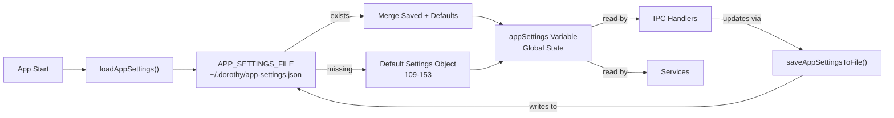
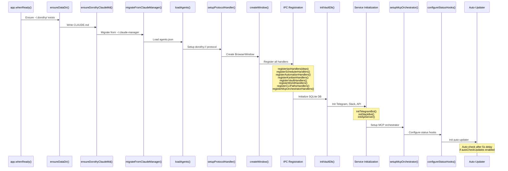
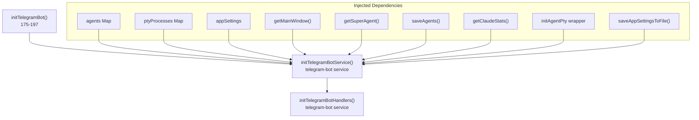
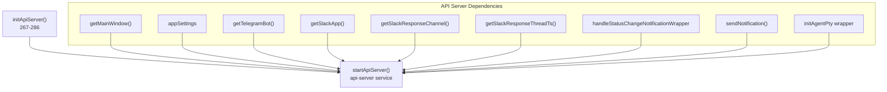
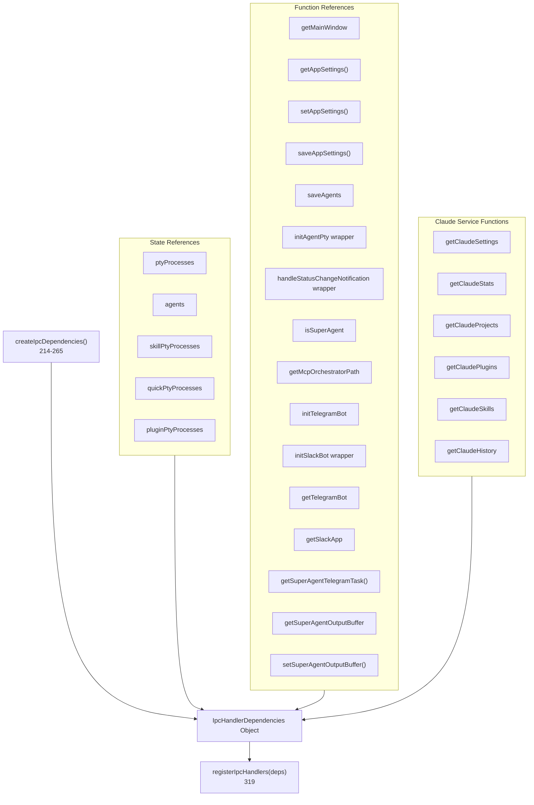
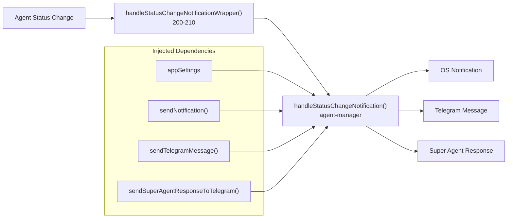
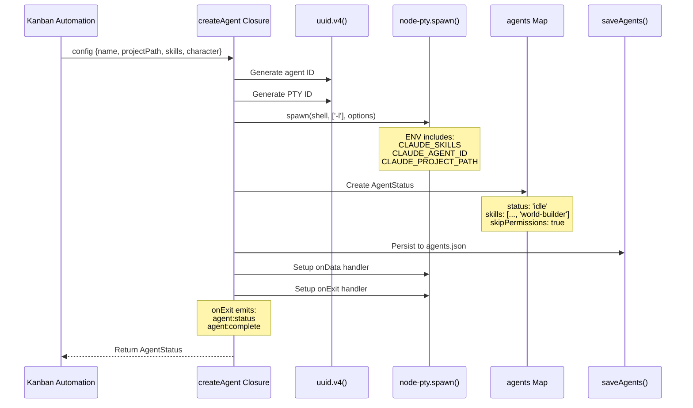
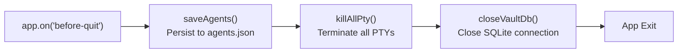

<!-- source: DeepWiki mcp.deepwiki.com · repo Charlie85270/Dorothy · page 11.1 Electron Main Process · fetched 2026-10-26 -->

# Electron Main Process

Relevant source files

The following files were used as context for generating this wiki page:

- [electron/main.ts](electron/main.ts)

The Electron Main Process serves as the central orchestrator for Dorothy's desktop application. It initializes all core services, manages the application lifecycle, coordinates IPC communication between the renderer and system resources, and maintains global application state. This document covers the main process structure, initialization sequence, and service orchestration.

For information about the IPC communication layer between main and renderer processes, see [IPC Communication](#11.2). For details on the HTTP API server that MCP tools use to interact with Electron services, see [HTTP API Server](#11.4).

---

## Architecture and Module Organization

The main process is organized into four primary layers: core modules, services, handlers, and utilities. Each layer has distinct responsibilities and dependencies.

**Main Process Module Structure**

```mermaid
graph TB
    Main["main.ts<br/>Entry Point"]
    
    subgraph Core["Core Modules"]
        WindowMgr["window-manager<br/>createWindow()<br/>getMainWindow()<br/>setupProtocolHandler()"]
        AgentMgr["agent-manager<br/>agents Map<br/>loadAgents()<br/>initAgentPty()"]
        PtyMgr["pty-manager<br/>ptyProcesses Map<br/>quickPtyProcesses<br/>killAllPty()"]
    end
    
    subgraph Services["Services Layer"]
        ApiServer["api-server<br/>startApiServer()<br/>port 31415"]
        TelegramSvc["telegram-bot<br/>initTelegramBotService()<br/>sendTelegramMessage()"]
        SlackSvc["slack-bot<br/>initSlackBot()<br/>getSlackApp()"]
        ClaudeSvc["claude-service<br/>getClaudeSettings()<br/>getClaudeStats()"]
        McpOrch["mcp-orchestrator<br/>setupMcpOrchestrator()<br/>getMcpOrchestratorPath()"]
        VaultDb["vault-db<br/>initVaultDb()<br/>closeVaultDb()"]
        Updater["update-checker<br/>initAutoUpdater()<br/>checkForUpdates()"]
        KanbanAuto["kanban-automation<br/>initKanbanAutomation()<br/>findMatchingAgent()"]
        HooksMgr["hooks-manager<br/>configureStatusHooks()"]
    end
    
    subgraph Handlers["IPC Handlers"]
        IpcHandlers["ipc-handlers<br/>registerIpcHandlers()"]
        SchedHandlers["scheduler-handlers<br/>registerSchedulerHandlers()"]
        AutoHandlers["automation-handlers<br/>registerAutomationHandlers()"]
        KanbanHandlers["kanban-handlers<br/>registerKanbanHandlers()"]
        VaultHandlers["vault-handlers<br/>registerVaultHandlers()"]
        WorldHandlers["world-handlers<br/>registerWorldHandlers()"]
        CLIHandlers["cli-paths-handlers<br/>registerCLIPathsHandlers()"]
    end
    
    subgraph Utils["Utilities"]
        UtilsModule["utils<br/>sendNotification()<br/>ensureDataDir()<br/>migrateFromClaudeManager()"]
    end
    
    Main --> WindowMgr
    Main --> AgentMgr
    Main --> PtyMgr
    Main --> ApiServer
    Main --> TelegramSvc
    Main --> SlackSvc
    Main --> ClaudeSvc
    Main --> McpOrch
    Main --> VaultDb
    Main --> Updater
    Main --> KanbanAuto
    Main --> HooksMgr
    Main --> IpcHandlers
    Main --> SchedHandlers
    Main --> AutoHandlers
    Main --> KanbanHandlers
    Main --> VaultHandlers
    Main --> WorldHandlers
    Main --> CLIHandlers
    Main --> UtilsModule
    
    IpcHandlers -.->|uses| AgentMgr
    IpcHandlers -.->|uses| PtyMgr
    TelegramSvc -.->|uses| AgentMgr
    SlackSvc -.->|uses| AgentMgr
    ApiServer -.->|uses| AgentMgr
    KanbanAuto -.->|uses| AgentMgr
```

**Sources:** [electron/main.ts:1-603]()

---

## Application Settings Management

The main process maintains global application settings in the `appSettings` variable, loaded from `~/.dorothy/app-settings.json`. Settings are managed through three functions: `loadAppSettings()`, `saveAppSettingsToFile()`, and the `createIpcDependencies()` factory.

| Setting Category | Key Fields | Purpose |
|-----------------|------------|---------|
| Notifications | `notificationsEnabled`, `notifyOnWaiting`, `notifyOnComplete`, `notifyOnError` | Control notification behavior |
| Telegram | `telegramEnabled`, `telegramBotToken`, `telegramChatId`, `telegramAuthToken`, `telegramAuthorizedChatIds` | Telegram bot configuration |
| Slack | `slackEnabled`, `slackBotToken`, `slackAppToken`, `slackSigningSecret`, `slackChannelId` | Slack bot configuration |
| JIRA | `jiraEnabled`, `jiraDomain`, `jiraEmail`, `jiraApiToken` | JIRA integration credentials |
| Social Data | `socialDataEnabled`, `socialDataApiKey` | Social data API configuration |
| X/Twitter | `xPostingEnabled`, `xApiKey`, `xApiSecret`, `xAccessToken`, `xAccessTokenSecret` | Twitter API credentials |
| Tasmania | `tasmaniaEnabled`, `tasmaniaServerPath` | Local AI server configuration |
| Google Workspace | `gwsEnabled`, `gwsSkillsInstalled` | GWS integration status |
| General | `verboseModeEnabled`, `autoCheckUpdates`, `defaultProvider` | General preferences |
| CLI Paths | `cliPaths.claude`, `cliPaths.codex`, `cliPaths.gemini`, `cliPaths.node`, etc. | Tool executable paths |

**Settings Loading and Defaults**

**Sources:** [electron/main.ts:104-172]()

---

## Initialization Sequence

The main process follows a carefully orchestrated initialization sequence triggered by `app.whenReady()`. Each step must complete in order to ensure proper dependency resolution.

**Initialization Flow**

**Sources:** [electron/main.ts:288-567]()

The initialization sequence ensures:
1. **Data directory existence**: Creates `~/.dorothy/` if missing
2. **Dorothy's CLAUDE.md presence**: Writes the global agent instructions so spawned agents inherit them
3. **Migration completion**: Handles rebrand from `claude-manager` to `dorothy`
4. **Agent state loading**: Restores persisted agents from disk
5. **Protocol registration**: Enables `dorothy://` URL scheme for production builds
6. **Window creation**: Spawns the main BrowserWindow
7. **IPC handler registration**: Wires up all bidirectional communication channels
8. **Service initialization**: Starts external integrations and internal services
9. **MCP orchestrator setup**: Configures the orchestrator for agent spawning
10. **Auto-update check**: Optionally checks for updates 5 seconds after launch

---

## Service Initialization and Dependencies

Services are initialized with carefully injected dependencies to avoid circular imports and ensure proper lifecycle management. Three primary patterns are used: direct function calls, dependency injection via factory functions, and service-specific initialization wrappers.

**Telegram Bot Initialization**

The Telegram bot follows a two-phase initialization pattern: dependency injection via `initTelegramBotService()`, followed by handler registration via `initTelegramBotHandlers()`.

**Sources:** [electron/main.ts:174-197]()

**API Server Initialization**

The API server requires access to multiple services and state management functions, all injected via `startApiServer()`.

**Sources:** [electron/main.ts:267-286]()

**IPC Handlers Dependency Factory**

The IPC handlers receive dependencies through a factory function `createIpcDependencies()` that constructs a `IpcHandlerDependencies` object. This pattern centralizes dependency resolution and makes the handler registration pure.

**Sources:** [electron/main.ts:212-265]()

---

## Status Change Notification Wrapper

The `handleStatusChangeNotificationWrapper()` function serves as a critical integration point, coordinating notification delivery across multiple channels when an agent's status changes. It injects runtime dependencies into the core notification handler.

**Sources:** [electron/main.ts:199-210]()

This wrapper is passed to:
- `initAgentPty()` calls to handle PTY exit notifications
- API server initialization for agent lifecycle events
- Kanban automation service for task completion notifications
- IPC handler dependencies for manual agent operations

---

## Kanban Automation Agent Creation

The Kanban automation service requires direct agent creation capabilities without going through IPC. The `initKanbanAutomation()` call receives two closures: `createAgent` and `startAgent`, both implemented inline in [electron/main.ts:392-537]().

**Agent Creation Flow for Kanban Tasks**

**Sources:** [electron/main.ts:391-484]()

The `startAgent` closure (lines 485-537) handles agent execution by:
1. Initializing PTY if not present via `initAgentPty()`
2. Building the Claude command with `--dangerously-skip-permissions` (always enabled for Kanban tasks)
3. Constructing the prompt with skills instructions
4. Writing command to PTY, using temp script file for long commands (>100 chars)
5. Updating agent status to `'running'`

---

## Application Lifecycle Hooks

The main process handles four Electron lifecycle events to ensure proper resource cleanup and state persistence.

| Event | Handler | Purpose |
|-------|---------|---------|
| `window-all-closed` | [electron/main.ts:570-574]() | Quit app on non-macOS platforms when all windows close |
| `activate` | [electron/main.ts:577-582]() | Re-create window on macOS when dock icon clicked |
| `before-quit` | [electron/main.ts:585-590]() | Save agents, kill all PTY processes, close vault DB |
| `certificate-error` | [electron/main.ts:593-600]() | Allow self-signed certificates for `localhost` in dev mode |

**Before Quit Sequence**

**Sources:** [electron/main.ts:585-590]()

---

## Global Exports

The main process exports two symbols for use by other modules:

- **`appSettings`**: The current application settings object, exported for read-only access by integration modules
- **`getTelegramBot`**: Function reference to retrieve the Telegram bot instance, required by API server routes

**Sources:** [electron/main.ts:602]()

---

## Module Import Organization

The main.ts file organizes imports into six logical groups, reflecting the layered architecture:

1. **Types**: `AppSettings`, `AgentStatus` from `./types`
2. **Constants**: `APP_SETTINGS_FILE` from `./constants`
3. **Core modules**: `window-manager`, `agent-manager`, `pty-manager`
4. **Services**: `api-server`, `telegram-bot`, `slack-bot`, `claude-service`, `hooks-manager`, `mcp-orchestrator`, `vault-db`, `update-checker`, `kanban-automation`
5. **Handlers**: All `*-handlers` modules for IPC registration
6. **Utils**: Utility functions from `./utils`

This organization mirrors the runtime dependency flow: core modules are initialized first, followed by services, then handlers that wire everything together.

**Sources:** [electron/main.ts:13-102]()

---

