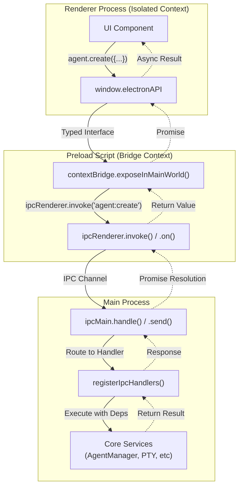
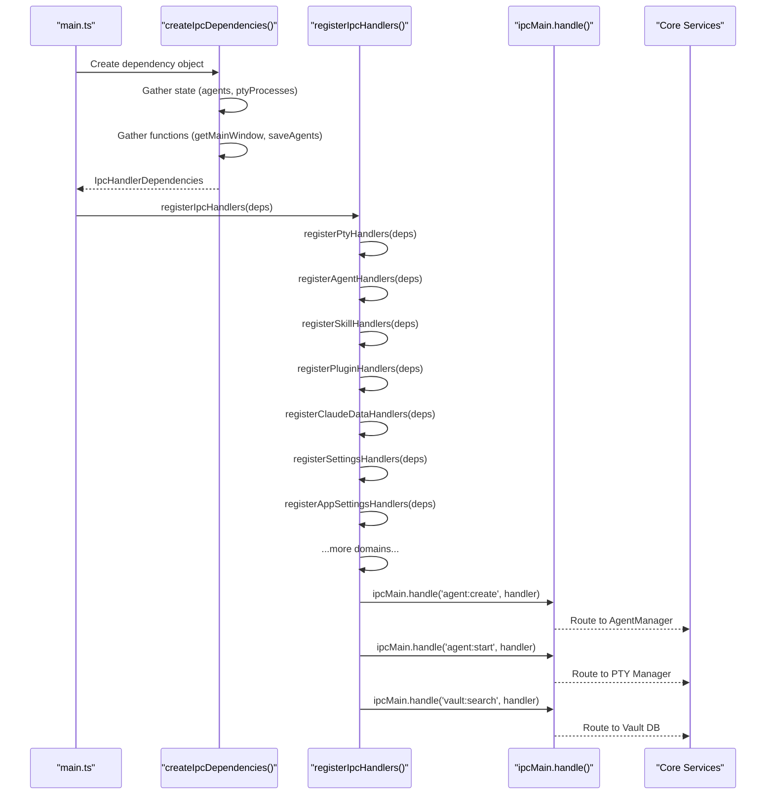
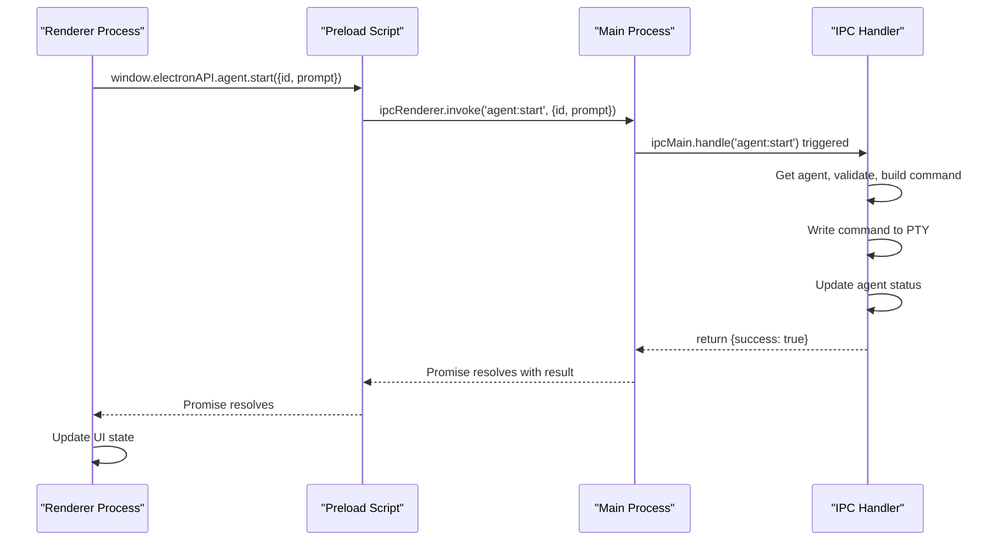
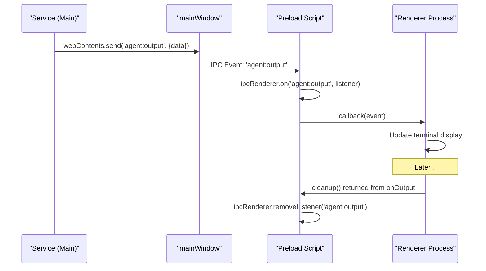
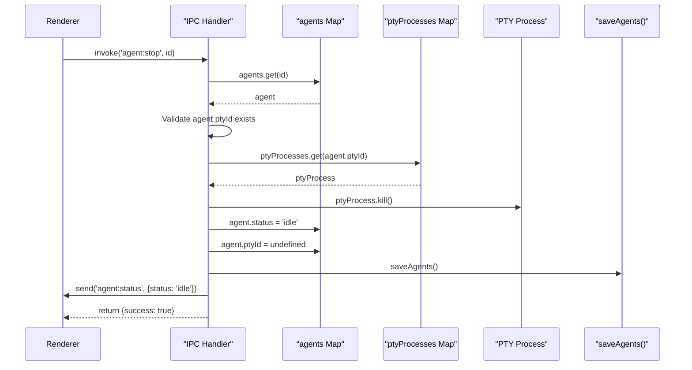

<!-- source: DeepWiki mcp.deepwiki.com · repo Charlie85270/Dorothy · page 11.2 IPC Communication · fetched 2026-10-26 -->

# IPC Communication

<details>
<summary>Relevant source files</summary>

The following files were used as context for generating this wiki page:

- [electron/core/agent-manager.ts](electron/core/agent-manager.ts)
- [electron/handlers/ipc-handlers.ts](electron/handlers/ipc-handlers.ts)
- [electron/main.ts](electron/main.ts)
- [electron/preload.ts](electron/preload.ts)
- [src/components/Settings/index.ts](src/components/Settings/index.ts)
- [src/types/electron.d.ts](src/types/electron.d.ts)

</details>


## Purpose and Scope

This document describes Dorothy's Inter-Process Communication (IPC) architecture, which enables communication between Electron's main process and renderer process. The IPC layer is Dorothy's primary mechanism for UI interactions with system services, agent management, file operations, and external integrations.

For information about the main process services that IPC handlers connect to, see [Electron Main Process](#11.1). For details on PTY process management, see [PTY Management](#11.3). For the HTTP API server used by MCP tools, see [HTTP API Server](#11.4).

---

## Architecture Overview

Dorothy implements a three-layer IPC architecture using Electron's security-conscious context isolation model:

**Layer 1: Renderer Process** - React/Next.js UI components call methods on `window.electronAPI`  
**Layer 2: Preload Script** - `contextBridge` exposes type-safe IPC methods to the renderer  
**Layer 3: Main Process** - `ipcMain.handle()` registers handlers that execute privileged operations



**Sources:** [electron/preload.ts:1-635](), [electron/handlers/ipc-handlers.ts:1-78](), [electron/main.ts:317-330]()

---

## Preload Script and Context Bridge

The preload script [electron/preload.ts]() creates a secure bridge between the isolated renderer context and the privileged main process using `contextBridge.exposeInMainWorld()`. This exposes an `electronAPI` object on the global `window` object with strict TypeScript typing.

### Context Bridge Exposure Pattern

All IPC methods follow a consistent pattern where the renderer calls synchronous-looking methods that internally invoke asynchronous IPC handlers:

```typescript
// Example from electron/preload.ts
contextBridge.exposeInMainWorld('electronAPI', {
  agent: {
    create: (config) => ipcRenderer.invoke('agent:create', config),
    start: (params) => ipcRenderer.invoke('agent:start', params),
    list: () => ipcRenderer.invoke('agent:list'),
    // Event listeners return cleanup functions
    onOutput: (callback) => {
      const listener = (_, event) => callback(event);
      ipcRenderer.on('agent:output', listener);
      return () => ipcRenderer.removeListener('agent:output', listener);
    },
  }
});
```

### Handler Categories in Preload Script

The preload script organizes IPC methods into domain-specific namespaces:

| Namespace | Purpose | Example Channels |
|-----------|---------|------------------|
| `pty` | PTY terminal management | `pty:create`, `pty:write`, `pty:resize`, `pty:kill` |
| `agent` | Agent lifecycle management | `agent:create`, `agent:start`, `agent:stop`, `agent:list` |
| `skill` | Skill installation and linking | `skill:install-start`, `skill:list-installed-all` |
| `plugin` | Plugin installation via PTY | `plugin:install-start`, `plugin:pty-data` |
| `claude` | Claude Code data access | `claude:getData` |
| `settings` | Claude settings management | `settings:get`, `settings:save` |
| `appSettings` | Dorothy app configuration | `app:getSettings`, `app:saveSettings` |
| `telegram` | Telegram bot control | `telegram:test`, `telegram:sendTest` |
| `slack` | Slack bot control | `slack:test`, `slack:sendTest` |
| `jira` | JIRA integration testing | `jira:test` |
| `socialData` | SocialData API testing | `socialdata:test` |
| `gws` | Google Workspace integration | `gws:detect`, `gws:authStatus`, `gws:setup` |
| `tasmania` | Local LLM server control | `tasmania:getStatus`, `tasmania:loadModel` |
| `dialog` | System dialogs | `dialog:open-folder`, `dialog:open-files` |
| `shell` | Shell command execution | `shell:exec`, `shell:open-terminal` |
| `orchestrator` | MCP orchestrator setup | `orchestrator:getStatus`, `orchestrator:setup` |
| `scheduler` | Task scheduling | `scheduler:listTasks`, `scheduler:createTask` |
| `automation` | Automation management | `automation:list`, `automation:create`, `automation:run` |
| `kanban` | Kanban board operations | `kanban:list`, `kanban:create`, `kanban:move` |
| `vault` | Document vault operations | `vault:listDocuments`, `vault:search` |
| `world` | Generative zone management | `world:listZones`, `world:exportZone` |
| `cliPaths` | CLI path configuration | `cliPaths:detect`, `cliPaths:save` |
| `updates` | Auto-update system | `updates:check`, `updates:download` |
| `memory` | Claude project memory | `memory:list-projects`, `memory:read-file` |
| `obsidian` | Obsidian vault browsing | `obsidian:scan`, `obsidian:readFile` |
| `api` | API token retrieval | `api:getToken` |

**Sources:** [electron/preload.ts:18-634]()

---

## Handler Registration System

The main process registers IPC handlers during app initialization using a modular registration system. Handlers are organized by domain and accept dependencies via dependency injection.

### Handler Registration Flow



**Sources:** [electron/main.ts:214-265](), [electron/main.ts:317-330](), [electron/handlers/ipc-handlers.ts:57-77]()

### Dependency Injection Interface

The `IpcHandlerDependencies` interface [electron/handlers/ipc-handlers.ts:22-55]() defines all dependencies that handlers need:

| Dependency Type | Examples |
|-----------------|----------|
| **State Maps** | `agents`, `ptyProcesses`, `skillPtyProcesses` |
| **Getters** | `getMainWindow()`, `getAppSettings()`, `getTelegramBot()` |
| **Setters** | `setAppSettings()`, `setSuperAgentOutputBuffer()` |
| **Persisters** | `saveAppSettings()`, `saveAgents()` |
| **Initializers** | `initAgentPty()`, `initTelegramBot()`, `initSlackBot()` |
| **Callbacks** | `handleStatusChangeNotification()` |
| **Utilities** | `isSuperAgent()`, `getMcpOrchestratorPath()` |
| **Data Providers** | `getClaudeSettings()`, `getClaudeProjects()`, `getClaudeSkills()` |

This pattern allows handlers to remain pure functions without direct imports of global state or services.

**Sources:** [electron/handlers/ipc-handlers.ts:22-55](), [electron/main.ts:214-265]()

---

## Type System

Dorothy uses TypeScript's type system to provide compile-time safety for IPC communication. The `ElectronAPI` interface [src/types/electron.d.ts:152-785]() defines the complete contract between renderer and main processes.

### Type Definition Structure

```typescript
// From src/types/electron.d.ts
export interface ElectronAPI {
  agent: {
    create: (config: {
      projectPath: string;
      skills: string[];
      worktree?: WorktreeConfig;
      character?: AgentCharacter;
      // ... more fields
    }) => Promise<AgentStatus & { ptyId: string }>;
    
    start: (params: {
      id: string;
      prompt: string;
      options?: { model?: string; resume?: boolean };
    }) => Promise<{ success: boolean }>;
    
    onOutput: (callback: (event: AgentEvent) => void) => () => void;
  };
  // ... 30+ other namespaces
}

declare global {
  interface Window {
    electronAPI?: ElectronAPI;
  }
}
```

### Type Safety Benefits

1. **Compile-Time Validation** - TypeScript catches mismatched parameters before runtime
2. **IntelliSense Support** - IDEs provide autocomplete for all IPC methods
3. **Refactoring Safety** - Renaming types updates all call sites automatically
4. **Self-Documenting** - Interface serves as API documentation

**Sources:** [src/types/electron.d.ts:152-792]()

---

## Bidirectional Communication Patterns

Dorothy uses two IPC communication patterns: request-response for synchronous operations and events for asynchronous notifications.

### Request-Response Pattern (invoke/handle)

The renderer invokes an IPC method, the main process handles it, and returns a promise that resolves with the result:



**Example Channels:**
- `agent:create`, `agent:start`, `agent:stop`, `agent:list`
- `vault:createDocument`, `vault:search`, `vault:listDocuments`
- `kanban:create`, `kanban:move`, `kanban:update`
- `settings:get`, `settings:save`, `app:getSettings`

**Sources:** [electron/preload.ts:44-81](), [electron/handlers/ipc-handlers.ts:172-378]()

### Event Pattern (send/on)

The main process sends events to the renderer asynchronously to notify of state changes:



**Example Event Channels:**
- `agent:output` - PTY output stream data
- `agent:complete` - Agent task completion
- `agent:status` - Agent status changes
- `kanban:task-created` - New Kanban task
- `vault:document-updated` - Document modifications
- `pty:data`, `pty:exit` - Generic PTY events
- `app:update-available` - Software update notifications

**Event Listener Pattern:**
All event listeners return cleanup functions to prevent memory leaks:

```typescript
const cleanup = window.electronAPI.agent.onOutput((event) => {
  console.log('Agent output:', event.data);
});

// Later, to unsubscribe:
cleanup();
```

**Sources:** [electron/preload.ts:83-107](), [electron/handlers/ipc-handlers.ts:330-354](), [electron/core/agent-manager.ts:308-330]()

---

## IPC Channels by Domain

Dorothy organizes IPC channels into domain-specific groups. Each domain has a dedicated registration function in the handler system.

### Agent Management Channels

Agent lifecycle operations including creation, starting, stopping, and monitoring.

**Request-Response Channels:**

| Channel | Parameters | Returns | Handler Location |
|---------|------------|---------|------------------|
| `agent:create` | `{projectPath, skills, worktree?, character?, name?, ...}` | `AgentStatus & {ptyId}` | [ipc-handlers.ts:172-377]() |
| `agent:start` | `{id, prompt, options?}` | `{success: boolean}` | [ipc-handlers.ts:380-589]() |
| `agent:stop` | `id: string` | `{success: boolean}` | [ipc-handlers.ts:655-680]() |
| `agent:remove` | `id: string` | `{success: boolean}` | [ipc-handlers.ts:683-712]() |
| `agent:get` | `id: string` | `AgentStatus \| null` | [ipc-handlers.ts:592-604]() |
| `agent:list` | - | `AgentStatus[]` | [ipc-handlers.ts:606-609]() |
| `agent:update` | `{id, skills?, secondaryProjectPath?, ...}` | `{success, agent?}` | [ipc-handlers.ts:612-652]() |
| `agent:input` | `{id, input}` | `{success: boolean}` | [ipc-handlers.ts:741-756]() |
| `agent:resize` | `{id, cols, rows}` | `{success: boolean}` | [ipc-handlers.ts:759-774]() |

**Event Channels:**

| Channel | Event Data | Emitted When |
|---------|-----------|--------------|
| `agent:output` | `{type, agentId, ptyId, data, timestamp}` | PTY produces output |
| `agent:complete` | `{type, agentId, ptyId, exitCode, timestamp}` | Agent task finishes |
| `agent:status` | `{type, agentId, status, timestamp}` | Agent status changes |

**Sources:** [electron/preload.ts:44-108](), [electron/handlers/ipc-handlers.ts:156-775]()

### PTY Terminal Channels

Direct PTY terminal management for interactive shells.

| Channel | Purpose | Handler |
|---------|---------|---------|
| `pty:create` | Spawn new PTY with shell | [ipc-handlers.ts:94-120]() |
| `pty:write` | Send input to PTY | [ipc-handlers.ts:123-130]() |
| `pty:resize` | Update terminal dimensions | [ipc-handlers.ts:133-140]() |
| `pty:kill` | Terminate PTY process | [ipc-handlers.ts:143-151]() |
| `pty:data` (event) | Output stream from PTY | [ipc-handlers.ts:109-111]() |
| `pty:exit` (event) | PTY process exited | [ipc-handlers.ts:114-117]() |

**Sources:** [electron/preload.ts:20-41](), [electron/handlers/ipc-handlers.ts:90-152]()

### Skill Management Channels

Skill installation via `npx skills` with interactive PTY terminals.

| Channel | Purpose |
|---------|---------|
| `skill:install-start` | Start skill installation in PTY |
| `skill:install-write` | Send input to installation PTY |
| `skill:install-resize` | Resize installation terminal |
| `skill:install-kill` | Kill installation process |
| `skill:list-installed` | Get installed skills (legacy) |
| `skill:list-installed-all` | Get skills per provider |
| `skill:link-to-provider` | Symlink skill to another provider |
| `skill:fetch-marketplace` | Fetch skills from skills.sh |
| `skill:pty-data` (event) | Installation PTY output |
| `skill:pty-exit` (event) | Installation complete |

**Sources:** [electron/preload.ts:111-145](), [electron/handlers/ipc-handlers.ts:779-968]()

### Vault and Document Channels

SQLite-backed document vault with full-text search.

| Channel | Purpose |
|---------|---------|
| `vault:listDocuments` | Query documents by folder/tags |
| `vault:getDocument` | Get document with attachments |
| `vault:createDocument` | Create new document |
| `vault:updateDocument` | Update document content/metadata |
| `vault:deleteDocument` | Delete document |
| `vault:search` | FTS5 full-text search |
| `vault:listFolders` | Get folder hierarchy |
| `vault:createFolder` | Create folder |
| `vault:deleteFolder` | Delete folder (optionally recursive) |
| `vault:attachFile` | Attach file to document |
| `vault:document-created` (event) | Document created |
| `vault:document-updated` (event) | Document updated |
| `vault:document-deleted` (event) | Document deleted |

**Sources:** [electron/preload.ts:481-531](), [electron/handlers/vault-handlers.ts]()

### Kanban Board Channels

Task management system with agent auto-assignment.

| Channel | Purpose |
|---------|---------|
| `kanban:list` | Get all tasks |
| `kanban:get` | Get single task by ID |
| `kanban:create` | Create new task |
| `kanban:update` | Update task metadata |
| `kanban:move` | Move task to different column |
| `kanban:reorder` | Reorder tasks within column |
| `kanban:delete` | Delete task |
| `kanban:generate` | AI-generate task from prompt |
| `kanban:task-created` (event) | Task created |
| `kanban:task-updated` (event) | Task updated |
| `kanban:task-deleted` (event) | Task deleted |

**Sources:** [electron/preload.ts:428-478](), [electron/handlers/kanban-handlers.ts]()

### Settings Channels

Configuration management for both Claude Code and Dorothy settings.

**Claude Code Settings:**
- `settings:get` - Read `~/.claude/settings.json`
- `settings:save` - Write `~/.claude/settings.json`
- `settings:getInfo` - Get system info (versions, paths)

**Dorothy App Settings:**
- `app:getSettings` - Read `~/.dorothy/app-settings.json`
- `app:saveSettings` - Write `~/.dorothy/app-settings.json`
- `settings:updated` (event) - Settings changed notification

**Sources:** [electron/preload.ts:182-223](), [electron/handlers/ipc-handlers.ts:1090-1220]()

### Integration Test Channels

One-off test operations for external service integrations.

| Channel | Service | Returns |
|---------|---------|---------|
| `telegram:test` | Telegram Bot API | `{success, botName?, error?}` |
| `telegram:sendTest` | Telegram message sending | `{success, error?}` |
| `slack:test` | Slack API auth | `{success, botName?, error?}` |
| `slack:sendTest` | Slack message sending | `{success, error?}` |
| `jira:test` | JIRA API auth | `{success, displayName?, email?, error?}` |
| `socialdata:test` | SocialData API | `{success, error?}` |
| `xapi:test` | X/Twitter API | `{success, username?, error?}` |
| `tasmania:test` | Local LLM server | `{success, serverExists, apiReachable, error?}` |

**Sources:** [electron/preload.ts:226-261](), [electron/handlers/ipc-handlers.ts:1222-1400]()

### Scheduler and Automation Channels

Task scheduling (via launchd/cron) and automation management.

**Scheduler:**
- `scheduler:listTasks` - Get all scheduled tasks
- `scheduler:createTask` - Create cron/launchd job
- `scheduler:deleteTask` - Remove scheduled task
- `scheduler:updateTask` - Modify task parameters
- `scheduler:runTask` - Execute task immediately
- `scheduler:getLogs` - Fetch task execution logs
- `scheduler:log-data` (event) - Real-time log output

**Automation:**
- `automation:list` - Get all automations
- `automation:create` - Create automation rule
- `automation:update` - Enable/disable automation
- `automation:delete` - Remove automation
- `automation:run` - Execute automation now
- `automation:getLogs` - Get automation run history

**Sources:** [electron/preload.ts:348-425](), [electron/handlers/scheduler-handlers.ts](), [electron/handlers/automation-handlers.ts]()

### Memory and Obsidian Channels

Claude Code project memory and Obsidian vault integration.

**Memory (Claude Projects):**
- `memory:list-projects` - Scan `~/.claude/projects/*/memory/`
- `memory:read-file` - Read memory file content
- `memory:write-file` - Update memory file
- `memory:create-file` - Create new memory file
- `memory:delete-file` - Remove memory file

**Obsidian Vaults:**
- `obsidian:scan` - Scan all configured vaults
- `obsidian:readFile` - Read markdown file
- `obsidian:writeFile` - Update markdown file
- `obsidian:getVaultInfo` - Get vault configuration
- `obsidian:detectVault` - Check if path is Obsidian vault
- `obsidian:addVault` - Register new vault
- `obsidian:removeVault` - Unregister vault

**Sources:** [electron/preload.ts:603-625](), [electron/handlers/memory-handlers.ts](), [electron/handlers/obsidian-handlers.ts]()

### Update System Channels

Electron-updater integration for auto-updates.

| Channel | Purpose |
|---------|---------|
| `app:checkForUpdates` | Check for new version |
| `app:downloadUpdate` | Download update package |
| `app:quitAndInstall` | Install and restart |
| `app:openExternal` | Open URL in browser |
| `app:update-available` (event) | Update found |
| `app:update-not-available` (event) | No update found |
| `app:update-progress` (event) | Download progress |
| `app:update-downloaded` (event) | Ready to install |
| `app:update-error` (event) | Update error |

**Sources:** [electron/preload.ts:570-600](), [electron/services/update-checker.ts]()

---

## Handler Implementation Patterns

Handlers follow consistent patterns for common operations. Understanding these patterns helps when adding new IPC channels.

### Pattern: Agent PTY Operations

Agent-related handlers follow this pattern:
1. Retrieve agent from `agents` Map
2. Validate agent exists and has PTY
3. Perform operation on PTY process
4. Update agent state
5. Persist changes via `saveAgents()`
6. Send IPC event to renderer



**Sources:** [electron/handlers/ipc-handlers.ts:655-680]()

### Pattern: Database Operations with Events

Database operations (Vault, Kanban) follow this pattern:
1. Execute database operation
2. Emit event to all renderer windows
3. Return result to caller

```typescript
// Example from vault handlers
const document = await db.createDocument(params);
mainWindow?.webContents.send('vault:document-created', document);
return { success: true, document };
```

**Sources:** [electron/handlers/vault-handlers.ts](), [electron/handlers/kanban-handlers.ts]()

### Pattern: PTY-Based Installation

Interactive installations (skills, plugins) use PTY terminals:
1. Create UUID for PTY
2. Spawn PTY with specific command
3. Store PTY in domain-specific Map
4. Forward PTY data events to renderer
5. Handle PTY exit and cleanup

**Sources:** [electron/handlers/ipc-handlers.ts:784-822](), [electron/handlers/ipc-handlers.ts:978-1014]()

### Pattern: Settings Persistence

Settings handlers read, merge, and write JSON files:
1. Read existing file (if exists)
2. Merge with updates (shallow or deep)
3. Write atomically
4. Optionally emit `settings:updated` event

**Sources:** [electron/handlers/ipc-handlers.ts:1170-1220]()

---

## Error Handling and Edge Cases

IPC handlers implement consistent error handling to prevent crashes and provide useful feedback.

### Common Error Patterns

1. **Resource Not Found** - Return `null` or `{success: false, error: string}`
2. **Invalid Parameters** - Throw error with descriptive message (caught by Electron)
3. **PTY Process Missing** - Reinitialize PTY if agent exists but PTY was lost
4. **File System Errors** - Catch and return error message
5. **External Service Failures** - Return `{success: false, error: string}`

### PTY Lifecycle Edge Cases

The agent system handles several PTY lifecycle edge cases:

**Agent Restored from Disk:**
When an agent is loaded from `agents.json` on startup, it has no PTY. The `agent:get` and `agent:start` handlers check for missing PTYs and reinitialize:

```typescript
// From ipc-handlers.ts:597-601
if (!agent.ptyId || !ptyProcesses.has(agent.ptyId)) {
  console.log(`Initializing PTY for agent ${id} on get`);
  const ptyId = await initAgentPty(agent);
  agent.ptyId = ptyId;
}
```

**PTY Replaced During Provider Switch:**
When an agent uses a local provider (Tasmania), the PTY is recreated with new environment variables. The system handles this by checking PTY IDs:

```typescript
// From agent-manager.ts:332-334
ptyProcess.onData((data) => {
  const agent = agents.get(id);
  if (!agent || agent.ptyId !== ptyId) return; // Skip if PTY was replaced
  // ... handle data
});
```

**Sources:** [electron/handlers/ipc-handlers.ts:592-604](), [electron/handlers/ipc-handlers.ts:401-510](), [electron/core/agent-manager.ts:308-354]()

---

## Performance Considerations

### Event Throttling

PTY output can generate hundreds of events per second. The system handles this by:
1. Buffering output in the agent's `output` array
2. Sending raw events to renderer immediately
3. Truncating stored output to last 100 entries on save

**Sources:** [electron/core/agent-manager.ts:149-156]()

### Memory Management

Event listeners use cleanup functions to prevent memory leaks:
- Renderer components call cleanup on unmount
- Preload script returns cleanup from all `onX` methods
- Cleanup removes the specific listener, not all listeners

**Sources:** [electron/preload.ts:31-40]()

### Handler Registration Timing

All IPC handlers are registered synchronously during `app.whenReady()` before the renderer window loads. This ensures no IPC calls are missed during app startup.

**Sources:** [electron/main.ts:317-330]()

---

## Summary

Dorothy's IPC architecture provides:
- **Type-Safe Communication** - Full TypeScript coverage from renderer to main
- **Security** - Context isolation via preload script
- **Modularity** - Domain-specific handler organization
- **Flexibility** - Both request-response and event-based patterns
- **Testability** - Dependency injection for handler logic

The system supports 30+ domain namespaces with 150+ IPC channels covering all aspects of agent management, external integrations, and system operations.

---

