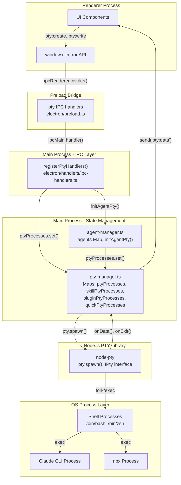
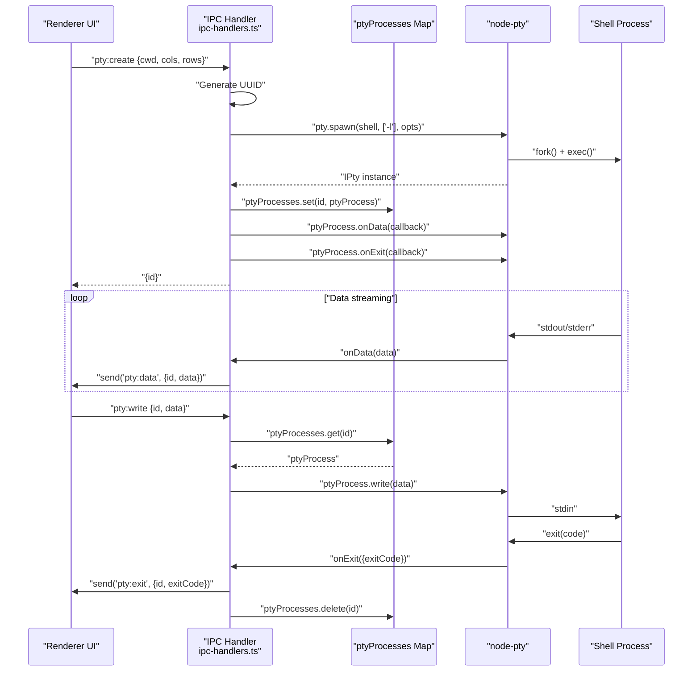
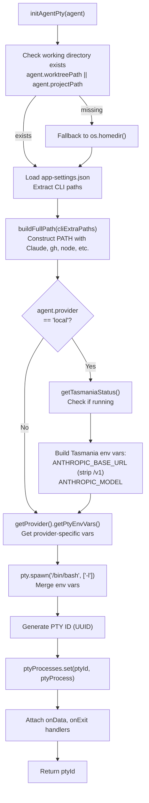
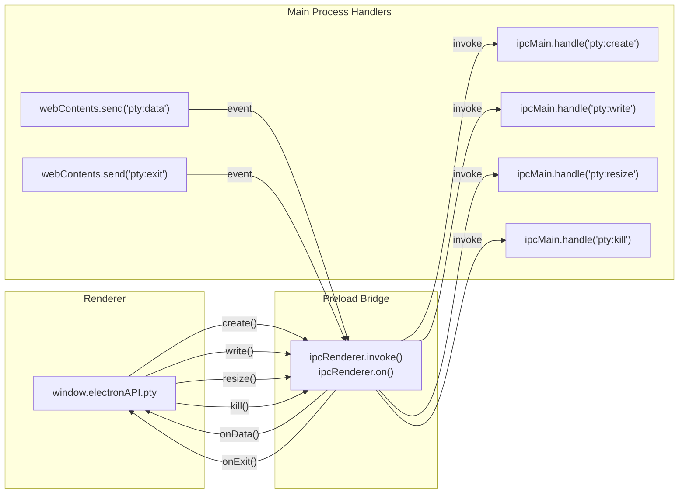
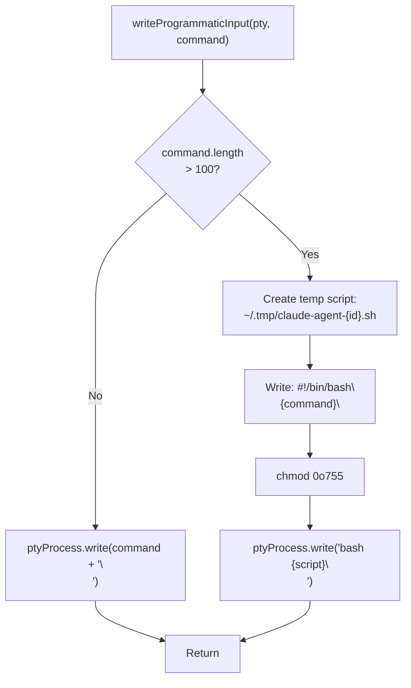
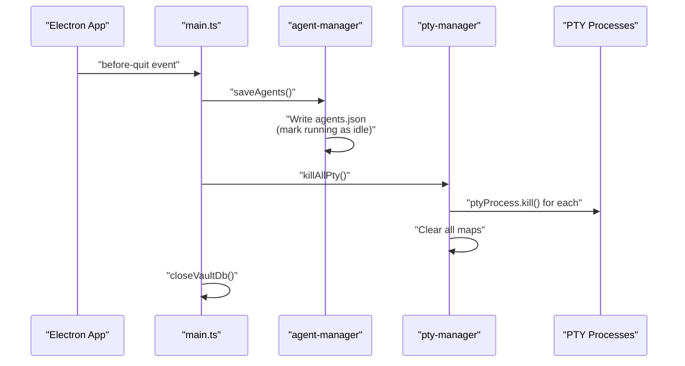
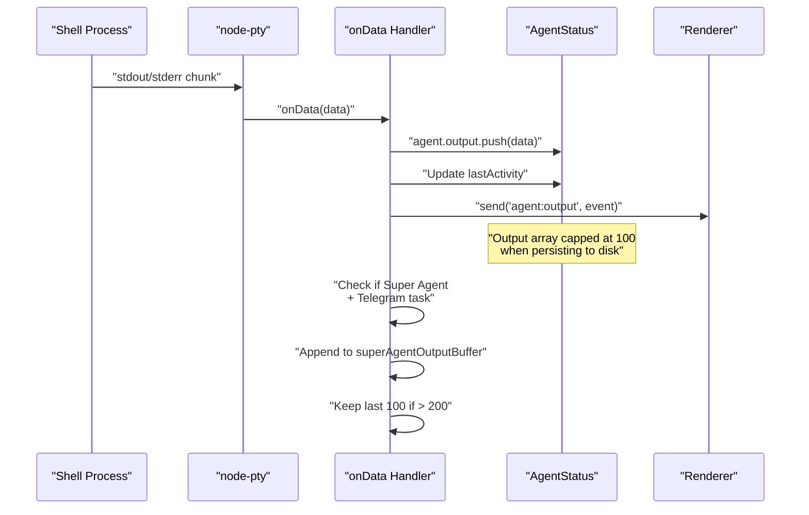

<!-- source: DeepWiki mcp.deepwiki.com · repo Charlie85270/Dorothy · page 11.3 PTY Management · fetched 2026-10-26 -->

# PTY Management

<details>
<summary>Relevant source files</summary>

The following files were used as context for generating this wiki page:

- [electron/core/agent-manager.ts](electron/core/agent-manager.ts)
- [electron/handlers/ipc-handlers.ts](electron/handlers/ipc-handlers.ts)
- [electron/main.ts](electron/main.ts)
- [electron/preload.ts](electron/preload.ts)
- [src/components/Settings/index.ts](src/components/Settings/index.ts)
- [src/types/electron.d.ts](src/types/electron.d.ts)

</details>


PTY Management handles the creation, lifecycle, and coordination of pseudo-terminal processes in Dorothy. Each agent, skill installation, plugin installation, and quick terminal session runs in its own isolated PTY process, providing real-time bidirectional I/O with shell environments. This system forms the foundation for agent execution, enabling Dorothy to spawn Claude CLI instances and other interactive processes while capturing their output and forwarding user input.

For information about agent lifecycle and status management, see [Agent Execution Model](#3.2). For IPC communication patterns, see [IPC Communication](#11.2).

---

## PTY Process Categories

Dorothy maintains four distinct PTY process maps, each serving a specific purpose in the application lifecycle. These maps track active PTY instances and enable targeted management of different process types.

### Process Type Overview

| Map Name | Purpose | Lifecycle | Key Characteristics |
|----------|---------|-----------|---------------------|
| `ptyProcesses` | Agent execution terminals | Long-lived, persistent across app sessions (recreated on restore) | Runs Claude CLI or provider binaries, bakes in environment variables, supports provider switching |
| `skillPtyProcesses` | Skill installation terminals | Short-lived, destroyed after installation | Spawns `npx` directly (no login shell), avoids shell rc file issues |
| `pluginPtyProcesses` | Plugin installation terminals | Short-lived, destroyed after installation | Runs plugin install commands, uses `--no-rcs` flag to skip shell initialization |
| `quickPtyProcesses` | Quick terminal sessions | User-controlled, created via Settings | General-purpose interactive shells for debugging and exploration |

**Sources:** [electron/core/pty-manager.ts:43-46](), [electron/main.ts:43-49]()

---

## PTY Architecture

The PTY management system consists of three layers: process spawning, state tracking, and IPC bridging. The core module (`pty-manager.ts`) provides low-level process management, while `agent-manager.ts` implements agent-specific PTY logic. IPC handlers expose PTY operations to the renderer process.

### Component Relationships



**Sources:** [electron/core/pty-manager.ts:43-49](), [electron/handlers/ipc-handlers.ts:90-152](), [electron/preload.ts:18-41]()

---

## PTY Lifecycle

Each PTY process follows a consistent lifecycle: spawn → data streaming → exit. The main process creates PTY instances using `node-pty`, attaches event listeners for data and exit events, and forwards these events to the renderer via IPC.

### Standard PTY Lifecycle Flow



**Sources:** [electron/handlers/ipc-handlers.ts:90-151](), [electron/core/pty-manager.ts]()

### PTY Creation Parameters

PTY spawning requires careful configuration of the shell environment, working directory, and dimensions. The `pty.spawn()` function from `node-pty` accepts these parameters:

| Parameter | Type | Purpose | Example |
|-----------|------|---------|---------|
| `shell` | `string` | Shell binary path | `/bin/bash`, `/bin/zsh`, or `process.env.SHELL` |
| `args` | `string[]` | Shell arguments | `['-l']` for login shell, `['--no-rcs', '-c', 'command']` for non-interactive |
| `name` | `string` | Terminal type | `'xterm-256color'` |
| `cols` | `number` | Terminal width | `80`, `120` |
| `rows` | `number` | Terminal height | `24`, `30` |
| `cwd` | `string` | Working directory | Agent project path or `os.homedir()` |
| `env` | `Record<string, string>` | Environment variables | Merged with `process.env`, includes `PATH`, provider-specific vars |

**Sources:** [electron/handlers/ipc-handlers.ts:94-104](), [electron/core/agent-manager.ts:290-303]()

---

## Agent PTY Management

Agents require specialized PTY handling because they execute long-running Claude CLI processes with provider-specific configurations. Each agent's PTY is initialized with a tailored environment that includes skill paths, MCP configuration, and provider credentials.

### Agent PTY Initialization

The `initAgentPty()` function in `agent-manager.ts` creates PTY processes for agents restored from disk. This function is called when an agent needs a PTY but doesn't have one (e.g., after app restart or when starting a task).



**Sources:** [electron/core/agent-manager.ts:223-355]()

### Agent PTY Recreation for Local Provider

When an agent uses the local provider (Tasmania), the PTY must be recreated before each task execution to bake Tasmania environment variables into the process environment. Writing `export` statements to an already-running shell is unreliable because the shell may execute the Claude command before processing the export. The recreation flow happens in the `agent:start` IPC handler.

**Key Logic:**
1. Detect `provider === 'local'` in `agent:start` handler
2. Check Tasmania status and extract endpoint/model
3. Strip `/v1` suffix from endpoint (Claude SDK appends it automatically)
4. Kill existing PTY with `ptyProcess.kill()`
5. Spawn new PTY with `ANTHROPIC_BASE_URL` and `ANTHROPIC_MODEL` in env
6. Re-attach `onData` and `onExit` handlers
7. Proceed with command execution

**Sources:** [electron/handlers/ipc-handlers.ts:402-510]()

---

## Environment Configuration

PTY processes inherit environment variables from the main Electron process but require augmentation with Dorothy-specific paths and provider configurations. The PATH construction and environment variable injection ensure that Claude CLI, gh, node, and other tools are accessible within the shell.

### PATH Construction Strategy

The `buildFullPath()` utility constructs a comprehensive PATH by combining user-configured CLI paths, NVM directories, Homebrew paths, and system defaults. This PATH is passed to every PTY spawn.

**PATH Component Order:**
1. User-configured paths from `app-settings.json` → `cliPaths.additionalPaths`
2. Directories containing configured binaries (`claude`, `codex`, `gemini`, `gws`, `gh`, `node`)
3. NVM installation paths (`~/.nvm/versions/node/*/bin`)
4. Homebrew paths (`/opt/homebrew/bin`, `/usr/local/bin`)
5. Standard system paths (`/usr/bin`, `/bin`, `/usr/sbin`, `/sbin`)

**Sources:** [electron/utils/path-builder.ts](), [electron/handlers/ipc-handlers.ts:248-258](), [electron/core/agent-manager.ts:239-261]()

### Provider-Specific Environment Variables

Each provider (Claude, Codex, Gemini, local/Tasmania) requires different environment variables. The provider abstraction encapsulates these differences through the `getPtyEnvVars()` method.

**Environment Variable Categories:**

| Provider | Key Variables | Purpose |
|----------|--------------|---------|
| Claude | `CLAUDE_AGENT_ID`, `CLAUDE_PROJECT_PATH`, `CLAUDE_SKILLS`, `CLAUDECODE` (deleted) | Identify agent, set project context, configure skills, prevent nested sessions |
| Codex | Similar to Claude with Codex-specific paths | Configure Codex CLI environment |
| Gemini | Similar to Claude with Gemini-specific paths | Configure Gemini CLI environment |
| Local (Tasmania) | `ANTHROPIC_BASE_URL`, `ANTHROPIC_MODEL`, `CLAUDE_CODE_DISABLE_NONESSENTIAL_TRAFFIC` | Point Claude SDK to local server, specify model, disable telemetry |

**Sources:** [electron/handlers/ipc-handlers.ts:263-285](), [electron/core/agent-manager.ts:286-302]()

### Agent-Specific Environment Variables

Beyond provider configuration, each agent PTY receives additional environment variables that enable Claude Code features:

- **`CLAUDE_AGENT_ID`**: Unique agent identifier
- **`CLAUDE_PROJECT_PATH`**: Primary project directory
- **`CLAUDE_SKILLS`**: Comma-separated skill list (always includes `world-builder`)
- **`CLAUDE_CODE_ADDITIONAL_DIRECTORIES_CLAUDE_MD`**: Set to `'1'` to load CLAUDE.md from `--add-dir` paths like `~/.dorothy`

**Sources:** [electron/handlers/ipc-handlers.ts:268-285](), [electron/core/agent-manager.ts:299-301]()

---

## IPC Handlers

The renderer process interacts with PTY processes through a type-safe IPC interface defined in the preload script. The main process registers handlers for PTY operations and emits events for data and exit notifications.

### PTY IPC Operations



### Handler Implementation Details

**`pty:create`**
- Generates UUID for PTY process
- Spawns shell with `pty.spawn(shell, ['-l'], opts)`
- Stores PTY in `ptyProcesses` map
- Attaches `onData` and `onExit` listeners
- Returns `{id}` to renderer

**`pty:write`**
- Retrieves PTY from map by ID
- Calls `ptyProcess.write(data)`
- Returns `{success: boolean}`

**`pty:resize`**
- Retrieves PTY from map by ID
- Calls `ptyProcess.resize(cols, rows)`
- Returns `{success: boolean}`

**`pty:kill`**
- Retrieves PTY from map by ID
- Calls `ptyProcess.kill()`
- Removes PTY from map
- Returns `{success: boolean}`

**Sources:** [electron/handlers/ipc-handlers.ts:90-151](), [electron/preload.ts:19-40]()

---

## Skill and Plugin PTY Management

Skill and plugin installations require temporary PTY processes with different shell configurations than agent PTYs. These processes use non-login shells or skip shell initialization files to avoid interference from user's `~/.zshrc` or `~/.bashrc` configurations.

### Skill Installation PTY

Skill installations spawn `npx` directly without a login shell, avoiding potential issues with shell completion definitions (like `compdef` in zsh).

**Spawn Configuration:**
- Binary: `npx`
- Args: `['skills', 'add', githubUrl, '--skill', skillName]`
- Shell: None (direct process spawn)
- Working directory: `os.homedir()`
- Environment: Includes `PATH` from `buildFullPath()`

**Sources:** [electron/handlers/ipc-handlers.ts:784-821]()

### Plugin Installation PTY

Plugin installations use the user's shell but skip rc files to prevent broken completions or other shell configuration issues.

**Spawn Configuration for Zsh:**
- Binary: `process.env.SHELL` or `/bin/zsh`
- Args: `['--no-rcs', '-c', command]`
- Effect: Runs command in clean zsh environment

**Spawn Configuration for Other Shells:**
- Binary: `process.env.SHELL` or `/bin/bash`
- Args: `['-c', command]`
- Effect: Runs command in non-interactive shell

**Sources:** [electron/handlers/ipc-handlers.ts:978-1013]()

---

## Programmatic Input Writing

The `writeProgrammaticInput()` utility in `pty-manager.ts` provides reliable command execution by handling long commands that could be corrupted by PTY line wrapping. For commands exceeding 100 characters, the utility writes them to a temporary shell script and executes the script instead.

### Long Command Handling Strategy



**Rationale:**
Long commands written to PTY can trigger line wrapping in the terminal emulator, causing characters to be rearranged or duplicated. This breaks shell parsing and leads to syntax errors. Writing to a temp script and executing it avoids this issue entirely.

**Sources:** [electron/core/pty-manager.ts](), [electron/handlers/ipc-handlers.ts:528-534]()

---

## PTY Cleanup and Lifecycle Management

Dorothy implements cleanup mechanisms to ensure PTY processes don't leak when the application quits or agents are removed. The `killAllPty()` function terminates all active PTY processes, and individual agents clean up their PTYs on removal.

### Application Quit Cleanup



**Cleanup Sequence:**
1. `before-quit` event triggered
2. `saveAgents()` persists agent state (running agents marked as idle)
3. `killAllPty()` terminates all PTY processes in all maps
4. `closeVaultDb()` closes database connections

**Sources:** [electron/main.ts:585-590](), [electron/core/pty-manager.ts]()

### Agent Removal Cleanup

When an agent is removed via `agent:remove` IPC handler, Dorothy performs comprehensive cleanup:

1. Kill agent's PTY process
2. Remove PTY from `ptyProcesses` map
3. Remove git worktree if it exists (`git worktree remove --force`)
4. Delete agent from `agents` map
5. Persist updated agent list to `agents.json`

**Sources:** [electron/handlers/ipc-handlers.ts:683-711]()

---

## PTY Process Recovery

Agents restored from `agents.json` after app restart don't have active PTY processes. Dorothy lazily recreates PTYs when needed through two paths:

### Lazy PTY Initialization Triggers

| Trigger | Handler | Function Called |
|---------|---------|----------------|
| `agent:get` IPC call | `ipcMain.handle('agent:get')` | `initAgentPty()` if `!agent.ptyId` |
| `agent:start` IPC call | `ipcMain.handle('agent:start')` | `initAgentPty()` if `!agent.ptyId` |

**Initialization Check:**
```typescript
if (!agent.ptyId || !ptyProcesses.has(agent.ptyId)) {
  const ptyId = await initAgentPty(agent);
  agent.ptyId = ptyId;
}
```

This pattern ensures agents always have valid PTYs before execution without unnecessarily creating PTYs for idle agents.

**Sources:** [electron/handlers/ipc-handlers.ts:591-603](), [electron/handlers/ipc-handlers.ts:389-395]()

---

## Shell Selection and Configuration

Dorothy uses login shells (`-l` flag) for agent and general PTYs to ensure users' shell environments (PATH, aliases, environment variables) are properly initialized. For skill and plugin installations, Dorothy uses non-login shells or bypasses shell initialization to avoid interference.

### Shell Selection Logic

| PTY Type | Shell Selection | Arguments | Reason |
|----------|----------------|-----------|--------|
| Agent PTY | `/bin/bash` (hardcoded) | `['-l']` | Consistent environment, login shell initialization |
| General PTY | `process.env.SHELL` or `/bin/zsh` | `['-l']` | Respect user preference, login shell |
| Skill Install | `npx` (no shell) | `['skills', 'add', ...]` | Direct process spawn, no shell overhead |
| Plugin Install | `process.env.SHELL` or `/bin/zsh` | `['--no-rcs', '-c', cmd]` (zsh)<br/>`['-c', cmd]` (others) | Skip rc files to avoid `compdef` errors |

**Sources:** [electron/core/agent-manager.ts:229](), [electron/handlers/ipc-handlers.ts:96](), [electron/handlers/ipc-handlers.ts:800](), [electron/handlers/ipc-handlers.ts:980-990]()

---

## Data Flow and Buffering

PTY output streams continuously from shell processes to the main process, where it's buffered in agent state and forwarded to the renderer. The output array stores the last 100 entries to prevent memory exhaustion.

### Output Buffer Management



**Buffer Limits:**
- Runtime: Unlimited (array grows during execution)
- Persistence: Last 100 entries saved to `agents.json`
- Super Agent Telegram: Last 100 entries kept when buffer exceeds 200

**Sources:** [electron/handlers/ipc-handlers.ts:329-354](), [electron/core/agent-manager.ts:148-156]()

---

## PTY State Coordination

PTY processes are stateful resources that must be carefully coordinated between the main process and renderer. The `ptyId` stored in `AgentStatus` links agents to their PTY processes, enabling operations like input writing and resizing.

### State Consistency Mechanisms

**PTY ID Management:**
- Each PTY gets a unique UUID generated by `uuidv4()`
- Agent stores `ptyId` in `AgentStatus` object
- PTY stored in `ptyProcesses` map with `ptyId` as key
- `ptyId` cleared when agent stops or PTY exits

**Stale PTY Detection:**
When sending output, handlers check if the PTY ID still matches:
```typescript
if (!agent || agent.ptyId !== ptyId) return;
```

This prevents data from old PTYs being attributed to recreated PTYs.

**Sources:** [electron/handlers/ipc-handlers.ts:292](), [electron/handlers/ipc-handlers.ts:332-334](), [electron/handlers/ipc-handlers.ts:356-373]()

---

## Summary

PTY management in Dorothy provides the foundation for agent execution and interactive shell sessions. The system maintains four distinct PTY maps for different purposes, implements provider-specific environment configuration, and handles PTY lifecycle events through IPC. Key architectural decisions include:

- **Separation of concerns**: Different PTY maps for agents, skills, plugins, and quick terminals
- **Lazy initialization**: PTYs created on-demand for restored agents
- **Provider abstraction**: Environment variables tailored to Claude, Codex, Gemini, or local providers
- **Tasmania special handling**: PTY recreation before each task to bake in local model credentials
- **Long command safety**: Temp script execution for commands exceeding 100 characters
- **Cleanup guarantees**: `killAllPty()` on app quit, individual cleanup on agent removal

This architecture enables Dorothy to orchestrate multiple concurrent agent processes while maintaining isolation, resource efficiency, and reliable communication with the renderer UI.

**Sources:** [electron/core/pty-manager.ts:43-49](), [electron/core/agent-manager.ts:223-355](), [electron/handlers/ipc-handlers.ts:90-775]()

---

