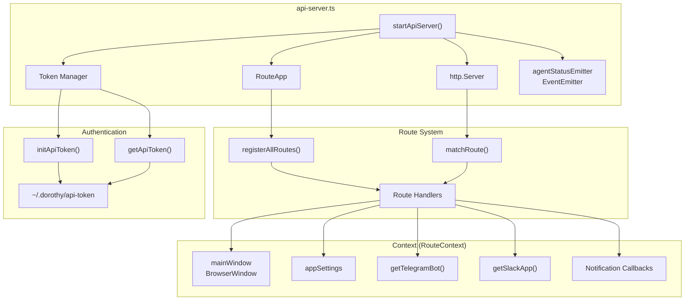
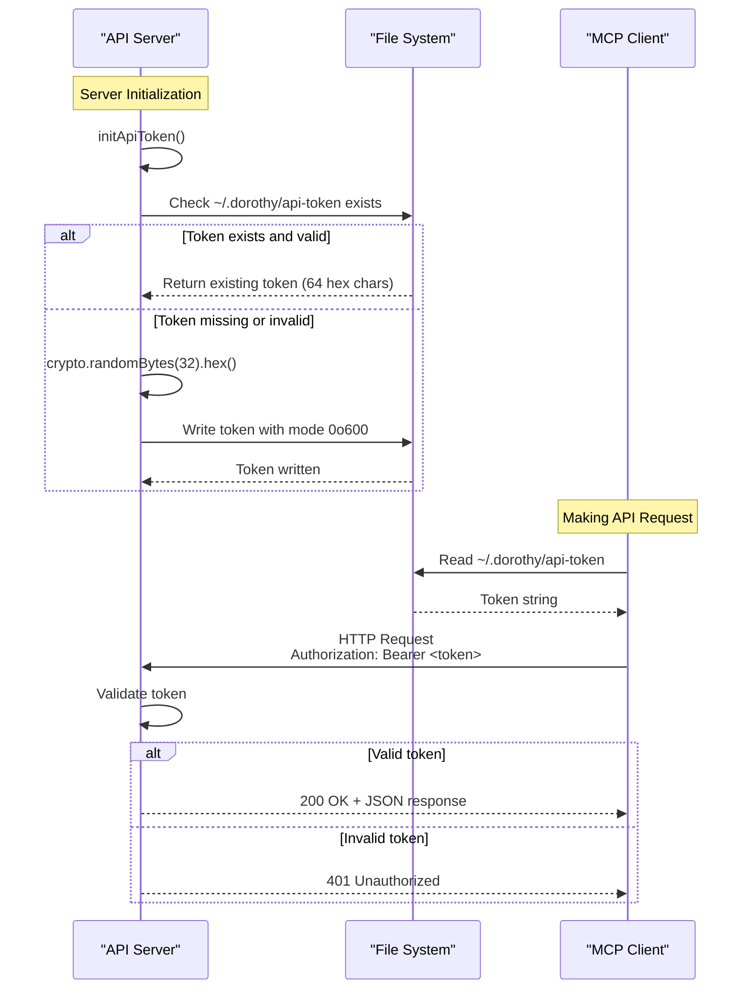
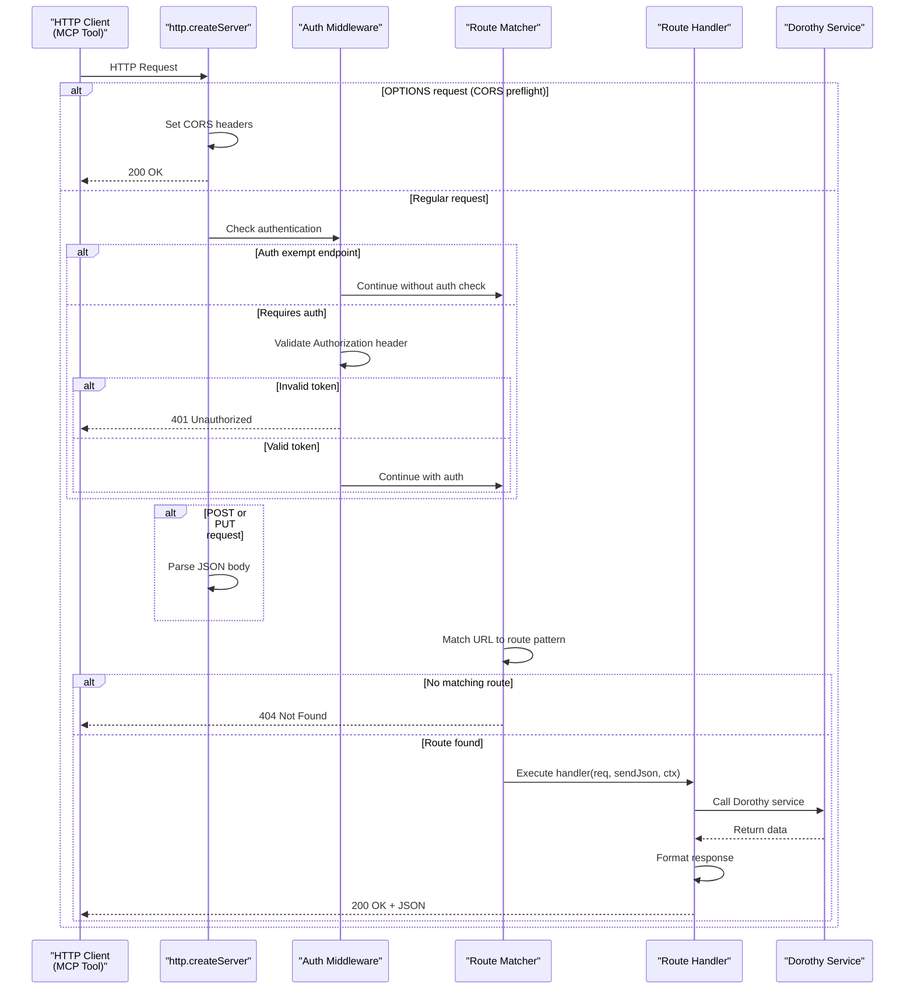
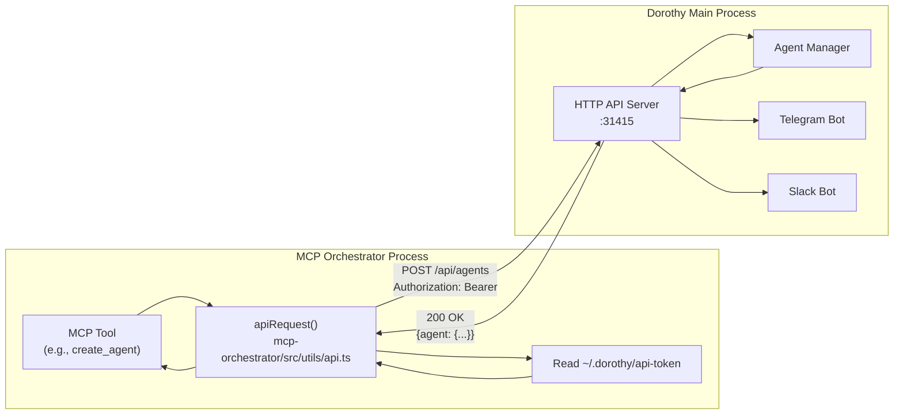
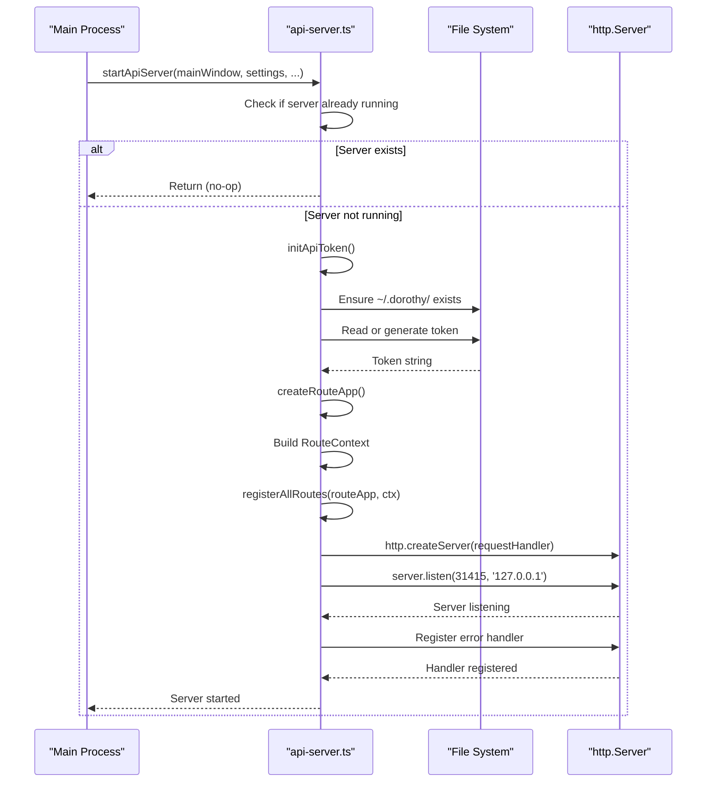

<!-- source: DeepWiki mcp.deepwiki.com · repo Charlie85270/Dorothy · page 11.4 HTTP API Server · fetched 2026-10-26 -->

# HTTP API Server

<details>
<summary>Relevant source files</summary>

The following files were used as context for generating this wiki page:

- [electron/services/api-server.ts](electron/services/api-server.ts)
- [mcp-orchestrator/src/tools/automations.ts](mcp-orchestrator/src/tools/automations.ts)
- [mcp-orchestrator/src/tools/index.ts](mcp-orchestrator/src/tools/index.ts)
- [mcp-orchestrator/src/utils/api.ts](mcp-orchestrator/src/utils/api.ts)
- [mcp-orchestrator/src/utils/automations.ts](mcp-orchestrator/src/utils/automations.ts)
- [mcp-orchestrator/src/utils/index.ts](mcp-orchestrator/src/utils/index.ts)

</details>


## Purpose and Scope

The HTTP API Server is an internal REST API that runs on port 31415 within Dorothy's Electron main process. It provides a bridge for MCP servers and automation tools to interact with Dorothy's core services, including agent management, messaging integrations, and system state. This page documents the server's architecture, authentication mechanism, and request handling flow.

For information about the specific routes and endpoints exposed by the API, see the Route Handlers section. For details on how MCP tools consume this API, see [mcp-orchestrator](#4.1).

---

## Overview

The HTTP API server exists to solve a fundamental architectural challenge: MCP servers run as separate stdio-based processes and need a way to interact with Dorothy's Electron services (agent manager, Telegram bot, Slack bot, etc.). The API server provides this bridge by exposing HTTP endpoints that MCP tools can call to perform operations like creating agents, sending messages, or querying system state.

**Key Characteristics:**
- Runs on `127.0.0.1:31415` (localhost only, not exposed to network)
- Uses Bearer token authentication stored in `~/.dorothy/api-token`
- Supports CORS for local development (port 3000)
- Provides both synchronous and long-poll endpoints
- Integrates with all major Dorothy services via dependency injection

**Primary Use Cases:**
1. **MCP Tool Integration**: Tools like `create_agent`, `send_telegram`, and automation runners call the API to perform operations
2. **Automation Execution**: The automation system uses the API to create ephemeral agents and control their lifecycle
3. **Inter-Process Communication**: External scripts and MCP servers use the API to interact with the running Dorothy instance

Sources: [electron/services/api-server.ts:1-199](), [mcp-orchestrator/src/utils/api.ts:1-62]()

---

## Server Architecture

### Component Structure



**Diagram: HTTP API Server Component Architecture**

The API server is structured around several key abstractions:

- **RouteApp**: A lightweight routing system that maps HTTP methods and URL patterns to handler functions
- **RouteContext**: Dependency injection container providing access to Electron services (main window, settings, bots, callbacks)
- **EventEmitter**: Enables long-polling for agent status changes without repeated requests
- **Token Manager**: Handles secure token generation and persistence

Sources: [electron/services/api-server.ts:49-99](), [electron/services/api-server.ts:11-20]()

---

## Authentication System

### Token Generation and Storage

The API uses a Bearer token authentication scheme with a cryptographically secure token stored on disk:



**Diagram: Token Authentication Flow**

**Token Characteristics:**
- **Generation**: Uses Node.js `crypto.randomBytes(32)` for 256-bit entropy
- **Format**: 64-character hexadecimal string
- **Permissions**: File stored with mode `0o600` (owner read/write only)
- **Location**: `~/.dorothy/api-token` (standardized across Dorothy and MCP tools)
- **Lifecycle**: Generated once per installation, persists until manual deletion

Sources: [electron/services/api-server.ts:21-47](), [electron/constants.ts]()

### Authentication Exemptions

Certain endpoints are exempt from authentication for local automation scenarios:

| Endpoint Pattern | Purpose | Rationale |
|-----------------|---------|-----------|
| `/api/local-file` | Local file operations | Called by shell scripts without token access |
| `/api/health` | Health check | Monitoring and debugging |
| `/api/hooks/*` | Webhook handlers | External services with their own auth |
| `/api/kanban/complete` | Kanban task completion | Called from automation scripts |
| `/api/scheduler/status` | Scheduler status | System monitoring |

These endpoints are only accessible from `127.0.0.1`, providing inherent protection against network-based attacks.

Sources: [electron/services/api-server.ts:116-120]()

---

## Request Processing Flow

### HTTP Request Lifecycle



**Diagram: Complete Request Processing Sequence**

**Processing Stages:**

1. **CORS Handling**: Sets headers for local development (`http://localhost:3000`)
2. **Authentication**: Validates Bearer token (except for exempt endpoints)
3. **Body Parsing**: Reads and parses JSON for POST/PUT requests
4. **Route Matching**: Finds handler using regex or string matching
5. **Handler Execution**: Invokes handler with request, response helper, and context
6. **Response Formatting**: Sends JSON response with appropriate status code

Sources: [electron/services/api-server.ts:101-178]()

---

## Route Registration System

### RouteApp Interface

The API server uses a minimal routing framework defined within the module:

```typescript
interface RouteApp {
  routes: Array<{
    method: string;
    pattern: string | RegExp;
    handler: (req: RouteRequest, sendJson: Function, ctx: RouteContext) => Promise<void>;
  }>;
  add(method: string, pattern: string | RegExp, handler: Function): void;
  get(pattern: string | RegExp, handler: Function): void;
  post(pattern: string | RegExp, handler: Function): void;
  put(pattern: string | RegExp, handler: Function): void;
  delete(pattern: string | RegExp, handler: Function): void;
}
```

**Pattern Matching:**
- **String patterns**: Exact match (e.g., `/api/health`)
- **RegEx patterns**: Capture groups for parameters (e.g., `/^\/api\/agents\/([^/]+)$/` captures agent ID)
- **Parameter extraction**: First capture group mapped to `params.id`

**Route Registration Example:**

```typescript
const routeApp = createRouteApp();
const ctx: RouteContext = {
  mainWindow,
  appSettings,
  getTelegramBot,
  getSlackApp,
  // ... other dependencies
};

registerAllRoutes(routeApp, ctx);
```

Sources: [electron/services/api-server.ts:49-70](), [electron/services/api-routes.ts]()

### Context Object (RouteContext)

The `RouteContext` provides handlers with access to all Dorothy services via dependency injection:

| Property | Type | Purpose |
|----------|------|---------|
| `mainWindow` | `BrowserWindow \| null` | Electron window for IPC communication |
| `appSettings` | `AppSettings` | Application configuration |
| `getTelegramBot` | `() => TelegramBot \| null` | Telegram bot instance getter |
| `getSlackApp` | `() => SlackApp \| null` | Slack app instance getter |
| `slackResponseChannel` | `string \| null` | Active Slack channel for responses |
| `slackResponseThreadTs` | `string \| null` | Slack thread timestamp |
| `handleStatusChangeNotificationCallback` | `Function` | Agent status change notifications |
| `sendNotificationCallback` | `Function` | Desktop notification sender |
| `initAgentPtyCallback` | `Function` | Agent PTY initialization |
| `agentStatusEmitter` | `EventEmitter` | Event bus for agent status changes |

This design decouples route handlers from direct dependencies, enabling easier testing and service replacement.

Sources: [electron/services/api-server.ts:87-98](), [electron/services/api-routes.ts]()

---

## Client Usage Patterns

### MCP Tool Integration

MCP tools in the orchestrator use a standardized API client to interact with Dorothy:



**Diagram: MCP Tool API Client Pattern**

**API Client Implementation:**

The `apiRequest` function provides a consistent interface for all MCP tools:

- **Base URL**: `http://127.0.0.1:31415` (configurable via `CLAUDE_MGR_API_URL`)
- **Token Loading**: Reads from `~/.dorothy/api-token` on each request
- **Timeout Handling**: 30 seconds default, 10 minutes for long-poll endpoints
- **Error Handling**: Throws on non-OK responses with error message from JSON

**Common Request Patterns:**

```typescript
// Create agent
await apiRequest("/api/agents", "POST", {
  projectPath: "/path/to/project",
  name: "My Agent",
  skipPermissions: true
});

// Start agent
await apiRequest(`/api/agents/${agentId}/start`, "POST", {
  prompt: "Task description",
  model: "sonnet"
});

// Send Telegram message
await apiRequest("/api/telegram/send", "POST", {
  message: "Agent completed task"
});

// Long-poll for agent completion
const response = await apiRequest(`/api/agents/${agentId}/wait?status=completed,error`);
```

Sources: [mcp-orchestrator/src/utils/api.ts:1-62](), [mcp-orchestrator/src/tools/automations.ts:728-775]()

### Automation System Usage

The automation system extensively uses the API to create ephemeral agents:

**Ephemeral Agent Pattern:**
1. Poll external source (GitHub, JIRA) for items
2. Filter items based on automation triggers
3. For each item: Create agent via `/api/agents` (POST)
4. Start agent with interpolated prompt via `/api/agents/:id/start` (POST)
5. Poll agent status via `/api/agents/:id` (GET) until completion
6. Clean up agent via `/api/agents/:id` (DELETE)

This pattern allows automations to run agents autonomously without UI interaction, with full lifecycle management and error handling.

Sources: [mcp-orchestrator/src/tools/automations.ts:582-814]()

---

## Long-Polling Support

### Agent Status Event Emitter

The API server includes an `EventEmitter` for efficient agent status monitoring:

```typescript
export const agentStatusEmitter = new EventEmitter();
agentStatusEmitter.setMaxListeners(50);
```

**Purpose:**
- Enables long-polling endpoints that wait for agent status changes
- Avoids constant polling with 1-2 second intervals
- Supports up to 50 concurrent waiters

**Usage Pattern:**
1. Client makes request to `/api/agents/:id/wait?status=completed,error`
2. Handler registers listener on `agentStatusEmitter`
3. When agent status changes, listener fires and returns response
4. If no change within timeout (default 10 minutes), returns current state

This pattern is critical for automation runners that need to wait for agent completion without blocking or excessive CPU usage.

Sources: [electron/services/api-server.ts:14-16]()

---

## Security Considerations

### Threat Model

**Protected Against:**
- **Network-based attacks**: Server binds to `127.0.0.1` only, not accessible from network
- **Unauthorized access**: Bearer token with 256-bit entropy required for most endpoints
- **Token theft**: Token file restricted to owner (mode `0o600`)

**Attack Vectors:**
- **Local privilege escalation**: If attacker has local user access, they can read token file
- **Process inspection**: Token held in memory by all MCP processes
- **File system access**: Token persists on disk in plaintext (but with restrictive permissions)

### Best Practices

1. **Localhost Binding**: Never expose API to `0.0.0.0` or network interfaces
2. **Token Rotation**: Manual token regeneration requires deleting `~/.dorothy/api-token`
3. **Endpoint Validation**: All parameterized routes validate inputs (e.g., agent IDs, repo names)
4. **Error Handling**: Generic error messages in responses to avoid information leakage

**SSRF Protection:**
The automation webhook output includes URL validation to prevent Server-Side Request Forgery:
- Requires HTTPS protocol
- Blocks localhost and private IP ranges (10.x.x.x, 192.168.x.x, 127.x.x.x, etc.)
- Blocks link-local addresses (169.254.x.x)

Sources: [electron/services/api-server.ts:180-191](), [mcp-orchestrator/src/tools/automations.ts:48-74]()

---

## Server Lifecycle

### Startup Sequence



**Diagram: API Server Startup Sequence**

**Initialization Parameters:**
- `mainWindow`: Electron BrowserWindow for UI communication
- `appSettings`: Current application settings
- `getTelegramBot`: Function to get Telegram bot instance
- `getSlackApp`: Function to get Slack app instance
- Various callback functions for notifications and agent management

**Error Handling:**
- Port in use (EADDRINUSE): Logs warning, server not started
- Other errors: Logged to console

Sources: [electron/services/api-server.ts:71-191]()

### Shutdown

```typescript
export function stopApiServer() {
  if (apiServer) {
    apiServer.close();
    apiServer = null;
  }
}
```

The shutdown function cleanly closes the HTTP server and clears the module-level reference. This is called during Electron app shutdown.

Sources: [electron/services/api-server.ts:193-198]()

---

## Integration Points

### Main Process Services

The API server acts as a central integration hub for Dorothy's services:

| Service | Integration Method | API Endpoints |
|---------|-------------------|---------------|
| Agent Manager | `initAgentPtyCallback` | `/api/agents`, `/api/agents/:id/start`, `/api/agents/:id/stop` |
| Telegram Bot | `getTelegramBot()` | `/api/telegram/send`, `/api/telegram/upload` |
| Slack Bot | `getSlackApp()` | `/api/slack/send`, `/api/slack/upload` |
| Settings Manager | `appSettings` object | `/api/settings`, `/api/settings/update` |
| Notification System | `sendNotificationCallback` | Used by handlers for desktop notifications |
| Status Monitoring | `agentStatusEmitter` | `/api/agents/:id/wait` |

### MCP Orchestrator Tools

The following MCP tools rely on the API server:

- **Agent Management**: `create_agent`, `start_agent`, `stop_agent`, `delete_agent`, `list_agents`
- **Messaging**: `send_telegram`, `send_slack`
- **Automation Execution**: All automation runners that create ephemeral agents
- **Scheduler**: Task execution status reporting

Sources: [electron/services/api-server.ts:71-99](), [mcp-orchestrator/src/tools/]()

---

## Performance Characteristics

**Throughput:**
- Single-threaded Node.js HTTP server
- Concurrent request handling via async/await
- Long-poll endpoints use event-driven architecture (EventEmitter)

**Latency:**
- Local loopback: <1ms for simple GET requests
- Agent creation: 100-500ms (PTY spawn overhead)
- Long-poll wait: Blocks until event or timeout (10 min)

**Resource Usage:**
- Minimal memory footprint (<10 MB)
- CPU: Negligible when idle, spikes during request processing
- No connection pooling needed (localhost only)

**Scalability:**
- EventEmitter limited to 50 concurrent listeners
- No built-in rate limiting (trusted local environment)
- File-based token storage (no database overhead)

Sources: [electron/services/api-server.ts:14-16](), [electron/services/api-server.ts:101-178]()

---

