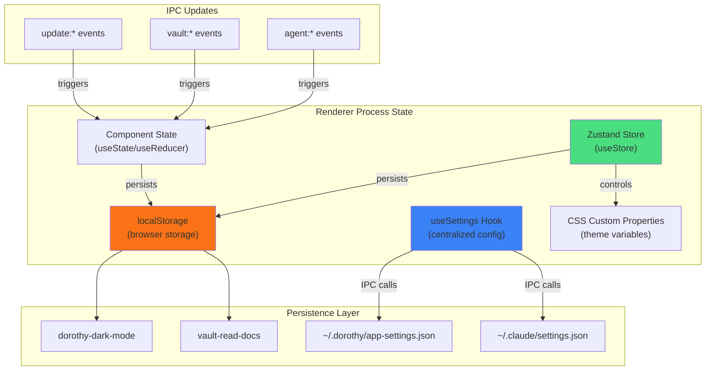
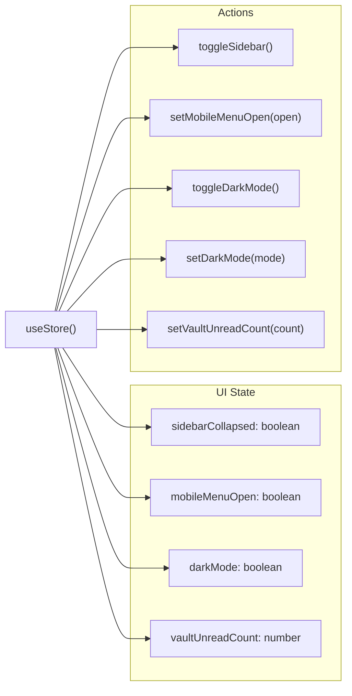
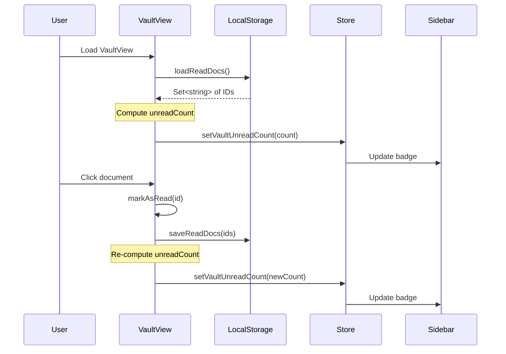
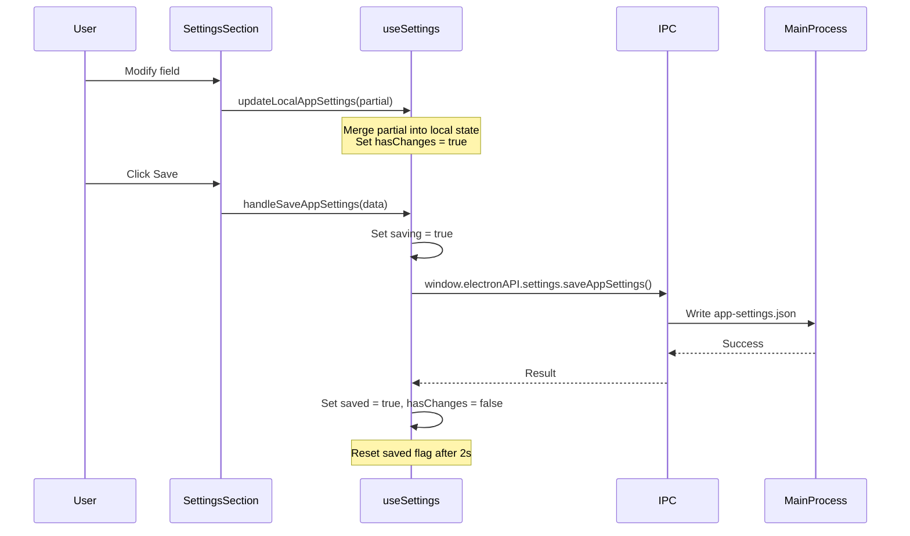
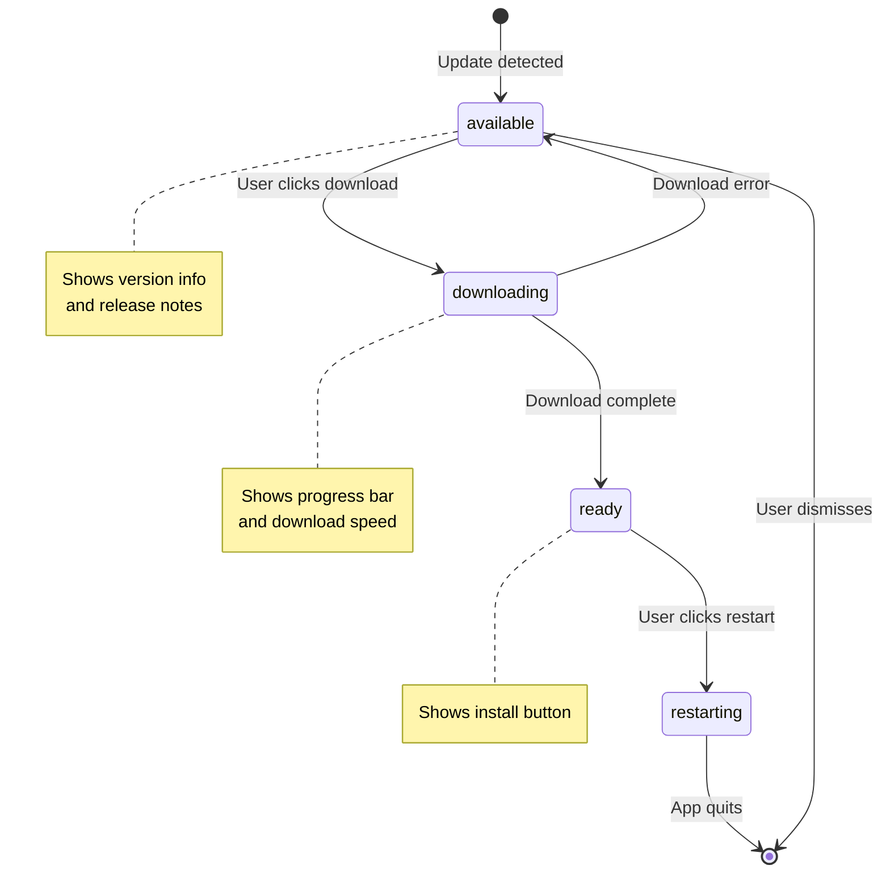
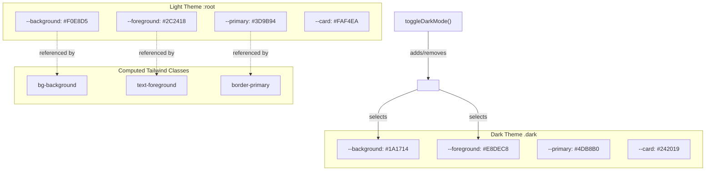
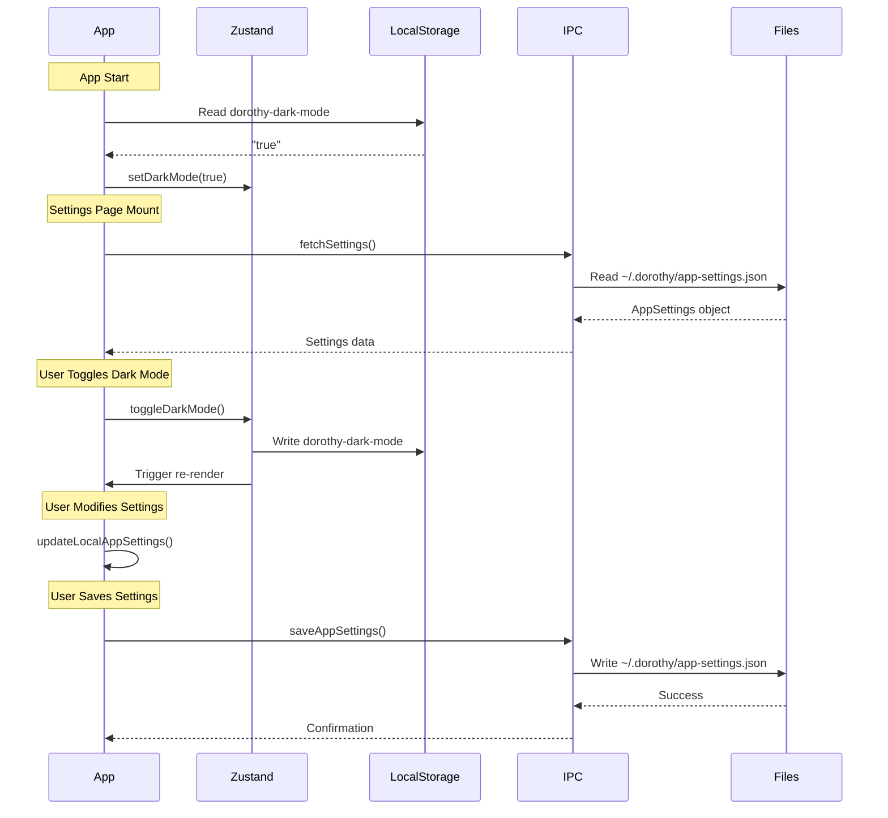

<!-- source: DeepWiki mcp.deepwiki.com · repo Charlie85270/Dorothy · page 11.6 State Management · fetched 2026-10-26 -->

# State Management

<details>
<summary>Relevant source files</summary>

The following files were used as context for generating this wiki page:

- [mcp-vault/src/tools/documents.ts](mcp-vault/src/tools/documents.ts)
- [src/app/globals.css](src/app/globals.css)
- [src/app/settings/page.tsx](src/app/settings/page.tsx)
- [src/app/vault/page.tsx](src/app/vault/page.tsx)
- [src/components/ClientLayout.tsx](src/components/ClientLayout.tsx)
- [src/components/Sidebar.tsx](src/components/Sidebar.tsx)
- [src/components/VaultView/components/FolderTree.tsx](src/components/VaultView/components/FolderTree.tsx)
- [src/components/VaultView/index.tsx](src/components/VaultView/index.tsx)

</details>


This document explains Dorothy's state management architecture for the renderer process (React UI). State management in Dorothy is organized into multiple layers: a global Zustand store for app-wide UI state, local storage for persistence, a centralized settings hook, component-level React state for feature-specific concerns, and CSS custom properties for theming.

For information about main process state (agents, PTY processes), see [Electron Main Process](#11.1). For data persistence strategies (JSON files, SQLite), see [Data Persistence](#11.5).

---

## State Architecture Overview

Dorothy uses a layered state management approach where each layer has distinct responsibilities and persistence strategies.

**State Layers Architecture**



**Sources:** [src/components/ClientLayout.tsx:1-350](), [src/components/Sidebar.tsx:1-280](), [src/components/VaultView/index.tsx:1-506](), [src/app/settings/page.tsx:1-262]()

---

## Zustand Global Store

Dorothy uses [Zustand](https://github.com/pmndrs/zustand) for global application state. The store is accessed via the `useStore` hook and manages app-wide UI state like sidebar visibility, dark mode, and notification badges.

### Store Structure

**Zustand Store State Slices**



**Sources:** [src/components/ClientLayout.tsx:62](), [src/components/Sidebar.tsx:52]()

### Usage Patterns

Components access the Zustand store using destructuring with the `useStore` hook:

```typescript
// Accessing multiple state slices and actions
const { 
  sidebarCollapsed, 
  mobileMenuOpen, 
  setMobileMenuOpen, 
  darkMode, 
  setDarkMode, 
  setVaultUnreadCount 
} = useStore();

// Accessing single state slice with selector (optimization)
const setVaultUnreadCount = useStore(s => s.setVaultUnreadCount);
```

**Sources:** [src/components/ClientLayout.tsx:62](), [src/components/Sidebar.tsx:52](), [src/components/VaultView/index.tsx:64]()

### Sidebar State Management

The sidebar collapse state and mobile menu state are managed globally to maintain consistency across navigation:

| State | Type | Purpose | Persistence |
|-------|------|---------|-------------|
| `sidebarCollapsed` | boolean | Desktop sidebar expanded/collapsed | In-memory only |
| `mobileMenuOpen` | boolean | Mobile drawer open/closed | In-memory only |
| `toggleSidebar` | function | Toggle desktop sidebar | - |
| `setMobileMenuOpen` | function | Control mobile menu | - |

These states are consumed by the `Sidebar` component and `ClientLayout` to coordinate margins and responsive behavior. Mobile menu automatically closes when window resizes to desktop size.

**Sources:** [src/components/ClientLayout.tsx:62-178](), [src/components/Sidebar.tsx:50-280]()

### Dark Mode State

Dark mode state is managed in Zustand but persisted to `localStorage` for consistency across sessions:

```typescript
// Initialize from localStorage on mount
useEffect(() => {
  const saved = localStorage.getItem('dorothy-dark-mode');
  if (saved === 'true') {
    setDarkMode(true);
  }
}, [setDarkMode]);

// Sync to document class and localStorage on change
useEffect(() => {
  document.documentElement.classList.toggle('dark', darkMode);
  localStorage.setItem('dorothy-dark-mode', String(darkMode));
}, [darkMode]);
```

The `dark` class on `<html>` triggers CSS custom property overrides defined in [src/app/globals.css:140-214]().

**Sources:** [src/components/ClientLayout.tsx:131-143]()

### Vault Unread Count Badge

The global vault unread count is computed in `VaultView` and pushed to the store for the sidebar badge:

```typescript
// Compute unread count from documents and localStorage read tracking
const unreadCount = useMemo(
  () => allDocuments.filter(d => !readDocIds.has(d.id)).length,
  [allDocuments, readDocIds]
);

// Push to global store for sidebar badge
useEffect(() => {
  setVaultUnreadCount(unreadCount);
}, [unreadCount, setVaultUnreadCount]);
```

This pattern allows the sidebar to display a live unread badge even when the VaultView is not mounted. The badge appears on both desktop and mobile navigation.

**Sources:** [src/components/VaultView/index.tsx:66-73](), [src/components/Sidebar.tsx:110-125](), [src/components/ClientLayout.tsx:145-172]()

---

## Local Storage Persistence

Dorothy uses browser `localStorage` for client-side persistence of user preferences and UI state that should survive page reloads.

### Local Storage Keys

| Key | Type | Purpose | Default |
|-----|------|---------|---------|
| `dorothy-dark-mode` | string | Dark mode preference ("true"/"false") | - |
| `vault-read-docs` | JSON array | IDs of vault documents marked as read | `[]` |

**Sources:** [src/components/ClientLayout.tsx:133-143](), [src/components/ClientLayout.tsx:49-59](), [src/components/VaultView/index.tsx:28-46]()

### Vault Read Tracking

The vault read tracking system uses `localStorage` to persist which documents the user has viewed:

**Vault Read State Flow**



**Sources:** [src/components/VaultView/index.tsx:28-83](), [src/components/ClientLayout.tsx:145-172]()

### First Load Handling

On the very first load (when `localStorage.getItem('vault-read-docs')` returns `null`), all existing documents are marked as read to avoid showing false unread badges for pre-existing content:

```typescript
const firstLoad = isFirstLoad(); // checks if key exists

if (firstLoad) {
  const result = await window.electronAPI?.vault?.listDocuments();
  if (result?.documents) {
    const ids = new Set(result.documents.map(d => d.id));
    setReadDocIds(ids);
    saveReadDocs(ids);
  }
}
```

**Sources:** [src/components/VaultView/index.tsx:124-141]()

---

## Settings State Management

Settings are managed through a centralized `useSettings` hook that abstracts IPC communication with the main process and provides a consistent API for reading and writing configuration.

### useSettings Hook API

**useSettings Hook Interface**

```mermaid
graph TB
    useSettings["useSettings()"]
    
    subgraph "Returned State"
        settings["settings<br/>(ClaudeSettings)"]
        appSettings["appSettings<br/>(AppSettings)"]
        info["info<br/>(SystemInfo)"]
        skills["skills<br/>(InstalledSkills)"]
    end
    
    subgraph "Loading State"
        loading["loading: boolean"]
        saving["saving: boolean"]
        error["error: string | null"]
        saved["saved: boolean"]
        hasChanges["hasChanges: boolean"]
    end
    
    subgraph "Actions"
        fetchSettings["fetchSettings()"]
        handleSave["handleSave()"]
        handleSaveAppSettings["handleSaveAppSettings(data)"]
        updateSettings["updateSettings(partial)"]
        updateLocalAppSettings["updateLocalAppSettings(partial)"]
    end
    
    useSettings --> settings
    useSettings --> appSettings
    useSettings --> info
    useSettings --> skills
    useSettings --> loading
    useSettings --> saving
    useSettings --> error
    useSettings --> saved
    useSettings --> hasChanges
    useSettings --> fetchSettings
    useSettings --> handleSave
    useSettings --> handleSaveAppSettings
    useSettings --> updateSettings
    useSettings --> updateLocalAppSettings
```



**Sources:** [src/app/settings/page.tsx:53-68]()

### Settings Data Flow

Settings modifications follow a local-first pattern with explicit save operations:

**Settings Update Flow**



**Sources:** [src/app/settings/page.tsx:53-261]()

### Settings State Scope

The settings system manages three distinct configuration objects:

1. **AppSettings** - Dorothy-specific configuration stored in `~/.dorothy/app-settings.json`:
   - Integration credentials (Telegram, Slack, JIRA, etc.)
   - Notification preferences
   - Terminal settings
   - Default provider selection

2. **ClaudeSettings** - Claude CLI configuration stored in `~/.claude/settings.json`:
   - Permissions and security settings
   - Plugin installations
   - Environment variables

3. **SystemInfo** - Read-only system information:
   - Platform, version, paths
   - Installation status of CLI tools

**Sources:** [src/app/settings/page.tsx:70-157]()

### Local State Pattern

Settings sections use local state updates that are batched before saving:

```typescript
// Update local state without saving
onUpdateLocalSettings={updateLocalAppSettings}

// Explicit save operation
onSaveAppSettings={handleSaveAppSettings}
```

This pattern allows users to make multiple changes and review them before committing, with a visual indicator (`hasChanges`) showing unsaved modifications.

**Sources:** [src/app/settings/page.tsx:91-133](), [src/app/settings/page.tsx:200-219]()

---

## Component-Level State Patterns

Feature-specific state is managed at the component level using React hooks. Dorothy follows consistent patterns for state organization, persistence, and reactivity.

### VaultView State Architecture

The VaultView demonstrates a comprehensive component state pattern with multiple state categories:

| Category | States | Purpose |
|----------|--------|---------|
| **Data State** | `documents`, `allDocuments`, `folders`, `selectedDoc`, `selectedDocAttachments`, `searchResults` | Domain data loaded from IPC |
| **UI State** | `viewMode`, `selectedFolderId`, `searchQuery`, `isSearching`, `loading` | View control and navigation |
| **Read Tracking** | `readDocIds` | User interaction state (persisted to localStorage) |

**Sources:** [src/components/VaultView/index.tsx:48-64]()

### State Initialization Patterns

Components follow a consistent pattern for state initialization with loading indicators:

```typescript
const [loading, setLoading] = useState(true);

useEffect(() => {
  const init = async () => {
    setLoading(true);
    await Promise.all([
      loadDocuments(), 
      loadAllDocuments(), 
      loadFolders()
    ]);
    // Special first-load logic
    setLoading(false);
  };
  init();
}, []);
```

**Sources:** [src/components/VaultView/index.tsx:124-141]()

### Real-Time Event Listeners

Components subscribe to IPC events to update state reactively:

```typescript
useEffect(() => {
  if (!isElectron()) return;

  const unsubCreated = window.electronAPI!.vault!.onDocumentCreated((doc) => {
    setDocuments(prev => [doc, ...prev]);
    setAllDocuments(prev => [doc, ...prev]);
  });

  const unsubUpdated = window.electronAPI!.vault!.onDocumentUpdated((doc) => {
    setDocuments(prev => prev.map(d => d.id === doc.id ? doc : d));
    setAllDocuments(prev => prev.map(d => d.id === doc.id ? doc : d));
    if (selectedDoc?.id === doc.id) {
      setSelectedDoc(doc);
    }
  });

  const unsubDeleted = window.electronAPI!.vault!.onDocumentDeleted(({ id }) => {
    setDocuments(prev => prev.filter(d => d.id !== id));
    setAllDocuments(prev => prev.filter(d => d.id !== id));
    if (selectedDoc?.id === id) {
      setSelectedDoc(null);
      setViewMode('list');
    }
  });

  return () => {
    unsubCreated();
    unsubUpdated();
    unsubDeleted();
  };
}, [selectedDoc?.id]);
```

This pattern ensures the UI stays synchronized with main process state changes without polling.

**Sources:** [src/components/VaultView/index.tsx:151-181]()

### Derived State with useMemo

Performance-sensitive computed values use `useMemo` to avoid unnecessary recalculations:

```typescript
const unreadCount = useMemo(
  () => allDocuments.filter(d => !readDocIds.has(d.id)).length,
  [allDocuments, readDocIds]
);

const rootDocs = useMemo(
  () => documents.filter(d => !d.folder_id),
  [documents]
);
```

**Sources:** [src/components/VaultView/index.tsx:66-73](), [src/components/VaultView/components/FolderTree.tsx:251-254]()

### Folder Tree Recursive State

The folder tree uses recursive state management where each node maintains its own expansion state:

```typescript
function FolderNode({ folder, depth, ... }) {
  const [expanded, setExpanded] = useState(false);
  const [showNewSubfolder, setShowNewSubfolder] = useState(false);
  const [newSubfolderName, setNewSubfolderName] = useState('');
  
  // Count unread in this folder and all descendants
  const unreadCount = useMemo(
    () => countUnreadInFolder(folder.id, allFolders, documents, readDocIds),
    [folder.id, allFolders, documents, readDocIds]
  );
  
  // Recursively render child folders
  return (
    <>
      {/* This folder's UI */}
      {expanded && childFolders.map(child => (
        <FolderNode folder={child} depth={depth + 1} ... />
      ))}
    </>
  );
}
```

Each folder node independently manages its expansion and creation UI, with depth passed down for indentation calculation.

**Sources:** [src/components/VaultView/components/FolderTree.tsx:85-244]()

---

## Update Flow State

The auto-update system maintains sophisticated state for the download, install, and restart flow:

**Update State Machine**



**Sources:** [src/components/ClientLayout.tsx:38-129]()

### Update State Variables

| State | Type | Purpose |
|-------|------|---------|
| `updateInfo` | `UpdateInfo \| null` | Version details, release notes, URLs |
| `updateDismissed` | boolean | User dismissed the dialog |
| `updateFlowState` | `'available' \| 'downloading' \| 'ready' \| 'restarting'` | Current step in flow |
| `downloadPercent` | number | Download progress (0-100) |
| `downloadSpeed` | number | Bytes per second |

The state machine prevents double-clicks during downloads using a ref:

```typescript
const downloadClickedRef = useRef(false);

const handleDownloadUpdate = useCallback(() => {
  if (downloadClickedRef.current) return;
  downloadClickedRef.current = true;
  // ... trigger download
}, []);
```

**Sources:** [src/components/ClientLayout.tsx:64-124]()

### Update Event Listeners

The component subscribes to auto-updater events from the main process:

```typescript
useEffect(() => {
  if (!window.electronAPI?.updates) return;
  const unsubs: (() => void)[] = [];

  if (window.electronAPI.updates.onUpdateAvailable) {
    unsubs.push(window.electronAPI.updates.onUpdateAvailable((info) => {
      setUpdateInfo(info);
      setUpdateFlowState('available');
    }));
  }

  if (window.electronAPI.updates.onDownloadProgress) {
    unsubs.push(window.electronAPI.updates.onDownloadProgress((progress) => {
      setDownloadPercent(progress.percent);
      setDownloadSpeed(progress.bytesPerSecond);
    }));
  }

  if (window.electronAPI.updates.onUpdateDownloaded) {
    unsubs.push(window.electronAPI.updates.onUpdateDownloaded(() => {
      setUpdateFlowState('ready');
    }));
  }

  return () => unsubs.forEach((fn) => fn());
}, []);
```

**Sources:** [src/components/ClientLayout.tsx:72-107]()

---

## CSS Custom Properties for Theming

Dorothy's theming system uses CSS custom properties (CSS variables) that are swapped when dark mode is enabled. This approach allows instant theme switching without re-rendering components.

### Theme Variable Structure

**CSS Variable State System**



**Sources:** [src/app/globals.css:61-214]()

### Variable Categories

The CSS defines multiple categories of theme variables:

| Category | Variables | Purpose |
|----------|-----------|---------|
| **Surfaces** | `--background`, `--foreground`, `--card`, `--popover` | Background and text colors |
| **Semantic** | `--primary`, `--secondary`, `--muted`, `--accent`, `--destructive` | Functional color roles |
| **Status** | `--success`, `--warning`, `--danger`, `--info` | Alert and feedback colors |
| **Legacy** | `--bg-primary`, `--text-primary`, `--border-primary` | Backwards compatibility |
| **Charts** | `--chart-1` through `--chart-5` | Data visualization palette |

**Sources:** [src/app/globals.css:61-135](), [src/app/globals.css:140-214]()

### Dark Mode Class Toggle

The dark mode state in Zustand controls the `dark` class on the document root:

```typescript
useEffect(() => {
  document.documentElement.classList.toggle('dark', darkMode);
  localStorage.setItem('dorothy-dark-mode', String(darkMode));
}, [darkMode]);
```

This single class addition triggers all CSS variable overrides defined in the `.dark` selector at [src/app/globals.css:140-214]().

**Sources:** [src/components/ClientLayout.tsx:140-143]()

### Scrollbar Theme Overrides

Dark mode also overrides scrollbar styling through CSS:

```css
.dark * {
  scrollbar-color: #4A4237 #2E2922;
}
.dark *::-webkit-scrollbar-track {
  background: #2E2922;
}
.dark *::-webkit-scrollbar-thumb {
  background: #4A4237;
}
```

**Sources:** [src/app/globals.css:216-235]()

---

## State Hydration and Persistence Summary

Dorothy's state management follows a clear hydration and persistence strategy:

| State Type | Storage | Hydration Timing | Persistence Timing |
|------------|---------|------------------|-------------------|
| Sidebar collapsed | Memory only | N/A | N/A |
| Dark mode | `localStorage` | On ClientLayout mount | On every toggle |
| Vault read docs | `localStorage` | On VaultView mount | On document view |
| App settings | `~/.dorothy/app-settings.json` | On settings page mount | On explicit save |
| Update flow | Memory only | On update available event | N/A |

**State Persistence Flow**



**Sources:** [src/components/ClientLayout.tsx:131-143](), [src/components/VaultView/index.tsx:75-83](), [src/app/settings/page.tsx:53-219]()

---

