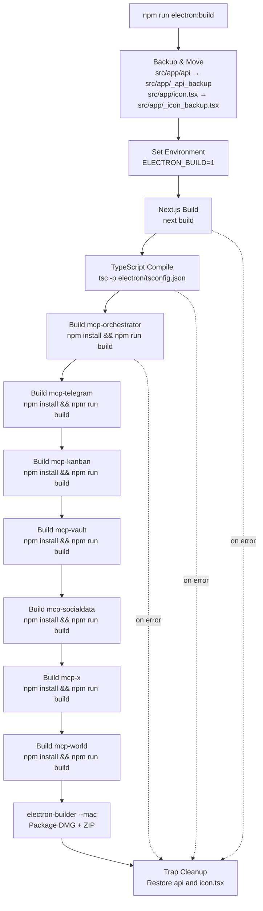
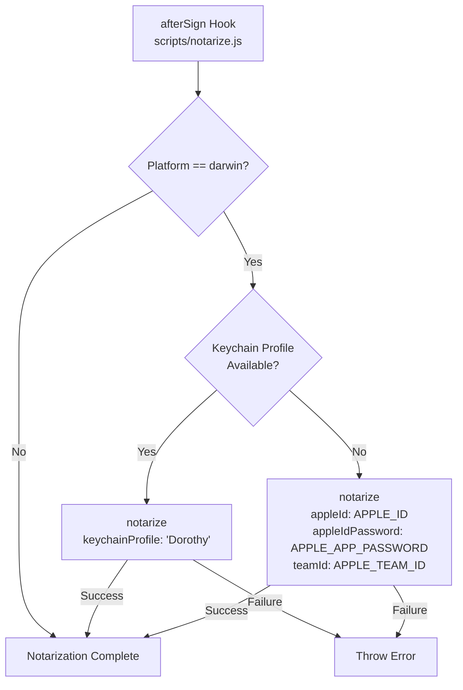
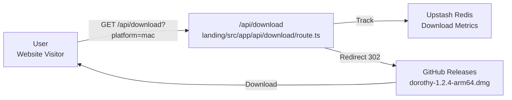
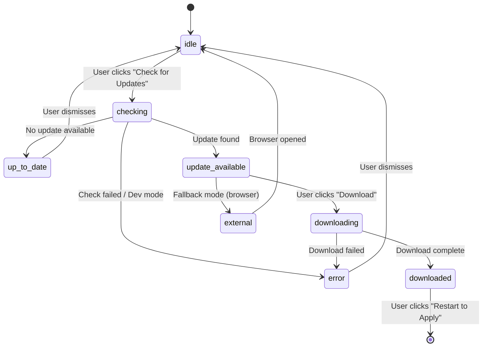
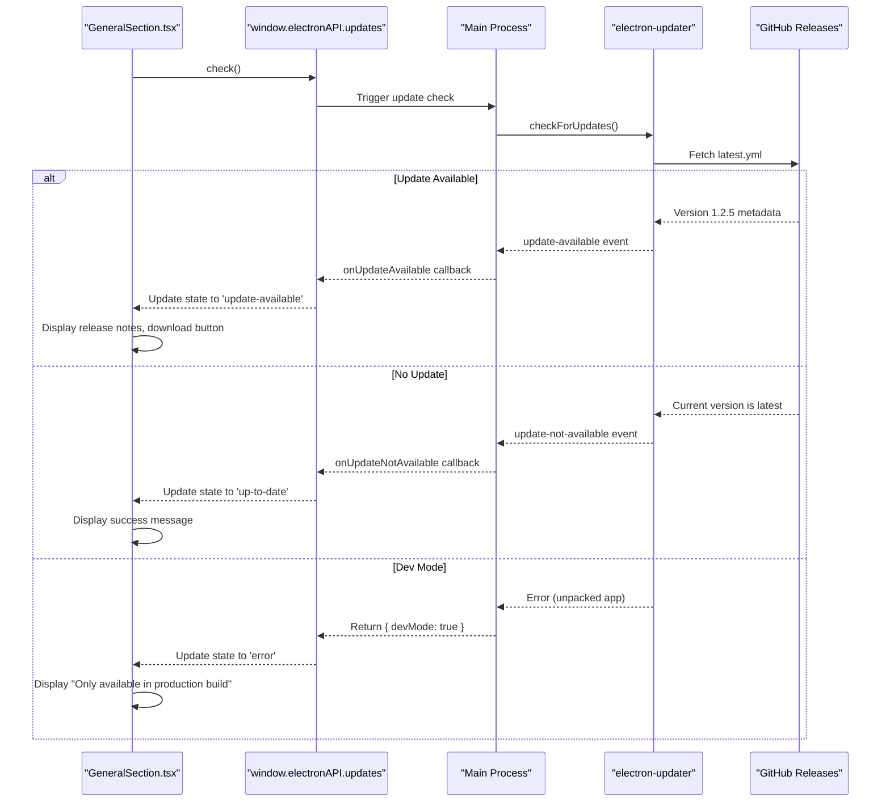

<!-- source: DeepWiki mcp.deepwiki.com · repo Charlie85270/Dorothy · page 12 Build and Release · fetched 2026-10-26 -->

# Build and Release

<details>
<summary>Relevant source files</summary>

The following files were used as context for generating this wiki page:

- [landing/src/app/api/download/route.ts](landing/src/app/api/download/route.ts)
- [package-lock.json](package-lock.json)
- [package.json](package.json)
- [public/atlassian-jira-svgrepo-com.svg](public/atlassian-jira-svgrepo-com.svg)
- [scripts/notarize.js](scripts/notarize.js)
- [src/components/Settings/GeneralSection.tsx](src/components/Settings/GeneralSection.tsx)

</details>


This document provides a comprehensive technical guide to Dorothy's build system, release process, and auto-update mechanism. It covers the multi-stage build pipeline, macOS notarization, GitHub release distribution, and the in-app update system.

For information about building Dorothy from source for development purposes, see [Building from Source](#2.2). For details on the development workflow and testing, see [Development Guide](#14).

---

## Overview

Dorothy's build and release system is implemented through a sophisticated pipeline that orchestrates:

- **Multi-stage build**: Next.js compilation (with API route exclusion for Electron), TypeScript compilation, and seven MCP module builds
- **macOS packaging**: electron-builder with DMG and ZIP targets, hardened runtime, and code signing
- **Notarization**: Automated Apple notarization via `@electron/notarize` using either keychain profiles or environment variables
- **Distribution**: GitHub Releases with download tracking through a Next.js API route backed by Upstash Redis
- **Auto-updates**: In-app update checking and installation powered by `electron-updater`

The current version is `1.2.4` as defined in [package.json:3]().

---

## Build Pipeline

### Script: `electron:build`

The primary build command is defined in [package.json:17]() as a bash script that executes multiple sequential steps with proper error handling.

**Build Stages Flow:**



**Sources:** [package.json:17]()

### Why Move API Routes?

Next.js API routes (`src/app/api`) are designed for server-side execution in a Node.js environment. When building for Electron, these routes must be excluded because:

1. Electron's main process handles backend logic via IPC, not HTTP routes
2. Including API routes in the static export would cause build errors
3. The landing page (separate deployment) uses these routes, not the Electron app

The build script temporarily moves `src/app/api` to `src/app/_api_backup` and restores it via a bash `trap` statement to ensure cleanup even if the build fails.

**Sources:** [package.json:17]()

### electron-builder Configuration

The packaging configuration is defined in [package.json:20-134]():

| Property | Value | Purpose |
|----------|-------|---------|
| `appId` | `io.dorothy.app` | macOS bundle identifier |
| `productName` | `Dorothy` | Application display name |
| `publish.provider` | `github` | GitHub Releases integration |
| `publish.owner` | `Charlie85270` | GitHub repository owner |
| `publish.repo` | `dorothy` | GitHub repository name |
| `directories.output` | `release` | Build output directory |
| `afterSign` | `scripts/notarize.js` | Post-signing notarization hook |

**Files Included in Package:**

The `files` array [package.json:31-40]() specifies what gets bundled:

- `electron/dist/**/*` - Compiled main process code
- `electron/resources/**/*` - Static resources
- `out/**/*` - Next.js static export
- `node_modules/**/*` - Dependencies (with exclusions for Next.js dev tools)
- `skills/**/*` - Pre-installed skill modules
- `hooks/**/*` - Git hooks

**ASAR Unpacking:**

Certain modules must remain unpacked [package.json:42-48]() for native functionality:

- `out/**/*` - Next.js static files
- `hooks/**/*` - Shell scripts
- `electron/resources/**/*` - Resource files
- `node_modules/better-sqlite3/**/*` - Native SQLite bindings
- `node_modules/node-pty/**/*` - Native PTY bindings

**MCP Modules as Extra Resources:**

Each MCP server is copied to `extraResources` [package.json:49-105]() with only essential files:

```
Resources/
├── mcp-orchestrator/
│   ├── package.json
│   └── dist/bundle.js
├── mcp-telegram/
│   ├── package.json
│   └── dist/bundle.js
├── mcp-kanban/
│   ├── package.json
│   └── dist/bundle.js
├── mcp-vault/
│   ├── package.json
│   └── dist/bundle.js
├── mcp-socialdata/
│   ├── package.json
│   └── dist/bundle.js
├── mcp-x/
│   ├── package.json
│   └── dist/bundle.js
└── mcp-world/
    ├── package.json
    └── dist/bundle.js
```

**Sources:** [package.json:20-134]()

### macOS-Specific Settings

Configuration for macOS builds [package.json:108-119]():

```json
{
  "category": "public.app-category.developer-tools",
  "icon": "public/icon.icns",
  "hardenedRuntime": true,
  "gatekeeperAssess": false,
  "entitlements": "build/entitlements.mac.plist",
  "entitlementsInherit": "build/entitlements.mac.plist",
  "target": ["dmg", "zip"]
}
```

**Targets:**
- **DMG**: Disk image with custom layout (app icon at x:130, y:220; Applications folder link at x:410, y:220)
- **ZIP**: Archive format for direct download and update distribution

**Sources:** [package.json:108-133]()

---

## macOS Notarization

### Notarization Script

The notarization process is handled by [scripts/notarize.js](), invoked automatically via the `afterSign` hook [package.json:107]().



**Sources:** [scripts/notarize.js:1-32]()

### Authentication Methods

**Method 1: Keychain Profile (Preferred)**

The script uses a keychain profile named `Dorothy` [scripts/notarize.js:17]() if `APPLE_ID` environment variable is not set. This approach is more secure and doesn't require exposing credentials in environment variables.

Setup:
```bash
xcrun notarytool store-credentials "Dorothy" \
  --apple-id "your-apple-id@example.com" \
  --team-id "XXXXXXXXXX" \
  --password "app-specific-password"
```

**Method 2: Environment Variables**

Fallback method [scripts/notarize.js:19-25]() using:
- `APPLE_ID` - Apple ID email
- `APPLE_APP_PASSWORD` - App-specific password
- `APPLE_TEAM_ID` - 10-character team ID

**Sources:** [scripts/notarize.js:1-32]()

### Error Handling

The notarization script includes comprehensive error handling [scripts/notarize.js:27-29](). If notarization fails, the error is logged and re-thrown, preventing the creation of a non-notarized release.

**Sources:** [scripts/notarize.js:27-29]()

---

## Release Process

### GitHub Releases Integration

Dorothy uses GitHub Releases for distribution with automatic publishing configured in [package.json:23-26]():

```json
{
  "publish": {
    "provider": "github",
    "owner": "Charlie85270",
    "repo": "dorothy"
  }
}
```

After a successful build and notarization, artifacts are uploaded to:
- **Repository**: `https://github.com/Charlie85270/Dorothy`
- **Current Release**: `v1.2.4`
- **Artifacts**:
  - `dorothy-1.2.4-arm64.dmg` - Disk image installer
  - `dorothy-1.2.4-arm64.zip` - Update package for electron-updater

**Sources:** [package.json:23-26](), [landing/src/app/api/download/route.ts:13]()

### Download Tracking API

The landing page includes a download tracking API at `/api/download` that redirects users to the actual release while recording analytics.



**Sources:** [landing/src/app/api/download/route.ts:1-48]()

### Tracked Metrics

The API records [landing/src/app/api/download/route.ts:20-39]():

| Redis Key | Type | Description |
|-----------|------|-------------|
| `downloads:total` | Counter | Total downloads across all time |
| `downloads:daily:YYYY-MM-DD` | Counter | Daily download count |
| `downloads:platform:mac` | Counter | Platform-specific downloads |
| `downloads:log` | List (capped at 1000) | Download event log with timestamp, platform, user-agent |

**Environment Variables:**

- `UPSTASH_REDIS_REST_URL` - Redis connection URL
- `UPSTASH_REDIS_REST_TOKEN` - Authentication token

If these are not set, tracking is silently skipped and the redirect still works [landing/src/app/api/download/route.ts:5-10]().

**Sources:** [landing/src/app/api/download/route.ts:5-39]()

### Download URL Configuration

The current download URL is hardcoded in [landing/src/app/api/download/route.ts:13]():

```typescript
const DOWNLOAD_URL = 'https://github.com/Charlie85270/dorothy/releases/download/1.2.4/dorothy-1.2.4-arm64.dmg';
```

This must be updated manually for each release.

**Sources:** [landing/src/app/api/download/route.ts:13]()

---

## Auto-Update System

### electron-updater Integration

Dorothy uses `electron-updater` [package.json:165]() for automatic update checking and installation. The update UI is implemented in [src/components/Settings/GeneralSection.tsx]().

**Update State Machine:**



**Sources:** [src/components/Settings/GeneralSection.tsx:31]()

### Update Check Flow

**IPC Communication:**



**Sources:** [src/components/Settings/GeneralSection.tsx:85-103](), [src/components/Settings/GeneralSection.tsx:106-132]()

### Download Progress Tracking

When a user initiates a download [src/components/Settings/GeneralSection.tsx:136-146](), the UI subscribes to progress events:

**Progress Event Listener:**

[src/components/Settings/GeneralSection.tsx:59-83]() sets up event listeners for:

1. **`onDownloadProgress`**: Updates `downloadPercent` state [src/components/Settings/GeneralSection.tsx:64-66]()
2. **`onUpdateDownloaded`**: Transitions to `downloaded` state [src/components/Settings/GeneralSection.tsx:70-72]()
3. **`onUpdateError`**: Transitions to `error` state with message [src/components/Settings/GeneralSection.tsx:75-79]()

**Progress Bar Rendering:**

[src/components/Settings/GeneralSection.tsx:239-251]() displays:
- Percentage text: `{downloadPercent.toFixed(0)}%`
- Visual progress bar with width: `{downloadPercent}%`
- Blue progress indicator with smooth transitions

**Sources:** [src/components/Settings/GeneralSection.tsx:59-83](), [src/components/Settings/GeneralSection.tsx:239-251]()

### Release Notes Display

The update UI displays release notes with HTML stripping for plain text rendering [src/components/Settings/GeneralSection.tsx:6-20]():

**`stripHtml` Function:**

Converts HTML release notes to readable plain text by:
1. Replacing `<br>` tags with newlines
2. Adding newlines after block elements (`</p>`, `</li>`, `</h1>`, etc.)
3. Converting `<li>` tags to markdown-style bullets (`- `)
4. Removing all remaining HTML tags
5. Unescaping HTML entities (`&amp;`, `&lt;`, `&gt;`, `&quot;`, `&#39;`)
6. Collapsing multiple consecutive newlines

The first 300 characters are displayed [src/components/Settings/GeneralSection.tsx:232]() with an ellipsis if truncated.

**Sources:** [src/components/Settings/GeneralSection.tsx:6-20](), [src/components/Settings/GeneralSection.tsx:228-236]()

### Fallback Download Mode

For older releases or specific scenarios, the system supports a fallback mode [src/components/Settings/GeneralSection.tsx:134-146]():

**Detection:**

If `updateInfo.downloadUrl` is present [src/components/Settings/GeneralSection.tsx:134](), the update is considered a fallback update (likely an older release without proper `electron-updater` configuration).

**Behavior:**

Instead of downloading via `electron-updater`, clicking "Download" opens the browser to the `downloadUrl` [src/components/Settings/GeneralSection.tsx:138-139]():

```typescript
window.electronAPI?.updates?.openExternal(updateInfo.downloadUrl);
```

**Sources:** [src/components/Settings/GeneralSection.tsx:134-146]()

### Installation

After download completes, the UI shows a "Restart to Apply" button [src/components/Settings/GeneralSection.tsx:274-282]() that calls:

```typescript
window.electronAPI?.updates?.quitAndInstall();
```

This triggers the main process to quit the app and start the installer, which replaces the old version and relaunches Dorothy.

**Sources:** [src/components/Settings/GeneralSection.tsx:148-150](), [src/components/Settings/GeneralSection.tsx:274-282]()

### Auto-Check on Startup

The settings include a toggle for automatic update checking [src/components/Settings/GeneralSection.tsx:173-183]():

```typescript
<Toggle
  enabled={appSettings.autoCheckUpdates !== false}
  onChange={() => onSaveAppSettings({ autoCheckUpdates: !appSettings.autoCheckUpdates })}
/>
```

When enabled, Dorothy checks for updates on application startup. This setting is stored in `app-settings.json`.

**Sources:** [src/components/Settings/GeneralSection.tsx:173-183]()

---

## Build Output Structure

After a successful build, the output directory structure is:

```
release/
├── mac/
│   └── Dorothy.app/
│       └── Contents/
│           ├── MacOS/
│           │   └── Dorothy (executable)
│           ├── Resources/
│           │   ├── app.asar (main app bundle)
│           │   ├── app.asar.unpacked/
│           │   │   ├── out/ (Next.js static export)
│           │   │   ├── hooks/
│           │   │   ├── node_modules/
│           │   │   │   ├── better-sqlite3/
│           │   │   │   └── node-pty/
│           │   │   └── electron/resources/
│           │   ├── mcp-orchestrator/
│           │   ├── mcp-telegram/
│           │   ├── mcp-kanban/
│           │   ├── mcp-vault/
│           │   ├── mcp-socialdata/
│           │   ├── mcp-x/
│           │   └── mcp-world/
│           └── Info.plist
├── dorothy-1.2.4-arm64.dmg (installer)
└── dorothy-1.2.4-arm64.zip (update package)
```

**Sources:** [package.json:20-134]()

---

## Version Management

The application version is centrally defined in [package.json:3]() as `1.2.4`. This version number is used by:

1. **electron-builder**: Embedded in package metadata
2. **GitHub Releases**: Tag name and release title
3. **electron-updater**: Version comparison for update detection
4. **Landing page download URL**: Hardcoded in [landing/src/app/api/download/route.ts:13]()
5. **UI display**: Shown in GeneralSection [src/components/Settings/GeneralSection.tsx:167]()

To create a new release, update the version in `package.json`, rebuild, and ensure the download URL in the landing page API is updated accordingly.

**Sources:** [package.json:3](), [landing/src/app/api/download/route.ts:13](), [src/components/Settings/GeneralSection.tsx:167]()

---

