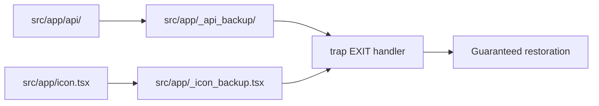
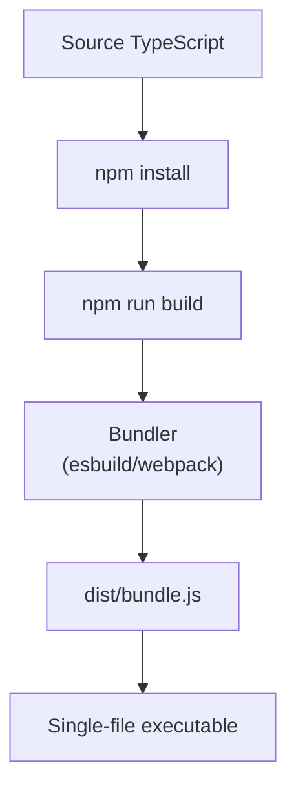
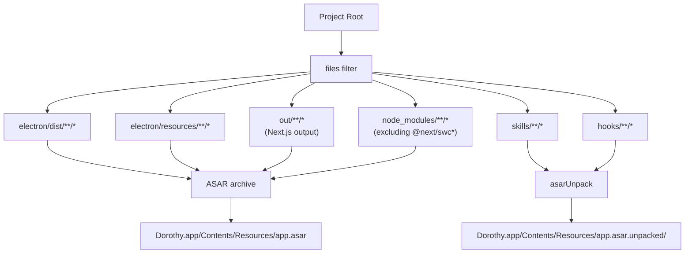
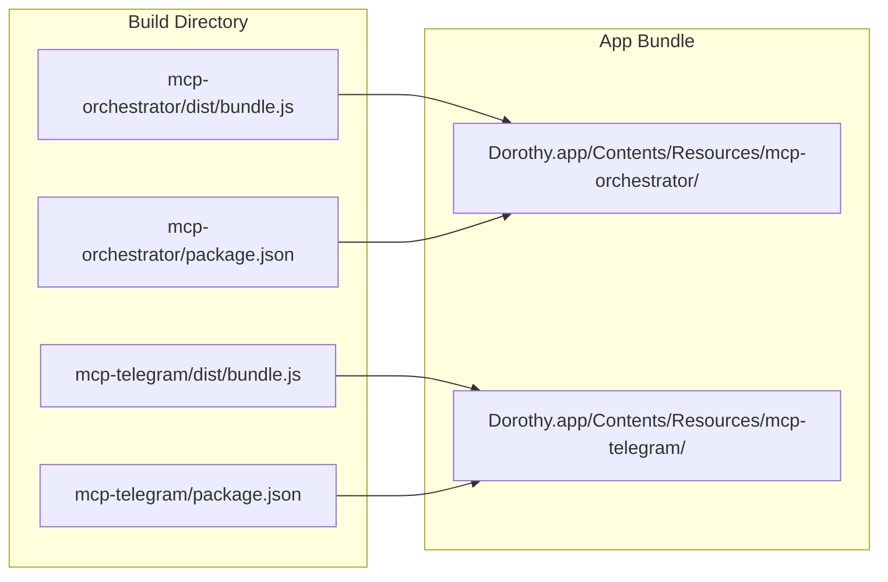

<!-- source: DeepWiki mcp.deepwiki.com · repo Charlie85270/Dorothy · page 12.1 Build Pipeline · fetched 2026-10-26 -->

# Build Pipeline

<details>
<summary>Relevant source files</summary>

The following files were used as context for generating this wiki page:

- [landing/src/app/api/download/route.ts](landing/src/app/api/download/route.ts)
- [package-lock.json](package-lock.json)
- [package.json](package.json)
- [public/atlassian-jira-svgrepo-com.svg](public/atlassian-jira-svgrepo-com.svg)
- [scripts/notarize.js](scripts/notarize.js)
- [src/components/Settings/GeneralSection.tsx](src/components/Settings/GeneralSection.tsx)

</details>


This document details the Dorothy build pipeline, which transforms the development codebase into distributable macOS applications. The pipeline encompasses Next.js compilation, TypeScript transpilation, MCP module bundling, and electron-builder packaging.

For information about macOS notarization, see [macOS Notarization](#12.2). For the release process and distribution, see [Release Process](#12.3). For the auto-update mechanism, see [Auto-Update System](#12.4).

---

## Overview

The build pipeline is orchestrated by the `electron:build` npm script, which executes a multi-stage bash command that builds all application components in sequence. The process produces a fully packaged macOS application (`.dmg` and `.zip`) with code signing and notarization.

**Sources:** [package.json:17-17]()

---

## Build Script Anatomy

The `electron:build` script at [package.json:17]() performs the following sequence:

```bash
bash -c 'set -e; 
  mv src/app/api src/app/_api_backup; 
  mv src/app/icon.tsx src/app/_icon_backup.tsx 2>/dev/null || true; 
  trap "mv src/app/_api_backup src/app/api 2>/dev/null; mv src/app/_icon_backup.tsx src/app/icon.tsx 2>/dev/null" EXIT; 
  ELECTRON_BUILD=1 next build; 
  tsc -p electron/tsconfig.json; 
  cd mcp-orchestrator && npm install && npm run build && cd ..; 
  cd mcp-telegram && npm install && npm run build && cd ..; 
  cd mcp-kanban && npm install && npm run build && cd ..; 
  cd mcp-vault && npm install && npm run build && cd ..; 
  cd mcp-socialdata && npm install && npm run build && cd ..; 
  cd mcp-x && npm install && npm run build && cd ..; 
  cd mcp-world && npm install && npm run build && cd ..; 
  electron-builder --mac'
```

Key characteristics:
- **Fail-fast**: `set -e` ensures any command failure aborts the build
- **Cleanup guarantee**: `trap` ensures API routes are restored even on failure
- **Sequential execution**: Each stage must complete before the next begins

**Sources:** [package.json:17-17]()

---

## Pipeline Stages

### Stage 1: API Route Exclusion



The landing page API routes (`src/app/api/download/route.ts`, stats endpoints) are Next.js server routes designed for Vercel deployment. Since Electron does not need server-side API routes, they are temporarily renamed before building to prevent Next.js from including them in the static export.

The `trap` command registers an EXIT handler that restores the original structure regardless of build success or failure.

**Sources:** [package.json:17](), [landing/src/app/api/download/route.ts:1-49]()

---

### Stage 2: Next.js Build

```bash
ELECTRON_BUILD=1 next build
```

This stage invokes Next.js to compile the React application into static HTML, CSS, and JavaScript:

- **Environment**: `ELECTRON_BUILD=1` signals conditional logic to exclude server-only features
- **Output directory**: `out/` containing static assets
- **Build mode**: Static export (no server-side rendering in Electron context)
- **Asset optimization**: Minification, tree-shaking, code splitting

The Next.js configuration at `next.config.js` (not shown in provided files) likely specifies `output: 'export'` to generate static files.

**Sources:** [package.json:17]()

---

### Stage 3: TypeScript Compilation

```bash
tsc -p electron/tsconfig.json
```

TypeScript compilation transforms the Electron main process code from `electron/` into JavaScript:

| Source Directory | Output Directory | Purpose |
|-----------------|------------------|---------|
| `electron/*.ts` | `electron/dist/*.js` | Main process entry point |
| `electron/handlers/**/*.ts` | `electron/dist/handlers/**/*.js` | IPC handlers |
| `electron/services/**/*.ts` | `electron/dist/services/**/*.js` | Background services |

The compiled `electron/dist/main.js` serves as the Electron entry point specified in [package.json:5]().

**Sources:** [package.json:5](), [package.json:17]()

---

### Stage 4: MCP Module Builds

Each of the seven MCP servers is built in sequence. The pattern for each module is:

```bash
cd <module-name> && npm install && npm run build && cd ..
```

#### MCP Build Process



Each MCP module produces a self-contained `dist/bundle.js` that includes all dependencies bundled together. This approach:
- Eliminates `node_modules` dependencies at runtime
- Reduces package size
- Simplifies distribution

#### MCP Modules Built

| Module | Purpose | Output |
|--------|---------|--------|
| `mcp-orchestrator` | Agent management, messaging, scheduling | `mcp-orchestrator/dist/bundle.js` |
| `mcp-telegram` | Telegram media operations | `mcp-telegram/dist/bundle.js` |
| `mcp-kanban` | Task management | `mcp-kanban/dist/bundle.js` |
| `mcp-vault` | Document storage with SQLite | `mcp-vault/dist/bundle.js` |
| `mcp-socialdata` | Twitter/social API integration | `mcp-socialdata/dist/bundle.js` |
| `mcp-x` | X/Twitter posting | `mcp-x/dist/bundle.js` |
| `mcp-world` | 3D agent world | `mcp-world/dist/bundle.js` |

**Sources:** [package.json:17](), [package.json:49-106]()

---

### Stage 5: electron-builder Packaging

```bash
electron-builder --mac
```

electron-builder packages the compiled assets into distributable macOS applications. The configuration at [package.json:20-134]() defines the packaging behavior.

#### Build Configuration Breakdown

**App Identity**
```json
{
  "appId": "io.dorothy.app",
  "productName": "Dorothy"
}
```

**File Inclusion Pattern**



The `files` array at [package.json:31-41]() specifies which files to include:
- `electron/dist/**/*`: Compiled main process code
- `out/**/*`: Next.js static export
- `node_modules/**/*`: Runtime dependencies (excluding Next.js-specific modules)
- `skills/**/*` and `hooks/**/*`: Extension directories

**ASAR Unpacking**

Certain files must remain unpacked because they require native file system access:

| Pattern | Reason |
|---------|--------|
| `out/**/*` | Next.js assets loaded via HTTP server |
| `hooks/**/*` | Git hooks executed as shell scripts |
| `electron/resources/**/*` | Resource files accessed by path |
| `node_modules/better-sqlite3/**/*` | Native module with `.node` binaries |
| `node_modules/node-pty/**/*` | Native module with `.node` binaries |

**Sources:** [package.json:42-48]()

---

## MCP Module Extraction

The `extraResources` configuration at [package.json:49-106]() copies each MCP module's built artifacts into the application bundle:



Each MCP module directory contains:
- `package.json`: Module metadata for spawning via Node.js
- `dist/bundle.js`: Self-contained executable bundle

At runtime, the agent manager spawns these MCP servers by executing `node <path>/dist/bundle.js` with stdio communication.

**Sources:** [package.json:49-106]()

---

## macOS-Specific Configuration

The `mac` configuration at [package.json:108-119]() defines macOS packaging parameters:

```json
{
  "category": "public.app-category.developer-tools",
  "icon": "public/icon.icns",
  "hardenedRuntime": true,
  "gatekeeperAssess": false,
  "entitlements": "build/entitlements.mac.plist",
  "entitlementsInherit": "build/entitlements.mac.plist",
  "target": ["dmg", "zip"]
}
```

**Key settings:**
- **hardenedRuntime**: Required for macOS notarization
- **entitlements**: Defines permissions (camera, microphone, JIT compilation for native modules)
- **target**: Produces both DMG installer and ZIP archive

The `afterSign` hook at [package.json:107]() invokes `scripts/notarize.js` for Apple notarization. See [macOS Notarization](#12.2) for details.

**Sources:** [package.json:107-119](), [scripts/notarize.js:1-33]()

---

## DMG Configuration

The `dmg` section at [package.json:120-134]() configures the disk image layout:

```json
{
  "title": "Dorothy",
  "contents": [
    { "x": 130, "y": 220 },
    { "x": 410, "y": 220, "type": "link", "path": "/Applications" }
  ]
}
```

This creates a DMG with the application icon at (130, 220) and a symlink to `/Applications` at (410, 220), providing the standard drag-to-install experience.

**Sources:** [package.json:120-134]()

---

## Build Output Structure

After successful completion, the pipeline produces:

```
release/
├── Dorothy-1.2.4-arm64.dmg          # Disk image installer
├── Dorothy-1.2.4-arm64-mac.zip      # ZIP archive
└── mac-arm64/
    └── Dorothy.app/
        └── Contents/
            ├── MacOS/
            │   └── Dorothy                      # Electron executable
            ├── Resources/
            │   ├── app.asar                     # Packed application code
            │   ├── app.asar.unpacked/           # Unpacked native modules
            │   │   ├── hooks/
            │   │   ├── out/
            │   │   └── node_modules/
            │   ├── mcp-orchestrator/
            │   │   ├── package.json
            │   │   └── dist/bundle.js
            │   ├── mcp-telegram/
            │   ├── mcp-kanban/
            │   ├── mcp-vault/
            │   ├── mcp-socialdata/
            │   ├── mcp-x/
            │   └── mcp-world/
            └── Info.plist
```

The output directory is defined by `directories.output` at [package.json:29]().

**Sources:** [package.json:20-134]()

---

## Build Dependencies

The build process requires these devDependencies:

| Package | Version | Purpose |
|---------|---------|---------|
| `electron-builder` | ^25.1.8 | Packaging and code signing |
| `@electron/notarize` | ^3.1.1 | Apple notarization |
| `@electron/rebuild` | ^4.0.2 | Rebuilding native modules |
| `typescript` | ^5 | TypeScript compilation |
| `concurrently` | ^9.1.0 | Running parallel dev processes |
| `wait-on` | ^8.0.1 | Waiting for dev server |

**Sources:** [package.json:167-187]()

---

## Version Management

The application version is defined at [package.json:3]() and referenced throughout the build:

- **App bundle**: Embedded in `Info.plist`
- **Download URL**: Used in [landing/src/app/api/download/route.ts:13]()
- **Update checker**: Compared against GitHub releases

Version updates require synchronization across:
1. `package.json` version field
2. Download API route URL
3. Git tag for release

**Sources:** [package.json:3](), [landing/src/app/api/download/route.ts:13]()

---

## Build Environment Variables

| Variable | Purpose | Stage |
|----------|---------|-------|
| `ELECTRON_BUILD=1` | Signals Electron context to Next.js | Next.js build |
| `NODE_ENV=production` | Enables production optimizations | All stages |
| `APPLE_ID` | Apple Developer ID for notarization | After sign |
| `APPLE_APP_PASSWORD` | App-specific password | After sign |
| `APPLE_TEAM_ID` | Developer team ID | After sign |

Notarization credentials can also be stored in the macOS keychain as the "Dorothy" profile, bypassing environment variables. See [scripts/notarize.js:9-18]() for the conditional logic.

**Sources:** [package.json:17](), [scripts/notarize.js:9-26]()

---

## Common Build Issues

### Native Module Rebuilding

The `better-sqlite3` and `node-pty` modules contain native `.node` binaries that must match the Electron version. If build errors occur related to these modules:

```bash
npm run electron:rebuild
# or manually
electron-rebuild -f -w better-sqlite3 -w node-pty
```

### Next.js API Route Inclusion

If API routes accidentally get included in the build, the application bundle will contain server-side code that won't function in Electron. The temporary rename strategy prevents this, but if the trap fails, manually verify that `src/app/api` was restored after build.

### MCP Module Build Failures

If any MCP module fails to build, the entire pipeline aborts due to `set -e`. Check the specific module's `npm run build` script and build configuration in its directory.

**Sources:** [package.json:17]()

---

## Development Build

For development purposes without full packaging, use `electron:pack`:

```bash
npm run electron:pack
```

This executes the same build stages but passes `--dir` to electron-builder, which skips DMG/ZIP creation and notarization, producing only an unpackaged application directory for faster iteration.

**Sources:** [package.json:18]()

---

## Build Performance

Typical build times on Apple Silicon (M1/M2):

| Stage | Duration |
|-------|----------|
| API route exclusion | <1s |
| Next.js build | 30-60s |
| TypeScript compilation | 5-10s |
| MCP modules (7 × build) | 20-40s |
| electron-builder packaging | 30-60s |
| Notarization | 3-10 minutes |
| **Total (without notarization)** | **~2-3 minutes** |
| **Total (with notarization)** | **~5-13 minutes** |

Notarization time varies based on Apple's server load and is handled asynchronously after packaging completes.

**Sources:** [package.json:17](), [scripts/notarize.js:1-33]()

---

