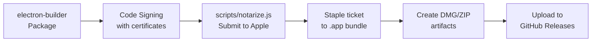
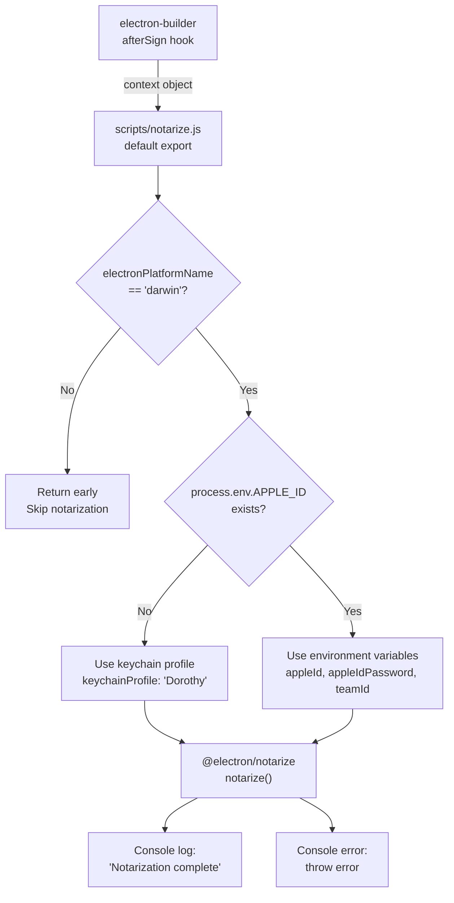
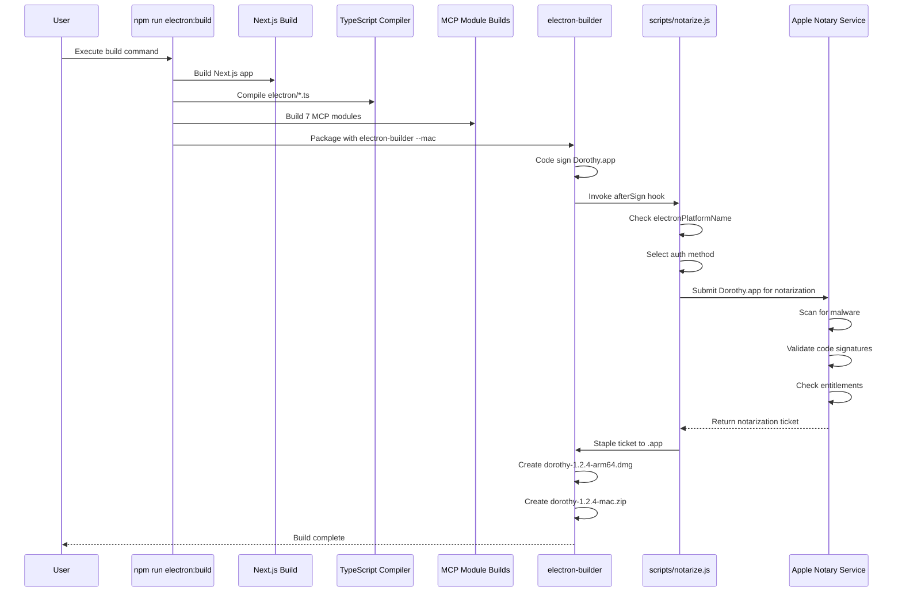
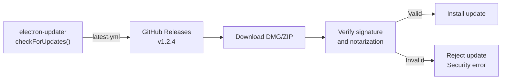

<!-- source: DeepWiki mcp.deepwiki.com · repo Charlie85270/Dorothy · page 12.2 macOS Notarization · fetched 2026-10-26 -->

# macOS Notarization

<details>
<summary>Relevant source files</summary>

The following files were used as context for generating this wiki page:

- [landing/src/app/api/download/route.ts](landing/src/app/api/download/route.ts)
- [package-lock.json](package-lock.json)
- [package.json](package.json)
- [public/atlassian-jira-svgrepo-com.svg](public/atlassian-jira-svgrepo-com.svg)
- [scripts/notarize.js](scripts/notarize.js)
- [src/components/Settings/GeneralSection.tsx](src/components/Settings/GeneralSection.tsx)

</details>


This document explains Dorothy's macOS notarization process, which ensures that the application can be installed and run on macOS systems without triggering Gatekeeper warnings. Notarization is a mandatory step for distributing macOS applications outside the App Store.

For information about the complete build pipeline, see [Build Pipeline](#12.1). For details on the release and distribution process, see [Release Process](#12.3).

---

## Overview

macOS notarization is an automated security check performed by Apple that scans applications for malicious content and code-signing issues. Dorothy implements notarization as part of its `electron:build` workflow using the `@electron/notarize` package. The notarization process runs automatically after the code signing step and must complete successfully before the DMG and ZIP artifacts can be distributed.

The notarization workflow occurs between code signing and distribution:



Sources: [package.json:107](), [scripts/notarize.js:1-32]()

---

## Notarization Script Architecture

The notarization logic is implemented in `scripts/notarize.js` as an electron-builder `afterSign` hook. The script exports a default async function that electron-builder invokes after code signing completes.



Sources: [scripts/notarize.js:1-32]()

---

## Authentication Methods

Dorothy supports two authentication mechanisms for Apple's notarization service, allowing flexibility for different build environments (local development vs CI/CD).

### Keychain Profile Authentication

The preferred method for local builds uses a keychain profile stored in the macOS Keychain. This method activates when the `APPLE_ID` environment variable is **not** set:

```javascript
// scripts/notarize.js:14-18
if (useKeychain) {
  await notarize({
    appPath: `${appOutDir}/${appName}.app`,
    keychainProfile: 'Dorothy',
  });
}
```

The keychain profile named `"Dorothy"` must be created using `xcrun notarytool store-credentials` before running the build. This approach avoids storing credentials in environment variables or files.

**Profile Creation Command:**
```bash
xcrun notarytool store-credentials Dorothy \
  --apple-id "your-apple-id@example.com" \
  --team-id "TEAMID123" \
  --password "app-specific-password"
```

### Environment Variable Authentication

For CI/CD environments (GitHub Actions, etc.), the script falls back to environment variable authentication:

| Environment Variable | Purpose | Example |
|---------------------|---------|---------|
| `APPLE_ID` | Apple Developer account email | `developer@example.com` |
| `APPLE_APP_PASSWORD` | App-specific password | `abcd-efgh-ijkl-mnop` |
| `APPLE_TEAM_ID` | 10-character Apple Team ID | `ABCDEF1234` |

```javascript
// scripts/notarize.js:19-26
else {
  await notarize({
    appPath: `${appOutDir}/${appName}.app`,
    appleId: process.env.APPLE_ID,
    appleIdPassword: process.env.APPLE_APP_PASSWORD,
    teamId: process.env.APPLE_TEAM_ID,
  });
}
```

Sources: [scripts/notarize.js:8-26]()

---

## Build Configuration

The electron-builder configuration in `package.json` defines the notarization hook and required security settings.

### AfterSign Hook Registration

```json
// package.json:107
"afterSign": "scripts/notarize.js"
```

This instructs electron-builder to execute the notarization script after code signing but before creating distribution artifacts.

### macOS Security Configuration

The `mac` section of the build configuration enables features required for notarization:

| Setting | Value | Purpose |
|---------|-------|---------|
| `hardenedRuntime` | `true` | Enables Hardened Runtime protection |
| `gatekeeperAssess` | `false` | Skips pre-notarization Gatekeeper check |
| `entitlements` | `"build/entitlements.mac.plist"` | Specifies app entitlements |
| `entitlementsInherit` | `"build/entitlements.mac.plist"` | Applies entitlements to child processes |

```json
// package.json:108-118
"mac": {
  "category": "public.app-category.developer-tools",
  "icon": "public/icon.icns",
  "hardenedRuntime": true,
  "gatekeeperAssess": false,
  "entitlements": "build/entitlements.mac.plist",
  "entitlementsInherit": "build/entitlements.mac.plist",
  "target": [
    "dmg",
    "zip"
  ]
}
```

Sources: [package.json:107-119]()

---

## Notarization Process Flow

The complete notarization workflow integrates with Dorothy's build pipeline:



Sources: [package.json:17](), [scripts/notarize.js:1-32]()

---

## Entitlements and Hardened Runtime

Dorothy requires specific entitlements to function correctly under Hardened Runtime, which is mandatory for notarization. These are defined in `build/entitlements.mac.plist` (referenced but not shown in provided files).

### Common Required Entitlements

Based on Dorothy's architecture, the following entitlements are typically required:

| Entitlement | Reason |
|-------------|--------|
| `com.apple.security.cs.allow-unsigned-executable-memory` | For JIT compilation in Node.js/V8 |
| `com.apple.security.cs.allow-jit` | JavaScript JIT execution |
| `com.apple.security.network.client` | HTTP API calls to external services |
| `com.apple.security.network.server` | HTTP API server on port 31415 |
| `com.apple.security.files.user-selected.read-write` | User-selected file access |
| `com.apple.security.automation.apple-events` | System automation capabilities |

The entitlements file is applied to both the main app and all child processes via the `entitlementsInherit` setting.

Sources: [package.json:113-114]()

---

## Dependencies and Versions

The notarization functionality depends on specific npm packages:

```json
// package.json:168-169
"devDependencies": {
  "@electron/notarize": "^3.1.1",
  ...
}
```

The `@electron/notarize` package version `^3.1.1` requires Node.js `>= 22.12.0` as specified in its own dependencies. This constraint is important for CI/CD environment setup.

Sources: [package.json:168](), [package-lock.json:522-534]()

---

## Error Handling and Logging

The notarization script implements error handling with console output for debugging:

```javascript
// scripts/notarize.js:11-31
console.log(`Notarizing ${appName}.app...`);

try {
  // notarization logic
} catch (error) {
  console.error('Notarization failed:', error);
  throw error;
}
console.log('Notarization complete');
```

When notarization fails:
1. The error is logged to console with full details
2. The error is re-thrown, causing the build to fail
3. electron-builder terminates without creating distribution artifacts
4. The exit code propagates to CI/CD systems

This fail-fast approach prevents unsigned or unnotarized builds from being released.

Sources: [scripts/notarize.js:11-31]()

---

## Platform-Specific Execution

The notarization script includes a platform check to ensure it only runs on macOS builds:

```javascript
// scripts/notarize.js:2-3
const { electronPlatformName, appOutDir } = context;
if (electronPlatformName !== 'darwin') return;
```

This guard clause allows the same build configuration to support multiple platforms without requiring platform-specific package.json configurations. When building for Windows or Linux, the script returns immediately without attempting notarization.

Sources: [scripts/notarize.js:2-3]()

---

## Integration with Auto-Updater

Notarized builds are essential for Dorothy's auto-update functionality. The `electron-updater` component (used in GeneralSection) can only install updates that are properly signed and notarized:



Without notarization, macOS would block the update installation, and users would receive Gatekeeper warnings. The notarization ticket is stapled to the DMG, allowing offline verification.

Sources: [src/components/Settings/GeneralSection.tsx:85-103](), [package.json:165]()

---

## Troubleshooting

### Common Notarization Failures

| Error Message | Cause | Solution |
|--------------|-------|----------|
| `Invalid credentials` | Wrong Apple ID or password | Verify `APPLE_ID` and `APPLE_APP_PASSWORD` |
| `Team ID not found` | Incorrect or missing Team ID | Check Apple Developer account for correct `APPLE_TEAM_ID` |
| `Code signing issue detected` | Code signature verification failed | Ensure valid signing certificate before notarization |
| `Hardened Runtime not enabled` | Missing runtime flag | Verify `hardenedRuntime: true` in package.json |
| `Invalid entitlements` | Entitlements file error | Check syntax of `build/entitlements.mac.plist` |
| `Keychain profile not found` | Dorothy profile not created | Run `xcrun notarytool store-credentials Dorothy` |

### Checking Notarization Status

After notarization completes, verify the ticket is stapled:

```bash
# Check if ticket is stapled to the app
spctl -a -vv release/mac/Dorothy.app

# Check if DMG is notarized
spctl -a -vv -t install release/dorothy-1.2.4-arm64.dmg

# View notarization history
xcrun notarytool history --keychain-profile Dorothy
```

Sources: [scripts/notarize.js:1-32]()

---

## Build Output Artifacts

After successful notarization, electron-builder creates two distribution formats specified in the `mac.target` configuration:

| Artifact | Format | Purpose |
|----------|--------|---------|
| `dorothy-1.2.4-arm64.dmg` | Disk Image | User-friendly installer with drag-to-Applications |
| `dorothy-1.2.4-mac.zip` | ZIP Archive | Update distribution for electron-updater |

Both artifacts contain the notarized and stapled `Dorothy.app` bundle. The DMG is uploaded to GitHub Releases and linked from the landing page download API.

Sources: [package.json:115-118](), [landing/src/app/api/download/route.ts:13]()

---

