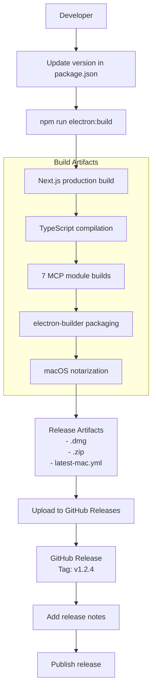
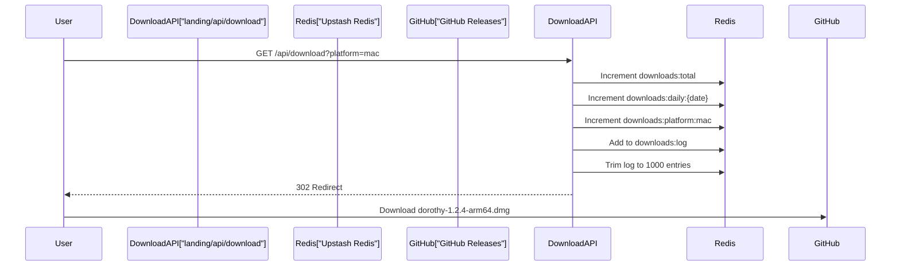
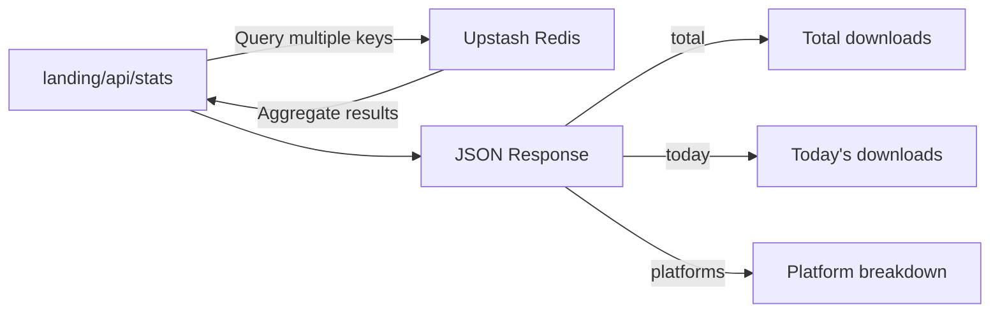
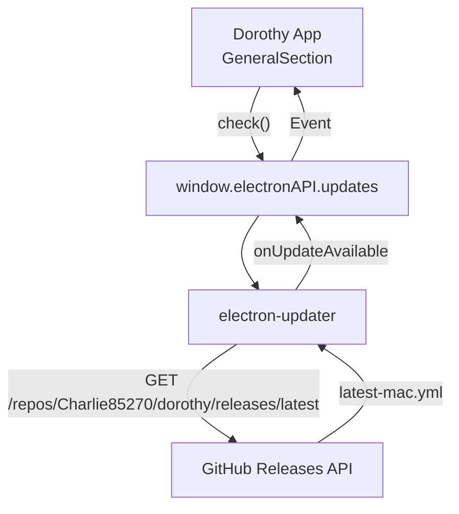

<!-- source: DeepWiki mcp.deepwiki.com · repo Charlie85270/Dorothy · page 12.3 Release Process · fetched 2026-10-26 -->

# Release Process

<details>
<summary>Relevant source files</summary>

The following files were used as context for generating this wiki page:

- [landing/package-lock.json](landing/package-lock.json)
- [landing/package.json](landing/package.json)
- [landing/src/app/api/download/route.ts](landing/src/app/api/download/route.ts)
- [landing/src/app/api/stats/route.ts](landing/src/app/api/stats/route.ts)
- [landing/src/app/layout.tsx](landing/src/app/layout.tsx)
- [package-lock.json](package-lock.json)
- [package.json](package.json)
- [public/atlassian-jira-svgrepo-com.svg](public/atlassian-jira-svgrepo-com.svg)
- [scripts/notarize.js](scripts/notarize.js)
- [src/components/Settings/GeneralSection.tsx](src/components/Settings/GeneralSection.tsx)

</details>


This document describes Dorothy's release distribution system, including GitHub Releases integration, download tracking via the landing page, and analytics infrastructure.

For information about the build pipeline that creates release artifacts, see [Build Pipeline](#12.1). For details about the auto-update mechanism within the application, see [Auto-Update System](#12.4). For macOS code signing and notarization, see [macOS Notarization](#12.2).

---

## Overview

Dorothy uses GitHub Releases as its primary distribution channel. The landing page at `https://dorothy.app` serves as a download portal that tracks analytics and redirects users to the appropriate GitHub Release asset. This architecture separates distribution (GitHub's CDN) from analytics (Upstash Redis), allowing Dorothy to remain fully open-source while tracking adoption metrics.

**Sources:** [landing/src/app/api/download/route.ts:1-49](), [package.json:1-189]()

---

## Release Configuration

### Version Management

Dorothy's version is managed through the standard `package.json` version field. The current release version is `1.2.4`.

**Key Fields:**

| Field | Value | Purpose |
|-------|-------|---------|
| `version` | `1.2.4` | Semver version used for all artifacts |
| `name` | `dorothy` | Package identifier |
| `productName` | `Dorothy` | Display name in the app |

**Sources:** [package.json:2-4]()

### GitHub Releases Integration

The `electron-builder` configuration in `package.json` specifies GitHub as the publish provider:

```json
"publish": {
  "provider": "github",
  "owner": "Charlie85270",
  "repo": "dorothy"
}
```

This configuration enables `electron-updater` to automatically discover new releases by querying the GitHub Releases API at `https://api.github.com/repos/Charlie85270/dorothy/releases/latest`.

**Sources:** [package.json:23-27]()

---

## Release Creation Workflow



**Sources:** [package.json:17](), [scripts/notarize.js:1-33]()

### Build Command

The complete build is triggered via:

```bash
npm run electron:build
```

This script performs multiple steps:
1. **Temporarily moves API routes and icons** to prevent Next.js from including them in the Electron build
2. **Builds Next.js** with `ELECTRON_BUILD=1` environment variable
3. **Compiles TypeScript** for the Electron main process
4. **Builds seven MCP modules** sequentially (orchestrator, telegram, kanban, vault, socialdata, x, world)
5. **Runs electron-builder** for macOS targets (dmg and zip)
6. **Executes notarization** via the `afterSign` hook

**Sources:** [package.json:17](), [package.json:107]()

### Release Artifacts

Each release includes:

| Artifact | Description |
|----------|-------------|
| `dorothy-{version}-arm64.dmg` | macOS ARM64 disk image |
| `dorothy-{version}-arm64-mac.zip` | macOS ARM64 zip archive |
| `latest-mac.yml` | Metadata file for electron-updater |

The `latest-mac.yml` file contains SHA512 checksums and file sizes, enabling secure update verification.

**Sources:** [package.json:108-119]()

---

## Download Tracking System

### Landing Page Download API

The landing page provides a `/api/download` endpoint that serves two purposes:
1. **Tracks download metrics** in Redis
2. **Redirects users** to the GitHub Release asset



**Sources:** [landing/src/app/api/download/route.ts:1-49]()

### Download Route Implementation

The download route tracks multiple metrics:

**Redis Keys:**

| Key Pattern | Type | Purpose |
|-------------|------|---------|
| `downloads:total` | Counter | Total downloads across all time |
| `downloads:daily:{YYYY-MM-DD}` | Counter | Downloads for a specific date |
| `downloads:platform:{platform}` | Counter | Platform-specific totals |
| `downloads:log` | List | Last 1000 download events |

**Download Log Entry:**
```typescript
{
  timestamp: string;     // ISO 8601 timestamp
  platform: string;      // "mac", "windows", or "linux"
  userAgent: string;     // Browser user agent
}
```

The log is kept at a maximum of 1000 entries using `LTRIM` to prevent unbounded growth.

**Sources:** [landing/src/app/api/download/route.ts:22-40]()

### Download URL Management

The current release URL is hardcoded in the download route:

```typescript
const DOWNLOAD_URL = 'https://github.com/Charlie85270/dorothy/releases/download/1.2.4/dorothy-1.2.4-arm64.dmg';
```

This URL must be manually updated when creating a new release. The format follows GitHub's standard release asset URL structure:

```
https://github.com/{owner}/{repo}/releases/download/{tag}/{asset-name}
```

**Sources:** [landing/src/app/api/download/route.ts:13]()

---

## Analytics and Statistics

### Statistics API

The `/api/stats` endpoint provides download metrics without requiring authentication:



**Sources:** [landing/src/app/api/stats/route.ts:1-50]()

### Response Schema

```typescript
{
  total: number;          // All-time downloads
  today: number;          // Downloads today
  platforms: {
    mac: number;
    windows: number;
    linux: number;
  }
}
```

The endpoint returns zeros if Redis is unavailable or not configured, ensuring graceful degradation.

**Sources:** [landing/src/app/api/stats/route.ts:12-49]()

### Redis Configuration

The analytics system requires two environment variables:

| Variable | Purpose |
|----------|---------|
| `UPSTASH_REDIS_REST_URL` | Redis REST API endpoint |
| `UPSTASH_REDIS_REST_TOKEN` | Authentication token |

If these variables are not set, the download route still functions but skips tracking.

**Sources:** [landing/src/app/api/download/route.ts:5-10](), [landing/src/app/api/stats/route.ts:5-10]()

---

## Update Discovery Integration

### Electron-Updater Configuration

Dorothy uses `electron-updater` to check for new releases. The update system queries GitHub Releases based on the publish configuration in `package.json`:



**Sources:** [src/components/Settings/GeneralSection.tsx:85-103](), [package.json:23-27]()

### Update Check Flow

The update check process in the Settings UI follows these states:

| State | Description | UI Behavior |
|-------|-------------|-------------|
| `idle` | No check performed | Shows "Check for Updates" button |
| `checking` | Query in progress | Shows spinner |
| `up-to-date` | No update available | Shows green checkmark |
| `update-available` | New version found | Shows download button |
| `downloading` | Download in progress | Shows progress bar |
| `downloaded` | Ready to install | Shows "Restart to Apply" button |
| `error` | Check failed | Shows error message |

**Sources:** [src/components/Settings/GeneralSection.tsx:31-44]()

### Release Notes Display

When an update is available, the UI displays release notes by stripping HTML tags:

```typescript
function stripHtml(html: string): string {
  return html
    .replace(/<br\s*\/?>/gi, '\n')
    .replace(/<\/(?:p|li|h[1-6]|div|tr)>/gi, '\n')
    .replace(/<li[^>]*>/gi, '- ')
    .replace(/<[^>]+>/g, '')
    // ... HTML entity decoding
    .trim();
}
```

The function converts common HTML elements to plain text with line breaks, ensuring release notes are readable in the UI.

**Sources:** [src/components/Settings/GeneralSection.tsx:7-20]()

### Fallback Mechanism

For older releases that don't support in-app downloads, the UI provides a fallback to open the browser:

```typescript
if (isFallbackUpdate && updateInfo?.downloadUrl) {
  window.electronAPI?.updates?.openExternal(updateInfo.downloadUrl);
}
```

This ensures users can always access updates even if the automated download fails.

**Sources:** [src/components/Settings/GeneralSection.tsx:134-140]()

---

## Platform-Specific Considerations

### macOS Distribution

Dorothy targets macOS exclusively in the current release configuration:

```json
"mac": {
  "category": "public.app-category.developer-tools",
  "icon": "public/icon.icns",
  "hardenedRuntime": true,
  "gatekeeperAssess": false,
  "target": ["dmg", "zip"]
}
```

The `dmg` target creates a disk image with a drag-to-Applications folder layout, while the `zip` target provides a simple archive for programmatic installation.

**Sources:** [package.json:108-119]()

### Notarization Requirement

All macOS releases must be notarized to avoid Gatekeeper warnings. The notarization process is triggered automatically via the `afterSign` hook:

```json
"afterSign": "scripts/notarize.js"
```

The notarization script supports two authentication methods:
1. **Keychain profile** (preferred): Uses stored credentials with `keychainProfile: 'Dorothy'`
2. **Environment variables** (CI/CD): Uses `APPLE_ID`, `APPLE_APP_PASSWORD`, and `APPLE_TEAM_ID`

**Sources:** [package.json:107](), [scripts/notarize.js:1-33]()

---

## Release Checklist

To publish a new release:

1. **Update version** in `package.json`
2. **Run build**: `npm run electron:build`
3. **Verify artifacts** in `release/` directory
4. **Create GitHub Release** with tag matching version (e.g., `v1.2.5`)
5. **Upload artifacts** (.dmg, .zip, latest-mac.yml)
6. **Write release notes** describing changes
7. **Update download URL** in `landing/src/app/api/download/route.ts`
8. **Deploy landing page** to update the download link
9. **Publish release** on GitHub
10. **Verify auto-update** by checking for updates in an older version

**Sources:** [landing/src/app/api/download/route.ts:13](), [package.json:2]()

---

## Monitoring and Maintenance

### Download Metrics

Track release adoption by monitoring:
- Daily download counts from `/api/stats`
- Platform distribution to understand user demographics
- Download log patterns to detect unusual activity

### Update Adoption

Monitor update adoption by comparing download statistics over time. A spike in downloads after a release indicates successful update propagation.

### Redis Maintenance

The download log is automatically trimmed to 1000 entries to prevent unbounded growth. Other counters increment indefinitely, which is acceptable for download tracking.

**Sources:** [landing/src/app/api/download/route.ts:39]()

---

