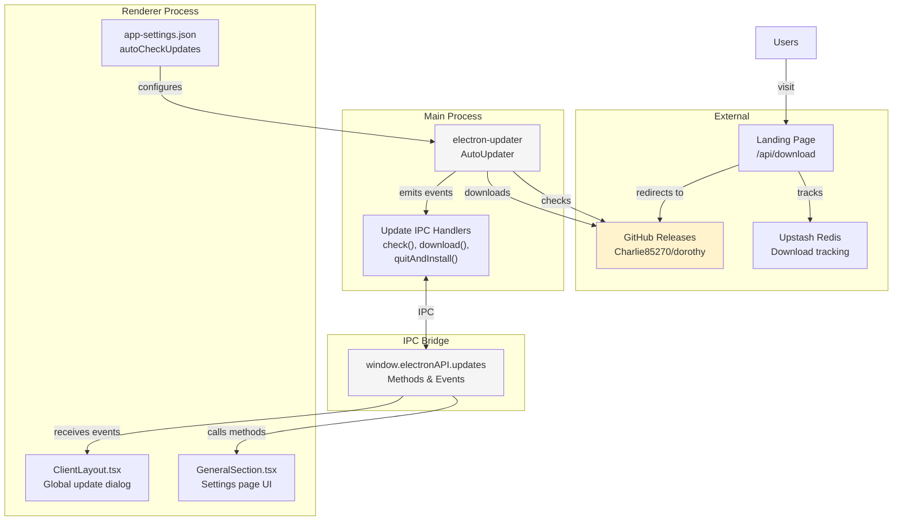
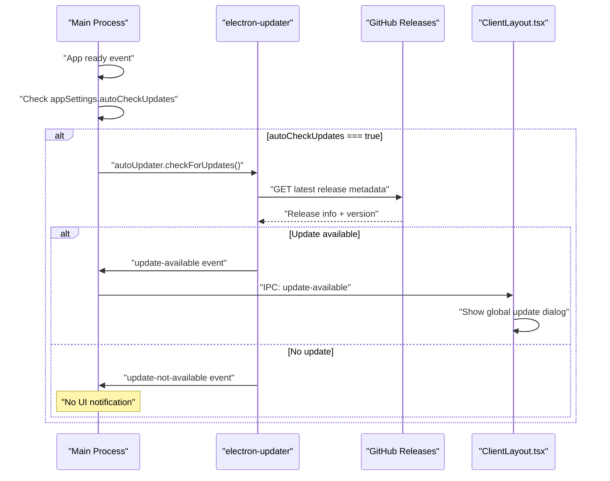
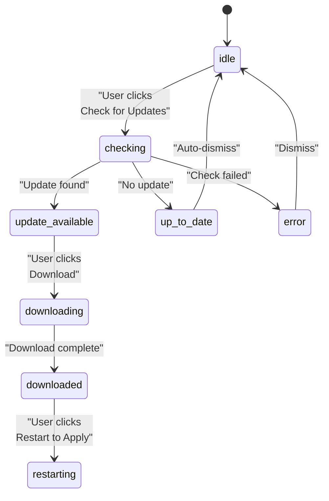
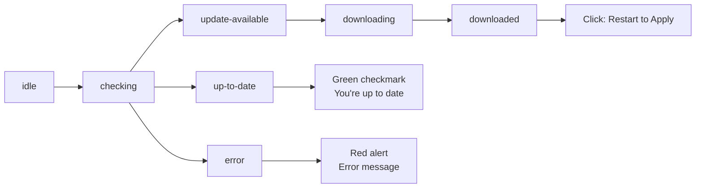
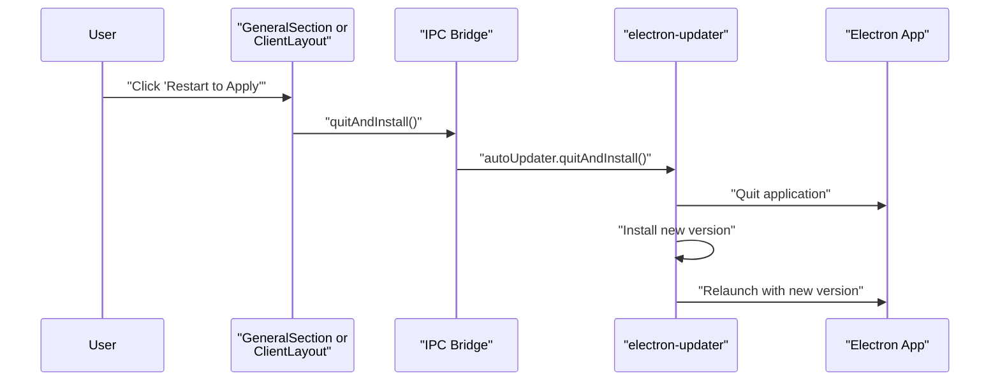
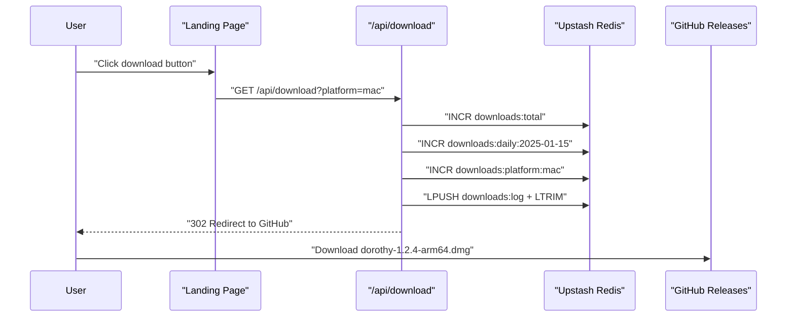

<!-- source: DeepWiki mcp.deepwiki.com · repo Charlie85270/Dorothy · page 12.4 Auto-Update System · fetched 2026-10-26 -->

# Auto-Update System

<details>
<summary>Relevant source files</summary>

The following files were used as context for generating this wiki page:

- [landing/src/app/api/download/route.ts](landing/src/app/api/download/route.ts)
- [mcp-vault/src/tools/documents.ts](mcp-vault/src/tools/documents.ts)
- [package-lock.json](package-lock.json)
- [package.json](package.json)
- [public/atlassian-jira-svgrepo-com.svg](public/atlassian-jira-svgrepo-com.svg)
- [scripts/notarize.js](scripts/notarize.js)
- [src/app/globals.css](src/app/globals.css)
- [src/app/vault/page.tsx](src/app/vault/page.tsx)
- [src/components/ClientLayout.tsx](src/components/ClientLayout.tsx)
- [src/components/Settings/GeneralSection.tsx](src/components/Settings/GeneralSection.tsx)
- [src/components/Sidebar.tsx](src/components/Sidebar.tsx)
- [src/components/VaultView/components/FolderTree.tsx](src/components/VaultView/components/FolderTree.tsx)
- [src/components/VaultView/index.tsx](src/components/VaultView/index.tsx)

</details>


The auto-update system enables Dorothy to automatically check for, download, and install new versions from GitHub Releases. Built on top of `electron-updater`, it provides both automatic checks on startup and manual update checks through the Settings interface. The system supports in-app downloads with progress tracking and a fallback browser-based update mode for compatibility.

For information about the build and release pipeline that produces updates, see [Release Process](#12.3). For configuration options, see [AppSettings](#13.1).

---

## Architecture Overview

Dorothy's update system consists of three layers: the Electron main process running `electron-updater`, IPC bridges communicating update events to the renderer, and React UI components displaying update status and controls.



**Sources:** [package.json:23-26](), [package.json:165](), [src/components/Settings/GeneralSection.tsx:1-346](), [src/components/ClientLayout.tsx:61-350]()

---

## Update Info Data Structure

The `UpdateInfo` interface defines the shape of update metadata communicated between the main process and renderer:

| Field | Type | Description |
|-------|------|-------------|
| `currentVersion` | `string` | Currently installed version (from package.json) |
| `latestVersion` | `string` | Latest available version from GitHub |
| `releaseNotes` | `string` | HTML release notes from GitHub Release |
| `hasUpdate` | `boolean` | Whether an update is available |
| `downloadUrl` | `string?` | Fallback browser URL (for old releases) |
| `releaseUrl` | `string?` | GitHub Release page URL |

When `downloadUrl` is present, the system operates in **fallback mode**, where clicking "Download" opens the browser instead of using in-app download. This handles cases where `electron-updater` cannot process older release formats.

**Sources:** [src/components/Settings/GeneralSection.tsx:22-29](), [src/components/ClientLayout.tsx:38-45]()

---

## Update Check Flow

### Automatic Check on Startup

When Dorothy launches, if `autoCheckUpdates` is enabled in app settings, the main process automatically invokes `autoUpdater.checkForUpdates()`. This happens silently without user interaction.



**Sources:** [src/components/ClientLayout.tsx:72-108](), [src/components/Settings/GeneralSection.tsx:176-183]()

### Manual Check from Settings

Users can manually trigger an update check from the General section of Settings. The UI transitions through states: `idle` → `checking` → `update-available` or `up-to-date` or `error`.



**Sources:** [src/components/Settings/GeneralSection.tsx:85-103](), [src/components/Settings/GeneralSection.tsx:31]()

---

## IPC API Surface

The preload script exposes `window.electronAPI.updates` with the following methods and event listeners:

### Methods

| Method | Parameters | Returns | Description |
|--------|-----------|---------|-------------|
| `check()` | none | `Promise<{devMode?: boolean}>` | Trigger manual update check |
| `download()` | none | `void` | Start downloading the update |
| `quitAndInstall()` | none | `void` | Quit app and install update |
| `openExternal(url)` | `url: string` | `void` | Open URL in browser (fallback) |

### Event Listeners

| Event | Callback Signature | Description |
|-------|-------------------|-------------|
| `onUpdateAvailable` | `(info: UpdateInfo) => void` | Fired when update is found |
| `onUpdateNotAvailable` | `(info: UpdateInfo) => void` | Fired when no update exists |
| `onDownloadProgress` | `({percent, bytesPerSecond}) => void` | Progress updates during download |
| `onUpdateDownloaded` | `() => void` | Download completed successfully |
| `onUpdateError` | `(error: string) => void` | Any error during check/download |

Each event listener returns an unsubscribe function for cleanup.

**Sources:** [src/components/Settings/GeneralSection.tsx:59-83](), [src/components/Settings/GeneralSection.tsx:106-132](), [src/components/ClientLayout.tsx:72-108]()

---

## UI Components

### GeneralSection (Settings Page)

Located at `/settings/general`, this component provides:
- **Auto-check toggle:** Enables/disables startup checks
- **Manual check button:** Triggers on-demand update check
- **Inline update flow:** Shows update details, download progress, and install button within the settings card

The UI displays different states:



**Sources:** [src/components/Settings/GeneralSection.tsx:152-303]()

### ClientLayout (Global Dialog)

A modal dialog that appears automatically when an update is detected on startup (if auto-check is enabled). Features:
- **Auto-appearance:** Shows without user action when `onUpdateAvailable` fires
- **Dorothy branding:** Logo and version display
- **Release notes preview:** First 400 characters with "..." truncation
- **Progress bar:** Visual download progress with speed indicator
- **State management:** Tracks `available` → `downloading` → `ready` → `restarting`
- **Dismissible:** User can click "Later" to defer the update

The dialog uses Framer Motion for smooth animations and prevents re-clicking during download with `downloadClickedRef`.

**Sources:** [src/components/ClientLayout.tsx:233-348]()

---

## Download Progress Tracking

During in-app downloads, `electron-updater` emits progress events with two metrics:

1. **Percent complete:** `0.0` to `100.0`
2. **Bytes per second:** Download speed in bytes/sec

Both UI components listen to `onDownloadProgress` and update their displays:

```tsx
// Example from ClientLayout.tsx:88-91
window.electronAPI.updates.onDownloadProgress((progress) => {
  setDownloadPercent(progress.percent);
  setDownloadSpeed(progress.bytesPerSecond);
});
```

The progress bar updates in real-time:
- **GeneralSection:** Simple progress bar with percentage (no speed)
- **ClientLayout:** Progress bar + speed display (e.g., "2.5 MB/s")

**Sources:** [src/components/Settings/GeneralSection.tsx:63-67](), [src/components/Settings/GeneralSection.tsx:238-251](), [src/components/ClientLayout.tsx:87-92](), [src/components/ClientLayout.tsx:279-292]()

---

## Quit and Install Flow

After download completes, `electron-updater` emits `update-downloaded` event. The UI transitions to display a "Restart to Apply" button. When clicked:



The `quitAndInstall()` method:
1. Saves all app state
2. Closes all windows
3. Installs the update from the downloaded file
4. Relaunches Dorothy with the new version

**Sources:** [src/components/Settings/GeneralSection.tsx:148-150](), [src/components/ClientLayout.tsx:126-129]()

---

## Fallback Update Mode

For older releases or when `electron-updater` cannot parse the update metadata, Dorothy falls back to browser-based updates. This is detected when `UpdateInfo.downloadUrl` is present.

### Fallback Detection

```typescript
// From ClientLayout.tsx:110
const isFallbackUpdate = !!(updateInfo?.downloadUrl);
```

### Behavior Differences

| Mode | Download Method | Button Icon | User Experience |
|------|----------------|-------------|-----------------|
| **Normal** | In-app via `electron-updater` | Download icon | Progress bar, quit & install |
| **Fallback** | Browser opens GitHub Release | ExternalLink icon | User downloads DMG manually |

In fallback mode, clicking "Download Update" calls `openExternal(downloadUrl)`, which opens the user's default browser to the GitHub Release page. The dialog is then dismissed automatically.

**Sources:** [src/components/Settings/GeneralSection.tsx:134-146](), [src/components/ClientLayout.tsx:110-124]()

---

## Release Notes Rendering

GitHub provides release notes as HTML. Dorothy strips HTML tags and formats them as plain text for display in the UI:

```typescript
// From GeneralSection.tsx:7-20
function stripHtml(html: string): string {
  return html
    .replace(/<br\s*\/?>/gi, '\n')
    .replace(/<\/(?:p|li|h[1-6]|div|tr)>/gi, '\n')
    .replace(/<li[^>]*>/gi, '- ')
    .replace(/<[^>]+>/g, '')
    .replace(/&amp;/g, '&')
    .replace(/&lt;/g, '<')
    .replace(/&gt;/g, '>')
    .replace(/&quot;/g, '"')
    .replace(/&#39;/g, "'")
    .replace(/\n{3,}/g, '\n\n')
    .trim();
}
```

This conversion:
- Preserves line breaks from `<br>`, `<p>`, `<div>`, etc.
- Converts `<li>` tags to bullet points (`- `)
- Unescapes HTML entities
- Collapses multiple newlines

The UI truncates notes to 300-400 characters with "..." for the preview.

**Sources:** [src/components/Settings/GeneralSection.tsx:6-20](), [src/components/ClientLayout.tsx:22-36]()

---

## Download Tracking via Landing Page

The landing page at `landing/src/app/api/download/route.ts` serves as a download endpoint that:
1. Tracks download metrics in Upstash Redis
2. Redirects users to the actual GitHub Release DMG

### Tracked Metrics

| Redis Key | Type | Description |
|-----------|------|-------------|
| `downloads:total` | counter | Total downloads across all time |
| `downloads:daily:YYYY-MM-DD` | counter | Downloads for specific date |
| `downloads:platform:mac` | counter | Platform-specific downloads |
| `downloads:log` | list | Last 1000 download events with timestamp, platform, user-agent |

### API Flow



If Redis is unavailable, the tracking fails gracefully and the redirect still happens, ensuring downloads are never blocked by analytics failures.

**Sources:** [landing/src/app/api/download/route.ts:1-49]()

---

## electron-updater Configuration

The `package.json` build section configures `electron-updater`:

```json
"build": {
  "appId": "io.dorothy.app",
  "productName": "Dorothy",
  "publish": {
    "provider": "github",
    "owner": "Charlie85270",
    "repo": "dorothy"
  },
  "afterSign": "scripts/notarize.js",
  "mac": {
    "category": "public.app-category.developer-tools",
    "hardenedRuntime": true,
    "entitlements": "build/entitlements.mac.plist",
    "target": ["dmg", "zip"]
  }
}
```

### Key Configuration Points

- **Provider:** GitHub Releases (queries `Charlie85270/dorothy` repo)
- **Targets:** Both DMG and ZIP for macOS (ZIP is for delta updates)
- **Notarization:** macOS builds are notarized via `scripts/notarize.js` (see [macOS Notarization](#12.2))
- **Hardened Runtime:** Required for macOS Gatekeeper approval

The `electron-updater` library automatically:
- Fetches release metadata from GitHub API
- Compares semantic versions (current vs latest)
- Downloads the appropriate asset (architecture-aware)
- Verifies code signatures on macOS

**Sources:** [package.json:20-134]()

---

## Error Handling

### Dev Mode Detection

When running in development (unpacked app), `electron-updater` cannot check for updates. The main process returns `{ devMode: true }` and the UI displays:

```
Error: Update check is only available in the production build.
```

**Sources:** [src/components/Settings/GeneralSection.tsx:92-97]()

### Network Failures

If the update check fails (network error, GitHub API down, etc.), the `onUpdateError` event fires with an error message. The UI displays a red error state with the message text.

**Sources:** [src/components/Settings/GeneralSection.tsx:75-80](), [src/components/Settings/GeneralSection.tsx:288-296]()

### Download Interruptions

If a download is interrupted, `onUpdateError` fires and the UI resets to the `update-available` state, allowing the user to retry. The partially downloaded file is cleaned up by `electron-updater`.

**Sources:** [src/components/ClientLayout.tsx:100-105]()

---

## Configuration Settings

The auto-update system respects one user preference:

### `autoCheckUpdates`

- **Type:** `boolean`
- **Default:** `true` (inferred from toggle behavior)
- **Location:** `~/.dorothy/app-settings.json`
- **Effect:** Controls whether Dorothy checks for updates on startup

When disabled, users must manually check for updates via Settings > General > "Check for Updates" button.

**Sources:** [src/components/Settings/GeneralSection.tsx:179-181]()

---

## Version Display

The current version is displayed in multiple locations:

1. **GeneralSection:** Shows hardcoded fallback `1.2.4` or `updateInfo.currentVersion`
2. **ClientLayout dialog:** Shows `updateInfo.currentVersion`
3. **Sidebar (if added):** Could display version in footer

The version comes from `package.json` and is embedded at build time by Electron Builder.

**Sources:** [package.json:3](), [src/components/Settings/GeneralSection.tsx:167](), [src/components/ClientLayout.tsx:257]()

---

