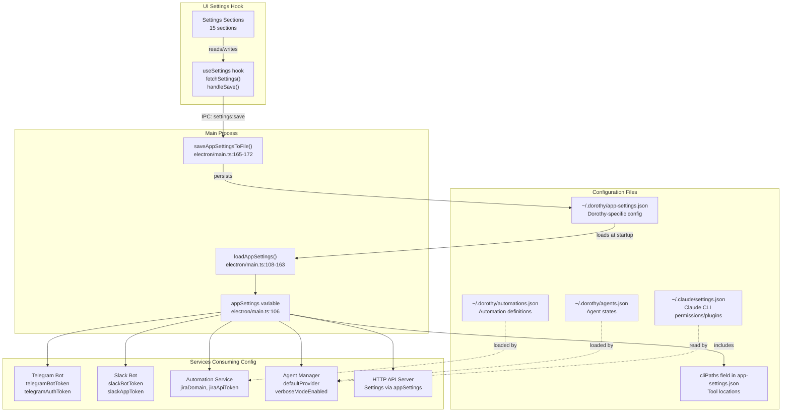
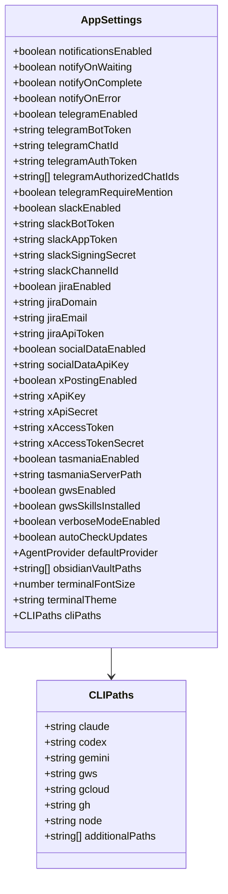
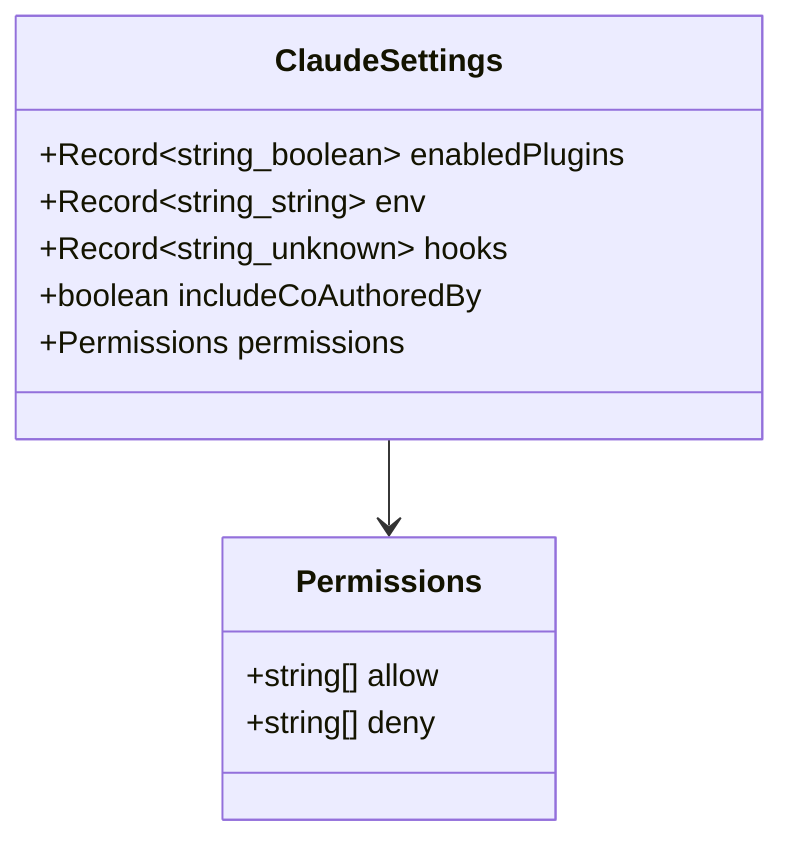
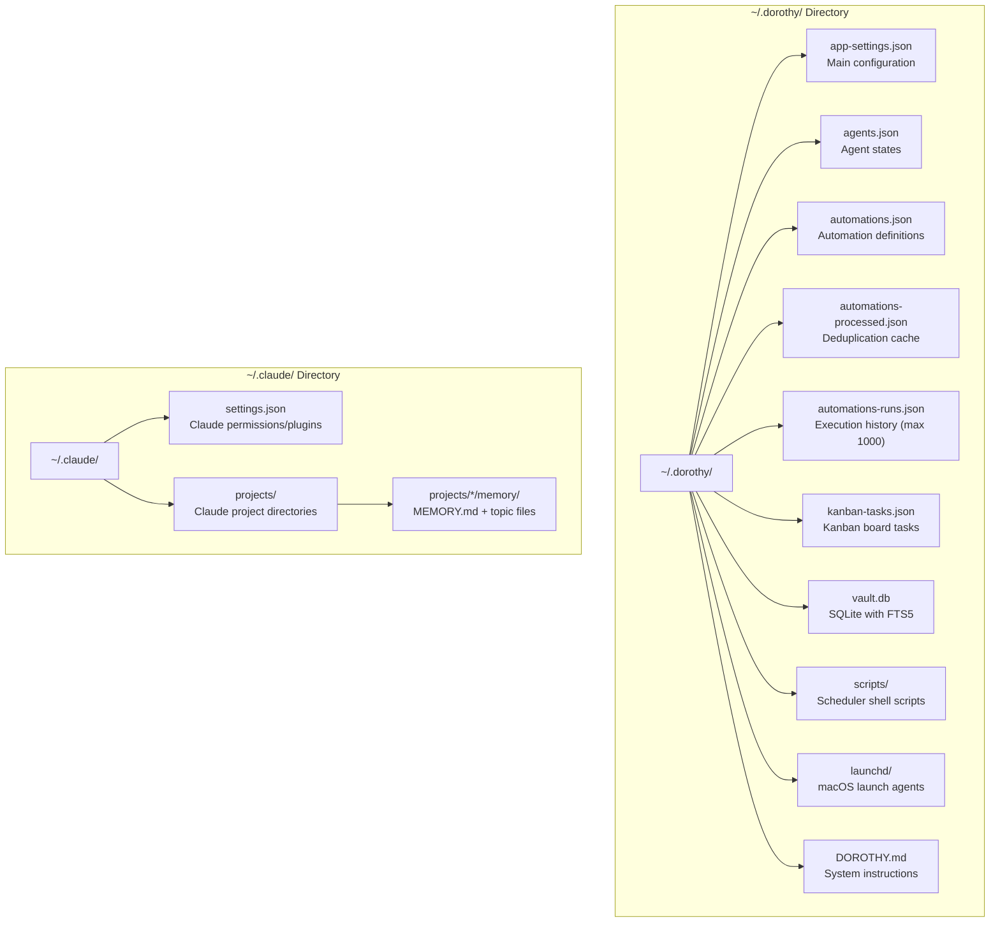
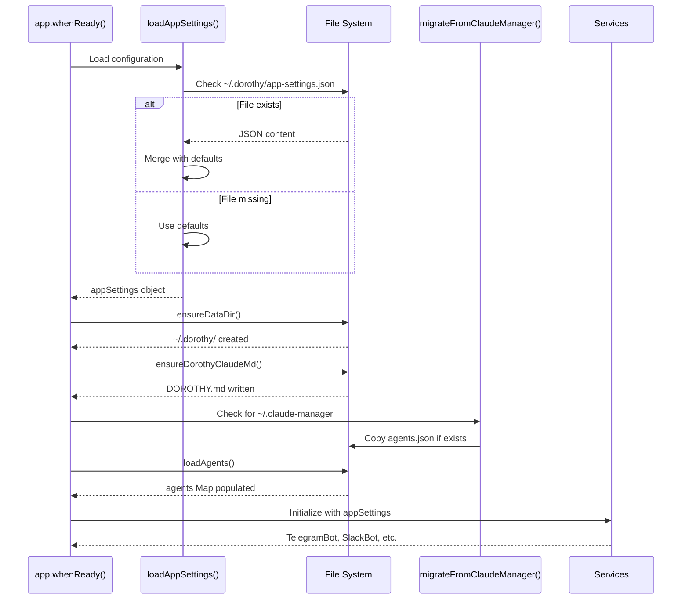
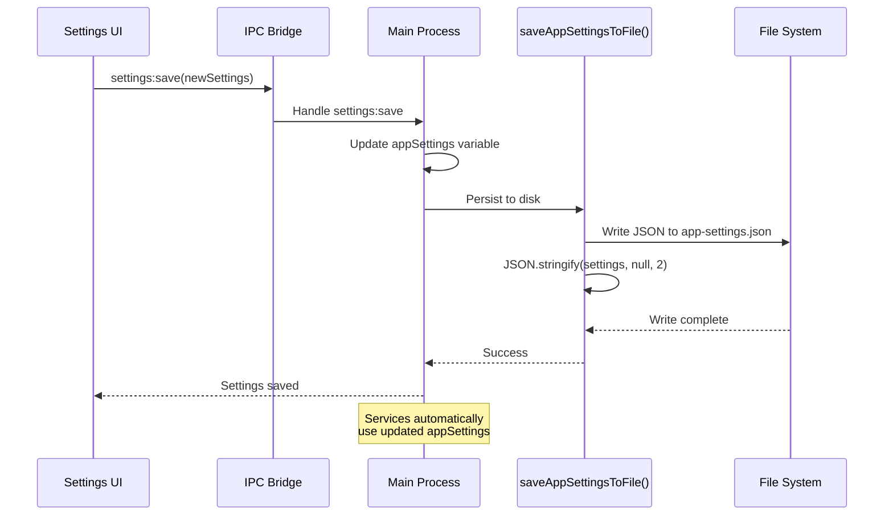

<!-- source: DeepWiki mcp.deepwiki.com · repo Charlie85270/Dorothy · page 13 Configuration Reference · fetched 2026-10-26 -->

# Configuration Reference

<details>
<summary>Relevant source files</summary>

The following files were used as context for generating this wiki page:

- [electron/main.ts](electron/main.ts)
- [electron/types/index.ts](electron/types/index.ts)
- [src/components/Settings/constants.ts](src/components/Settings/constants.ts)
- [src/components/Settings/types.ts](src/components/Settings/types.ts)

</details>


This document provides a complete reference for all configuration files, settings fields, environment variables, and data file locations used by Dorothy. Configuration is split across multiple files to separate Dorothy-specific settings from Claude CLI settings, and to maintain compatibility with existing Claude Code installations.

For information about configuring specific integrations through the UI, see [Settings](#5.3). For details on how settings are consumed by services, see [Technical Architecture](#11).

---

## Configuration System Overview

Dorothy uses a multi-file configuration strategy where settings are stored in JSON files within the `~/.dorothy/` directory, with some integration into Claude's native `~/.claude/` directory structure.

**Configuration File Flow Diagram**



**Sources:** [electron/main.ts:104-172](), [electron/types/index.ts:1-85](), [src/components/Settings/constants.ts:1-85]()

---

## AppSettings Structure

The `AppSettings` interface defines all Dorothy-specific configuration. It is stored in `~/.dorothy/app-settings.json` and loaded at application startup.

**AppSettings Type Definition**



**Sources:** [electron/types/index.ts:35-85](), [src/components/Settings/types.ts:27-76]()

---

## AppSettings Field Reference

### Notifications

| Field | Type | Default | Description |
|-------|------|---------|-------------|
| `notificationsEnabled` | `boolean` | `true` | Master toggle for all system notifications |
| `notifyOnWaiting` | `boolean` | `true` | Show notification when agent enters waiting state |
| `notifyOnComplete` | `boolean` | `true` | Show notification when agent completes successfully |
| `notifyOnError` | `boolean` | `true` | Show notification when agent encounters an error |

These settings control desktop notifications triggered by agent status changes. Notifications are sent via [handleStatusChangeNotification]() in [electron/core/agent-manager.ts]().

**Sources:** [electron/main.ts:110-113](), [src/components/Settings/constants.ts:38-41]()

---

### Telegram Integration

| Field | Type | Default | Description |
|-------|------|---------|-------------|
| `telegramEnabled` | `boolean` | `false` | Enable Telegram bot integration |
| `telegramBotToken` | `string` | `''` | Bot token from @BotFather |
| `telegramChatId` | `string` | `''` | Legacy field (deprecated, use `telegramAuthorizedChatIds`) |
| `telegramAuthToken` | `string` | `''` | Secret token for `/auth` command authentication |
| `telegramAuthorizedChatIds` | `string[]` | `[]` | List of authorized chat IDs (private chats or groups) |
| `telegramRequireMention` | `boolean` | `false` | In groups, only respond when bot is @mentioned |

The Telegram bot service consumes these settings to initialize the bot and validate incoming messages. See [Telegram Bot](#9.1) for setup details.

**Sources:** [electron/main.ts:114-119](), [electron/types/index.ts:51-56]()

---

### Slack Integration

| Field | Type | Default | Description |
|-------|------|---------|-------------|
| `slackEnabled` | `boolean` | `false` | Enable Slack bot integration |
| `slackBotToken` | `string` | `''` | Bot User OAuth Token (starts with `xoxb-`) |
| `slackAppToken` | `string` | `''` | App-Level Token for Socket Mode (starts with `xapp-`) |
| `slackSigningSecret` | `string` | `''` | Signing secret for request verification |
| `slackChannelId` | `string` | `''` | Default channel ID for notifications |

The Slack bot uses Socket Mode for real-time event handling. All tokens are configured in the Slack App settings dashboard.

**Sources:** [electron/main.ts:120-124](), [electron/types/index.ts:57-61]()

---

### JIRA Integration

| Field | Type | Default | Description |
|-------|------|---------|-------------|
| `jiraEnabled` | `boolean` | `false` | Enable JIRA REST API integration |
| `jiraDomain` | `string` | `''` | JIRA instance domain (e.g., `yourcompany.atlassian.net`) |
| `jiraEmail` | `string` | `''` | JIRA account email for authentication |
| `jiraApiToken` | `string` | `''` | JIRA API token (generate from account settings) |

JIRA integration is used by the automation system to poll for issues and create Kanban tasks. See [JIRA Automations](#7.3).

**Sources:** [electron/main.ts:125-128](), [electron/types/index.ts:62-65]()

---

### Social Data / X (Twitter) Integration

| Field | Type | Default | Description |
|-------|------|---------|-------------|
| `socialDataEnabled` | `boolean` | `false` | Enable Social Data API integration |
| `socialDataApiKey` | `string` | `''` | API key for Social Data service |
| `xPostingEnabled` | `boolean` | `false` | Enable X/Twitter posting capabilities |
| `xApiKey` | `string` | `''` | X API Key (from Twitter Developer Portal) |
| `xApiSecret` | `string` | `''` | X API Secret Key |
| `xAccessToken` | `string` | `''` | X Access Token |
| `xAccessTokenSecret` | `string` | `''` | X Access Token Secret |

The Social Data API provides access to Twitter data through the `mcp-socialdata` server. X posting uses direct Twitter API credentials.

**Sources:** [electron/main.ts:129-135](), [electron/types/index.ts:66-72]()

---

### Tasmania (Local AI Server)

| Field | Type | Default | Description |
|-------|------|---------|-------------|
| `tasmaniaEnabled` | `boolean` | `false` | Enable Tasmania local AI server integration |
| `tasmaniaServerPath` | `string` | `''` | Path to Tasmania server installation directory |

When enabled, agents can use `provider: 'local'` to run on Tasmania instead of Claude. See [Providers](#3.3).

**Sources:** [electron/main.ts:136-137](), [electron/types/index.ts:73-74]()

---

### Google Workspace

| Field | Type | Default | Description |
|-------|------|---------|-------------|
| `gwsEnabled` | `boolean` | `false` | Enable Google Workspace integration |
| `gwsSkillsInstalled` | `boolean` | `false` | Track whether GWS skills are installed |

GWS integration requires the `gws` CLI tool and authenticates via `gcloud`. Skills are installed separately.

**Sources:** [electron/main.ts:138-139](), [electron/types/index.ts:75-76]()

---

### General Settings

| Field | Type | Default | Description |
|-------|------|---------|-------------|
| `verboseModeEnabled` | `boolean` | `false` | Add `--verbose` flag to Claude CLI commands |
| `autoCheckUpdates` | `boolean` | `true` | Automatically check for updates on startup |
| `defaultProvider` | `AgentProvider` | `'claude'` | Default provider for new agents (`claude`, `codex`, `gemini`, `local`) |

**Sources:** [electron/main.ts:140-142](), [electron/types/index.ts:77-80]()

---

### Obsidian Integration

| Field | Type | Default | Description |
|-------|------|---------|-------------|
| `obsidianVaultPaths` | `string[]` | `[]` | List of Obsidian vault paths for read-only mounting |

Agents can access these vaults as read-only reference material via `--add-dir` flag. See [Obsidian Integration](#6.4).

**Sources:** [electron/types/index.ts:81](), [src/components/Settings/constants.ts:71]()

---

### Terminal Appearance

| Field | Type | Default | Description |
|-------|------|---------|-------------|
| `terminalFontSize` | `number` | `11` | Font size for terminal display (in pixels) |
| `terminalTheme` | `'dark' \| 'light'` | `'dark'` | Terminal color scheme |

These settings affect the xterm.js terminal display in the agent dashboard.

**Sources:** [electron/types/index.ts:82-83](), [src/components/Settings/constants.ts:72-73]()

---

### CLI Paths

The `cliPaths` object stores absolute paths to CLI tools. Dorothy attempts to auto-detect these on first run, but they can be manually configured.

| Field | Type | Default | Description |
|-------|------|---------|-------------|
| `cliPaths.claude` | `string` | `''` | Path to `claude` CLI executable |
| `cliPaths.codex` | `string` | `''` | Path to `codex` CLI executable |
| `cliPaths.gemini` | `string` | `''` | Path to `gemini` CLI executable |
| `cliPaths.gws` | `string` | `''` | Path to `gws` CLI executable |
| `cliPaths.gcloud` | `string` | `''` | Path to `gcloud` CLI executable |
| `cliPaths.gh` | `string` | `''` | Path to GitHub `gh` CLI executable |
| `cliPaths.node` | `string` | `''` | Path to Node.js executable |
| `cliPaths.additionalPaths` | `string[]` | `[]` | Additional PATH directories to prepend |

CLI paths are managed by [cli-paths-handlers.ts]() and consumed when spawning PTY processes.

**Sources:** [electron/main.ts:143-152](), [electron/types/index.ts:35-44]()

---

## Claude Settings Structure

Claude Code's native settings file (`~/.claude/settings.json`) is separate from Dorothy's configuration but is read and written by Dorothy's settings UI.

**ClaudeSettings Type Definition**



### ClaudeSettings Fields

| Field | Type | Description |
|-------|------|-------------|
| `enabledPlugins` | `Record<string, boolean>` | Map of plugin names to enabled state |
| `env` | `Record<string, string>` | Environment variables passed to Claude CLI |
| `hooks` | `Record<string, unknown>` | Hook configurations for status monitoring |
| `includeCoAuthoredBy` | `boolean` | Include co-authored-by trailer in commits |
| `permissions` | `{ allow: string[], deny: string[] }` | File/directory permission rules |

The `permissions` object uses glob patterns to control Claude's file system access. Dorothy writes hooks to this file for status monitoring (see [hooks-manager.ts]()).

**Sources:** [src/components/Settings/types.ts:1-7]()

---

## Environment Variables

Dorothy and its MCP servers use several environment variables for configuration and runtime behavior.

**Environment Variables Reference**

| Variable | Used By | Purpose |
|----------|---------|---------|
| `UPSTASH_REDIS_REST_URL` | Landing page | Redis connection for download tracking |
| `UPSTASH_REDIS_REST_TOKEN` | Landing page | Redis authentication token |
| `CLAUDE_AGENT_NAME` | MCP Orchestrator | Agent name for tool calls |
| `CLAUDE_AGENT_ID` | PTY processes | Unique agent identifier |
| `CLAUDE_PROJECT_PATH` | PTY processes | Agent's working directory |
| `CLAUDE_SKILLS` | PTY processes | Comma-separated list of skills |
| `SHELL` | PTY spawning | Shell executable path (defaults to `/bin/zsh`) |
| `PATH` | All processes | Extended with `additionalPaths` from CLI config |
| `HOME` | All processes | User home directory |

### Agent Environment Variables

When spawning agent PTY processes, Dorothy injects environment variables to pass context:

```typescript
env: {
  ...process.env,
  CLAUDE_SKILLS: allSkills.join(','),
  CLAUDE_AGENT_ID: id,
  CLAUDE_PROJECT_PATH: config.projectPath,
}
```

These variables are available to the Claude CLI and all MCP servers during agent execution.

**Sources:** [electron/main.ts:414-420]()

---

## File Locations Reference

Dorothy stores data in a structured directory hierarchy under the user's home directory.

**Dorothy Data Directory Structure**



### ~/.dorothy/ Files

| File Path | Format | Purpose |
|-----------|--------|---------|
| `~/.dorothy/app-settings.json` | JSON | Main configuration (see AppSettings above) |
| `~/.dorothy/agents.json` | JSON | Persisted agent states (AgentStatus[]) |
| `~/.dorothy/automations.json` | JSON | Automation definitions and schedules |
| `~/.dorothy/automations-processed.json` | JSON | SHA256 hashes of processed items for deduplication |
| `~/.dorothy/automations-runs.json` | JSON | Last 1000 automation execution logs |
| `~/.dorothy/kanban-tasks.json` | JSON | Kanban board task data |
| `~/.dorothy/vault.db` | SQLite | Document vault with FTS5 full-text search |
| `~/.dorothy/DOROTHY.md` | Markdown | System-wide instructions loaded by all agents |
| `~/.dorothy/scripts/` | Directory | Shell scripts for scheduled tasks |
| `~/.dorothy/launchd/` | Directory | macOS launchd plist files |

**Sources:** [electron/constants.ts](), [electron/main.ts:299-301]()

---

### ~/.claude/ Files

Dorothy integrates with Claude Code's native directory structure:

| File Path | Format | Purpose |
|-----------|--------|---------|
| `~/.claude/settings.json` | JSON | Claude CLI settings (permissions, plugins, hooks) |
| `~/.claude/projects/` | Directory | Claude project directories |
| `~/.claude/projects/*/memory/` | Directory | Project-specific memory files |
| `~/.claude/projects/*/memory/MEMORY.md` | Markdown | Memory system entrypoint |

The memory system is documented in detail at [Memory System](#6.1).

**Sources:** [src/components/Settings/types.ts:9-17]()

---

## Configuration Loading Sequence

The following diagram shows how configuration is loaded during application startup:

**Startup Configuration Flow**



1. [loadAppSettings()]() reads `app-settings.json` and merges with defaults
2. [ensureDataDir()]() creates `~/.dorothy/` if missing
3. [ensureDorothyClaudeMd()]() writes system instructions
4. [migrateFromClaudeManager()]() migrates legacy data if present
5. [loadAgents()]() loads agent states
6. Services initialize with the loaded configuration

**Sources:** [electron/main.ts:293-567](), [electron/utils.ts]()

---

## Configuration Persistence

Settings are persisted to disk whenever modified through the UI or programmatically.

**Settings Save Flow**



Changes to `appSettings` are immediately visible to all services because they share a reference to the same object. Persistence ensures changes survive application restarts.

**Sources:** [electron/main.ts:165-172](), [electron/handlers/ipc-handlers.ts]()

---

## Default Values

All settings have sensible defaults defined in two locations for consistency:

1. **Main process:** [electron/main.ts:109-153]() - `loadAppSettings()` function
2. **Renderer process:** [src/components/Settings/constants.ts:37-84]() - `DEFAULT_APP_SETTINGS` constant

These defaults ensure Dorothy can run without manual configuration, with integrations disabled until explicitly enabled by the user.

**Sources:** [electron/main.ts:108-163](), [src/components/Settings/constants.ts:37-84]()

---

