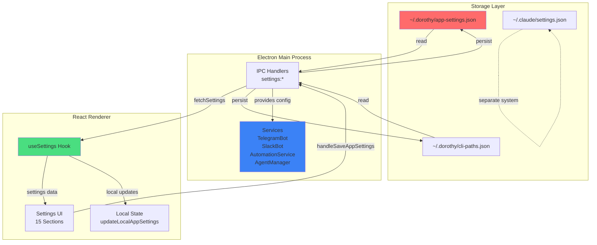
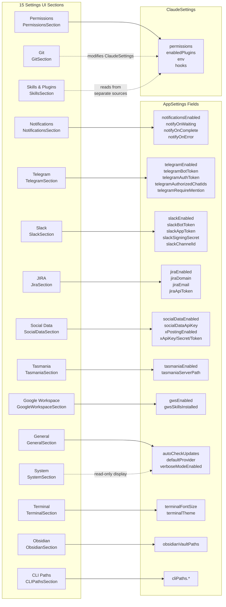
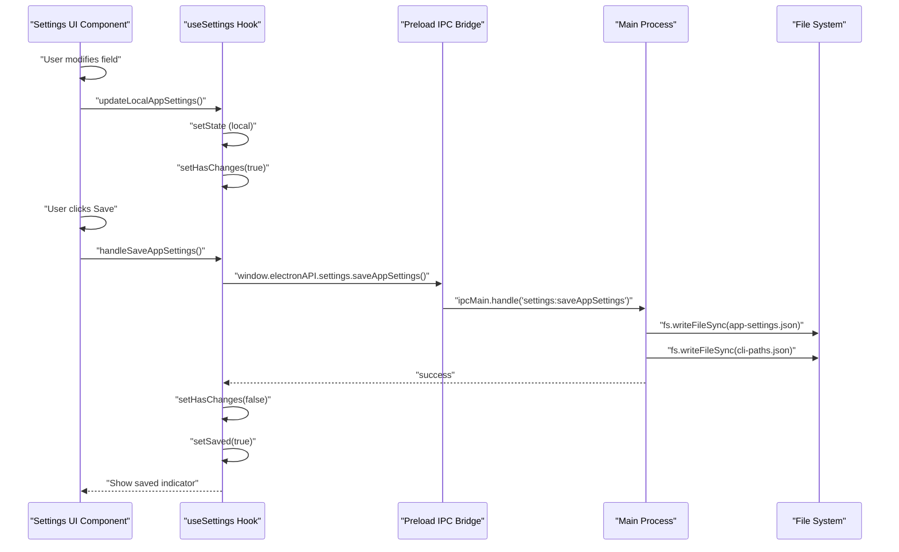
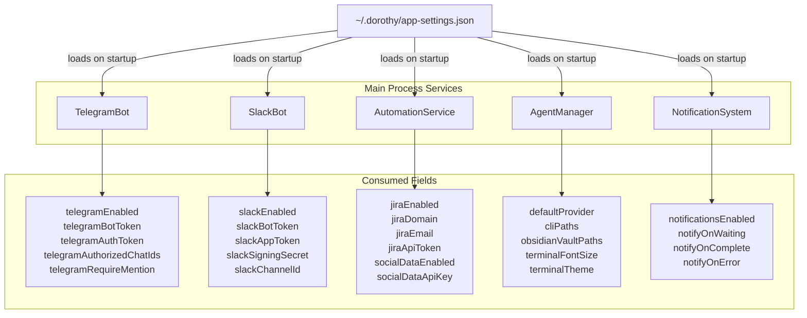

<!-- source: DeepWiki mcp.deepwiki.com · repo Charlie85270/Dorothy · page 13.1 AppSettings · fetched 2026-10-26 -->

# AppSettings

<details>
<summary>Relevant source files</summary>

The following files were used as context for generating this wiki page:

- [electron/types/index.ts](electron/types/index.ts)
- [src/app/settings/page.tsx](src/app/settings/page.tsx)
- [src/components/Settings/constants.ts](src/components/Settings/constants.ts)
- [src/components/Settings/types.ts](src/components/Settings/types.ts)

</details>


This page provides a complete reference for the `AppSettings` configuration structure used by Dorothy. `AppSettings` stores Dorothy-specific configuration including integration credentials, notification preferences, terminal settings, and CLI paths. This is distinct from Claude's native settings (see [Permissions](#5.3) for Claude settings).

For information about how settings are managed through the UI, see [Settings](#5.3). For environment variables, see [Environment Variables](#13.2). For file system locations, see [File Locations](#13.3).

---

## Overview

The `AppSettings` interface defines the structure for Dorothy's main configuration file, stored at `~/.dorothy/app-settings.json`. This file contains all Dorothy-specific preferences and integration credentials, separate from Claude Code's own `~/.claude/settings.json` file.

The settings system is type-safe with identical interfaces defined for both the Electron main process and the React renderer process:
- Main process: [electron/types/index.ts:46-84]()
- Renderer process: [src/components/Settings/types.ts:38-76]()

**Sources:** [electron/types/index.ts:46-84](), [src/components/Settings/types.ts:38-76]()

---

## Settings Architecture

### Data Flow



**Diagram: AppSettings data flow from file storage through IPC to UI and service consumers**

**Sources:** [src/app/settings/page.tsx:53-68](), [src/hooks/useSettings]()

---

## Configuration Structure

The `AppSettings` interface contains 40+ fields organized into eight functional categories:

### Notifications

| Field | Type | Default | Description |
|-------|------|---------|-------------|
| `notificationsEnabled` | `boolean` | `true` | Master switch for desktop notifications |
| `notifyOnWaiting` | `boolean` | `true` | Show notification when agent enters waiting state |
| `notifyOnComplete` | `boolean` | `true` | Show notification when agent completes task |
| `notifyOnError` | `boolean` | `true` | Show notification when agent encounters error |

**Sources:** [electron/types/index.ts:47-50](), [src/components/Settings/constants.ts:38-41]()

### Telegram Integration

| Field | Type | Default | Description |
|-------|------|---------|-------------|
| `telegramEnabled` | `boolean` | `false` | Enable Telegram bot integration |
| `telegramBotToken` | `string` | `''` | Bot token from BotFather |
| `telegramChatId` | `string` | `''` | Legacy field (kept for backwards compatibility) |
| `telegramAuthToken` | `string` | `''` | Secret token for authentication |
| `telegramAuthorizedChatIds` | `string[]` | `[]` | List of authorized chat IDs |
| `telegramRequireMention` | `boolean` | `false` | Only respond when bot is @mentioned in groups |

**Sources:** [electron/types/index.ts:51-56](), [src/components/Settings/constants.ts:42-47]()

### Slack Integration

| Field | Type | Default | Description |
|-------|------|---------|-------------|
| `slackEnabled` | `boolean` | `false` | Enable Slack bot integration |
| `slackBotToken` | `string` | `''` | Bot User OAuth Token (xoxb-...) |
| `slackAppToken` | `string` | `''` | App-Level Token for Socket Mode (xapp-...) |
| `slackSigningSecret` | `string` | `''` | Signing secret for request verification |
| `slackChannelId` | `string` | `''` | Default channel ID for notifications |

**Sources:** [electron/types/index.ts:57-61](), [src/components/Settings/constants.ts:48-52]()

### JIRA Integration

| Field | Type | Default | Description |
|-------|------|---------|-------------|
| `jiraEnabled` | `boolean` | `false` | Enable JIRA REST API integration |
| `jiraDomain` | `string` | `''` | JIRA instance domain (e.g., yourcompany.atlassian.net) |
| `jiraEmail` | `string` | `''` | User email for authentication |
| `jiraApiToken` | `string` | `''` | API token from JIRA account settings |

**Sources:** [electron/types/index.ts:62-65](), [src/components/Settings/constants.ts:53-56]()

### Social Data and X/Twitter

| Field | Type | Default | Description |
|-------|------|---------|-------------|
| `socialDataEnabled` | `boolean` | `false` | Enable SocialData API integration |
| `socialDataApiKey` | `string` | `''` | SocialData API key |
| `xPostingEnabled` | `boolean` | `false` | Enable X (Twitter) posting capabilities |
| `xApiKey` | `string` | `''` | X API key |
| `xApiSecret` | `string` | `''` | X API secret |
| `xAccessToken` | `string` | `''` | X access token |
| `xAccessTokenSecret` | `string` | `''` | X access token secret |

**Sources:** [electron/types/index.ts:66-72](), [src/components/Settings/constants.ts:57-63]()

### Tasmania (Local AI)

| Field | Type | Default | Description |
|-------|------|---------|-------------|
| `tasmaniaEnabled` | `boolean` | `false` | Enable Tasmania local AI server |
| `tasmaniaServerPath` | `string` | `''` | Path to Tasmania server executable |

**Sources:** [electron/types/index.ts:73-74](), [src/components/Settings/constants.ts:64-65]()

### Google Workspace

| Field | Type | Default | Description |
|-------|------|---------|-------------|
| `gwsEnabled` | `boolean` | `false` | Enable Google Workspace integration |
| `gwsSkillsInstalled` | `boolean` | `false` | Track whether GWS skills are installed |

**Sources:** [electron/types/index.ts:75-76](), [src/components/Settings/constants.ts:66-67]()

### General Preferences

| Field | Type | Default | Description |
|-------|------|---------|-------------|
| `verboseModeEnabled` | `boolean` | `false` | Enable verbose logging (future use) |
| `autoCheckUpdates` | `boolean` | `true` | Automatically check for app updates |
| `defaultProvider` | `AgentProvider?` | `'claude'` | Default AI provider ('claude', 'codex', 'gemini', 'local') |
| `obsidianVaultPaths` | `string[]?` | `[]` | Paths to Obsidian vaults for read-only mounting |
| `terminalFontSize` | `number?` | `11` | Font size for terminal emulator |
| `terminalTheme` | `'dark' \| 'light'?` | `'dark'` | Terminal color theme |

**Sources:** [electron/types/index.ts:77-83](), [src/components/Settings/constants.ts:68-73]()

### CLI Paths

The `cliPaths` field contains an embedded `CLIPaths` interface:

| Field | Type | Default | Description |
|-------|------|---------|-------------|
| `cliPaths.claude` | `string` | `''` | Path to claude CLI executable |
| `cliPaths.codex` | `string` | `''` | Path to codex CLI executable |
| `cliPaths.gemini` | `string` | `''` | Path to gemini CLI executable |
| `cliPaths.gws` | `string` | `''` | Path to gws CLI executable |
| `cliPaths.gcloud` | `string` | `''` | Path to gcloud CLI executable |
| `cliPaths.gh` | `string` | `''` | Path to GitHub CLI (gh) executable |
| `cliPaths.node` | `string` | `''` | Path to Node.js executable |
| `cliPaths.additionalPaths` | `string[]` | `[]` | Additional PATH directories |

**Sources:** [electron/types/index.ts:35-44](), [src/components/Settings/types.ts:27-36](), [src/components/Settings/constants.ts:74-83]()

---

## Settings Sections Mapping



**Diagram: Mapping of 15 settings UI sections to their underlying configuration fields**

**Sources:** [src/app/settings/page.tsx:70-157](), [src/components/Settings/constants.ts:19-35]()

---

## Persistence and Storage

### File Location

The `AppSettings` data is persisted to:
```
~/.dorothy/app-settings.json
```

CLI paths are stored separately at:
```
~/.dorothy/cli-paths.json
```

### Save Flow



**Diagram: AppSettings save flow showing local state updates before persistence**

**Sources:** [src/hooks/useSettings](), [src/app/settings/page.tsx:200-218]()

---

## Service Consumption

### Integration Services

Multiple Electron main process services consume `AppSettings` to configure their behavior:



**Diagram: How different main process services consume specific AppSettings fields**

**Sources:** [electron/main.ts](), [electron/services/]()

---

## Default Values Reference

The complete default configuration is defined in [src/components/Settings/constants.ts:37-84]() as the `DEFAULT_APP_SETTINGS` object:

```typescript
export const DEFAULT_APP_SETTINGS = {
  // Notifications
  notificationsEnabled: true,
  notifyOnWaiting: true,
  notifyOnComplete: true,
  notifyOnError: true,
  
  // Telegram
  telegramEnabled: false,
  telegramBotToken: '',
  telegramChatId: '',
  telegramAuthToken: '',
  telegramAuthorizedChatIds: [] as string[],
  telegramRequireMention: false,
  
  // Slack
  slackEnabled: false,
  slackBotToken: '',
  slackAppToken: '',
  slackSigningSecret: '',
  slackChannelId: '',
  
  // JIRA
  jiraEnabled: false,
  jiraDomain: '',
  jiraEmail: '',
  jiraApiToken: '',
  
  // Social Data & X
  socialDataEnabled: false,
  socialDataApiKey: '',
  xPostingEnabled: false,
  xApiKey: '',
  xApiSecret: '',
  xAccessToken: '',
  xAccessTokenSecret: '',
  
  // Tasmania
  tasmaniaEnabled: false,
  tasmaniaServerPath: '',
  
  // Google Workspace
  gwsEnabled: false,
  gwsSkillsInstalled: false,
  
  // General
  verboseModeEnabled: false,
  autoCheckUpdates: true,
  defaultProvider: 'claude',
  obsidianVaultPaths: [] as string[],
  terminalFontSize: 11,
  terminalTheme: 'dark' as const,
  
  // CLI Paths
  cliPaths: {
    claude: '',
    codex: '',
    gemini: '',
    gws: '',
    gcloud: '',
    gh: '',
    node: '',
    additionalPaths: [],
  },
};
```

These defaults are applied when `~/.dorothy/app-settings.json` does not exist or is missing fields.

**Sources:** [src/components/Settings/constants.ts:37-84]()

---

## Distinction from Claude Settings

Dorothy maintains two separate settings files:

| Aspect | AppSettings | ClaudeSettings |
|--------|-------------|----------------|
| **File Path** | `~/.dorothy/app-settings.json` | `~/.claude/settings.json` |
| **Ownership** | Dorothy-specific | Claude Code native |
| **Purpose** | Integration config, UI preferences | Permissions, plugins, environment |
| **Interface** | `AppSettings` ([electron/types/index.ts:46-84]()) | `ClaudeSettings` ([src/components/Settings/types.ts:1-7]()) |
| **Modified By** | Dorothy Settings UI sections | Git, Permissions sections |
| **Consumed By** | TelegramBot, SlackBot, AgentManager | Claude CLI runtime |

### Key Differences

**AppSettings fields:**
- Integration credentials (Telegram, Slack, JIRA)
- Notification preferences
- Terminal appearance
- Default provider selection
- CLI path resolution
- Obsidian vault paths

**ClaudeSettings fields:**
- File permissions (`permissions.allow`, `permissions.deny`)
- Enabled plugins (`enabledPlugins`)
- Environment variables (`env`)
- Git configuration (`includeCoAuthoredBy`)
- Tool hooks (`hooks`)

**Sources:** [electron/types/index.ts:46-84](), [src/components/Settings/types.ts:1-7](), [src/components/Settings/types.ts:38-76]()

---

## Type Definitions

### AgentProvider Enum

The `defaultProvider` field uses the `AgentProvider` type:

```typescript
type AgentProvider = 'claude' | 'codex' | 'gemini' | 'local';
```

- `'claude'`: Default, uses Claude Code CLI
- `'codex'`: Uses Google Codex CLI (Gemini-powered)
- `'gemini'`: Uses direct Gemini API
- `'local'`: Uses Tasmania local AI server

**Sources:** [electron/types/index.ts:8]()

### CLIPaths Interface

The `cliPaths` field is an embedded object of type `CLIPaths`:

```typescript
interface CLIPaths {
  claude: string;
  codex: string;
  gemini: string;
  gws: string;
  gcloud: string;
  gh: string;
  node: string;
  additionalPaths: string[];
}
```

All fields default to empty strings except `additionalPaths` which defaults to an empty array.

**Sources:** [electron/types/index.ts:35-44](), [src/components/Settings/types.ts:27-36]()

---

## Migration and Backwards Compatibility

### Legacy Fields

The `telegramChatId` field ([electron/types/index.ts:53]()) is marked as legacy:
```typescript
telegramChatId: string; // Legacy - kept for backwards compatibility
```

This field is superseded by `telegramAuthorizedChatIds` array but retained to prevent breaking changes for users upgrading from earlier versions.

### Optional Fields

Several fields were added in later versions and are marked optional with `?`:
- `defaultProvider` ([electron/types/index.ts:80]())
- `obsidianVaultPaths` ([electron/types/index.ts:81]())
- `terminalFontSize` ([electron/types/index.ts:82]())
- `terminalTheme` ([electron/types/index.ts:83]())

When these fields are undefined in the loaded `app-settings.json`, defaults from [src/components/Settings/constants.ts:37-84]() are applied.

**Sources:** [electron/types/index.ts:46-84](), [src/components/Settings/constants.ts:37-84]()

---

