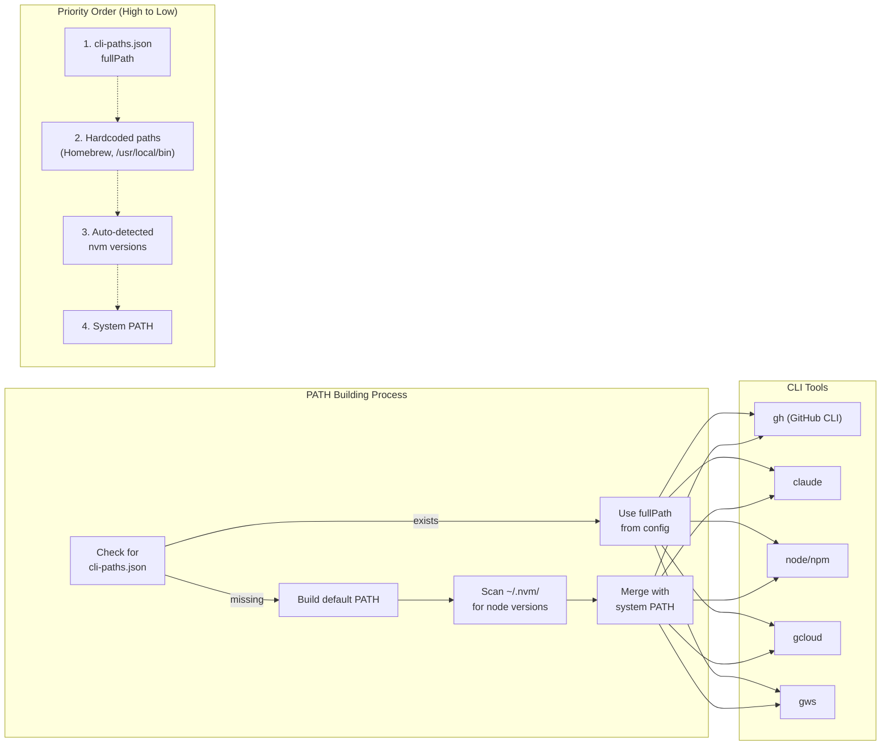
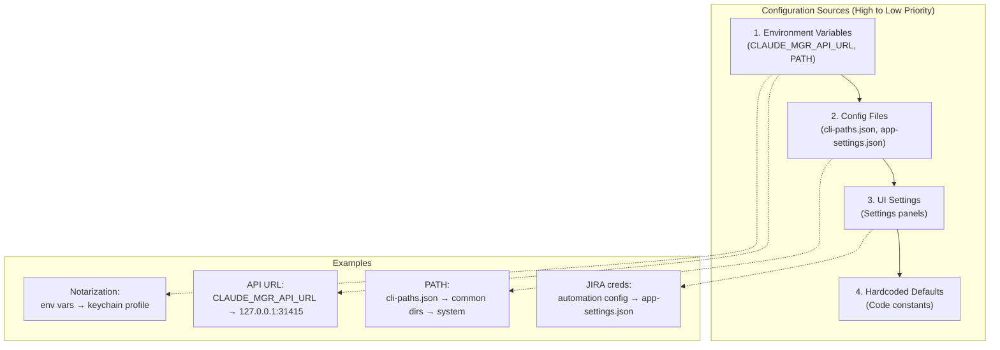

<!-- source: DeepWiki mcp.deepwiki.com · repo Charlie85270/Dorothy · page 13.2 Environment Variables · fetched 2026-10-26 -->

# Environment Variables

<details>
<summary>Relevant source files</summary>

The following files were used as context for generating this wiki page:

- [electron/services/api-server.ts](electron/services/api-server.ts)
- [landing/src/app/api/download/route.ts](landing/src/app/api/download/route.ts)
- [mcp-orchestrator/src/tools/automations.ts](mcp-orchestrator/src/tools/automations.ts)
- [mcp-orchestrator/src/tools/index.ts](mcp-orchestrator/src/tools/index.ts)
- [mcp-orchestrator/src/utils/api.ts](mcp-orchestrator/src/utils/api.ts)
- [mcp-orchestrator/src/utils/automations.ts](mcp-orchestrator/src/utils/automations.ts)
- [mcp-orchestrator/src/utils/index.ts](mcp-orchestrator/src/utils/index.ts)
- [package-lock.json](package-lock.json)
- [package.json](package.json)
- [public/atlassian-jira-svgrepo-com.svg](public/atlassian-jira-svgrepo-com.svg)
- [scripts/notarize.js](scripts/notarize.js)
- [src/components/Settings/GeneralSection.tsx](src/components/Settings/GeneralSection.tsx)

</details>


This page documents all environment variables used by Dorothy across its various components: the Electron main process, renderer process, MCP servers, build pipeline, and landing page. For general configuration that is managed through the UI, see [AppSettings](#13.1). For file system locations and data persistence, see [File Locations](#13.3).

## Overview

Dorothy uses environment variables for three primary purposes:

1. **Build-time configuration** - Controls the electron build process and notarization
2. **Runtime configuration** - MCP server API URLs and system paths
3. **External service credentials** - Redis, Apple notarization, and JIRA/Slack tokens (primarily managed through UI settings)

Most user-configurable settings are managed through the Settings UI and stored in configuration files rather than environment variables. Environment variables are primarily used for system-level configuration, build automation, and developer-specific overrides.

---

## Variable Categories

### Build-Time Variables

These variables control the build, packaging, and notarization processes.

| Variable | Purpose | Used By | Required | Default |
|----------|---------|---------|----------|---------|
| `ELECTRON_BUILD` | Signals Electron build mode to Next.js | Build script | No | undefined |
| `NODE_ENV` | Node environment (development/production) | electron:start script | No | undefined |
| `APPLE_ID` | Apple ID for notarization | notarize.js | No¹ | undefined |
| `APPLE_APP_PASSWORD` | App-specific password for notarization | notarize.js | No¹ | undefined |
| `APPLE_TEAM_ID` | Apple Developer Team ID | notarize.js | No¹ | undefined |

¹ Required for notarization unless using keychain profile

**Sources:** [package.json:16-17](), [scripts/notarize.js:9-25]()

---

### Runtime Variables

These variables configure the runtime behavior of the Electron app and MCP servers.

| Variable | Purpose | Used By | Required | Default |
|----------|---------|---------|---------|---------|
| `CLAUDE_MGR_API_URL` | Override API server URL | mcp-orchestrator | No | `http://127.0.0.1:31415` |
| `PATH` | System PATH for CLI tools | Automations, MCP servers | Yes² | System default |
| `HOME` | User home directory | All components | Yes² | System default |

² Automatically provided by the operating system

**Sources:** [mcp-orchestrator/src/utils/api.ts:9](), [mcp-orchestrator/src/tools/automations.ts:100-145]()

---

### Landing Page Variables

The Next.js landing page uses these variables for download tracking.

| Variable | Purpose | Required | Used By |
|----------|---------|----------|---------|
| `UPSTASH_REDIS_REST_URL` | Upstash Redis connection URL | No | /api/download route |
| `UPSTASH_REDIS_REST_TOKEN` | Upstash Redis authentication token | No | /api/download route |

If these variables are not set, the landing page download endpoint functions without tracking (graceful degradation).

**Sources:** [landing/src/app/api/download/route.ts:5-10]()

---

## Environment Variable Flow

```mermaid
graph TB
    subgraph "Build Environment"
        ELECTRON_BUILD["ELECTRON_BUILD=1"]
        NODE_ENV["NODE_ENV=development"]
        APPLE_ID["APPLE_ID"]
        APPLE_APP_PASSWORD["APPLE_APP_PASSWORD"]
        APPLE_TEAM_ID["APPLE_TEAM_ID"]
    end
    
    subgraph "Runtime Environment"
        PATH["PATH"]
        HOME["HOME"]
        CLAUDE_MGR_API_URL["CLAUDE_MGR_API_URL"]
    end
    
    subgraph "Landing Page Environment"
        UPSTASH_REDIS_REST_URL["UPSTASH_REDIS_REST_URL"]
        UPSTASH_REDIS_REST_TOKEN["UPSTASH_REDIS_REST_TOKEN"]
    end
    
    subgraph "Build Pipeline"
        NextBuild["next build"]
        ElectronBuilder["electron-builder"]
        NotarizeScript["scripts/notarize.js"]
    end
    
    subgraph "Runtime Components"
        MCPOrchestrator["mcp-orchestrator"]
        AutomationService["Automation Service"]
        APIServer["API Server (31415)"]
    end
    
    subgraph "Landing Services"
        DownloadRoute["/api/download route"]
        Redis["Upstash Redis"]
    end
    
    ELECTRON_BUILD --> NextBuild
    NODE_ENV --> ElectronBuilder
    APPLE_ID --> NotarizeScript
    APPLE_APP_PASSWORD --> NotarizeScript
    APPLE_TEAM_ID --> NotarizeScript
    
    CLAUDE_MGR_API_URL --> MCPOrchestrator
    PATH --> AutomationService
    PATH --> MCPOrchestrator
    HOME --> AutomationService
    HOME --> MCPOrchestrator
    
    UPSTASH_REDIS_REST_URL --> DownloadRoute
    UPSTASH_REDIS_REST_TOKEN --> DownloadRoute
    DownloadRoute --> Redis
    
    MCPOrchestrator -.->|"calls"| APIServer
```



**Sources:** [package.json:16-17](), [scripts/notarize.js:9-25](), [mcp-orchestrator/src/utils/api.ts:9](), [landing/src/app/api/download/route.ts:5-10]()

---

## Build-Time Configuration Details

### ELECTRON_BUILD

Set during the `electron:build` script to signal that the build is for Electron packaging. This causes the Next.js build to exclude API routes and modify behavior for the Electron environment.

```bash
# From package.json:17
ELECTRON_BUILD=1 next build
```

**Usage:**
- Set automatically by the build script
- Checked by Next.js configuration to exclude `/api` routes from the build
- Temporary directories are created (`_api_backup`, `_icon_backup.tsx`) to exclude these files during build

**Sources:** [package.json:17]()

### NODE_ENV

Standard Node.js environment variable for distinguishing development from production.

```bash
# From package.json:16
NODE_ENV=development electron .
```

**Usage:**
- Set to `development` during `electron:start` script
- Controls Electron DevTools availability
- Affects logging verbosity and error handling

**Sources:** [package.json:16]()

### Apple Notarization Variables

Required for macOS app notarization unless using a keychain profile.

```javascript
// From scripts/notarize.js:14-26
if (useKeychain) {
  await notarize({
    appPath: `${appOutDir}/${appName}.app`,
    keychainProfile: 'Dorothy',
  });
} else {
  await notarize({
    appPath: `${appOutDir}/${appName}.app`,
    appleId: process.env.APPLE_ID,
    appleIdPassword: process.env.APPLE_APP_PASSWORD,
    teamId: process.env.APPLE_TEAM_ID,
  });
}
```

**Precedence:**
1. If `APPLE_ID` is **not set**, uses keychain profile named "Dorothy"
2. Otherwise, uses environment variables for credentials

**Sources:** [scripts/notarize.js:14-26]()

---

## Runtime Configuration Details

### CLAUDE_MGR_API_URL

Overrides the default API server URL used by MCP servers to communicate with Dorothy's HTTP API.

```typescript
// From mcp-orchestrator/src/utils/api.ts:9
const API_URL = process.env.CLAUDE_MGR_API_URL || "http://127.0.0.1:31415";
```

**Default:** `http://127.0.0.1:31415`

**When to override:**
- Running API server on non-default port
- Testing MCP tools against remote Dorothy instance
- Load balancing or proxying scenarios

**Sources:** [mcp-orchestrator/src/utils/api.ts:9]()

### PATH Environment Variable

Critical for CLI tool discovery. The automation system builds an augmented PATH that includes common installation locations for tools like `gh`, `claude`, `node`, etc.

```typescript
// From mcp-orchestrator/src/tools/automations.ts:92-131
function buildFullPath(): string {
  const config = loadCLIPathsConfig();
  if (config?.fullPath) {
    return config.fullPath;
  }
  
  const additionalPaths = [
    "/opt/homebrew/bin",
    "/usr/local/bin",
    path.join(homeDir, ".local/bin"),
    path.join(homeDir, ".nvm/versions/node/v20.11.1/bin"),
    path.join(homeDir, ".nvm/versions/node/v22.0.0/bin"),
  ];
  
  // ...scan for nvm versions...
  
  return [...new Set([...additionalPaths, ...existingPath.split(":")])].join(":");
}
```

**PATH augmentation sources:**
1. `~/.dorothy/cli-paths.json` (fullPath field) - highest priority
2. Hardcoded common locations (Homebrew, /usr/local/bin, ~/.local/bin)
3. Auto-detected nvm node versions in `~/.nvm/versions/node/`
4. System PATH - lowest priority

**Usage:**
- Used by `execAsync()` wrapper in automations
- Ensures GitHub CLI (`gh`), Claude CLI, and other tools are discoverable
- Dynamically rebuilt on each execution to pick up config changes

**Sources:** [mcp-orchestrator/src/tools/automations.ts:92-145]()

### HOME Environment Variable

Standard Unix environment variable pointing to the user's home directory. Used extensively for resolving configuration file paths.

**Key files resolved via HOME:**
- `~/.dorothy/` - All Dorothy configuration and state
- `~/.claude/` - Claude Code settings and memory
- `~/.nvm/` - Node version manager installations

**Sources:** [mcp-orchestrator/src/tools/automations.ts:101]()

---

## PATH Resolution Strategy



**Sources:** [mcp-orchestrator/src/tools/automations.ts:92-145]()

---

## Landing Page Redis Configuration

The landing page uses optional environment variables for download tracking via Upstash Redis.

```typescript
// From landing/src/app/api/download/route.ts:5-10
const redis = process.env.UPSTASH_REDIS_REST_URL && process.env.UPSTASH_REDIS_REST_TOKEN
  ? new Redis({
      url: process.env.UPSTASH_REDIS_REST_URL,
      token: process.env.UPSTASH_REDIS_REST_TOKEN,
    })
  : null;
```

**Behavior:**
- **Both variables set:** Redis client initialized, downloads tracked
- **Either variable missing:** Redis client is `null`, tracking silently skipped
- Download redirect still functions normally

**Tracked metrics when enabled:**
- Total downloads (`downloads:total`)
- Daily downloads (`downloads:daily:YYYY-MM-DD`)
- Platform-specific downloads (`downloads:platform:mac`)
- Download log with last 1000 entries (`downloads:log`)

**Sources:** [landing/src/app/api/download/route.ts:5-40]()

---

## Configuration Precedence

Dorothy follows a clear precedence hierarchy for configuration:



**Sources:** [mcp-orchestrator/src/utils/api.ts:9](), [mcp-orchestrator/src/tools/automations.ts:79-90](), [mcp-orchestrator/src/tools/automations.ts:339-356](), [scripts/notarize.js:9-18]()

---

## Setting Environment Variables

### For Development

```bash
# Set for single session
export CLAUDE_MGR_API_URL=http://localhost:31415
npm run electron:dev

# Set for single command
NODE_ENV=development npm run electron:start
```

### For Production Builds

```bash
# Set in shell profile (~/.zshrc, ~/.bashrc)
export APPLE_ID="your-apple-id@example.com"
export APPLE_APP_PASSWORD="your-app-specific-password"
export APPLE_TEAM_ID="TEAM12345"

# Then run build
npm run electron:build
```

### For Landing Page Deployment

Configure in your deployment platform (Vercel, Netlify, etc.):
```
UPSTASH_REDIS_REST_URL=https://your-redis-instance.upstash.io
UPSTASH_REDIS_REST_TOKEN=your-token-here
```

---

## Environment Variable Validation

Dorothy does not perform explicit validation of environment variables at startup. Instead:

1. **Build variables** - Notarization script checks for presence of `APPLE_ID` to determine authentication method
2. **Runtime variables** - Use sensible defaults (e.g., `CLAUDE_MGR_API_URL` defaults to `http://127.0.0.1:31415`)
3. **Optional variables** - Gracefully degrade when missing (e.g., Redis tracking)

**Sources:** [scripts/notarize.js:9](), [mcp-orchestrator/src/utils/api.ts:9](), [landing/src/app/api/download/route.ts:5-10]()

---

## Security Considerations

### Sensitive Variables

These variables contain credentials and should be protected:
- `APPLE_APP_PASSWORD` - App-specific password for Apple notarization
- `UPSTASH_REDIS_REST_TOKEN` - Redis authentication token
- `UPSTASH_REDIS_REST_URL` - May contain credentials in URL

**Best practices:**
- Never commit these to version control
- Use keychain profiles for notarization when possible
- Use deployment platform secret management for landing page variables

### PATH Manipulation

The automation system augments PATH but does not blindly trust user input:

1. Reads `cli-paths.json` from Dorothy's config directory
2. Merges with hardcoded safe paths
3. Does not execute arbitrary shell commands from untrusted sources
4. Repository names are validated with regex before use in shell commands

**Sources:** [mcp-orchestrator/src/tools/automations.ts:92-145](), [mcp-orchestrator/src/tools/automations.ts:173-177]()

---

## Troubleshooting

### CLI Tools Not Found

If automations fail with "command not found" errors:

1. Check `~/.dorothy/cli-paths.json` for `fullPath` field
2. Manually set paths in Settings → CLI Paths
3. Verify tools are installed: `which gh`, `which claude`, `which node`
4. Check system PATH: `echo $PATH`

### API Connection Errors

If MCP tools fail to connect to API server:

1. Verify API server is running (port 31415)
2. Check `CLAUDE_MGR_API_URL` if overridden
3. Verify `~/.dorothy/api-token` exists and is readable
4. Check firewall settings for localhost connections

### Notarization Failures

If macOS notarization fails:

1. Verify environment variables are set correctly
2. Check Apple ID has app-specific password generated
3. Verify Team ID is correct
4. Consider using keychain profile instead: `xcrun notarytool store-credentials Dorothy`

**Sources:** [mcp-orchestrator/src/utils/api.ts:9-19](), [electron/services/api-server.ts:19-46](), [scripts/notarize.js:1-32]()

---

