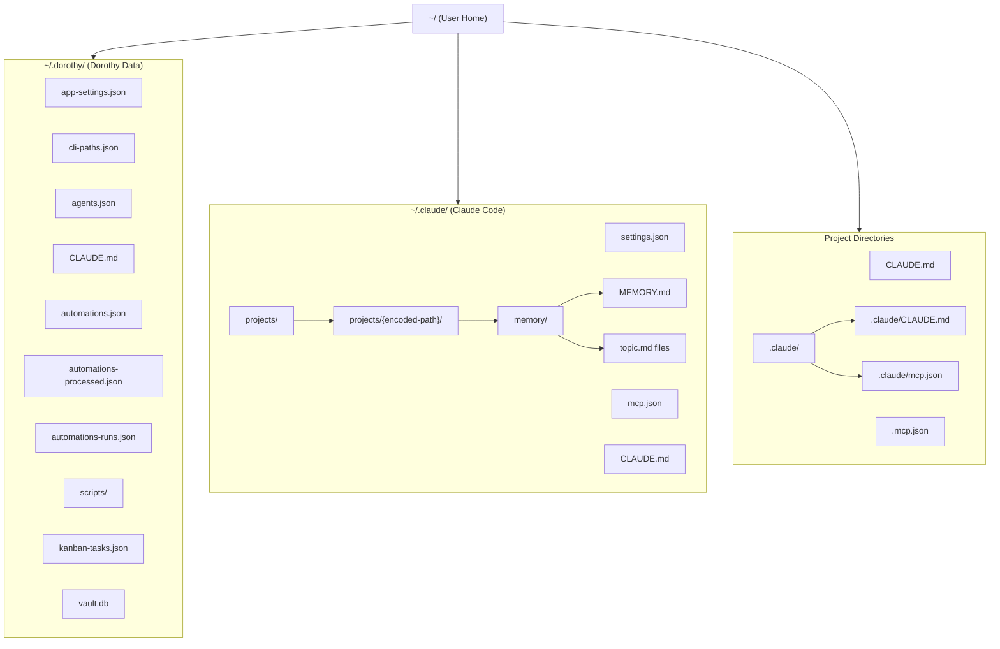
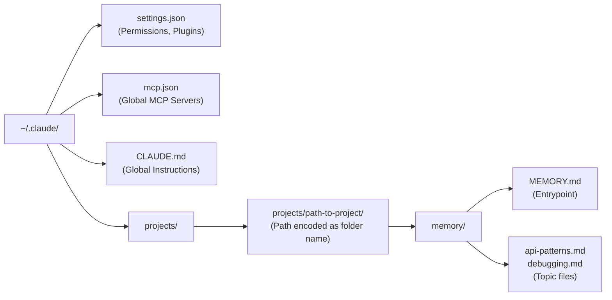
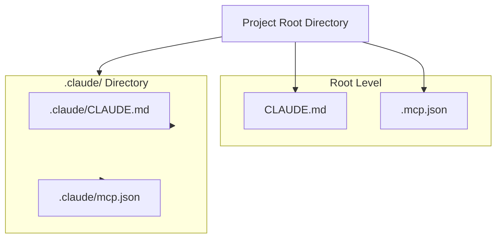
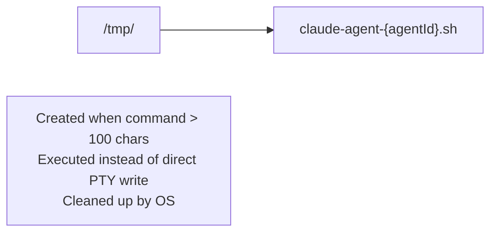
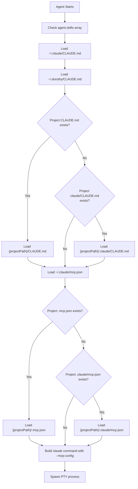
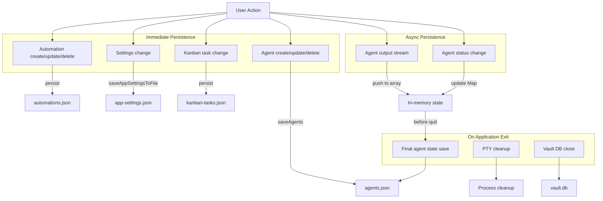

<!-- source: DeepWiki mcp.deepwiki.com · repo Charlie85270/Dorothy · page 13.3 File Locations · fetched 2026-10-26 -->

# File Locations

<details>
<summary>Relevant source files</summary>

The following files were used as context for generating this wiki page:

- [CLAUDE.md](CLAUDE.md)
- [bun.lock](bun.lock)
- [electron/handlers/memory-handlers.ts](electron/handlers/memory-handlers.ts)
- [electron/main.ts](electron/main.ts)
- [src/app/memory/page.tsx](src/app/memory/page.tsx)
- [src/app/recurring-tasks/page.tsx](src/app/recurring-tasks/page.tsx)
- [src/components/Memory/AgentKnowledgeGraph.tsx](src/components/Memory/AgentKnowledgeGraph.tsx)

</details>


This document provides a comprehensive reference for all data files and directories used by Dorothy. Dorothy stores its configuration and state in `~/.dorothy/` and integrates with Claude Code's native storage in `~/.claude/`. For configuration schemas and field definitions, see [AppSettings](#13.1). For environment variable configuration, see [Environment Variables](#13.2).

---

## Directory Structure Overview



**Sources:** [electron/main.ts:99-103](), [electron/main.ts:167](), [electron/main.ts:300](), [src/components/Memory/AgentKnowledgeGraph.tsx:576-589]()

---

## ~/.dorothy/ Directory

Dorothy's primary data directory, created by `ensureDataDir()` on application startup.

### Core Configuration Files

| File | Purpose | Format | Updated By |
|------|---------|--------|------------|
| `app-settings.json` | Application settings including integrations, notifications, provider defaults | JSON | Settings UI, IPC handlers |
| `cli-paths.json` | CLI executable paths for claude, codex, gemini, gh, gws, node | JSON | CLI Paths settings section |
| `agents.json` | Agent definitions and runtime state | JSON | Agent Manager |

**Sources:** [electron/main.ts:22](), [electron/main.ts:155-163](), [electron/main.ts:165-172]()

### Automation Files

| File | Purpose | Retention | Format |
|------|---------|-----------|--------|
| `automations.json` | Automation definitions with sources, triggers, filters, outputs | Permanent | JSON |
| `automations-processed.json` | Content hashes of processed items for deduplication | Growing | JSON |
| `automations-runs.json` | Execution history (last 1000 runs) | Capped | JSON |
| `scripts/` | Shell scripts for scheduled tasks (launchd/cron) | Permanent | Bash |

**Sources:** Referenced in automation system diagrams

### Task Management

| File | Purpose | Schema |
|------|---------|--------|
| `kanban-tasks.json` | Kanban board tasks with status, assignee, agent linkage | JSON array of task objects |

**Sources:** Referenced in Kanban system

### Document Vault

| File | Type | Contents |
|------|------|----------|
| `vault.db` | SQLite | `documents`, `folders`, `attachments` tables with FTS5 full-text search index |

**Sources:** [electron/main.ts:89](), [electron/services/vault-db]()

### Global Instructions

| File | Purpose | Loaded By |
|------|---------|-----------|
| `CLAUDE.md` | Global Dorothy-specific instructions for all agents | All spawned agent processes |

**Sources:** [electron/main.ts:100](), [src/components/Memory/AgentKnowledgeGraph.tsx:582]()

---

## ~/.claude/ Directory

Claude Code's native directory, managed by the Claude CLI. Dorothy reads from this directory but does not directly modify it (except through Claude CLI invocations).



**Sources:** [src/components/Memory/AgentKnowledgeGraph.tsx:548-550](), [CLAUDE.md:1-12]()

### Configuration Files

| File | Purpose | Format | Modified By |
|------|---------|--------|-------------|
| `settings.json` | Claude CLI settings: permissions, plugins, environment | JSON | Permissions settings section |
| `mcp.json` | Global MCP server definitions (`mcpServers` object) | JSON | Manual editing |
| `CLAUDE.md` | Global instructions loaded for all Claude sessions | Markdown | Manual editing |

**Sources:** [src/components/Memory/AgentKnowledgeGraph.tsx:548](), [src/components/Memory/AgentKnowledgeGraph.tsx:581]()

### Project Memory Structure

Memory files use path-as-folder-name encoding (slashes become dashes):

```
~/.claude/projects/Users-username-code-myproject/memory/
    MEMORY.md           # Entrypoint (< 200 lines)
    architecture.md     # Topic file
    debugging.md        # Topic file
    api-patterns.md     # Topic file
```

**File Naming Convention:**
- Project path: `/Users/username/code/myproject`
- Encoded folder: `Users-username-code-myproject`
- Full path: `~/.claude/projects/Users-username-code-myproject/memory/`

**Sources:** [CLAUDE.md:1-12](), [src/app/memory/page.tsx:1-630]()

### Memory File Types

| File | Purpose | Size Guidelines |
|------|---------|-----------------|
| `MEMORY.md` | Entrypoint with high-level context and index | < 200 lines |
| `{topic}.md` | Detailed notes on specific topics (patterns, debugging, conventions) | No limit |

**Sources:** [CLAUDE.md:8-10](), [src/app/memory/page.tsx:87-137]()

---

## Project-Specific Files

Each project directory can contain Dorothy and Claude configuration files:



**Sources:** [src/components/Memory/AgentKnowledgeGraph.tsx:576-589](), [src/components/Memory/AgentKnowledgeGraph.tsx:616-641]()

### Instruction Files

| Location | Purpose | Scope |
|----------|---------|-------|
| `{projectPath}/CLAUDE.md` | Project-specific instructions | Agents in this project |
| `{projectPath}/.claude/CLAUDE.md` | Alternate location | Agents in this project |

**Loading Order:**
1. `~/.claude/CLAUDE.md` (global)
2. `~/.dorothy/CLAUDE.md` (global Dorothy)
3. `{projectPath}/CLAUDE.md` (project)
4. `{projectPath}/.claude/CLAUDE.md` (project alternate)

**Sources:** [src/components/Memory/AgentKnowledgeGraph.tsx:576-589]()

### MCP Configuration Files

| Location | Purpose | Schema |
|----------|---------|--------|
| `{projectPath}/.mcp.json` | Per-project MCP servers | `{ "mcpServers": { "name": { "command": "...", "args": [...] } } }` |
| `{projectPath}/.claude/mcp.json` | Alternate location | Same schema |

**Sources:** [src/components/Memory/AgentKnowledgeGraph.tsx:616-630]()

---

## Temporary Files

Dorothy creates temporary files during agent execution:



**Purpose:** Avoid PTY line-wrapping issues with long commands by writing to a temporary shell script.

**Lifecycle:**
1. Created when agent command exceeds 100 characters
2. Written with full command including `cd` and `claude` invocation
3. Executed via PTY: `bash '/tmp/claude-agent-{agentId}.sh'`
4. Automatically cleaned by OS temp file policies

**Sources:** [electron/main.ts:529-534]()

---

## File Location Resolution

### Agent Configuration Lookup



**Sources:** [src/components/Memory/AgentKnowledgeGraph.tsx:542-670]()

### Path Encoding for Memory

Memory directories use path-as-folder-name encoding:

| Original Path | Encoded Folder Name |
|---------------|---------------------|
| `/Users/alice/code/myapp` | `Users-alice-code-myapp` |
| `/home/bob/projects/api` | `home-bob-projects-api` |
| `C:\Users\charlie\dev\ui` | `C-Users-charlie-dev-ui` |

**Implementation:** Slashes and backslashes replaced with dashes, maintained by Claude Code CLI.

**Sources:** [CLAUDE.md:3]()

---

## File Permissions and Ownership

All Dorothy files are created with user ownership and standard permissions:

| File Type | Permissions | Notes |
|-----------|-------------|-------|
| JSON files | `0644` (rw-r--r--) | Standard config files |
| `vault.db` | `0644` (rw-r--r--) | SQLite database |
| Shell scripts (`scripts/`) | `0755` (rwxr-xr-x) | Executable by scheduler |
| Temporary scripts | `0755` (rwxr-xr-x) | Set via `fs.writeFileSync` mode option |

**Sources:** [electron/main.ts:530]()

---

## Migration and Compatibility

### Legacy Data Migration

Dorothy 1.0 was previously named "Claude Manager". On first run, data is migrated:

**Migration Function:** `migrateFromClaudeManager()`

| Source | Destination | Preserved |
|--------|-------------|-----------|
| `~/.claude-manager/*` | `~/.dorothy/*` | All files |

**Sources:** [electron/main.ts:103]()

### Backward Compatibility

- Claude Code memory format: Native, no Dorothy-specific modifications
- MCP configurations: Standard JSON schema compatible with Claude CLI
- Settings persistence: JSON with schema versioning via field presence

**Sources:** [electron/main.ts:108-163]()

---

## Data Persistence Guarantees



**Persistence Triggers:**

1. **Immediate:** Settings changes, agent CRUD, automation CRUD
2. **On Status Change:** Agent transitions (idle → running → completed/error)
3. **On Exit:** Final state flush via `before-quit` event

**Sources:** [electron/main.ts:585-590](), [electron/main.ts:35-40](), [electron/main.ts:165-172]()

---

## File Size Management

### Capped Storage

| File | Retention Policy |
|------|------------------|
| `automations-runs.json` | Last 1000 runs (FIFO) |
| `agent.output` array | Full session output (cleared on agent restart) |

### Unbounded Growth

| File | Growth Pattern | Mitigation |
|------|----------------|------------|
| `automations-processed.json` | One hash per processed item | Manual cleanup if needed |
| `vault.db` | Grows with documents | SQLite VACUUM command available |
| Memory files (`~/.claude/projects/*/memory/*.md`) | Grows with Claude usage | User-managed via Memory UI |

**Sources:** Referenced in automation system design

---

## Quick Reference Table

| Path | Type | Purpose | Persistence |
|------|------|---------|-------------|
| `~/.dorothy/app-settings.json` | JSON | Application configuration | On settings change |
| `~/.dorothy/cli-paths.json` | JSON | CLI executable paths | On CLI paths change |
| `~/.dorothy/agents.json` | JSON | Agent definitions | On agent change + app exit |
| `~/.dorothy/automations.json` | JSON | Automation definitions | On automation change |
| `~/.dorothy/automations-processed.json` | JSON | Processed item hashes | After automation run |
| `~/.dorothy/automations-runs.json` | JSON | Run history (capped) | After automation run |
| `~/.dorothy/kanban-tasks.json` | JSON | Kanban board state | On task change |
| `~/.dorothy/vault.db` | SQLite | Document vault with FTS5 | On document/folder change |
| `~/.dorothy/scripts/` | Directory | Scheduler shell scripts | On scheduled task create |
| `~/.dorothy/CLAUDE.md` | Markdown | Global Dorothy instructions | Manual edit |
| `~/.claude/settings.json` | JSON | Claude CLI settings | Via Permissions UI |
| `~/.claude/mcp.json` | JSON | Global MCP servers | Manual edit |
| `~/.claude/CLAUDE.md` | Markdown | Global Claude instructions | Manual edit |
| `~/.claude/projects/{path}/memory/` | Directory | Project memory files | Via Claude CLI |
| `{project}/CLAUDE.md` | Markdown | Project instructions | Manual edit |
| `{project}/.mcp.json` | JSON | Project MCP servers | Manual edit |
| `/tmp/claude-agent-{id}.sh` | Bash | Temporary command script | On long command execution |

**Sources:** Comprehensive summary from all sections above

---

