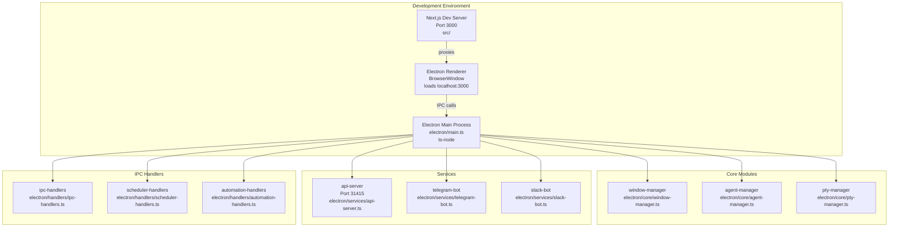
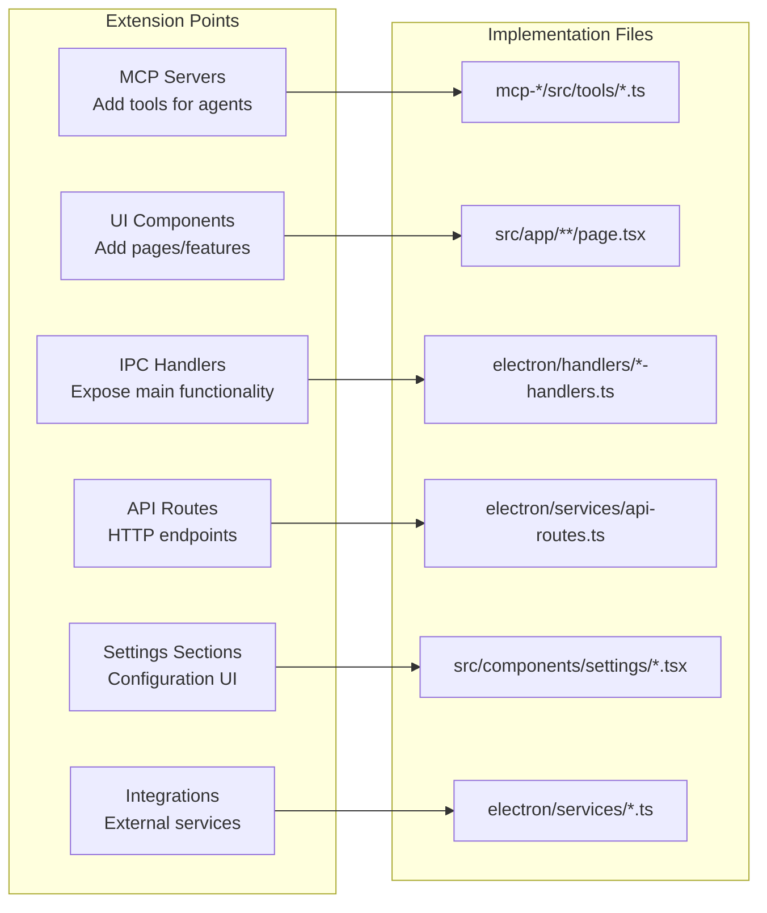
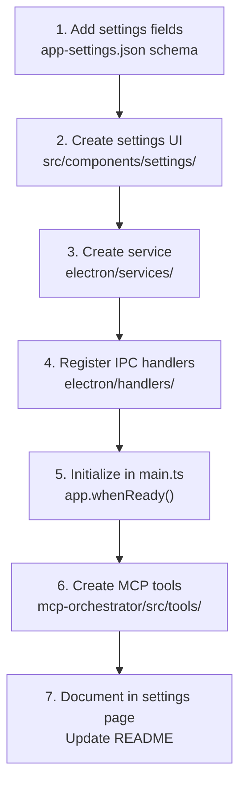
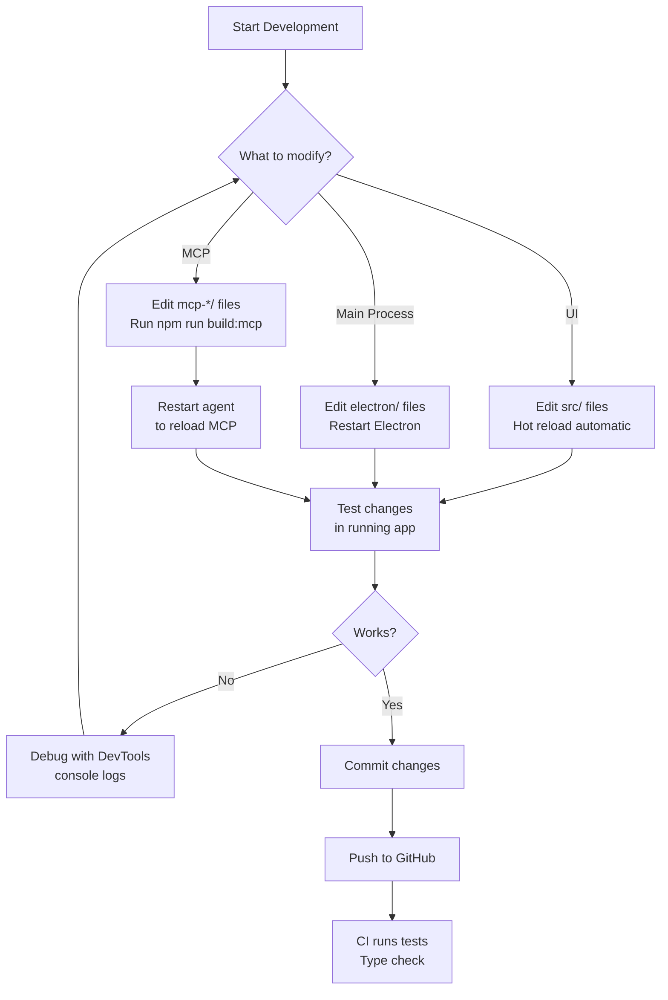

<!-- source: DeepWiki mcp.deepwiki.com · repo Charlie85270/Dorothy · page 14 Development Guide · fetched 2026-10-26 -->

# Development Guide

<details>
<summary>Relevant source files</summary>

The following files were used as context for generating this wiki page:

- [electron/main.ts](electron/main.ts)
- [electron/services/api-server.ts](electron/services/api-server.ts)
- [mcp-orchestrator/src/tools/automations.ts](mcp-orchestrator/src/tools/automations.ts)
- [mcp-orchestrator/src/tools/index.ts](mcp-orchestrator/src/tools/index.ts)
- [mcp-orchestrator/src/utils/api.ts](mcp-orchestrator/src/utils/api.ts)
- [mcp-orchestrator/src/utils/automations.ts](mcp-orchestrator/src/utils/automations.ts)
- [mcp-orchestrator/src/utils/index.ts](mcp-orchestrator/src/utils/index.ts)

</details>


This guide is for developers who want to extend, modify, or contribute to Dorothy. It covers the development environment setup, architecture overview, extension points, and common development patterns. For detailed technical architecture, see [Technical Architecture](#11). For build and release processes, see [Build and Release](#12).

---

## Development Environment Setup

### Prerequisites

Dorothy requires the following tools for development:

| Tool | Version | Purpose |
|------|---------|---------|
| Node.js | 20.x or 22.x | Runtime for Electron and Next.js |
| npm | 8.x+ | Package management |
| TypeScript | 5.x | Type checking and compilation |
| Python | 3.x | Required by node-gyp for native modules |
| Xcode CLI Tools | Latest | macOS build tools (macOS only) |

### Repository Structure

```
Dorothy/
├── electron/              # Main process code
│   ├── main.ts           # Entry point
│   ├── core/             # Core modules (window, agent, PTY)
│   ├── services/         # Services (API, Telegram, Slack)
│   ├── handlers/         # IPC handlers
│   └── types.ts          # Shared types
├── src/                  # Renderer process (Next.js)
│   ├── app/              # App router pages
│   ├── components/       # React components
│   ├── hooks/            # Custom hooks
│   └── store/            # Zustand state management
├── mcp-orchestrator/     # MCP server for orchestration
├── mcp-telegram/         # MCP server for Telegram media
├── mcp-kanban/          # MCP server for task management
├── mcp-vault/           # MCP server for document storage
├── mcp-socialdata/      # MCP server for social data
├── mcp-world/           # MCP server for generative zone
└── mcp-x/              # MCP server for X/Twitter
```

### Running in Development

**1. Install dependencies:**

```bash
npm install
```

**2. Start Next.js dev server:**

```bash
npm run dev
```

**3. Start Electron (in another terminal):**

```bash
npm run electron:dev
```

**4. Build MCP modules (if modified):**

```bash
npm run build:mcp
```

The development setup uses `ts-node` to run TypeScript directly without compilation. Changes to the renderer process (Next.js) hot-reload automatically. Changes to the main process require restarting Electron.

Sources: [electron/main.ts:1-603](), [package.json]()

---

## Development Architecture Overview

### Process Architecture Diagram



Sources: [electron/main.ts:1-603](), [electron/core/window-manager.ts](), [electron/services/api-server.ts:1-199]()

### Key Architectural Concepts

**Modular Design**: Dorothy uses a modular architecture where each subsystem is isolated in its own file or directory. The main process [electron/main.ts:1-603]() wires everything together during initialization.

**IPC Communication**: All communication between renderer and main process uses type-safe IPC handlers. See [IPC Communication](#11.2) for details.

**PTY-Based Agent Execution**: Agents run in pseudo-terminals (PTY) spawned by [electron/core/pty-manager.ts](). Each agent gets its own shell session.

**HTTP API Bridge**: MCP tools communicate with Electron services through an HTTP API server on port 31415 [electron/services/api-server.ts:180]().

**State Management**: 
- Main process: In-memory Maps with disk persistence
- Renderer process: Zustand stores with localStorage sync
- MCP servers: JSON files in `~/.dorothy/`

Sources: [electron/main.ts:13-103](), [electron/core/agent-manager.ts](), [electron/core/pty-manager.ts]()

---

## Extension Points

### Extension Points Diagram



Sources: [electron/handlers/ipc-handlers.ts](), [electron/services/api-server.ts](), [mcp-orchestrator/src/tools/]()

### 1. MCP Servers and Tools

MCP servers extend agent capabilities with new tools. Each MCP server is a standalone npm package that communicates via stdio.

**Creating a new MCP tool** (detailed in [Creating MCP Servers](#14.1)):

1. Add tool registration in your MCP server's main file
2. Use the `@modelcontextprotocol/sdk` server API
3. Implement tool logic with proper validation
4. Update agent MCP config to include the server

**Example MCP tool registration:**

```typescript
server.tool(
  "tool_name",
  "Tool description",
  {
    param1: z.string().describe("Parameter description"),
    param2: z.number().optional(),
  },
  async ({ param1, param2 }) => {
    // Tool implementation
    return {
      content: [{ type: "text", text: "Result" }],
    };
  }
);
```

Sources: [mcp-orchestrator/src/tools/automations.ts:820-1156]()

### 2. UI Features

Add new UI features by creating pages in the Next.js app directory.

**Key UI patterns:**

| Pattern | Location | Purpose |
|---------|----------|---------|
| Pages | `src/app/**/page.tsx` | App routes |
| Components | `src/components/` | Reusable UI elements |
| Hooks | `src/hooks/` | Custom React hooks |
| Stores | `src/store/` | Zustand state management |

**Example page structure:**

```typescript
"use client";

import { useEffect, useState } from 'react';

export default function MyFeature() {
  const [data, setData] = useState(null);
  
  useEffect(() => {
    window.electronAPI.myFeature.getData().then(setData);
  }, []);
  
  return <div>{/* UI */}</div>;
}
```

See [Adding UI Features](#14.2) for detailed guidance.

Sources: [src/app/](), [src/components/]()

### 3. IPC Handlers

IPC handlers expose main process functionality to the renderer.

**Handler registration pattern** in [electron/handlers/ipc-handlers.ts:1-800]():

```typescript
export function registerIpcHandlers(deps: IpcHandlerDependencies) {
  ipcMain.handle('namespace:action', async (event, ...args) => {
    // Implementation using deps
    return result;
  });
}
```

**Dependencies pattern**: All handlers receive a `dependencies` object containing references to services, state, and utility functions. This enables testability and decoupling.

Sources: [electron/handlers/ipc-handlers.ts:82-265](), [electron/main.ts:214-265]()

### 4. API Routes

The HTTP API server provides endpoints for MCP tools to interact with Electron services.

**Route registration** in [electron/services/api-server.ts:49-59]():

```typescript
export function registerAllRoutes(app: RouteApp, ctx: RouteContext) {
  app.get('/api/endpoint', async (req, sendJson, ctx) => {
    const data = await someOperation();
    sendJson({ data });
  });
  
  app.post('/api/endpoint', async (req, sendJson, ctx) => {
    const { body } = req;
    // Process body
    sendJson({ success: true });
  });
}
```

**Route security**: All routes except health checks and local-only endpoints require Bearer token authentication [electron/services/api-server.ts:116-129]().

Sources: [electron/services/api-server.ts:49-178](), [electron/services/api-routes.ts]()

### 5. Settings Sections

Add configuration UI by creating a new settings section component.

**Settings section pattern:**

```typescript
export function MySettingsSection() {
  const { settings, loading, error, handleSave } = useSettings();
  
  const handleMySettingChange = async (value: any) => {
    await handleSave({ myNewSetting: value });
  };
  
  return (
    <SettingsCard
      title="My Feature"
      description="Configure my feature"
    >
      {/* Settings UI */}
    </SettingsCard>
  );
}
```

Settings are persisted to `~/.dorothy/app-settings.json` [electron/main.ts:105-173]().

Sources: [src/components/settings/](), [electron/main.ts:105-173]()

---

## Common Development Patterns

### Pattern: Adding a New Integration

**Step-by-step integration pattern:**



**Example: Adding a Discord integration**

1. **Add to AppSettings type** [electron/types.ts]():
```typescript
export interface AppSettings {
  // ...existing fields
  discordEnabled: boolean;
  discordBotToken: string;
  discordChannelId: string;
}
```

2. **Create settings section** `src/components/settings/DiscordSection.tsx`
3. **Create service** `electron/services/discord-bot.ts`
4. **Add IPC handlers** for Discord operations
5. **Initialize in main.ts** [electron/main.ts:542-546]()
6. **Create MCP tool** `send_discord` in mcp-orchestrator

Sources: [electron/services/telegram-bot.ts:1-350](), [electron/services/slack-bot.ts:1-200]()

### Pattern: Adding State to Main Process

**State management pattern:**

```typescript
// 1. Define state map
const myFeatureState = new Map<string, MyStateType>();

// 2. Create save/load functions
function loadMyState() {
  const file = path.join(DATA_DIR, 'my-state.json');
  if (fs.existsSync(file)) {
    const data = JSON.parse(fs.readFileSync(file, 'utf-8'));
    for (const [key, value] of Object.entries(data)) {
      myFeatureState.set(key, value);
    }
  }
}

function saveMyState() {
  const file = path.join(DATA_DIR, 'my-state.json');
  const data = Object.fromEntries(myFeatureState);
  fs.writeFileSync(file, JSON.stringify(data, null, 2));
}

// 3. Load on startup in main.ts
app.whenReady().then(() => {
  loadMyState();
});

// 4. Save on quit
app.on('before-quit', () => {
  saveMyState();
});
```

Sources: [electron/core/agent-manager.ts:33-80](), [electron/main.ts:585-590]()

### Pattern: UI Component with IPC Communication

**React component pattern:**

```typescript
"use client";

import { useEffect, useState } from 'react';
import { useToast } from '@/hooks/use-toast';

export function MyFeature() {
  const [data, setData] = useState<any[]>([]);
  const [loading, setLoading] = useState(true);
  const { toast } = useToast();
  
  useEffect(() => {
    loadData();
    
    // Listen for real-time updates
    const unsubscribe = window.electronAPI.myFeature.onUpdate(
      (event, update) => {
        setData(prev => [...prev, update]);
      }
    );
    
    return () => unsubscribe();
  }, []);
  
  async function loadData() {
    try {
      const result = await window.electronAPI.myFeature.list();
      setData(result);
    } catch (error) {
      toast({
        variant: "destructive",
        title: "Error loading data",
        description: String(error),
      });
    } finally {
      setLoading(false);
    }
  }
  
  return (
    <div>{/* UI rendering */}</div>
  );
}
```

Sources: [src/app/agents/page.tsx](), [src/app/memory/page.tsx]()

### Pattern: MCP Tool with API Communication

**MCP tool calling Electron API:**

```typescript
import { apiRequest } from "../utils/api.js";

server.tool(
  "my_action",
  "Description of action",
  {
    param: z.string().describe("Parameter"),
  },
  async ({ param }) => {
    try {
      // Call Dorothy's API
      const response = await apiRequest(
        "/api/my-endpoint",
        "POST",
        { data: param }
      );
      
      return {
        content: [{
          type: "text",
          text: `Action completed: ${JSON.stringify(response)}`,
        }],
      };
    } catch (error) {
      return {
        content: [{
          type: "text",
          text: `Error: ${error}`,
        }],
        isError: true,
      };
    }
  }
);
```

**API utility** [mcp-orchestrator/src/utils/api.ts:21-61]() handles authentication and timeouts automatically.

Sources: [mcp-orchestrator/src/tools/automations.ts:478-576](), [mcp-orchestrator/src/utils/api.ts:1-62]()

---

## Development Workflow

### Development Workflow Diagram



### Debugging Tools

**Electron DevTools**: Press `Cmd+Option+I` (macOS) or `Ctrl+Shift+I` (Windows/Linux) to open Chrome DevTools for the renderer process.

**Main Process Logging**: All console output from the main process appears in the terminal where you ran `npm run electron:dev`.

**IPC Inspector**: Set `ELECTRON_ENABLE_LOGGING=1` environment variable to see IPC messages:

```bash
ELECTRON_ENABLE_LOGGING=1 npm run electron:dev
```

**MCP Server Logging**: MCP servers log to stderr, which is captured in agent output. Enable verbose mode [electron/main.ts:505]() to see detailed MCP communication.

**API Request Logging**: The API server logs all requests [electron/services/api-server.ts:101-178](). Check terminal output for API debugging.

Sources: [electron/main.ts:1-603](), [electron/services/api-server.ts:71-191]()

---

## Testing Strategy

Dorothy uses multiple testing approaches:

**1. MCP Tool Testing**: Each MCP server includes a test directory with integration tests. See [Testing](#14.3) for details.

**2. Component Testing**: React components can be tested with Jest and React Testing Library (infrastructure to be added).

**3. Manual Testing**: Most testing is currently manual due to the complexity of PTY and IPC interactions.

**4. Type Checking**: TypeScript provides compile-time verification:

```bash
npm run type-check
```

**5. Build Verification**: Ensure all MCP modules compile:

```bash
npm run build:mcp
```

Sources: [mcp-orchestrator/tests/](), [package.json]()

---

## File Locations Reference

Key configuration and state files for development:

| File | Purpose | Location |
|------|---------|----------|
| `app-settings.json` | Application settings | `~/.dorothy/app-settings.json` |
| `agents.json` | Agent definitions | `~/.dorothy/agents.json` |
| `api-token` | API authentication token | `~/.dorothy/api-token` |
| `cli-paths.json` | CLI tool paths | `~/.dorothy/cli-paths.json` |
| `automations.json` | Automation definitions | `~/.dorothy/automations.json` |
| `kanban-tasks.json` | Kanban tasks | `~/.dorothy/kanban-tasks.json` |
| `vault.db` | Document vault database | `~/.dorothy/vault.db` |
| `CLAUDE.md` | Dorothy system prompt | `~/.dorothy/CLAUDE.md` |

**Development vs Production**: In development mode, all files are still written to `~/.dorothy/`. To test with a clean slate, delete this directory (Electron will recreate it on next launch).

Sources: [electron/constants.ts](), [electron/utils.ts]()

---

## Common Tasks

### Adding a New IPC Handler

1. Define the handler in the appropriate file under `electron/handlers/`
2. Register it in [electron/main.ts:318-332]()
3. Add TypeScript definitions to the preload script types
4. Call from renderer using `window.electronAPI.namespace.method()`

### Adding a New API Endpoint

1. Define route in `electron/services/api-routes.ts`
2. Register in `registerAllRoutes()` function
3. Ensure proper authentication for non-local endpoints
4. Call from MCP tools using `apiRequest()` utility

### Modifying Agent Execution

1. Agent spawning logic: [electron/core/agent-manager.ts:82-250]()
2. PTY management: [electron/core/pty-manager.ts:1-100]()
3. Command building: [electron/handlers/ipc-handlers.ts:300-450]()
4. MCP config generation: [electron/services/mcp-orchestrator.ts]()

### Adding Settings

1. Add fields to `AppSettings` type [electron/types.ts]()
2. Add defaults in `loadAppSettings()` [electron/main.ts:108-153]()
3. Create settings section component
4. Import and render in settings page
5. Use settings via `useSettings()` hook

Sources: [electron/handlers/ipc-handlers.ts:82-800](), [electron/main.ts:318-380](), [electron/types.ts]()

---

## Next Steps

- **Create MCP Servers**: See [Creating MCP Servers](#14.1) for detailed MCP development guide
- **Add UI Features**: See [Adding UI Features](#14.2) for React component development
- **Testing**: See [Testing](#14.3) for test infrastructure details
- **Build Process**: See [Build and Release](#12) for packaging and distribution

For questions or contributions, open an issue or pull request on the [GitHub repository](https://github.com/Charlie85270/Dorothy).

Sources: [electron/main.ts:1-603](), [electron/handlers/](), [electron/services/](), [mcp-orchestrator/]()

---

