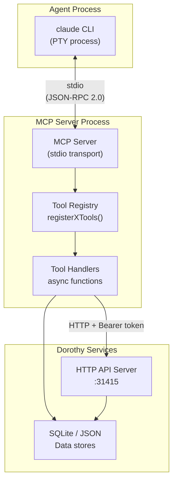
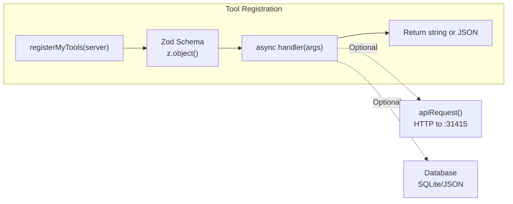
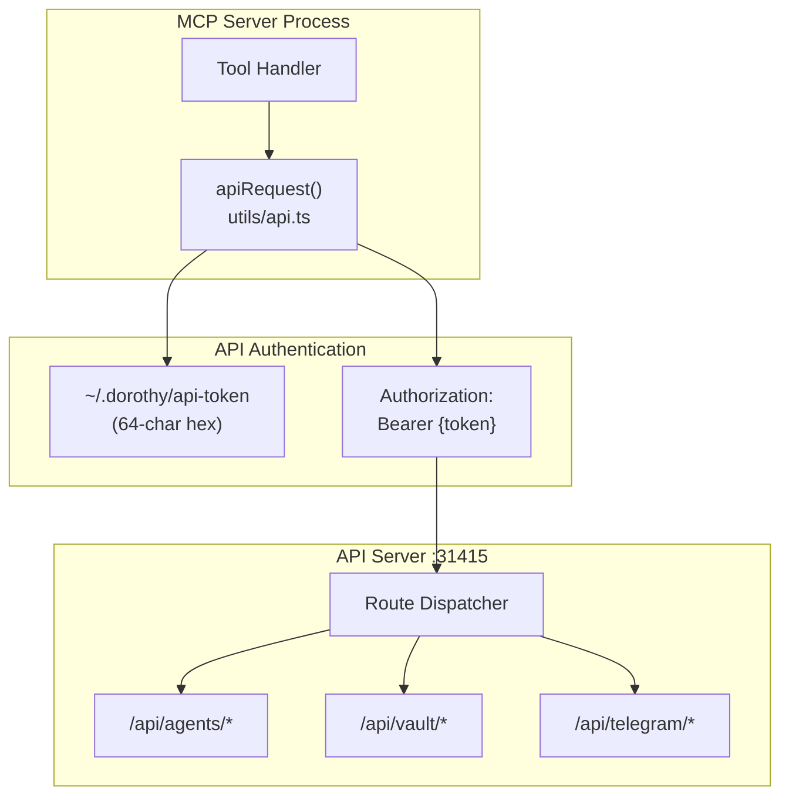
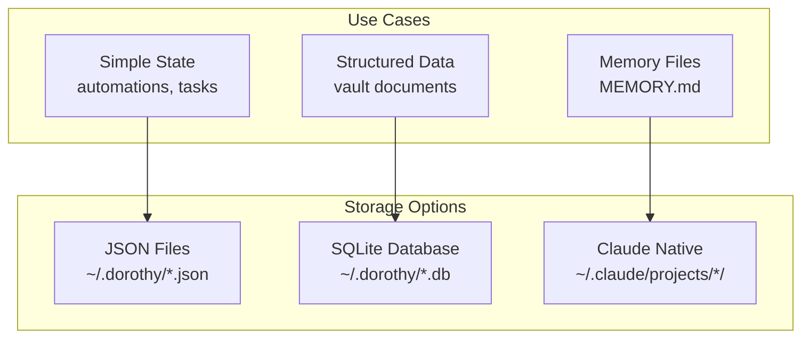
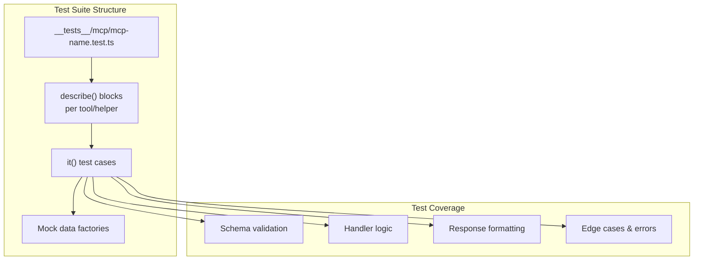

<!-- source: DeepWiki mcp.deepwiki.com · repo Charlie85270/Dorothy · page 14.1 Creating MCP Servers · fetched 2026-10-26 -->

# Creating MCP Servers

<details>
<summary>Relevant source files</summary>

The following files were used as context for generating this wiki page:

- [README.md](README.md)
- [__tests__/mcp/mcp-socialdata.test.ts](__tests__/mcp/mcp-socialdata.test.ts)
- [__tests__/mcp/mcp-vault.test.ts](__tests__/mcp/mcp-vault.test.ts)
- [electron/services/api-server.ts](electron/services/api-server.ts)
- [landing/public/kanban.png](landing/public/kanban.png)
- [landing/public/ollama-icon.svg](landing/public/ollama-icon.svg)
- [landing/src/app/page.tsx](landing/src/app/page.tsx)
- [mcp-orchestrator/src/tools/automations.ts](mcp-orchestrator/src/tools/automations.ts)
- [mcp-orchestrator/src/tools/index.ts](mcp-orchestrator/src/tools/index.ts)
- [mcp-orchestrator/src/utils/api.ts](mcp-orchestrator/src/utils/api.ts)
- [mcp-orchestrator/src/utils/automations.ts](mcp-orchestrator/src/utils/automations.ts)
- [mcp-orchestrator/src/utils/index.ts](mcp-orchestrator/src/utils/index.ts)
- [screenshots/kanban.png](screenshots/kanban.png)

</details>


This document provides a technical guide for creating new Model Context Protocol (MCP) servers for Dorothy. MCP servers expose tools that agents can invoke programmatically to extend their capabilities. For information about using existing MCP tools, see [MCP Ecosystem](#4).

MCP servers in Dorothy communicate via stdio and are spawned as child processes when agents start. They expose tools through standardized JSON-RPC 2.0 protocol, validated using Zod schemas.

---

## MCP Architecture Overview

### Communication Model



**Sources:** [README.md:639-644](), [electron/services/api-server.ts:1-199](), [mcp-orchestrator/src/utils/api.ts:1-62]()

---

## Project Structure

A typical MCP server in Dorothy follows this structure:

```
mcp-<name>/
├── package.json              # Dependencies: @modelcontextprotocol/sdk, zod
├── tsconfig.json            # TypeScript configuration
├── src/
│   ├── index.ts             # Server entry point
│   ├── tools/               # Tool implementations (optional, for organization)
│   │   ├── <domain>.ts     # Tool registration and handlers
│   │   └── index.ts        # Tool exports
│   └── utils/              # Shared utilities
│       ├── api.ts          # Dorothy API client
│       └── helpers.ts      # Domain-specific helpers
└── __tests__/              # Test suites
    └── mcp-<name>.test.ts
```

**Example Structure:**

| Server | Location | Tools Count | Purpose |
|--------|----------|-------------|---------|
| `mcp-orchestrator` | `mcp-orchestrator/` | 26+ | Agent management, messaging, scheduler |
| `mcp-telegram` | `mcp-telegram/` | 4 | Telegram media support |
| `mcp-kanban` | `mcp-kanban/` | 8 | Task management |
| `mcp-vault` | `mcp-vault/` | 10 | Document management |
| `mcp-socialdata` | `mcp-socialdata/` | 5 | Twitter/X API |

**Sources:** [README.md:646-702]()

---

## Server Entry Point

### Basic Server Setup

```typescript
#!/usr/bin/env node
import { Server } from "@modelcontextprotocol/sdk/server/index.js";
import { StdioServerTransport } from "@modelcontextprotocol/sdk/server/stdio.js";
import { registerMyTools } from "./tools/index.js";

const server = new Server(
  {
    name: "mcp-myserver",
    version: "1.0.0",
  },
  {
    capabilities: {
      tools: {},
    },
  }
);

// Register all tools
registerMyTools(server);

// Start stdio transport
const transport = new StdioServerTransport();
await server.connect(transport);
```

**Key Components:**

| Component | Type | Purpose |
|-----------|------|---------|
| `Server` | `@modelcontextprotocol/sdk/server` | Core MCP server instance |
| `StdioServerTransport` | `@modelcontextprotocol/sdk/server/stdio` | stdio communication transport |
| `capabilities.tools` | Object | Declares tool support |
| `registerMyTools()` | Function | Registers tool handlers |

**Sources:** [README.md:639-644]()

---

## Tool Registration Pattern

### Tool Handler Structure



**Sources:** [mcp-orchestrator/src/tools/agents.ts](), [mcp-orchestrator/src/tools/automations.ts]()

### Example: Creating a Tool

```typescript
import { McpServer } from "@modelcontextprotocol/sdk/server/mcp.js";
import { z } from "zod";
import { apiRequest } from "../utils/api.js";

export function registerMyTools(server: McpServer) {
  // Define tool schema
  server.tool(
    "my_tool_name",
    "Description of what this tool does. Be specific about parameters and behavior.",
    {
      param1: z.string().describe("Description of param1"),
      param2: z.number().optional().describe("Optional parameter"),
      param3: z.enum(["option1", "option2"]).describe("Enum parameter"),
    },
    async ({ param1, param2, param3 }) => {
      try {
        // Validation logic
        if (!param1 || param1.trim().length === 0) {
          return "Error: param1 is required";
        }
        
        // Business logic
        const result = await apiRequest("/api/endpoint", "POST", {
          param1,
          param2,
          param3,
        });
        
        // Format response for agent consumption
        return formatResponse(result);
      } catch (error) {
        return `Error: ${error instanceof Error ? error.message : String(error)}`;
      }
    }
  );
}
```

**Schema Validation Examples:**

| Validation | Zod Syntax | Use Case |
|------------|------------|----------|
| Required string | `z.string()` | IDs, names, paths |
| Optional string | `z.string().optional()` | Descriptions, templates |
| Number | `z.number()` | Counts, limits, timeouts |
| Boolean | `z.boolean()` | Flags, toggles |
| Enum | `z.enum(["a", "b"])` | Status, model selection |
| Array | `z.array(z.string())` | Tags, labels, IDs |

**Sources:** [mcp-orchestrator/src/tools/agents.ts](), [__tests__/mcp/mcp-vault.test.ts:1-10]()

---

## Dorothy API Integration

### API Client Usage

MCP servers can interact with Dorothy's internal services through the HTTP API server on port 31415.



**Sources:** [mcp-orchestrator/src/utils/api.ts:1-62](), [electron/services/api-server.ts:1-199]()

### API Request Helper

The `apiRequest()` utility function handles authentication and error handling:

```typescript
// mcp-orchestrator/src/utils/api.ts
export async function apiRequest(
  endpoint: string,
  method: "GET" | "POST" | "DELETE" = "GET",
  body?: Record<string, unknown>
): Promise<unknown> {
  const url = `${API_URL}${endpoint}`;
  const headers: Record<string, string> = { "Content-Type": "application/json" };
  
  // Read token from ~/.dorothy/api-token
  const token = readApiToken();
  if (token) {
    headers["Authorization"] = `Bearer ${token}`;
  }
  
  // Handle long-poll endpoints with extended timeout
  const isLongPoll = endpoint.includes("/wait");
  const timeoutMs = isLongPoll ? 600_000 : 30_000;
  
  const controller = new AbortController();
  const timer = setTimeout(() => controller.abort(), timeoutMs);
  
  try {
    const response = await fetch(url, { method, headers, body: JSON.stringify(body) });
    const data = await response.json();
    
    if (!response.ok) {
      throw new Error(data.error || `API error: ${response.status}`);
    }
    
    return data;
  } finally {
    clearTimeout(timer);
  }
}
```

**Key Features:**

- **Token Authentication:** Reads from `~/.dorothy/api-token` (generated by API server)
- **Timeout Handling:** 30s default, 10min for long-poll endpoints
- **Error Propagation:** Throws errors with server message
- **Abort Support:** Allows request cancellation

**Sources:** [mcp-orchestrator/src/utils/api.ts:1-62]()

### Common API Endpoints

| Endpoint | Method | Purpose | Request Body |
|----------|--------|---------|--------------|
| `/api/agents` | GET | List all agents | None |
| `/api/agents` | POST | Create agent | `{ projectPath, name, skills?, skipPermissions? }` |
| `/api/agents/:id` | GET | Get agent details | None |
| `/api/agents/:id/start` | POST | Start agent with task | `{ prompt, model? }` |
| `/api/agents/:id/stop` | POST | Stop running agent | None |
| `/api/agents/:id/wait` | GET | Long-poll until completion | None |
| `/api/vault/documents` | GET | List vault documents | Query: `folder_id?`, `tags?` |
| `/api/vault/documents` | POST | Create document | `{ title, content, folder?, tags? }` |
| `/api/telegram/send` | POST | Send Telegram message | `{ message }` |
| `/api/slack/send` | POST | Send Slack message | `{ message }` |

**Sources:** [electron/services/api-server.ts:49-199](), [mcp-orchestrator/src/tools/automations.ts:478-489]()

---

## Data Persistence Patterns

### Storage Strategies

MCP servers in Dorothy use three primary storage patterns:



**Sources:** [README.md:725-745]()

### JSON File Pattern

Used for simple state management (automations, tasks, processed items):

```typescript
import * as fs from "fs";
import * as path from "path";
import * as os from "os";

const DATA_FILE = path.join(os.homedir(), ".dorothy", "my-data.json");

// Ensure directory exists
function ensureDir(): void {
  const dir = path.dirname(DATA_FILE);
  if (!fs.existsSync(dir)) {
    fs.mkdirSync(dir, { recursive: true });
  }
}

// Load data
export function loadData(): MyData[] {
  ensureDir();
  if (!fs.existsSync(DATA_FILE)) {
    return [];
  }
  try {
    return JSON.parse(fs.readFileSync(DATA_FILE, "utf-8"));
  } catch {
    return [];
  }
}

// Save data
export function saveData(data: MyData[]): void {
  ensureDir();
  fs.writeFileSync(DATA_FILE, JSON.stringify(data, null, 2));
}
```

**Sources:** [mcp-orchestrator/src/utils/automations.ts:143-175]()

### SQLite Pattern

Used for structured data with search requirements (vault documents):

**File Locations:**

| Database | Path | Purpose | Features |
|----------|------|---------|----------|
| `vault.db` | `~/.dorothy/vault.db` | Document storage | FTS5 full-text search, folders, attachments |

**Sources:** [README.md:743]()

---

## Tool Response Formatting

### Response Guidelines

Agents consume tool responses as text. Format responses for readability and actionability:

**Good Response Formatting:**

```typescript
// ✅ Good: Structured, scannable, actionable
function formatDocumentList(docs: Document[]): string {
  if (docs.length === 0) {
    return "No documents found.";
  }
  
  const lines = docs.map(d => {
    const tags = JSON.parse(d.tags || "[]");
    const tagsStr = tags.length > 0 ? `, tags: ${tags.join(", ")}` : "";
    return `- [${d.id.slice(0, 8)}] ${d.title} (by ${d.author}, ${d.updated_at.slice(0, 10)}${tagsStr})`;
  });
  
  return `Found ${docs.length} documents:\n\n${lines.join("\n")}`;
}

// ✅ Good: Clear success message with details
function formatSuccess(doc: Document): string {
  return `Document created successfully!
ID: ${doc.id}
Title: ${doc.title}
Folder: ${doc.folder_id || "Root"}
Tags: ${JSON.parse(doc.tags || "[]").join(", ") || "None"}`;
}

// ✅ Good: Informative error
function formatError(error: unknown): string {
  return `Error creating document: ${error instanceof Error ? error.message : String(error)}`;
}
```

**Sources:** [__tests__/mcp/mcp-vault.test.ts:302-330](), [__tests__/mcp/mcp-vault.test.ts:110-119]()

### Formatting Patterns

| Pattern | Use Case | Example |
|---------|----------|---------|
| **List with metadata** | Multiple results | `- [doc-123] Title (by agent, 2024-01-15)` |
| **Hierarchical tree** | Nested structures | `- Folder\n  - Subfolder\n    - Item` |
| **Key-value pairs** | Details | `Title: value\nID: value\nStatus: value` |
| **Engagement metrics** | Social data | `❤️ 25  🔁 5  💬 3  👁 500` |
| **Empty state** | No results | `No items found matching "query".` |
| **Pagination hint** | Cursored results | `📄 More results available. Use cursor: "abc123"` |

**Sources:** [__tests__/mcp/mcp-socialdata.test.ts:171-178](), [__tests__/mcp/mcp-vault.test.ts:397-432]()

---

## Template Variable Interpolation

### Automation Prompts

Tools that create agents or send messages often use template variables:

```typescript
export function interpolateTemplate(
  template: string,
  variables: Record<string, unknown>
): string {
  let result = template;
  for (const [key, value] of Object.entries(variables)) {
    const pattern = new RegExp(`\\{\\{${key}\\}\\}`, "g");
    result = result.replace(pattern, String(value));
  }
  return result;
}
```

**Supported Variables (GitHub):**

| Variable | Type | Example | Description |
|----------|------|---------|-------------|
| `{{title}}` | string | `"Fix login bug"` | PR/issue title |
| `{{url}}` | string | `"https://github.com/..."` | Item URL |
| `{{author}}` | string | `"octocat"` | Author username |
| `{{body}}` | string | `"This PR fixes..."` | Description/body |
| `{{repo}}` | string | `"owner/repo"` | Repository name |
| `{{number}}` | number | `42` | PR/issue number |
| `{{type}}` | string | `"pull_request"` | Item type |

**Supported Variables (JIRA):**

| Variable | Type | Example | Description |
|----------|------|---------|-------------|
| `{{key}}` | string | `"PROJ-123"` | Issue key |
| `{{summary}}` | string | `"Task summary"` | Issue summary |
| `{{status}}` | string | `"In Progress"` | Current status |
| `{{issueType}}` | string | `"Bug"` | Issue type |
| `{{priority}}` | string | `"High"` | Priority level |
| `{{assignee}}` | string | `"John Doe"` | Assignee name |

**Sources:** [README.md:128-157](), [mcp-orchestrator/src/utils/automations.ts:227-237]()

---

## Testing MCP Tools

### Test Structure

Test files validate tool business logic, helpers, and formatters:



**Sources:** [__tests__/mcp/mcp-vault.test.ts:1-10](), [__tests__/mcp/mcp-socialdata.test.ts:1-10]()

### Test Patterns

```typescript
import { describe, it, expect, vi, beforeEach } from 'vitest';

// Mock factories for consistent test data
function makeDocument(overrides: Partial<VaultDocument> = {}): VaultDocument {
  return {
    id: 'doc-001-uuid',
    title: 'Test Document',
    content: '# Hello\n\nThis is a test document.',
    folder_id: 'folder-001',
    author: 'test-agent',
    tags: '["test","report"]',
    created_at: '2024-01-01T00:00:00.000Z',
    updated_at: '2024-01-01T00:00:00.000Z',
    ...overrides,
  };
}

describe('vault_create_document handler logic', () => {
  it('derives author from CLAUDE_AGENT_NAME env var', () => {
    const agentName = 'my-agent';
    const agentId = 'agent-123';
    const author = agentName || agentId || 'agent';
    expect(author).toBe('my-agent');
  });
  
  it('formats success message correctly', () => {
    const doc = makeDocument({ id: 'doc-abc', title: 'My Report' });
    const folder = 'Research';
    const tags = ['report', 'weekly'];
    const text = `Document created successfully!\nID: ${doc.id}\nTitle: ${doc.title}\nFolder: ${folder}\nTags: ${tags.join(", ")}`;
    
    expect(text).toContain('doc-abc');
    expect(text).toContain('My Report');
    expect(text).toContain('Research');
  });
  
  it('shows "None" when no tags provided', () => {
    const tags: string[] | undefined = undefined;
    const text = `Tags: ${tags?.join(", ") || "None"}`;
    expect(text).toBe('Tags: None');
  });
});
```

**Test Categories:**

| Category | Purpose | Examples |
|----------|---------|----------|
| **Schema validation** | Verify Zod schemas accept/reject inputs | Required vs optional, enum values |
| **Handler logic** | Test business logic paths | Success, validation errors, API errors |
| **Formatting** | Verify response text structure | Lists, details, empty states |
| **Edge cases** | Handle unexpected inputs | Empty arrays, null values, malformed data |
| **API construction** | Verify URL/body building | Query params, request bodies |

**Sources:** [__tests__/mcp/mcp-vault.test.ts:87-144](), [__tests__/mcp/mcp-socialdata.test.ts:259-292]()

---

## Environment Variables

### Agent Context

MCP servers can access agent-specific environment variables:

| Variable | Set By | Purpose | Example |
|----------|--------|---------|---------|
| `CLAUDE_AGENT_NAME` | Agent Manager | Agent's display name | `"my-agent"` |
| `CLAUDE_AGENT_ID` | Agent Manager | Agent's unique ID | `"agent-123"` |
| `CLAUDE_MGR_API_URL` | System | API server URL | `"http://127.0.0.1:31415"` |

**Usage Example:**

```typescript
// Derive author from environment
const agentName = process.env.CLAUDE_AGENT_NAME;
const agentId = process.env.CLAUDE_AGENT_ID;
const author = agentName || agentId || "agent";
```

**Sources:** [__tests__/mcp/mcp-vault.test.ts:89-107]()

---

## Security Considerations

### Input Validation

Always validate inputs to prevent injection attacks:

```typescript
// ✅ Validate repository names
const REPO_RE = /^[a-zA-Z0-9._-]+\/[a-zA-Z0-9._-]+$/;
if (!REPO_RE.test(repo)) {
  return { items: [], error: `Invalid repository name: ${repo}` };
}

// ✅ Validate numeric inputs
if (!Number.isInteger(number) || number <= 0) {
  throw new Error(`Invalid issue/PR number: ${number}`);
}

// ✅ Escape shell arguments
const escaped = message.replace(/'/g, "'\\''");
const cmd = `gh pr comment ${number} --repo ${repo} --body '${escaped}'`;
```

**Sources:** [mcp-orchestrator/src/tools/automations.ts:173-177](), [mcp-orchestrator/src/tools/automations.ts:493-502]()

### Webhook URL Validation

Prevent SSRF attacks by validating webhook URLs:

```typescript
function isAllowedWebhookUrl(urlString: string): boolean {
  try {
    const parsed = new URL(urlString);
    
    // Require HTTPS
    if (parsed.protocol !== 'https:') return false;
    
    const hostname = parsed.hostname.toLowerCase();
    
    // Block localhost
    if (hostname === 'localhost' || hostname === '[::1]') return false;
    
    // Block private IP ranges
    const ipParts = hostname.split('.').map(Number);
    if (ipParts.length === 4 && ipParts.every(p => !isNaN(p))) {
      const [a, b] = ipParts;
      if (a === 127) return false;          // 127.x.x.x
      if (a === 10) return false;           // 10.x.x.x
      if (a === 172 && b >= 16 && b <= 31) return false; // 172.16-31.x.x
      if (a === 192 && b === 168) return false; // 192.168.x.x
      if (a === 169 && b === 254) return false; // 169.254.x.x (link-local)
    }
    
    return true;
  } catch {
    return false;
  }
}
```

**Sources:** [mcp-orchestrator/src/tools/automations.ts:44-74]()

---

## Complete Example: Creating a Simple MCP Server

### Directory Setup

```
mcp-weather/
├── package.json
├── tsconfig.json
└── src/
    ├── index.ts
    └── utils/
        └── api.ts
```

### package.json

```json
{
  "name": "mcp-weather",
  "version": "1.0.0",
  "type": "module",
  "bin": {
    "mcp-weather": "./dist/index.js"
  },
  "scripts": {
    "build": "tsc",
    "dev": "tsc --watch"
  },
  "dependencies": {
    "@modelcontextprotocol/sdk": "^1.0.0",
    "zod": "^3.22.0"
  },
  "devDependencies": {
    "@types/node": "^20.0.0",
    "typescript": "^5.0.0"
  }
}
```

### src/index.ts

```typescript
#!/usr/bin/env node
import { Server } from "@modelcontextprotocol/sdk/server/index.js";
import { StdioServerTransport } from "@modelcontextprotocol/sdk/server/stdio.js";
import { z } from "zod";

const server = new Server(
  {
    name: "mcp-weather",
    version: "1.0.0",
  },
  {
    capabilities: {
      tools: {},
    },
  }
);

// Register weather tool
server.tool(
  "get_weather",
  "Get current weather for a city. Returns temperature, conditions, and humidity.",
  {
    city: z.string().describe("City name (e.g., 'San Francisco')"),
    units: z.enum(["celsius", "fahrenheit"]).optional().describe("Temperature units (default: celsius)"),
  },
  async ({ city, units = "celsius" }) => {
    try {
      // Validate input
      if (!city || city.trim().length === 0) {
        return "Error: City name is required";
      }
      
      // Call weather API (example)
      const response = await fetch(`https://api.weather.example/current?city=${encodeURIComponent(city)}`);
      const data = await response.json();
      
      if (!response.ok) {
        return `Error: ${data.message || `HTTP ${response.status}`}`;
      }
      
      // Format response
      const temp = units === "celsius" ? data.temp_c : data.temp_f;
      const unit = units === "celsius" ? "°C" : "°F";
      
      return `Weather in ${city}:
Temperature: ${temp}${unit}
Conditions: ${data.conditions}
Humidity: ${data.humidity}%
Wind: ${data.wind_speed} km/h ${data.wind_dir}`;
    } catch (error) {
      return `Error fetching weather: ${error instanceof Error ? error.message : String(error)}`;
    }
  }
);

// Start server
const transport = new StdioServerTransport();
await server.connect(transport);
```

### Integration with Dorothy

Add to `~/.claude/settings.json`:

```json
{
  "mcpServers": {
    "weather": {
      "command": "node",
      "args": ["/path/to/mcp-weather/dist/index.js"]
    }
  }
}
```

**Sources:** [README.md:409-485]()

---

## Build and Distribution

### TypeScript Configuration

```json
{
  "compilerOptions": {
    "target": "ES2022",
    "module": "ES2022",
    "lib": ["ES2022"],
    "moduleResolution": "node",
    "outDir": "./dist",
    "rootDir": "./src",
    "strict": true,
    "esModuleInterop": true,
    "skipLibCheck": true,
    "forceConsistentCasingInFileNames": true
  },
  "include": ["src/**/*"],
  "exclude": ["node_modules", "dist"]
}
```

### Build Process

```bash
# Install dependencies
npm install

# Build TypeScript
npm run build

# Test the server
node dist/index.js
```

**Sources:** [README.md:756-774]()

---

## Common Patterns and Utilities

### CLI Path Resolution

When calling external CLIs (gh, node, etc.), use path resolution:

```typescript
import * as fs from "fs";
import * as path from "path";
import * as os from "os";

const CLI_PATHS_CONFIG_FILE = path.join(os.homedir(), ".dorothy", "cli-paths.json");

function loadCLIPathsConfig(): { fullPath?: string; gh?: string; node?: string } | null {
  try {
    if (fs.existsSync(CLI_PATHS_CONFIG_FILE)) {
      return JSON.parse(fs.readFileSync(CLI_PATHS_CONFIG_FILE, "utf-8"));
    }
  } catch { }
  return null;
}

function buildFullPath(): string {
  const config = loadCLIPathsConfig();
  if (config?.fullPath) {
    return config.fullPath;
  }
  
  // Fallback to default paths
  const homeDir = os.homedir();
  const additionalPaths = [
    "/opt/homebrew/bin",
    "/usr/local/bin",
    path.join(homeDir, ".local/bin"),
  ];
  
  return [...additionalPaths, ...(process.env.PATH || "").split(":")].join(":");
}

// Use in exec commands
import { exec } from "child_process";
import { promisify } from "util";

const execAsync = promisify(exec);

async function runCommand(command: string): Promise<{ stdout: string; stderr: string }> {
  return execAsync(command, {
    env: {
      ...process.env,
      PATH: buildFullPath(),
    },
  });
}
```

**Sources:** [mcp-orchestrator/src/tools/automations.ts:76-146]()

### Content Hashing for Deduplication

```typescript
import * as crypto from "crypto";

export function hashContent(content: string): string {
  return crypto.createHash("sha256").update(content).digest("hex").slice(0, 16);
}

export function createItemId(
  sourceType: string,
  namespace: string,
  itemType: string,
  itemId: string
): string {
  return `${sourceType}:${namespace}:${itemType}:${itemId}`;
}
```

**Sources:** [mcp-orchestrator/src/utils/automations.ts:218-237]()

---

## Debugging and Logging

### Server Logging

MCP servers communicate via stdio, so logging must go to stderr:

```typescript
// ✅ Correct: Log to stderr
console.error("Debug: Processing item", itemId);

// ❌ Wrong: stdout is reserved for MCP protocol
console.log("This will break the protocol");
```

### Testing with stdio

Test MCP servers in isolation:

```bash
# Send a test message
echo '{"jsonrpc":"2.0","method":"tools/list","id":1}' | node dist/index.js

# Expected response (on stdout)
# {"jsonrpc":"2.0","id":1,"result":{"tools":[...]}}
```

**Sources:** [README.md:639-644]()

---

## Next Steps

After creating your MCP server:

1. **Test thoroughly** - Write unit tests for all tool handlers
2. **Document tools** - Provide clear descriptions and parameter documentation
3. **Register with Dorothy** - Add to `~/.claude/settings.json`
4. **Monitor usage** - Check agent output for tool invocations
5. **Iterate** - Refine response formatting based on agent behavior

For more information on specific Dorothy systems, see:
- [MCP Ecosystem](#4) - Overview of all built-in MCP servers
- [Technical Architecture](#11) - Deep dive into Dorothy's architecture
- [Testing](#14.3) - Test infrastructure and best practices

---

