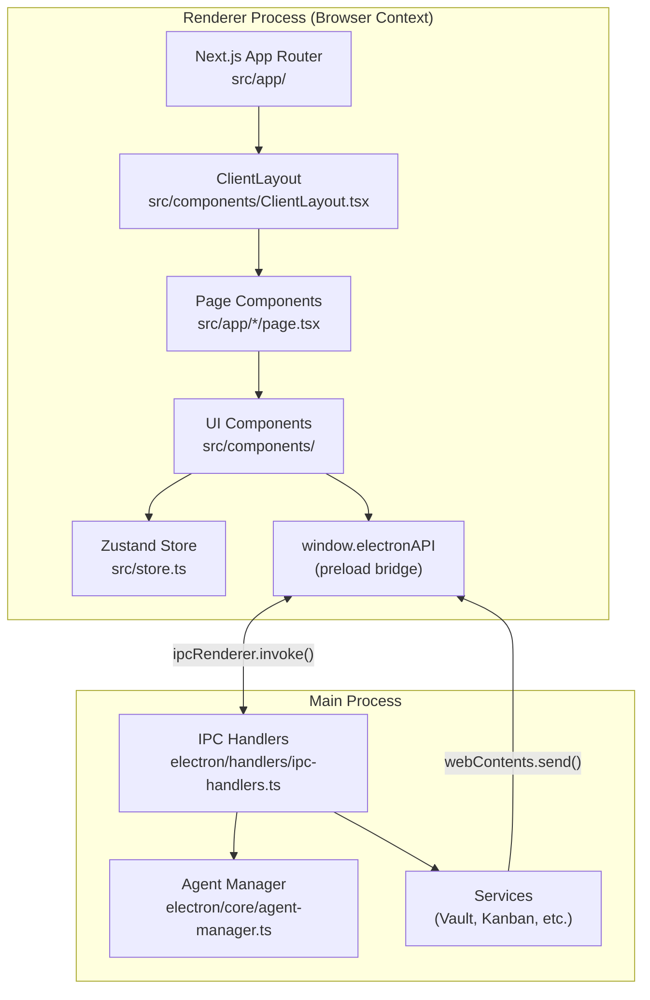
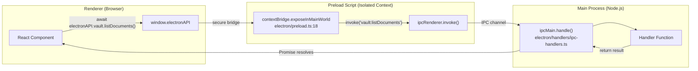
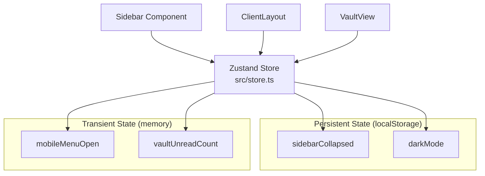
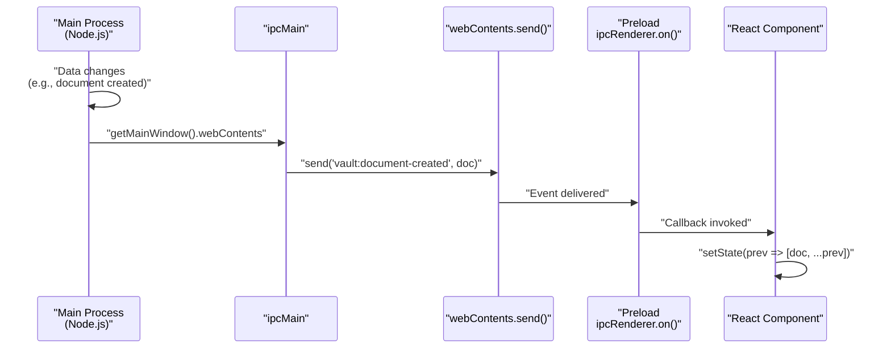

<!-- source: DeepWiki mcp.deepwiki.com · repo Charlie85270/Dorothy · page 14.2 Adding UI Features · fetched 2026-10-26 -->

# Adding UI Features

<details>
<summary>Relevant source files</summary>

The following files were used as context for generating this wiki page:

- [electron/core/agent-manager.ts](electron/core/agent-manager.ts)
- [electron/handlers/ipc-handlers.ts](electron/handlers/ipc-handlers.ts)
- [electron/preload.ts](electron/preload.ts)
- [mcp-vault/src/tools/documents.ts](mcp-vault/src/tools/documents.ts)
- [src/app/globals.css](src/app/globals.css)
- [src/app/vault/page.tsx](src/app/vault/page.tsx)
- [src/components/ClientLayout.tsx](src/components/ClientLayout.tsx)
- [src/components/Settings/index.ts](src/components/Settings/index.ts)
- [src/components/Sidebar.tsx](src/components/Sidebar.tsx)
- [src/components/VaultView/components/FolderTree.tsx](src/components/VaultView/components/FolderTree.tsx)
- [src/components/VaultView/index.tsx](src/components/VaultView/index.tsx)
- [src/types/electron.d.ts](src/types/electron.d.ts)

</details>


This guide covers the process of adding new user interface features to Dorothy's Electron renderer process, including creating pages, components, IPC communication, and state management. For information about creating MCP servers or modifying the main process, see [Creating MCP Servers](#14.1). For backend architecture details, see [Electron Main Process](#11.1) and [IPC Communication](#11.2).

---

## UI Architecture Overview

Dorothy's user interface runs in an Electron renderer process using Next.js 14 with the App Router. The architecture follows a three-tier model:

| Layer | Technology | Purpose |
|-------|------------|---------|
| **Renderer Process** | Next.js 14, React 18 | UI pages and components |
| **IPC Bridge** | `electron/preload.ts` | Type-safe communication layer |
| **Main Process** | Electron, Node.js | System operations, IPC handlers |

The renderer process has no direct access to Node.js APIs or file system operations. All system interactions must flow through the IPC bridge using `window.electronAPI`.

**Diagram: Renderer Process Architecture**



**Sources:** [src/components/ClientLayout.tsx:1-350](), [electron/preload.ts:1-635](), [electron/handlers/ipc-handlers.ts:1-100]()

---

## Adding New Pages

Dorothy uses Next.js App Router with file-based routing. Each page is a React Server Component that can import client components.

### Page Structure

Create a new page by adding a `page.tsx` file in the `src/app/` directory:

```
src/app/
├── my-feature/
│   └── page.tsx          # Route: /my-feature
├── settings/
│   └── [section]/
│       └── page.tsx      # Dynamic route: /settings/[section]
└── vault/
    └── page.tsx          # Route: /vault
```

**Example Page Template:**

```typescript
'use client';

import { useState, useEffect } from 'react';
import { Loader2 } from 'lucide-react';

export default function MyFeaturePage() {
  const [loading, setLoading] = useState(true);
  const [data, setData] = useState(null);

  useEffect(() => {
    // Fetch data via IPC
    const loadData = async () => {
      if (window.electronAPI?.myFeature) {
        const result = await window.electronAPI.myFeature.getData();
        setData(result);
      }
      setLoading(false);
    };
    loadData();
  }, []);

  if (loading) {
    return (
      <div className="flex items-center justify-center h-full">
        <Loader2 className="w-6 h-6 animate-spin text-muted-foreground" />
      </div>
    );
  }

  return (
    <div className="h-[calc(100vh-7rem)] lg:h-[calc(100vh-3rem)] flex flex-col pt-4 lg:pt-6">
      <div className="flex flex-col sm:flex-row sm:items-center justify-between gap-3 mb-4">
        <div>
          <h1 className="text-xl lg:text-2xl font-bold tracking-tight">My Feature</h1>
          <p className="text-muted-foreground text-xs lg:text-sm mt-1">Feature description</p>
        </div>
      </div>
      {/* Feature content */}
    </div>
  );
}
```

### Adding to Navigation

Add the page to the sidebar navigation in [src/components/Sidebar.tsx:31-44]():

```typescript
const navItems = [
  { href: '/my-feature', icon: MyIcon, label: 'My Feature', shortcut: 'F' },
  // ... other items
];
```

**Sources:** [src/app/vault/page.tsx:1-60](), [src/components/Sidebar.tsx:31-44]()

---

## Component Patterns

Dorothy follows consistent patterns for reusable UI components.

### Component Organization

```
src/components/
├── VaultView/
│   ├── index.tsx              # Main component
│   ├── components/
│   │   ├── FolderTree.tsx     # Sub-components
│   │   ├── DocumentList.tsx
│   │   └── DocumentViewer.tsx
│   └── shared.tsx             # Shared utilities
├── Settings/
│   ├── index.ts               # Exports
│   ├── GeneralSection.tsx
│   └── types.ts
└── Sidebar.tsx                # Standalone component
```

### Shared Component Examples

**Panel Container:**

```typescript
export function VaultPanel({ 
  children, 
  className 
}: { 
  children: React.ReactNode; 
  className?: string 
}) {
  return (
    <div className={`bg-card border border-border rounded-lg ${className}`}>
      {children}
    </div>
  );
}
```

**Empty State:**

```typescript
export function VaultEmptyState({ 
  icon: Icon, 
  title, 
  description 
}: { 
  icon: React.ComponentType<{ className?: string }>; 
  title: string; 
  description: string;
}) {
  return (
    <div className="flex flex-col items-center justify-center h-full text-center p-8">
      <Icon className="w-12 h-12 text-muted-foreground mb-4" />
      <h3 className="text-lg font-semibold mb-2">{title}</h3>
      <p className="text-muted-foreground text-sm">{description}</p>
    </div>
  );
}
```

**Sources:** [src/components/VaultView/index.tsx:1-50](), [src/components/VaultView/components/FolderTree.tsx:1-100]()

---

## IPC Communication

All communication between the renderer and main process flows through the IPC bridge defined in `window.electronAPI`.

**Diagram: IPC Communication Architecture**



### Defining Types

Define the IPC API interface in [src/types/electron.d.ts]():

```typescript
export interface ElectronAPI {
  myFeature?: {
    getData: () => Promise<{ data: MyData[] }>;
    createItem: (params: { name: string }) => Promise<{ success: boolean; item?: MyData }>;
    onItemCreated: (callback: (item: MyData) => void) => () => void;
  };
}
```

**Sources:** [src/types/electron.d.ts:152-791]()

### Preload Bridge

Expose IPC methods in [electron/preload.ts]():

```typescript
contextBridge.exposeInMainWorld('electronAPI', {
  myFeature: {
    getData: () => ipcRenderer.invoke('myFeature:getData'),
    createItem: (params: { name: string }) => 
      ipcRenderer.invoke('myFeature:createItem', params),
    onItemCreated: (callback: (item: unknown) => void) => {
      const listener = (_: unknown, item: unknown) => callback(item);
      ipcRenderer.on('myFeature:itemCreated', listener);
      return () => ipcRenderer.removeListener('myFeature:itemCreated', listener);
    },
  },
});
```

**Sources:** [electron/preload.ts:18-634]()

### Main Process Handlers

Register handlers in [electron/handlers/ipc-handlers.ts]():

```typescript
function registerMyFeatureHandlers(deps: IpcHandlerDependencies): void {
  const { getMainWindow } = deps;

  // Query handler
  ipcMain.handle('myFeature:getData', async () => {
    try {
      const data = await loadMyFeatureData();
      return { data };
    } catch (error) {
      return { data: [], error: error.message };
    }
  });

  // Command handler
  ipcMain.handle('myFeature:createItem', async (_event, params: { name: string }) => {
    try {
      const item = await createMyFeatureItem(params.name);
      
      // Notify all renderer windows
      getMainWindow()?.webContents.send('myFeature:itemCreated', item);
      
      return { success: true, item };
    } catch (error) {
      return { success: false, error: error.message };
    }
  });
}
```

**Sources:** [electron/handlers/ipc-handlers.ts:60-776]()

### Component Usage

Call IPC methods from React components:

```typescript
'use client';

import { useState, useEffect } from 'react';

export default function MyFeatureComponent() {
  const [items, setItems] = useState([]);

  // Initial data load
  useEffect(() => {
    const loadData = async () => {
      if (!window.electronAPI?.myFeature) return;
      const result = await window.electronAPI.myFeature.getData();
      if (result.data) {
        setItems(result.data);
      }
    };
    loadData();
  }, []);

  // Real-time event listener
  useEffect(() => {
    if (!window.electronAPI?.myFeature) return;
    
    const unsubscribe = window.electronAPI.myFeature.onItemCreated((item) => {
      setItems(prev => [item, ...prev]);
    });
    
    return unsubscribe;
  }, []);

  const handleCreate = async (name: string) => {
    if (!window.electronAPI?.myFeature) return;
    const result = await window.electronAPI.myFeature.createItem({ name });
    if (!result.success) {
      console.error('Failed to create item:', result.error);
    }
  };

  return (
    <div>
      <button onClick={() => handleCreate('New Item')}>Create</button>
      {items.map(item => <div key={item.id}>{item.name}</div>)}
    </div>
  );
}
```

**Sources:** [src/components/VaultView/index.tsx:86-149]()

---

## State Management

Dorothy uses Zustand for global state management. The store is defined in [src/store.ts]().

**Diagram: Zustand Store Architecture**



### Creating Store Slices

Add new state to the Zustand store:

```typescript
interface StoreState {
  // Existing state
  sidebarCollapsed: boolean;
  darkMode: boolean;
  
  // New feature state
  myFeatureFilter: string;
  setMyFeatureFilter: (filter: string) => void;
  myFeatureItems: MyItem[];
  setMyFeatureItems: (items: MyItem[]) => void;
}

export const useStore = create<StoreState>((set) => ({
  // Existing
  sidebarCollapsed: false,
  darkMode: false,
  
  // New
  myFeatureFilter: 'all',
  setMyFeatureFilter: (filter) => set({ myFeatureFilter: filter }),
  myFeatureItems: [],
  setMyFeatureItems: (items) => set({ myFeatureItems: items }),
}));
```

### Using Store in Components

```typescript
import { useStore } from '@/store';

export default function MyComponent() {
  const { myFeatureFilter, setMyFeatureFilter, myFeatureItems } = useStore();
  
  const filteredItems = myFeatureItems.filter(item => {
    if (myFeatureFilter === 'all') return true;
    return item.status === myFeatureFilter;
  });
  
  return (
    <div>
      <select value={myFeatureFilter} onChange={(e) => setMyFeatureFilter(e.target.value)}>
        <option value="all">All</option>
        <option value="active">Active</option>
      </select>
      {filteredItems.map(item => <div key={item.id}>{item.name}</div>)}
    </div>
  );
}
```

**Sources:** [src/components/ClientLayout.tsx:62-173](), [src/components/Sidebar.tsx:50-280]()

---

## Styling and Theming

Dorothy uses a custom CSS variable-based theming system with Tailwind CSS v4.

### Theme Variables

All theme colors are defined in [src/app/globals.css:61-214]():

| Variable | Light Mode | Dark Mode | Usage |
|----------|-----------|-----------|-------|
| `--background` | `#F0E8D5` | `#1A1714` | Page background |
| `--foreground` | `#2C2418` | `#E8DEC8` | Primary text |
| `--card` | `#FAF4EA` | `#242019` | Card backgrounds |
| `--primary` | `#3D9B94` | `#4DB8B0` | Accent color (teal) |
| `--border` | `#D5CAB4` | `#3A342B` | Border color |
| `--muted-foreground` | `#7A6E58` | `#9A8E78` | Secondary text |

### Dark Mode Toggle

Dark mode is controlled by the Zustand store and synced to localStorage:

```typescript
// ClientLayout.tsx
const { darkMode, setDarkMode } = useStore();

useEffect(() => {
  document.documentElement.classList.toggle('dark', darkMode);
  localStorage.setItem('dorothy-dark-mode', String(darkMode));
}, [darkMode]);
```

The `.dark` class on `<html>` overrides all CSS variables with dark mode values [src/app/globals.css:140-214]().

### Component Styling

Use Tailwind utility classes with semantic color names:

```typescript
<div className="bg-card border border-border rounded-lg">
  <h2 className="text-foreground font-semibold">Heading</h2>
  <p className="text-muted-foreground">Description text</p>
  <button className="bg-primary text-primary-foreground hover:bg-primary/90">
    Action
  </button>
</div>
```

### Responsive Design

Follow mobile-first responsive patterns:

```typescript
<div className="
  flex flex-col gap-2          /* Mobile: vertical stack */
  lg:flex-row lg:gap-4         /* Desktop: horizontal */
">
  <aside className="
    w-full                      /* Mobile: full width */
    lg:w-64 lg:shrink-0         /* Desktop: fixed sidebar */
  ">
    Sidebar
  </aside>
  <main className="flex-1">
    Content
  </main>
</div>
```

**Sources:** [src/app/globals.css:1-636](), [src/components/ClientLayout.tsx:131-143]()

---

## Real-Time Updates

Components can listen for real-time events from the main process using IPC event listeners.

**Diagram: Real-Time Event Flow**



### Setting Up Event Listeners

**In component:**

```typescript
useEffect(() => {
  if (!window.electronAPI?.vault) return;

  // Listen for created documents
  const unsubCreated = window.electronAPI.vault.onDocumentCreated((doc) => {
    setDocuments(prev => [doc, ...prev]);
  });

  // Listen for updated documents
  const unsubUpdated = window.electronAPI.vault.onDocumentUpdated((doc) => {
    setDocuments(prev => prev.map(d => d.id === doc.id ? doc : d));
  });

  // Listen for deleted documents
  const unsubDeleted = window.electronAPI.vault.onDocumentDeleted(({ id }) => {
    setDocuments(prev => prev.filter(d => d.id !== id));
    if (selectedDoc?.id === id) {
      setSelectedDoc(null);
    }
  });

  // Cleanup on unmount
  return () => {
    unsubCreated();
    unsubUpdated();
    unsubDeleted();
  };
}, [selectedDoc?.id]);
```

### Emitting Events from Main Process

```typescript
// After creating a document
const newDocument = await createDocument(params);

// Notify all renderer windows
getMainWindow()?.webContents.send('vault:document-created', newDocument);
```

**Sources:** [src/components/VaultView/index.tsx:150-181](), [electron/handlers/ipc-handlers.ts:516-530]()

---

## Complete Example: Adding a Notes Feature

This example demonstrates adding a new "Notes" feature with full CRUD operations, IPC communication, and real-time updates.

**Step 1: Define Types**

Create [src/types/notes.ts]():

```typescript
export interface Note {
  id: string;
  title: string;
  content: string;
  created_at: string;
  updated_at: string;
}
```

**Step 2: Add IPC Types**

Update [src/types/electron.d.ts]():

```typescript
export interface ElectronAPI {
  // ... existing
  notes?: {
    list: () => Promise<{ notes: Note[] }>;
    create: (params: { title: string; content: string }) => Promise<{ success: boolean; note?: Note }>;
    update: (id: string, params: { title?: string; content?: string }) => Promise<{ success: boolean }>;
    delete: (id: string) => Promise<{ success: boolean }>;
    onNoteCreated: (callback: (note: Note) => void) => () => void;
    onNoteUpdated: (callback: (note: Note) => void) => () => void;
    onNoteDeleted: (callback: (event: { id: string }) => void) => () => void;
  };
}
```

**Step 3: Implement Preload Bridge**

Add to [electron/preload.ts]():

```typescript
notes: {
  list: () => ipcRenderer.invoke('notes:list'),
  create: (params: { title: string; content: string }) =>
    ipcRenderer.invoke('notes:create', params),
  update: (id: string, params: { title?: string; content?: string }) =>
    ipcRenderer.invoke('notes:update', id, params),
  delete: (id: string) =>
    ipcRenderer.invoke('notes:delete', id),
  onNoteCreated: (callback: (note: unknown) => void) => {
    const listener = (_: unknown, note: unknown) => callback(note);
    ipcRenderer.on('notes:noteCreated', listener);
    return () => ipcRenderer.removeListener('notes:noteCreated', listener);
  },
  onNoteUpdated: (callback: (note: unknown) => void) => {
    const listener = (_: unknown, note: unknown) => callback(note);
    ipcRenderer.on('notes:noteUpdated', listener);
    return () => ipcRenderer.removeListener('notes:noteUpdated', listener);
  },
  onNoteDeleted: (callback: (event: { id: string }) => void) => {
    const listener = (_: unknown, event: { id: string }) => callback(event);
    ipcRenderer.on('notes:noteDeleted', listener);
    return () => ipcRenderer.removeListener('notes:noteDeleted', listener);
  },
}
```

**Step 4: Implement Main Process Handlers**

Create [electron/handlers/notes-handlers.ts]():

```typescript
import { ipcMain } from 'electron';
import * as fs from 'fs';
import * as path from 'path';
import { v4 as uuidv4 } from 'uuid';

const NOTES_FILE = path.join(require('os').homedir(), '.dorothy', 'notes.json');

function loadNotes() {
  if (!fs.existsSync(NOTES_FILE)) return [];
  return JSON.parse(fs.readFileSync(NOTES_FILE, 'utf-8'));
}

function saveNotes(notes: any[]) {
  fs.writeFileSync(NOTES_FILE, JSON.stringify(notes, null, 2));
}

export function registerNotesHandlers(deps: { getMainWindow: () => any }) {
  const { getMainWindow } = deps;

  ipcMain.handle('notes:list', async () => {
    try {
      const notes = loadNotes();
      return { notes };
    } catch (error) {
      return { notes: [], error: error.message };
    }
  });

  ipcMain.handle('notes:create', async (_event, params: { title: string; content: string }) => {
    try {
      const notes = loadNotes();
      const note = {
        id: uuidv4(),
        title: params.title,
        content: params.content,
        created_at: new Date().toISOString(),
        updated_at: new Date().toISOString(),
      };
      notes.push(note);
      saveNotes(notes);
      
      getMainWindow()?.webContents.send('notes:noteCreated', note);
      
      return { success: true, note };
    } catch (error) {
      return { success: false, error: error.message };
    }
  });

  ipcMain.handle('notes:update', async (_event, id: string, params: { title?: string; content?: string }) => {
    try {
      const notes = loadNotes();
      const note = notes.find((n: any) => n.id === id);
      if (!note) return { success: false, error: 'Note not found' };
      
      if (params.title) note.title = params.title;
      if (params.content) note.content = params.content;
      note.updated_at = new Date().toISOString();
      
      saveNotes(notes);
      getMainWindow()?.webContents.send('notes:noteUpdated', note);
      
      return { success: true };
    } catch (error) {
      return { success: false, error: error.message };
    }
  });

  ipcMain.handle('notes:delete', async (_event, id: string) => {
    try {
      let notes = loadNotes();
      notes = notes.filter((n: any) => n.id !== id);
      saveNotes(notes);
      
      getMainWindow()?.webContents.send('notes:noteDeleted', { id });
      
      return { success: true };
    } catch (error) {
      return { success: false, error: error.message };
    }
  });
}
```

Register in [electron/handlers/ipc-handlers.ts]():

```typescript
import { registerNotesHandlers } from './notes-handlers';

export function registerIpcHandlers(deps: IpcHandlerDependencies): void {
  // ... existing handlers
  registerNotesHandlers(deps);
}
```

**Step 5: Create Component**

Create [src/components/NotesView/index.tsx]():

```typescript
'use client';

import { useState, useEffect } from 'react';
import { Plus, Trash2, Edit } from 'lucide-react';
import type { Note } from '@/types/notes';

export default function NotesView() {
  const [notes, setNotes] = useState<Note[]>([]);
  const [selectedNote, setSelectedNote] = useState<Note | null>(null);
  const [isEditing, setIsEditing] = useState(false);
  const [title, setTitle] = useState('');
  const [content, setContent] = useState('');

  // Load notes
  useEffect(() => {
    const loadNotes = async () => {
      if (!window.electronAPI?.notes) return;
      const result = await window.electronAPI.notes.list();
      if (result.notes) {
        setNotes(result.notes);
      }
    };
    loadNotes();
  }, []);

  // Real-time updates
  useEffect(() => {
    if (!window.electronAPI?.notes) return;

    const unsubCreated = window.electronAPI.notes.onNoteCreated((note) => {
      setNotes(prev => [note, ...prev]);
    });

    const unsubUpdated = window.electronAPI.notes.onNoteUpdated((note) => {
      setNotes(prev => prev.map(n => n.id === note.id ? note : n));
      if (selectedNote?.id === note.id) {
        setSelectedNote(note);
      }
    });

    const unsubDeleted = window.electronAPI.notes.onNoteDeleted(({ id }) => {
      setNotes(prev => prev.filter(n => n.id !== id));
      if (selectedNote?.id === id) {
        setSelectedNote(null);
      }
    });

    return () => {
      unsubCreated();
      unsubUpdated();
      unsubDeleted();
    };
  }, [selectedNote?.id]);

  const handleCreate = async () => {
    if (!window.electronAPI?.notes || !title.trim()) return;
    await window.electronAPI.notes.create({ title, content });
    setTitle('');
    setContent('');
    setIsEditing(false);
  };

  const handleUpdate = async () => {
    if (!window.electronAPI?.notes || !selectedNote) return;
    await window.electronAPI.notes.update(selectedNote.id, { title, content });
    setIsEditing(false);
  };

  const handleDelete = async (id: string) => {
    if (!window.electronAPI?.notes) return;
    await window.electronAPI.notes.delete(id);
  };

  return (
    <div className="flex gap-4 h-full">
      {/* Notes List */}
      <div className="w-64 bg-card border border-border rounded-lg p-4">
        <div className="flex items-center justify-between mb-4">
          <h2 className="font-semibold">Notes</h2>
          <button
            onClick={() => {
              setSelectedNote(null);
              setTitle('');
              setContent('');
              setIsEditing(true);
            }}
            className="p-2 hover:bg-secondary rounded"
          >
            <Plus className="w-4 h-4" />
          </button>
        </div>
        <div className="space-y-2">
          {notes.map(note => (
            <button
              key={note.id}
              onClick={() => {
                setSelectedNote(note);
                setTitle(note.title);
                setContent(note.content);
                setIsEditing(false);
              }}
              className={`w-full text-left p-2 rounded ${
                selectedNote?.id === note.id ? 'bg-primary/10' : 'hover:bg-secondary'
              }`}
            >
              <div className="font-medium text-sm">{note.title}</div>
              <div className="text-xs text-muted-foreground">
                {new Date(note.updated_at).toLocaleDateString()}
              </div>
            </button>
          ))}
        </div>
      </div>

      {/* Note Editor */}
      <div className="flex-1 bg-card border border-border rounded-lg p-6">
        {(isEditing || selectedNote) ? (
          <div className="flex flex-col h-full gap-4">
            <input
              type="text"
              value={title}
              onChange={(e) => setTitle(e.target.value)}
              placeholder="Note title..."
              className="text-xl font-semibold bg-transparent border-none focus:outline-none"
            />
            <textarea
              value={content}
              onChange={(e) => setContent(e.target.value)}
              placeholder="Note content..."
              className="flex-1 bg-transparent border-none focus:outline-none resize-none"
            />
            <div className="flex gap-2">
              {isEditing ? (
                <>
                  <button
                    onClick={selectedNote ? handleUpdate : handleCreate}
                    className="px-4 py-2 bg-primary text-primary-foreground rounded"
                  >
                    {selectedNote ? 'Update' : 'Create'}
                  </button>
                  <button
                    onClick={() => setIsEditing(false)}
                    className="px-4 py-2 bg-secondary rounded"
                  >
                    Cancel
                  </button>
                </>
              ) : (
                <>
                  <button
                    onClick={() => setIsEditing(true)}
                    className="flex items-center gap-2 px-4 py-2 bg-secondary rounded"
                  >
                    <Edit className="w-4 h-4" />
                    Edit
                  </button>
                  <button
                    onClick={() => selectedNote && handleDelete(selectedNote.id)}
                    className="flex items-center gap-2 px-4 py-2 bg-destructive text-white rounded"
                  >
                    <Trash2 className="w-4 h-4" />
                    Delete
                  </button>
                </>
              )}
            </div>
          </div>
        ) : (
          <div className="flex items-center justify-center h-full text-muted-foreground">
            Select a note or create a new one
          </div>
        )}
      </div>
    </div>
  );
}
```

**Step 6: Create Page Route**

Create [src/app/notes/page.tsx]():

```typescript
'use client';

import NotesView from '@/components/NotesView';

export default function NotesPage() {
  return (
    <div className="h-[calc(100vh-7rem)] lg:h-[calc(100vh-3rem)] flex flex-col pt-4 lg:pt-6">
      <div className="flex items-center justify-between mb-4">
        <div>
          <h1 className="text-xl lg:text-2xl font-bold tracking-tight">Notes</h1>
          <p className="text-muted-foreground text-xs lg:text-sm mt-1">
            Quick notes and reminders
          </p>
        </div>
      </div>
      <div className="flex-1 overflow-hidden">
        <NotesView />
      </div>
    </div>
  );
}
```

**Step 7: Add to Sidebar Navigation**

Update [src/components/Sidebar.tsx]():

```typescript
import { StickyNote } from 'lucide-react';

const navItems = [
  // ... existing items
  { href: '/notes', icon: StickyNote, label: 'Notes', shortcut: 'N' },
];
```

**Sources:** Full example synthesized from patterns in [src/components/VaultView/index.tsx:1-505](), [electron/handlers/ipc-handlers.ts:428-478](), [src/types/electron.d.ts:619-646]()

---

## Best Practices

### Type Safety

- Always define TypeScript interfaces for IPC parameters and return types
- Use type guards when checking for Electron API availability: `if (!window.electronAPI?.feature) return;`
- Validate data from main process before using in components

### Error Handling

- Wrap all IPC calls in try-catch blocks
- Return error information from handlers: `{ success: false, error: string }`
- Display error messages to users using toast notifications or inline feedback

### Performance

- Debounce expensive IPC calls (searches, live validation)
- Use `useMemo` to avoid re-computing derived state
- Limit real-time event listener re-registrations with proper dependency arrays
- Cleanup event listeners on component unmount

### Accessibility

- Use semantic HTML elements (`<button>`, `<nav>`, etc.)
- Add ARIA labels for icon-only buttons
- Support keyboard navigation (Enter, Escape, Arrow keys)
- Ensure sufficient color contrast (theme variables handle this)

### Responsive Design

- Test UI at mobile (< 1024px) and desktop breakpoints
- Use `lg:` prefix for desktop-specific styles
- Provide mobile-specific alternatives (hamburger menu, simplified layouts)
- Hide non-critical content on mobile with `hidden sm:block`

**Sources:** [src/components/VaultView/index.tsx:86-321](), [src/components/ClientLayout.tsx:1-350](), [src/app/globals.css:1-636]()

---

