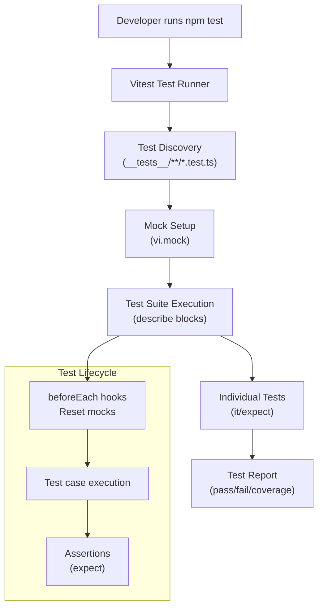
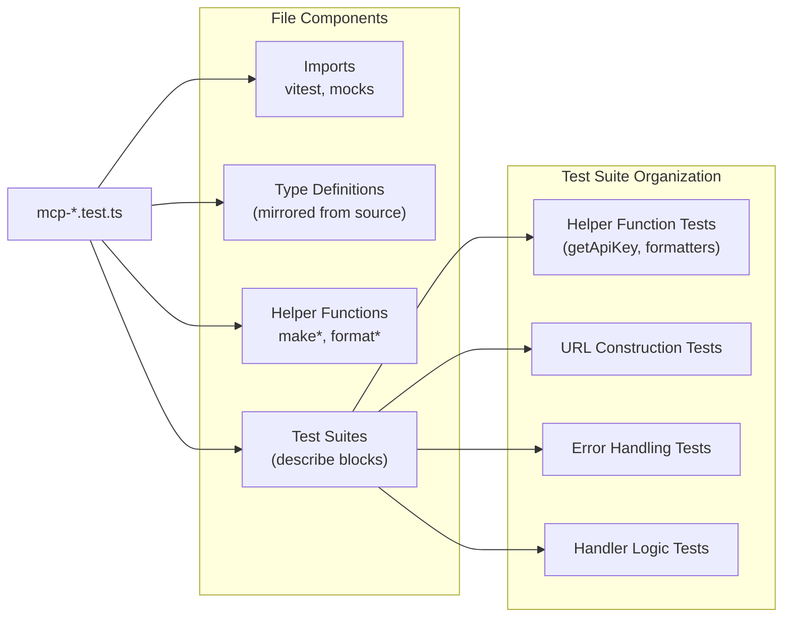
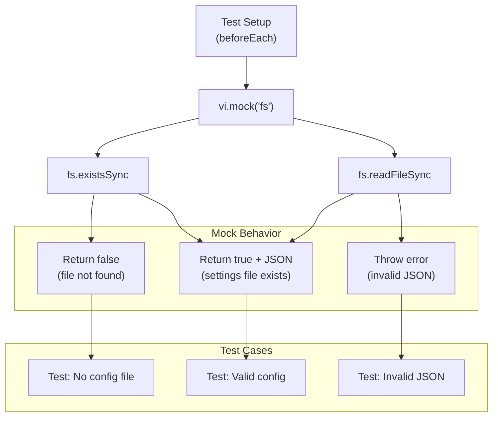
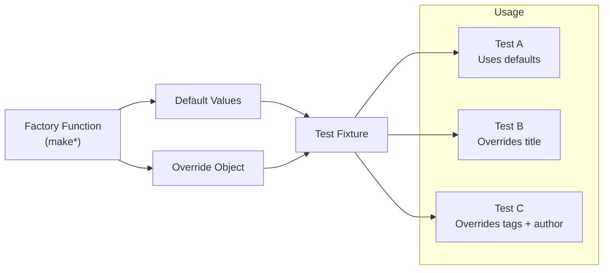
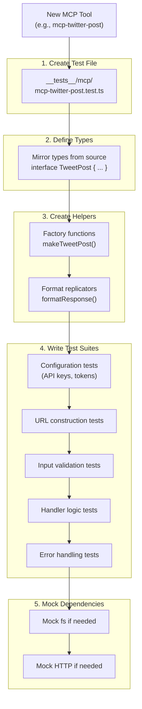
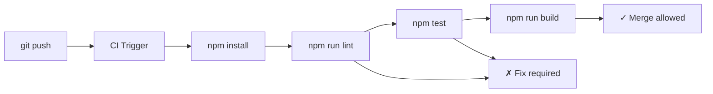

<!-- source: DeepWiki mcp.deepwiki.com · repo Charlie85270/Dorothy · page 14.3 Testing · fetched 2026-10-26 -->

# Testing

<details>
<summary>Relevant source files</summary>

The following files were used as context for generating this wiki page:

- [CLAUDE.md](CLAUDE.md)
- [README.md](README.md)
- [__tests__/mcp/mcp-socialdata.test.ts](__tests__/mcp/mcp-socialdata.test.ts)
- [__tests__/mcp/mcp-vault.test.ts](__tests__/mcp/mcp-vault.test.ts)
- [bun.lock](bun.lock)
- [electron/handlers/memory-handlers.ts](electron/handlers/memory-handlers.ts)
- [landing/public/kanban.png](landing/public/kanban.png)
- [landing/public/ollama-icon.svg](landing/public/ollama-icon.svg)
- [landing/src/app/page.tsx](landing/src/app/page.tsx)
- [screenshots/kanban.png](screenshots/kanban.png)
- [src/app/memory/page.tsx](src/app/memory/page.tsx)
- [src/app/recurring-tasks/page.tsx](src/app/recurring-tasks/page.tsx)
- [src/components/Memory/AgentKnowledgeGraph.tsx](src/components/Memory/AgentKnowledgeGraph.tsx)

</details>


This page documents Dorothy's testing infrastructure for developers contributing MCP tools or core functionality. The current test suite focuses on MCP server tool handlers, validating business logic, formatting functions, and API integration patterns.

For information about using Dorothy's features, see [Overview](#1). For guidance on creating new MCP servers, see [Creating MCP Servers](#14.1).

---

## Test Framework and Organization

Dorothy uses **Vitest 4.0.18** as its testing framework. Tests are located in the `__tests__/` directory, organized by subsystem.

### Directory Structure

```
__tests__/
├── mcp/
│   ├── mcp-socialdata.test.ts    # Twitter/X API integration tests
│   ├── mcp-vault.test.ts         # Document vault tests
│   ├── mcp-kanban.test.ts        # (not shown in provided files)
│   └── mcp-orchestrator.test.ts  # (not shown in provided files)
└── (other test categories)
```

**Current Test Coverage:**
- MCP tool handlers (business logic, formatting, validation)
- API request construction and error handling
- Data transformation and formatting functions
- Configuration file parsing

**Not Currently Covered:**
- UI components (React/Next.js)
- Electron main process integration
- IPC communication
- End-to-end workflows

**Sources:** [__tests__/mcp/mcp-socialdata.test.ts:1-10](), [__tests__/mcp/mcp-vault.test.ts:1-10]()

---

## Test Execution Flow



**Sources:** [__tests__/mcp/mcp-socialdata.test.ts:259-292](), [__tests__/mcp/mcp-vault.test.ts:87-144]()

---

## MCP Tool Test Architecture

### Test File Structure

Each MCP server test file follows a consistent pattern:



**Example Test Suite Organization** (from `mcp-socialdata.test.ts`):

| Suite | Description | Test Count |
|-------|-------------|------------|
| `getApiKey` | API key retrieval from settings file | 4 tests |
| `socialDataRequest URL construction` | Query parameter building | 3 tests |
| `error status code handling` | HTTP error responses (402, 404, 422, 500) | 4 tests |
| `formatTweet` | Tweet formatting for display | 2 tests |
| `twitter_search handler logic` | Search results formatting and pagination | 5 tests |
| `formatTweetDetail` | Detailed tweet formatting with entities | 8 tests |
| `formatUserProfile` | User profile formatting | Multiple tests |

**Sources:** [__tests__/mcp/mcp-socialdata.test.ts:259-403](), [__tests__/mcp/mcp-vault.test.ts:87-252]()

---

## Mock Patterns

### File System Mocking

MCP tool tests mock file system operations to avoid side effects:



**Implementation Example:**

```typescript
// Mock setup at top of file
vi.mock('fs', async (importOriginal) => {
  const actual = await importOriginal<typeof import('fs')>();
  return {
    ...actual,
    existsSync: vi.fn().mockReturnValue(false),
    readFileSync: vi.fn().mockReturnValue(''),
  };
});

// Reset in beforeEach
beforeEach(() => {
  vi.mocked(fs.existsSync).mockReturnValue(false);
  vi.mocked(fs.readFileSync).mockReturnValue('');
});

// Configure per test
it('returns API key from settings file', () => {
  vi.mocked(fs.existsSync).mockReturnValue(true);
  vi.mocked(fs.readFileSync).mockReturnValue(JSON.stringify({
    socialDataApiKey: 'test-api-key-123',
  }));
  expect(getApiKey()).toBe('test-api-key-123');
});
```

**Sources:** [__tests__/mcp/mcp-socialdata.test.ts:11-21](), [__tests__/mcp/mcp-socialdata.test.ts:260-292]()

---

## Test Utilities and Fixtures

### Helper Functions for Test Data

Each test file provides factory functions to create test fixtures:

**`mcp-socialdata.test.ts` Helpers:**

| Function | Purpose | Example Usage |
|----------|---------|---------------|
| `makeTweet()` | Create mock tweet with default values | `makeTweet({ id_str: '123', full_text: 'Hello' })` |
| `makeTweetDetail()` | Create detailed tweet with entities | `makeTweetDetail({ entities: { hashtags: [...] } })` |
| `makeUserProfile()` | Create user profile object | `makeUserProfile({ verified: true })` |
| `formatTweet()` | Replicate formatting logic from source | Used to verify output format |
| `formatTweetDetail()` | Replicate detail formatter | Tests entity inclusion |
| `formatUserProfile()` | Replicate profile formatter | Tests bio/stats formatting |

**`mcp-vault.test.ts` Helpers:**

| Function | Purpose | Example Usage |
|----------|---------|---------------|
| `makeDocument()` | Create vault document fixture | `makeDocument({ title: 'My Report', folder_id: 'folder-1' })` |
| `makeFolder()` | Create folder fixture | `makeFolder({ name: 'Research', parent_id: null })` |
| `makeSearchResult()` | Create FTS5 search result | `makeSearchResult({ snippet: 'highlighted <mark>content</mark>' })` |

**Design Pattern:**



**Example Implementation:**

```typescript
function makeDocument(overrides: Partial<VaultDocument> = {}): VaultDocument {
  return {
    id: 'doc-001-uuid',
    title: 'Test Document',
    content: '# Hello\n\nThis is a test document.',
    folder_id: 'folder-001',
    author: 'test-agent',
    agent_id: 'agent-001',
    tags: '["test","report"]',
    created_at: '2024-01-01T00:00:00.000Z',
    updated_at: '2024-01-01T00:00:00.000Z',
    ...overrides,  // Apply test-specific overrides
  };
}
```

**Sources:** [__tests__/mcp/mcp-socialdata.test.ts:96-168](), [__tests__/mcp/mcp-vault.test.ts:47-85]()

---

## Test Patterns by Category

### 1. Configuration and API Key Tests

**Pattern:** Verify settings file parsing and fallback behavior

```typescript
describe('getApiKey', () => {
  it('returns API key from settings file', () => {
    // Setup: Mock file exists with valid JSON
    // Action: Call getApiKey()
    // Assert: Returns expected key
  });

  it('throws when settings file does not exist', () => {
    // Setup: Mock file doesn't exist
    // Action/Assert: Expect error with specific message
  });

  it('throws when API key is not in settings', () => {
    // Setup: File exists but missing key
    // Action/Assert: Expect error
  });

  it('throws on invalid JSON', () => {
    // Setup: File exists with malformed JSON
    // Action/Assert: Expect error
  });
});
```

**Sources:** [__tests__/mcp/mcp-socialdata.test.ts:266-292]()

---

### 2. URL Construction and Query Parameter Tests

**Pattern:** Verify API request URL building with optional parameters

```typescript
describe('socialDataRequest URL construction', () => {
  it('constructs correct API URL', () => {
    const url = `https://api.socialdata.tools/twitter/search`;
    expect(url).toBe('https://api.socialdata.tools/twitter/search');
  });

  it('appends query params correctly', () => {
    const params = new URLSearchParams();
    params.append('query', 'test');
    params.append('type', 'Latest');
    expect(params.toString()).toBe('query=test&type=Latest');
  });

  it('skips empty or undefined params', () => {
    // Verify only non-empty values are included
  });
});
```

**Sources:** [__tests__/mcp/mcp-socialdata.test.ts:294-333]()

---

### 3. Error Handling Tests

**Pattern:** Verify HTTP status code handling and error messages

```typescript
describe('error status code handling', () => {
  it('returns insufficient credits error for 402', () => {
    const statusCode = 402;
    // Build error message based on status code
    expect(error).toContain('Insufficient');
  });

  it('returns not found error for 404', () => {
    // Verify 404 handling
  });

  it('returns validation error for 422', () => {
    // Verify validation error includes detail
  });

  it('returns generic error for other status codes', () => {
    // Verify fallback error format
  });
});
```

**Sources:** [__tests__/mcp/mcp-socialdata.test.ts:335-381]()

---

### 4. Formatter Tests

**Pattern:** Verify text formatting for display, including conditional sections

```typescript
describe('formatTweetDetail', () => {
  it('formats basic tweet detail correctly', () => {
    const tweet = makeTweetDetail();
    const text = formatTweetDetail(tweet);
    expect(text).toContain('Tweet by @testuser');
    expect(text).toContain('Likes: 25');
    // ... verify all required fields
  });

  it('includes reply context when present', () => {
    const tweet = makeTweetDetail({
      in_reply_to_screen_name: 'otheruser',
    });
    const text = formatTweetDetail(tweet);
    expect(text).toContain('In reply to: @otheruser');
  });

  it('omits reply context when not a reply', () => {
    const tweet = makeTweetDetail({
      in_reply_to_screen_name: null,
    });
    const text = formatTweetDetail(tweet);
    expect(text).not.toContain('In reply to');
  });

  it('includes hashtags when present', () => {
    // Test entity inclusion
  });

  it('includes URLs when present', () => {
    // Test URL entity
  });

  // ... etc for media, mentions
});
```

**Sources:** [__tests__/mcp/mcp-socialdata.test.ts:468-577]()

---

### 5. Handler Logic Tests

**Pattern:** Verify tool handler business logic without actual API calls

```typescript
describe('vault_create_document handler logic', () => {
  it('derives author from CLAUDE_AGENT_NAME env var', () => {
    const agentName = 'my-agent';
    const author = agentName || 'agent';
    expect(author).toBe('my-agent');
  });

  it('falls back to CLAUDE_AGENT_ID when no name', () => {
    // Test fallback chain
  });

  it('formats success message correctly', () => {
    const doc = makeDocument({ id: 'doc-abc', title: 'My Report' });
    const text = `Document created successfully!\nID: ${doc.id}`;
    expect(text).toContain('doc-abc');
  });

  it('shows "None" when no tags provided', () => {
    // Test optional field formatting
  });
});
```

**Sources:** [__tests__/mcp/mcp-vault.test.ts:88-144]()

---

### 6. URL Building with Filters

**Pattern:** Verify query string construction with optional filters

```typescript
describe('vault_list_documents handler logic', () => {
  it('builds URL with folder_id param', () => {
    const folder_id = 'folder-abc';
    let urlPath = '/api/vault/documents';
    const params: string[] = [];
    if (folder_id) params.push(`folder_id=${encodeURIComponent(folder_id)}`);
    if (params.length > 0) urlPath += `?${params.join("&")}`;
    expect(urlPath).toBe('/api/vault/documents?folder_id=folder-abc');
  });

  it('builds URL with both params', () => {
    // Test multiple query params
  });

  it('builds URL without params when no filters', () => {
    // Test base URL
  });
});
```

**Sources:** [__tests__/mcp/mcp-vault.test.ts:253-302]()

---

## Running Tests

### Commands

```bash
# Run all tests
npm test

# Run tests in watch mode (re-run on file changes)
npm test -- --watch

# Run specific test file
npm test __tests__/mcp/mcp-vault.test.ts

# Run tests with coverage
npm test -- --coverage

# Run tests matching pattern
npm test -- -t "formatTweet"
```

### Vitest Configuration

Vitest configuration is typically in `vitest.config.ts` or `vite.config.ts`. Key settings:

- **Test files:** `__tests__/**/*.test.ts`
- **Coverage threshold:** (if configured)
- **Global setup/teardown:** (if configured)
- **Test timeout:** Default 5000ms

**Sources:** [package.json]() (devDependencies includes vitest@4.0.18)

---

## Writing New Tests

### Adding Tests for a New MCP Tool



**Template Structure:**

```typescript
import { describe, it, expect, vi, beforeEach } from 'vitest';

// ============================================================================
// mcp-<tool-name> tool handler tests
// ============================================================================
// Description of what this test file covers

// Mock setup (if needed)
vi.mock('fs', async (importOriginal) => {
  // ...
});

// ---------- Types ----------
interface MyType {
  // Mirror types from source
}

// ---------- Helpers ----------
function makeFixture(overrides: Partial<MyType> = {}): MyType {
  return {
    // defaults
    ...overrides,
  };
}

function formatOutput(data: MyType): string {
  // Replicate formatter from source
}

// ---------- Tests ----------
describe('mcp-<tool-name>', () => {
  beforeEach(() => {
    // Reset mocks
  });

  describe('configuration', () => {
    it('loads settings correctly', () => {
      // Test config parsing
    });
  });

  describe('URL construction', () => {
    it('builds API URL with params', () => {
      // Test URL building
    });
  });

  describe('handler logic', () => {
    it('formats output correctly', () => {
      // Test business logic
    });
  });

  describe('error handling', () => {
    it('handles API errors', () => {
      // Test error cases
    });
  });
});
```

**Sources:** [__tests__/mcp/mcp-socialdata.test.ts:1-50](), [__tests__/mcp/mcp-vault.test.ts:1-50]()

---

### Test Coverage Goals

| Component | Current | Target |
|-----------|---------|--------|
| **MCP Tools** | Partial (vault, socialdata) | 100% (all tools) |
| **Formatters** | Good | Maintain |
| **URL Construction** | Good | Maintain |
| **Error Handling** | Good | Maintain |
| **Configuration Parsing** | Good | Maintain |
| **UI Components** | None | 70%+ |
| **IPC Handlers** | None | 80%+ |
| **Electron Services** | None | 60%+ |

---

## Testing Best Practices

### 1. Test Naming Convention

Use descriptive test names that document behavior:

```typescript
// ✅ Good
it('returns "No documents found" for empty list', () => { ... });
it('includes hashtags when present', () => { ... });
it('omits reply context when not a reply', () => { ... });

// ❌ Avoid
it('works', () => { ... });
it('test1', () => { ... });
```

### 2. Arrange-Act-Assert Pattern

Structure tests clearly:

```typescript
it('formats document summary correctly', () => {
  // Arrange
  const docs = [
    makeDocument({ id: 'abc', title: 'Report A', author: 'agent-1' }),
  ];

  // Act
  const summary = docs.map(d => `- [${d.id.slice(0, 8)}] ${d.title}`).join('\n');

  // Assert
  expect(summary).toContain('[abcdef12]');
  expect(summary).toContain('Report A');
});
```

### 3. Test One Thing

Each test should verify a single behavior:

```typescript
// ✅ Good - separate tests
it('includes folder_id in URL when provided', () => { ... });
it('includes tags in URL when provided', () => { ... });
it('includes both params when both provided', () => { ... });

// ❌ Avoid - testing multiple things
it('builds URL with all params', () => {
  // Tests folder_id, tags, sorting, pagination...
});
```

### 4. Use Factory Functions

Avoid repetitive object creation:

```typescript
// ✅ Good
const tweet = makeTweet({ favorite_count: 1000 });
expect(formatTweet(tweet)).toContain('❤️ 1000');

// ❌ Avoid
const tweet = {
  id_str: '1729591119699124560',
  full_text: 'Hello Twitter!',
  tweet_created_at: '2024-01-15T10:00:00Z',
  user: { ... },  // 10 more lines
  favorite_count: 1000,  // The one thing we care about
  // ... more fields
};
```

**Sources:** [__tests__/mcp/mcp-socialdata.test.ts:96-114](), [__tests__/mcp/mcp-vault.test.ts:47-85]()

---

## Continuous Integration

Tests run automatically on:
- Pre-commit hooks (if configured)
- Pull request creation/update
- Push to main branch
- Release builds

Expected CI pipeline:



---

## Future Test Expansion

### Planned Test Categories

**UI Component Tests:**
- React component rendering
- User interaction simulation
- State management (Zustand)
- Form validation

**Integration Tests:**
- IPC communication flows
- Agent lifecycle (create → start → output → complete)
- Automation pipeline execution
- Kanban task flow

**E2E Tests:**
- Full user workflows (create agent, assign task, view output)
- Multi-agent coordination
- Remote control via Telegram/Slack
- Settings persistence

**Performance Tests:**
- Terminal output streaming with high frequency
- Large vault search operations
- Knowledge graph rendering with 100+ nodes
- Parallel agent execution (10+ concurrent)

---

## Troubleshooting Tests

### Common Issues

**1. Mock not resetting between tests**

```typescript
// Add to beforeEach
beforeEach(() => {
  vi.clearAllMocks();  // Clear call history
  vi.resetAllMocks();  // Reset implementations
});
```

**2. Async test timing out**

```typescript
// Increase timeout for specific test
it('slow operation', { timeout: 10000 }, async () => {
  await slowOperation();
});
```

**3. Snapshot mismatch**

```bash
# Update snapshots if change is intentional
npm test -- -u
```

**4. Module not found in tests**

Check `tsconfig.json` paths and Vitest's `resolve.alias` configuration.

---

**Sources:** [__tests__/mcp/mcp-socialdata.test.ts:1-577](), [__tests__/mcp/mcp-vault.test.ts:1-417](), [package.json]()