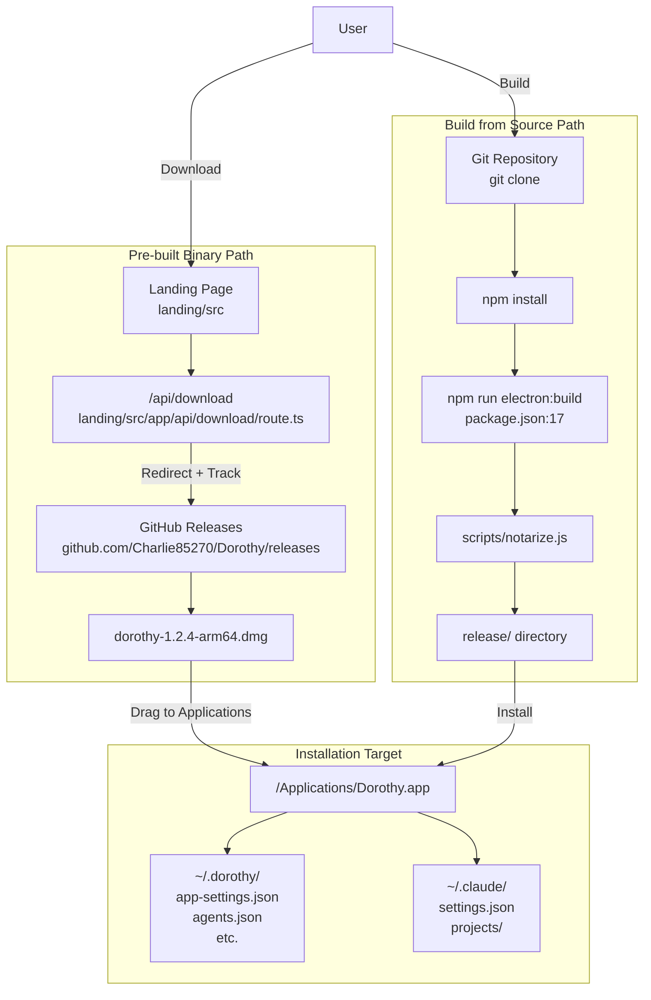
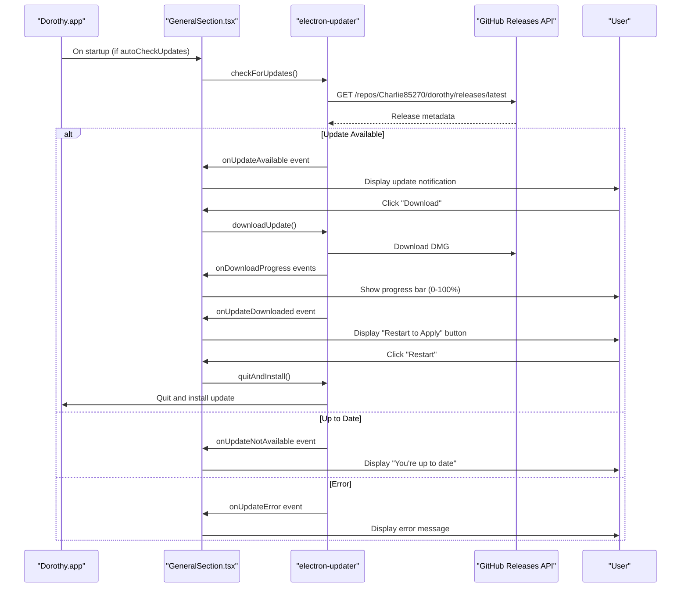

<!-- source: DeepWiki mcp.deepwiki.com · repo Charlie85270/Dorothy · page 2 Installation and Setup · fetched 2026-10-26 -->

# Installation and Setup

<details>
<summary>Relevant source files</summary>

The following files were used as context for generating this wiki page:

- [landing/package-lock.json](landing/package-lock.json)
- [landing/package.json](landing/package.json)
- [landing/src/app/api/download/route.ts](landing/src/app/api/download/route.ts)
- [landing/src/app/api/stats/route.ts](landing/src/app/api/stats/route.ts)
- [landing/src/app/layout.tsx](landing/src/app/layout.tsx)
- [package-lock.json](package-lock.json)
- [package.json](package.json)
- [public/atlassian-jira-svgrepo-com.svg](public/atlassian-jira-svgrepo-com.svg)
- [scripts/notarize.js](scripts/notarize.js)
- [src/components/Settings/GeneralSection.tsx](src/components/Settings/GeneralSection.tsx)

</details>


This page provides an overview of installing Dorothy on your system and completing initial configuration. Dorothy is distributed as pre-built binaries for macOS and can also be built from source for development or customization purposes.

**Scope**: This page covers installation methods, system requirements, and the update mechanism. For detailed download instructions, see [Download and Install](#2.1). For building from source, see [Building from Source](#2.2). For first-time configuration after installation, see [Initial Configuration](#2.3).

---

## Installation Overview

Dorothy offers two primary installation paths:

1. **Pre-built binaries**: Download notarized DMG/ZIP files from GitHub Releases
2. **Build from source**: Clone the repository and run the build pipeline locally

The application is currently packaged for macOS (both arm64 and x64 architectures). After installation, Dorothy automatically checks for updates using `electron-updater` and can install updates with user consent.

---

## System Requirements

Dorothy requires:

| Component | Requirement |
|-----------|-------------|
| **Operating System** | macOS 10.15+ (Catalina or later) |
| **Architecture** | arm64 (Apple Silicon) or x64 (Intel) |
| **Node.js** (for building) | >= 18.18.0 |
| **CLI Tools** | Claude CLI, Codex CLI, or Gemini CLI (at least one provider) |
| **Memory** | 4GB RAM minimum, 8GB recommended |
| **Disk Space** | 500MB for application, additional space for agent projects |

**Sources**: [package.json:1-189](), [package.json:20-135]()

---

## Installation Methods



**Sources**: [landing/src/app/api/download/route.ts:1-49](), [package.json:17-18](), [scripts/notarize.js:1-33]()

---

## Pre-built Binary Installation

The simplest installation method downloads a notarized DMG from GitHub Releases via the landing page API:

1. The `/api/download` endpoint tracks downloads in Upstash Redis
2. Redirects to the latest release URL (currently v1.2.4)
3. User downloads `dorothy-{version}-arm64.dmg`
4. User mounts DMG and drags `Dorothy.app` to `/Applications`

The download URL is hardcoded at [landing/src/app/api/download/route.ts:13]():

```typescript
const DOWNLOAD_URL = 'https://github.com/Charlie85270/dorothy/releases/download/1.2.4/dorothy-1.2.4-arm64.dmg';
```

Download tracking uses Redis keys:
- `downloads:total` - Total download count
- `downloads:daily:{YYYY-MM-DD}` - Daily download count
- `downloads:platform:{platform}` - Platform-specific count

For detailed installation steps, see [Download and Install](#2.1).

**Sources**: [landing/src/app/api/download/route.ts:12-48](), [landing/src/app/api/stats/route.ts:1-50]()

---

## Build from Source Installation

Building Dorothy from source involves a multi-stage pipeline defined in `electron:build` script:

### Build Pipeline Stages

```mermaid
graph LR
    subgraph "Stage 1: UI Build"
        APIBackup["Backup API routes<br/>mv src/app/api src/app/_api_backup"]
        NextBuild["Next.js Build<br/>ELECTRON_BUILD=1 next build"]
        NextOut["out/ directory<br/>Static HTML/JS"]
    end
    
    subgraph "Stage 2: Main Process"
        TSC["TypeScript Compilation<br/>tsc -p electron/tsconfig.json"]
        ElectronDist["electron/dist/main.js"]
    end
    
    subgraph "Stage 3: MCP Servers"
        MCPOrch["mcp-orchestrator<br/>npm install && npm run build"]
        MCPTelegram["mcp-telegram<br/>npm install && npm run build"]
        MCPKanban["mcp-kanban<br/>npm install && npm run build"]
        MCPVault["mcp-vault<br/>npm install && npm run build"]
        MCPSocial["mcp-socialdata<br/>npm install && npm run build"]
        MCPX["mcp-x<br/>npm install && npm run build"]
        MCPWorld["mcp-world<br/>npm install && npm run build"]
    end
    
    subgraph "Stage 4: Packaging"
        ElectronBuilder["electron-builder --mac<br/>package.json:20-135"]
        ASAR["app.asar<br/>Packaged app code"]
        Resources["Resources<br/>MCP bundles, skills, hooks"]
    end
    
    subgraph "Stage 5: Notarization"
        NotarizeScript["scripts/notarize.js<br/>@electron/notarize"]
        AppleCheck["Apple Notarization Service"]
        SignedApp["Notarized Dorothy.app"]
    end
    
    APIBackup --> NextBuild
    NextBuild --> NextOut
    NextOut --> TSC
    TSC --> ElectronDist
    ElectronDist --> MCPOrch
    MCPOrch --> MCPTelegram
    MCPTelegram --> MCPKanban
    MCPKanban --> MCPVault
    MCPVault --> MCPSocial
    MCPSocial --> MCPX
    MCPX --> MCPWorld
    MCPWorld --> ElectronBuilder
    ElectronBuilder --> ASAR
    ElectronBuilder --> Resources
    ASAR --> NotarizeScript
    Resources --> NotarizeScript
    NotarizeScript --> AppleCheck
    AppleCheck --> SignedApp
```



**Sources**: [package.json:17](), [package.json:20-135](), [scripts/notarize.js:1-33]()

### Build Command

```bash
npm run electron:build
```

This script executes the following sequence [package.json:17]():

1. **API Route Backup**: Moves `src/app/api` to `src/app/_api_backup` (API routes aren't needed in Electron)
2. **Next.js Build**: `ELECTRON_BUILD=1 next build` generates static output in `out/`
3. **TypeScript Compilation**: `tsc -p electron/tsconfig.json` compiles main process to `electron/dist/`
4. **MCP Builds**: Seven MCP servers are built sequentially (orchestrator, telegram, kanban, vault, socialdata, x, world)
5. **Electron Builder**: Packages the app into DMG and ZIP formats for macOS
6. **Notarization**: `scripts/notarize.js` submits to Apple for notarization

### electron-builder Configuration

The build configuration is defined at [package.json:20-135]():

| Setting | Value | Purpose |
|---------|-------|---------|
| `appId` | `io.dorothy.app` | Application identifier |
| `productName` | `Dorothy` | Display name |
| `directories.output` | `release` | Output directory |
| `files` | `electron/dist`, `out/`, `skills/`, etc. | Files to include |
| `asarUnpack` | `better-sqlite3`, `node-pty`, etc. | Native modules to exclude from ASAR |
| `extraResources` | MCP server bundles | Bundled as `resources/` |
| `afterSign` | `scripts/notarize.js` | Post-build notarization hook |

### Notarization Process

The `scripts/notarize.js` script handles macOS notarization [scripts/notarize.js:1-33]():

```javascript
// Two authentication methods supported:
// 1. Keychain profile (default): keychainProfile: 'Dorothy'
// 2. Environment variables: APPLE_ID, APPLE_APP_PASSWORD, APPLE_TEAM_ID
```

Notarization requires:
- Apple Developer account
- App-specific password or keychain profile
- Team ID

For complete build instructions and troubleshooting, see [Building from Source](#2.2).

**Sources**: [package.json:17-18](), [scripts/notarize.js:1-33]()

---

## Post-Installation Directory Structure

After installation, Dorothy creates the following directory structure:

```
~/.dorothy/
├── app-settings.json          # Application configuration
├── agents.json                # Agent definitions and state
├── automations.json           # Automation definitions
├── automations-processed.json # Deduplication tracking
├── automations-runs.json      # Execution history
├── kanban-tasks.json          # Kanban board tasks
├── cli-paths.json             # CLI tool locations
├── vault.db                   # SQLite document database
└── scripts/                   # Scheduled task scripts

~/.claude/
├── settings.json              # Claude CLI settings
└── projects/                  # Agent project directories
    └── {project-name}/
        ├── CLAUDE.md          # Project configuration
        └── memory/            # Memory files
            └── MEMORY.md      # Entrypoint memory file

/Applications/Dorothy.app/
└── Contents/
    ├── MacOS/Dorothy          # Executable
    ├── Resources/
    │   ├── app.asar           # Main application code
    │   ├── mcp-orchestrator/  # MCP server bundles
    │   ├── mcp-telegram/
    │   ├── mcp-kanban/
    │   ├── mcp-vault/
    │   ├── mcp-socialdata/
    │   ├── mcp-x/
    │   └── mcp-world/
    └── Frameworks/            # Electron framework
```

These directories are automatically created on first launch.

**Sources**: [package.json:31-105]()

---

## Update Mechanism

Dorothy uses `electron-updater` for automatic updates, implemented in `GeneralSection` component:

### Update Flow



**Sources**: [src/components/Settings/GeneralSection.tsx:85-150]()

### Update Settings

The `GeneralSection` component provides update controls [src/components/Settings/GeneralSection.tsx:173-183]():

- **Auto-check for updates**: Toggle at [GeneralSection.tsx:178-181]()
- **Manual check**: Button at [GeneralSection.tsx:190-201]()
- **Download progress**: Progress bar at [GeneralSection.tsx:239-251]()
- **Quit and install**: Button at [GeneralSection.tsx:274-282]()

### Update State Machine

| State | Description | UI Action |
|-------|-------------|-----------|
| `idle` | No update check performed | Show "Check for Updates" button |
| `checking` | Checking GitHub for updates | Show loading spinner |
| `up-to-date` | Current version is latest | Show green checkmark |
| `update-available` | New version found | Show "Download" button |
| `downloading` | Download in progress | Show progress bar |
| `downloaded` | Update ready to install | Show "Restart to Apply" button |
| `error` | Update check/download failed | Show error message |

The updater configuration is defined in `package.json` [package.json:23-27]():

```json
"publish": {
  "provider": "github",
  "owner": "Charlie85270",
  "repo": "dorothy"
}
```

**Sources**: [src/components/Settings/GeneralSection.tsx:31-150](), [package.json:23-27]()

---

## Initial Configuration

After installation, Dorothy requires minimal configuration to start:

1. **CLI Path Detection**: Dorothy automatically detects installed CLI tools (Claude, Codex, Gemini)
2. **Default Provider**: Select the default CLI provider for automations and scheduled tasks
3. **Data Directory Creation**: `~/.dorothy/` and `~/.claude/` directories are created automatically
4. **Optional Integrations**: Telegram, Slack, JIRA, GitHub can be configured later

The `GeneralSection` component performs CLI detection on mount [src/components/Settings/GeneralSection.tsx:46-56]():

```typescript
useEffect(() => {
  window.electronAPI?.cliPaths?.detect().then((paths) => {
    if (paths) {
      setInstalledProviders({
        claude: !!paths.claude,
        codex: !!paths.codex,
        gemini: !!paths.gemini,
      });
    }
  });
}, []);
```

For detailed first-time configuration steps, see [Initial Configuration](#2.3).

**Sources**: [src/components/Settings/GeneralSection.tsx:46-56](), [src/components/Settings/GeneralSection.tsx:305-326]()

---

## Verification

After installation, verify Dorothy is working correctly:

### Check Application Launch

```bash
# Check if Dorothy.app exists
ls -la /Applications/Dorothy.app

# Launch Dorothy
open /Applications/Dorothy.app
```

### Verify Data Directories

```bash
# Check Dorothy data directory
ls -la ~/.dorothy/

# Check Claude directory
ls -la ~/.claude/
```

### Check Version

In the Dorothy UI, navigate to Settings → General to verify:
- Application version matches downloaded version
- Update check functionality works
- CLI providers are detected

### Verify CLI Tools

Dorothy requires at least one CLI provider. Check installations:

```bash
# Claude CLI
which claude

# Codex CLI (if installed)
which codex

# Gemini CLI (if installed)
which gemini
```

If no CLI tools are found, Dorothy will display warnings in the Settings → CLI Paths section.

**Sources**: [src/components/Settings/GeneralSection.tsx:161-169]()

---

## Troubleshooting

### Application Won't Open on macOS

If Dorothy won't open due to security restrictions:

```bash
# Clear quarantine attribute
xattr -d com.apple.quarantine /Applications/Dorothy.app

# Or right-click → Open (bypasses Gatekeeper)
```

### Build Failures

Common build issues:

| Issue | Solution |
|-------|----------|
| `tsc` errors | Ensure TypeScript 5.x is installed |
| MCP build failures | Run `npm install` in each MCP directory |
| Notarization timeout | Check Apple Developer credentials |
| `electron-builder` errors | Verify all dependencies in `package.json` are installed |

### Update Check Fails

If update checking doesn't work [src/components/Settings/GeneralSection.tsx:93-97]():

```typescript
// Dev mode restriction
if (result?.devMode) {
  setUpdateError('Update check is only available in the production build.');
}
```

Update checking is disabled in development builds. Use production DMG for updates.

**Sources**: [src/components/Settings/GeneralSection.tsx:85-103](), [scripts/notarize.js:1-33]()

---

## Next Steps

After successful installation:

1. **Configure CLI Paths**: See [Initial Configuration](#2.3) for provider setup
2. **Create Your First Agent**: See [Creating and Managing Agents](#3.1)
3. **Set Up Integrations**: See [Telegram Bot](#9.1), [Slack Bot](#9.2), or [Automations](#7)
4. **Explore MCP Tools**: See [MCP Ecosystem](#4) for available tools

**Sources**: [package.json:1-189](), [landing/src/app/api/download/route.ts:1-49](), [src/components/Settings/GeneralSection.tsx:1-346]()

---

