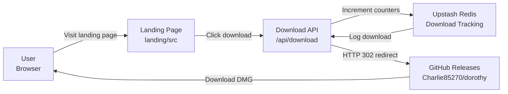
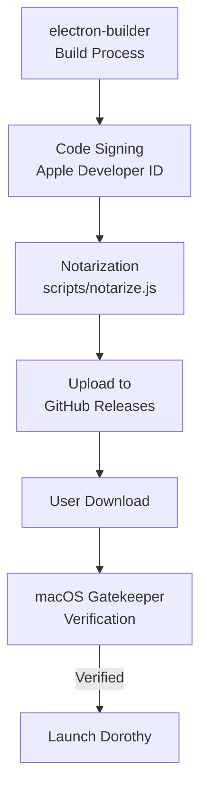
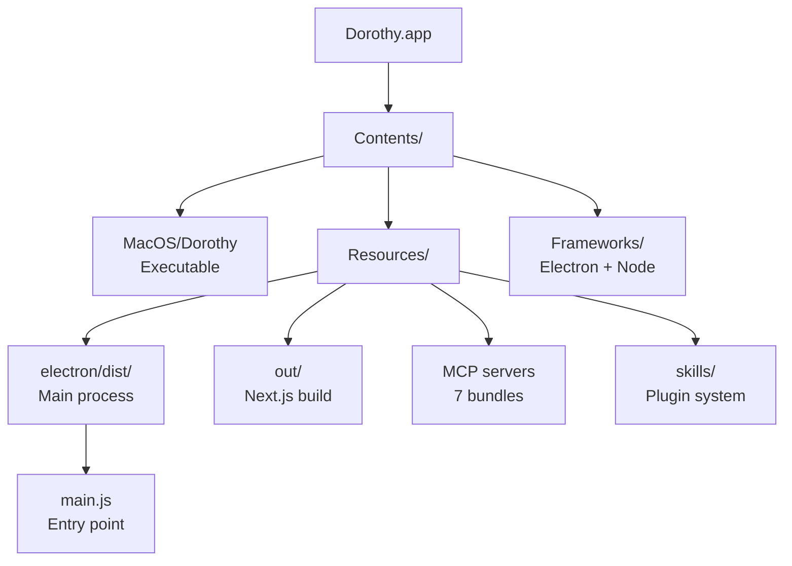
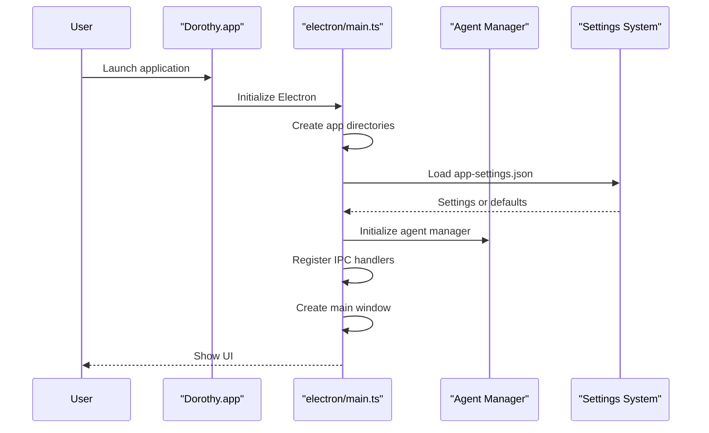
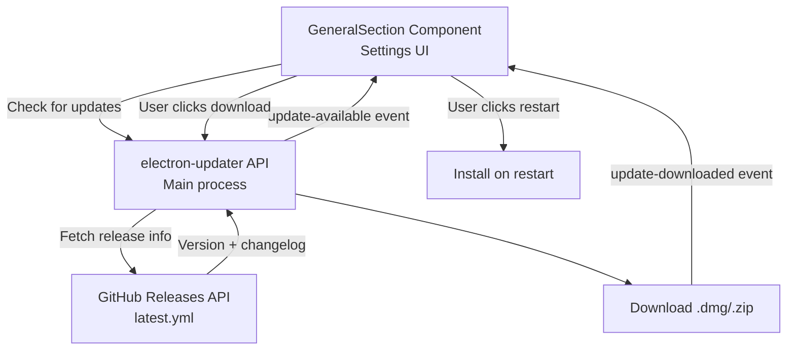
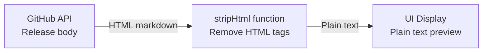

<!-- source: DeepWiki mcp.deepwiki.com · repo Charlie85270/Dorothy · page 2.1 Download and Install · fetched 2026-10-26 -->

# Download and Install

<details>
<summary>Relevant source files</summary>

The following files were used as context for generating this wiki page:

- [landing/package-lock.json](landing/package-lock.json)
- [landing/package.json](landing/package.json)
- [landing/src/app/api/download/route.ts](landing/src/app/api/download/route.ts)
- [landing/src/app/api/stats/route.ts](landing/src/app/api/stats/route.ts)
- [landing/src/app/layout.tsx](landing/src/app/layout.tsx)
- [package-lock.json](package-lock.json)
- [package.json](package.json)
- [public/atlassian-jira-svgrepo-com.svg](public/atlassian-jira-svgrepo-com.svg)
- [scripts/notarize.js](scripts/notarize.js)
- [src/components/Settings/GeneralSection.tsx](src/components/Settings/GeneralSection.tsx)

</details>


This page explains how to download and install pre-built Dorothy binaries. It covers platform support, the download process via the landing page, installation steps, and the integrated auto-update system. For building Dorothy from source, see [Building from Source](#2.2). For first-time setup and configuration, see [Initial Configuration](#2.3).

---

## Platform Support

Dorothy currently distributes official pre-built binaries for **macOS only**. The build system targets both Intel and Apple Silicon architectures.

| Platform | Architecture | Format | Status |
|----------|-------------|--------|--------|
| macOS | arm64 (Apple Silicon) | DMG, ZIP | ✅ Supported |
| macOS | x64 (Intel) | DMG, ZIP | ✅ Supported |
| Windows | - | - | ❌ Not distributed |
| Linux | - | - | ❌ Not distributed |

The application is built using `electron-builder` with macOS-specific configuration including code signing and notarization for Gatekeeper compatibility.

**Sources:** [package.json:108-119]()

---

## System Requirements

- **macOS:** 10.13 (High Sierra) or later
- **Node.js:** >= 18.18.0 (for Electron runtime)
- **Disk Space:** ~200 MB for application bundle
- **Memory:** Minimum 2 GB RAM recommended

---

## Download Process

### Landing Page and Download API

Dorothy uses a Next.js landing page that routes downloads through a tracking API before redirecting to GitHub Releases.



The download API performs the following operations:

1. **Platform Detection**: Extracts `platform` query parameter (defaults to `mac`)
2. **Metrics Tracking**: Increments Redis counters if configured:
   - `downloads:total` - All-time download count
   - `downloads:daily:{YYYY-MM-DD}` - Daily download count
   - `downloads:platform:{platform}` - Per-platform count
   - `downloads:log` - Circular buffer of last 1000 downloads (timestamp, platform, user-agent)
3. **Redirect**: Issues HTTP 302 redirect to GitHub release URL

The hardcoded download URL points to the latest release:

```
https://github.com/Charlie85270/dorothy/releases/download/1.2.4/dorothy-1.2.4-arm64.dmg
```

**Sources:** [landing/src/app/api/download/route.ts:1-49](), [landing/src/app/api/stats/route.ts:1-50]()

### Direct GitHub Releases

Users can also download directly from GitHub Releases without tracking:

```
https://github.com/Charlie85270/Dorothy/releases
```

Each release includes:
- **DMG file**: Disk image with application bundle (drag-to-install)
- **ZIP file**: Compressed application bundle (extract-and-run)
- **Release notes**: Markdown-formatted changelog

**Sources:** [package.json:23-27](), [landing/src/app/api/download/route.ts:13]()

---

## Installation Steps

### macOS Installation (DMG)

The DMG installer provides a standard macOS installation experience:

1. **Download**: Obtain `dorothy-{version}-arm64.dmg` via landing page or GitHub
2. **Mount**: Double-click the DMG file to mount the disk image
3. **Install**: Drag `Dorothy.app` to the `Applications` folder
4. **Eject**: Unmount the DMG after installation
5. **Launch**: Open Dorothy from Applications or Spotlight

### macOS Installation (ZIP)

Alternative installation method using the ZIP archive:

1. **Download**: Obtain `dorothy-{version}-arm64.zip`
2. **Extract**: Unzip the archive (double-click or `unzip` command)
3. **Move**: Move `Dorothy.app` to `/Applications`
4. **Launch**: Open Dorothy

### Gatekeeper and Notarization

Dorothy is code-signed and notarized for macOS Gatekeeper. The notarization process ensures the application can be opened without security warnings.



The notarization script supports two authentication modes:

- **Keychain Profile**: Uses stored credentials (`keychainProfile: 'Dorothy'`)
- **Environment Variables**: Uses `APPLE_ID`, `APPLE_APP_PASSWORD`, `APPLE_TEAM_ID`

**Sources:** [scripts/notarize.js:1-33](), [package.json:107-114]()

---

## Installation Artifacts

Once installed, Dorothy creates the following directory structure:

| Path | Contents | Purpose |
|------|----------|---------|
| `/Applications/Dorothy.app` | Application bundle | Main executable |
| `~/.dorothy/` | Application data | Configuration, agents, automations |
| `~/.claude/` | Claude Code data | Projects, memory, settings |

The application bundle structure:



**Sources:** [package.json:31-48](), [package.json:49-106]()

---

## First Launch

On first launch, Dorothy:

1. **Creates directories**: Initializes `~/.dorothy/` structure
2. **Detects CLI tools**: Scans for `claude`, `codex`, `gemini` in PATH
3. **Prompts for configuration**: Guides user through initial setup (covered in [Initial Configuration](#2.3))

The main process initialization sequence:



**Sources:** [package.json:5]()

---

## Auto-Update System

Dorothy includes an integrated auto-update mechanism using `electron-updater`. The update system checks GitHub Releases for new versions and can download/install updates without requiring a manual re-download.

### Update Flow



### Update States

The update system tracks the following states in `GeneralSection`:

| State | Description | UI Behavior |
|-------|-------------|-------------|
| `idle` | Initial state | "Check for Updates" button enabled |
| `checking` | Checking for updates | Spinner, button disabled |
| `up-to-date` | No updates available | Green checkmark, current version shown |
| `update-available` | New version found | Download button, release notes displayed |
| `downloading` | Downloading update | Progress bar with percentage |
| `downloaded` | Ready to install | "Restart to Apply" button |
| `error` | Update failed | Error message, retry available |

### Auto-Check on Startup

The `autoCheckUpdates` setting controls whether Dorothy automatically checks for updates on launch:

```typescript
// Default behavior: auto-check enabled
appSettings.autoCheckUpdates !== false
```

This setting can be toggled in the General Settings section.

**Sources:** [src/components/Settings/GeneralSection.tsx:1-346](), [package.json:165]()

### Update Events and Handlers

The update system uses IPC events for communication between main and renderer processes:

**Main Process Events (sent to renderer):**
- `update-available` - New version detected
- `update-not-available` - Already on latest version
- `download-progress` - Download progress percentage
- `update-downloaded` - Update ready to install
- `update-error` - Update check/download failed

**Renderer to Main Methods:**
- `updates.check()` - Trigger update check
- `updates.download()` - Start downloading update
- `updates.quitAndInstall()` - Install update and restart
- `updates.openExternal(url)` - Open release URL in browser (fallback)

### Development Mode Limitation

Update checking is disabled in development mode (unpacked apps). The UI displays an error message if update check is attempted in dev mode:

```
"Update check is only available in the production build."
```

**Sources:** [src/components/Settings/GeneralSection.tsx:85-103](), [src/components/Settings/GeneralSection.tsx:106-132]()

### Release Notes Display

When an update is available, the UI displays the first 300 characters of the release notes (HTML stripped):



The `stripHtml` function performs:
1. Convert `<br>` to newlines
2. Convert closing tags to newlines
3. Strip all remaining HTML tags
4. Decode HTML entities
5. Collapse multiple newlines
6. Truncate to 300 characters with ellipsis

**Sources:** [src/components/Settings/GeneralSection.tsx:6-20]()

---

## Verification

To verify a successful installation:

1. **Launch Dorothy**: Application should open without security warnings
2. **Check version**: Settings → General shows current version (e.g., `1.2.4`)
3. **Verify directories**: `~/.dorothy/` directory exists
4. **CLI detection**: Settings → CLI Paths shows detected tools

---

## Troubleshooting

### Gatekeeper Blocks Application

If macOS prevents launching with "unidentified developer" warning:

```bash
# Remove quarantine attribute
xattr -d com.apple.quarantine /Applications/Dorothy.app
```

### Update Check Fails

- **Dev mode**: Update checking is disabled in unpacked apps
- **Network**: Ensure connection to GitHub API
- **Permissions**: Check firewall settings for outbound HTTPS

---

## Next Steps

After installation:
- Proceed to [Initial Configuration](#2.3) to set up CLI paths and integrations
- See [Creating and Managing Agents](#3.1) to start using Dorothy

---

**Sources:** [landing/src/app/api/download/route.ts:1-49](), [package.json:1-189](), [src/components/Settings/GeneralSection.tsx:1-346](), [scripts/notarize.js:1-33](), [landing/src/app/layout.tsx:1-29]()

---

