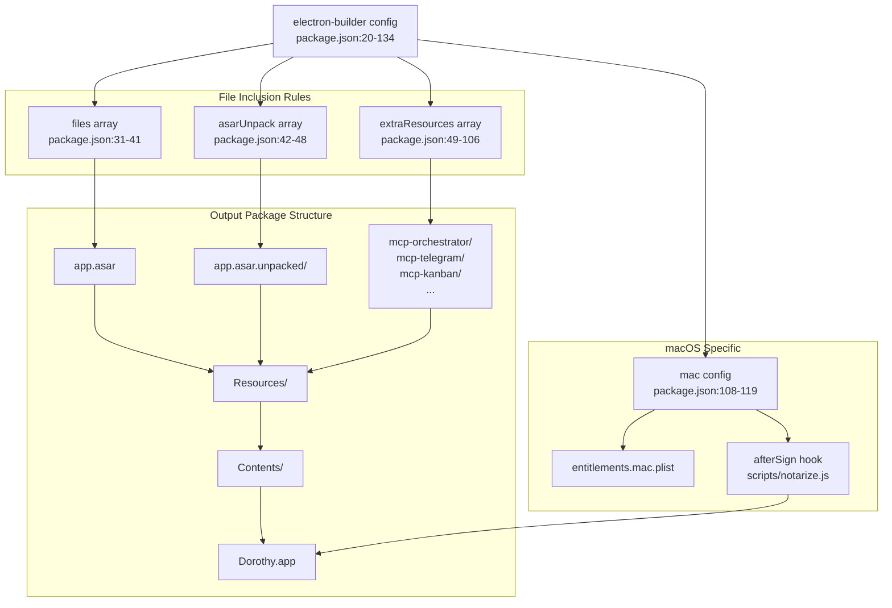
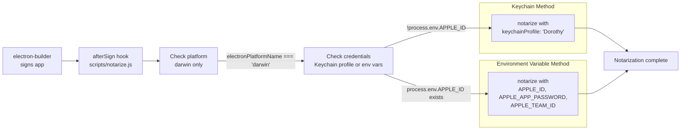
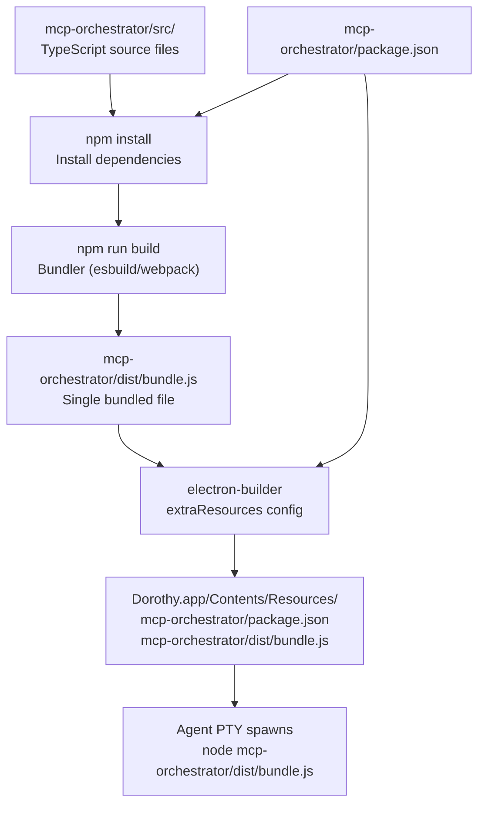
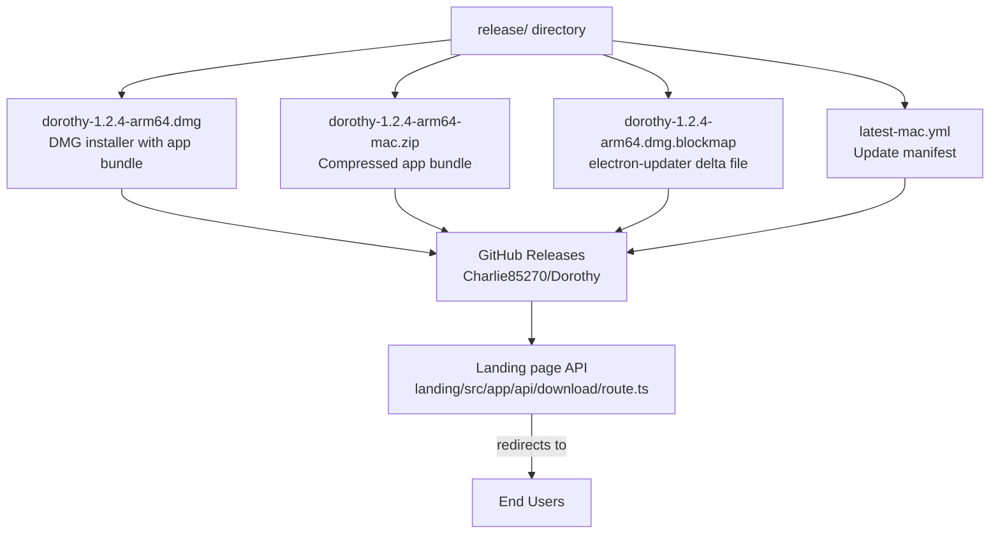
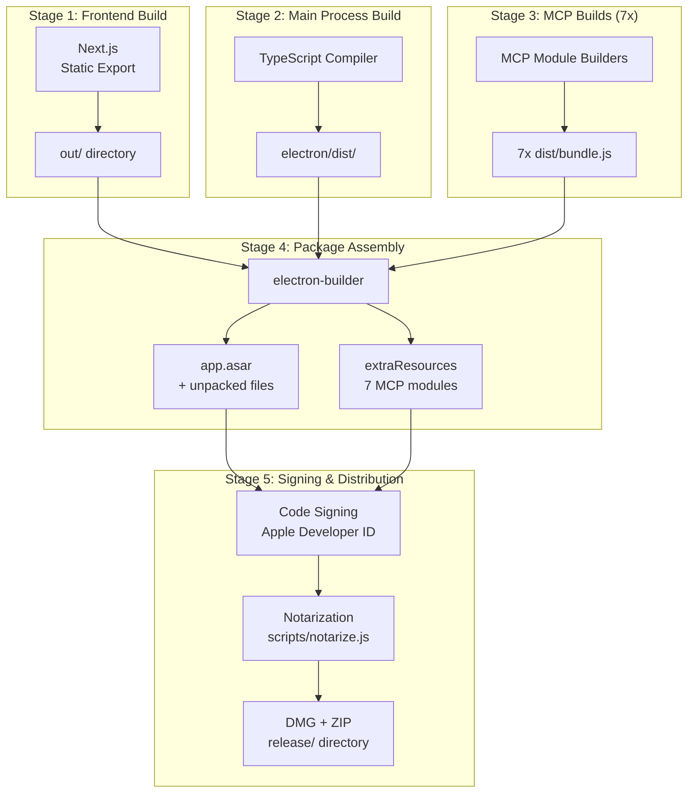

<!-- source: DeepWiki mcp.deepwiki.com · repo Charlie85270/Dorothy · page 2.2 Building from Source · fetched 2026-10-26 -->

# Building from Source

<details>
<summary>Relevant source files</summary>

The following files were used as context for generating this wiki page:

- [landing/src/app/api/download/route.ts](landing/src/app/api/download/route.ts)
- [package-lock.json](package-lock.json)
- [package.json](package.json)
- [public/atlassian-jira-svgrepo-com.svg](public/atlassian-jira-svgrepo-com.svg)
- [scripts/notarize.js](scripts/notarize.js)
- [src/components/Settings/GeneralSection.tsx](src/components/Settings/GeneralSection.tsx)

</details>


This page provides comprehensive instructions for building Dorothy from source code. It covers all dependencies, build scripts, MCP module compilation, and the electron-builder packaging process. For information about downloading pre-built binaries, see [Download and Install](#2.1). For configuration after building, see [Initial Configuration](#2.3).

---

## Prerequisites

Building Dorothy from source requires the following tools and dependencies:

| Tool | Version | Purpose |
|------|---------|---------|
| **Node.js** | ≥18.x | JavaScript runtime |
| **npm** | ≥8.x | Package manager |
| **TypeScript** | ^5.x | TypeScript compiler |
| **Python** | 2.7 or ≥3.6 | Required for native module compilation |
| **Xcode Command Line Tools** | Latest (macOS) | C++ compiler for native modules |
| **Apple Developer Account** | (Optional) | Required for code signing and notarization |

**Native Modules**: Dorothy includes two critical native modules that require compilation:
- `better-sqlite3` - SQLite database interface
- `node-pty` - Pseudo-terminal management for agent execution

These modules are rebuilt during installation using `@electron/rebuild`.

**Sources**: [package.json:1-188](), [package.json:136-166](), [package.json:167-187]()

---

## Build Pipeline Overview

The Dorothy build process consists of multiple stages executed sequentially by the `electron:build` script. This diagram shows the complete flow:

```mermaid
graph TD
    Start["npm run electron:build"]
    BackupAPI["Backup API Routes<br/>src/app/api → src/app/_api_backup"]
    BackupIcon["Backup icon.tsx<br/>src/app/icon.tsx → src/app/_icon_backup.tsx"]
    NextBuild["Next.js Build<br/>ELECTRON_BUILD=1 next build"]
    TSCompile["TypeScript Compilation<br/>tsc -p electron/tsconfig.json"]
    
    MCPOrch["MCP Orchestrator<br/>npm install && npm run build"]
    MCPTelegram["MCP Telegram<br/>npm install && npm run build"]
    MCPKanban["MCP Kanban<br/>npm install && npm run build"]
    MCPVault["MCP Vault<br/>npm install && npm run build"]
    MCPSocial["MCP Social Data<br/>npm install && npm run build"]
    MCPX["MCP X<br/>npm install && npm run build"]
    MCPWorld["MCP World<br/>npm install && npm run build"]
    
    ElectronBuilder["electron-builder --mac"]
    Notarize["scripts/notarize.js<br/>Apple notarization"]
    RestoreAPI["Restore API Routes<br/>_api_backup → api"]
    RestoreIcon["Restore icon.tsx<br/>_icon_backup.tsx → icon.tsx"]
    
    Release["Output: release/ directory<br/>DMG + ZIP artifacts"]
    
    Start --> BackupAPI
    BackupAPI --> BackupIcon
    BackupIcon --> NextBuild
    NextBuild --> TSCompile
    TSCompile --> MCPOrch
    MCPOrch --> MCPTelegram
    MCPTelegram --> MCPKanban
    MCPKanban --> MCPVault
    MCPVault --> MCPSocial
    MCPSocial --> MCPX
    MCPX --> MCPWorld
    MCPWorld --> ElectronBuilder
    ElectronBuilder --> Notarize
    Notarize --> RestoreAPI
    RestoreAPI --> RestoreIcon
    RestoreIcon --> Release
```



**Key Characteristics**:

- **API Route Exclusion**: Next.js API routes in `src/app/api/` are temporarily moved to prevent inclusion in the Electron build, as they are only used by the standalone landing page
- **Sequential MCP Builds**: Seven MCP servers are built in sequence, each producing a bundled `dist/bundle.js`
- **Automatic Restoration**: The bash trap mechanism ensures API routes and icon are restored even if the build fails

**Sources**: [package.json:17]()

---

## Step-by-Step Build Instructions

### 1. Clone and Install Dependencies

```bash
# Clone repository
git clone https://github.com/Charlie85270/Dorothy.git
cd Dorothy

# Install root dependencies
npm install
```

This installs all dependencies listed in [package.json:136-187](), including both production dependencies (Electron runtime, native modules, UI libraries) and development dependencies (build tools, TypeScript, electron-builder).

**Sources**: [package.json:136-187]()

### 2. Build Next.js Frontend

The Next.js build is handled automatically by `electron:build`, but can be run manually:

```bash
# Manual Next.js build (excluding API routes)
mv src/app/api src/app/_api_backup
ELECTRON_BUILD=1 next build
mv src/app/_api_backup src/app/api
```

The `ELECTRON_BUILD=1` environment variable signals to Next.js configuration that this is an Electron build, which may affect output directory (`out/`) and static export settings.

**Output**: `out/` directory containing static Next.js export

**Sources**: [package.json:17]()

### 3. Compile Electron Main Process

```bash
# Compile TypeScript in electron/ directory
tsc -p electron/tsconfig.json
```

This compiles all TypeScript files in the `electron/` directory using the project-specific TypeScript configuration. The main entry point is `electron/main.ts`, which is compiled to `electron/dist/main.js`.

**Output**: `electron/dist/` directory

**Sources**: [package.json:17](), [package.json:5]()

### 4. Build MCP Modules

Each MCP module must be built individually. The build script automates this:

```bash
# Build all MCP modules sequentially
cd mcp-orchestrator && npm install && npm run build && cd ..
cd mcp-telegram && npm install && npm run build && cd ..
cd mcp-kanban && npm install && npm run build && cd ..
cd mcp-vault && npm install && npm run build && cd ..
cd mcp-socialdata && npm install && npm run build && cd ..
cd mcp-x && npm install && npm run build && cd ..
cd mcp-world && npm install && npm run build && cd ..
```

Each MCP module:
- Has its own `package.json` with dependencies
- Produces a single bundled file: `dist/bundle.js`
- Is included in the final package as an `extraResource`

**Sources**: [package.json:17](), [package.json:49-106]()

### 5. Package with electron-builder

```bash
# Create macOS DMG and ZIP
electron-builder --mac
```

This executes electron-builder with the configuration in [package.json:20-134](), producing:
- **DMG installer**: `release/dorothy-1.2.4-arm64.dmg`
- **ZIP archive**: `release/dorothy-1.2.4-arm64-mac.zip`

**Sources**: [package.json:17](), [package.json:20-134]()

### 6. Complete Build Command

To execute the entire build pipeline in one command:

```bash
npm run electron:build
```

This runs the complete bash script defined in [package.json:17](), including all stages and cleanup traps.

**Sources**: [package.json:17]()

---

## Build Configuration Details

This diagram maps the electron-builder configuration structure to the output package:



### File Inclusion Configuration

The `files` array specifies which files are included in the ASAR archive:

| Pattern | Description |
|---------|-------------|
| `electron/dist/**/*` | Compiled main process code |
| `electron/resources/**/*` | Static resources for main process |
| `out/**/*` | Next.js static export |
| `node_modules/**/*` | All dependencies |
| `!node_modules/@next/swc*` | Exclude Next.js SWC binaries |
| `skills/**/*` | Agent skills definitions |
| `hooks/**/*` | Hook scripts |

**Sources**: [package.json:31-41]()

### ASAR Unpack Configuration

Certain files must be unpacked from the ASAR archive to function correctly:

```javascript
"asarUnpack": [
  "out/**/*",              // Next.js output (static files)
  "hooks/**/*",            // Hook execution scripts
  "electron/resources/**/*", // Resources needed at runtime
  "node_modules/better-sqlite3/**/*", // Native SQLite module
  "node_modules/node-pty/**/*"        // Native PTY module
]
```

**Rationale**: Native modules with `.node` binaries and dynamic resources cannot be loaded from within the ASAR archive.

**Sources**: [package.json:42-48]()

### Extra Resources Configuration

MCP modules are included as extra resources, placed in `Resources/` alongside the ASAR:

```javascript
{
  "from": "mcp-orchestrator",
  "to": "mcp-orchestrator",
  "filter": ["package.json", "dist/bundle.js"]
}
```

Each MCP module contributes only:
- `package.json` - Module metadata
- `dist/bundle.js` - Bundled code

This pattern repeats for all seven MCP servers: orchestrator, telegram, kanban, vault, socialdata, x, and world.

**Sources**: [package.json:49-106]()

---

## macOS Signing and Notarization

Dorothy implements Apple's code signing and notarization requirements for distribution outside the Mac App Store.

### Code Signing Configuration

```javascript
"mac": {
  "category": "public.app-category.developer-tools",
  "icon": "public/icon.icns",
  "hardenedRuntime": true,
  "gatekeeperAssess": false,
  "entitlements": "build/entitlements.mac.plist",
  "entitlementsInherit": "build/entitlements.mac.plist"
}
```

**Key Settings**:
- **hardenedRuntime**: Enables hardened runtime with entitlements
- **entitlements**: Specifies required permissions (e.g., network access, JIT compilation)
- **gatekeeperAssess**: Disabled to allow notarization without Gatekeeper assessment

**Sources**: [package.json:108-119]()

### Notarization Process

The notarization script at `scripts/notarize.js` executes after signing:



**Implementation Details**:

The notarization script supports two authentication methods:

1. **Keychain Profile** (preferred for local builds):
   ```javascript
   await notarize({
     appPath: `${appOutDir}/${appName}.app`,
     keychainProfile: 'Dorothy',
   });
   ```

2. **Environment Variables** (for CI/CD):
   ```javascript
   await notarize({
     appPath: `${appOutDir}/${appName}.app`,
     appleId: process.env.APPLE_ID,
     appleIdPassword: process.env.APPLE_APP_PASSWORD,
     teamId: process.env.APPLE_TEAM_ID,
   });
   ```

The script automatically selects the method based on whether `APPLE_ID` is set.

**Sources**: [scripts/notarize.js:1-32](), [package.json:107]()

### Setting Up Notarization Credentials

**Option 1: Keychain Profile (Recommended)**

```bash
# Store credentials in keychain
xcrun notarytool store-credentials "Dorothy" \
  --apple-id "your@email.com" \
  --team-id "TEAM_ID" \
  --password "app-specific-password"
```

**Option 2: Environment Variables**

```bash
export APPLE_ID="your@email.com"
export APPLE_APP_PASSWORD="app-specific-password"
export APPLE_TEAM_ID="TEAM_ID"
```

**Sources**: [scripts/notarize.js:8-26]()

---

## MCP Module Build Architecture

The MCP module build process is critical to Dorothy's functionality. This diagram shows the build flow for a single MCP module:



**Module List and Purposes**:

| Module | Tools Count | Primary Purpose |
|--------|-------------|-----------------|
| `mcp-orchestrator` | 26+ | Agent management, messaging, scheduling, automations |
| `mcp-telegram` | 4 | Telegram media support |
| `mcp-kanban` | 8 | Task management |
| `mcp-vault` | 10 | Document and folder management |
| `mcp-socialdata` | 5 | Twitter API integration |
| `mcp-x` | - | X/Twitter posting |
| `mcp-world` | - | 3D world visualization |

Each module is built independently but follows the same pattern:
1. Install dependencies in module directory
2. Run module-specific build script
3. Produce `dist/bundle.js`
4. Copy to application resources

**Sources**: [package.json:17](), [package.json:49-106]()

---

## Build Artifacts and Distribution

After a successful build, the following artifacts are created:



**Distribution Flow**:

1. **Upload to GitHub Releases**: Artifacts are manually uploaded to GitHub Releases with version tag (e.g., `v1.2.4`)
2. **Landing Page API**: The Next.js landing page at `/api/download` tracks downloads and redirects to GitHub
3. **Auto-Updater Integration**: The `latest-mac.yml` file enables the electron-updater system to check for updates

**Sources**: [package.json:20-134](), [landing/src/app/api/download/route.ts:1-48]()

---

## Development vs. Production Builds

### Development Build

For active development, use the `electron:dev` script:

```bash
npm run electron:dev
```

This runs:
1. Next.js development server (`npm run dev`)
2. TypeScript compilation in watch mode
3. Electron launch pointed at `localhost:3000`

**Characteristics**:
- Hot module reloading
- Source maps enabled
- No packaging or signing
- Faster iteration cycle

**Sources**: [package.json:15-16]()

### Production Build

The `electron:build` script creates a full production build:

```bash
npm run electron:build
```

**Characteristics**:
- Minified and optimized code
- ASAR packaging
- Code signing and notarization
- Slower build time (~5-10 minutes)

**Sources**: [package.json:17]()

---

## Troubleshooting Common Build Issues

### Native Module Compilation Failures

**Symptom**: Errors mentioning `better-sqlite3` or `node-pty` during `npm install`

**Solution**:
```bash
# Ensure Python and build tools are installed
xcode-select --install  # macOS

# Rebuild native modules for Electron
npm run postinstall  # If configured
# or manually:
./node_modules/.bin/electron-rebuild
```

**Sources**: [package.json:136-166]()

### MCP Module Build Failures

**Symptom**: Individual MCP module fails to build

**Solution**:
```bash
# Build individual module to see detailed error
cd mcp-orchestrator
npm install
npm run build
```

Check for:
- Missing dependencies
- TypeScript errors
- Bundler configuration issues

**Sources**: [package.json:17]()

### Notarization Timeouts

**Symptom**: Notarization script hangs or times out

**Solution**:
- Verify Apple credentials are correct
- Check Apple Developer account status
- Use environment variables for more visibility:
  ```bash
  export DEBUG=electron-notarize*
  npm run electron:build
  ```

**Sources**: [scripts/notarize.js:27-29]()

### API Route Inclusion Error

**Symptom**: Build fails with errors about Next.js API routes being incompatible with Electron

**Solution**: The `electron:build` script should automatically exclude API routes. If the trap fails, manually restore:
```bash
mv src/app/_api_backup src/app/api
mv src/app/_icon_backup.tsx src/app/icon.tsx
```

**Sources**: [package.json:17]()

---

## Build System Architecture Summary

The complete build system can be visualized as a multi-stage pipeline:



**Build Time Estimates**:

| Stage | Duration | Notes |
|-------|----------|-------|
| Frontend Build | 30-60s | Depends on Next.js cache |
| Main Process Compile | 10-15s | TypeScript compilation |
| MCP Builds (all 7) | 2-3 min | Sequential builds |
| electron-builder Package | 1-2 min | ASAR creation, file copy |
| Code Signing | 10-20s | Certificate validation |
| Notarization | 2-5 min | Apple server processing |
| **Total** | **6-10 min** | Full production build |

**Sources**: [package.json:1-188]()

---

